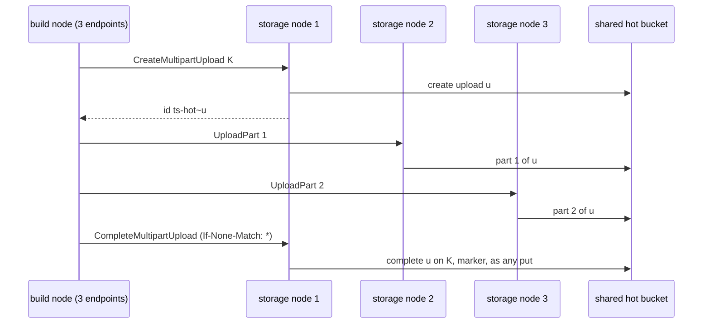

# One store, several endpoints: the S3 client sends each request to the next endpoint in turn

Status: **built in the pull request that adds `endpoints` (tierstore#229); failover on a failed connect added in section 8.** This document replaces the first version of #228, which also planned a random mode, failover, down marks and metrics; none of that is decided (section 7). Terms in bold are those of [tierstore-design.md](tierstore-design.md) and [put-without-lock.md](put-without-lock.md).

## 1. The problem

The lab has three storage nodes. Each runs tierstore with `[hot_store]` and `[cold_store]` over the **same** hot and cold buckets, and any of them serves any request with the same answers (I3 of put-without-lock.md: strong read-after-write, after-delete and after-list through any proxy over the same hot and cold pair). A build node's `[cold_store]` stands for "the storage nodes", but `cold_store.endpoint` takes one address, so one node is used and the other two idle.

What the user wants: the same thing as now, with N connections, and the requests rotating over them.

## 2. The design

| | Before | After |
|---|---|---|
| File | `endpoint = "http://storage-1:9000"` | `endpoints = ["http://storage-1:9000", "http://storage-2:9000", "http://storage-3:9000"]` |
| Requests | all to storage-1 | request n goes to endpoint n modulo N |
| A file with `endpoint` | works | works unchanged; a list of one is the same as `endpoint` |

- `[hot_store]` and `[cold_store]` of kind `s3` take `endpoint` or `endpoints`, exactly one of the two. An empty list, an entry twice, and both keys are refused when the file is loaded. `endpoints` in a `memory` or `dir` tier is refused as `endpoint` is.
- The S3 client (`crates/objstore-s3`, `S3Store::new_rotating`) keeps the endpoints and one atomic counter. Every signed request takes the next number, so the choice is per request, not per connection, and a read that the client sends again goes to the next endpoint.
- Each request is signed for the `Host` of the endpoint it goes to. One `reqwest::Client` serves all of them and pools connections per host:port, so each endpoint has its own pool.
- Nothing above the S3 client knows there is more than one endpoint: the `Backend` and `ObjectStore` interfaces, the markers, the locks, every stored format and the fronts are unchanged. The marks bucket of the hot tier is a second handle on the same store and shares the endpoints. `format-epoch --hot-endpoint` stays one address.
- One new `[server]` key, `server.s3_endpoint_attempts` (section 8); no other.

A request that fails fails as it does today, with the same error, except one whose connection to its endpoint could not be made: that request never reached a store and goes to the next endpoint (section 8). The caller's retry of any other failure is a new request and goes to the next endpoint because of the rotation.

## 3. What the design rests on

tierstore is a proxy on top of stores and does not probe them. The endpoints of one list must be **front doors of one logical store**: the same bucket and objects, S3's strong read-after-write, read-after-delete and read-after-list whichever endpoint answers, the same atomic conditional writes (create-only and `If-Match`), and the same credentials file, region and bucket name. The nodes of one MinIO cluster meet it, and so do several tierstore storage nodes over the same hot and cold buckets in one release (put-without-lock.md 2.2 for the MinIO measurements). Independently replicated stores, or two stores that merely hold copies, do not; listing them is the operator's mistake, as with a store that ignores `If-None-Match`, and the docs say so.

## 4. Any storage node can serve any request

**Multipart uploads.** `tiered/uploads.rs` says the proxy "keeps no state of an upload": the upload lives in the tier that holds it, and the id says which (`ts-hot~<hot store id>` for the hot tier, the cold store's own id otherwise). Every call that follows the id (`send_part`, `complete_on_entry` or `complete_marked`, `drop_upload`, `list_upload_parts`) routes by that prefix and calls the shared store. So the parts of one upload may go to different nodes, the completion may go to a node that took no part, and the abort of an upload whose creator died goes to a live node. Conditions: the nodes of one set run one release (the `ts-hot~` prefix), and agree on the format phase with the same marks bucket, as put-without-lock.md 4.1 already requires.

**Read-after-write.** An acknowledgement comes from the shared stores: a put after its object and marker were written to the hot store and the marks bucket (5.1), a delete after its `gone` marker (5.6). A later request reads the shared stores too: a hot hit is the hot object (I12), a hot miss reads the marker with the cold object (I9), a listing is the union of both tiers plus a page of markers (5.8). What a proxy keeps in memory (usage level, format object, its own locks) is not object or marker state that a read or write trusts without re-reading. I2 and I3 quantify over requests, not over proxies, and the model of put-without-lock.md already has two proxies interleaving, so the node that serves a request is not a variable of the protocol and no protocol changes here. A listing's continuation token is the hex of the key it continues after, so the pages of one listing may go to different nodes.

**The one staleness is the cache's.** A build node serves a hit from disk with no upstream call, so another node's overwrite or delete is seen only after `local_cache.revalidate_after`. That is independent of the endpoints.

**A create-only put whose answer was lost** (the node landed the key and died before answering): the retry goes to the next node and is answered 412 because the key is there, which is S3's own answer, and the caller decides what it means as it does with one node.

## 5. Cost

No extra store request: the client sends the same requests as before, to a different address. Latency per operation is that of the endpoint chosen; with identical nodes it is the same as before. Each endpoint holds its own connections, so N endpoints hold up to N times the idle connections (`pool_idle_timeout` applies to each).

## 6. Tests and compatibility

Tests, in the pull request: nine requests over three loopback fakes that verify the signature against the Host land round robin; one entry behaves as `endpoint`; config refusals (both, empty, repeated, neither, a list in a `dir` or `memory` tier); and a compat test that the release before refuses `endpoints` in a storage node's `[hot_store]` and reads the same file with `endpoint` (B8: the key is additive, and a host that may roll back keeps `endpoint` until every process has this release).

## 7. Later work, not decided

None of these is part of this design, and none is a decision against it; each would be its own design and pull request.

- **Down-marking** of an endpoint that did not answer (failover on a failed connect is built, section 8).
- **A random choice** in place of the rotation.
- **Least-in-flight choice**, if the endpoints differ in speed.
- **Metrics per endpoint** and a line at start that names them.
- **TLS** to an endpoint (not built for a single endpoint either).

## 8. Failover on a connection that could not be made

The user needs a node down not to fail a third of the requests (the next lab has three storage nodes). The client sends a request again, to the next endpoint, only when the request certainly never reached a store. No health check, no down mark, no probe.

| Failure of a send | Sent again? | Why |
|---|---|---|
| connect refused, no route, name not resolved, connect timeout (reqwest `is_connect`) | yes, up to `server.s3_endpoint_attempts` sends (default 3) | hyper-util reports this kind only for an error of the connector, which runs before the request is given to a connection: no byte of it was written |
| timeout of the whole request or of the answer's head; reset or closed after the request was handed over; "connection closed before message completed"; any HTTP status (5xx included) | no | the store may have done the work; a conditional PUT that landed and is sent again breaks the lock-free marker protocol |

"Connection closed before message completed" (hyper `IncompleteMessage`, shown as `client error (SendRequest)`) is the answer to a request written to a pooled connection that the store had already closed or died on. hyper cannot tell that from a store that read the request, did the work and died. When hyper knows the request was not written to a reused connection it returns the request to hyper-util, whose client already sends it on a new connection; the case that reaches the caller is the one that is not provable, so it is not sent again here. The remedy for it is the one in place: `server.s3_pool_idle_timeout` shorter than the store's idle close, and the caller's retry.

Bodies. A `Bytes` body (small puts, the parts of a multipart upload) is cloned per send, which copies nothing, and each send is signed again for the `Host` it goes to. A body streamed from the client (`put_stream`, one streamed PUT) is not buffered: its source is shared by the sends of the request, and a send is repeated only after a failed connect, when the body was not yet polled, so the next send reads it from its start. A streamed body that has been read is never replayed; if it were, the new body would end short of its length and fail.

With one endpoint a send that failed to connect is repeated to the same address on a new connection, up to the same bound.
