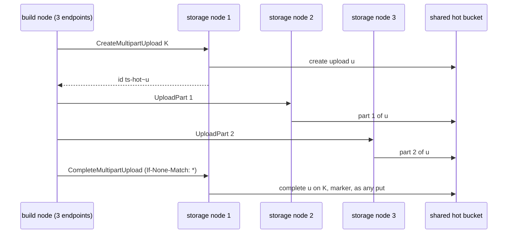

# One store, several endpoints: the S3 client sends each request to the next endpoint in turn

Status: **built: the round robin over `endpoints` (komira-ai/tierstore#229) and failover on a failed connect, section 8 (komira-ai/tierstore#232). TLS to an endpoint is built too (komira-ai/tierstore#465). An endpoint that stalled or refused a connection is set aside for a while and probed, and the client says per endpoint whether it is aside, section 9 (komira-ai/tierstore#635).** A random mode, least-in-flight choice and the export of the per-endpoint state as a tierstore metric are not built and not decided (section 7). This document replaces the first version (komira-ai/tierstore#228), which also planned a random mode, failover, down marks and metrics; only failover was later decided and built. Terms in bold are those of [tierstore-design.md](tierstore-design.md) and [put-without-lock.md](put-without-lock.md).

## 1. The problem

The lab has three storage nodes. Each runs tierstore with `[hot_store]` and `[cold_store]` over the **same** hot and cold buckets, and any of them serves any request with the same answers (I3 of put-without-lock.md: strong read-after-write, after-delete and after-list through any proxy over the same hot and cold pair). A build node's `[cold_store]` stands for "the storage nodes", but `cold_store.endpoint` takes one address, so one node is used and the other two idle.

What the user wants: the same thing as now, with N connections, and the requests rotating over them.

## 2. The design

| | Before | After |
|---|---|---|
| File | `endpoint = "http://storage-1:9000"` | `endpoints = ["http://storage-1:9000", "http://storage-2:9000", "http://storage-3:9000"]` |
| Requests | all to storage-1 | request n goes to endpoint n modulo N |
| A file with `endpoint` | works | works unchanged; a list of one is the same as `endpoint` |

- `[hot_store]` and `[cold_store]` of kind `s3` take `endpoint` or `endpoints`, exactly one of the two. An empty list, an entry twice, and both keys are refused when the file is loaded. `endpoints` in a `memory` or `dir` tier is refused as `endpoint` is.
- The S3 client (`crates/objstore-s3`, `S3Store::new_rotating`) keeps the endpoints and the position after the endpoint it picked last. Every request takes the next endpoint in turn, so the choice is per request, not per connection, and a read that the client sends again goes to the next endpoint. An endpoint set aside (section 9) is skipped.
- Each request is signed for the `Host` of the endpoint it goes to. One `reqwest::Client` serves all of them and pools connections per host:port, so each endpoint has its own pool.
- Nothing above the S3 client knows there is more than one endpoint: the `Backend` and `ObjectStore` interfaces, the markers, the locks, every stored format and the fronts are unchanged. The marks bucket of the hot tier is a second handle on the same store and shares the endpoints. `format-epoch --hot-endpoint` stays one address.
- One new `[server]` key, `server.s3_endpoint_attempts` (section 8); no other.

A request that fails fails as it does today, with the same error, except one whose connection to its endpoint could not be made: that request never reached a store and goes to the next endpoint (section 8). The caller's retry of any other failure is a new request and goes to the next endpoint because of the rotation.

## 3. What the design rests on

tierstore is a proxy on top of stores and does not probe them. The endpoints of one list must be **front doors of one logical store**: the same bucket and objects, S3's strong read-after-write, read-after-delete and read-after-list whichever endpoint answers, the same atomic conditional writes (create-only and `If-Match`), and the same credentials file, region and bucket name. The nodes of one MinIO cluster meet it, and so do several tierstore storage nodes over the same hot and cold buckets in one release (put-without-lock.md 2.2 for the MinIO measurements). Independently replicated stores, or two stores that merely hold copies, do not; listing them is the operator's mistake, as with a store that ignores `If-None-Match`, and the docs say so.

## 4. Any storage node can serve any request

**Multipart uploads.** `tiered/uploads.rs` says the proxy "keeps no state of an upload": the upload lives in the tier that holds it, and the id says which (`ts-hot~<hot store id>` for the hot tier, the cold store's own id otherwise). Every call that follows the id (`send_part`, `complete_on_entry` or `complete_marked`, `drop_upload`, `list_upload_parts`) routes by that prefix and calls the shared store. So the parts of one upload may go to different nodes, the completion may go to a node that took no part, and the abort of an upload whose creator died goes to a live node. Conditions: the nodes of one set run one release (the `ts-hot~` prefix), and agree on the format phase with the same marks bucket, as put-without-lock.md 4.1 already requires.

**Read-after-write.** An acknowledgement comes from the shared stores: a put after its object and marker were written to the hot store and the marks bucket (5.1), a delete after its `gone` marker (5.6). A later request reads the shared stores too: a hot hit is the hot object (I12), a hot miss reads the marker with the cold object (I9), a listing is the union of both tiers plus a page of markers (5.8). What a proxy keeps in memory (usage level, format object, its own locks) is not object or marker state that a read or write trusts without re-reading. I2 and I3 quantify over requests, not over proxies, and the model of put-without-lock.md already has two proxies interleaving, so the node that serves a request is not a variable of the protocol and no protocol changes here. A listing's continuation token is the hex of the key it continues after, so the pages of one listing may go to different nodes.

**The one staleness is the cache's.** A build node serves a hit from disk with no upstream call, so another node's overwrite or delete is seen only after `local_cache.revalidate_after`. That is independent of the endpoints.

**A create-only put whose answer was lost** (the node landed the key and died before answering): the retry goes to the next node and is answered 412 because the key is there, which is S3's own answer, and the caller decides what it means as it does with one node.

## 5. Cost

No extra store request: the client sends the same requests as before, to a different address. Latency per operation is that of the endpoint chosen; with identical nodes it is the same as before. Each endpoint holds its own connections, so N endpoints hold up to N times the idle connections (`pool_idle_timeout` applies to each).

## 6. Tests and compatibility

Tests, in the pull request: nine requests over three loopback fakes that verify the signature against the Host land round robin; one entry behaves as `endpoint`; config refusals (both, empty, repeated, neither, a list in a `dir` or `memory` tier); and a compat test that the release before refuses `endpoints` in a storage node's `[hot_store]` and reads the same file with `endpoint` (B8: the key is additive, and a host that may roll back keeps `endpoint` until every process has this release).

Section 4 has its tests in `crates/tierstore/tests/tierstore/s3_multi_endpoint.rs` (komira-ai/tierstore#515), over fronts of one loopback S3 service, each logging the requests it took: one upload's creation, two parts and completion through three endpoints land creation and completion on the first and one part on each of the others, and the object has both parts in order; an abort at an endpoint that did not create the upload removes it for all; with one endpoint refusing connections the part whose turn it is lands on the next; a listing read two keys a page goes to the endpoints in turn and gives each key once; and an upload of the hot tier begun through one proxy is continued, completed or aborted through others, each over its own front.

## 7. Later work, not decided

None of these is part of this design, and none is a decision against it; each would be its own design and pull request.

- **Down-marking** of an endpoint that did not answer: since built (section 9), as a time aside and a probe.
- **A random choice** in place of the rotation.
- **Least-in-flight choice**, if the endpoints differ in speed.
- **Metrics per endpoint** and a line at start that names them. The client gives the state of each endpoint (`S3Store::endpoints`, section 9) and logs each change of it; its export as a tierstore metric is not built.
- **TLS** to an endpoint: since built for every endpoint, one or several (`https://`,
  `crates/objstore-s3/src/s3/endpoint.rs`).

## 8. Failover on a connection that could not be made

The user needs a node down not to fail a third of the requests (the next lab has three storage nodes). The client sends a request again, to the next endpoint, only when the request certainly never reached a store, or when it is a read whose endpoint stalled and was set aside (section 9).

| Failure of a send | Sent again? | Why |
|---|---|---|
| connect refused, no route, name not resolved, connect timeout (reqwest `is_connect`) | yes, up to `server.s3_endpoint_attempts` sends (default 3) | hyper-util reports this kind only for an error of the connector, which runs before the request is given to a connection: no byte of it was written |
| timeout of the answer's head of a GET or HEAD whose endpoint was then set aside (section 9) | yes, within the same bound | a read changes nothing, and the next send goes to another endpoint, not back to the one that stalled |
| timeout of the whole request or of the answer's head of any other request; reset or closed after the request was handed over; "connection closed before message completed"; any HTTP status (5xx included) | no | the store may have done the work; a conditional PUT that landed and is sent again breaks the lock-free marker protocol |

"Connection closed before message completed" (hyper `IncompleteMessage`, shown as `client error (SendRequest)`) is the answer to a request written to a pooled connection that the store had already closed or died on. hyper cannot tell that from a store that read the request, did the work and died. When hyper knows the request was not written to a reused connection it returns the request to hyper-util, whose client already sends it on a new connection; the case that reaches the caller is the one that is not provable, so it is not sent again here. The remedy for it is the one in place: `server.s3_pool_idle_timeout` shorter than the store's idle close, and the caller's retry.

Bodies. A `Bytes` body (small puts, the parts of a multipart upload) is cloned per send, which copies nothing, and each send is signed again for the `Host` it goes to. A body streamed from the client (`put_stream`, one streamed PUT) is not buffered: its source is shared by the sends of the request, and a send is repeated only after a failed connect, when the body was not yet polled, so the next send reads it from its start. A streamed body that has been read is never replayed; if it were, the new body would end short of its length and fail.

With one endpoint a send that failed to connect is repeated to the same address on a new connection, up to the same bound.

## 9. An endpoint that stalled or refused a connection is set aside

Before this, the rotation remembered nothing. An endpoint that accepts connections and never answers cost the full `request_timeout` (60 s by default) of every request whose turn it was: with three endpoints and one of them silent, every third read waited 60 s and failed as a stall, for as long as the endpoint stayed silent. A refusing endpoint cost every request whose turn it was a failed connect before failover.

| Event at an endpoint | What happens to the endpoint | What happens to the request |
|---|---|---|
| any answer, whatever its status (5xx included), to any request | back in turn at once if it was aside; its failures are cleared | the answer is the request's |
| a stall: no answer's head within `request_timeout` (reqwest's limit of the request, or the head limit of a read), or no progress of a copy or of a request with a `Bytes` body for its limit | set aside, unless it is the last endpoint in turn | a GET or HEAD is sent to the next endpoint (within `s3_endpoint_attempts`); any other request fails as before, since it may have landed |
| a failed connect (section 8) | set aside, unless it is the last endpoint in turn | sent to the next endpoint, as in section 8 |
| a failure of a request that was on its way to the endpoint before it was set aside | nothing changes: one stall seen by many requests at once is one failure | as in the rows above |
| a body that stops arriving after the head, a reset, a closed connection, the kernel's `ETIMEDOUT` | nothing | as in section 8 |
| a streamed PUT that makes no progress | nothing: the source of its body may be what gives nothing | fails as before |

- **The time aside.** 2 s after the first failure; each failure after it with no answer between doubles it, up to 30 s. Each time is shortened by up to a quarter, drawn from a seed of the process (`std`'s `RandomState`, no new dependency), so the clients of one store do not come back to it at one moment.
- **The probe.** When the time is up, the next request that picks an endpoint starts one probe of it on a task of its own: an unsigned `GET /` of the endpoint, limited to `request_timeout`. No caller's request waits for it or is it. Any answer, whatever its status, puts the endpoint back in turn (a running S3 service refuses an unsigned request, and that refusal is an answer); no answer sets it aside for the next, longer, time. While the probe is out the endpoint stays aside, for at most `request_timeout` plus 2 s, after which another probe is started, so a probe whose task ended unheard of does not keep the endpoint aside for good.
- **The last endpoint in turn is never set aside.** Its failure is the request's error, exactly as with a store of one endpoint, and the requests go on to it. A store of one endpoint behaves as before this section in every case.
- **The state.** `S3Store::endpoints` gives each endpoint, in the order given, and whether it is set aside: a gauge per endpoint, for the caller to export. The client logs each change: a warning when an endpoint is set aside (with the failure and the time) and when its probe got no answer, an information line when it is back in turn.
- **What does not change.** No new setting, no new dependency, no request the store did not get before except the probes (at most one per endpoint set aside at a time, and once the time aside is at its cap at most one per 22.5 s, the 30 s cap less up to a quarter), and no format. The `ObjectStore` and `Backend` interfaces are unchanged; `S3Store::endpoints` and `EndpointState` are additions.

Tests (`crates/objstore-s3/src/s3/health/tests.rs` for the table alone at chosen instants, `health/wire_tests.rs` against fronts of one loopback service and a gate that holds connections unanswered, on tokio's paused clock held still): with three endpoints and the first silent, 100 reads all come back whole, the first waits out its limit there and is sent on, and the other 99 complete with the clock standing still and none sent to the silent endpoint; the probe is started once when the time is up, a probe with no answer sets the endpoint aside for longer, and one that is answered brings it back; the last endpoint in turn is never set aside, with two endpoints and with one; a refused endpoint is set aside; a stalled write is not sent again but a stalled HEAD is; a 500 sets nothing aside; one stall seen by two reads is one failure; and an answer to a request sent before the endpoint was set aside brings it back.
