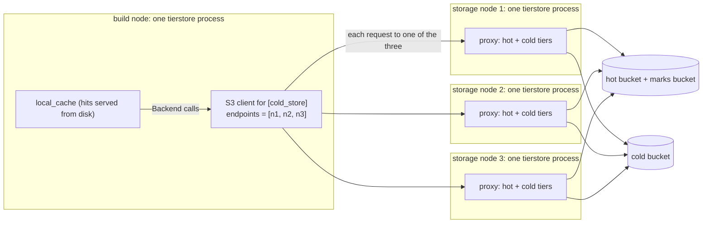
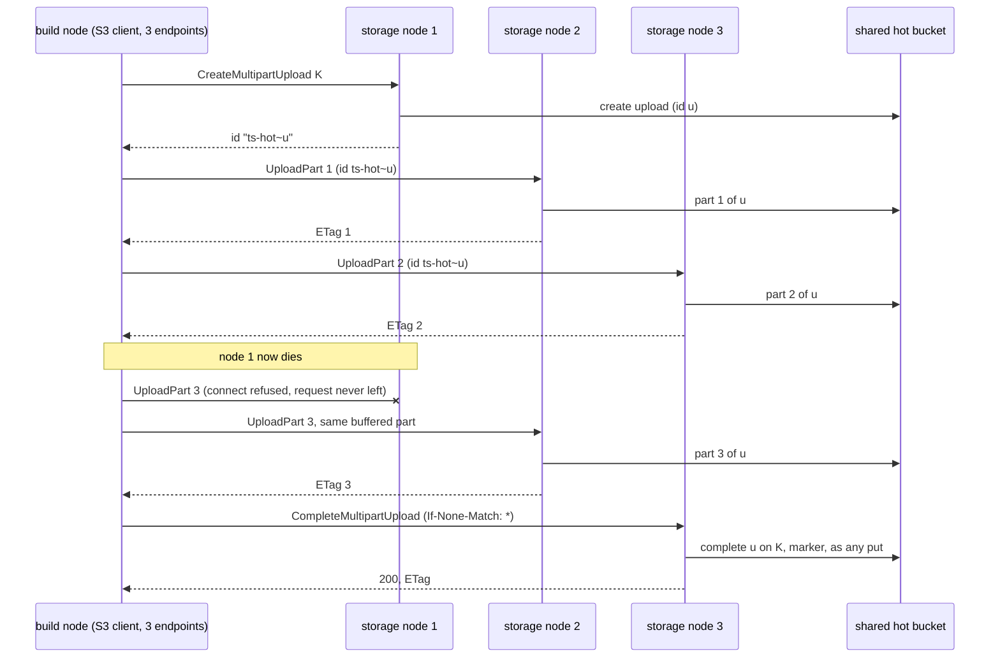

# One store, several endpoints: the S3 client spreads requests over the nodes that front it

Status: **proposed (2026-11-07), not built.** Everything here is the plan; the code is the single-endpoint S3 client of `crates/objstore-s3` until the pull requests of section 14 land. Each of those moves the text it makes true out of "plan" in the same pull request (rule P10). Terms in bold are those of the glossary of [tierstore-design.md](tierstore-design.md) (section 17) and of [put-without-lock.md](put-without-lock.md): hot tier, cold tier, marker, lock, lease. New terms: **endpoint** (one `http://host[:port]` that reaches a store), **down mark** (a proxy's own note that an endpoint did not answer), **attempt** (one send of a request to one endpoint).

Figures: **measured** means a farm measurement with its source in the capability and cost report of 2026-11-05/06 as quoted in put-without-lock.md section 6; **inferred** says how it was computed (rule P11); **pending** means a run that has not finished and has no figure yet.

## 1. The problem

The upgraded lab has three dedicated storage nodes. Each runs tierstore with `[hot_store]` and `[cold_store]` over the **same** hot and cold buckets. Every node serves the same data with strong consistency, because the markers and leases of put-without-lock.md make any proxy equivalent to any other (I3: "strong read-after-write, after-delete and after-list through any proxy over the same hot and cold pair"). Client machines run tierstore as a **build node**: a `[local_cache]` whose upstream is a `[cold_store]` of `kind = "s3"` that stands for "the storage nodes". Chaining is the CEO's model (tierstore-chaining): a hot+cold proxy is just the cache's upstream, reached through the one store interface, in one process or across processes.

Today `cold_store.endpoint` takes **one** `http://host[:port]`. A build node can therefore use one storage node only; the other two idle, and the one that is used is a single point of failure for every build machine that names it. The operator's options are all outside tierstore: a hardware or software balancer in front of the nodes, DNS round robin, or a different `endpoint` in each build node's file chosen by hand.

**What the user wants:** tierstore itself spreads its requests over the N storage nodes, with no external balancer, and keeps working when one of them is down.

**Before and after, for an operator of a build node.**

| | Before | After |
|---|---|---|
| File | `endpoint = "http://storage-1.example:9000"` | `endpoints = ["http://storage-1.example:9000", "http://storage-2.example:9000", "http://storage-3.example:9000"]` |
| Requests | all to storage-1 | one request to one node; consecutive requests to different nodes (round robin, or at random) |
| A node is down | every request fails (or the file is edited by hand) | the dead node is skipped for a while; a read, and any request that never reached the node, is sent to another node |
| A file with `endpoint` | works | **works unchanged**, byte for byte the same requests |
| Extra store requests | | **none**; section 12 |

**What does not change.** The `Backend` and `ObjectStore` interfaces, the markers, the locks, the format object, every stored format, the S3 and OCI fronts, and a file that gives `endpoint`. The choice lives in the S3 client (`crates/objstore-s3`), below the interface that the cache and the proxy call; nothing above it knows there is more than one endpoint.

## 2. Decisions at a glance

| # | Decision | Section |
|---|---|---|
| D1 | Config: `endpoints = [...]` beside `endpoint`, exactly one of the two. It is a key of **any** `kind = "s3"` table (`[hot_store]`, `[cold_store]`, so the upstream of a cache too), not of `cold_store` alone. A list of one entry is the same as `endpoint`. | 4 |
| D2 | The endpoint is chosen **per request**, not per connection. The default is **round robin** from a random start; `random` is the other value of `server.s3_endpoint_choice`. Least-in-flight is not built; it can be added later as one more value of the same key. | 5 |
| D3 | An endpoint is marked down only by **transport**: a connect failure, a reset, a stall. **Any HTTP answer, a 5xx and a 503 `SlowDown` included, is the store's answer: it is returned as it is and never moves the request or marks the endpoint.** | 6 |
| D4 | A mark lasts `server.s3_endpoint_down_for` (30 s). Marks are advice, not a gate: when every endpoint is marked, the request goes to the one marked longest ago. There is no probe. | 6 |
| D5 | A request that **never left** (connect failure) is retried on another endpoint whatever it is, a streamed PUT included. A request that **went out** is retried on another endpoint only if replaying it is safe: GET, HEAD, LIST, UploadPart of a buffered part, AbortMultipartUpload. Every other write is sent once, as today. | 7 |
| D6 | Multipart: the upload id **need not stay on one node**. A storage proxy keeps no state of an upload; the upload lives in the shared hot (or cold) bucket. Any call of an upload may go to any storage node. | 8 |
| D7 | Read-after-write holds when consecutive requests land on different nodes: it is I3 as stated, no new rule. The local cache's exception (5.16 of put-without-lock.md) is unchanged and is the only one. | 9 |
| D8 | Per-endpoint series on `/metricz`; the start line names the endpoints of a table that has more than one. | 11 |
| D9 | Cost: no extra store request; latency unchanged except on failover. | 12 |

## 3. What the design rests on

**A requirement on the store, stated and not tested.** tierstore is a proxy on top of stores and does not probe them (no-store-probes). The endpoints of one table are **front doors of one logical store**:

1. the same bucket, the same objects, and S3's strong read-after-write, read-after-delete and read-after-list **whichever endpoint** answers;
2. the same atomic conditional writes (create-only and `If-Match`) whichever endpoint takes them, and for the same key two racing conditional writes are ordered by the store, not by the endpoint;
3. the same credentials file, region and bucket name for all of them (the signature covers the `Host` of each endpoint, and each attempt is signed for the endpoint it goes to).

What meets it: the nodes of one MinIO cluster (the farm measured exactly one winner of 16 racing create-only PUTs sent to six nodes in 200 of 200 trials, and no stale GET, HEAD or LIST on another node after a PUT, overwrite or delete, put-without-lock.md 2.2, rows F1, E, G6, G7); several tierstore storage nodes over the same hot and cold buckets, one release, one key set. What does not: independently replicated stores, or two stores that merely hold copies. If an operator lists such endpoints, the damage is theirs, as with a store that ignores `If-None-Match` (operations.md, "what tierstore requires of a store"); the docs say so and tierstore does not look.

**Chaining stays one mechanism.** The cache's upstream is a `Backend` over an S3 store. Whether that store reaches one process or three, and whether the process behind it is a proxy or a MinIO, is not visible above the S3 client:



The same client also serves the other configurations with no mode switch:

- **One process** (a storage node with a cache, or the in-process chain): the cache's upstream is the in-process proxy through the same `Backend`; there is no S3 hop and no endpoint.
- **A storage node whose hot tier is a MinIO cluster**: `[hot_store] endpoints = [...]` lists the cluster's nodes; the markers bucket is the second handle on the same store and shares the endpoints.
- **Chains of chains** (a cache whose upstream is a second tier of proxies): each hop chooses for itself; nothing is shared between hops.

## 4. Config shape (D1)

```toml
# a build node
[cold_store]
kind             = "s3"
bucket           = "tierstore"
endpoints        = ["http://storage-1.example:9000",
                    "http://storage-2.example:9000",
                    "http://storage-3.example:9000"]
credentials_file = "/etc/tierstore/upstream.credentials"
```

**The rules.**

1. `endpoints` is a list of `http://host[:port]` strings, each with the rules `endpoint` has today (no path, no userinfo, no query; `https` refused while TLS to a tier is not built). It is a key of every table whose `kind` is `s3`; for another `kind` it is refused as `endpoint` is.
2. **Exactly one of `endpoint` and `endpoints`** is given for an `s3` table. Both, or neither, is refused at load (exit 2) naming the key. `endpoints = []` is refused. (This is today's rule for the build node's `[cold_store]`, extended.)
3. A list of **one** entry is the same as `endpoint`. Such a file behaves exactly as the file with `endpoint`, and prints the same start line.
4. A repeated entry (the same scheme, host and port, compared after the URL is parsed) is refused: weighting is not a feature (below), and a repeat is a mistake to fix in the file (B20). No count limit is set; the config is read once, and the lists in view are a handful.
5. `region`, `credentials_file`, `bucket` and every other key of the table apply to all endpoints.

**Why a list beside `endpoint`, and not a replacement.** `endpoint` is in every shipped file. Keeping it means a file that works today works unchanged (B8). The list `endpoints` already exists in the loader for the build node's `[cold_store]`, with the single rule "exactly one entry" and the message "a list of several is not supported yet", and `configuration.md` lists "Several upstream endpoints" under "Not in a release yet". This design turns that stub into the feature; the key name is already in the loader, so it is also the least surprising name.

**Why any s3 table, not `cold_store` only.** The lab needs only the build node's `[cold_store]`. But the client is the same for both tiers (one `S3Config`), the farm's hot tier is a MinIO cluster of several nodes that meet the requirement of section 3, and refusing the key in `[hot_store]` would add a refusal rule, a doc line and a negative test to protect nothing. A key that exists in one s3 table and not the other would also have to become allowed later, which is the kind of surprise config shapes should not hold. The cost is that `[hot_store] endpoints` is exercised by a test (section 13) and that the marks bucket shares the hot tier's endpoints.

**Where the loader refuses it today, and what changes.** `config.rs` (`storage`) refuses `endpoints` in both tiers of a storage node; `config_cache.rs` (`upstream_table`) takes exactly one entry. Both rules go; the `refuse_hot_keys` and `refuse` calls and the cache-only module docs are corrected (section 15).

**Tunables (every number is a key with a default).** All three go in `[server]` with the other `s3_*` client settings; they apply to every `s3` table of the process, as `s3_connect_timeout` does.

| Key | Type, default | What |
|---|---|---|
| `server.s3_endpoint_choice` | `"round_robin"` or `"random"`, `"round_robin"` | how the endpoint of a request is chosen among those not marked down (section 5) |
| `server.s3_endpoint_down_for` | duration, `30s` (1ms to 1h) | how long an endpoint that failed in transport is passed over (section 6) |
| `server.s3_endpoint_attempts` | count, `3` (1 to 16) | the most endpoints one request is sent to; a request goes to an endpoint at most once. `1` turns failover off but keeps the marks. A value above the number of endpoints means all of them |

Existing keys keep their meaning: `s3_connect_timeout` (5 s) is the price of a try of an endpoint that is unreachable, `s3_request_timeout` (60 s) the price of a try of one that is hung, `s3_pool_idle_timeout` (30 s) the life of an idle connection to each endpoint, `s3_read_retries` and `s3_read_retry_wait` the resend to the **same** endpoint when there is only one (section 6). A lab file should set `s3_connect_timeout` to about `1s`; the default of 5 s is for a WAN.

**Not a feature: weights.** All endpoints weigh the same. If a later release wants weights, the entries may become tables beside the strings (a string stays valid), or a second key may be added; both are additive. Nothing about the strings in `endpoints` closes that door. This is the one-way-door audit of section 16.

**Rust API (a two-way door).** `S3Config.endpoint: String` becomes `endpoints: Vec<String>` (at least one). It is a library type used inside the workspace; every construction site changes in the first pull request, which carries no behaviour.

## 5. Choosing an endpoint (D2)

**Per request.** The endpoint is picked when a request is about to be sent. The alternative, per connection (pick when a connection is opened and keep it), fails the purpose: keep-alive connections live for `s3_pool_idle_timeout`, and a build node under steady load has a few connections that last for hours, so all of its traffic would stay on the node it connected to first. Per request also lets a ranged fill of one large object (8 MiB pieces, `local_cache.fill_chunk`) and the parts of one multipart upload use all the nodes' bandwidth.

**Interaction with the pool.** One `reqwest::Client` serves all endpoints of a table; its pool is keyed by `host:port`, so each endpoint has its own idle connections, each dropped after `s3_pool_idle_timeout`. With concurrency `c` a build node holds about `c / N` connections to each node, not `c` to each. A request that finds no idle connection to its endpoint opens one: one TCP handshake, 0.2 ms RTT on the farm (measured), the same cost as a request after 30 idle seconds today. A node that gets less than one request in `s3_pool_idle_timeout` from a client reopens a connection each time; with the pool timeout at 30 s this is the same as today's single-endpoint client at the same idle rate.

**Round robin (the default).** A per-store counter, started at a random value so that many build nodes starting together do not walk the nodes in lockstep, advanced for every request; the request goes to the first endpoint at or after the counter that is not marked down and not yet tried by this request. For one client the spread is exact (each node gets one in N); across many clients it is exact on average. With a node down the survivors split its share evenly. State: one atomic integer.

**Random.** A uniform draw among the endpoints not marked down and not yet tried by this request. No shared counter, so no contention at very high request rates, at the price of a binomial spread (for 3 nodes and 30 requests the busiest node gets 10 +/- 2.6 requests, 1 standard deviation, inferred). The randomness is drawn through an injected source so that tests fix it.

**Least in flight (not built).** It would adapt to a slow node and to the difference between a 1 GiB PUT and a HEAD. It needs a counter whose decrement is tied to the end of a request body, which for a streamed read is the end of a stream the caller drops whenever it likes; and it can only help against a node that is slow while answering, which section 6 does not detect either. It can be added later as a third value of `server.s3_endpoint_choice` (additive); it is listed in Q3.

**One choice per request, not per call of the trait.** Operations of the cache that are several requests (a HEAD before a create-only put, then the PUT; the pieces of a fill; the parts of an upload) choose independently. They may land on different nodes. Section 9 shows that this is safe.

## 6. Failure without probes (D3, D4)

tierstore does not ask an endpoint whether it is up. It learns only from the answer to a request it was going to send anyway.

**What an attempt can end in, and what each does.**

| Outcome of an attempt | Meaning | Marks the endpoint down? | The request |
|---|---|---|---|
| An HTTP answer, any status (200, 404, 412, 403, **500, 503 `SlowDown`**, ...) | the node is up and said what it says | **No** | **Returned as it is.** Never sent to another node |
| Connect refused, host or network unreachable, DNS failure, **connect timeout** (`s3_connect_timeout`) | the request did not reach the node | Yes | Sent to another endpoint if attempts remain, **for every kind of request** (section 7) |
| The connection is reset or closed before the answer's headers, or the headers do not come within `s3_request_timeout` (a hung node) | the request may have been executed | Yes | Sent to another endpoint only if the request is replayable (section 7); otherwise the transport error, as today |
| The answer's headers came and the body then fails or stalls | a read in progress | Yes | The end of that body, an error; the caller starts the read again, and the restart picks another endpoint |

**Why a 503 is not a reason to leave a node.** A storage node answers 503 `SlowDown` when it waited `lock_wait` for a key's lock (I6) and when its hot store is full or down, and every other node of the three shares that hot store; moving the request would repeat the answer elsewhere, and a request multiplied by the failure is exactly what an overloaded store does not need. The 503 carries `Retry-After`, which belongs to the client. A 500 is the store's own report of its failure; the S3 client does not retry a 5xx today and does not start. A 403 from one of three nodes is a node that has a different key set: a loud, permanent mistake of the file, which the operator fixes at the source (B20), not by tierstore routing around it.

**How long, and no probe.** An endpoint that failed in transport is **marked down for `s3_endpoint_down_for`** (30 s) on tokio's clock, which a test pauses. The mark is a timestamp; nothing checks the endpoint during or after it. When the time passes, the endpoint is eligible again, and **the next real request that picks it is the trial**: an answer proves nothing is wrong, and a transport failure marks it again. Why 30 s: a trial of a dead host costs `s3_connect_timeout` (1 s in the lab file, 5 s default), and that is paid by **one** request per mark expiry per build node, whose request is then retried on a live node, not by one in three of all requests. A longer mark costs nothing but a delay in using a recovered node, and the other nodes carry its share meanwhile. A shorter one puts a slow request in front of the operator more often. The value is a key.

**Marks are advice, not a gate.** If every endpoint is marked, the request is sent to the one whose mark was made longest ago, so a request is never refused for want of an endpoint, and a table of one endpoint is never skipped: with one endpoint the machinery changes nothing (no skip, no failover; the resend of a read to the same endpoint, `s3_read_retries` with its waits, is as today). With several endpoints a resend goes to **another** node at once and has no wait; the count is `s3_endpoint_attempts`, and the same-endpoint resend does not apply.

**A mark is only time.** A later success does not clear it, and a failure of a request that started before the mark does not extend it beyond `now + s3_endpoint_down_for`. Nothing is persisted: a restart forgets the marks, and the first requests find the dead node again at the price of one connect timeout. The marks of two build nodes are not shared.

**Slow is not down.** A node that answers, slowly, stays in rotation at its share. tierstore does not time answers against each other (that would be a health judgment from latency, with a threshold to tune and to be wrong about). A hung node is caught by `s3_request_timeout`, 60 s by default; the worst case for a replayable request that meets hung nodes is `s3_endpoint_attempts` times that, because each attempt waits its own limit. The lab file should set `s3_request_timeout` as low as its longest honest request allows (the file's own comment on the key says to set it longer than the longest multipart completion).

## 7. Which requests may go to another endpoint (D5)

The rule has two classes, from one question: *if the request ran on the first node and the answer was lost, does running it again on another node do harm?*

**Class A: replay is harmless; sent to another endpoint after any transport failure, up to the attempts.**

| Request | Why replay is safe |
|---|---|
| GET (whole, ranged, streamed), HEAD, LIST (ListObjectsV2, list parts, list uploads) | they change nothing. A read already restarts after a transport failure before its headers (`retrying` in `tagged.rs`); this moves the restart to another node |
| UploadPart whose part is **held in memory** (the parts of `multipart::put`; `part_bytes`, 16 MiB, are buffered as they are sent) | S3 defines a part sent again with the same number as replacing the one before. The part is staged in the upload and is visible to no GET, HEAD or LIST until the completion, so no invariant of put-without-lock.md sees it |
| AbortMultipartUpload | the upload is gone afterwards, whichever node ran it; aborting a gone upload answers `NoSuchUpload`, which the abort (best effort, logged) already treats as done |

**Class B: sent once after it went out; sent to another endpoint only if it never left.**

| Request | Why not replayed after it went out |
|---|---|
| PUT, plain, create-only or `If-Match`, streamed or not | The body is a stream that is consumed by the first send; it cannot be replayed. And an unknown outcome of a conditional write is resolved by a HEAD, never assumed (the doc comment at the top of `tagged.rs`): a replay of a create-only put whose first send landed is answered 412 for the writer's own success, and a replay of an `If-Match` put is 412 or 409 for the same reason (409 `ConditionalRequestConflict`, put-without-lock.md 2.1). A replayed plain put is a second, later write of the key: it can overwrite what another client wrote and had acknowledged in between. That is a legal S3 order for a client that retries, and the client is the one that decides to retry |
| DELETE, plain or `If-Match` | The delete is idempotent as S3 defines it, but a replay is a **new, later delete**: it can remove a put acknowledged after the first. More to the point, the first node may be hung and still holding the key's lock (I8: a holder whose DELETE ended unknown keeps its lock until the call can no longer land), so a replay on another node waits for that lock for `lock_wait` and answers 503 (I6, I13); it gains nothing for up to `departure` (60 s) |
| CreateMultipartUpload | A replay makes a second upload id and orphans the first in the shared bucket. (`hot_store.abandoned_upload_after` aborts such uploads; its default is `0s`, which aborts none, as in S3.) |
| CompleteMultipartUpload, plain, create-only or `If-Match` | As the conditional PUT; the completion is the commit |
| UploadPart whose body is a stream from the caller (`upload_part_stream`) | the body cannot be replayed |

**A request that never left is the exception to Class B.** If the failure is a connect failure (refused, unreachable, DNS, connect timeout), nothing was sent, so no decision about replay exists: the same request, body included, goes to the next endpoint. This covers the common failure by far (a node is down, restarted or cut off) for every kind of request. For a streamed body, the body is lent to the request through a handle that takes the stream back if the request ends before one byte of it was polled, which is exactly the set of failures before the connection exists (the HTTP client polls the body only after the connection is up and the headers are written). A request whose body was polled at all is Class B. The mechanism (a shared handle, a one-chunk look-ahead, or the client's own retry hook) is an implementation choice and a two-way door; the pull request that builds it also owns the test that a refused connection leaves the stream unpolled (section 13).

**What the caller sees when it was not replayed.** The transport error, as today. The cache's `put_through` already treats a transport failure of the upstream as a failed put and a client's S3 library retries a 503 (the front answers `Unavailable`); the retry is a new request, and **round robin has moved on, so it goes to another node**. Failover for the writes that cannot be replayed is therefore the caller's retry, which is where S3 puts it.

## 8. Multipart uploads across endpoints (D6)

**The question.** A build node uploads an object larger than `server.s3_single_put_max` (default 5 GiB), or of unknown length, as a multipart upload: CreateMultipartUpload, UploadPart n times, CompleteMultipartUpload, AbortMultipartUpload on failure. Must all of these reach the node that took the first?

**No.** `tiered/uploads.rs` says it in its header: the proxy "keeps no state of an upload"; the upload lives in the tier that holds it, and the id says which. The id a storage node gives a client is `ts-hot~<the hot store's own id>` when the upload is in the hot tier (the default whenever the hot tier has room, and always under the markers, where `send_part` refuses a cold id), and the cold store's own id unchanged otherwise. Every call that follows the id (`send_part`, `complete_on_entry` or `complete_marked`, `drop_upload`, `list_upload_parts`, `list_open_uploads`) routes by that prefix and calls the shared store. So:

- the parts of one upload may go to different storage nodes, and in a lab with three nodes each node takes a third of the bytes, which is the throughput reason to choose per request;
- the completion may go to a node that took no part: it is a put of the key on markers (`complete_marked`), like any other, and uses nothing but the shared hot bucket, the marks bucket and the id;
- the abort of an upload whose creator died goes to a live node and succeeds, where pinning the upload to its creator would leave it open until `abandoned_upload_after`;
- a listing of uploads is a union of both tiers' lists and holds no node's state.



**Conditions, which the docs state.** (1) All storage nodes of one set run the same release: the `ts-hot~` prefix is parsed by every node, and an id of a release before the prefix names a cold upload. A rolling update runs two releases for a while; a build node's upload that straddles it is a case for the update hook's drain, which today pauses writes for the rollout (put-without-lock.md 8.2), and, outside a rollout, for the operator not to mix releases. (2) All nodes agree on the format phase (`active` or `active-marks`) with the marks bucket of the same name: a node that does not refuses writes with 503 (put-without-lock.md 4.1), so an upload does not half-complete. (3) The completion and the abort of one upload have the semantics of any put: a failure of the completion with unknown outcome is not replayed (section 7); the caller's retry of a completion on another node sees `NoSuchUpload` if the first landed, or 412 for the key it made, and resolves it with a HEAD, as it does today with one node.

**The client side.** `multipart.rs` holds an `Arc<Conn>` in the `Upload` it creates, and the abort of a dropped upload (`abort` in a spawned task) uses it. With endpoints the `Upload` holds the shared endpoint set instead of one connection, and each call picks. No upload state is added.

## 9. Consistency: read-after-write on different nodes (D7)

**Claim.** If an operation is acknowledged by any storage node, then every operation that starts after the acknowledgement and is served by any storage node sees it, with the exceptions that put-without-lock.md already states. Choosing the node per request therefore changes nothing a client can observe.

**Why, by the invariants of put-without-lock.md.**

1. **An acknowledgement is by the shared stores.** A put is acknowledged after the object and its marker were written to the hot store and the marks bucket (5.1), a delete after its `gone` marker and its DELETE (5.6), a completion after the completion landed. The ack comes from the node that did the work, after the store's own acknowledgement; no node-local state is part of "acknowledged".
2. **A later request reads the shared stores.** A hot hit is the hot object (I12); a hot miss reads the marker with the cold object within `read_window` and trusts cold only if there is no marker or it says `gone = false` (I9); a LIST is the union of both tiers plus a page of markers (5.8). None of this reads another proxy's memory. What a proxy keeps in process is the usage level (published by the leader), the format object it refreshes every `format_refresh`, the set of keys it asked a copy-back of, and its own locks. None is object or marker state that a read or a write trusts without re-reading, so a request served by node 2 starts from the same truth as node 1.
3. **I2 and I3 quantify over requests, not over proxies.** I3 reads "through any proxy over the same hot and cold pair"; I2 says "no GET, HEAD, LIST or copy-back of an operation started after it returns a version older than that operation's, from either tier". The model of Appendix B has two proxies running interleaved operations, which is the case "two requests of one client land on two nodes" under every ordering the model enumerates; the proxy that serves a request is not a variable of the protocol. No protocol changes in this design, so no model run is added.
4. **After-delete and after-list.** A delete acknowledged by node 1 leaves a `gone` marker until cold has caught up; a GET on node 2 that misses hot finds it (I9, 5.7) and answers absent, as on node 1. A LIST page on node 2 sees the keys the page of node 1 saw, with the marker page (5.8). A continuation token of a listing is the hex of the key it continues after (`server/list_token.rs`): it names no node, so the pages of one listing may go to different nodes.
5. **Races between two clients** are those between two proxies: lock, wait, last writer wins (I6, I8). The node choice only changes which proxy runs each side.

**The local cache exception (5.16, I3).** A build node serves a cache hit from disk with no upstream call, so another node's overwrite or delete is not seen until `local_cache.revalidate_after` has passed (never, while it is unset). That is independent of the endpoints and is **the only** staleness: with several endpoints the cache's HEAD for revalidation (`local_cache/revalidate.rs`) goes to whichever node is next and compares a tag and a size that every node derives from the same hot (or cold) object. A node's own writes are not subject to the exception (`forget` in `local_cache/write.rs`) whichever storage node took them.

**ETags.** The tag a node answers is the hot store's own tag while the object is hot and the cold store's after a copy-back or eviction; two nodes asked at the same instant answer from the same tier state and the same tag. The mismatch between the tiers' tags (Q4 of put-without-lock.md, PR #173) is the same with one endpoint or three; this design neither makes it worse nor depends on its fix.

**A create-only put whose answer was lost** (node 1 landed the key and died before answering): the client's retry is a new request, goes to node 2 or 3, and is answered 412 because the key is there. That is S3's own answer to the retry of a create-only put, and the client is the one who decides what it means.

## 10. Every operation, with the endpoint chosen

The requests in the table are those of the client of the S3 store; the requests the storage node makes behind each are those of put-without-lock.md section 6.1 and are unchanged.

| Operation (client of the S3 store) | Requests to the store | Endpoint choice | On a connect failure | On reset or stall |
|---|---|---|---|---|
| GET, whole or ranged; HEAD | 1 | one pick | next endpoint | next endpoint |
| LIST page | 1 per page | one pick per page | next endpoint | next endpoint |
| PUT, streamed (create-only, plain, `If-Match`) | 1 | one pick | next endpoint, the body unpolled | transport error to the caller |
| DELETE | 1 | one pick | next endpoint | transport error to the caller |
| Multipart upload of n parts | 1 + n + 1 (+ 1 abort on failure) | one pick for each request | next endpoint for each | UploadPart (buffered) and abort: next endpoint; create and complete: error |

```mermaid
sequenceDiagram
  participant S as caller (the cache)
  participant Cl as S3 client
  participant A as endpoint A (down since 4 s)
  participant B as endpoint B
  participant Cc as endpoint C
  Note over Cl: round robin cursor at A; A is marked down, so the pick is B
  S->>Cl: GET K
  Cl->>B: GET K (signed for B's Host)
  B-->>Cl: 200 + body
  Cl-->>S: object
  S->>Cl: HEAD K
  Cl->>Cc: HEAD K
  Cc-->>Cl: 200 (the same answer B would give)
  Cl-->>S: head
  Note over Cl: 30 s after the mark, A is eligible again
  S->>Cl: PUT K (streamed, 1 MiB)
  Cl->>A: PUT K (trial)
  A--xCl: connect refused (the body was not polled)
  Note over Cl: A marked down again; same request, same body
  Cl->>B: PUT K (signed for B's Host, new date)
  B-->>Cl: 200 + ETag
  Cl-->>S: ETag
  S->>Cl: GET K2
  Cl->>Cc: GET K2
  Cc--xCl: reset before headers (the node died)
  Note over Cl: C marked down; a read may be replayed
  Cl->>B: GET K2
  B-->>Cl: 200
  Cl-->>S: object
```

A 503 `SlowDown` from B in place of the 200 of the PUT is returned to the caller and moves nothing.

## 11. Metrics and the start line (D8)

**On `/metricz`**, per `s3` table of the process (the storage node's hot and cold, the build node's upstream), with the label values of the existing tier series (`tier` is `hot` or `cold`; a build node's upstream is `cold`). They are read from the client when `/metricz` is scraped: `objstore-s3` exposes a snapshot of its endpoint counters, and the metrics module of `tierstore` renders it, so the client library needs no metrics registry.

| Series | Type | Labels | What |
|---|---|---|---|
| `tierstore_store_endpoint_requests_total` | counter | `tier`, `endpoint`, `outcome`: `answered`, `connect_failed`, `failed` | attempts, by what they ended in: `answered` any HTTP answer, whatever its status; `connect_failed` the request never left; `failed` it went out and the transport failed or stalled |
| `tierstore_store_endpoint_down` | gauge | `tier`, `endpoint` | 1 while the endpoint is marked down, 0 otherwise (read against the clock at scrape time) |
| `tierstore_store_endpoint_failovers_total` | counter | `tier` | requests that were sent to a second endpoint (or a third) after the first did not answer |

`endpoint` is the label value `host:port` as configured, without the scheme. `/metricz` is unsigned and on the S3 listener (metrics.md), so a client that can reach the listener can read the storage nodes' addresses; for a build node that is the loopback socket, for a storage node the same listener its clients already use. Q5 asks whether the position (`0`, `1`, ...) should be the label instead.

Queries this supports: the spread (`sum by (endpoint) (rate(tierstore_store_endpoint_requests_total[5m]))`, which should be flat), a node out of rotation (`tierstore_store_endpoint_down == 1`), and a failing node (`rate(..{outcome=~"connect_failed|failed"}[5m])`). The series are additive (new names); a table with one endpoint has one series per outcome.

**The start line** is one line on stdout that parsers read (`tierstore <version> listen=...`, with `mode=` and `oci-listen=` after it). It gains **nothing** for a table with one endpoint. For a table with more than one, a field is added after `listen=` and `mode=` and before `oci-listen=`, so that `oci-listen=` and its parenthesis stay last as they are:

```text
tierstore 1.4.0 listen=127.0.0.1:9000 mode=cache cold-endpoints=storage-1.example:9000,storage-2.example:9000,storage-3.example:9000
```

`hot-endpoints=` is the same for `[hot_store]`. The field is a `key=value` after the fields a parser already reads, in the style of `oci-listen=`; the form is a one-way door in the sense of section 16 and Q6 asks about it. Nothing else prints at the start: no probe of the endpoints runs, and the first request that uses each is what finds a wrong one.

## 12. Cost: requests and latency per operation (D9)

**Extra store requests: none.** The selection is a counter or a draw, a lookup in a table of timestamps, and a signature over the chosen endpoint's `Host`; it sends nothing. No endpoint is probed, none is "warmed", and a failed attempt is not an extra request but the cost of a node being down. The requests per operation are those in the table of section 10 and, behind them, those of put-without-lock.md section 6.1.

**Latency per operation is unchanged except on failover.** Measured on the farm (put-without-lock.md 6.1, hot MinIO, one connection, 1 in flight, p50) the unit costs the proxy pays for the operations a build node asks are: HEAD of a hot key 3.2 ms (4.6 through a proxy, with 1.4 ms of proxy work per wave); a hot GET hit 4.1; a cold-only GET 30 to 40; a new-key put on markers 17.2 (inferred, section 6.1 there); a delete 43.7. The S3 client's work for the choice adds a pointer read and an atomic add to each request (**inferred**: a few tens of nanoseconds, below the 1.4 ms per wave by four orders of magnitude; no run measures it). The one new latency is the first request to an endpoint whose pool is empty: a TCP handshake, 0.2 ms on the farm (**measured** RTT), which a single-endpoint client also pays after `s3_pool_idle_timeout`.

**On failover** the price is what the failed attempt waited:

| Failure | Price paid by the one request that meets it | Then |
|---|---|---|
| Node down, connection refused | about one RTT, 0.2 ms (inferred; the kernel answers the SYN with a reset) | node skipped for 30 s |
| Node unreachable (cable out, host powered off) | `s3_connect_timeout`: 5 s default, 1 s in the lab file | skipped for 30 s; one request per mark expiry per build node pays it again, until the node returns |
| Node hung after accepting | `s3_request_timeout` (60 s default) for a request in flight; each replay may wait the same, up to `s3_endpoint_attempts` times | skipped for 30 s |
| Node answers 503 | none: returned | none |

**The shape of the load.** Round robin turns one node's load into a third for each node. The storage nodes' hot-store load per operation (put-without-lock.md 6.2) is unchanged in total. One cost sits in the nodes and not in the client: the set of keys a proxy has asked a copy-back of (`hot_store.want_retry`, `want_recent_limit`) is per process, so a cold-only key read through k different nodes in a minute may be asked by each. The ask is a create-only `WANT` marker and happens only when the read found no marker (mark_reads.rs), so after one node created it the others see it and ask nothing; only simultaneous reads race, and the loser's create-only is refused. At most N-1 extra marker creates per key per `want_retry`, off the read path, in the rare race; **inferred from the code, not measured**.

**The benchmark.** The chained benchmark over the six farm nodes is running into `results-v4/chain/` (the client on node01; arms: A the client cache over a storage proxy over hot and cold, B the storage proxy directly, C the cache directly over cold; per arm 250 requests of put, get, head, overwrite, delete, and a 64 MiB and a 1 GiB put). At the time of writing `results-v4/chain/raw/` is empty: **pending**. Its figures price the hop that this design repeats N ways (A against B); it has no arm with several endpoints. The pull request that builds the client adds that arm (`endpoints` = the six nodes; section 13) and records p50 and p99 per operation beside arm A, and the per-endpoint request counts from the new series. The expected result, stated before it is run so that it can fail: p50 of every operation within the noise of arm A (the 3.4 ms spread between the farm's two runs, put-without-lock.md 6), and the counts per endpoint equal to within one request per client.

## 13. Tests (hermetic, deterministic; B8, T1, T5, T10, T12)

Fake endpoints are in-process listeners on port 0: the existing `FakeS3` of `objstore-s3` (feature `testkit`) and the hand-written wire servers of `tests/s3_wire`. A "refused" endpoint is a listener bound and dropped. A "reset" endpoint accepts and closes. A "hung" one accepts and reads nothing, and the test advances tokio's paused clock past `request_timeout`. The down window is tested on the same paused clock. **No test sleeps against a real timeout and none asserts elapsed time** (T10); the counts are of requests and of bytes. Randomness is injected. Names are written with the behaviour each asserts (T8).

**`objstore-s3`, `tests/s3_endpoints.rs`:**

- `round_robin_sends_consecutive_requests_to_each_endpoint_in_turn`: 3 fakes, 9 GETs, each fake saw 3, and the sequence visits the three in a fixed rotation from the injected start.
- `random_choice_follows_the_injected_source`: a fixed sequence of draws gives the endpoints that sequence names.
- `an_endpoint_that_refuses_the_connection_is_skipped_for_the_down_window_and_tried_again_after`: a refused fake gets one attempt, then none for the next requests; after the clock moves `s3_endpoint_down_for` it gets one more.
- `a_503_slowdown_is_returned_as_it_is_and_the_endpoint_stays_in_rotation`: fake A answers 503; the caller gets the 503, fake B saw no request of it, and the next request still goes to A.
- `a_500_is_returned_as_it_is_and_nothing_is_marked`: the same with 500; and 403.
- `a_streamed_put_whose_first_endpoint_refuses_the_connection_arrives_whole_on_the_second`: the body stream was polled by no attempt before the second, and the fake stores every byte exactly once.
- `a_streamed_put_that_was_reset_after_its_first_byte_is_not_sent_again`: one transport error to the caller, the second fake saw nothing, the first is marked.
- `a_create_only_put_a_delete_and_a_completion_are_not_replayed_after_a_reset`: three cases, each exactly one request on the wire.
- `a_get_a_head_a_list_and_a_buffered_part_are_sent_to_the_next_endpoint_after_a_reset_or_a_stall`: with the clock moved for the stall.
- `an_abort_of_an_upload_goes_to_a_live_endpoint_when_the_creating_one_is_gone`.
- `every_endpoint_marked_down_still_gets_the_request_to_the_one_marked_longest_ago`.
- `a_table_of_one_endpoint_is_never_skipped_and_keeps_the_resend_of_a_read_with_its_waits`: the old single-endpoint tests (`s3_wire/transport.rs`, `timeouts.rs`) run unchanged.
- `each_attempt_is_signed_for_the_host_of_its_endpoint`: the fake verifies SigV4 (`s3_fake_auth.rs` does for one); the retry has a fresh `x-amz-date`.
- `attempts_bounds_the_endpoints_one_request_is_sent_to`: with `attempts = 2` and three dead fakes, two attempts and then the error.
- `the_parts_of_one_upload_go_to_different_endpoints_and_the_object_is_complete` (the fakes share one object map).
- `the_counters_and_the_down_gauge_follow_the_outcomes`: the snapshot after each case above.

**`tierstore`, loader (`config_upstream_tests.rs`, `config_tier_tests.rs`) and docs:**

- `endpoints_and_endpoint_together_are_refused_naming_the_key`; `neither_is_refused_for_an_s3_tier`; `an_empty_list_is_refused`; `a_repeated_endpoint_is_refused`; `a_list_of_one_loads_as_the_endpoint_does_and_prints_the_same_start_line`; `endpoints_in_a_storage_nodes_hot_and_cold_tables_load`; `endpoints_in_a_memory_or_dir_tier_is_refused`; each bad entry is refused with the rules `endpoint` has.
- `the_start_line_names_the_endpoints_of_a_table_that_has_several_and_keeps_oci_listen_last`.
- `docs_tests.rs`: the three new keys are in `configuration.md`, the three series in `metrics.md`.

**Compatibility (B8).** The change adds keys, series and a start-line field; no stored format changes, so there is no data to read in both directions. The configuration crosses releases, and `crates/compat/tests/config.rs` is where that is run on the previous release:

- `a_file_with_endpoint_loads_in_both_releases` (the unchanged file);
- `a_file_with_several_endpoints_is_read_here_and_refused_by_the_release_before`: the previous release refuses `endpoints` of several entries in a build node's file and any `endpoints` in a storage node's. **An operator who may roll back must put the list back to `endpoint` first**; `configuration.md` says so. The three tunables are keys the previous release does not know and ignores with a warning (the rule "Keys this release does not know").

**Consistency across nodes (T5 for the claim of section 9)**, `crates/tierstore/tests/s3_front/` (a new `multi_endpoint.rs`, hermetic, three proxies over one shared pair of in-memory stores, in one process, each on a port 0 listener; the build node's S3 client has the three as `endpoints`):

- `a_put_through_one_node_is_read_head_listed_and_deleted_through_the_others_in_turn`: put, get, head, list, overwrite, get, delete, get, list, round robin, so consecutive requests are on different nodes; each answer reflects the one before.
- `a_multipart_upload_created_through_one_node_completes_through_another`: create, three parts, abort of a second upload, completion, over three nodes with the ids as the nodes give them.
- `a_node_that_is_stopped_is_skipped_and_the_workload_finishes`: one of the three listeners is closed mid-run; all requests succeed, replayable and refused-connect ones included, and the dead node's down gauge is 1.
- `a_build_nodes_revalidation_through_a_different_node_sees_an_overwrite`: with `revalidate_after = 0s`.

**Benchmark arm** (section 12) is a measurement, not a test; it asserts nothing (T10).

## 14. Pull requests (P7, one subject each; interfaces before their users)

0. **This document.** No code.
1. `objstore-s3`: `S3Config.endpoints` (a list of at least one), `Conn` split into the part every endpoint shares and the per-endpoint address and `Host`; a single-endpoint client is identical (the existing tests unchanged). No selection yet. Behaviour: none.
2. `objstore-s3`: the chooser, the down marks, failover by class (sections 5 to 7), the lent body, the multipart set; `S3Tuning` gains the three settings; the snapshot of counters. Inert until a table has two endpoints.
3. `tierstore`: the loader (`endpoints` in any s3 table, the three `server.s3_*` keys, the refusals), the construction of the backends, the start line, the metrics; `configuration.md`, `metrics.md`, `operations.md`. The feature turns on here.
4. The end-to-end tests of section 13 and the benchmark arm, with the figures recorded in section 12 and the pending marks removed. If the figures disagree with section 12, this document is corrected in the same pull request.

Pull request 1 can land alone and is the interface the others use; 3 can be split in two (loader and backends; metrics and start line) if it runs long. The design is linked from each (B22: it touches `objstore-s3` and `tierstore`).

## 15. What this changes in other documents (P10)

- `crates/tierstore/docs/configuration.md`: the `endpoint` rows of `[hot_store]` and `[cold_store]` get `endpoints`; the paragraph on the upstream ("In place of `endpoint` it may have a list `endpoints` of exactly one entry"), the loader's list ("more than one entry in `endpoints`") and "Not in a release yet: Several upstream endpoints" are rewritten; the three keys join the `server.s3_*` rows; the S3 tuning note on `s3_read_retries` says it applies to a table with one endpoint.
- `crates/tierstore/src/server/config.rs` (`storage`: the two `refuse` calls and the `endpoints` field doc), `config_cache.rs` (`upstream_table`, the module doc), `crates/tierstore/src/s3.rs` and `crates/objstore-s3/src/s3/mod.rs` (headers: "endpoint", "Not built yet").
- `crates/tierstore/docs/metrics.md` (three series), `operations.md` (the start line; "what tierstore requires of a store": the section 3 requirement), `limits.md` (the staleness of the cache is unchanged).
- tierstore-design.md: section 4 ("Configurations") gets a sentence and a pointer here; section 14 (future work) loses the entry if it has one.

## 16. One-way doors (the audit)

What would lock us in once released, and what is done about it now:

| Door | Why it is one | Decision |
|---|---|---|
| The key `endpoints` and its type (list of strings) | a file written for it is read by every later release | already in the loader, a list of strings; weights or per-endpoint options can come as a table form beside a string, or a second key: additive |
| Exactly-one-of `endpoint` / `endpoints` | a file depends on the refusal | the shape that every earlier file satisfies; relaxing it later is additive |
| The three `server.s3_*` keys and their value names (`round_robin`, `random`) | file contents | named like their siblings; a new choice value (`least_in_flight`) is additive; they are in `[server]` because the client settings are, and a per-table override later is additive |
| Metric names and labels | dashboards and alerts | one family prefix `tierstore_store_endpoint_*` beside the tier series; `tier`, `endpoint`, `outcome` as elsewhere (Q5 on the label value) |
| The start-line field | parsers | a `key=value` after the existing fields and before `oci-listen=` (Q6) |
| Semantics: "an HTTP answer never moves a request" | operators will rely on it | stated in D3 and in the docs; relaxing it (a per-key list of retry statuses) is additive |
| Semantics: marks are in memory and per process | a shared or persisted mark would be a stored format | not persisted, not shared; a later shared hint would be a new object type, additive |
| The Rust field `S3Config.endpoints` | a library type | two-way (an in-workspace API), changed in PR 1 |

Deliberately **not** built: weights, health probes, a "preferred" or "backup" role for an endpoint, sticky routing by key, hedged requests (a second request to a second node when the first is slow), least-in-flight, a shared mark between processes, and any discovery of the endpoints (DNS SRV, the registrations of the storage nodes). Hedging would add store requests and is against minimize-store-requests; discovery would be a mode of the client.

## 17. Alternatives that were rejected

- **An external balancer, or DNS round robin.** The user asked for none. A name with several addresses already works in the sense that the HTTP client tries the addresses of a name in turn when connecting, but the order is the resolver's, nothing marks a bad address, and each address is not a separate pool; it stays possible and is outside this design.
- **A special "storage group" mode or `tiered_upstream` flag on the cache.** It breaks the chaining model (one mechanism, composed). The choice is below the interface.
- **Pick per connection.** Section 5.
- **Probes (a periodic HEAD or `/readyz` of each node).** The CEO's rule: no probes, judge by answers. A probe is also a store request per interval per client.
- **Failing over on a 5xx or 503.** Section 6: the answer is the store's; and the nodes share their stores.
- **Replaying writes after they went out, buffered.** Buffering a streamed body to replay it is whole-file buffering (B16 forbids it for data paths), and the unknown-outcome problem remains.
- **Pinning a multipart upload to its creator.** Section 8: no state needs it, and it loses the abort of a dead creator and the spread of the parts.
- **`endpoint` accepting a comma-separated list.** It overloads a key whose meaning is one URL, hides the list from the loader's per-entry checks, and a parser of the old release would read a bad URL instead of a clean refusal.

## 18. Open questions

- **Q1. The key shape (D1).** Decided in this draft: `endpoints` beside `endpoint`, in any s3 table. The alternative is `cold_store` only for now. The cost of "any" is one test and a doc line for `[hot_store]`; the CEO may prefer the smaller surface.
- **Q2. A 5xx other than 503 (D3).** The draft returns every HTTP answer as it is. A 500 from one node of three could mean that node alone is broken (a full local disk, a bug); but all three share their stores, and the draft cannot tell the two apart without judging answers. If the CEO wants it, a key (a list of statuses that fail over a replayable request) is additive.
- **Q3. Least in flight.** Not built. Does the lab carry mixed 1 GiB puts and small reads often enough to want it? Needs a run with `s3_endpoint_choice = "round_robin"` and the per-endpoint series to show a skew first.
- **Q4. Defaults.** `down_for` 30 s, `attempts` 3, a lab `s3_connect_timeout` of 1 s. The first two are judgment, from the costs in section 12; all three are keys.
- **Q5. The `endpoint` label.** `host:port` (readable; on the unsigned `/metricz`), or the position in the list (`0`, `1`, ...; mapped by the start line).
- **Q6. The start-line form (`cold-endpoints=a,b,c`).** The alternative is no start-line change, with the endpoints in the log only. The start line is read by tooling; the draft adds a field after the fields a parser reads and before `oci-listen=`.
- **Q7. Mixed releases during a rolling update.** A multipart upload that straddles two releases of the storage nodes fails at a node that does not know the `ts-hot~` prefix (section 8). Today a rollout is a write pause. Is that enough, or should the client pin a multipart upload to one node during a rollout? The draft says it is enough.
- **Q8. The benchmark.** The chained run is pending (section 12). The draft adds the multi-endpoint arm to the follow-up; the CEO may want it measured before PR 3 merges, in which case PR 3 waits for it.
