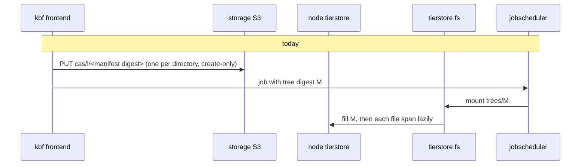
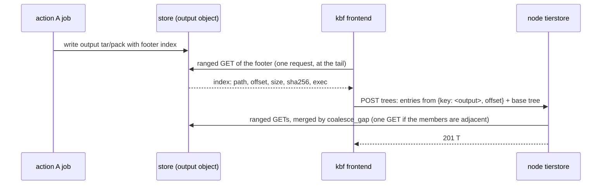

# Node-local trees: one create call, one tree, every interface

Status: **proposed (owner direction, 2026-11-15), not built.** This is a design for the owner's review; no code, no format and no lab change comes with it. What it says about today was read in the code of `main` (tierstore: `crates/tierstore/src/tree_manifest.rs`, `server/treefs/`, `server/fill_socket/`, `server/hydrate.rs`, `server/local_cache/`; kbf: `crates/kbf-front/src/action_tree.rs`, `action_tree/encode.rs`, `place.rs`, `memo.rs`, on the branch of its trees-in-objects-out design) and is marked **read**; what is not measured is marked **inferred**. Terms in bold are those of the glossary of [tierstore-design.md](tierstore-design.md) (section 17).

The owner's direction (2026-11-15): "i don't like how we're specifically implementing a feature into just one interface of tierstore. Remember the fs is just one interface in tierstore. Like calling the objectstore API on trees/T will just return a manifest vs using the file system interface gets you something very different. That's not how tierstore is supposed to work. Like this create tree API on tierstore should create a tree that can be called from object store API or FS API. It does only need to live on that node though. And then it should prefetch everything into the local cache and then when the object store API or fs API fetches an object, then it can do the math of oh it's this object in the local cache with this offset and size."

## 1. The problem (read)

A **tree** today is a convention, not a thing tierstore owns:

- **The writer is the client.** kbf's frontend builds one `tree_manifest` v1 JSON object per directory of an action's input root (`action_tree/encode.rs`), checks each with tierstore's own `parse_manifest`, and stores each with an ordinary create-only S3 PUT to `cas/l/<sha256 of the manifest>` (`action_tree.rs`). A file child carries `sha256`, `size`, `exec` and, when its bytes are a span of a pack, `source: {key, offset}`; a directory child carries the child manifest's digest and length. `memo.rs` maps a REAPI `Directory` digest to its manifest so a shared subtree is built once. `place.rs` first makes every blob locatable (pack index, else a whole `cas/l/<sha256>`, else a write of the blob there).
- **Only one interface reads it as a tree.** `tierstore fs` (the `[fs]` process) presents `<mount>/trees/<digest>` as a directory: a lookup of an unattached digest reads the manifests through the fill socket (`fill <digest>`), flattens them (`flatten`), attaches the tree with no run, and fills file spans lazily by `fill <sha256> <size> from <key> @ <offset>` (`treefs/core/implicit.rs`, `treefs/attach.rs`, `treefs/control.rs`). jobscheduler mounts `/run/tierstore/fs/trees/<digest>` as a read-only layer of the job root, as an opaque host path.
- **Every other interface sees a manifest.** Through the S3 interface, `cas/l/<manifest digest>` is the JSON and nothing more; there is no path under it. The local cache's file for a span is named by the blob's digest, so the same span is a blob to the mount and a range of a pack object to S3.

So the interfaces disagree on what a tree is, and the feature (a tree as a directory) was built into one of them. The prefetch design ([prefetch-api.md](prefetch-api.md), built as `server/hydrate.rs`) has the same shape: the client names tree digests, and tierstore re-reads the manifests it was never given directly.

The owner's rule: a tree is a **core** object. It is created once, by a call on the node, and every interface resolves it with the same lookup. Everything below follows from that.

## 2. Decisions

| # | Decision | Reason |
|---|---|---|
| D1 | **A tree is a core object of the node, created by one call: `create tree`.** It is not an S3 object, not a tier object and not a mount-only feature. Each interface is an adapter over the core's `resolve(tree, path)`, `stat` and `list` (section 6). | The owner's rule; the same shape as the front-adapter / core split of [pluggable-interfaces.md](pluggable-interfaces.md). |
| D2 | **The create call is carried by an extension endpoint on the S3 listener: `POST /_tierstore/v1/trees`.** The local control socket does not carry it. | The caller is the build frontend, which is not on the node and already holds an endpoint and a key for the node's S3 listener (section 3.1). `hydrate` took the same route (prefetch-api D3). A second carrier would be a second contract to keep equal. |
| D3 | **The tree's identity is a Merkle digest of its content, independent of where the bytes were and of how the request grouped them.** The digest covers names, kinds, exec flags, symlink targets, and each file's `sha256` and `size`. It does not cover `{key, offset}`, which are where to fetch the bytes from, not what they are (section 4). | Content addressing is then real: the same tree has the same digest on every node and after a repack. Today's digest covers `source`, so the same tree from two pack layouts is two trees (tree-manifest.md: "Two encodings of one tree are two trees"). |
| D4 | **The canonical encoding is binary, one record per directory; the request is a separate, non-canonical JSON document that the server normalises.** The client library in the `tierstore` crate (which kbf already uses for `parse_manifest`) computes the digest, so a client may memoise it before the call. | Section 4.3 compares binary and canonical JSON. |
| D5 | **A file entry requires `sha256`.** A request without one is refused. | Ordinary objects are mutable (design section 16); a `{key, offset, size}` alone does not say which bytes the tree holds. The digest in the entry is what makes the tree content-addressed, and it is checked while the range is filled. kbf has the digest of every file. |
| D6 | **Create returns when the tree is ready: every referenced range is in the node's local cache and pinned, and the record is written.** Until then the tree is not visible to any interface. There is no readiness state to poll. | Section 5. One state means no interface needs a "not ready" answer; a job start never waits on the network. |
| D7 | **The tree's bytes resolve to `(cache entry, offset, size)`.** In v1 an entry is the blob's own file (offset 0), as the cache keeps blobs today, because the passthrough read of the mount needs a whole file. The resolver's answer already has the offset, so a later layout that serves a span of a cached pack changes the resolver and no interface (section 6.3, question Q1). | The owner's "do the math" is the contract of the resolver; whether the cache holds a span as its own file or as part of the pack is a cache layout choice that no interface sees. |
| D8 | **Node-local.** The record lives in the node's cache directory, is never written to a tier, and is invisible to every other node. A tier object `_trees/...` is refused. | The owner: "it does only need to live on that node". Nothing to replicate means no consistency story. |
| D9 | **The S3 name is `_trees/<T>/<path>`, a new reserved prefix.** The mount keeps `trees/<T>`. | `_entries/`, `_journal/`, `_tiering/` are already carved out of the key space; a user key that began `trees/` would be shadowed by a bare `trees/`. One more reserved prefix is a one-way door of the same kind (section 6.4). The owner's name `trees/T` is the mount's; on S3 the leading underscore is what keeps it from colliding. |
| D10 | **The old convention stays readable.** A digest that names no created tree is looked up as a v1 manifest at `cas/l/<digest>`, as today (section 8). | B8: formats change additively; a rollout may have both kinds of node. |
| D11 | **Every bound is a config key with a default** (section 9). | Tunables are config. |

## 3. What the call is

### 3.1 Which interface carries it

| Carrier | For | Against |
|---|---|---|
| **S3 listener extension `POST /_tierstore/v1/trees` (recommended)** | The caller (kbf's frontend, or the Mac daemon to its loopback tierstore) already has the endpoint and a signed-request key; the call is node-local by the node it is sent to; no new socket, uid or port (minimal operator surface). `hydrate` and `release` are already there with the same auth helper. | The S3 listener is the S3 interface; the create call is not S3. It is a path under the reserved `/_tierstore/` prefix, as the other extensions are, and the core does the work. |
| Local control socket (`tierstore fs`'s `control.sock`) | Local, no signing. | It belongs to `tierstore fs`, a separate process, so the call would be an fs feature, which is the thing the owner rejected. Its group is `fs.client_group`; kbf's frontend is not on the node and not in it. |
| Fill socket | The node's own process pair. | Mode 0600, the instance's own uid; made for `tierstore fs` to ask the cache for blobs. |
| Both S3 and a socket | A caller on the node need not sign. | Two contracts that must say the same thing; nothing on the node needs the socket (jobscheduler mounts a path and does not create trees). |

Recommendation: **the S3 listener only.** If a future interface needs to create trees locally, it calls the same core function that the endpoint calls; the carrier is not part of the core.

`tierstore fs` does not need the call either: it is a reader (section 6.2).

### 3.2 The request

`POST /_tierstore/v1/trees`, signed as any request. The body is one JSON document (`Content-Type: application/json`), at most `trees.max_request_bytes`:

```json
{
  "v": 1,
  "entries": [
    {"path": "bin/cc", "kind": "file", "exec": true, "sha256": "<64 hex>", "size": 1048576,
     "from": {"key": "cas/d/n7/b2/0000000000000041", "offset": 524288}},
    {"path": "include/empty.h", "kind": "file", "sha256": "e3b0c442...", "size": 0},
    {"path": "lib", "kind": "symlink", "target": "bin"},
    {"path": "toolchain", "kind": "tree", "tree": "<64 hex of a created tree>"}
  ],
  "ttl": "4h"
}
```

- `entries` lists paths below the root. A path is `/`-separated names; each name follows today's rule (not empty, not `.` or `..`, no `/`, no NUL, not beginning `.wh.`; tree-manifest.md). Directories are implied by the paths below them; an **empty** directory is `{"path": "x", "kind": "dir"}`. The order of `entries` is free; the server sorts.
- `file`: `sha256` and `size` of the contents, optional `exec` (false when absent), and where to fetch them from: `from: {key, offset}`, the `size` bytes at `offset` of the object `key`. With no `from` the contents are the whole object `cas/l/<sha256>`, which is today's rule. A file of size 0 has no `from` and needs no fetch. `exec` is the only mode bit in v1 (question Q4).
- `symlink`: `target`, kept as the client wrote it (never resolved by the server).
- `tree`: **structural sharing.** The path holds the tree already created with that digest; the child is named by digest, and its entries are not sent again. The child must exist on this node when the call is made and is pinned for as long as the new tree lives (a child is a reference, section 7). A tree whose child is absent is refused `unknown child tree <digest>`; the client sends the child first (kbf's memo of `Directory` digest to tree digest tells it which it has sent). A `tree` entry at the root path (`""`) is refused.
- `ttl`: how long the tree stays after the last reader goes (section 7), at most `trees.ttl_max`; default `trees.ttl`.

Validation, all before any fetch, each refused by name with the path of the entry (`400`):

| Check | Refusal |
|---|---|
| `v` is 1 | `unsupported tree version` |
| every name and every `sha256` is well formed; a path or a `target` is not too long | `unsupported entry name`, `malformed digest`, `path too long` |
| no two entries have one path; no file path is also a directory prefix of another entry | `duplicate path`, `file and directory at one path` |
| `from.key` is not under a reserved prefix (this includes `_trees/`: a tree is never a source of another tree's bytes) | `reserved key` |
| `from.offset + size` fits in 64 bits | `range overflow` |
| entries at most `trees.max_entries`, depth at most `trees.max_depth` (4096), request at most `trees.max_request_bytes` | `tree too large`, `tree too deep`, `request too large` |
| total bytes of the files at most `trees.max_bytes`, and the new bytes of the tree fit under `local_cache.pin_limit` | `tree too large for the cache` (`507`) |
| the key may read every `from.key` (the key file's scope, [keys.md](../../crates/tierstore/docs/keys.md)) and may use `_trees/` | `403` |

`ttl` and the pins use the machinery of the holds of `hydrate` (prefetch-api D7), so a tree is, in code terms, a durable hold whose members are a directory structure.

### 3.3 The result

`201` with

```json
{"tree": "<T, 64 hex>", "entries": 1203, "files": 1100, "bytes": 83886080,
 "filled": 42, "present": 1058, "fill_bytes": 5242880, "created": true, "expires_ms": 1763200000000}
```

`created: false` means the digest was already a ready tree on this node: the call refreshed its expiry and pinned nothing new (create is **idempotent** by the digest). The server computes `T` from the normalised content and returns it; a client that computed `T` itself may send `"tree": "<T>"` in the request, and the server refuses a mismatch (`tree digest mismatch`). A failure is the refusals above, or section 5.4.

## 4. Identity and encoding

### 4.1 The digest

A **node** of a tree is a directory. Its canonical record (4.2) lists its children sorted bytewise by name; a file child holds its `sha256`, `size` and `exec`; a symlink child its target; a directory child the **digest of the child's record**. The tree digest `T` is the digest of the root's record: `sha256` of its canonical bytes. So:

- The digest of a node depends only on what is below it. A subtree shared by two trees has one digest in both; a `tree` entry of the request names exactly that digest, so a request that sends a child by digest and one that sends its entries give the same `T`.
- A request is normalised by building the nodes bottom-up, so how the client grouped the entries (flat paths, or children by digest) is not part of `T`.
- Locations (`from`) are not in any record. A tree created from one pack layout and one created from another have one digest if the contents are equal.

### 4.2 The canonical record

One record per directory:

```text
magic   "TSTR" (4 bytes)
version u8 = 1
count   uvarint                     children
child*  : kind u8 (1 file, 2 dir, 3 symlink; others refused)
          name_len uvarint, name bytes (UTF-8)
          file:    flags u8 (bit 0 exec; other bits must be 0 in v1), size uvarint, sha256 (32 bytes)
          dir:     sha256 of the child's record (32 bytes)
          symlink: target_len uvarint, target bytes
```

Children are strictly sorted by name (bytewise); a record that is not, or that has trailing bytes, or a varint that is not the shortest form, is refused. The digest is of exactly these bytes, so one tree has one encoding by construction: no normalisation step is needed to compare two records.

### 4.3 Binary or canonical JSON (recommend binary for identity)

| | Canonical binary (recommended) | Canonical JSON |
|---|---|---|
| One encoding per tree | By construction: a fixed field order, shortest varints, sorted children; a reader refuses anything else. | Needs a canonicalisation spec (key order, no whitespace, number forms, string escapes, Unicode normalisation); every client must implement it exactly, and a divergence is a different tree. This is the trap of v1: it avoided it by declaring non-canonical. |
| Size | A file child is about 45 + name bytes (inferred from the layout above). | A file child with a 64-hex digest and field names is about 110 + name bytes (inferred); 2 to 3 times larger. |
| Reading | One pass, no allocation for numbers; a directory is read without the rest of the tree. | Parse and re-serialise to verify. |
| Debugging | A `GET _trees/<T>?listing` (section 6.1) renders it as JSON; `tierstore` gets a `tree show` verb of the library. | Readable by eye. |
| Extension | A new field is a new `flags` bit or a new `kind`, written only after readers know it (the rule of tree-manifest.md); a new version number changes digests. | Unknown fields are ignored by a reader, but must then be kept in the canonical form, or the digest differs between writers that know them. |

The input is JSON (3.2) because it is easy for any client to produce and is not canonical by design: the server is the only place that builds the canonical record from it. The client library offers the same function for clients that want the digest first. So there is **one canonical form, binary**, and one friendly input; the digest never depends on the input's byte layout.

### 4.4 Limits

`trees.max_entries` default 16,777,215 and `trees.max_depth` default 4096 are the limits of the format today (`MAX_ENTRIES`, `MAX_DEPTH`), kept so that a tree that was legal as a v1 manifest is legal here; both are config keys so a node may be stricter. `MAX_MANIFEST_BYTES` (64 MiB) has no counterpart: no single record is read whole (a record's size is bounded by `trees.max_dir_entries`, default 1,000,000, and a larger directory is refused `directory too large`).

## 5. Prefetch on create

### 5.1 Pick: create waits for ready (recommended), with the owner's lean

| Option | What the caller sees | Cost |
|---|---|---|
| **A. Create returns when everything is local (recommended)** | One state. After `201`, a read of any interface never reaches the network. A failure is at create, with the entry named, not at a job's open. | The call's latency is the fill time of what is not yet local. The client hides it by sending create when it places the job, concurrently with other work (section 10). |
| B. Create returns at once with a readiness state | Fast reply; every interface must answer for a tree "not ready yet": the S3 front 503, the mount blocks or `EAGAIN`, a future interface its own. | Readiness becomes a part of every interface's contract, which is the kind of per-interface behaviour the owner is removing. A read that joins an in-flight fill (prefetch-api D2) already gets the speed of B without the state. |

A is chosen. B's one real advantage (the caller does not wait) is obtained by the caller not waiting: it can issue the call early and in the background. If the owner wants the early reply, it is additive: `?wait=false` returns `202` and `GET /_tierstore/v1/trees/<T>` gives `{state}` (question Q3). Nothing else changes.

### 5.2 What a create does

1. Validate (3.2) and build the nodes (4.1). A tree that is already ready is answered `created: false` with no fetch.
2. Collect the file entries that have contents. Drop those whose digest the cache already holds (marked used, pinned for the tree). That is the whole of the work for a warm tree.
3. **Dedup** the rest: by digest (two paths with one digest are one fetch), and against running fills (the single flight table: a blob another create or a read is already filling is joined, not fetched twice; prefetch-api D2).
4. **Plan the reads**: group the missing ranges by object, sort by offset, and merge ranges whose gap is at most `trees.coalesce_gap` (default 256 KiB) into one ranged GET; a whole `cas/l/<sha256>` is one GET. Each GET streams once: the bytes are hashed and written to the blobs' cache files in one pass (B16: read once, no whole-file buffering), the gap bytes are hashed and dropped. A blob whose hash differs from its entry's `sha256`, or an object too short, fails the create (5.4).
5. **Bound the work**: at most `trees.fill_concurrency` (default 8) ranged GETs at once, per node, across all creates, on a pool of their own that never takes a foreground read's permit (the pool of `prefetch_concurrency`); at most `trees.fill_rate` (default `off`) bytes a second in total, a token bucket; the rest queue FIFO by create and, within a create, in the tree's path order. A foreground read of a blob a create is filling joins the flight and is promoted (prefetch-api D5).
6. Write the record (4.2, every node) into `local_cache.path/trees/<T>/` with a rename, pin the blobs for the tree (the owner of a pin is `{mount: "tree", tree: <T>}`), then make the tree visible and answer `201`.

Admission is the rule of prefetch-api D6 and D10, with the opposite outcome: a hold may be cut, but a tree is promised complete, so a tree whose missing bytes do not fit under `high_water` is refused (`507 tree too large for the cache`) before any fetch. There is no partial tree.

### 5.3 Config keys (section 9) and where they come from

The pool, the queue and the flight table are those of `local_cache.prefetch_*`; `trees.*` adds the keys above. Every one has a default; none is required.

### 5.4 Partial failure

A create fails whole: no record is written and the tree is not visible. What was filled stays in the cache as unpinned blobs (they are real, verified blobs: a retry, or any read of that digest, benefits) and is evicted in its turn. The answer names the first `trees.max_failures` (default 20) entries that failed:

| Failure | Status | Retry? |
|---|---|---|
| a range's source object is missing (`upstream 404`) | `404 source missing`, with key and path | after the client has written it |
| a blob's bytes do not hash to the entry's `sha256`, or the object is shorter than `offset + size` | `422 mismatch` / `422 short` | no: a client bug or an overwritten object |
| the upstream failed or timed out | `502 upstream` | yes; create is idempotent |
| fill pool or queue full (`trees.fill_queue`, default 16384 blobs) | `503 busy`, with `Retry-After` | yes |
| the cache is out of space (`critical`) or the new bytes would pass `pin_limit` | `507` | after eviction or a release |
| `trees.create_timeout` (default 120s) passed | `504`, the fills keep going to completion | yes: the next create finds them present |

A client that gets any of these starts nothing on the node for that tree and falls back as section 8.3 says.

## 6. One tree, every interface

### 6.1 The core operations

A **tree store** in the node's process (beside the local cache) holds the records and answers three questions, for a ready tree `T` and a path:

| Operation | Answer |
|---|---|
| `resolve(T, path)` | `Dir{entries}`, or `File{entry, offset, size, exec}`, or `Symlink{target}`, or `NotFound`, or `NoSuchTree` |
| `list(T, path, after, limit)` | children of a directory in name order, paged |
| `stat(T, path)` | the kind and size, with no data |

`entry` is a cache entry (a file in the node's cache directory); `offset` and `size` say which of its bytes are the file. A read is `pread(entry, offset + start, len)` clipped to `size`, so a ranged read of the file is a range of the entry; no interface reads a manifest. A record is read when a directory is looked up, one directory at a time (4.2), so a lookup of `a/b/c` touches three records and none of the rest of the tree.

### 6.2 What each interface does with it

| Interface | `_trees/<T>/<path>` or `<mount>/trees/<T>/<path>` |
|---|---|
| **S3** | `GET _trees/<T>/<path>`: `200` with the file's bytes, `Content-Length` the file's `size`, `ETag` the file's `sha256` (a quoted hex, as the object digests of design section 16 are rendered), `Last-Modified` the tree's creation time; `Range: bytes=a-b` works and is `206`; `HEAD` the same with no body. `exec` is `x-amz-meta-exec: true`. A path that is a directory: `GET` is `404 NoSuchKey` as S3 has no directory objects, but `LIST` works: `ListObjectsV2` with `prefix=_trees/<T>/` (and `delimiter=/`) lists the children, directories as `CommonPrefixes`, and is paged by the continuation token. A symlink answers `200` with an empty body and `x-amz-meta-symlink-target`. `PUT`, `DELETE`, `POST ?uploads`, copy into and from are refused `403 Reserved`. An unknown tree is `404 NoSuchKey` as any missing key. |
| **fs** (`tierstore fs`) | `<mount>/trees/<T>/<path>`, as today: a lookup of `T` asks the node's tree store (6.3) before it asks for a manifest; a hit is a tree with its inode numbers (derived as `ino.rs` does) and reads go from the cache entry at the offset: with passthrough, the blob's file for an entry at offset 0. No manifest is parsed by the process for a created tree. |
| **OCI front** | None. A registry reads blobs by digest; nothing in it addresses a path. |
| **A future interface** (GCS-flavoured front, a native client) | Calls `resolve` / `list` / `stat` and maps the answers to its wire. The interface adds no tree logic of its own; the test of the design is that a new front is only an adapter. |

Whatever the interface, the answer to a given path is the same, because the same function gives it. A test asserts it: one tree, read through S3, through the core directly and through the fs core, compared byte for byte (section 11).

### 6.3 `(entry, offset, size)` and the cache's layout

Today the cache holds a blob in a file named by its digest, so a span of a pack is its own file (offset 0): read (`fill <sha256> <size> from <key> @ <offset>` and `blob_path`). In v1 the tree store keeps that: `resolve` gives `{entry: blob file, offset: 0, size}`. The owner's "this object in the local cache with this offset and size" holds as the interface of the resolver, and it is what a later layout uses to hold the pack itself and answer `{entry: pack file, offset, size}`.

Which is better is a cache decision, not a design of this document (question Q1):

| | Blob per digest (today, v1) | Pack as the cached object |
|---|---|---|
| Duplicate bytes | A blob shared by two packs is held once. A span copied out of a pack the cache also holds is held twice. | A span is never held twice; a shared blob is held once per pack that has it. |
| Dedup by digest across trees | Natural: one entry per digest. | Needs an index digest to `(pack, offset)`; one more table, rebuilt after a crash. |
| FUSE passthrough | Works: the backing file is exactly the blob. | The backing file would hold more than the file; reads go through the process (`passthrough` off) or the kernel's offset is lost. |
| Eviction and pins | One pin per blob, as today. | One pin of a pack holds every file in it, including files of no tree. |
| Prefetch of a sparse tree | Fetches only the spans (merged by `coalesce_gap`). | Fetches the pack, which may be many times the tree. |

The design recommends keeping the blob per digest until a measurement says otherwise, because only it keeps passthrough, and it makes no interface rely on the choice.

### 6.4 The namespace and collisions

- **S3**: `_trees/` is added to `RESERVED_PREFIXES` (`journal.rs`: `_entries/`, `_journal/`, `_tiering/`). It is the same kind of one-way door: a key that begins `_trees/` in a bucket that tierstore proxies, written before the release, would be hidden. No such key is known to the owner's buckets (`cas/`, `cas/d/`, `cas/l/` and the like are the writers'); this is a **question for the owner** (Q2) and a check at deploy: a LIST of the prefix on each bucket, once.
- A reserved key is never an ordinary object: `PUT` is `403`, ordinary `LIST` omits it (as it omits `_entries/`), copy and the `from.key` of a tree refuse it. The reconciler never sees a tree, so no tier holds a copy of one.
- The mount's namespace is `trees/<digest>` (a mount path, not an object key) and needs no prefix.
- A name below a tree may be any bytes but `/` and NUL (4.2), and an S3 key is at most 1024 bytes; a path whose key would pass that is `400 KeyTooLong` through S3 and fine through the mount. The create call does not refuse it; section 12 lists it.
- `_trees/<T>` itself (no path) is `GET` `404` and `LIST` of `_trees/` is empty: no interface lists the trees a node has.

## 7. Scope, lifetime, restart, other nodes

**Node-local.** A tree is created on one node by a call to that node and exists in its `local_cache.path/trees/` only. Another node does not know `T` (it answers `404`) until it is sent the same call; the call is idempotent and the digest is node-independent (4.1), so kbf can send the same request to any node that will run the job. A tree is not written to any tier, not replicated, not forwarded: a chained tierstore whose upstream is another tierstore (config C of [tierstore-design.md](tierstore-design.md)) does not proxy `_trees/` or the endpoint (it is reserved at the next hop too, refused there as any reserved key), so a tree on the proxy is not a tree on its upstream.

**Lifetime.** A tree is alive while it has a reference:

- **a lease**: from the last create or refresh until `ttl` (default `trees.ttl` = 4h, at most `trees.ttl_max` = 24h) later. A repeated create refreshes it.
- **an attachment**: a run of the mount that has attached the tree (`attach <T> for <run>`, which already pins) holds it until `detach`; a lookup that attached it implicitly holds it until idle for `fs.tree_idle_secs` (default 900s).
- **an open S3 read** of `_trees/<T>/...` holds it for the response.
- **a parent tree** that has it as a `tree` child holds it as long as the parent lives.

`DELETE /_tierstore/v1/trees/<T>` is the **explicit release**: it removes the lease only; the tree goes when no attachment, open read or parent holds it. When the last reference goes the tree is dropped: the record is removed and its pins are released, so its blobs are evictable again in the cache's order. The blobs themselves stay until evicted: a tree recreated soon after is warm.

**Restart and update.** The record is a directory of files written by rename, with no fsync (the cache needs no durable writes: a partial file is detected after a crash, not prevented): a start reads `trees/`, drops a record that is short or does not hash to its digest, and a tree one of whose blobs the cache lost (a file of another size than recorded is dropped by the cache's start) is dropped too. A tree is then gone, and the next read says `404`; kbf's memo of `T` is only a hint, and creating again is cheap when the blobs are present. Leases are stored in the record's directory (the expiry time) and survive; attachments are re-made by `tierstore fs` (`attachments` file, as today). A hand-over of the S3 listener to a new instance (live update) needs nothing: the new instance holds the lock of the cache directory when the old one leaves and reads `trees/` as at a start; the in-flight creates of the old instance end with its drain (`503 busy` to the caller, who retries).

**What other nodes see: nothing.** There is no tree object in a tier, no listing, no metric across nodes.

**Eviction.** A tree's blobs are pinned, so the cache's eviction does not take them while the tree is alive, up to `local_cache.pin_limit`; a create that would pass it is refused (5.2). Pins are bytes the node cannot evict, so `trees.ttl` is the lever: a job that has ended and is not reusing the tree releases it.

## 8. Migration from the manifest convention

### 8.1 The sequence today and after



```mermaid
sequenceDiagram
    participant K as kbf frontend
    participant N as node S3 listener
    participant C as tree store + cache
    participant U as upstream tier
    participant F as tierstore fs
    participant J as jobscheduler
    K->>N: POST /_tierstore/v1/trees {entries}
    N->>C: validate, build nodes, digest T
    C->>U: ranged GETs (deduped, coalesced, bounded)
    U-->>C: bytes (hashed as they pass)
    C->>C: write record, pin blobs
    N-->>K: 201 {tree: T, ready}
    K->>J: job with tree T (host path trees/T)
    J->>F: mount trees/T
    F->>C: resolve(T, path)
    C-->>F: entry, offset, size (local; no network)
    Note over N,C: GET _trees/T/path on S3 asks the same resolve
```

### 8.2 What changes where

- **kbf's frontend**: `TreeWriter::write` stops storing one manifest per directory to `cas/l/`. It sends one create request per action tree: the entries of the action's input root and `.kbf`, plus one `tree` entry for the base tree (already created on the node, so the base is never resent). `place.rs` keeps locating blobs, but `{key, offset}` goes into the call, and its fallback of writing an unlocated blob to `cas/l/<sha256>` stays (the create takes it as a whole object). Its memo of `Directory` digest to manifest becomes `Directory` digest to tree digest `T` (the answer or the client library's own computation), so a subtree shared with a previous action is a `tree` entry and not entries; `parse_manifest` checking is replaced by the library's builder. The tree it hands jobscheduler is `T`.
- **jobscheduler**: nothing. It mounts `/run/tierstore/fs/trees/<T>` as before; the path is an opaque host path to it.
- **tierstore fs**: a lookup of a digest asks the tree store first (a local call in the same node over the fill socket, or from the files of `trees/` in the cache directory that it already reads), and falls back to the manifest path (8.3). Attach and detach are unchanged (they pin through the same table).
- **`hydrate`**: built today (`server/hydrate.rs`) to expand a tree digest into manifests and queued blobs. A create is its replacement for any tree the client sends listings of; `hydrate` stays for the old convention (a v1 manifest digest) until the last old tree is gone, then is removed in its own PR (question Q5).

### 8.3 Compatibility (B8): old trees stay readable

Nothing existing is renamed, removed or re-meant; the new format is a new record type and a new endpoint.

- A **v1 manifest** at `cas/l/<M>` is unchanged: `parse_manifest`, `flatten` and the golden `tests/stored_formats/tree_manifest.rs` stay. The fs process resolves a digest that names no created tree as it does today, so a tree kbf wrote before the rollout mounts and reads exactly as before. A digest is either a tree record (a created `T`) or, if none, a manifest at `cas/l/<digest>`; a v1 manifest and a record cannot be mistaken for each other (the record starts with the magic `TSTR` and is hashed as a whole, JSON starts with `{`; a collision of two SHA-256 is not considered).
- The S3 interface on a created tree is new (`_trees/`); on a v1 manifest digest, `cas/l/<M>` is still only the JSON. The owner's complaint holds for old trees only, and they age out (the manifests' own TTL in kbf's memo; a cleanup later).
- **Rollout order**, both sides additive: (1) release tierstore with the tree store, the endpoint, the S3 adapter and the fs resolver; (2) ship kbf's frontend, which calls create, and on `404 NoSuchBucket` (what a release before this answers to an unknown path; prefetch-api's compatibility table) or `501` falls back to today's writer for that node, per call, no probe. A fallback job hands jobscheduler a manifest digest and the mount reads it by the old path; a node on the new release reads either. (3) Remove the fallback once every node runs the release; the manifest path stays in tierstore.
- **The test of B8** that the PR names: a release before this reads the `trees/` of a cache directory and the `_trees/` keys a release after writes (it ignores the directory; an unknown key is an ordinary 404 there), and the release after reads a v1 manifest tree written by the one before and mounts it. There is also a golden test for the record's bytes (4.2), `tests/stored_formats/tree_record.rs`, with a fixture and its digest.
- **No cutover day**: the two conventions run side by side, per node, per job.

## 9. Configuration

A `[trees]` table of the node's file (a build node; a node with no `[local_cache]` answers `501 TreesNotAvailable`, as `hydrate` does). Every key has a default; none is required.

| Key | Default | Meaning |
|---|---|---|
| `trees.enabled` | `true` | `false` answers the endpoint `501` and serves no `_trees/` |
| `trees.ttl` | `4h` | lease of a tree with no `ttl` in the request |
| `trees.ttl_max` | `24h` | the longest `ttl` taken |
| `trees.max_entries` | 16777215 | entries of one create, below the root |
| `trees.max_depth` | 4096 | names on a path |
| `trees.max_dir_entries` | 1000000 | children of one directory |
| `trees.max_request_bytes` | `256MiB` | the body of one create |
| `trees.max_bytes` | `32GiB` | file bytes of one tree (the bound of `hydrate_max_bytes`) |
| `trees.max_trees` | 1024 | trees alive at once; a create over it is `429` |
| `trees.fill_concurrency` | 8 | ranged GETs of creates at once, node-wide |
| `trees.fill_rate` | `off` | bytes a second of all creates together, or `off` |
| `trees.fill_queue` | 16384 | blobs waiting; over it `503` |
| `trees.coalesce_gap` | `256KiB` | ranges of one object this near are one GET |
| `trees.create_timeout` | `120s` | the longest a create waits for ready |
| `trees.max_failures` | 20 | entries a failure answer names |

Existing keys are reused: `local_cache.pin_limit`, `high_water`, `critical`, `prefetch_concurrency` and `prefetch_queue_ttl`.

## 10. Latency budget

Nothing below was measured; the shape is inferred from the work of 5.2, and the figures that matter are the ones to measure (section 12 and task 8).

| Case | Cost of a create | Job start |
|---|---|---|
| Warm: every blob and every child tree present | one request (the listing, about 45 bytes plus name per file entry, inferred: 100,000 files is about 7 MB) + validate and build nodes (CPU, one pass) + write the records + pin (no store request at all) | none beyond the create |
| Cold: missing bytes B in R merged ranges | request + `R / fill_concurrency` rounds of the store's service time (service time per request, not round trip, dominates) + `B / min(link, fill_rate)` + hash and write in the same pass + record | none beyond the create |
| A job with no create (fallback, old convention) | none | lookups and span fills at the job's first opens, lazily, as today |

The create is on the path of the job's start, so the client sends it **when it places the action**, concurrent with what else the frontend does for the job (the action's `.kbf`, the pack index, the job request), and the job request waits only on whatever remains. The saving is not the bytes, which a lazy mount would also fetch (a lazy mount fetches fewer when the job opens fewer files; a whole tree fetches the files the job never opens: prefetch-api Q3, inferred up to 40% of an input root's bytes), but that no open of a job waits for the network, and that a read that finds a range in flight joins it. `trees.max_bytes` and `fill_rate` bound the waste.

## 11. Tests (by name, behaviour)

Each is a behaviour test in Rust, hermetic, with the fake upstream of the cache tests and an injected clock (T10, T12); none is built yet.

- `tree_digest_ignores_source_and_grouping`: the same entries with other `from` locations, and the same tree sent flat and as child trees by digest, give one `T`.
- `tree_record_is_canonical`: a record with unsorted children, a non-minimal varint, trailing bytes or an unknown kind is refused; the golden bytes and digest are pinned.
- `create_validates_by_name`: each refusal of 3.2 with the entry's path.
- `create_fetches_each_range_once`: two paths with one digest, two creates at once, and a read that joins, make one GET each; adjacent ranges within the gap are one GET and a gap over it are two.
- `create_is_ready_or_absent`: a failure of one range (404, short, mismatch, upstream error) leaves no record and nothing visible; the filled blobs are unpinned; a retry succeeds without refetching them.
- `s3_get_head_range_list_agree_with_core`: GET, ranged GET, HEAD and LIST of `_trees/<T>/` give the core's `resolve`/`list`; a directory is `404` on GET; a symlink; paging.
- `fs_core_reads_created_tree_without_manifest`: the mount core resolves a created `T`, reads at the offset, and never reads `cas/l/<T>`.
- `old_manifest_tree_still_mounts`: a v1 manifest tree mounts and reads as before.
- `reserved_trees_prefix_refuses_writes_and_hides_from_list`.
- `tree_survives_restart_and_drops_when_a_blob_is_lost`, `ttl_attachment_and_parent_references_keep_a_tree`, `release_unpins_and_leaves_blobs_evictable`.
- `create_over_pin_limit_is_507_before_any_fetch`.

## 12. Failure modes and edge cases

| Case | Behaviour |
|---|---|
| the S3 listener is a read-only instance (does not hold the cache directory lock) | create `503 SlowDown`; `_trees/` reads are served from the records (they are files) |
| a storage node (no `[local_cache]`) | `501 TreesNotAvailable` |
| `T` unknown on a node | `404` on every interface; the client creates it |
| two creates of one tree at once | one does the work; the other joins its blobs and sees the same record (`created` is true for the first only) |
| the source object is overwritten after the create | no effect: the tree holds the verified blobs; a create after it with the old digest fails `mismatch` |
| the same blob in many trees | one cache entry, one pin per tree; unpinned when the last tree goes |
| path over 1024 bytes through S3 | `400 KeyTooLong`; the mount serves it |
| a name that is not valid UTF-8 | refused at create (4.2 is UTF-8 only; REAPI names are) |
| a tree larger than the cache | `507` before any fetch |
| the node's disk full during a create | `507`; the partial files are removed |
| a client creates a tree it never reads | the lease ends it at `ttl` |
| the cache directory is on a stacked file system | refused at start, as the mount already refuses it |
| auth: a key that cannot read the source keys, or has no `_trees/` grant | `403`; a read of `_trees/` is a read of the keys it holds, so a tree must not be a way to read what the key could not |

## 13. A per-action output tar or pack is "just an object"

An action's outputs are written as one object (a pack or a tar of the files, named by the writer, for example `out/<action digest>/<n>`) and are not individually named in the store. They enter a tree the way every other object does: **an entry of a create request that names the object and a range**. Nothing about a pack or a tar is known to tierstore.

kbf's design in progress (a separate PR; its text is not read here, and what follows is the **requirement on it**, not a description of it) writes a **footer file index** at the end of the object. A frontend that has the index gets, per member, its path, `offset`, `size`, `sha256` and exec. It then builds the entries `{path, kind: file, sha256, size, exec, from: {key: <object>, offset}}`: for a tar, the offset of the member's data (after its 512-byte header), which is exactly a byte range; for a pack, the member's span. A downstream action's input tree is then entries into the upstream action's output objects, with no copy and no `cas/l/<sha256>` write.



What this needs from the kbf design (a question for that PR, not decided here): **the footer must carry the `sha256` of every member** (D5), or the frontend must hash on the way out; without it the client cannot compute `T` before the call and the content check of D3 is absent. And the object may be overwritten later (it is an ordinary object, not content-addressed); this is harmless, since the tree holds verified blobs from create on, and a create after an overwrite fails `mismatch` rather than serving other bytes.

## 14. Consistency with tierstore's tiers and docs

- **Ordinary objects keep the S3 contract, unchanged.** tierstore makes no content-addressing promise for them (design section 16: a digest is a record kept per object, not an identity); a key can be overwritten and `cas/l/<sha256>` is a convention of the writer. **Trees are the one content-addressed thing**: `T` names exactly one set of names and bytes, and every file's digest is checked at create. This document says so in the glossary (section 17) when it is built.
- **Tiers.** A create reads the sources through the node's normal read path (local cache, then hot, then cold, whichever the upstream chain is). It writes nothing to a tier and changes no entry's placement, state or eviction. The reconciler, the journal and the `_entries/` records never see a tree. A tree is local-cache state only, which is why it needs no model check of the entry lifecycle.
- **Local cache.** Records live in `local_cache.path/trees/`; blobs are cache entries; pins use the existing pin table; fills use the single flight table; the budget, marks and `pin_limit` apply. Nothing new is accounted for outside the cache's budget except the records, which are small (inferred: about 50 bytes a file entry), counted into it.
- **Docs to change in the PRs that build it (P10, T19)**: `tree-manifest.md` (says "no process of tierstore reads or writes a manifest yet", already stale given the fs process; and gains a pointer to the record), a new `trees.md`, `configuration.md` (`[trees]`), `clients.md` (the endpoint, `_trees/`), `keys.md` (the grants), `metrics.md`, `operations.md` (lifetime, restart), `docs/stored-formats.md` (the record), `prefetch-api.md` (hydrate for the old convention only), `virtual-build-fs.md` (the fs resolves through the tree store), and the glossary of tierstore-design.md.

## 15. Tasks, one pull request each, smallest first (P7; none started)

| # | Where | Task |
|---|---|---|
| 1 | tierstore | The record format and the builder in the `tierstore` crate: `TreeRecord`, the normaliser from entries, the digest, the golden fixture. An interface, no behaviour. |
| 2 | tierstore | Tree store core: records on disk, `resolve` / `list` / `stat`, leases and references, restart, over the cache's pins. No HTTP. |
| 3 | tierstore | Create: validation, dedup, coalesced bounded fills, ready or absent; `[trees]` keys. |
| 4 | tierstore | S3 adapter: `POST /_tierstore/v1/trees`, `DELETE`, `_trees/` GET, ranged GET, HEAD, LIST, the reserved prefix. |
| 5 | tierstore | fs resolver: a created tree before a manifest; fallback to the manifest path. |
| 6 | kbf | The frontend creates trees and memoises `T`, with the per-call fallback. After 1 to 5 are released. |
| 7 | both | Measure on node-05 and the farm Mac (unknowns of section 10); then remove the fallback and retire `hydrate`'s manifest path. |

3 to 5 may be reviewed in parallel once 2 is in. The design's one-way doors (the digest definition, the record bytes, the `_trees/` prefix, the endpoint path) are all decided in this document before task 1.

## 16. Open questions for the owner

- **Q1.** In the cache, should a tree's file be its own blob file (v1 here; passthrough works; a span copied out of a cached pack is held twice) or a span of the cached pack object (no copy; passthrough lost; pins and prefetch are per pack)? The resolver answers `(entry, offset, size)` either way (6.3).
- **Q2.** The S3 name is `_trees/<T>/<path>`, not `trees/<T>/<path>`, to keep it from ever shadowing a user key; the mount keeps `trees/<T>`. Is that acceptable, or is the plain `trees/` wanted on S3 at the cost of reserving a name users might own?
- **Q3.** Create waits for ready (D6). Do you also want a non-waiting mode and a readiness state, or is "call it early" enough?
- **Q4.** Only `exec` in v1 (what REAPI has). Do you want the full permission bits now, or later as a new flag bit (additive)?
- **Q5.** Retire `hydrate` after the old convention is gone, or keep it as "prefetch these existing digests"? (Create already does that for a tree it is sent.)
- **Q6.** Is a file's `sha256` required (D5)? A request without it would let a client hand tierstore any range and have the digest computed, at the price that a client cannot know `T` before the call and the tree is not verified against anything.
- **Q7.** A create is authorised by the key's read scope of the sources and a grant on `_trees/`. Is a per-prefix grant the right way to give the build frontend that, or should creating trees be its own permission?
- **Q8.** The kbf footer index must carry each member's `sha256` (section 13). Is that acceptable for the kbf design in progress?
- **Q9.** The issue this work is tracked under: the commit says `Refs komira-ai/tierstore#274`; no issue exists for it.
