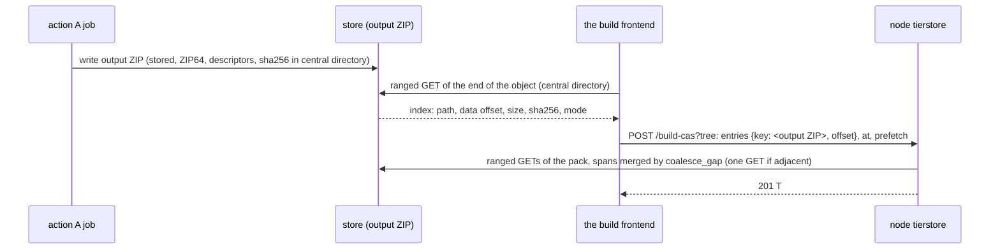

# Node-local trees: one create call, one tree, every interface

Status: **proposed (owner direction, 2026-11-15; revised 2026-11-15 after the owner answered Q1, Q2 and Q8 on pull request #320), not built.** This is a design for the owner's review; no code, no format and no lab change comes with it. What it says about today was read in the code of `main` (tierstore: `crates/tierstore/src/tree_manifest.rs`, `server/treefs/`, `server/fill_socket/`, `server/hydrate.rs`, `server/local_cache/`; the build frontend: the build-frontend crate: `src/action_tree.rs`, `action_tree/encode.rs`, `place.rs`, `memo.rs`, on the branch of its trees-in-objects-out design) and is marked **read**; what is not measured is marked **inferred**. Terms in bold are those of the glossary of [tierstore-design.md](tierstore-design.md) (section 17).

**The owner's answers (2026-11-15), now part of the design.** Q1: a tree file is a span of the cached pack; nothing is copied out of a cached pack. Q2: no reserved prefix and no reserved endpoint name; the create call states where the tree appears (a bucket and key prefix for S3, a path under the mount for fs), and a read of a key first checks whether the key falls under a tree's location on this node. Q8: the build frontend output object is a ZIP whose members are entries `{key, offset, size, sha256}`. Q3 to Q7 were answered later the same day: all of Q1 to Q8 are decided (section 16); only Q9, the issue number, is open.

The owner's direction (2026-11-15): "i don't like how we're specifically implementing a feature into just one interface of tierstore. Remember the fs is just one interface in tierstore. Like calling the objectstore API on trees/T will just return a manifest vs using the file system interface gets you something very different. That's not how tierstore is supposed to work. Like this create tree API on tierstore should create a tree that can be called from object store API or FS API. It does only need to live on that node though. And then it should prefetch everything into the local cache and then when the object store API or fs API fetches an object, then it can do the math of oh it's this object in the local cache with this offset and size."

## 1. The problem (read)

A **tree** today is a convention, not a thing tierstore owns:

- **The writer is the client.** The build frontend builds one `tree_manifest` v1 JSON object per directory of an action's input root (`action_tree/encode.rs`), checks each with tierstore's own `parse_manifest`, and stores each with an ordinary create-only S3 PUT to `cas/l/<sha256 of the manifest>` (`action_tree.rs`). A file child carries `sha256`, `size`, `exec` and, when its bytes are a span of a pack, `source: {key, offset}`; a directory child carries the child manifest's digest and length. `memo.rs` maps a REAPI `Directory` digest to its manifest so a shared subtree is built once. `place.rs` first makes every blob locatable (pack index, else a whole `cas/l/<sha256>`, else a write of the blob there).
- **Only one interface reads it as a tree.** `tierstore fs` (the `[fs]` process) presents `<mount>/trees/<digest>` as a directory: a lookup of an unattached digest reads the manifests through the fill socket (`fill <digest>`), flattens them (`flatten`), attaches the tree with no run, and fills file spans lazily by `fill <sha256> <size> from <key> @ <offset>` (`treefs/core/implicit.rs`, `treefs/attach.rs`, `treefs/control.rs`). jobscheduler mounts `/run/tierstore/fs/trees/<digest>` as a read-only layer of the job root, as an opaque host path.
- **Every other interface sees a manifest.** Through the S3 interface, `cas/l/<manifest digest>` is the JSON and nothing more; there is no path under it. The local cache's file for a span is named by the blob's digest, so the same span is a blob to the mount and a range of a pack object to S3.

So the interfaces disagree on what a tree is, and the feature (a tree as a directory) was built into one of them. The prefetch design ([prefetch-api.md](prefetch-api.md), built as `server/hydrate.rs`) has the same shape: the client names tree digests, and tierstore re-reads the manifests it was never given directly.

The owner's rule: a tree is a **core** object. It is created once, by a call on the node, and every interface resolves it with the same lookup. Everything below follows from that.

## 2. Decisions

| # | Decision | Reason |
|---|---|---|
| D1 | **A tree is a core object of the node, created by one call: `create tree`.** It is not an S3 object, not a tier object and not a mount-only feature. Each interface is an adapter over the core's `resolve(tree, path)`, `stat` and `list` (section 6). | The owner's rule; the same shape as the front-adapter / core split of [pluggable-interfaces.md](pluggable-interfaces.md). |
| D2 | **The create call is a gRPC API of its own, a `trees` interface in `[[interface]]`: `tierstore.trees.v1.TreesService` with `CreateTree`, `GetPlacement` and `DeleteTree`** (owner decision, 2026-11-15, tracking issue komira-ai/tierstore#326, replacing the `POST /<bucket>?tree` of the first draft). It reserves no key and no path on the S3 listener, and the local control socket does not carry it. The requests and answers of sections 3.2 and 3.3 are the proto messages of `crates/tierstore-trees-api/proto/tierstore/trees/v1/trees.proto` (the field set of the JSON documents there, in proto types), and each refusal of this document is a gRPC status (the code table is `server/trees/refusal.rs`; the name of the refusal is the message); where sections 3 to 5 write an HTTP method, path or status, read the call and status of that table. TLS is optional (`tls_cert_file`, `tls_key_file`), the port is a config key (default 9600), and a call is signed with the existing keys over its body (`x-amz-content-sha256` is the body's SHA-256) with no new permission. | The owner's decision: the create call is not S3, and a typed contract belongs in proto. The caller is the build frontend, which holds a key of the node already. |
| D3 | **The tree's identity is a Merkle digest of its content, independent of where the bytes were and of how the request grouped them.** (A tree of a version 2 tree list is named by the list's own digest instead: section 17.) The digest covers names, kinds, the full Unix mode of every file and directory (the root's included), symlink targets, and each file's `sha256` and `size`. It does not cover `{key, offset}`, which are where to fetch the bytes from, not what they are (section 4). | Content addressing is then real: the same tree has the same digest on every node and after a repack. Today's digest covers `source`, so the same tree from two pack layouts is two trees (tree-manifest.md: "Two encodings of one tree are two trees"). |
| D4 | **The canonical encoding is binary, one record per directory; the request is a separate, non-canonical JSON document that the server normalises.** The client library in the `tierstore` crate (which the build frontend already uses for `parse_manifest`) computes the digest, so a client may memoise it before the call. | Section 4.3 compares binary and canonical JSON. |
| D5 | **A file entry requires `sha256`.** A request without one is refused. | Ordinary objects are mutable (design section 16); a `{key, offset, size}` alone does not say which bytes the tree holds. The digest in the entry is what makes the tree content-addressed, and it is checked while the range is filled. The build frontend has the digest of every file. |
| D6 | **Prefetch is an option of the create call, `"prefetch"` with the values `none`, `background` or `wait`, default `wait` (`trees.prefetch_default`).** `none`: the placement exists when the call returns and a range is filled on its first read. `background`: the call returns at once, every range is pulled in the background and the placement reports readiness. `wait`: the call returns when every range is in the cache and pinned, or fails whole. There is no separate prefetch or hydrate API. | The owner's direction: hydrate is not a second API. One option with three values covers the lazy, the early-reply and the all-ready cases (section 5). `wait` is the default because the owner leans to prefetch everything and a job start then never waits on the network. |
| D7 | **A tree's file resolves to `(cached pack, offset, size)`: a span of the cached pack, never a copy.** Pins, eviction accounting and prefetch are per pack (the object the span is in); a whole object `cas/l/<sha256>` is a pack with one member at offset 0. Because a span is not a whole file, **FUSE passthrough is not used for it**: the mount serves the read through the process with a `pread` of the pack at `offset + start` (section 6.3). | The owner's Q1 answer: "do the math". The resolver's answer is the contract every interface uses, and the cache keeps one copy of each pack byte. |
| D8 | **Node-local.** The record and the placements live in the node's cache directory, are never written to a tier, and are invisible to every other node. | The owner: "it does only need to live on that node". Nothing to replicate means no consistency story. |
| D9 | **The create call says where the tree appears, per interface: for S3 a bucket and a key prefix chosen by the caller, for fs a path under the mount. A tree and a place it appears at are separate: the tree is content (`T`), the place is a *placement*.** A GET, HEAD or LIST first asks whether the key falls under a placement on this node; if so the tree answers, otherwise the request is an ordinary object request. No key space is reserved. | The owner's Q2 answer. A reserved prefix is a one-way door that hides user keys; a caller-chosen location puts the choice, and the collision check, where the knowledge is (section 6.4). |
| D10 | **The old convention stays readable.** `<mount>/trees/<digest>` and a digest that names no created tree are read as a v1 manifest at `cas/l/<digest>`, as today (section 8). | B8: formats change additively; a rollout may have both kinds of node. |
| D11 | **Every bound is a config key with a default** (section 9). | Tunables are config. |
| D12 | **`hydrate` is superseded by create with `prefetch`.** It stays accepted, unchanged and marked deprecated, for one release, then is removed (section 8.2). | B8: a client of the previous release keeps working through the rollout. |

## 3. What the call is

### 3.1 Which interface carries it, and how it is addressed

**Superseded by D2 (owner decision on komira-ai/tierstore#326):** the carrier is the gRPC `trees` interface, not the S3 listener. The comparison and the table of `?tree` calls below are the first draft's, kept for the reasoning; the calls are `CreateTree`, `GetPlacement` and `DeleteTree`.

| Carrier | For | Against |
|---|---|---|
| **S3 listener, `POST /<bucket>?tree` (recommended)** | The caller (the build frontend, or the Mac daemon to its loopback tierstore) already has the endpoint and a signed-request key; the call is node-local by the node it is sent to; no new socket, uid or port (minimal operator surface). | The S3 listener is the S3 interface; the create call is not S3. It is addressed as a flag on the bucket, which S3 already does for `?uploads`, `?tagging` and `?delete`, and the core does the work. |
| Local control socket (`tierstore fs`'s `control.sock`) | Local, no signing. | It belongs to `tierstore fs`, a separate process, so the call would be an fs feature, which is the thing the owner rejected. Its group is `fs.client_group`; the build frontend is not on the node and not in it. |
| Fill socket | The node's own process pair. | Mode 0600, the instance's own uid; made for `tierstore fs` to ask the cache for blobs. |
| Both S3 and a socket | A caller on the node need not sign. | Two contracts that must say the same thing; nothing on the node needs the socket (jobscheduler mounts a path and does not create trees). |

Recommendation: **the S3 listener only.** If a future interface needs to create trees locally, it calls the same core function that the endpoint calls; the carrier is not part of the core.

How the endpoint is addressed without reserving a name:

| Call | Meaning |
|---|---|
| `POST /<bucket>?tree` | create (3.2); the body is the request, the answer the result (3.3) |
| `GET /<bucket>?tree=<placement id>` | the state of one placement (its tree, locations, expiry) |
| `DELETE /<bucket>?tree=<placement id>` | release: remove the placement (section 7) |

The subresource `tree` is a query parameter of a **bucket** request, not a key and not a path segment, so it cannot be an object: a key is only what follows the bucket in the path. The bucket is the one the node serves; it is the bucket of every S3 location in the call. A release before this one answers an unknown `POST /<bucket>?tree` with an error and no side effect; a test on main pins what it answers before this is built (as prefetch-api's task 0 did for `hydrate`), and the build frontend's fallback (8.3) reads that answer.

`tierstore fs` does not need the call either: it is a reader (section 6.2).


### 3.2 The request

`POST /<bucket>?tree`, signed as any request. The body is one JSON document (`Content-Type: application/json`), at most `trees.max_request_bytes`:

```json
{
  "v": 1,
  "entries": [
    {"path": "bin/cc", "kind": "file", "mode": "0755", "sha256": "<64 hex>", "size": 1048576,
     "from": {"key": "cas/d/n7/b2/0000000000000041", "offset": 524288}},
    {"path": "include/empty.h", "kind": "file", "sha256": "e3b0c442...", "size": 0},
    {"path": "lib", "kind": "symlink", "target": "bin"},
    {"path": "toolchain", "kind": "tree", "tree": "<64 hex of a created tree>"}
  ],
  "at": [
    {"interface": "s3", "prefix": "jobs/1f3a/root/"},
    {"interface": "fs", "path": "jobs/1f3a/root"}
  ],
  "prefetch": "wait",
  "ttl": "4h"
}
```

- `entries` lists paths below the root. A path is `/`-separated names; each name follows today's rule (not empty, not `.` or `..`, no `/`, no NUL; tree-manifest.md). Directories are implied by the paths below them; an **empty** directory is `{"path": "x", "kind": "dir"}`. The order of `entries` is free; the server sorts.
- `file`: `sha256` and `size` of the contents, optional `mode` (below), and where to fetch them from: `from: {key, offset}`, the `size` bytes at `offset` of the object `key`. With no `from` the contents are the whole object `cas/l/<sha256>`, which is today's rule. A file of size 0 has no `from` and needs no fetch. 
- **Mode (the owner's Q4 answer): the full Unix mode bits, on every file and directory entry, and the tree digest covers them.** `mode` is a string of one to four octal digits, the permission bits plus setuid (04000), setgid (02000) and sticky (01000): `"0644"`, `"0755"`, `"4755"`, `"1777"`; the file-type bits are not carried (the `kind` says the type). Anything else is refused `bad mode`. A `file` with no `mode` is `0644` and a `dir` with no `mode` is `0755`; the server fills the default **before** it builds the record, so the digest never depends on whether the client wrote the default (a default is part of the format, not a node setting). A directory the paths imply, with no entry of its own, is `0755`; the root's mode is the request's `root_mode`, default `0755`. A symlink has no mode: it is served as `0777`, as a symlink always is, and the mode is not in its record. Owner and group are not carried: every entry is owned by the user the node serves (`fs.owner` on the mount). The build frontend maps REAPI's executable bit to `0755` and `0644`; a client with fuller modes (a toolchain's `4755` helper, a `1777` scratch directory) sends them.
- `symlink`: `target`, kept as the client wrote it (never resolved by the server).
- `tree`: **structural sharing.** The path holds the tree already created with that digest; the child is named by digest, and its entries are not sent again. The child must exist on this node when the call is made and is pinned for as long as the new tree lives (a child is a reference, section 7). A tree whose child is absent is refused `unknown child tree <digest>`; the client sends the child first (the build frontend's memo of `Directory` digest to tree digest tells it which it has sent). A `tree` entry at the root path (`""`) is refused.
- `at`: **where the tree appears**, one or more locations, each for one interface; at least one is required. An `s3` location is the call's bucket (the one in the URL, e.g. `build-cas`) and a key `prefix` chosen by the caller: it ends in `/`, is not empty, and is at most 1024 bytes less the longest path of the tree. The tree's path `bin/cc` is then the key `jobs/1f3a/root/bin/cc` of that bucket. An `fs` location is a `path` of names under the mount (the mount point is the node's `fs.mountpoint`; the call does not know it); it does not begin with the mount's own names `trees`, `views` or `put`, which are directories of the mount, not of any object namespace. A tree may be placed in several places by several calls, and in both interfaces by one. Each (tree, location set) is a **placement**; the answer names it (3.3).
- `prefetch`: `none`, `background` or `wait` (5.1); default `trees.prefetch_default`.
- `ttl`: how long the placement stays after the last reader goes (section 7), at most `trees.ttl_max`; default `trees.ttl`.

Validation, all before any fetch, each refused by name with the path of the entry (`400`):

| Check | Refusal |
|---|---|
| `v` is 1 | `unsupported tree version` |
| every name and every `sha256` is well formed; a path or a `target` is not too long | `unsupported entry name`, `malformed digest`, `path too long` |
| no two entries have one path; no file path is also a directory prefix of another entry | `duplicate path`, `file and directory at one path` |
| `from.key` is not under a reserved prefix, and not under any placement of this bucket on this node (a source is an ordinary object, never a tree's member) | `reserved key`, `source under a tree location` |
| every `at` location is well formed (an `s3` prefix ends in `/`, an `fs` path has valid names and no `trees`, `views`, `put` first) | `bad location` |
| no location overlaps an existing placement of this node (equal, inside, or containing it), except the same tree at the same location, which refreshes it | `409 location overlaps`, `409 location taken` |
| no ordinary object exists under an `s3` location: one `ListObjectsV2` of the prefix with `max-keys=1` at create | `409 location not empty` |
| `from.offset + size` fits in 64 bits | `range overflow` |
| entries at most `trees.max_entries`, depth at most `trees.max_depth` (4096), request at most `trees.max_request_bytes` | `tree too large`, `tree too deep`, `request too large` |
| total bytes of the files at most `trees.max_bytes`, and the new bytes of the tree fit under `local_cache.pin_limit` | `tree too large for the cache` (`507`) |
| the key may **read every source object** (`from.key`, or `cas/l/<sha256>`) and may **write every target location** (the `s3` prefix, as a PUT under it would need; the `fs` path, as the node's grant for it), each checked on its own against the key file's grants ([keys.md](../../crates/tierstore/docs/keys.md)); no new permission exists | `403`, naming the first key or location that failed |

`ttl` and the pins use the machinery of the holds of `hydrate` (prefetch-api D7), so a tree is, in code terms, a durable hold whose members are a directory structure.

### 3.3 The result

`201` with

```json
{"tree": "<T, 64 hex>", "placement": "<id>", "at": [
   {"interface": "s3", "bucket": "build-cas", "prefix": "jobs/1f3a/root/"},
   {"interface": "fs", "path": "jobs/1f3a/root"}],
 "entries": 1203, "files": 1100, "bytes": 83886080, "packs": 3,
 "filled": 42, "present": 1058, "fill_bytes": 5242880, "created": true, "expires_ms": 1763200000000}
```

`created: false` means the same tree was already placed at these locations on this node: the call refreshed its expiry and pinned nothing new (create is **idempotent** by tree and location). A tree already ready on the node that is placed at a new location is `created: true` with `fill_bytes` 0: only the placement is new. The server computes `T` from the normalised content and returns it; a client that computed `T` itself may send `"tree": "<T>"` in the request, and the server refuses a mismatch (`tree digest mismatch`). A failure is the refusals above, or section 5.4.

## 4. Identity and encoding

### 4.1 The digest

A **node** of a tree is a directory. Its canonical record (4.2) lists its children sorted bytewise by name; a file child holds its `sha256`, `size` and `mode`; a directory child's mode is in its own record; a symlink child its target; a directory child the **digest of the child's record**. The tree digest `T` is the digest of the root's record: `sha256` of its canonical bytes. So:

- The digest of a node depends only on what is below it. A subtree shared by two trees has one digest in both; a `tree` entry of the request names exactly that digest, so a request that sends a child by digest and one that sends its entries give the same `T`.
- A request is normalised by building the nodes bottom-up, so how the client grouped the entries (flat paths, or children by digest) is not part of `T`.
- Locations (`from`) are not in any record. A tree created from one pack layout and one created from another have one digest if the contents are equal.

### 4.2 The canonical record

(A tree of a version 2 tree list has no records and is read in place: section 17.)

One record per directory:

```text
magic   "TSTR" (4 bytes)
version u8 = 1
mode    u16 (big endian)            this directory's mode, 0 to 07777; any bit above is refused
count   uvarint                     children
child*  : kind u8 (1 file, 2 dir, 3 symlink; others refused)
          name_len uvarint, name bytes (UTF-8)
          file:    mode u16 (big endian, 0 to 07777), size uvarint, sha256 (32 bytes)
          dir:     sha256 of the child's record (32 bytes)
          symlink: target_len uvarint, target bytes
```

Children are strictly sorted by name (bytewise); a record that is not, or that has trailing bytes, or a varint that is not the shortest form, is refused. The digest is of exactly these bytes, so one tree has one encoding by construction: no normalisation step is needed to compare two records.

### 4.3 Binary or canonical JSON (recommend binary for identity)

| | Canonical binary (recommended) | Canonical JSON |
|---|---|---|
| One encoding per tree | By construction: a fixed field order, shortest varints, sorted children; a reader refuses anything else. | Needs a canonicalisation spec (key order, no whitespace, number forms, string escapes, Unicode normalisation); every client must implement it exactly, and a divergence is a different tree. This is the trap of v1: it avoided it by declaring non-canonical. |
| Size | A file child is about 45 + name bytes (inferred from the layout above). | A file child with a 64-hex digest and field names is about 110 + name bytes (inferred); 2 to 3 times larger. |
| Reading | One pass, no allocation for numbers; a directory is read without the rest of the tree. | Parse and re-serialise to verify. |
| Debugging | `GET /<bucket>?tree=<placement id>&listing` (3.1) renders it as JSON; the `tierstore` library gets a `tree show` verb. | Readable by eye. |
| Extension | A new field is a new `kind`, or a new version number (the mode bits above 07777, such as a type, are refused in v1 and are free for a later version), written only after readers know it (the rule of tree-manifest.md); a new version number changes digests. | Unknown fields are ignored by a reader, but must then be kept in the canonical form, or the digest differs between writers that know them. |

The input is JSON (3.2) because it is easy for any client to produce and is not canonical by design: the server is the only place that builds the canonical record from it. The client library offers the same function for clients that want the digest first. So there is **one canonical form, binary**, and one friendly input; the digest never depends on the input's byte layout.

### 4.4 Limits

`trees.max_entries` default 16,777,215 and `trees.max_depth` default 4096 are the limits of the format today (`MAX_ENTRIES`, `MAX_DEPTH`), kept so that a tree that was legal as a v1 manifest is legal here; both are config keys so a node may be stricter. `MAX_MANIFEST_BYTES` (64 MiB) has no counterpart: no single record is read whole (a record's size is bounded by `trees.max_dir_entries`, default 1,000,000, and a larger directory is refused `directory too large`).

## 5. Prefetch on create

### 5.1 The prefetch option

One option of the create call, three values (a `"prefetch"` member of the request, 3.2; the default is `trees.prefetch_default`):

| Value | The call returns | After it returns | A read of a range not yet filled | Failure |
|---|---|---|---|---|
| `none` | `201` once the request is validated, the record written and the placement made (no fetch) | state `lazy`: nothing is pulled; a range is filled when it is first read | fills it (below) | none at create; a read of a missing or wrong range fails by its own interface (`502` / `EIO`) |
| `background` | `202` at once, after the same steps; the pulls are queued | state `filling`, then `ready` or `failed`, read with `GET /<bucket>?tree=<placement id>` (3.1): `{state, files, filled_bytes, total_bytes, failures}` | joins the running fill and is promoted to run at once (prefetch-api D2, D5); a range not yet queued is an ordinary read-through | the placement stays, state `failed` with the first `trees.max_failures` entries named; the failed ranges are ordinary read-through misses |
| `wait` (default) | `201` when every range is in the cache and pinned, or an error with no placement | state `ready`: no read reaches the network | cannot happen | the whole create fails (5.4): no placement, nothing visible |

Why this shape, and what each interface does: **no interface needs a "not ready" answer**, because a read of a range that is not in the cache is not an error in any value: it is a fill. A read in `none` or `background` takes the first-read path: the cache fills the **whole member span** the read is in (the span is hashed against the entry's `sha256` as it fills, so a ranged GET or a `pread` of part of a file waits for the span, and a mismatch is `502 mismatch` on S3 and `EIO` on the mount), then serves the range from the cache; two reads of one span, and a read and a prefetch, are one fill. The readiness state is for the caller that wants to know (the build frontend may poll or may not), not for the interfaces.

`wait` is the default and the recommendation for a job: the call is sent when the action is placed, concurrently with other work (section 10), and a job that starts after it never opens a file that is not local. `background` is for a caller that must not wait (a placement it will use later, or a tree larger than it wants to block on); `none` is for a tree most of whose files will not be read, where the waste of pulling everything (prefetch-api Q3, inferred up to 40% of an input root's bytes) matters more than the first-read latency. A placement created with `none` or `background` can be completed later by creating it again with `wait` (idempotent, 3.3): the call pulls what is missing and returns when ready. The bounds of 5.2 apply to `background` and `wait` alike.


### 5.2 What a create does

1. Validate (3.2) and build the nodes (4.1), then check the locations (conflicts, 6.4). A placement that already exists for this tree and location is answered `created: false` and its `prefetch` may complete it (5.1).
2. Write the tree record (4.2, every node) into `local_cache.path/trees/<T>/` by rename, and the placement into `local_cache.path/placements/<id>` (6.4); make the placement visible. For `none` and `background` this is the end of what the call waits for.
3. For `background` and `wait`: **group the files by pack**, the object each file's span is in (`from.key`, or `cas/l/<sha256>` when there is no `from`). A file the cache already holds the span of (an extent of the pack's cache entry, 6.3) is marked used and pinned; that is the whole of the work for a warm tree.
4. **Dedup**: by (pack, range): two paths with one span are one fill; against running fills (the single flight table keyed by the pack entry; a range another create or a read is filling is joined, not fetched twice; prefetch-api D2).
5. **Plan the reads** per pack: sort the missing spans by offset and merge those whose gap is at most `trees.coalesce_gap` (default 256 KiB) into one ranged GET. If the pack is at most `local_cache.whole_fill_limit` (default 64 MiB) and the spans cover at least `trees.whole_pack_percent` (default 50) of it, read the whole pack in one GET instead. Each GET streams once: the bytes are written into the pack's cache entry at their offsets, and each member span is hashed as it passes (B16: read once, no whole-file buffering); gap bytes are written and not hashed, and are not recorded as filled. A span whose hash differs from its entry's `sha256`, or an object too short, fails (5.4).
6. **Bound the work**: at most `trees.fill_concurrency` (default 8) ranged GETs at once, per node, across all creates, on a pool of their own that never takes a foreground read's permit (the pool of `prefetch_concurrency`); at most `trees.fill_rate` (default `off`) bytes a second in total, a token bucket; the rest queue FIFO by create and, within a create, in the tree's path order. A foreground read of a span a create is filling joins the flight and is promoted (prefetch-api D5).
7. Pin each pack for the placement (the owner of a pin is `{mount: "tree", tree: <placement id>}`), once per pack however many members the tree has in it. `wait` answers `201` when every span is filled and pinned.

Admission is the rule of prefetch-api D6 and D10: a tree whose missing bytes do not fit under `high_water` (counting each pack's filled extents once) is refused `507 tree too large for the cache` for `wait` before any fetch; for `background` the placement is made and the pulls that do not fit are dropped and counted (`would_evict`), left to first-read fills. There is no partial `wait`.


### 5.3 Config keys (section 9) and where they come from

The pool, the queue and the flight table are those of `local_cache.prefetch_*`; `trees.*` adds the keys above. Every one has a default; none is required.

### 5.4 Partial failure

With `wait`, a create fails whole: no placement is made and nothing is visible. What was filled stays in the cache as unpinned extents of the packs (verified spans: a retry, or any read of that span, benefits) and is evicted in its turn. With `background` the placement stays (5.1) and the failures are in its state. With `none` there is nothing to fail at create. The answer names the first `trees.max_failures` (default 20) entries that failed:

| Failure | Status | Retry? |
|---|---|---|
| a range's source object is missing (`upstream 404`) | `404 source missing`, with key and path | after the client has written it |
| a blob's bytes do not hash to the entry's `sha256`, or the object is shorter than `offset + size` | `422 mismatch` / `422 short` | no: a client bug or an overwritten object |
| the upstream failed or timed out | `502 upstream` | yes; create is idempotent |
| fill pool or queue full (`trees.fill_queue`, default 16384 blobs) | `503 busy`, with `Retry-After` | yes |
| the cache is out of space (`critical`) or the new bytes would pass `pin_limit` | `507` | after eviction or a release |
| `trees.create_timeout` (default 120s) passed | `504`, the fills keep going to completion | yes: the next create finds them present |

A client that gets any of these from `wait` has no placement on the node for that tree and falls back as section 8.3 says.

## 6. One tree, every interface

### 6.1 The core operations

(A tree of a version 2 tree list has no records and is read in place: section 17.)

A **tree store** in the node's process (beside the local cache) holds the tree records and the placements, and answers, for a ready or filling placement and a path:

| Operation | Answer |
|---|---|
| `locate(interface, location)` | the placement a bucket and key, or a mount path, falls under, and the path below its root; or none |
| `resolve(placement, path)` | `Dir{mode, entries}`, or `File{pack, offset, size, mode, sha256}`, or `Symlink{target}`, or `NotFound` |
| `list(placement, path, after, limit)` | children of a directory in name order, paged |
| `stat(placement, path)` | the kind and size, with no data |

`pack` is a cache entry (a file in the node's cache directory, holding the whole object or some extents of it); `offset` and `size` say which of its bytes are the file. A read is `pread(pack, offset + start, len)` clipped to `size`, so a ranged read of the file is a range of the pack; no interface reads a manifest. A tree record is read when a directory is looked up, one directory at a time (4.2), so a lookup of `a/b/c` touches three records and none of the rest of the tree.

### 6.2 What each interface does with it

A request that names a location asks `locate` first; no match is an ordinary request, unchanged.

| Interface | Where the tree appears and what the request does |
|---|---|
| **S3** | At `<bucket>` and the `prefix` of the placement. `GET <prefix><path>`: `200` with the file's bytes, `Content-Length` the file's `size`, `ETag` the file's `sha256` (a quoted hex, as the object digests of design section 16 are rendered), `Last-Modified` the placement's creation time; `Range: bytes=a-b` works and is `206`; `HEAD` the same with no body. **The mode is exposed as `x-amz-meta-mode: <four octal digits>`** on `GET` and `HEAD` of a file (for example `x-amz-meta-mode: 4755`), so a client that copies the tree out of S3 can restore it; setuid, setgid and sticky are shown as stored. A directory has no object, so its mode is visible only through the mount; a `LIST` does not carry metadata. A path that is a directory: `GET` is `404 NoSuchKey` as S3 has no directory objects. `ListObjectsV2` with a `prefix` under the placement lists the children (directories as `CommonPrefixes` with `delimiter=/`, paged by the continuation token). A `LIST` whose prefix is above a placement (`jobs/` when the placement is `jobs/1f3a/root/`) lists the ordinary objects and the tree's keys merged in key order (the placement is a small sorted table: an in-range scan of it is merged into the upstream listing). A symlink answers `200` with an empty body and `x-amz-meta-symlink-target`. A write under the placement is refused (6.4). |
| **fs** (`tierstore fs`) | At `<mount>/<path>` of the placement (the intermediate names are directories of mode 0711, as the mount's root is: passed through, not listed). A lookup asks the tree store over the fill socket for `locate`/`resolve` (a read request, no new socket) and reads from the pack at the offset (6.3). `<mount>/trees/<digest>` stays the place of the old convention: a digest that is a v1 manifest. No manifest is parsed by the process for a created tree. **Modes are served as stored**: a file or directory reports exactly its mode, including setuid, setgid and sticky; the mount is mounted `nosuid`, so setuid and setgid have **no effect** there (a program runs as its caller), and the sticky bit on a directory is shown but has no effect on a read-only mount. They are carried so that the digest names the tree faithfully and so that a copy of it elsewhere is right. |
| **OCI front** | None. A registry reads blobs by digest; nothing in it addresses a path. |
| **A future interface** (GCS-flavoured front, a native client) | Calls `locate` / `resolve` / `list` / `stat` and maps the answers to its wire. The interface adds no tree logic of its own; the test of the design is that a new front is only an adapter. |

Whatever the interface, the answer to a given path is the same, because the same function gives it. A test asserts it: one tree placed in both interfaces, read through S3, through the core directly and through the fs core, compared byte for byte (section 11).

### 6.3 `(pack, offset, size)`: a span of the cached pack (the owner's Q1 answer)

A file of a tree is a span of the pack it is in. Nothing is copied out of a cached pack into a file of its own: the cache entry is the pack, and `resolve` gives `{pack, offset, size}`.

What this changes in the cache, read against `local_cache` as it is today (it keeps one file for each object, named by the SHA-256 of its key, with a sidecar of `key`, `size`, `sha256`, `tag`, `modified`; an object larger than `whole_fill_limit` is passed through and kept nowhere):

- **A pack entry may hold only some extents.** The entry is a sparse file of the object's full size with a sidecar that lists its **filled, verified extents** (`[offset, length]` ranges). Such entries live in a directory of their own, `extents-v1`, beside `digest-v1`, and never in it: every entry of `digest-v1` is a whole object, as every existing reader assumes, so a release that does not know extents ignores the directory and cannot serve a hole as a whole object (B8; a rollback leaves the directory unused and its bytes uncounted until it is removed by hand or the release is rolled forward again). An entry that fills to the whole object is moved into `digest-v1`. The start-up check that drops a file of another size than recorded holds (a sparse file has the full apparent size). A pack larger than `whole_fill_limit` can now be cached by extents: the limit stays the most that one ordinary read fills whole.
- **An ordinary read of the pack's key** (S3 GET of `cas/d/...`) treats an entry with extents as a miss for any range not covered, and fills or passes through as it does today; it never serves an unfilled hole.
- **Pins, eviction and accounting are per pack.** A placement pins the pack once however many of its members are in it; two trees that share a pack share its pin and its bytes. The bytes of a pack the tree does not use (gaps, and members of no tree) count against the budget when the whole pack was read (5.2, step 5) and are evicted with it. `pin_limit` counts the pack's filled bytes once.
- **A blob in two packs is held twice**, once in each (no dedup by digest across packs; a whole object `cas/l/<sha256>` is its own pack). This is the price of no copy; a repack that moves a member is a new pack and a new fill.
- **Prefetch is per pack**: the unit of the flight table, the pin and the plan of 5.2 is the pack; the plan reads the spans a tree needs, or the whole pack when they cover most of it.

**FUSE passthrough is not used for a span.** Passthrough asks the kernel to serve an open file from a backing file the process registers; the kernel maps the whole open file onto the whole backing file, so a member at offset 4096 of a pack would read the pack's first bytes. So for a file whose span is not the whole of its cache file (`offset == 0 && size == the entry's size`, the case of a whole object `cas/l/<sha256>`), the mount opens it as a cached open (the mode `fs.passthrough = false` already gives, and Linux 6.8 uses): reads the kernel's page cache does not have reach the process, which `pread`s the pack at `offset + start` (the macOS NFS path already does this). A whole-object file keeps passthrough, a member of a pack never does. `fs.max_backing_ids` then bounds only the whole-object files. The cost is a process read for each page-cache miss of a member (not measured; inferred to be a small factor over passthrough for large sequential reads and a larger one for many small files, and measured in task 8, section 15). A later kernel feature that maps a range (not in the Linux of the farm today) would remove the cost and change nothing above the mount's read path.

### 6.4 Locations, conflicts, writes and release

**Appearing.** A placement makes the tree's keys appear under an S3 location (the call's bucket and `prefix`) and its paths under an fs location. The check on a request: the S3 front asks `locate(bucket, key)` before any other work of GET, HEAD, LIST, PUT, DELETE, copy and multipart; the mount's lookup asks `locate(path)`. The table is in memory (rebuilt from `placements/` at a start), sorted by location; a prefix lookup tests the key at each `/` boundary, so it is a handful of map lookups, not a scan. No key is reserved: with no placement, the node serves every key as it did.

**Conflicts, decided.**

| Case | Rule | Why |
|---|---|---|
| A new location equal to, inside or containing an existing placement's location (same bucket, same interface) | **Refused**, `409 location overlaps`; the same tree at the same location is a refresh and the same location with another tree is `409 location taken`. | Two trees answering one key has no right answer, and an order of precedence would be one more rule for every reader to know. The caller chooses unique prefixes (the build frontend has `jobs/<id>/...`), so a refusal costs it nothing. |
| A new `s3` location over existing ordinary objects | **Refused**, `409 location not empty`, after one `ListObjectsV2` of the prefix with `max-keys=1` through the node's read path (a read of the caller's own namespace, not a probe of what the store can do). The alternative, shadowing them by rule (the tree wins, the objects become unreachable on this node), was rejected. | A silent shadow hides data and makes a LIST say less than the store holds; the refusal makes the mistake a failed call at the one place it can be seen. |
| An object written under a location **later, through another node** | Not seen by this node; the tree wins here, the object is in the tier. | A node cannot know another node's writes without a check on every request. It is a residual of the unique-prefix rule, which the caller keeps; said in the docs. |
| A tree's `from.key` under a placement | Refused at create, `source under a tree location` (3.2). | A source is an ordinary object; a source that a tree has shadowed would read back the tree. |

**Writes under a location are refused.** A `PUT`, `POST ?uploads` (and its parts), `DELETE` and `COPY` with a destination under a placement answer `409 TreeLocationReadOnly` (a tree is immutable); a copy with a source under a placement is allowed and reads the tree's bytes like a GET. A write to the mount under a location is `EROFS` (the mount is read-only).

**Release removes the location.** `DELETE /<bucket>?tree=<placement id>` removes the placement and its locations at once: the S3 keys stop appearing (a GET is then an ordinary GET of the same key) and the mount path stops resolving once no job holds it open (7). The tree record and the blobs follow the lifetime rules of section 7.

**Other limits.** A name below a tree may be any bytes but `/` and NUL (4.2), and an S3 key is at most 1024 bytes: the create refuses an `s3` location whose prefix plus the longest path of the tree passes it (`path too long for the location`); the mount has no such limit. No interface lists the placements of a node.


## 7. Scope, lifetime, restart, other nodes

**Node-local.** A tree and its placements are created on one node by a call to that node and exist in its `local_cache.path/trees/` and `placements/` only. Another node does not know them (a GET there is an ordinary GET) until it is sent the same call; the call is idempotent and the digest `T` is node-independent (4.1), so the build frontend can send the same request, with its own locations, to any node that will run the job. Nothing is written to a tier, replicated or forwarded: a chained tierstore whose upstream is another tierstore (config C of [tierstore-design.md](tierstore-design.md)) does not forward `POST /<bucket>?tree`, so a placement on the proxy is not a placement on its upstream, and the proxy's read of the upstream for a key sees the upstream's objects.

**Lifetime.** A placement is alive while it has a reference:

- **a lease**: from the last create or refresh until `ttl` (default `trees.ttl` = 4h, at most `trees.ttl_max` = 24h) later. A repeated create refreshes it.
- **an attachment**: a run of the mount that has attached the path (`attach <path> for <run>`, which already pins) holds it until `detach`; a lookup that attached it implicitly holds it until idle for `fs.tree_idle_secs` (default 900s).
- **an open S3 read** of a key under the placement holds it for the response.
- **a parent tree** that has the tree as a `tree` child holds the tree (not the placement) as long as the parent lives.

`DELETE /<bucket>?tree=<placement id>` is the **explicit release**: it removes the lease and the location (6.4); the placement's state goes when no attachment or open read holds it. When a tree has no placement and no parent it is dropped: the record is removed and the pins released, so its packs are evictable again in the cache's order. The packs stay until evicted: a tree placed again soon after is warm.

**Restart and update.** The record and the placement are files written by rename, with no fsync (the cache needs no durable writes: a partial file is detected after a crash, not prevented): a start reads `trees/` and `placements/`, drops a record that is short or does not hash to its digest, and a tree one of whose pack entries the cache lost (a file of another size than recorded is dropped by the cache's start) is dropped too; a placement of a dropped tree goes with it. A key is then an ordinary key again and the mount path is gone (`ENOENT`); the build frontend's memo of `T` is only a hint, and creating again is cheap when the packs are present. A `background` placement that was `filling` at a stop restarts its pulls from the extents the sidecar records. Leases are stored in the placement (the expiry time) and survive; attachments are re-made by `tierstore fs` (`attachments` file, as today). A hand-over of the S3 listener to a new instance (live update) needs nothing: the new instance holds the lock of the cache directory when the old one leaves and reads the directories as at a start; the in-flight creates of the old instance end with its drain (`503 busy` to the caller, who retries).

**What other nodes see: nothing.** There is no tree object in a tier, no listing, no metric across nodes.

**Eviction.** A placement's packs are pinned, so the cache's eviction does not take them while it is alive, up to `local_cache.pin_limit`; a `wait` create that would pass it is refused (5.2). Pins are bytes the node cannot evict, so `trees.ttl` is the lever: a job that has ended releases its placement.


## 8. Migration from the manifest convention

### 8.1 The sequence today and after


```mermaid
sequenceDiagram
    participant K as the build frontend
    participant N as node S3 listener
    participant C as tree store + cache
    participant U as upstream tier
    participant F as tierstore fs
    participant J as jobscheduler
    K->>N: POST /build-cas?tree {entries, at, prefetch: wait}
    N->>C: validate, build nodes, digest T, check locations
    C->>U: ranged GETs per pack (deduped, coalesced, bounded)
    U-->>C: bytes (written into the pack entry, member spans hashed as they pass)
    C->>C: write record and placement, pin packs
    N-->>K: 201 {tree: T, placement, at}
    K->>J: job with the fs path of the placement
    J->>F: mount <mount>/jobs/1f3a/root
    F->>C: locate, resolve(placement, path)
    C-->>F: pack, offset, size (local; no network)
    Note over N,C: GET build-cas/jobs/1f3a/root/path on S3 asks the same locate and resolve
```

### 8.2 What changes where

- **the build frontend**: `TreeWriter::write` stops storing one manifest per directory to `cas/l/`. It sends one create request per action tree to the node that will run the job: the entries of the action's input root and `the frontend metadata file`, plus one `tree` entry for the base tree (already created on the node, so the base is never resent), `at` an `s3` prefix `jobs/<id>/root/` and an `fs` path `jobs/<id>/root` (its own unique names), and `prefetch: wait`. `place.rs` keeps locating blobs, but `{key, offset}` goes into the call, and its fallback of writing an unlocated blob to `cas/l/<sha256>` stays (the create takes it as a whole object). Its memo of `Directory` digest to manifest becomes `Directory` digest to tree digest `T` (the answer or the client library's own computation), so a subtree shared with a previous action is a `tree` entry and not entries; `parse_manifest` checking is replaced by the library's builder. It releases the placement when the job ends.
- **jobscheduler**: nothing in its code. It mounts a host path as a read-only layer of the job root; the path is now `/run/tierstore/fs/jobs/<id>/root` (what the build frontend hands it) instead of `/run/tierstore/fs/trees/<T>`, and it is opaque to jobscheduler either way.
- **tierstore fs**: a lookup under the mount asks the tree store (`locate`, over the fill socket) for a placement, and falls back to the old manifest path for `trees/<digest>`. Attach and detach are unchanged in shape (they pin through the same table, now per pack).
- **`hydrate` is retired by this change, not kept as a second API (the owner's direction; Q5 answered).** It is built today (`server/hydrate.rs`: `hydrate {hold, expires_ms, trees}` and `release`, which expand v1 manifest digests into queued blobs). Create with `prefetch: background` or `wait` does what it does for any tree the client sends, and a placement is its hold. Retirement, per B8: (1) the release that adds create keeps `hydrate` and `release` accepted, unchanged and with no new feature, and documents them as deprecated; the old calls are counted (`hydrate_calls_total`, an existing counter) so the removal rests on a measurement, not a guess; (2) the build frontend stops calling them in the same change that calls create; (3) the next release removes them, in a pull request of their own, answering the paths as unknown. The alternative, mapping `hydrate` onto create with `prefetch: background` inside tierstore, was rejected: a hydrate carries v1 manifest digests and no locations, so it would be a create with a placement nobody asked for, and its `release` semantics (a hold shared by several calls) would have to be kept for one release anyway. Mapping buys nothing a release of keeping it does not.

### 8.3 Compatibility (B8): old trees stay readable

Nothing existing is renamed, removed or re-meant; the new format is a new record type and a new endpoint.

- A **v1 manifest** at `cas/l/<M>` is unchanged: `parse_manifest`, `flatten` and the golden `tests/stored_formats/tree_manifest.rs` stay. The fs process resolves a digest that names no created tree as it does today, so a tree the build frontend wrote before the rollout mounts and reads exactly as before. A digest is either a tree record (a created `T`) or, if none, a manifest at `cas/l/<digest>`; a v1 manifest and a record cannot be mistaken for each other (the record starts with the magic `TSTR` and is hashed as a whole, JSON starts with `{`; a collision of two SHA-256 is not considered).
- The S3 interface on a created tree is new (a placement under a prefix the caller chose, nothing reserved); on a v1 manifest digest, `cas/l/<M>` is still only the JSON. The owner's complaint holds for old trees only, and they age out (the manifests' own TTL in the build frontend's memo; a cleanup later).
- **Rollout order**, both sides additive: (1) release tierstore with the tree store, the endpoint, the S3 adapter and the fs resolver; (2) ship the build frontend, which calls create, and on the error a release before this gives to an unknown `POST /<bucket>?tree` (pinned by a test on main before this lands, 3.1) or `501` falls back to today's writer for that node, per call, no probe. A fallback job hands jobscheduler a manifest digest and the mount reads it by the old path; a node on the new release reads either. (3) Remove the fallback once every node runs the release; the manifest path stays in tierstore.
- **The test of B8** that the PR names: a release before this reads the cache directory a release after wrote (it ignores `trees/`, `placements/` and `extents-v1/`, and reads every file of `digest-v1` as before), and the release after reads a v1 manifest tree written by the one before and mounts it. There is also a golden test for the record's bytes (4.2), `tests/stored_formats/tree_record.rs`, with a fixture and its digest.
- **No cutover day**: the two conventions run side by side, per node, per job.

## 9. Configuration

A `[trees]` table of the node's file (a build node; a node with no `[local_cache]` answers `501 TreesNotAvailable`, as `hydrate` does). Every key has a default; none is required.

| Key | Default | Meaning |
|---|---|---|
| `trees.enabled` | `true` | `false` answers the endpoint `501` and makes no placement |
| `trees.ttl` | `4h` | lease of a tree with no `ttl` in the request |
| `trees.ttl_max` | `24h` | the longest `ttl` taken |
| `trees.max_entries` | 16777215 | entries of one create, below the root |
| `trees.max_depth` | 4096 | names on a path |
| `trees.max_dir_entries` | 1000000 | children of one directory |
| `trees.max_request_bytes` | `256MiB` | the body of one create |
| `trees.max_bytes` | `32GiB` | file bytes of one tree (the bound of `hydrate_max_bytes`) |
| `trees.max_placements` | 1024 | placements alive at once; a create over it is `429` |
| `trees.fill_concurrency` | 8 | ranged GETs of creates at once, node-wide |
| `trees.fill_rate` | `off` | bytes a second of all creates together, or `off` (never used; removed, see below) |
| `trees.fill_queue` | 16384 | blobs waiting; over it `503` (never used; removed, see below) |
| `trees.coalesce_gap` | `256KiB` | ranges of one object this near are one GET (never used; removed, see below) |
| `trees.prefetch_default` | `wait` | `none`, `background` or `wait`: the value of a create with no `prefetch` member |
| `trees.whole_pack_percent` | 50 (1 to 100) | the share of a pack (at most `local_cache.whole_fill_limit`) the needed spans must cover for the whole pack to be read in one GET (never used; removed, see below) |
| `trees.create_timeout` | `120s` | the longest a `wait` create waits for ready |
| `trees.max_failures` | 20 | entries a failure answer names |

As built, `trees.fill_rate`, `trees.fill_queue`, `trees.coalesce_gap` and `trees.whole_pack_percent` were read and range-checked but used by nothing; they are removed (section 13 of [fetch-cache-serve.md](fetch-cache-serve.md)), a file that still sets them loads with a warning for each, and how a pack's reads are planned, which the read plan of section 5 above (`coalesce_gap`, `whole_pack_percent`, `fill_rate`, `fill_queue`) proposed, is now section 6 of fetch-cache-serve.md.

Existing keys are reused: `local_cache.pin_limit`, `high_water`, `critical`, `prefetch_concurrency` and `prefetch_queue_ttl`.

## 10. Latency budget

Nothing below was measured; the shape is inferred from the work of 5.2, and the figures that matter are the ones to measure (section 12 and task 8).

| Case | Cost of a create | Job start |
|---|---|---|
| Warm: every blob and every child tree present | one request (the listing, about 45 bytes plus name per file entry, inferred: 100,000 files is about 7 MB) + validate and build nodes (CPU, one pass) + write the records + pin (no store request at all) | none beyond the create |
| Cold: missing bytes B in R merged ranges | request + `R / fill_concurrency` rounds of the store's service time (service time per request, not round trip, dominates) + `B / min(link, fill_rate)` + hash and write in the same pass + record | none beyond the create |
| A job with no create (fallback, old convention) | none | lookups and span fills at the job's first opens, lazily, as today |

The create is on the path of the job's start, so the client sends it **when it places the action**, concurrent with what else the frontend does for the job (the action's `the frontend metadata file`, the pack index, the job request), and the job request waits only on whatever remains. The saving is not the bytes, which a lazy mount would also fetch (a lazy mount fetches fewer when the job opens fewer files; a whole tree fetches the files the job never opens: prefetch-api Q3, inferred up to 40% of an input root's bytes), but that no open of a job waits for the network, and that a read that finds a range in flight joins it. `trees.max_bytes` and `fill_rate` bound the waste.

## 11. Tests (by name, behaviour)

Each is a behaviour test in Rust, hermetic, with the fake upstream of the cache tests and an injected clock (T10, T12); none is built yet.

- `tree_digest_ignores_source_and_grouping`: the same entries with other `from` locations, and the same tree sent flat and as child trees by digest, give one `T`.
- `tree_record_is_canonical`: a record with unsorted children, a non-minimal varint, trailing bytes or an unknown kind is refused; the golden bytes and digest are pinned.
- `create_validates_by_name`: each refusal of 3.2 with the entry's path.
- `create_fetches_each_range_once`: two paths with one span, two creates at once, and a read that joins, make one GET each; adjacent ranges within the gap are one GET and a gap over it are two.
- `create_wait_is_ready_or_absent`: with `prefetch: wait`, a failure of one range (404, short, mismatch, upstream error) leaves no placement and nothing visible; the filled extents are unpinned; a retry succeeds without refetching them.
- `prefetch_none_fills_on_first_read`, `prefetch_background_reports_readiness_and_joins_reads`: `none` makes no store request at create and fills the whole member span at the first read, hashed; `background` answers `202`, its state goes `filling` to `ready`, a read mid-fill joins the flight and is promoted, and a failed range is a `failed` state and an ordinary miss; creating again with `wait` completes it.
- `span_of_cached_pack_is_not_copied`: two members of one pack are two spans of one cache entry; the pack is pinned once; no second file holds their bytes; an ordinary GET of the pack key never serves an unfilled hole.
- `mount_reads_pack_member_without_passthrough`: a member of a pack is opened as a cached open and read by `pread` at `offset + start`; a whole-object file keeps passthrough.

- `s3_get_head_range_list_agree_with_core`: GET, ranged GET, HEAD and LIST under the placement's prefix give the core's `resolve`/`list`, and a LIST above it merges tree and ordinary keys; a directory is `404` on GET; a symlink; paging.
- `fs_core_reads_created_tree_without_manifest`: the mount core resolves a placement path, reads at the offset, and never reads `cas/l/<T>`.
- `old_manifest_tree_still_mounts`: a v1 manifest tree mounts and reads as before.
- `key_outside_every_location_is_an_ordinary_object`, `overlapping_or_nonempty_location_is_refused`, `write_under_a_location_is_refused`, `release_removes_the_location`: a key that falls under no placement behaves as before this change; an overlapping location and a location over an existing object are `409`; PUT, multipart, DELETE and copy into a placement are `409`; after release the same key is an ordinary key again.
- `hydrate_still_accepted_for_one_release`: the old call answers as before and is counted.
- `tree_survives_restart_and_drops_when_a_blob_is_lost`, `ttl_attachment_and_parent_references_keep_a_tree`, `release_unpins_and_leaves_packs_evictable`.
- `wait_create_over_pin_limit_is_507_before_any_fetch`.

## 12. Failure modes and edge cases

| Case | Behaviour |
|---|---|
| the S3 listener is a read-only instance (does not hold the cache directory lock) | create `503 SlowDown`; reads under a placement are served from the records (they are files) |
| a storage node (no `[local_cache]`) | `501 TreesNotAvailable` |
| a key or path under no placement on a node | an ordinary object request, or `ENOENT`: the client creates the placement |
| two creates of one tree at once | one does the work; the other joins its blobs and sees the same record (`created` is true for the first only) |
| the source object is overwritten after a `wait` create | no effect: the cache holds the verified spans; a create after it with the old digest fails `mismatch`. With `none` or `background` the first read of a span not yet filled fails `mismatch` |
| the same pack in many trees | one cache entry, one pin per placement; unpinned when the last placement goes |
| a prefix plus a path over 1024 bytes | an `s3` location is refused at create (6.4); an `fs`-only placement serves it |
| a name that is not valid UTF-8 | refused at create (4.2 is UTF-8 only; REAPI names are) |
| a tree larger than the cache | `wait`: `507` before any fetch; `background`: the pulls that do not fit are dropped and counted |
| the node's disk full during a create | `507`; the partial files are removed |
| a client creates a tree it never reads | the lease ends it at `ttl` |
| the cache directory is on a stacked file system | refused at start, as the mount already refuses it |
| auth: a key that cannot read the source keys, or cannot write under an `s3` location | `403`; a read under a placement is judged as a read of that key, so a tree is not a way to read what the key could not (the create checks the key may read every source) |

## 13. A per-action output object is "just an object" (the ZIP)

An action's outputs are written as one object, named by the writer (for example `out/<action digest>/<n>`), and are not individually named in the store. They enter a tree the way every other object does: **an entry of a create request that names the object and a range**. Nothing about the format of the object is known to tierstore.

The owner's answer (Q8, 2026-11-15) for the build frontend output object: **a ZIP with stored (uncompressed) entries, ZIP64, data descriptors, and the SHA-256 of each member in an extra field of its central-directory record.** The central directory at the end of the object is the footer file index; a frontend that reads it gets, per member, its name, the member's size, its `sha256` and the offset of its local header. It then builds the entries `{path, kind: file, sha256, size, mode, from: {key: <object>, offset}}`:

- **stored** means the member's bytes in the object are the file's bytes, so the span `{offset of the data, size}` is exactly the file and a ranged read of the object is a read of the file;
- **ZIP64** keeps offsets and sizes above 4 GiB representable;
- **data descriptors** mean the local header holds no sizes (they follow the data), so the writer streams; the sizes come from the central directory, which is why the index, not the local headers, is the source;
- **the `sha256`** is what D5 requires of every entry, so the client can compute `T` before the call and the content check of D3 is present. The answer to Q8 is yes: the footer carries each member's `sha256`.

One point for the build frontend design, since it is cheap now and costly later: a member's *data* offset is its local header's offset plus 30, plus the local header's name length and extra length, which the central directory does not carry (the local extra field may differ from the central one). So the index must record the **data offset** itself, or the frontend reads each local header (one more small ranged GET per member, 8 to 64 bytes). tierstore takes `offset` as the offset of the first data byte. The `mode` comes from the central directory's external attributes (the Unix mode in the high 16 bits when the entry says it was made on Unix, setuid, setgid and sticky included); that, too, is for the build frontend design to fix.



A downstream action's input tree is then entries into the upstream actions' output ZIPs, with no copy and no `cas/l/<sha256>` write; the cache holds each ZIP once, as a pack, and the members are spans of it (6.3). The object may be overwritten later (it is an ordinary object, not content-addressed); this is harmless after a `wait` create, since the cache holds the verified spans, and a create after an overwrite fails `mismatch` rather than serving other bytes.


## 14. Consistency with tierstore's tiers and docs

- **Ordinary objects keep the S3 contract, unchanged.** tierstore makes no content-addressing promise for them (design section 16: a digest is a record kept per object, not an identity); a key can be overwritten and `cas/l/<sha256>` is a convention of the writer. **Trees are the one content-addressed thing**: `T` names exactly one set of names and bytes, and every file's digest is checked at create. This document says so in the glossary (section 17) when it is built.
- **Tiers.** A create reads the sources through the node's normal read path (local cache, then hot, then cold, whichever the upstream chain is). It writes nothing to a tier and changes no entry's placement, state or eviction. The reconciler, the journal and the `_entries/` records never see a tree or a placement. A tree is local-cache state only, which is why it needs no model check of the entry lifecycle.
- **Local cache.** Records live in `local_cache.path/trees/` and placements in `placements/`; packs are cache entries (a new `extents-v1` directory for partial ones, 6.3); pins use the existing pin table, per pack; fills use the single flight table; the budget, marks and `pin_limit` apply. Nothing new is accounted for outside the cache's budget except the records, which are small (inferred: about 50 bytes a file entry), counted into it.
- **Docs to change in the PRs that build it (P10, T19)**: `tree-manifest.md` (says "no process of tierstore reads or writes a manifest yet", already stale given the fs process; and gains a pointer to the record), a new `trees.md`, `configuration.md` (`[trees]`), `clients.md` (the endpoint, placements), `keys.md` (the grants), `metrics.md`, `operations.md` (lifetime, restart), `docs/stored-formats.md` (the record), `prefetch-api.md` (hydrate superseded: deprecated for one release, then removed), `virtual-build-fs.md` (the fs resolves through the tree store; no passthrough for a pack member), and the glossary of tierstore-design.md.

## 15. Tasks, one pull request each, smallest first (P7; none started)

| # | Where | Task |
|---|---|---|
| 1 | tierstore | The record format and the builder in the `tierstore` crate: `TreeRecord`, the normaliser from entries, the digest, the golden fixture. An interface, no behaviour. |
| 2 | tierstore | Tree store core: records on disk, `resolve` / `list` / `stat`, leases and references, restart, over the cache's pins. No HTTP. |
| 3 | tierstore | Cache: pack entries by extents (`extents-v1`), per-pack pins and flights; then create: validation, dedup, coalesced bounded fills, the `prefetch` option; `[trees]` keys. |
| 4 | tierstore | S3 adapter: `POST /<bucket>?tree`, `GET` and `DELETE` of `?tree=<id>`, `locate` before every object request, GET, ranged GET, HEAD, LIST under and above a placement, refusal of writes and conflicts. A test on main first pins what a release before this answers to the unknown `POST ?tree`. |
| 5 | tierstore | fs resolver: `locate` and `resolve` by placement before a manifest, cached opens for pack members (no passthrough), fallback to the manifest path. |
| 6 | the build frontend | The frontend creates trees and memoises `T`, with the per-call fallback. After 1 to 5 are released. |
| 7 | both | Measure on node-05 and the farm Mac (unknowns of section 10); then remove the fallback; `hydrate` is removed in the release after the one that deprecates it (8.2). |

3 to 5 may be reviewed in parallel once 2 is in. The design's one-way doors (the digest definition, the record bytes, the `?tree` subresource and the placement's body, the `extents-v1` directory) are all decided in this document before task 1.

## 16. Open questions for the owner

- **Q1 (answered 2026-11-15).** A tree file is a span of the cached pack; no copy; pins and prefetch per pack; no FUSE passthrough for a pack member (6.3).
- **Q2 (answered 2026-11-15).** No reserved prefix or endpoint name; the create call states where the tree appears (bucket and prefix, mount path); a read first checks the placement table; overlapping and non-empty locations are refused; writes under a location are refused; release removes the location (6.4).
- **Q3 (answered 2026-11-15).** Prefetch is an option of create, `none | background | wait`, default `wait` (5.1).
- **Q4 (decided 2026-11-15).** Full Unix mode (permission bits, setuid, setgid, sticky) on every file and directory entry, covered by the tree digest; defaults `0644` file, `0755` directory, filled before the digest; served as stored, setuid and setgid without effect on the `nosuid` mount; the S3 interface exposes a file's mode as `x-amz-meta-mode` (3.2, 4.2, 6.2).
- **Q5 (answered 2026-11-15).** `hydrate` is not a separate API: it is superseded by create with `prefetch`, kept accepted for one release and then removed (8.2).
- **Q6 (decided 2026-11-15).** Each file's `sha256` is required (D5). A request without it is refused, so the digest is computable by the client before the call and every span is verified as it is filled.
- **Q7 (decided 2026-11-15, option a).** No new permission. A create needs read on every source object and write on every target location, checked per object and per location (3.2); a read under a placement is judged as a read of that key.
- **Q8 (answered 2026-11-15).** The build frontend output object is a ZIP (stored, ZIP64, data descriptors, SHA-256 in a central-directory extra field); the footer carries each member's `sha256` (section 13).
- **Q9.** The issue this work is tracked under: the commit says `Refs komira-ai/tierstore#274`; no issue exists for it.
## 17. Addendum: a tree served from its version 2 tree list

A tree the mount provider makes of a version 2 tree list (the `TSTREE` format, `crates/tierstore/docs/tree-manifest.md`) departs from D3 and from 4.2 and 6.1: the list is the tree. Its entries are fixed records in breadth-first order, each directory's children next to one another and sorted by name, so the node reads them in place and makes nothing of them: no record, no per-directory digest and no name or path per entry.

- **Identity.** Such a tree is named by the SHA-256 of the list's bytes, the digest of the key `cas/l/<digest>` it is stored under, which the provider checks on a thread of its own beside the walk. It is not a Merkle digest of the content: the same entries in a version 1 list and in a version 2 list are two trees, alike at every path, and a tree of records cannot hold such a tree by digest (`UnknownChild`). The two kinds of digest never meet: a record begins with its magic, a list with `TSTREE`.
- **Store.** The tree's directory holds the list as it is, `trees/<digest>/image`, written beside the walk and renamed into place by the create; a start keeps it if it hashes to its name and is a list the reader takes. `resolve`, `stat` and `list` read the entries in place: a lookup of `a/b/c` is three binary searches of the children of three directories, with no file read.
- **Mount.** `tierstore fs` (FUSE on Linux, the NFSv3 server on macOS) asks the fill socket `image <placement>`, reads the list from the tree's directory and serves it in place: an entry's inode is its index under the placement's tree number, a listing is the range of a directory's children, a lookup is a binary search, and an attribute is the entry's record. A mount of the release before asks `flat`, which flattens such a tree in the list's order, so the two releases number its entries alike across a hand-over.
- **Reads.** Each file is read at its own span (the list says it); a span several files have is read once.
