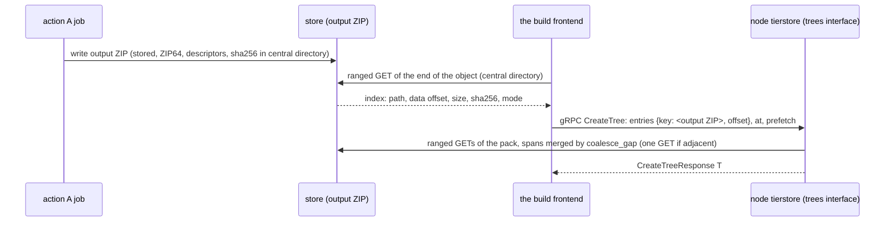

# Node-local trees: one create call, one tree, every interface

Status: **proposed (owner direction, 2026-11-15; revised 2026-11-15 after the owner answered Q1, Q2 and Q8 on pull request #320; revised again 2026-11-15 after the owner moved the create call off the S3 interface, and a third time on 2026-11-15 after the owner answered the open questions Q9 to Q16: the transport is gRPC with the types in proto, section 18), not built.** This is a design for the owner's review; no code, no format and no lab change comes with it. What it says about today was read in the code of `main` (tierstore: `crates/tierstore/src/tree_manifest.rs`, `server/treefs/`, `server/fill_socket/`, `server/hydrate.rs`, `server/local_cache/`; the build frontend: the build-frontend crate: `src/action_tree.rs`, `action_tree/encode.rs`, `place.rs`, `memo.rs`, on the branch of its trees-in-objects-out design) and is marked **read**; what is not measured is marked **inferred**. Terms in bold are those of the glossary of [tierstore-design.md](tierstore-design.md) (section 17).

**The owner's answers (2026-11-15), now part of the design.** Q1: a tree file is a span of the cached pack; nothing is copied out of a cached pack. Q2: no reserved prefix and no reserved endpoint name; the create call states where the tree appears (a bucket and key prefix for S3, a path under the mount for fs), and a read of a key first checks whether the key falls under a tree's location on this node. Q8: the build frontend output object is a ZIP whose members are entries `{key, offset, size, sha256}`. Q3 to Q7 were answered later the same day: all of Q1 to Q8 are decided (section 16); Q10 (not on S3) is answered; and the owner then answered Q9 and Q11 to Q16 (the issue, **gRPC with the types in proto**, TLS and a default port, the proto crate, `fs` as its own type, and two defaults taken). No question is open (section 16). The work is tracked in komira-ai/tierstore#326 (`Refs komira-ai/tierstore#326`).

The owner's direction (2026-11-15): "i don't like how we're specifically implementing a feature into just one interface of tierstore. Remember the fs is just one interface in tierstore. Like calling the objectstore API on trees/T will just return a manifest vs using the file system interface gets you something very different. That's not how tierstore is supposed to work. Like this create tree API on tierstore should create a tree that can be called from object store API or FS API. It does only need to live on that node though. And then it should prefetch everything into the local cache and then when the object store API or fs API fetches an object, then it can do the math of oh it's this object in the local cache with this offset and size."

The owner's second direction (2026-11-15, on #320): "this tree API shouldn't be on the S3 interface on tierstore. That's not quite right. Any s3 client should talk to the s3 interface. This should be like a different API for different clients to call." So the create call, and the release and state of a placement, are **not S3**: they are the `trees` API, an `[[interface]]` entry of its own (3.1 to 3.7). The S3 interface only reads a placement, as plain S3; it never knows how a tree was made. Everything else the owner decided stands. The change is logged in section 18, and the model check of the placement table is section 17.

The owner's third direction (2026-11-15, on #320, answering the open questions): "grpc. [...] Yes it can support TLS, any port is fine. Request and response types should be defined in proto. Yes filesystem stays its own interface type. [...] Yes create tracking issue." So the `trees` API is a **gRPC service** (`tierstore.trees.v1.TreesService`: `CreateTree`, `GetPlacement`, `DeleteTree`), its request and response types are defined in a `.proto` file (3.2), its listener supports optional TLS and has a default port that is a config key (3.7), and the tracking issue is komira-ai/tierstore#326. Everything else stands; the HTTP and JSON of the second revision are replaced, not kept beside it.

## 1. The problem (read)

A **tree** today is a convention, not a thing tierstore owns:

- **The writer is the client.** The build frontend builds one `tree_manifest` v1 JSON object per directory of an action's input root (`action_tree/encode.rs`), checks each with tierstore's own `parse_manifest`, and stores each with an ordinary create-only S3 PUT to `cas/l/<sha256 of the manifest>` (`action_tree.rs`). A file child carries `sha256`, `size`, `exec` and, when its bytes are a span of a pack, `source: {key, offset}`; a directory child carries the child manifest's digest and length. `memo.rs` maps a REAPI `Directory` digest to its manifest so a shared subtree is built once. `place.rs` first makes every blob locatable (pack index, else a whole `cas/l/<sha256>`, else a write of the blob there).
- **Only one interface reads it as a tree.** `tierstore fs` (the `[fs]` process) presents `<mount>/trees/<digest>` as a directory: a lookup of an unattached digest reads the manifests through the fill socket (`fill <digest>`), flattens them (`flatten`), attaches the tree with no run, and fills file spans lazily by `fill <sha256> <size> from <key> @ <offset>` (`treefs/core/implicit.rs`, `treefs/attach.rs`, `treefs/control.rs`). jobscheduler mounts `/run/tierstore/fs/trees/<digest>` as a read-only layer of the job root, as an opaque host path.
- **Every other interface sees a manifest.** Through the S3 interface, `cas/l/<manifest digest>` is the JSON and nothing more; there is no path under it. The local cache's file for a span is named by the blob's digest, so the same span is a blob to the mount and a range of a pack object to S3.

So the interfaces disagree on what a tree is, and the feature (a tree as a directory) was built into one of them. The prefetch design ([prefetch-api.md](prefetch-api.md), built as `server/hydrate.rs`) has the same shape: the client names tree digests, and tierstore re-reads the manifests it was never given directly.

The owner's rule: a tree is a **core** object. It is created once, by a call on the node, and every interface resolves it with the same lookup. Everything below follows from that.

## 2. Decisions

| # | Decision | Reason |
|---|---|---|
| D1 | **A tree is a core object of the node, created by one call of its own API (3.1): `create tree`.** It is not an S3 object, not a tier object and not a mount-only feature. Each interface is an adapter over the core's `resolve(tree, path)`, `stat` and `list` (section 6). | The owner's rule; the same shape as the front-adapter / core split of [pluggable-interfaces.md](pluggable-interfaces.md). |
| D2 | **The create call is not an S3 call. It is the `trees` API: its own interface, `[[interface]] type = "trees"`, its own listener (TLS optional), a gRPC service `tierstore.trees.v1.TreesService`, signed with the same tierstore keys.** `CreateTree` creates, `GetPlacement` states, `DeleteTree` releases (3.1). The S3 interface gets no tree verb: no `?tree` subresource and no reserved key; it only reads a placement as plain S3 (6.2). | The owner (2026-11-15, section 18): "Any s3 client should talk to the s3 interface. This should be like a different API for different clients to call." The caller is the build frontend on another host, so it is a network API with its own limits, version and TLS, as `oci` has; no new permission and no new key kind (3.4). The transport is the owner's (D13). |
| D3 | **The tree's identity is a Merkle digest of its content, independent of where the bytes were and of how the request grouped them.** The digest covers names, kinds, the full Unix mode of every file and directory (the root's included), symlink targets, and each file's `sha256` and `size`. It does not cover `{key, offset}`, which are where to fetch the bytes from, not what they are (section 4). | Content addressing is then real: the same tree has the same digest on every node and after a repack. Today's digest covers `source`, so the same tree from two pack layouts is two trees (tree-manifest.md: "Two encodings of one tree are two trees"). |
| D4 | **The canonical encoding is binary, one record per directory; the request is a separate, non-canonical protobuf message that the server normalises.** The client library in the `tierstore` crate (which the build frontend already uses for `parse_manifest`) computes the digest, so a client may memoise it before the call. The wire types are not in that crate but in `tierstore-trees-api` (D13). | Section 4.3 compares binary and canonical JSON. |
| D5 | **A file entry requires `sha256`.** A request without one is refused. | Ordinary objects are mutable (design section 16); a `{key, offset, size}` alone does not say which bytes the tree holds. The digest in the entry is what makes the tree content-addressed, and it is checked while the range is filled. The build frontend has the digest of every file. |
| D6 | **Prefetch is an option of the create call, `"prefetch"` with the values `none`, `background` or `wait`, default `wait` (`trees.prefetch_default`).** `none`: the placement exists when the call returns and a range is filled on its first read. `background`: the call returns at once, every range is pulled in the background and the placement reports readiness. `wait`: the call returns when every range is in the cache and pinned, or fails whole. There is no separate prefetch or hydrate API. | The owner's direction: hydrate is not a second API. One option with three values covers the lazy, the early-reply and the all-ready cases (section 5). `wait` is the default because the owner leans to prefetch everything and a job start then never waits on the network. |
| D7 | **A tree's file resolves to `(cached pack, offset, size)`: a span of the cached pack, never a copy.** Pins, eviction accounting and prefetch are per pack (the object the span is in); a whole object `cas/l/<sha256>` is a pack with one member at offset 0. Because a span is not a whole file, **FUSE passthrough is not used for it**: the mount serves the read through the process with a `pread` of the pack at `offset + start` (section 6.3). | The owner's Q1 answer: "do the math". The resolver's answer is the contract every interface uses, and the cache keeps one copy of each pack byte. |
| D8 | **Node-local.** The record and the placements live in the node's cache directory, are never written to a tier, and are invisible to every other node. | The owner: "it does only need to live on that node". Nothing to replicate means no consistency story. |
| D9 | **The create call says where the tree appears, per interface: for S3 a bucket and a key prefix chosen by the caller, for fs a path under the mount. A tree and a place it appears at are separate: the tree is content (`T`), the place is a *placement*.** A GET, HEAD or LIST first asks whether the key falls under a placement on this node; if so the tree answers, otherwise the request is an ordinary object request. No key space is reserved. | The owner's Q2 answer. A reserved prefix is a one-way door that hides user keys; a caller-chosen location puts the choice, and the collision check, where the knowledge is (section 6.4). |
| D10 | **The old convention stays readable.** `<mount>/trees/<digest>` and a digest that names no created tree are read as a v1 manifest at `cas/l/<digest>`, as today (section 8). | B8: formats change additively; a rollout may have both kinds of node. |
| D11 | **Every bound is a config key with a default** (section 9). | Tunables are config. |
| D12 | **`hydrate` is superseded by create with `prefetch`.** It stays accepted, unchanged and marked deprecated, for one release, then is removed (section 8.2). | B8: a client of the previous release keeps working through the rollout. |
| D13 | **The transport is gRPC, and the request and response types are defined in proto (the owner, 2026-11-15, Q11 and Q13).** The `.proto` is `crates/tierstore-trees-api/proto/tierstore/trees/v1/trees.proto`, package `tierstore.trees.v1`, built by `build.rs` with tonic and prost into the new crate `tierstore-trees-api` (messages, client and server stubs, no logic); it is kept additive by rule and by a test (3.2). The listener is the `oci` listener's parts with HTTP/2, TLS optional and a default port (3.7); calls carry the tierstore keys as SigV4 in the call's headers (3.4). | The owner's choice. Read: `Cargo.lock` has `h2` and no `tonic` or `prost`, so the dependency set is new and `cargo deny` judges it in task 3 (R6); a crate of its own keeps the HTTP stack and the generated code out of `tierstore`'s default features and lets the frontend take the client half alone. |

## 3. What the call is

### 3.1 A separate gRPC API with its own interface entry

**The owner's decisions (2026-11-15).** The create call is not an S3 call ("Any s3 client should talk to the s3 interface. This should be like a different API for different clients to call."), and its transport is **gRPC, with the request and response types defined in proto** (Q11, section 16). So:

- **The S3 interface is the S3 protocol and nothing else.** It has no tree verb, no subresource, no reserved key. The only thing it learns about trees is a read-side lookup (6.2): a GET, HEAD or LIST whose key falls under a placement of this node is answered from the placement, as plain S3.
- **The `trees` API is a different API for a different client.** Its caller is the build frontend (and, on a Mac, the daemon to its loopback tierstore), which makes trees. It is its own entry of the config-only `[[interface]]` list (3.7), with its own listener, limits and TLS settings, as the `oci` front has: one more front over the same proxy and core, in the sense of [pluggable-interfaces.md](pluggable-interfaces.md), a wire API decoded into the core's canonical operations (`create`, `stat`, `release`, section 6.1). `tierstore fs` stays what it is, a process of its own with an `[fs]` table and not an `[[interface]]` type (Q14, decided); it is a reader of trees like the S3 interface.
- **The service is `tierstore.trees.v1.TreesService`**, three unary calls, defined in `trees.proto` (3.2). The `v1` is in the proto package, so the service path on the wire is `/tierstore.trees.v1.TreesService/CreateTree`; a later incompatible service is a `v2` package served beside it.
- **Nothing else of the design changes.** Node-local trees, explicit locations, no reserved prefix, a file as a span of the cached pack, the `prefetch` option, the full Unix mode, a required `sha256`, and no new permission all stand. The API authenticates with the same tierstore keys (3.4) and adds no key kind.

**Which carrier** (unchanged by the transport):

| Carrier | For | Against |
|---|---|---|
| **A `trees` interface: its own network listener (chosen)** | The caller is not on the node (the build frontend runs on the services NUC and calls the build node where the job will run), so it must be a network API; it gets TLS, a connection limit and a message limit of its own, a version in its package, and a place in the config list like every other front; the S3 interface stays pure. | One more port to open on a build node, and one more `[[interface]]` entry in the packaged config (3.7). |
| An S3 subresource (`POST /<bucket>?tree`) | No new port. | **Rejected by the owner.** It makes the S3 interface carry a tierstore verb; its limits are those of an object store and the API could not be versioned, limited or turned off without touching S3. |
| Local control socket (`tierstore fs`'s `control.sock`) | Local, no signing. | A unix socket does not reach the NUC; it belongs to the fs process, so the call would be an fs feature. |
| Fill socket | The node's own process pair. | Mode 0600, the instance's own uid, for `tierstore fs` to ask the cache for blobs; not a network API. |

A caller on the node itself (a future interface) does not need a carrier: it calls the same core function the `trees` interface calls.

**What gRPC costs in the tree, and how the design keeps it small** (read from `Cargo.lock` and `crates/tierstore/Cargo.toml` on `main`; the rest is **inferred** and is checked by `cargo tree` and `cargo deny` in task 3):

- `tierstore` depends on `hyper` with `http1` and `server` only, and `rustls` / `tokio-rustls` for the `oci` front. `Cargo.lock` has `h2` (the HTTP/2 implementation) but neither `tonic` nor `prost`. The listener of the `trees` interface is built from the same parts as the `oci` listener (a TCP accept loop, an optional `tokio-rustls` acceptor, `hyper-util` to serve each connection) with hyper's `http2` feature on, so TLS, connection limits and the drain are the code `oci` already has, not a second server stack. `tonic` is taken with its default features off (`codegen`, `prost`): the generated service is a `tower` service that this listener serves; tonic's own transport is not used.
- **A request over 4 MiB.** tonic's default message limit is 4 MiB, and a tree of 100,000 files is near it (about 45 bytes plus the name per entry in the canonical record, more in a message: a few MB, inferred). The server sets `max_decoding_message_size` to `trees.max_request_bytes` (256 MiB default) and the client library sets the same on its side; there is no streaming create, so there is one message and one signature (3.4). The entry list is metadata, never blob data: it is decoded whole, which is what any decoder of it does (B16 concerns blob bytes, which never pass through this API).
- **HTTP/2 flow control.** An HTTP/2 stream starts with a 65,535-byte window, so a multi-megabyte request would stall for a window update every 64 KiB, one round trip each (inferred from the protocol default). The listener therefore sets the initial stream and connection windows to `trees` param `window` (default `16MiB`, 10) and the client library does the same, so a large create is one flight of data, not a ladder of round trips. Section 10 prices it.
- **No compression** in v1: the server answers a request that names a `grpc-encoding` other than `identity` `UNIMPLEMENTED` (it does not claim a codec it has not measured), so the digest of 3.4 is of the bytes as sent. A codec is additive later.

**The service and its three calls** (every call is signed, 3.4):

| Call | Meaning |
|---|---|
| `CreateTree(CreateTreeRequest) returns (CreateTreeResponse)` | create the tree and its placement (3.2, 3.3) |
| `GetPlacement(GetPlacementRequest) returns (GetPlacementResponse)` | the state of one placement: its tree, locations, `prefetch` state and expiry (3.5); with `list` set, the children of a directory of the tree, paged (a debugging read) |
| `DeleteTree(DeleteTreeRequest) returns (DeleteTreeResponse)` | release: remove the placement (section 7) |

There is no update of a tree (a tree is immutable; a changed tree is another tree), no list of placements (6.4) and no streaming call.

### 3.2 The proto, and the request

**Where it lives and how it is built.** The types are defined in `crates/tierstore-trees-api/proto/tierstore/trees/v1/trees.proto`, package `tierstore.trees.v1`, in a **new crate `tierstore-trees-api`** (Q13, section 16): the `.proto`, a `build.rs` that runs `tonic-prost-build` on it (with the `protoc` of the `protoc-bin-vendored` crate, so no CI runner or host needs `protoc` installed; **inferred** that the crates are permissive, which `cargo deny` checks in task 3, R6), and the generated messages with the client and server stubs. It holds no logic. Why a crate and not a module of `tierstore`: the build frontend must depend on the types and the client stub without the `server` feature's HTTP stack, `tierstore` itself keeps no HTTP stack in its default features (its `Cargo.toml`), and generated code is easiest to hold to the coverage floor (T1, T4: no exclusion) in a crate whose only content it is. The crate has two features, `client` and `server`, which switch `build_client` and `build_server` of the generator, so each consumer compiles, and is measured on, only the half it uses; its own tests turn both on through the dev-dependency on itself (as `tierstore` does for `server`) and run a real round trip. `tierstore` depends on it behind its `server` feature; the build frontend depends on it with `client`. The record builder and the digest function (section 4) stay in the `tierstore` crate (task 1), as the frontend already depends on that crate for `parse_manifest`.

**The proto** (the wire contract; a field is the unit of the one-way door, so the numbers are final):

```proto
syntax = "proto3";
package tierstore.trees.v1;

service TreesService {
  rpc CreateTree(CreateTreeRequest) returns (CreateTreeResponse);
  rpc GetPlacement(GetPlacementRequest) returns (GetPlacementResponse);
  rpc DeleteTree(DeleteTreeRequest) returns (DeleteTreeResponse);
}

message CreateTreeRequest {
  repeated Entry entries = 1;
  repeated Location at = 2;
  Prefetch prefetch = 3;            // PREFETCH_UNSPECIFIED: the node's trees.prefetch_default
  optional uint32 ttl_secs = 4;     // unset: trees.ttl
  optional uint32 root_mode = 5;    // unset: 0755
  optional bytes tree = 6;          // the client's own digest T (32 bytes), checked
}

message Entry {
  string path = 1;                  // "/"-separated names below the root
  oneof kind {
    File file = 2;
    Dir dir = 3;                    // an empty directory, or one with a mode of its own
    Symlink symlink = 4;
    ChildTree tree = 5;             // structural sharing: a tree already created on this node
  }
}

message File {
  optional uint32 mode = 1;         // permission bits, setuid, setgid, sticky: 0 to 07777; unset: 0644
  bytes sha256 = 2;                 // 32 bytes, required
  uint64 size = 3;
  optional Source from = 4;         // unset: the whole object cas/l/<sha256>
}

message Source { string key = 1; uint64 offset = 2; }   // the size bytes at offset of the object key
message Dir { optional uint32 mode = 1; }                // unset: 0755
message Symlink { string target = 1; }
message ChildTree { bytes tree = 1; }                    // 32 bytes

message Location {
  oneof where {
    S3Location s3 = 1;
    FsLocation fs = 2;
  }
}
message S3Location { string bucket = 1; string prefix = 2; }   // prefix ends in "/"
message FsLocation { string path = 1; }                        // names under the mount

enum Prefetch {
  PREFETCH_UNSPECIFIED = 0;
  PREFETCH_NONE = 1;
  PREFETCH_BACKGROUND = 2;
  PREFETCH_WAIT = 3;
}

enum PlacementState {
  PLACEMENT_STATE_UNSPECIFIED = 0;
  PLACEMENT_STATE_LAZY = 1;
  PLACEMENT_STATE_FILLING = 2;
  PLACEMENT_STATE_READY = 3;
  PLACEMENT_STATE_FAILED = 4;
}

message CreateTreeResponse {
  bytes tree = 1;                   // T, 32 bytes
  string placement = 2;             // the id (3.5)
  repeated Location at = 3;
  uint64 entries = 4;
  uint64 files = 5;
  uint64 bytes = 6;
  uint64 packs = 7;
  uint64 filled = 8;                // spans this call filled
  uint64 present = 9;               // spans already in the cache
  uint64 fill_bytes = 10;
  bool created = 11;                // false: the same tree was already placed at these locations
  uint64 expires_ms = 12;
  PlacementState state = 13;        // READY for wait, FILLING for background, LAZY for none
}

message GetPlacementRequest {
  string placement = 1;
  optional ListDir list = 2;        // set: also the children of one directory
}
message ListDir { string path = 1; string after = 2; uint32 limit = 3; }   // limit 0: 1000

message GetPlacementResponse {
  string placement = 1;
  bytes tree = 2;
  PlacementState state = 3;
  repeated Location at = 4;
  uint64 files = 5;
  uint64 total_bytes = 6;
  uint64 filled_bytes = 7;
  repeated Failure failures = 8;    // at most trees.max_failures
  uint64 created_ms = 9;
  uint64 expires_ms = 10;
  uint32 attachments = 11;
  repeated DirEntry children = 12;  // when list was set
  string next = 13;                 // pass as list.after; empty at the end
}

message Failure { string path = 1; string code = 2; }       // code: the reason of 3.6
message DirEntry {
  string name = 1;
  EntryKind kind = 2;
  uint32 mode = 3;
  uint64 size = 4;
  bytes sha256 = 5;                 // files
}
enum EntryKind { ENTRY_KIND_UNSPECIFIED = 0; ENTRY_KIND_FILE = 1; ENTRY_KIND_DIR = 2; ENTRY_KIND_SYMLINK = 3; }

message DeleteTreeRequest { string placement = 1; }
message DeleteTreeResponse {}
```

**How the proto is kept additive (B8).** Field numbers are never reused or renumbered, and a removed field is `reserved` by number and name; a field's type and a `oneof` member are never changed; a new field is `optional`, `repeated` or a new message, so an old reader skips it and an old writer's message still means what it did (proto3 has no required fields, and none is added by convention either); an enum gets new values only, with `0` always `UNSPECIFIED`; the service, the methods and the package name are the paths on the wire and are never renamed; a change that cannot be additive is a `v2` package. This is enforced by a test, not by review alone: the crate checks in the file descriptor set of the released `trees.proto` as a golden, and `trees_proto_is_additive` fails when the current proto lacks any message, field number, field type, `oneof` member, enum value, service or method of the golden, or has one of them changed (a removed field, a renumbered field and a retyped field each fail it). A second test, `trees_proto_golden_bytes_decode_both_ways`, holds the encoded bytes of a request and a response and decodes them with the current types, and decodes a message with an added field with the golden types, which is the "previous release on new data and the reverse" test B8 asks the PR to name.

**The request.** `CreateTree` on the `trees` interface, signed (3.4). The message is at most `trees.max_request_bytes`. Reading it:

- `entries` lists paths below the root. A path is `/`-separated names; each name follows today's rule (not empty, not `.` or `..`, no `/`, no NUL, not beginning `.wh.`; tree-manifest.md). Directories are implied by the paths below them; an **empty** directory is a `dir` entry. The order of `entries` is free; the server sorts.
- `file`: `sha256` and `size` of the contents, optional `mode` (below), and where to fetch them from: `from {key, offset}`, the `size` bytes at `offset` of the object `key`. With no `from` the contents are the whole object `cas/l/<sha256>`, which is today's rule. A file of size 0 has no `from` and needs no fetch.
- **Mode (the owner's Q4 answer): the full Unix mode bits, on every file and directory entry, and the tree digest covers them.** `mode` is the number of the permission bits plus setuid (04000), setgid (02000) and sticky (01000), 0 to 07777 (`0o755` is 493; the text of this document writes octal). A value above 07777 is refused `BadMode`. A `file` with no `mode` is `0644` and a `dir` with no `mode` is `0755`; the server fills the default **before** it builds the record, so the digest never depends on whether the client wrote the default (a default is part of the format, not a node setting). A directory the paths imply, with no entry of its own, is `0755`; the root's mode is `root_mode`, default `0755`. A symlink has no mode: it is served as `0777` and the mode is not in its record. Owner and group are not carried: every entry is owned by the user the node serves (`fs.owner` on the mount). The build frontend maps REAPI's executable bit to `0755` and `0644`; a client with fuller modes (a toolchain's `4755` helper, a `1777` scratch directory) sends them.
- `symlink`: `target`, kept as the client wrote it (never resolved by the server).
- `tree`: **structural sharing.** The path holds the tree already created with that digest; the child is named by digest and its entries are not sent again. The child must exist on this node when the call is made and is pinned for as long as the new tree lives (a child is a reference, section 7). A tree whose child is absent is refused `UnknownChildTree`; the client sends the child first (the build frontend's memo of `Directory` digest to tree digest tells it which it has sent). A `tree` entry at the root path (`""`) is refused.
- `at`: **where the tree appears**, one or more locations, each for one interface; at least one is required. An `s3` location is a `bucket` (one the node serves, e.g. `build-cas`) and a key `prefix` chosen by the caller: it ends in `/`, is not empty, and is at most 1024 bytes less the longest path of the tree. The tree's path `bin/cc` is then the key `jobs/1f3a/root/bin/cc` of that bucket. An `fs` location is a `path` of names under the mount (the mount point is the node's `fs.mountpoint`; the call does not know it); it does not begin with the mount's own names `trees`, `views` or `put`, which are directories of the mount, not of any object namespace. A tree may be placed in several places by several calls, and in both interfaces by one. Each (tree, location set) is a **placement**; the answer names it (3.3).
- `prefetch`: `NONE`, `BACKGROUND` or `WAIT` (5.1); unspecified is `trees.prefetch_default`.
- `ttl_secs`: how long the placement stays after the last reader goes (section 7), at most `trees.ttl_max`; unset is `trees.ttl`.

Validation, all before any fetch, each refused by name with the path of the entry as `INVALID_ARGUMENT` (or the code of 3.6 that the row names), the reason being the CamelCase of the refusal:

| Check | Refusal |
|---|---|
| every name and every `sha256` (32 bytes) is well formed; a path or a `target` is not too long; a file has a `sha256` | `UnsupportedEntryName`, `MalformedDigest`, `PathTooLong`, `MissingSha256` |
| no two entries have one path; no file path is also a directory prefix of another entry | `DuplicatePath`, `FileAndDirectoryAtOnePath` |
| `from.key` is not under a reserved prefix, and not under any placement of this bucket on this node (a source is an ordinary object, never a tree's member) | `ReservedKey`, `SourceUnderTreeLocation` |
| every `at` location is well formed (at least one; an `s3` bucket is one this node serves, an `s3` prefix ends in `/`, an `fs` path has valid names and no `trees`, `views`, `put` first) | `BadLocation` |
| no location overlaps an existing placement of this node (equal, inside, or containing it), except the same tree at the same location, which refreshes it | `LocationOverlaps`, `LocationTaken` (`ALREADY_EXISTS`) |
| no ordinary object exists under an `s3` location: one `ListObjectsV2` of the prefix with `max-keys=1` at create, after the placement is entered as `reserved` (6.4, section 17) | `LocationNotEmpty` (`FAILED_PRECONDITION`) |
| `from.offset + size` fits in 64 bits; a mode is at most 07777 | `RangeOverflow`, `BadMode` |
| entries at most `trees.max_entries`, depth at most `trees.max_depth` (4096), message at most `trees.max_request_bytes` | `TreeTooLarge`, `TreeTooDeep`, `RequestTooLarge` (`RESOURCE_EXHAUSTED`) |
| total bytes of the files at most `trees.max_bytes`, and the new bytes of the tree fit under `local_cache.pin_limit` | `TreeTooLargeForCache` (`RESOURCE_EXHAUSTED`) |
| the key may **read every source object** (`from.key`, or `cas/l/<sha256>`) and may **write every target location** (the `s3` prefix, as a PUT under it would need; an `fs` path only by the full key, 3.4), each checked on its own against the key file's grants ([keys.md](../../crates/tierstore/docs/keys.md)); no new permission exists | `PERMISSION_DENIED`, reason `AccessDenied` (`FsLocationNeedsFullKey` for an `fs` location from a key that is not the full key), naming the first key or location that failed |

`ttl_secs` and the pins use the machinery of the holds of `hydrate` (prefetch-api D7), so a tree is, in code terms, a durable hold whose members are a directory structure.

### 3.3 The result

`CreateTreeResponse` (the proto above): `tree` is `T`, `placement` the id, `at` the locations as placed, the counts, and `state`: `READY` after a `wait` create, `FILLING` after a `background` one and `LAZY` after a `none` one. gRPC has no `201` and `202`; the state is the answer to what those statuses said.

`created: false` means the same tree was already placed at these locations on this node: the call refreshed its expiry and pinned nothing new (create is **idempotent** by tree and location). A tree already ready on the node that is placed at a new location is `created: true` with `fill_bytes` 0: only the placement is new. The server computes `T` from the normalised content and returns it; a client that computed `T` itself may send it as `tree`, and the server refuses a mismatch (`TreeDigestMismatch`). A failure is the refusals above, or section 5.4; the form of an error is 3.6.

### 3.4 Authentication and TLS

**The tierstore keys, carried as SigV4 in the call's HTTP/2 headers.** A gRPC call is an HTTP/2 request, and its metadata are its headers, so a call carries exactly what a signed S3 request carries and the verifier of `server/auth.rs` (`verify(config, &Parts)`, which takes the head of the request and nothing else) checks it unchanged:

- `authorization`: `AWS4-HMAC-SHA256 Credential=<key id>/<date>/<region>/s3/aws4_request, SignedHeaders=host;x-amz-content-sha256;x-amz-date, Signature=<hex>` (`REQUIRED` in `auth.rs`), made with one key of [keys.md](../../crates/tierstore/docs/keys.md): the full key, a read-only key, or a scoped key. The signature names the key by its id, so key ids stay unique across the file as today.
- `x-amz-date`: the signing time; the same skew window as S3 (`SKEW_MILLIS`); the clock is the server's injected clock.
- `x-amz-content-sha256`: the SHA-256, in hex, **of the serialized protobuf message** (the payload of the one length-prefixed gRPC message, after its 5-byte prefix, as sent; there is no compression, 3.1). A call with no message body (none exists today) signs the empty digest.
- The canonical request is the one S3 uses: the method `POST`, the canonical URI **`/tierstore.trees.v1.TreesService/CreateTree`** (the method being called), no query, the signed headers above with `host` the `:authority` the client connected to (the adapter copies `:authority` into the `host` the verifier reads, since HTTP/2 has no `Host` header; **inferred**, the test below pins it), and the body digest. So the signature covers **which call, to which host, when, and every byte of the request**: a signed `GetPlacement` cannot be replayed as a `DeleteTree`, nor a `CreateTree` body altered.

**Why this and not a bearer.** A bearer derived from the key (an HMAC of the date, for example) would be replayable against any call and any body for its whole validity, and without TLS it would travel in clear; the lab's plain-listener case (Q12) makes that matter. The SigV4 form binds the call and the body, never sends the secret, reuses the one verifier, the same key files, the same clock-skew rule and the same refusal texts (`MISMATCH`, `SKEWED`, `UNKNOWN_KEY`), and the build frontend's client library already holds a signer for the S3 requests it makes. The cost is that the signer needs the bytes before it sends, which a unary message gives it for free, and that a generic gRPC tool (`grpcurl`) cannot call the service without the signature headers; a person reads a placement with the library's `tree show` verb or the `GetPlacement` list (4.3). A new token checked by an interceptor was rejected: it is a new credential kind, which Q7 forbids.

**Where it is checked.** A `tower` layer in front of the generated service, so the handlers never see an unchecked call: (1) on the request head, `verify` runs before the body is read; a failure is `UNAUTHENTICATED` (reason `Unauthenticated`, the refusal's own text and nothing more) and the body is not read; (2) the layer then reads the one message into memory, up to `trees.max_request_bytes` (a longer `content-length` or frame prefix is `RESOURCE_EXHAUSTED` before any byte is read), hashing as it reads, and compares the digest with `x-amz-content-sha256`; a difference is `INVALID_ARGUMENT`, reason `BodyDigestMismatch`, and the call goes no further; (3) only then does tonic decode the checked bytes and call the handler with the key's role. One pass hashes and collects; the message is held whole because the decoder needs it whole (3.1), which is the entry list and never blob data. There is no new key file, no new key kind and no new permission (Q7): what a key may do on a create is the pair of checks of 3.2, read on every source and write on every target location, judged against the key's grants by the existing grant code (`scoped.rs`, `keys.rs`):

| Key | CreateTree | GetPlacement, DeleteTree |
|---|---|---|
| full | yes | its own placements |
| scoped, with read prefixes over every source and a write prefix over every `s3` location, and **no `fs` location** | yes | its own placements |
| scoped, with an `fs` location in the request | no: `PERMISSION_DENIED`, `FsLocationNeedsFullKey` | its own placements |
| read-only | no: it may not write a location (`PERMISSION_DENIED`) | its own placements |
| presigning, GC, presigned URL | no (`PERMISSION_DENIED`) | no (`PERMISSION_DENIED`) |

(A *scoped key* is the existing key kind of keys.md: read, create and delete under the prefixes its file lists. Nothing here adds to it.)

**The fs half of the rule (a default taken, Q15).** A key file grants read, create and delete on object-key prefixes (keys.md) and has no grant on a mount path, so no existing grant can say "this key may write this `fs` path". The rule with no new permission is the one the keys already imply: the mount is served as the node's whole namespace and only the full key is "everything the server serves", so **an `fs` location is accepted only from the full key**; a scoped key (and a read-only key) that names one is refused before any fetch, and may place the same tree at an `s3` location it holds a write prefix for. The build frontend's key on the NUC is the full key of the lab, so its creates are unaffected. The mount itself is read-only and its reads are unchanged.

A placement belongs to the key that created it (the rule of a hold of `hydrate`, keys.md): another key that names the id is answered `NOT_FOUND`, `NoSuchPlacement`, whatever its rights; the same create by another key at the same location is `LocationTaken`. A read of a key under a placement, through the S3 interface, is judged as a read of that key by the reader's own key (section 12); a tree is not a way to read what the key could not.

**TLS (the owner's Q12 answer: supported).** `tls_cert_file` and `tls_key_file` params of the `trees` entry, optional and per listener, both or neither, read once at start (the key file refused if others can read it), the keys the `oci` entries already take and the same checks. With both, the listener is HTTPS and its ALPN offers `h2` only (gRPC needs HTTP/2); with neither it is **plain HTTP/2 over TCP with prior knowledge (h2c)**, which gRPC clients speak as a plain `http://` channel, and off loopback each such address prints one warning line at start, as `oci` does. The signature protects the call from tampering and replay within the skew window (the secret never travels), but it does not hide the entries or the answer, so a deployment that crosses a network it does not trust gives the certificate. Both modes are supported from the first release; which one the lab's packaged file uses is a config line, not a design question (3.7).

### 3.5 GetPlacement and DeleteTree

`GetPlacement` answers the `GetPlacementResponse` above: `placement`, `tree`, `state` (`LAZY`, `FILLING`, `READY` or `FAILED`, 5.1), `at`, `files`, `total_bytes`, `filled_bytes`, `failures` (at most `trees.max_failures`), `created_ms`, `expires_ms`, and `attachments`, the count of runs of the mount holding it (section 7). A placement that has expired, been released, or been dropped at a restart is `NOT_FOUND`, `NoSuchPlacement`. With `list {path, after, limit}` set, `children` is the children of a directory of the tree, name, kind, mode, size and `sha256`, in name order, at most `limit` (default 1000, at most `trees.max_dir_entries`) and a `next` to pass as `after`; a path that is not a directory is `NOT_FOUND`, `NoSuchPath`. It reads the same records as an S3 LIST and a mount `readdir`, and exists so a person can see a tree without a mount.

`DeleteTree` answers an empty `DeleteTreeResponse` and is idempotent in effect: the placement and its locations go at once (6.4), and a second `DeleteTree` of the same id is `NOT_FOUND`, `NoSuchPlacement`, which a client treats as released. A caller that lost the answer of a create can name the placement: the id is the first 32 hex digits of the SHA-256 of `T` and the sorted locations, so the same create always names the same placement and a client can compute it.

### 3.6 Errors

Every error is a gRPC status: a code, a short message, and, in the status details (`grpc-status-details-bin`, the `google.rpc.Status` the gRPC error model defines), one `google.rpc.ErrorInfo` with `domain = "tierstore.trees.v1"`, `reason` the CamelCase code, and `metadata` with `path` (the entry path) and `key` (the object key) when there are any; a `RetryInfo` accompanies `Busy`. The message carries no key material and no secret, and repeats at most the first 256 bytes of a name (the `echo_bytes` rule of the `oci` front). The details are in the status, so a client that reads only the code still acts right and one that reads the reason can tell the refusals of a code apart. The refusal table of the earlier HTTP form maps to the gRPC codes as follows (one reason per row of 3.2 and 5.4; the reason is the message of the refusal in CamelCase, `unsupported entry name` is `UnsupportedEntryName`):

| gRPC code | Reasons | When |
|---|---|---|
| `INVALID_ARGUMENT` | the reasons of the table of 3.2 that are not named below; `BodyDigestMismatch`, `TreeDigestMismatch`, `MissingSha256`, `UnknownChildTree`, `BadMode`, `BadLocation` | the request is malformed or refused before any fetch; `path` names the entry |
| `UNAUTHENTICATED` | `Unauthenticated` | no valid signature, an unknown key id, a clock out of the window; the answer says which and nothing more |
| `PERMISSION_DENIED` | `AccessDenied`, `FsLocationNeedsFullKey` | the key may not read a source or write a location, or a call a key may not make (3.4); `key` or `path` names the first that failed |
| `NOT_FOUND` | `NoSuchPlacement`, `NoSuchPath`, `SourceMissing` (5.4) | an id that is unknown, expired or another key's; a path that is not in the tree; a source object that is not in the store |
| `UNIMPLEMENTED` | `NoSuchRoute` | a service or method this node does not serve (a `v2` call on a node with only `v1`), which gRPC itself answers, and a `grpc-encoding` other than `identity` |
| `ALREADY_EXISTS` | `LocationOverlaps`, `LocationTaken` | 6.4 |
| `FAILED_PRECONDITION` | `LocationNotEmpty` (6.4); `Mismatch`, `Short` (5.4) | the state is not what the call needs: an object under the location, or a source that is not the bytes the entry says |
| `RESOURCE_EXHAUSTED` | `RequestTooLarge`, `TreeTooLarge`, `TreeTooDeep`, `TooManyPlacements`, `OutOfSpace`, `TreeTooLargeForCache` | over a bound of 3.2, `trees.max_placements` alive, or the cache's space (5.4) |
| `UNAVAILABLE` | `Upstream`, `Busy` (with `RetryInfo`), `NotServing` | 5.4; the upstream failed; the node is draining (the connection is closed with a `GOAWAY`, 3.7); and `NotServing` when this process does not hold the cache directory lock (a read-only instance, section 12) |
| `DEADLINE_EXCEEDED` | `Timeout` | `trees.create_timeout` passed, or the client's own `grpc-timeout` did (5.4) |

A request that is not gRPC at all (no `application/grpc` content type) gets the HTTP status `415` from the HTTP/2 layer, as tonic's server does. An error never leaves a placement or a pin behind. A call is idempotent, so a client retries `UNAVAILABLE` (after the `RetryInfo` delay when there is one) and `DEADLINE_EXCEEDED`, and no other code; `RESOURCE_EXHAUSTED` is retried only after the caller has released a placement or the cache has evicted.

### 3.7 The interface entry, and how a client finds it

```toml
[[interface]]
type = "trees"
params = { port = 9301, tls_cert_file = "/etc/tierstore/trees.crt", tls_key_file = "/etc/tierstore/trees.key" }
```

`type = "trees"` is a new `[[interface]]` type (additive, B8: a release before this refuses the type by name and has no other effect). Its params follow the `oci` entry, every one with a default, so an entry of `{}` is a valid plain-h2c listener (tunables are config):

| Param | Default | Meaning |
|---|---|---|
| `port` or `addresses` | `port = 9301` (**the default port, a config key**) | where it listens; the wildcard of IPv4 at `port`, or exactly the `addresses` (a list of `ip:port`); either one overrides the default; the port is the next to the S3 interface's 9300 and is any free port by config |
| `tls_cert_file`, `tls_key_file` | none (plain h2c) | both or neither; certificate chain leaf first, with an IP subjectAltName for each listen address; read once at start |
| `max_connections` | 64 (at least 1) | connections open at once; a connection over it is closed at accept |
| `connection_lifetime` | `1h` | the longest a connection lives; at its end the server sends a `GOAWAY`, lets in-flight calls finish, and the client reconnects |
| `handshake_timeout` | `10s` | the TLS handshake of a new connection (and the HTTP/2 preface on a plain one) |
| `body_timeout` | `30s` | the longest the server waits for the next piece of a request message |
| `window` | `16MiB` | the initial HTTP/2 stream and connection flow-control window (3.1) |
| `max_concurrent_streams` | 128 | calls in flight on one connection |
| `keepalive_interval` | `30s` | an HTTP/2 `PING` on an idle connection, so a connection the network dropped is found by the server and not by the first call after it |

The entries of the `trees` type are served together (one server and one drain, as `oci`'s are), so they must agree on the params above except the addresses; one that differs from the first is refused, naming the param.

Start-time checks, so a config mistake is a refused start and not runtime machinery (B20): a `trees` entry in a file with no `[local_cache]` is refused (`a trees interface needs [local_cache]`: the tree store lives in the cache); in a `--check-config` run the certificate and key are read and checked as for `oci`; an address another interface listens on is refused as today (so a `trees` default port that the S3 interface took is a refused start naming both). The entry is the switch: a node with no `trees` entry has no tree API.

It is served by the process that holds the cache directory lock, with the `s3` entries: one proxy, one tree store. A live update (design 6.7) hands the listener over like every other front: the hand-off names fronts by an open string and the frame is versioned (pluggable-interfaces.md 2.2), so `trees` is one more line kind, additive. The sockets the old instance listens on move to the new one; the old instance sends `GOAWAY` on its connections, its in-flight calls end with its drain, and a call that arrives in the gap is `UNAVAILABLE` `Busy`, which the caller retries on a new connection.

**Discovery.** There is no registry and no probe.

1. **The address is deployment configuration.** The node's file says where the front listens; the packaged build-node file ships the entry (on the default 9301, TLS by the file's own lines), the way the packaged file ships `s3` at 9300; the build frontend takes the node's host from where it already gets it (the job's placement names the host; prefetch-api section 1) and the port from its own setting, which defaults to 9301, and uses `https` when it has a CA for the node and `http` otherwise. Nothing is added to a tier, so no node can learn another's address from the store.
2. **The version is the package.** `tierstore.trees.v1`. A client that speaks a later version calls its own service first; a node that does not know it answers `UNIMPLEMENTED`, which says "use the version below".
3. **Availability is the answer.** A node that has no `trees` entry does not listen (the connection is refused), a node whose process is not serving answers `UNAVAILABLE` `NotServing`, a node of a release before this is also a refused connection. The client treats a refused connection, `UNIMPLEMENTED` and `NotServing` as "no tree API on this node" and falls back to the manifest writer for that call (8.3), per call, with no separate probe.
4. **`GetPlacement`** answers whether a placement the caller expects (it can compute the id, 3.5) is still there, which is what a frontend that restarted needs.

## 4. Identity and encoding

### 4.1 The digest

A **node** of a tree is a directory. Its canonical record (4.2) lists its children sorted bytewise by name; a file child holds its `sha256`, `size` and `mode`; a directory child's mode is in its own record; a symlink child its target; a directory child the **digest of the child's record**. The tree digest `T` is the digest of the root's record: `sha256` of its canonical bytes. So:

- The digest of a node depends only on what is below it. A subtree shared by two trees has one digest in both; a `tree` entry of the request names exactly that digest, so a request that sends a child by digest and one that sends its entries give the same `T`.
- A request is normalised by building the nodes bottom-up, so how the client grouped the entries (flat paths, or children by digest) is not part of `T`.
- Locations (`from`) are not in any record. A tree created from one pack layout and one created from another have one digest if the contents are equal.

### 4.2 The canonical record

One record per directory:

```text
magic   "TSTR" (4 bytes)
version u8 = 1
mode    u16 (big endian)            this directory's mode, 0 to 07777; any bit above is refused
count   uvarint                     children
child*  : kind u8 (1 file, 2 dir, 3 symlink; others refused)
          name_len uvarint, name bytes (UTF-8)
          file:    mode u16 (big endian, 0 to 07777), size uvarint, sha256 (32 bytes)
          dir:     sha256 of the child's record (32 bytes)
          symlink: target_len uvarint, target bytes
```

Children are strictly sorted by name (bytewise); a record that is not, or that has trailing bytes, or a varint that is not the shortest form, is refused. The digest is of exactly these bytes, so one tree has one encoding by construction: no normalisation step is needed to compare two records.

### 4.3 Binary or canonical JSON (recommend binary for identity)

| | Canonical binary (recommended) | Canonical JSON |
|---|---|---|
| One encoding per tree | By construction: a fixed field order, shortest varints, sorted children; a reader refuses anything else. | Needs a canonicalisation spec (key order, no whitespace, number forms, string escapes, Unicode normalisation); every client must implement it exactly, and a divergence is a different tree. This is the trap of v1: it avoided it by declaring non-canonical. |
| Size | A file child is about 45 + name bytes (inferred from the layout above). | A file child with a 64-hex digest and field names is about 110 + name bytes (inferred); 2 to 3 times larger. |
| Reading | One pass, no allocation for numbers; a directory is read without the rest of the tree. | Parse and re-serialise to verify. |
| Debugging | `GetPlacement` with `list` set (3.5) returns it as proto messages; the `tierstore` library gets a `tree show` verb. | Readable by eye. |
| Extension | A new field is a new `kind`, or a new version number (the mode bits above 07777, such as a type, are refused in v1 and are free for a later version), written only after readers know it (the rule of tree-manifest.md); a new version number changes digests. | Unknown fields are ignored by a reader, but must then be kept in the canonical form, or the digest differs between writers that know them. |

The input is the protobuf `CreateTreeRequest` (3.2) because it is easy for any client to produce and is not canonical by design: the server is the only place that builds the canonical record from it. The client library offers the same function for clients that want the digest first. So there is **one canonical form, binary**, and one friendly input; the digest never depends on the input's byte layout.

### 4.4 Limits

`trees.max_entries` default 16,777,215 and `trees.max_depth` default 4096 are the limits of the format today (`MAX_ENTRIES`, `MAX_DEPTH`), kept so that a tree that was legal as a v1 manifest is legal here; both are config keys so a node may be stricter. `MAX_MANIFEST_BYTES` (64 MiB) has no counterpart: no single record is read whole (a record's size is bounded by `trees.max_dir_entries`, default 1,000,000, and a larger directory is refused `directory too large`).

## 5. Prefetch on create

### 5.1 The prefetch option

One option of the create call, three values (a `"prefetch"` member of the request, 3.2; the default is `trees.prefetch_default`):

| Value | The call returns | After it returns | A read of a range not yet filled | Failure |
|---|---|---|---|---|
| `none` | the call returns once the request is validated, the record written and the placement made (no fetch) | state `lazy`: nothing is pulled; a range is filled when it is first read | fills it (below) | none at create; a read of a missing or wrong range fails by its own interface (`502` / `EIO`) |
| `background` | the call returns at once (`state: FILLING`), after the same steps; the pulls are queued | state `filling`, then `ready` or `failed`, read with `GetPlacement` (3.5): `{state, files, filled_bytes, total_bytes, failures}` | joins the running fill and is promoted to run at once (prefetch-api D2, D5); a range not yet queued is an ordinary read-through | the placement stays, state `failed` with the first `trees.max_failures` entries named; the failed ranges are ordinary read-through misses |
| `wait` (default) | the call returns (`state: READY`) when every range is in the cache and pinned, or an error with no placement | state `ready`: no read reaches the network | cannot happen | the whole create fails (5.4): no placement, nothing visible |

Why this shape, and what each interface does: **no interface needs a "not ready" answer**, because a read of a range that is not in the cache is not an error in any value: it is a fill. A read in `none` or `background` takes the first-read path: the cache fills the **whole member span** the read is in (the span is hashed against the entry's `sha256` as it fills, so a ranged GET or a `pread` of part of a file waits for the span, and a mismatch is `502 mismatch` on S3 and `EIO` on the mount), then serves the range from the cache; two reads of one span, and a read and a prefetch, are one fill. The readiness state is for the caller that wants to know (the build frontend may poll or may not), not for the interfaces.

`wait` is the default and the recommendation for a job: the call is sent when the action is placed, concurrently with other work (section 10), and a job that starts after it never opens a file that is not local. `background` is for a caller that must not wait (a placement it will use later, or a tree larger than it wants to block on); `none` is for a tree most of whose files will not be read, where the waste of pulling everything (prefetch-api Q3, inferred up to 40% of an input root's bytes) matters more than the first-read latency. A placement created with `none` or `background` can be completed later by creating it again with `wait` (idempotent, 3.3): the call pulls what is missing and returns when ready. The bounds of 5.2 apply to `background` and `wait` alike.


### 5.2 What a create does

1. Validate (3.2) and build the nodes (4.1), then check the locations (conflicts, 6.4). A placement that already exists for this tree and location is answered `created: false` and its `prefetch` may complete it (5.1).
2. Write the tree record (4.2, every node) into `local_cache.path/trees/<T>/` by rename, and the placement into `local_cache.path/placements/<id>` (6.4), the placement entering as `reserved` (section 17): from here a write under its location is refused `409`, and a read, a LIST and the mount ignore it, so nothing is served from it yet. The placement is made visible (`active`) only at the end of the call: after step 3 for `none` and `background`, which is then the end of what the call waits for (their fills go on after it, and the placement already answers reads), and after step 8 for `wait`. A failure at step 3 or in a fill of a `wait` create removes the `reserved` placement and nothing was ever visible.
3. For an `s3` location, **one `ListObjectsV2` of the prefix with `max-keys=1`** (6.4) through the node's read path to the upstream tiers; it is the one store request a create makes beyond the fills, once per `s3` location, and it is made for `none` and `background` as well (the placement must not shadow an object). An `fs`-only create makes none.
4. For `background` and `wait`: **group the files by pack**, the object each file's span is in (`from.key`, or `cas/l/<sha256>` when there is no `from`). A file the cache already holds the span of (an extent of the pack's cache entry, 6.3) is marked used and pinned; that is the whole of the work for a warm tree.
5. **Dedup**: by (pack, range): two paths with one span are one fill; against running fills (the single flight table keyed by the pack entry; a range another create or a read is filling is joined, not fetched twice; prefetch-api D2).
6. **Plan the reads** per pack: sort the missing spans by offset and merge those whose gap is at most `trees.coalesce_gap` (default 256 KiB) into one ranged GET. If the pack is at most `local_cache.whole_fill_limit` (default 64 MiB) and the spans cover at least `trees.whole_pack_percent` (default 50) of it, read the whole pack in one GET instead. Each GET streams once: the bytes are written into the pack's cache entry at their offsets, and each member span is hashed as it passes (B16: read once, no whole-file buffering); gap bytes are written and not hashed, and are not recorded as filled. A span whose hash differs from its entry's `sha256`, or an object too short, fails (5.4).
7. **Bound the work**: at most `trees.fill_concurrency` (default 8) ranged GETs at once, per node, across all creates, on a pool of their own that never takes a foreground read's permit (the pool of `prefetch_concurrency`); at most `trees.fill_rate` (default `off`) bytes a second in total, a token bucket; the rest queue FIFO by create and, within a create, in the tree's path order. A foreground read of a span a create is filling joins the flight and is promoted (prefetch-api D5).
8. Pin each pack for the placement (the owner of a pin is `{mount: "tree", tree: <placement id>}`), once per pack however many members the tree has in it. `wait` makes the placement `active` and answers `READY` when every span is filled and pinned.

Admission is the rule of prefetch-api D6 and D10: a tree whose missing bytes do not fit under `high_water` (counting each pack's filled extents once) is refused `RESOURCE_EXHAUSTED` `TreeTooLargeForCache` for `wait` before any fetch; for `background` the placement is made and the pulls that do not fit are dropped and counted (`would_evict`), left to first-read fills. There is no partial `wait`.


### 5.3 Config keys (section 9) and where they come from

The pool, the queue and the flight table are those of `local_cache.prefetch_*`; `trees.*` adds the keys above. Every one has a default; none is required.

### 5.4 Partial failure

With `wait`, a create fails whole: no placement is made and nothing is visible. What was filled stays in the cache as unpinned extents of the packs (verified spans: a retry, or any read of that span, benefits) and is evicted in its turn. With `background` the placement stays (5.1) and the failures are in its state. With `none` there is nothing to fail at create. The answer names the first `trees.max_failures` (default 20) entries that failed:

| Failure | Status | Retry? |
|---|---|---|
| a range's source object is missing (`upstream 404`) | `NOT_FOUND` `SourceMissing`, with key and path | after the client has written it |
| a blob's bytes do not hash to the entry's `sha256`, or the object is shorter than `offset + size` | `FAILED_PRECONDITION` `Mismatch` / `Short` | no: a client bug or an overwritten object |
| the upstream failed or timed out | `UNAVAILABLE` `Upstream` | yes; create is idempotent |
| fill pool or queue full (`trees.fill_queue`, default 16384 blobs) | `UNAVAILABLE` `Busy`, with `RetryInfo` | yes |
| the cache is out of space (`critical`) or the new bytes would pass `pin_limit` | `RESOURCE_EXHAUSTED` `OutOfSpace` or `TreeTooLargeForCache` | after eviction or a release |
| `trees.create_timeout` (default 120s) passed | `DEADLINE_EXCEEDED` `Timeout`, the fills keep going to completion (a client deadline shorter than the timeout ends the call the same way) | yes: the next create finds them present |

A client that gets any of these from `wait` has no placement on the node for that tree and falls back as section 8.3 says.

## 6. One tree, every interface

### 6.1 The core operations

A **tree store** in the node's process (beside the local cache) holds the tree records and the placements, and answers, for a ready or filling placement and a path:

| Operation | Answer |
|---|---|
| `locate(interface, location)` | the placement a bucket and key, or a mount path, falls under, and the path below its root; or none |
| `resolve(placement, path)` | `Dir{mode, entries}`, or `File{pack, offset, size, mode, sha256}`, or `Symlink{target}`, or `NotFound` |
| `list(placement, path, after, limit)` | children of a directory in name order, paged |
| `stat(placement, path)` | the kind and size, with no data |
| `create(request)`, `state(placement)`, `release(placement)` | the three calls of the `trees` interface (3.1); no other interface calls them |

`pack` is a cache entry (a file in the node's cache directory, holding the whole object or some extents of it); `offset` and `size` say which of its bytes are the file. A read is `pread(pack, offset + start, len)` clipped to `size`, so a ranged read of the file is a range of the pack; no interface reads a manifest. A tree record is read when a directory is looked up, one directory at a time (4.2), so a lookup of `a/b/c` touches three records and none of the rest of the tree.

### 6.2 What each interface does with it

A request that names a location asks `locate` first; no match is an ordinary request, unchanged.

| Interface | Where the tree appears and what the request does |
|---|---|
| **S3** | Read side only: the interface has no call that creates, states or releases a tree (3.1). A placement appears at `<bucket>` and its `prefix`. `GET <prefix><path>`: `200` with the file's bytes, `Content-Length` the file's `size`, `ETag` the file's `sha256` (a quoted hex, as the object digests of design section 16 are rendered), `Last-Modified` the placement's creation time; `Range: bytes=a-b` works and is `206`; `HEAD` the same with no body. **The mode is exposed as `x-amz-meta-mode: <four octal digits>`** on `GET` and `HEAD` of a file (for example `x-amz-meta-mode: 4755`), so a client that copies the tree out of S3 can restore it; setuid, setgid and sticky are shown as stored. A directory has no object, so its mode is visible only through the mount; a `LIST` does not carry metadata. A path that is a directory: `GET` is `404 NoSuchKey` as S3 has no directory objects. `ListObjectsV2` with a `prefix` under the placement lists the children (directories as `CommonPrefixes` with `delimiter=/`, paged by the continuation token). A `LIST` whose prefix is above a placement (`jobs/` when the placement is `jobs/1f3a/root/`) lists the ordinary objects and the tree's keys merged in key order (the placement is a small sorted table: an in-range scan of it is merged into the upstream listing). A symlink answers `200` with an empty body and `x-amz-meta-symlink-target`. A write under the placement is refused (6.4). |
| **fs** (`tierstore fs`) | At `<mount>/<path>` of the placement (the intermediate names are directories of mode 0711, as the mount's root is: passed through, not listed). A lookup asks the tree store over the fill socket for `locate`/`resolve` (a read request, no new socket) and reads from the pack at the offset (6.3). `<mount>/trees/<digest>` stays the place of the old convention: a digest that is a v1 manifest. No manifest is parsed by the process for a created tree. **Modes are served as stored**: a file or directory reports exactly its mode, including setuid, setgid and sticky; the mount is mounted `nosuid`, so setuid and setgid have **no effect** there (a program runs as its caller), and the sticky bit on a directory is shown but has no effect on a read-only mount. They are carried so that the digest names the tree faithfully and so that a copy of it elsewhere is right. |
| **OCI front** | None. A registry reads blobs by digest; nothing in it addresses a path. |
| **A future interface** (GCS-flavoured front, a native client) | Calls `locate` / `resolve` / `list` / `stat` and maps the answers to its wire. The interface adds no tree logic of its own; the test of the design is that a new front is only an adapter. |

Whatever the interface, the answer to a given path is the same, because the same function gives it. A test asserts it: one tree placed in both interfaces, read through S3, through the core directly and through the fs core, compared byte for byte (section 11).

### 6.3 `(pack, offset, size)`: a span of the cached pack (the owner's Q1 answer)

A file of a tree is a span of the pack it is in. Nothing is copied out of a cached pack into a file of its own: the cache entry is the pack, and `resolve` gives `{pack, offset, size}`.

What this changes in the cache, read against `local_cache` as it is today (it keeps one file for each object, named by the SHA-256 of its key, with a sidecar of `key`, `size`, `sha256`, `tag`, `modified`; an object larger than `whole_fill_limit` is passed through and kept nowhere):

- **A pack entry may hold only some extents.** The entry is a sparse file of the object's full size with a sidecar that lists its **filled, verified extents** (`[offset, length]` ranges). Such entries live in a directory of their own, `extents-v1`, beside `digest-v1`, and never in it: every entry of `digest-v1` is a whole object, as every existing reader assumes, so a release that does not know extents ignores the directory and cannot serve a hole as a whole object (B8; a rollback leaves the directory unused and its bytes uncounted until it is removed by hand or the release is rolled forward again). An entry that fills to the whole object is moved into `digest-v1`. The start-up check that drops a file of another size than recorded holds (a sparse file has the full apparent size). A pack larger than `whole_fill_limit` can now be cached by extents: the limit stays the most that one ordinary read fills whole.
- **An ordinary read of the pack's key** (S3 GET of `cas/d/...`) treats an entry with extents as a miss for any range not covered, and fills or passes through as it does today; it never serves an unfilled hole.
- **Pins, eviction and accounting are per pack.** A placement pins the pack once however many of its members are in it; two trees that share a pack share its pin and its bytes. The bytes of a pack the tree does not use (gaps, and members of no tree) count against the budget when the whole pack was read (5.2, step 5) and are evicted with it. `pin_limit` counts the pack's filled bytes once.
- **A blob in two packs is held twice**, once in each (no dedup by digest across packs; a whole object `cas/l/<sha256>` is its own pack). This is the price of no copy; a repack that moves a member is a new pack and a new fill.
- **Prefetch is per pack**: the unit of the flight table, the pin and the plan of 5.2 is the pack; the plan reads the spans a tree needs, or the whole pack when they cover most of it.

**FUSE passthrough is not used for a span.** Passthrough asks the kernel to serve an open file from a backing file the process registers; the kernel maps the whole open file onto the whole backing file, so a member at offset 4096 of a pack would read the pack's first bytes. So for a file whose span is not the whole of its cache file (`offset == 0 && size == the entry's size`, the case of a whole object `cas/l/<sha256>`), the mount opens it as a cached open (the mode `fs.passthrough = false` already gives, and Linux 6.8 uses): reads the kernel's page cache does not have reach the process, which `pread`s the pack at `offset + start` (the macOS NFS path already does this). A whole-object file keeps passthrough, a member of a pack never does. `fs.max_backing_ids` then bounds only the whole-object files. The cost is a process read for each page-cache miss of a member (not measured; inferred to be a small factor over passthrough for large sequential reads and a larger one for many small files, and measured in task 8, section 15). A later kernel feature that maps a range (not in the Linux of the farm today) would remove the cost and change nothing above the mount's read path.

### 6.4 Locations, conflicts, writes and release

**Appearing.** A placement makes the tree's keys appear under an S3 location (the call's bucket and `prefix`) and its paths under an fs location. The check on a request: the S3 front asks `locate(bucket, key)` before any other work of GET, HEAD, LIST, PUT, DELETE, copy and multipart; the mount's lookup asks `locate(path)`. The table is in memory (rebuilt from `placements/` at a start), sorted by location; a prefix lookup tests the key at each `/` boundary, so it is a handful of map lookups, not a scan. No key is reserved: with no placement, the node serves every key as it did.

**Conflicts, decided.**

| Case | Rule | Why |
|---|---|---|
| A new location equal to, inside or containing an existing placement's location (same bucket, same interface) | **Refused**, `ALREADY_EXISTS` `LocationOverlaps`; the same tree at the same location is a refresh and the same location with another tree is `ALREADY_EXISTS` `LocationTaken`. | Two trees answering one key has no right answer, and an order of precedence would be one more rule for every reader to know. The caller chooses unique prefixes (the build frontend has `jobs/<id>/...`), so a refusal costs it nothing. |
| A new `s3` location over existing ordinary objects | **Refused**, `FAILED_PRECONDITION` `LocationNotEmpty`. The order is fixed by the model check (section 17): the placement is first entered as `reserved` (a write under it is refused, a read ignores it), the writes admitted before that are awaited, and only then one `ListObjectsV2` of the prefix with `max-keys=1` runs through the node's read path (a read of the caller's own namespace, not a probe of what the store can do); a key found removes the placement. The alternative, shadowing them by rule (the tree wins, the objects become unreachable on this node), was rejected. | A silent shadow hides data and makes a LIST say less than the store holds; the refusal makes the mistake a failed call at the one place it can be seen. |
| An object written under a location **later, through another node** | Not seen by this node; the tree wins here, the object is in the tier. | A node cannot know another node's writes without a check on every request. It is a residual of the unique-prefix rule, which the caller keeps; said in the docs. |
| A tree's `from.key` under a placement | Refused at create, `source under a tree location` (3.2). | A source is an ordinary object; a source that a tree has shadowed would read back the tree. |

**Writes under a location are refused.** A `PUT`, `POST ?uploads` (and its parts), `DELETE` and `COPY` with a destination under a placement answer `409 TreeLocationReadOnly` (a tree is immutable); a copy with a source under a placement is allowed and reads the tree's bytes like a GET. A write to the mount under a location is `EROFS` (the mount is read-only).

**Release removes the location.** `DeleteTree` removes the placement and its locations at once: the S3 keys stop appearing (a GET is then an ordinary GET of the same key) and the mount path stops resolving once no job holds it open (7). The tree record and the blobs follow the lifetime rules of section 7.

**Other limits.** A name below a tree may be any bytes but `/` and NUL (4.2), and an S3 key is at most 1024 bytes: the create refuses an `s3` location whose prefix plus the longest path of the tree passes it (`path too long for the location`); the mount has no such limit. No interface lists the placements of a node.


## 7. Scope, lifetime, restart, other nodes

**Node-local.** A tree and its placements are created on one node by a call to that node and exist in its `local_cache.path/trees/` and `placements/` only. Another node does not know them (a GET there is an ordinary GET) until it is sent the same call; the call is idempotent and the digest `T` is node-independent (4.1), so the build frontend can send the same request, with its own locations, to any node that will run the job. Nothing is written to a tier, replicated or forwarded: a chained tierstore whose upstream is another tierstore (config C of [tierstore-design.md](tierstore-design.md)) does not forward the `trees` calls (the `trees` interface is not a front of the upstream), so a placement on the proxy is not a placement on its upstream, and the proxy's read of the upstream for a key sees the upstream's objects.

**Lifetime.** A placement is alive while it has a reference:

- **a lease**: from the last create or refresh until `ttl` (default `trees.ttl` = 4h, at most `trees.ttl_max` = 24h) later. A repeated create refreshes it.
- **an attachment**: a run of the mount that has attached the path (`attach <path> for <run>`, which already pins) holds it until `detach`; a lookup that attached it implicitly holds it until idle for `fs.tree_idle_secs` (default 900s).
- **an open S3 read** of a key under the placement holds it for the response.
- **a parent tree** that has the tree as a `tree` child holds the tree (not the placement) as long as the parent lives.

`DeleteTree` is the **explicit release**: it removes the lease and the location (6.4); the placement's state goes when no attachment or open read holds it. When a tree has no placement and no parent it is dropped: the record is removed and the pins released, so its packs are evictable again in the cache's order. The packs stay until evicted: a tree placed again soon after is warm.

**Restart and update.** The record and the placement are files written by rename, with no fsync (the cache needs no durable writes: a partial file is detected after a crash, not prevented): a start reads `trees/` and `placements/`, drops a record that is short or does not hash to its digest, and a tree one of whose pack entries the cache lost (a file of another size than recorded is dropped by the cache's start) is dropped too; a placement of a dropped tree goes with it. A key is then an ordinary key again and the mount path is gone (`ENOENT`); the build frontend's memo of `T` is only a hint, and creating again is cheap when the packs are present. A `background` placement that was `filling` at a stop restarts its pulls from the extents the sidecar records. Leases are stored in the placement (the expiry time) and survive; attachments are re-made by `tierstore fs` (`attachments` file, as today). A hand-over of the S3 listener to a new instance (live update) needs nothing: the new instance holds the lock of the cache directory when the old one leaves and reads the directories as at a start; the in-flight creates of the old instance end with its drain (`UNAVAILABLE` `Busy` to the caller, who retries).

**What other nodes see: nothing.** There is no tree object in a tier, no listing, no metric across nodes.

**Eviction.** A placement's packs are pinned, so the cache's eviction does not take them while it is alive, up to `local_cache.pin_limit`; a `wait` create that would pass it is refused (5.2). Pins are bytes the node cannot evict, so `trees.ttl` is the lever: a job that has ended releases its placement.


## 8. Migration from the manifest convention

### 8.1 The sequence today and after


```mermaid
sequenceDiagram
    participant K as the build frontend (NUC)
    participant T as node trees interface
    participant C as tree store + cache
    participant U as upstream tier
    participant F as tierstore fs
    participant J as jobscheduler
    participant X as any S3 client
    participant N as node S3 interface
    K->>T: gRPC CreateTree {entries, at: [s3 bucket+prefix, fs path], prefetch: WAIT} (SigV4 in the headers, on the held HTTP/2 connection)
    T->>C: verify key, validate, build nodes, digest T, reserve locations, check them
    C->>U: ListObjectsV2 prefix=jobs/1f3a/root/ max-keys=1 (once per s3 location; empty)
    U-->>C: no key
    C->>U: ranged GETs per pack (deduped, coalesced, bounded)
    U-->>C: bytes (written into the pack entry, member spans hashed as they pass)
    C->>C: write record and placement, pin packs, activate
    T-->>K: CreateTreeResponse {tree: T, placement, at, state: READY}
    K->>J: job with the fs path of the placement
    J->>F: mount <mount>/jobs/1f3a/root
    F->>C: locate, resolve(placement, path)
    C-->>F: pack, offset, size (local; no network)
    X->>N: GET build-cas/jobs/1f3a/root/path (plain S3)
    N->>C: locate, resolve (same answer as the mount)
    C-->>N: pack, offset, size
    N-->>X: 200 bytes
    K->>T: gRPC DeleteTree {placement} when the job ends
```

### 8.2 What changes where

- **the build frontend**: `TreeWriter::write` stops storing one manifest per directory to `cas/l/`. It sends one `CreateTree` call per action tree to the `trees` interface of the node that will run the job, on one gRPC channel (one HTTP/2 connection, multiplexed) held for each node (3.1; it reaches the node's host from where it already gets it and the port from its own setting, default 9301, 3.7; it depends on `tierstore-trees-api` with the `client` feature and signs each call, 3.4): the entries of the action's input root and `the frontend metadata file`, plus one `tree` entry for the base tree (already created on the node, so the base is never resent), `at` an `s3` bucket and prefix `jobs/<id>/root/` and an `fs` path `jobs/<id>/root` (its own unique names), and `prefetch: wait`. `place.rs` keeps locating blobs, but `{key, offset}` goes into the call, and its fallback of writing an unlocated blob to `cas/l/<sha256>` stays (the create takes it as a whole object). Its memo of `Directory` digest to manifest becomes `Directory` digest to tree digest `T` (the answer or the client library's own computation), so a subtree shared with a previous action is a `tree` entry and not entries; `parse_manifest` checking is replaced by the library's builder. It releases the placement when the job ends.
- **the tierstore S3 interface**: no new call and no change to any existing one. It gains the read side of 6.2 (`locate` first on GET, HEAD, ranged GET and LIST, and the `409` for a write under a location), which is plain S3 to its clients.
- **jobscheduler**: nothing in its code. It mounts a host path as a read-only layer of the job root; the path is now `/run/tierstore/fs/jobs/<id>/root` (what the build frontend hands it) instead of `/run/tierstore/fs/trees/<T>`, and it is opaque to jobscheduler either way.
- **tierstore fs**: a lookup under the mount asks the tree store (`locate`, over the fill socket) for a placement, and falls back to the old manifest path for `trees/<digest>`. Attach and detach are unchanged in shape (they pin through the same table, now per pack).
- **`hydrate` is retired by this change, not kept as a second API (the owner's direction; Q5 answered).** It is built today (`server/hydrate.rs`: `hydrate {hold, expires_ms, trees}` and `release`, which expand v1 manifest digests into queued blobs). Create with `prefetch: background` or `wait` does what it does for any tree the client sends, and a placement is its hold. Retirement, per B8: (1) the release that adds create keeps `hydrate` and `release` accepted, unchanged and with no new feature, and documents them as deprecated; the old calls are counted (`hydrate_calls_total`, an existing counter) so the removal rests on a measurement, not a guess; (2) the build frontend stops calling them in the same change that calls create; (3) the next release removes them, in a pull request of their own, answering the paths as unknown. The alternative, mapping `hydrate` onto create with `prefetch: background` inside tierstore, was rejected: a hydrate carries v1 manifest digests and no locations, so it would be a create with a placement nobody asked for, and its `release` semantics (a hold shared by several calls) would have to be kept for one release anyway. Mapping buys nothing a release of keeping it does not.

### 8.3 Compatibility (B8): old trees stay readable

Nothing existing is renamed, removed or re-meant; the new format is a new record type, and the new API is a new `[[interface]]` type of its own.

- A **v1 manifest** at `cas/l/<M>` is unchanged: `parse_manifest`, `flatten` and the golden `tests/stored_formats/tree_manifest.rs` stay. The fs process resolves a digest that names no created tree as it does today, so a tree the build frontend wrote before the rollout mounts and reads exactly as before. A digest is either a tree record (a created `T`) or, if none, a manifest at `cas/l/<digest>`; a v1 manifest and a record cannot be mistaken for each other (the record starts with the magic `TSTR` and is hashed as a whole, JSON starts with `{`; a collision of two SHA-256 is not considered).
- The S3 interface on a created tree is new (a placement under a prefix the caller chose, nothing reserved); on a v1 manifest digest, `cas/l/<M>` is still only the JSON. The owner's complaint holds for old trees only, and they age out (the manifests' own TTL in the build frontend's memo; a cleanup later).
- **Rollout order**, both sides additive: (1) release tierstore with the tree store, the `trees` interface (the gRPC service of `tierstore-trees-api`), the S3 read path and the fs resolver, and add the `trees` entry to the packaged build-node file (a node with no entry has no listener); (2) ship the build frontend, which calls create, and on a refused connection, `UNIMPLEMENTED` or `UNAVAILABLE` `NotServing` (3.7) falls back to today's writer for that node, per call, no probe. A fallback job hands jobscheduler a manifest digest and the mount reads it by the old path; a node on the new release reads either. (3) Remove the fallback once every node runs the release; the manifest path stays in tierstore.
- **The test of B8** that the PR names: the proto passes `trees_proto_is_additive` and `trees_proto_golden_bytes_decode_both_ways` (3.2), and a release before this reads the cache directory a release after wrote (it ignores `trees/`, `placements/` and `extents-v1/`, and reads every file of `digest-v1` as before), and the release after reads a v1 manifest tree written by the one before and mounts it. The config is covered the same way: the release before refuses a file with `type = "trees"` by name and nothing else changes in its start, and a file of the release before starts unchanged on the release after (`trees_interface_is_additive_to_the_config`, section 11). The S3 interface's own answers do not change for a key under no placement, so a client of the release before sees nothing. There is also a golden test for the record's bytes (4.2), `tests/stored_formats/tree_record.rs`, with a fixture and its digest.
- **No cutover day**: the two conventions run side by side, per node, per job.

## 9. Configuration

A `[trees]` table of the node's file (a build node; a `trees` interface in a file with no `[local_cache]` is refused at start, 3.7). Every key has a default; none is required.

| Key | Default | Meaning |
|---|---|---|
| `[[interface]] type = "trees"` | absent | the switch: with no entry there is no tree API and no listener; its params (`port` default 9301 or `addresses`, `tls_cert_file`, `tls_key_file`, `max_connections`, `connection_lifetime`, `handshake_timeout`, `body_timeout`, `window`, `max_concurrent_streams`, `keepalive_interval`) and their defaults are in 3.7 (`[trees] enabled` of the first revision is dropped) |
| `trees.ttl` | `4h` | lease of a tree with no `ttl_secs` in the request |
| `trees.ttl_max` | `24h` | the longest `ttl_secs` taken |
| `trees.max_entries` | 16777215 | entries of one create, below the root |
| `trees.max_depth` | 4096 | names on a path |
| `trees.max_dir_entries` | 1000000 | children of one directory |
| `trees.max_request_bytes` | `256MiB` | the body of one create |
| `trees.max_bytes` | `32GiB` | file bytes of one tree (the bound of `hydrate_max_bytes`) |
| `trees.max_placements` | 1024 | placements alive at once; a create over it is `RESOURCE_EXHAUSTED` `TooManyPlacements` |
| `trees.fill_concurrency` | 8 | ranged GETs of creates at once, node-wide |
| `trees.fill_rate` | `off` | bytes a second of all creates together, or `off` |
| `trees.fill_queue` | 16384 | blobs waiting; over it `UNAVAILABLE` `Busy` |
| `trees.coalesce_gap` | `256KiB` | ranges of one object this near are one GET |
| `trees.prefetch_default` | `wait` | `none`, `background` or `wait`: the value of a create whose `prefetch` is unspecified |
| `trees.whole_pack_percent` | 50 (1 to 100) | the share of a pack (at most `local_cache.whole_fill_limit`) the needed spans must cover for the whole pack to be read in one GET |
| `trees.create_timeout` | `120s` | the longest a `wait` create waits for ready |
| `trees.max_failures` | 20 | entries a failure answer names |

Existing keys are reused: `local_cache.pin_limit`, `high_water`, `critical`, `prefetch_concurrency` and `prefetch_queue_ttl`.

## 10. Latency budget

Nothing below was measured; the shape is inferred from the work of 5.2, the calls of 3.1 and what HTTP/2 does (the protocol's defaults, not a measurement of this code), and the figures that matter are the ones to measure (section 12 and task 8). The caller is the build frontend on the services NUC and the callee is the build node where the job will run, so every call crosses a LAN link once: `RTT` below is that round trip (not measured; sub-millisecond to a few milliseconds on one switch, inferred).

**Per call, on the `trees` interface:**

| Call | Cost | Store requests |
|---|---|---|
| connection, once per node per `connection_lifetime` | TCP, 1 RTT; TLS 1.3 handshake, 1 more RTT and a signature (none on plain h2c). The HTTP/2 preface and settings are sent with the first request, so they add no round trip (inferred from the protocol: a client may send its first request right after its preface). The frontend holds one gRPC channel per node and **multiplexes every call of every job on it**, so a connection is off the path of every call after the first to a node, and many creates at once do not queue behind each other or need a pool of connections as HTTP/1.1 would; the server's `GOAWAY` at `connection_lifetime` lets in-flight calls finish and the channel reconnects for the next | none |
| `CreateTree`, warm (every blob and every child tree present), L `s3` locations | request upload (about 45 bytes plus name per file entry as a record, a little more as a protobuf message with its tags: 100,000 files is a few MB, inferred, so tens of milliseconds at 1 Gb/s; with the 16 MiB window of 3.7 it is one flight, where the 64 KiB default window of HTTP/2 would add a round trip for each 64 KiB, about 50 for 3 MB, inferred from the protocol default, which is why the window is a param with that default) + 1 RTT + the message's SHA-256 for the signature (one pass, inferred at about a gigabyte a second a core) + validate and build nodes (CPU, one pass) + write the records + pin + **L `ListObjectsV2` of 6.4, in parallel when L > 1: about one store service time** (not a round trip; a request the node's read path may answer from its tiers, `max-keys=1`, an empty prefix) | **L LISTs** (0 for an `fs`-only create) |
| `CreateTree`, cold (missing bytes B in R merged ranges) | the warm cost + `R / fill_concurrency` rounds of the store's service time (service time per request, not round trip, dominates) + `B / min(link, fill_rate)`, hashed and written in the same pass, + record + the L LISTs above | L LISTs + R ranged GETs |
| `CreateTree` with `prefetch: NONE` or `BACKGROUND` | the warm cost without the fills: the call returns once the record and the placement are written, after the L LISTs | L LISTs at the call; the fills follow, bounded |
| `GetPlacement` | 1 RTT + a map lookup and the counters of the fill | none |
| `DeleteTree` | 1 RTT + removal of the placement file (a rename, no fsync) and the pins released | none |

**On the S3 interface** (the read path of 6.2; nothing was added to a write or a read of a key under no placement but one `locate`): a handful of in-memory map lookups, one at each `/` of the key (inferred microseconds, nothing on the network). A GET, HEAD or ranged GET under a placement is a `pread` of the cached pack: no store request when the span is filled, the first-read fill (5.1) when not. A LIST under a placement is a read of the tree's records; a LIST above one merges a range scan of the placement table into the store's listing, with no added store request. A create is the one operation of this interface that adds a store request (the LIST above). The mount's `locate` and `resolve` are the same calls over the fill socket.

| Case | Cost of a create | Job start |
|---|---|---|
| Warm | the warm row above (including the LIST) | none beyond the create |
| Cold | the cold row above | none beyond the create |
| A job with no create (fallback, old convention) | none | lookups and span fills at the job's first opens, lazily, as today |

**Why the LIST stays, and why unique prefixes do not remove it.** The caller does choose unique prefixes (`jobs/<id>/...`), and in the normal case the LIST finds nothing. It is kept because the unique-prefix rule is the caller's discipline, not something this node can see: a reused or mistyped prefix, an earlier job's output that was never released, or an object another node or an S3 client wrote there, would otherwise be **shadowed silently** (the tree wins, the object is unreachable on this node, a LIST says less than the store holds), and the model check (M2, section 17) holds only with the check in place. The cost is one request of one store service time per `s3` location per create, on the path of the job's start; it is not paid for `fs`-only placements. Q16 asks whether the lab wants it as a config key (`trees.check_location_empty`, default `true`) so that it can be measured and, if the frontend's prefix scheme is trusted, turned off; the recommendation is to keep it on until task 8 has measured it.

Moving the call from the S3 listener to its own listener, and then from HTTP/1.1 with JSON to gRPC, adds no hop and no store request: the same one request goes to another port. What gRPC changes in the budget is three things, all inferred from the protocol and to be measured in task 8: the window above (a param, so a measurement can move it), the message size (a protobuf message is smaller than the JSON of the same entries, which saves upload time and costs nothing to decode), and the connection (one multiplexed channel per node instead of a keep-alive connection per concurrent call). The one added step is the body digest, which the S3 carrier would have needed too (a signed payload). The create is on the path of the job's start, so the client sends it **when it places the action**, concurrent with what else the frontend does for the job (the action's `the frontend metadata file`, the pack index, the job request), and the job request waits only on whatever remains. The saving is not the bytes, which a lazy mount would also fetch (a lazy mount fetches fewer when the job opens fewer files; a whole tree fetches the files the job never opens: prefetch-api Q3, inferred up to 40% of an input root's bytes), but that no open of a job waits for the network, and that a read that finds a range in flight joins it. `trees.max_bytes` and `fill_rate` bound the waste.

## 11. Tests (by name, behaviour)

Each is a behaviour test in Rust, hermetic, with the fake upstream of the cache tests and an injected clock (T10, T12); none is built yet.

- `tree_digest_ignores_source_and_grouping`: the same entries with other `from` locations, and the same tree sent flat and as child trees by digest, give one `T`.
- `tree_record_is_canonical`: a record with unsorted children, a non-minimal varint, trailing bytes or an unknown kind is refused; the golden bytes and digest are pinned.
- `create_validates_by_name`: each refusal of 3.2 with the entry's path.
- `create_fetches_each_range_once`: two paths with one span, two creates at once, and a read that joins, make one GET each; adjacent ranges within the gap are one GET and a gap over it are two.
- `create_wait_is_ready_or_absent`: with `prefetch: wait`, a failure of one range (404, short, mismatch, upstream error) leaves no placement and nothing visible; the filled extents are unpinned; a retry succeeds without refetching them.
- `prefetch_none_fills_on_first_read`, `prefetch_background_reports_readiness_and_joins_reads`: `none` makes no store request at create and fills the whole member span at the first read, hashed; `background` answers `state: FILLING` (3.3), its state goes `filling` to `ready`, a read mid-fill joins the flight and is promoted, and a failed range is a `failed` state and an ordinary miss; creating again with `wait` completes it.
- `span_of_cached_pack_is_not_copied`: two members of one pack are two spans of one cache entry; the pack is pinned once; no second file holds their bytes; an ordinary GET of the pack key never serves an unfilled hole.
- `mount_reads_pack_member_without_passthrough`: a member of a pack is opened as a cached open and read by `pread` at `offset + start`; a whole-object file keeps passthrough.

- `trees_interface_is_not_the_s3_interface`: a `POST /<bucket>?tree`, a `GET` or `DELETE` with `?tree=` on the S3 listener, and a request to the path `/tierstore.trees.v1.TreesService/CreateTree` there, are answered as that interface answers any request it does not serve, and make no placement; the `trees` listener answers no S3 call (a `GET /<bucket>/<key>` is not a gRPC call and is refused as such, 3.6).
- `trees_interface_requires_a_signature_and_the_grants`: no signature, a wrong secret, an unknown key id, a stale date (`UNAUTHENTICATED`); a read-only key, a presigning key, a scoped key without read on one source or without write on the location, a scoped key naming an `fs` location (`PERMISSION_DENIED` naming the first failure); each by exact equality of the whole status: code, message and the `ErrorInfo` details (T13).
- `trees_calls_round_trip_by_derived_id`: `CreateTree`, `GetPlacement` and `DeleteTree` through the real client and server stubs; the id is the one the client computes; a second create is `created: false` with the same id; another key's id is `NOT_FOUND` `NoSuchPlacement`; a second delete is `NOT_FOUND`; `list` pages a directory in name order.
- `trees_errors_are_grpc_statuses_with_reasons`: every row of the table of 3.6 for a request that causes it: the gRPC code, the `ErrorInfo` reason, and `path` and `key` in its metadata; a `Busy` carries a `RetryInfo`.
- `trees_call_is_signed_over_method_host_and_message`: the signature is checked over the canonical URI of the method and the `:authority` as `host`; a `GetPlacement` signature replayed as `DeleteTree`, a signature for another authority, and a message changed after signing are each refused, by exact equality of the status (3.4).
- `trees_proto_is_additive`, `trees_proto_golden_bytes_decode_both_ways`: the proto keeps every message, field number and type, enum value, service and method of the golden descriptor of the released `trees.proto`, and the fixture bytes decode with the current types and the reverse (3.2; the negative cases are a removed, a renumbered and a retyped field).
- `trees_message_limit_is_the_config_key`: a message over 4 MiB and under `trees.max_request_bytes` is accepted; one over the key is `RESOURCE_EXHAUSTED` before the body is read.
- `trees_large_create_is_one_window_flight`: a request of several MB completes over a connection whose window param is the default, with a progress event per window update counted (no timing, T10) and a count of updates bounded by the message size over the window.
- `body_digest_is_checked_before_the_handler`: a message whose SHA-256 differs from `x-amz-content-sha256` is `INVALID_ARGUMENT` `BodyDigestMismatch` and makes no placement, and the handler is never entered; the digest is computed in the one pass that reads the message.
- `trees_listener_serves_tls_and_plain_and_hands_over`: with a certificate and key the listener is HTTPS with `h2` the only ALPN, with neither it is plain HTTP/2 with prior knowledge; the default port is 9301 and `port` or `addresses` overrides it; a hand-over to a new instance keeps the socket, the old instance sends `GOAWAY`, and a call in the gap is `UNAVAILABLE` `Busy`.
- `trees_interface_config_is_checked_at_start`: an entry with no `[local_cache]`, a certificate without its key, entries that disagree on a param, an address another interface listens on (including the default port), and a param of no type's own are each refused naming the param.
- `trees_interface_is_additive_to_the_config`: the release before refuses `type = "trees"` by name; a file of the release before starts unchanged (B8).
- `create_races_with_s3_write_to_one_refusal`: a create and a PUT under its prefix started at once give exactly one refusal and never a placement over a key this node wrote (the behaviour of M2, section 17).
- `cancelled_wait_create_leaves_no_placement`: a client that cancels or whose deadline passes during a `wait` create (the call is dropped at each step of 17) leaves no visible placement and no pin, and the fills it started run on to completion into unpinned extents (M4).
- `s3_get_head_range_list_agree_with_core`: GET, ranged GET, HEAD and LIST under the placement's prefix give the core's `resolve`/`list`, and a LIST above it merges tree and ordinary keys; a directory is `404` on GET; a symlink; paging.
- `fs_core_reads_created_tree_without_manifest`: the mount core resolves a placement path, reads at the offset, and never reads `cas/l/<T>`.
- `old_manifest_tree_still_mounts`: a v1 manifest tree mounts and reads as before.
- `key_outside_every_location_is_an_ordinary_object`, `overlapping_or_nonempty_location_is_refused`, `write_under_a_location_is_refused`, `release_removes_the_location`: a key that falls under no placement behaves as before this change, and a placement is created only through the `trees` interface; an overlapping location is `ALREADY_EXISTS` and a location over an existing object is `FAILED_PRECONDITION` `LocationNotEmpty` (6.4, 3.6), each by exact equality of the whole status; PUT, multipart, DELETE and copy into a placement are S3 `409 TreeLocationReadOnly` (6.4); after release the same key is an ordinary key again.
- `hydrate_still_accepted_for_one_release`: the old call answers as before and is counted.
- `tree_survives_restart_and_drops_when_a_blob_is_lost`, `ttl_attachment_and_parent_references_keep_a_tree`, `release_unpins_and_leaves_packs_evictable`.
- `wait_create_over_pin_limit_is_resource_exhausted_before_any_fetch`: a `wait` create whose new bytes pass `local_cache.pin_limit` is `RESOURCE_EXHAUSTED` `TreeTooLargeForCache` (3.6) before any store request, and leaves no placement.

## 12. Failure modes and edge cases

| Case | Behaviour |
|---|---|
| this process does not hold the cache directory lock (a read-only instance) | create `UNAVAILABLE` `NotServing`; reads under a placement are served from the records (they are files) |
| a storage node (no `[local_cache]`) | no `trees` interface: the file with the entry is refused at start, so the client finds a refused connection and falls back |
| a key or path under no placement on a node | an ordinary object request, or `ENOENT`: the client creates the placement |
| two creates of one tree at once | one does the work; the other joins its blobs and sees the same record (`created` is true for the first only) |
| the source object is overwritten after a `wait` create | no effect: the cache holds the verified spans; a create after it with the old digest fails `mismatch`. With `none` or `background` the first read of a span not yet filled fails `mismatch` |
| the same pack in many trees | one cache entry, one pin per placement; unpinned when the last placement goes |
| a prefix plus a path over 1024 bytes | an `s3` location is refused at create (6.4); an `fs`-only placement serves it |
| a name that is not valid UTF-8 | refused at create (4.2 is UTF-8 only; REAPI names are) |
| a tree larger than the cache | `wait`: `RESOURCE_EXHAUSTED` before any fetch; `background`: the pulls that do not fit are dropped and counted |
| the node's disk full during a create | `RESOURCE_EXHAUSTED` `OutOfSpace`; the partial files are removed |
| a client creates a tree it never reads | the lease ends it at `ttl` |
| the cache directory is on a stacked file system | refused at start, as the mount already refuses it |
| auth: a key that cannot read the source keys, or cannot write under an `s3` location | `PERMISSION_DENIED` `AccessDenied`; a read under a placement is judged as a read of that key, so a tree is not a way to read what the key could not (the create checks the key may read every source) |

## 13. A per-action output object is "just an object" (the ZIP)

An action's outputs are written as one object, named by the writer (for example `out/<action digest>/<n>`), and are not individually named in the store. They enter a tree the way every other object does: **an entry of a create request that names the object and a range**. Nothing about the format of the object is known to tierstore.

The owner's answer (Q8, 2026-11-15) for the build frontend output object: **a ZIP with stored (uncompressed) entries, ZIP64, data descriptors, and the SHA-256 of each member in an extra field of its central-directory record.** The central directory at the end of the object is the footer file index; a frontend that reads it gets, per member, its name, the member's size, its `sha256` and the offset of its local header. It then builds the entries `{path, kind: file, sha256, size, mode, from: {key: <object>, offset}}`:

- **stored** means the member's bytes in the object are the file's bytes, so the span `{offset of the data, size}` is exactly the file and a ranged read of the object is a read of the file;
- **ZIP64** keeps offsets and sizes above 4 GiB representable;
- **data descriptors** mean the local header holds no sizes (they follow the data), so the writer streams; the sizes come from the central directory, which is why the index, not the local headers, is the source;
- **the `sha256`** is what D5 requires of every entry, so the client can compute `T` before the call and the content check of D3 is present. The answer to Q8 is yes: the footer carries each member's `sha256`.

One point for the build frontend design, since it is cheap now and costly later: a member's *data* offset is its local header's offset plus 30, plus the local header's name length and extra length, which the central directory does not carry (the local extra field may differ from the central one). So the index must record the **data offset** itself, or the frontend reads each local header (one more small ranged GET per member, 8 to 64 bytes). tierstore takes `offset` as the offset of the first data byte. The `mode` comes from the central directory's external attributes (the Unix mode in the high 16 bits when the entry says it was made on Unix, setuid, setgid and sticky included); that, too, is for the build frontend design to fix.



A downstream action's input tree is then entries into the upstream actions' output ZIPs, with no copy and no `cas/l/<sha256>` write; the cache holds each ZIP once, as a pack, and the members are spans of it (6.3). The object may be overwritten later (it is an ordinary object, not content-addressed); this is harmless after a `wait` create, since the cache holds the verified spans, and a create after an overwrite fails `mismatch` rather than serving other bytes.


## 14. Consistency with tierstore's tiers and docs

- **Ordinary objects keep the S3 contract, unchanged.** tierstore makes no content-addressing promise for them (design section 16: a digest is a record kept per object, not an identity); a key can be overwritten and `cas/l/<sha256>` is a convention of the writer. **Trees are the one content-addressed thing**: `T` names exactly one set of names and bytes, and every file's digest is checked at create. This document says so in the glossary (section 17) when it is built.
- **Tiers.** A create reads the sources through the node's normal read path (local cache, then hot, then cold, whichever the upstream chain is). It writes nothing to a tier and changes no entry's placement, state or eviction. The reconciler, the journal and the `_entries/` records never see a tree or a placement. A tree is local-cache state only, which is why it needs no model check of the entry lifecycle.
- **Local cache.** Records live in `local_cache.path/trees/` and placements in `placements/`; packs are cache entries (a new `extents-v1` directory for partial ones, 6.3); pins use the existing pin table, per pack; fills use the single flight table; the budget, marks and `pin_limit` apply. Nothing new is accounted for outside the cache's budget except the records, which are small (inferred: about 50 bytes a file entry), counted into it.
- **Docs to change in the PRs that build it (P10, T19)**: `tree-manifest.md` (says "no process of tierstore reads or writes a manifest yet", already stale given the fs process; and gains a pointer to the record), a new `trees.md`, `configuration.md` (`[trees]` and the `trees` interface type), `clients.md` (the `trees` gRPC API, its calls, status codes and discovery; the S3 reading of a placement), the crate's own `README` for `trees.proto`, `keys.md` (the grants), `metrics.md`, `operations.md` (lifetime, restart), `docs/stored-formats.md` (the record), `prefetch-api.md` (hydrate superseded: deprecated for one release, then removed), `virtual-build-fs.md` (the fs resolves through the tree store; no passthrough for a pack member), and the glossary of tierstore-design.md.

## 15. Tasks, one pull request each, smallest first (P7; none started)

| # | Where | Task |
|---|---|---|
| 0 | tierstore-model | The placement-table model of section 17, with the negative case; lands before the code of 2 to 5. |
| 1 | tierstore | The record format and the builder in the `tierstore` crate: `TreeRecord`, the normaliser from entries, the digest, the golden fixture. An interface, no behaviour. |
| 2 | tierstore | Tree store core: records on disk, `resolve` / `list` / `stat`, leases and references, restart, over the cache's pins. No HTTP. |
| 3 | tierstore | Cache: pack entries by extents (`extents-v1`), per-pack pins and flights; then create: validation, dedup, coalesced bounded fills, the `prefetch` option; `[trees]` keys. |
| 4 | tierstore | **The `trees` interface, with the proto and the tonic server** (new, replaces the S3 adapter of the first revision): the new crate `tierstore-trees-api` (the `trees.proto`, its `build.rs`, the `client` and `server` features, `trees_proto_is_additive` and its golden descriptor, the new dependencies judged by `cargo deny`, R6), the `type = "trees"` entry, its params (default port 9301) and start checks, the listener with optional TLS and HTTP/2, the SigV4 layer and the body digest, the three handlers, the status mapping of 3.6, the hand-over line. The record builder and digest stay in the `tierstore` crate (task 1). It calls the core of 2 and 3 and holds no tree logic. |
| 5 | tierstore | **S3 read path** (small): `locate` first on GET, ranged GET, HEAD and LIST under and above a placement, `x-amz-meta-mode`, the `409` for a write under a location. No S3 call is added. |
| 6 | tierstore | fs resolver: `locate` and `resolve` by placement before a manifest, cached opens for pack members (no passthrough), fallback to the manifest path. |
| 7 | the build frontend | The frontend creates trees through the `trees` API and memoises `T`, with the per-call fallback. After 1 to 6 are released. |
| 8 | both | Measure on node-05 and the farm Mac (unknowns of section 10); then remove the fallback; `hydrate` is removed in the release after the one that deprecates it (8.2). |

3 to 6 may be reviewed in parallel once 2 is in (4 needs 3 to run a create, and says so). The design's one-way doors (the digest definition, the record bytes, the service and method names and the field numbers of `trees.proto`, the status codes and reasons of the `trees` API, the `type = "trees"` entry and its params, the placement id, the `extents-v1` directory) are all decided in this document before task 1.

**Dropped:** tierstore #322, which pinned main's answer to `POST /<bucket>?tree`, is no longer needed (section 18). The first revision's task 4 (an S3 adapter that carried the create call) is split into the two above, so no PR puts a tree verb on the S3 interface. Every commit and pull request of these tasks says `Refs komira-ai/tierstore#326`.

## 16. Open questions for the owner

- **Q1 (answered 2026-11-15).** A tree file is a span of the cached pack; no copy; pins and prefetch per pack; no FUSE passthrough for a pack member (6.3).
- **Q2 (answered 2026-11-15).** No reserved prefix or endpoint name (the create call is then not an S3 endpoint at all, Q10); the create call states where the tree appears (bucket and prefix, mount path); a read first checks the placement table; overlapping and non-empty locations are refused; writes under a location are refused; release removes the location (6.4).
- **Q3 (answered 2026-11-15).** Prefetch is an option of create, `none | background | wait`, default `wait` (5.1).
- **Q4 (decided 2026-11-15).** Full Unix mode (permission bits, setuid, setgid, sticky) on every file and directory entry, covered by the tree digest; defaults `0644` file, `0755` directory, filled before the digest; served as stored, setuid and setgid without effect on the `nosuid` mount; the S3 interface exposes a file's mode as `x-amz-meta-mode` (3.2, 4.2, 6.2).
- **Q5 (answered 2026-11-15).** `hydrate` is not a separate API: it is superseded by create with `prefetch`, kept accepted for one release and then removed (8.2).
- **Q6 (decided 2026-11-15).** Each file's `sha256` is required (D5). A request without it is refused, so the digest is computable by the client before the call and every span is verified as it is filled.
- **Q7 (decided 2026-11-15, option a).** No new permission. A create needs read on every source object and write on every target location, checked per object and per location (3.2); a read under a placement is judged as a read of that key.
- **Q8 (answered 2026-11-15).** The build frontend output object is a ZIP (stored, ZIP64, data descriptors, SHA-256 in a central-directory extra field); the footer carries each member's `sha256` (section 13).
- **Q9 (answered 2026-11-15).** The tracking issue is komira-ai/tierstore#326; this document and every commit of the work say `Refs komira-ai/tierstore#326` (not `Fixes`, P3).
- **Q10 (answered 2026-11-15).** The create call is not on the S3 interface; it is a separate API, its own `[[interface]]` entry (3.1, section 18).
- **Q11 (answered 2026-11-15).** gRPC, not HTTP and JSON; the request and response types are defined in proto (3.1, 3.2). Auth is the same tierstore keys as SigV4 in the call's headers (3.4).
- **Q12 (answered 2026-11-15).** TLS is supported, optional per listener (`tls_cert_file`, `tls_key_file`); any port is fine, so the port is a param with the default 9301 (3.4, 3.7).
- **Q13 (answered 2026-11-15).** The types are defined in proto and generated into a new crate `tierstore-trees-api` (3.2), with `client` and `server` features; the record builder and digest stay in `tierstore`.
- **Q14 (answered 2026-11-15).** `tierstore fs` stays its own interface type: a process with an `[fs]` table, refused as an `[[interface]]` type. Nothing is moved.
- **Q15 (default taken; the owner has no preference).** Only the full key may place at an `fs` location (3.4), because keys.md has no grant on a mount path; a scoped or read-only key naming one is refused. The build frontend's key is the full key. Not an open question: a scoped key that must place at `fs` is a later, additive key-file field (B8) and a change to keys.md, made when a caller needs it.
- **Q16 (default taken; the owner has no preference).** The location-empty LIST stays on by default, one store request per `s3` location per create (10), and is measured in task 8; a config key (`trees.check_location_empty`, default `true`) is added only if the measurement shows it matters.

**No question is open for the owner.** What remains are measurements of the figures marked inferred (section 10, task 8) and the dependency check of task 4 (`cargo deny` on tonic, prost and the `protoc` provider: R6), which are work, not decisions; if `cargo deny` refuses one of them, the design's fallback is to check in the generated code with a test that regenerates it and compares, and the wire contract does not change.

## 17. Model check, before code

The tree store is local-cache state, so the entry lifecycle needs no model (section 14). The new thing is the **placement table**: S3 reads and writes, the mount's lookups and the three calls of the `trees` interface all meet in it, from different tasks of one process, and a check that lists the location and then inserts the placement would have a window between the two. This is checked in `tierstore-model`, in the explorer the put-without-lock model uses (`explore.rs`, an exhaustive breadth-first search with state hashing), as task 0 of section 15, before the code of tasks 2 to 5.

**State.** Tree records; placements, each with its locations, a state (`reserved`, `active`, `released`), a lease, and holders (an attachment, an open read); ordinary keys under the locations, and the writes in flight (admitted, not yet committed); a restart marker.

**Steps of CreateTree, each an action of the model:** (1) check overlap and **insert the placement as `reserved`**: from this step a write under it is refused `409`, a read ignores it; (2) **wait for the writes admitted before step 1** under its locations; (3) list the location with `max-keys=1`: a key found removes the placement (`409 LocationNotEmpty`); (4) fill (`wait`); (5) make it `active`, or remove it on a failure. Other actions: S3 write (admit: `locate`, then commit), S3 read and list, `DELETE`, lease expiry, attach and detach, restart (drops `reserved` placements and placements whose record or pack is lost), pack loss, and **cancel**: the caller's gRPC call is cancelled or its deadline passes at any step of `CreateTree` (the caller may end a call at any point, and the server's task must then leave nothing visible). A cancelled `wait` create removes its `reserved` placement and releases its pins, and the fills it started run to completion into unpinned extents; a cancelled `none` or `background` create has already returned its placement.

**Properties.**

- **M1, no overlap.** No two non-released placements have locations that are equal, nested or containing.
- **M2, one answer, no shadow.** In every interleaving of a create and a write under its location, exactly one is refused: the write `409`, or the create `LocationNotEmpty`. A state in which a placement is `active` over an ordinary key written by this node is unreachable.
- **M3, release returns the key.** After a release with no holder, a key under the old location answers as an ordinary key, and no ordinary key was lost.
- **M4, visible means present.** A placement a read can see is `active` with its record and its pinned packs, or `lazy` or `background` with its record; a failed or cancelled `wait` create leaves nothing visible.
- **M5, a holder keeps it.** Lease expiry and release do not remove a placement's state while an attachment or open read holds it; the last holder going removes it.
- **M6, restart.** After a restart every visible placement has a record and its packs; no `reserved` placement survives.

**Negative case (T15).** With the naive order (list, then insert, with no `reserved` step) the model reaches a state that breaks M2: a write admitted before the insert commits after the list. The model's test asserts that the explorer finds that counterexample, and that it finds none with the order above. The bounds are small (two keys, two prefixes one nested in the other, two creates, two writers, one holder).

**Not modelled.** A write by another node under a location (the residual of 6.4), the byte-level fill, and the gRPC and HTTP wire of the interfaces (the model has the calls as actions, not their transport).

Status: not run; it is task 0 and the verdicts are filled in here when it lands.

## 18. Decision log

Changes to this design, newest last. Each says who decided it, what changed and where.

| Date | Decision | Source | What it changed |
|---|---|---|---|
| 2026-11-15 | A tree is a core object created by one call, readable through every interface; node-local; prefetched into the local cache; a read does the offset math | The owner's direction quoted at the top: "i don't like how we're specifically implementing a feature into just one interface of tierstore. [...]" | The whole of the first revision (D1 to D12) |
| 2026-11-15 | Q1 a span of the cached pack, Q2 no reserved prefix (explicit locations), Q8 the output ZIP | The owner's answers on #320 | 6.3, 6.4, 13 |
| 2026-11-15 | Q3 prefetch option, Q4 full mode, Q5 hydrate superseded, Q6 `sha256` required, Q7 no new permission | The owner's answers on #320 (section 16) | D5, D6, D12, 3.2, 8.2 |
| 2026-11-15 | **The create call is not on the S3 interface. It is a separate API, its own `[[interface]]` entry (`type = "trees"`), HTTP+JSON, authenticated with the same keys.** (the transport is replaced by gRPC on the next row) | The owner: "this tree API shouldn't be on the S3 interface on tierstore. That's not quite right. Any s3 client should talk to the s3 interface. This should be like a different API for different clients to call." | **D2 is replaced; 3.1 to 3.7 are new or rewritten (transport, calls, auth and TLS, errors, the interface entry, discovery); `POST`, `GET` and `DELETE /<bucket>?tree` are gone, with the `?tree` subresource and the S3 error forms of the create; 5.1, 6.1, 6.2, 6.4, 7, 8.1 to 8.3, 9, 10, 11, 12, 13, 14, 15 and 16 follow it; 17 (model check) is new because the create's check and the S3 write race in the placement table** |
| 2026-11-15 | Review fixes on #320: the location-empty LIST is in the latency budget and the diagram (5.2, 10, 16 Q16); an `fs` location needs the full key, since keys.md has no `fs` grant (3.4, Q15) | The review of #320 | 3.2, 3.4, 5.2, 8.1, 10, 16 |
| 2026-11-15 | **Q11 gRPC (not HTTP and JSON), with request and response types defined in proto; Q12 TLS supported, optional per listener, any port (default 9301, a config key); Q13 the types in a new crate `tierstore-trees-api`; Q14 `fs` stays its own interface type; Q15 and Q16 no preference, defaults taken; Q9 the tracking issue is komira-ai/tierstore#326.** | The owner on #320: "grpc. [...] Yes it can support TLS, any port is fine. Request and response types should be defined in proto. Yes filesystem stays it's own interface type. I don't know scoped key. I don't know empty location. Yes create tracking issue." | **D2 and D13 are rewritten; 3.1 to 3.7 are rewritten for the gRPC service `tierstore.trees.v1.TreesService` (the proto, the signing of a call, the status mapping, the entry and its params with the default port, the window and keepalive params); 5.1, 5.4, 6.4, 8.1 to 8.3, 9, 10 (connection reuse, flow-control window), 11 (new and changed tests), 12, 13, 14, 15 (task 4 holds the proto and the tonic server), 16 (no question is open) and 17 (a cancel action in the model) follow it** |

**Rejected on 2026-11-15.** The S3 subresource carrier (the owner); the local control socket and the fill socket as carriers (they do not reach another host and belong to the fs process); HTTP/1.1 with JSON bodies (the second revision's transport; replaced at the owner's choice of gRPC, 2026-11-15, whose costs and mitigations are in 3.1: a new dependency set, a 4 MiB default message limit and a 64 KiB default HTTP/2 window); a bearer derived from the key, and a new token kind, as the gRPC credential (3.4: replayable, and a new credential kind); an interceptor that hashes the body as a stream and checks it at the end (3.4: the handler could act on an unchecked message); a `GET /v1/info` call for discovery (3.7: the address is configuration, the version is the package, availability is the answer, and nothing is probed).

**Unchanged by it.** Reads: an S3 client GETs, HEADs and LISTs the keys under a placement's S3 location with plain S3 semantics, and the fs interface serves the fs location; neither knows how the tree was made. Node-local, caller-chosen locations, no reserved prefix, file as a span of the cached pack, the `prefetch` option, full Unix mode, required `sha256`, no new permission, hydrate superseded, the digest and the record (section 4), the lifetime rules (section 7).

**Pull request #322 is no longer needed.** It pinned what main answers to `POST /<bucket>?tree`, the call the first revision put on the S3 listener, so that the build frontend's fallback could read the answer. The create call is not on the S3 listener now, so there is no answer to pin: the fallback reads a refused connection, `UNIMPLEMENTED` (which includes `NoSuchRoute`) or `UNAVAILABLE` `NotServing` from the `trees` interface (3.6, 3.7, 8.3). It should be closed unmerged.
