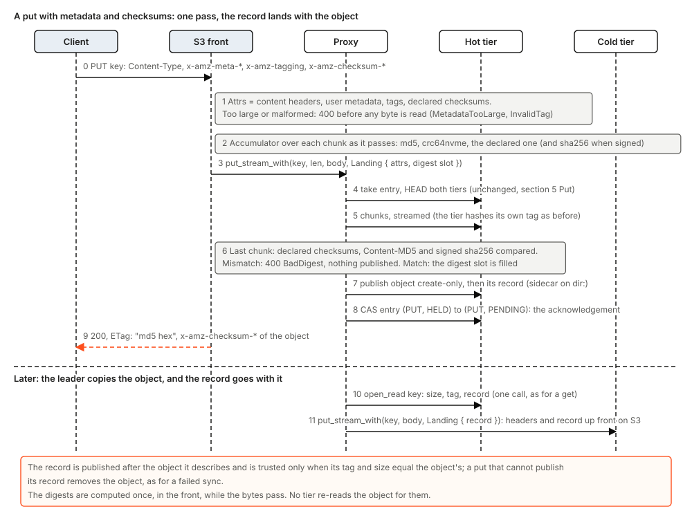
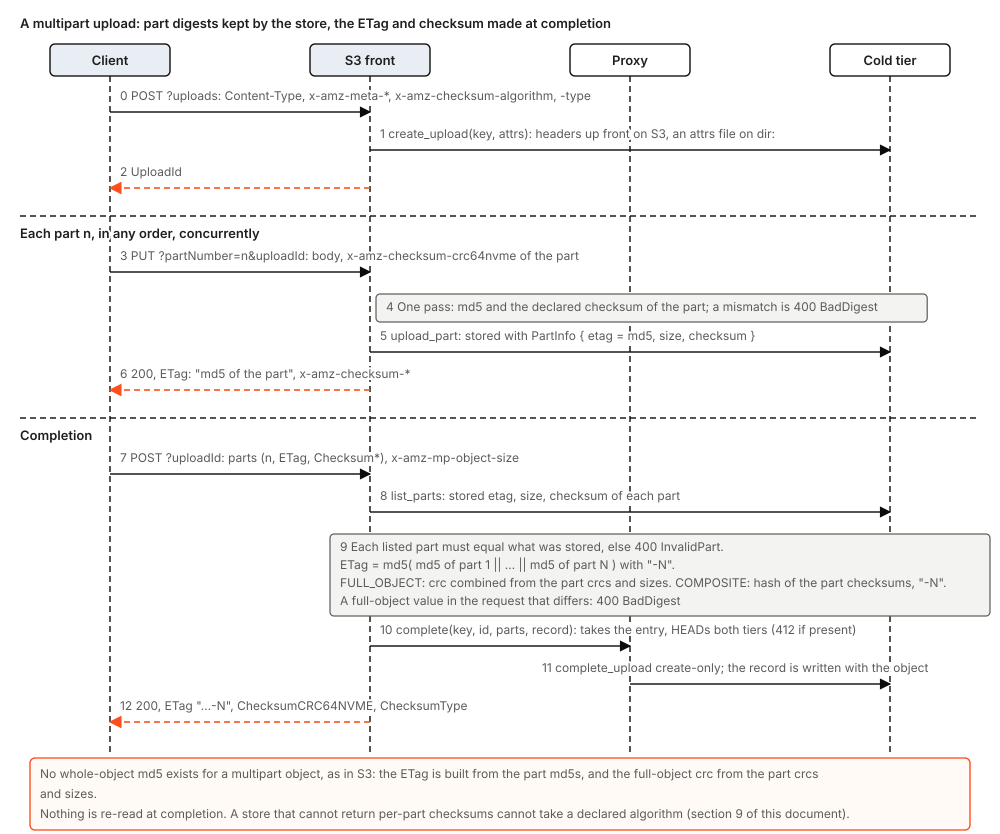
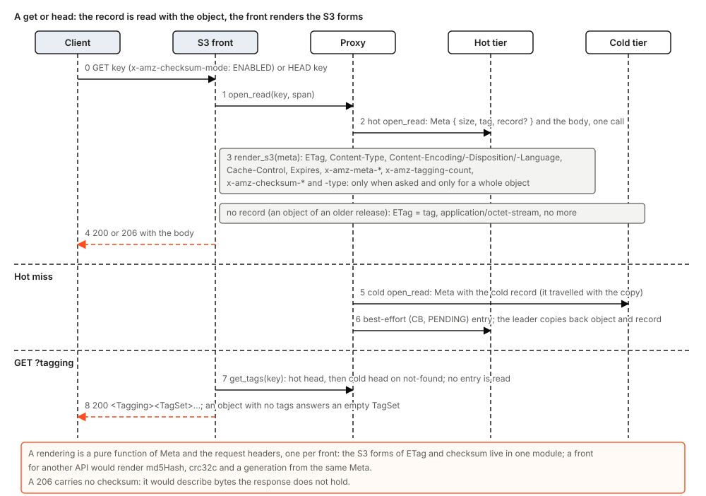
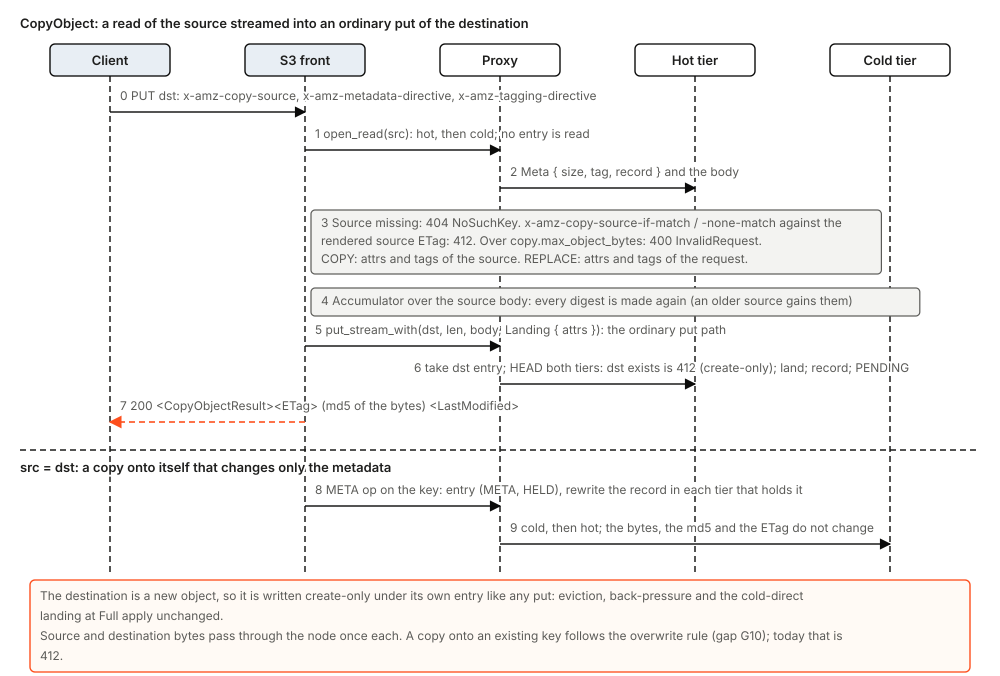

# Object metadata, digests and the S3 forms of ETag and checksums

Status: design. Nothing in this document is built; where it describes today, it describes the code of `main`. It is a living document in the manner of [tierstore-design.md](tierstore-design.md): it states the problem first, then the solution, and marks what is not built, so that a reader can tell the design from the plan. A change to code this text describes changes the text with it.

Direction from the CEO: clients use tierstore exactly as they use S3, and where the two differ the AWS documentation is the authority (MinIO only stands in where the documentation is silent, and the text says so). Match S3 for now, but with the right abstraction: the core keeps an extensible set of digests and the user's metadata per object, and each front renders its own forms from them. Every arbitrary number is a config key with a default. Persisted formats change only by adding.

## 1. The problem

A client that stores an object in S3 gets back more than its bytes. It gets the headers it set (`Content-Type`, `Content-Encoding`, `Content-Disposition`, `Content-Language`, `Cache-Control`, `Expires`), its own `x-amz-meta-*` pairs, an ETag that is the MD5 of a single-part object and `md5-of-part-md5s-N` of a multipart one, the checksum it declared (and, as the AWS documentation says, a CRC-64/NVME that S3 computes when it declared none), and tags it can read and change. A tool that works on S3 depends on some of these: rclone keeps a modification time in `x-amz-meta-mtime`, s3fs keeps mode, owner and time, web servers answer by `Content-Type`, Terraform and the Java transfer manager compare ETags with MD5s, and the AWS CLI v2 and boto3 (1.36 and later) send `x-amz-checksum-crc64nvme` on every upload by default.

tierstore answers none of that today. What a client sees on `main`, measured on a live node (release 0.3.47, `dir:` tiers, aws CLI 2.23.6; gap-list entries G01, G11, G12, G16, G17, G18 and G29):

| Call | What tierstore does today | What S3 does |
|---|---|---|
| PUT with `x-amz-checksum-crc64nvme` (the CLI default) | 501 `NotImplemented`; every upload of a default CLI or boto3 fails, and so does every part of a multipart upload | accepts it, verifies it, stores it |
| PUT with `Content-Type`, `Cache-Control`, `Content-Disposition`, `Content-Encoding`, `x-amz-meta-*` | 200, and the headers are dropped; HEAD and GET answer `application/octet-stream` and no meta | stores and returns all of them |
| ETag of a `dir:` object | 64 hex digits, the SHA-256 the tier keeps as its tag; an `S3` tier gives whatever its store's ETag is | MD5 hex; multipart `md5-N` |
| PUT answer | no ETag header | an ETag header |
| Multipart completion | the tier's tag, no `-N` | `md5-N` and the object's checksum |
| `x-amz-checksum-mode: ENABLED` on GET or HEAD | ignored; no checksum header | the stored checksum and its type |
| `GET ?tagging`, `PUT ?tagging`, `x-amz-tagging` | `?tagging` is 501; the header is accepted and dropped | tag set read and written |
| `PUT` with `x-amz-copy-source` | 501 (also for parts) | copy, with metadata and tagging directives |

The code explains why. A put's body is checked as it passes against the hashes the request claimed (`Check` in `server/request.rs`), and the hashes are then thrown away. `Meta` is `{size, tag, modified}`. A `dir:` object is one file whose first 32 bytes are the SHA-256 of the body and whose remainder is the body, so the tier has no place for anything else. An S3 tier forwards a body of at most 16 MiB as one PUT and a longer one as a multipart upload with its own 16 MiB parts, so its store's ETag is not the MD5 above that size. `object_headers` in `server/ops.rs` makes the answer from the meta alone. The S3 client of the tier (`objstore-s3`) sends no object headers at all.

Two facts make this more than a header-copying job.

- **Every byte may be hashed once.** The data paths read each object once, hash and store in the same pass, hold no whole file and have no size cap. More digests mean more work in that one pass, not a second pass.
- **An object lives in two tiers and may move between them.** The leader copies it to cold, evicts it from hot, and copies it back on a cold read. Whatever describes the object must travel with it through each of those, and through a chain of proxies, without the client ever seeing a different answer from a different place.

## 2. Goals and non-goals

Goals:

- Round trip `Content-Type`, `Content-Encoding`, `Content-Disposition`, `Content-Language`, `Cache-Control`, `Expires` and `x-amz-meta-*` on PUT, CreateMultipartUpload, GET, HEAD and CopyObject (G16).
- The S3 ETag: MD5 hex for an object made by one put or copy, `md5-N` for a multipart one; an ETag header on the put answer (G17).
- Accept CRC-64/NVME, store the checksum an upload declared (or the CRC-64/NVME that S3 would compute), return it in checksum mode, and handle multipart checksums, composite and full-object (G01, G29).
- Object tags: stored with the object, read, and replaced (G18).
- CopyObject and UploadPartCopy on top of these, with the metadata and tagging directives (G11, G12).
- A core that keeps an extensible set of digests and the user's metadata per object, computed in the one pass; each front renders its own forms.
- Old objects keep answering exactly as before.

Non-goals:

- Versioning, object lock and server-side encryption headers (the design says nothing about them), and the metadata of an object that an API other than the REST one put there.
- A whole-object MD5 or SHA-256 of a multipart object. S3 has none, and neither do we.
- ETag and `StorageClass` in listings, and `GetObjectAttributes` with its part list. The record of section 3 holds what they would need (the part count, the checksum), and each is its own gap; the listing would read one record per key on a `dir:` tier, which is a cost to decide on its own.
- Rewriting old objects to give them an MD5. An ETag never changes after the object's first write (section 8).
- A second front. The GCS case is used in section 6 to test the abstraction, not to build one.

## 3. The design in one picture

Three pieces, in the core, and one function per front.

**The record.** A small JSON document per object, `ObjectRecord`, that says what the object is beyond its bytes:

| Field | Meaning |
|---|---|
| `v` | 1. Read as "ignore the fields you do not know" for every `v` of 1 or more |
| `digests` | Map from a digest name to its value as base64 of the big-endian bytes. Names are the lowercase S3 header suffixes: `md5`, `sha1`, `sha256`, `crc32`, `crc32c`, `crc64nvme`. A name is added, never renamed. Present only for a digest the object's bytes were hashed to |
| `etag` | Optional. The S3 entity tag, without quotes, when it cannot be derived from `digests`: the `md5-N` of a multipart object, or an ETag that must survive a copy to a tier that would make another |
| `checksum` | Optional. `{algorithm, type, value}`: the one checksum S3 reports for the object. `type` is `FULL_OBJECT` or `COMPOSITE`; `value` is what `x-amz-checksum-<algorithm>` carries, with its `-N` for a composite |
| `parts` | Optional. The number of parts of a multipart object |
| `content_type`, `content_encoding`, `content_disposition`, `content_language`, `cache_control`, `expires` | Optional strings, as the request sent them (`expires` is not parsed) |
| `user` | Map from a lower-case metadata name to its value (RFC 2047 encoded where it was not ASCII) |
| `tags` | Optional list of key, value pairs. Kept here on a `dir:` tier; an S3 tier keeps tags natively (section 4) |
| `storage_class`, `website_redirect` | Optional strings, stored and echoed, with no effect (a request for `STANDARD_IA` is answered 200 and the HEAD says what was asked for) |

A rewrite of a record starts from the stored one and changes the fields it owns, so a binary that does not know a digest name does not drop it.

**The digest set.** The set of digests is data, not a struct of fixed fields: a name, a hasher, a length. The accumulator (`Digests`) is a list of hashers fed every chunk once. It replaces the per-claim `Check` of `server/request.rs`, which already works this way for the hashes a request claims. It computes the algorithms the config key `digests.always` names, plus the one the request declared, plus SHA-256 when the request is signed with a payload hash. When the last chunk has passed it compares every claimed value (as `Check` does now: a wrong `Content-MD5`, `x-amz-checksum-*` or `x-amz-content-sha256` is 400 `BadDigest` and nothing is published) and fills a `DigestSlot` that the tier reads before it publishes. Adding a digest later is a hasher and a name.

**The landing.** A new additive call carries both, so that a tier can write the record with the object:

- `Attrs`: what is known before the first byte (headers, user metadata, tags, the declared checksum algorithm and any declared value).
- `Landing { attrs, slot }`: `Attrs` plus the `DigestSlot`.
- `Meta` gains `record: Option<Arc<ObjectRecord>>`, and `put_stream_with`, `create_upload_with`, `list_parts`, `get_tags` and `put_tags` join `Backend` with defaults that ignore or refuse, so the memory backend and the test wrappers keep working and each wrapper forwards the new calls (one test per wrapper).

The names are proposals; the shape is the decision: one record, moved by the calls that already move an object.

**The renderers.** A front renders from `Meta` and the request headers, with no state: for the S3 front, `etag(&Meta)`, `object_headers(&Meta, &Request)` and the checksum headers live in one module. There is no `Front` trait: with one front built it would have one implementation (R9). A GCS front would be a second module that reads the same record (section 6).

## 4. Where the record lives, for each kind of tier

The rule that decides it: **a hit is one round trip**, so the record must come back with the object in the same call, from the tier that holds it, and it must be written so that the object never appears without its record where the record was known.

### `dir:` tier: a sidecar

A `dir:` object is a file whose first 32 bytes are its SHA-256 and whose remainder is its body; a reader of the previous release takes everything after 32 bytes as the body. So the file cannot grow a header or a trailer without an older reader serving wrong bytes. The record is therefore a second file:

- `.meta/<encoded key>` in the tier's directory, one file per object, the same encoding as the object's own name (a name that starts with `.` is never a key, so nothing lists it, and the previous release does not look at it; the same device as `.entries/` and `.uploads/`). The key length limit does not shrink, because the sidecar is in its own directory.
- The body is `{ "v": 1, "bind": { "tag": "<sha256 hex>", "size": N }, "record": { ... } }`. A reader trusts a sidecar only if `bind` equals the object's own tag and size. A sidecar left by a crash, or by a delete that did not remove it, is then read as no record, never as the record of another body.
- **Write order.** The object is linked first (that create-only link is the decision of who owns the key), then the sidecar is written to a temporary file, synced and renamed over `.meta/<name>`, then the directory is synced; only then does the put return. A put whose sidecar cannot be written removes its object again, as a put whose directory sync failed does today. A reader that looks in the gap between the link and the rename sees the object without its record, which is the answer for an unacknowledged put; every acknowledged put has both.
- **Delete** removes the object, then the sidecar; a delete of a key with no object still removes a sidecar it finds, so an orphan clears at the next delete. `delete_if_match` and the multipart completion follow the same order. A multipart completion on `dir:` joins the part files into the object as it does now and writes the record the front computed.
- A part of an upload gets a small file beside it (`<part>.rec`, `{etag, size, checksum}`) so that `list_parts` can return what each part was; the part's own name keeps carrying its SHA-256 tag, as the previous release's completion needs.

A sidecar is not an extended attribute because an xattr cannot be relied on across the file systems operators put `dir:` on (tmpfs before Linux 6.6, NFS, the macOS volumes the update hook also supports), is lost by `cp` and `rsync` without flags, and needs an unsafe-free binding we do not have (R2).

### `S3` tier: the store's own headers

A hit on an S3 hot tier must be one GET, and a cold-served GET one cold GET, so the record has to ride on the object. S3 gives an object fields that come back on GET and HEAD: the system headers and `x-amz-meta-*`. So on an S3 tier:

- `Content-Type`, `Content-Encoding`, `Content-Disposition`, `Content-Language`, `Cache-Control`, `Expires` and the user's `x-amz-meta-*` are written natively, as the client sent them, at PUT or CreateMultipartUpload. A bucket read by another tool shows what a client set, and a chain of proxies carries them (section 7).
- Everything of the record that is not a client header goes in one extra user-metadata entry, `x-amz-meta-tierstore-record`, holding the JSON of the fields `digests`, `etag`, `checksum`, `parts`, `storage_class` and `website_redirect` (about 150 bytes with three digests; a client may not use the name prefix `tierstore-`, section 12). Nothing the client sent is in it, so it is never rewritten when the client's headers are.
- The checksum the client declared is also sent natively (`x-amz-checksum-<algorithm>`, with `x-amz-checksum-algorithm` and `x-amz-checksum-type` on CreateMultipartUpload), so the store verifies it as well and a bucket read by another tool shows it.
- **Tags are native**: `x-amz-tagging` at PUT and CreateMultipartUpload, `GET ?tagging`, `PUT ?tagging`, `DELETE ?tagging` on the tier. The record's `tags` field is empty on such a tier. This needs `s3:GetObjectTagging` and `s3:PutObjectTagging` on the credential, and a store that implements them.
- **The part of S3 that cannot be written late.** Headers go before the body. A streamed client put knows its MD5 only after the last chunk, so the MD5 cannot be in `x-amz-meta-tierstore-record` of a put that lands on an S3 tier. The design does not re-read, copy-to-self or write a second object for it. Instead, for a put that lands on an S3 tier:
  - the object's ETag is the store's own ETag, which is the MD5 as long as the object was written by one PUT; so the S3 tier makes a single streamed PUT for any body of a declared length up to `single_put_max_bytes` (default 5 GiB, S3's own limit for one PUT), and not the 16 MiB multipart split it uses now. A body of unknown length is the one case that still splits, and the front already refuses it for an S3 tier (`needs_length`);
  - what the pass computed beyond that is returned to the client in the put answer and stored on the tier only where the tier can hold it up front;
  - the leader's copy to cold, and every copy-back, know the whole record before the first byte (it is read from the source tier), so they write it up front, including the MD5 as `etag`, whatever the destination does with the body. This is why `etag` is a field.

  The cost of this honesty is stated in the edge-case table: on an S3 hot tier, a streamed client put without a declared checksum stores no CRC-64/NVME, where S3 would have computed one. On `dir:` hot, which is the configuration the build farm runs, every put stores the full set.

### The local cache

The cache keeps `obj/<aa>/<bb>/<hex>.meta` per object, a JSON sidecar with `key`, `size`, `sha256`, `tag`, `modified`. It gains an optional `record` (the fields of section 3 that came with the upstream's answer: its headers, its user metadata, its checksum). It is read as optional, so an entry written by the previous release reads as no record, and the previous release reads a new entry by ignoring the field. The cache does not keep tags: `GET ?tagging` is passed to the upstream.

### Other tiers

`memory` keeps the record beside the bytes, as it keeps its tag, for tests. Objects the OCI front stores (`oci/blobs/sha256/...`, tag versions, upload chunks) have no record: they are written by the OCI front, which already hashes SHA-256 and is addressed by it. An S3 client that reads such an object through the S3 front gets the answers of an old object.

## 5. How each operation works

The sequences are for configuration B; a build node (A) is section 7. Every store call is in code order. Nothing here changes the entry protocol of [tierstore-design.md](tierstore-design.md) except one new op word in the last subsection.

### Put

The first diagram above. In order:

0. **Parse.** `Attrs` is made from the headers before any byte is read. User metadata is counted against `metadata.max_user_bytes` (S3's 2 KB: the sum of the UTF-8 bytes of each name, lower-cased and without the `x-amz-meta-` prefix, and each value); over it is 400 `MetadataTooLarge`. `x-amz-tagging` is parsed as a URL query and checked against the tag limits (section 10); a breach is 400 `InvalidTag`. A name under `tierstore-` is 400 `InvalidArgument`. A request with two `x-amz-checksum-*` headers is 400 `InvalidRequest`. An unlistable key, a reserved key and `Content-Length` are refused as today.
1. **Hash once.** The `Digests` accumulator sits where `Check` does now, in the stream the proxy is handed. Per chunk it feeds every hasher; no chunk is held.
2. **Land.** The proxy takes the entry, checks both tiers and streams the body to the tier exactly as in section 5 of the main design. The tier calls `put_stream_with`: when its last chunk has gone it reads the slot (the front has compared every claimed value by then, and a mismatch ended the stream in error, so nothing is published) and publishes object and record as section 4 says.
3. **Acknowledge.** The entry moves to PENDING as before. The front answers 200 with the ETag and the checksum header of the object, which today it does not send.

For a body the front cannot hash (`STREAMING-` payloads, which are refused today with 501) nothing changes: that is a separate gap, and a trailing checksum would be one more claimed value compared at the end of the stream.

### Multipart

All multipart calls go to the cold tier, as now. What is added:

- **Create** carries `Attrs` (headers, user metadata, tags) and the checksum algorithm and type the client named (`x-amz-checksum-algorithm`, `x-amz-checksum-type`). The type defaults as AWS documents: CRC-64/NVME is full-object only, CRC-32 and CRC-32C may be either and are composite for a multipart upload unless the client says `FULL_OBJECT`, SHA-1 and SHA-256 are composite only. A pair the table does not allow is 400 `InvalidRequest`.
- **UploadPart** hashes the part once: its MD5, which becomes the part's ETag (today the part's ETag is the tier's tag), and the declared checksum, which is verified (400 `BadDigest`) and returned. The tier keeps `{etag, size, checksum}` with the part: `dir:` in the part's `.rec` file, an S3 tier in the store's own part ETag and size and, for a declared algorithm, the store's per-part checksum.
- **Complete.** The front lists the stored parts (`list_parts`: one call), checks each part of the client's list against what was stored (the ETag and, if the upload declared a checksum, the part's checksum; otherwise 400 `InvalidPart`), and builds the answer without reading any data:
  - `etag = hex(md5(md5_1 || ... || md5_N)) + "-N"`, from the part MD5s the client listed and the store confirmed;
  - for `FULL_OBJECT` a CRC checksum, the object's CRC combined from the part CRCs and part sizes (the carry-less-multiply combine of the polynomial; no data is read), compared to `x-amz-checksum-<algorithm>` and `x-amz-mp-object-size` of the request if they were sent (400 `BadDigest` or `InvalidRequest` on a difference);
  - for `COMPOSITE` the hash of the concatenated raw part checksums, base64, with `-N`.
  Then the proxy takes the entry, checks both tiers and calls the create-only completion with the record, as in section 5 of the main design. An S3 tier gets the record at Create, since its headers go first; what it cannot know then (the composite ETag and the checksum) it computes natively, because the store is the one completing the parts the client's own part sizes made.
- **Parts uploaded twice.** S3 lets a part number be uploaded again and the last upload win. The stored parts of one number may then be two; the completion picks the one whose ETag the client's list names, as the `dir:` tier does now with the tag.

### Get and head

`Proxy::open_read` already returns the meta with the body, from the hot tier in one call and from cold on a miss. With the record in `Meta` the front has everything: no extra request, no entry read. The cold-served answer shows the same record as a hot one because the leader's copy-back writes the record it read from cold (section 7). `GET ?tagging` is a hot head and, on not-found, a cold head, then the tier's own `get_tags`; it reads no entry.

### CopyObject, UploadPartCopy

A copy is the existing read side feeding the existing write side, with no new path through the tiers:

1. Read the source with `open_read` (hot, then cold; no entry). A missing source is 404 `NoSuchKey`. The source key is percent-decoded; `?versionId` in the source is 400.
2. Evaluate `x-amz-copy-source-if-match` and `-if-none-match` against the source's rendered ETag (412 on a failure). The `-if-modified-since` and `-if-unmodified-since` forms are 501, as they are on a read today.
3. Choose the destination's `Attrs`. `x-amz-metadata-directive: COPY` (the default) takes the source's content headers and user metadata and ignores the request's; `REPLACE` takes the request's. `x-amz-tagging-directive` the same for tags. A source over `copy.max_object_bytes` (default 5 GiB, S3's limit for one CopyObject) is 400 `InvalidRequest`; a larger object is copied by UploadPartCopy.
4. Stream the source body into the destination's put (`put_stream_with`), under the destination's entry, create-only. **The digests are made again in the pass**, even though the source has them: an object of an older release gains its MD5 and CRC-64/NVME at the copy, and a source whose stored digest no longer matches its bytes is a destination whose record is true. The answer is 200 with `CopyObjectResult` (`ETag`, `LastModified`, and the checksum).
5. A destination that exists is 412, the overwrite rule of today (gap G10 decides whether that changes; this design does not).

The ETag of the destination is the MD5 of the bytes (AWS documents that an object made by `CopyObject` has an MD5 ETag, and one made by multipart upload or part copy does not), including when the source was multipart: then the copy's ETag differs from its source's, as it does in S3. **UploadPartCopy** is a ranged `open_read` of the source feeding `upload_part`: the part's ETag is the MD5 of the range, the part's checksum is computed in the pass, and the completion is as above. It lands after CopyObject, in its own change.

A copy of the key onto itself is allowed by S3 only if it changes something (the metadata, with `REPLACE`); otherwise it is 400 `InvalidRequest`. That case, and the writes to an existing key's tags, are the next subsection.

### Changing the record of an existing object: tagging and a copy onto itself

Objects are immutable, but their tags and their metadata (by a copy onto itself) are not. S3 lets a client change them; rclone's `SetModTime` and `s3fs chmod` depend on it. The bytes, the MD5 and the ETag do not change; only the record does. The design adds one entry op, **`META`**, and no other rule:

- A writer takes `(META, HELD)` create-only on the key's entry, with the whole new record in the entry body as an optional field `record` (a record is at most a few KB: the user metadata is limited to 2 KB and the headers to what a request may carry). On `EXISTS` it answers 503 `SlowDown` (a put in flight, a delete, the leader copying). The conservative rule is deliberate: a tag write on an object that has not yet been copied to cold (entry `(PUT, PENDING)`) is retried by the client for a few seconds, and the first version does not amend a pending put.
- Under the entry it heads both tiers. Not found in either is 404 `NoSuchKey`. It rewrites the record in cold, then in hot, wherever the object is: a `dir:` tier by writing the sidecar to a temporary file and renaming it over the old one; an S3 tier's tags by its own `PUT ?tagging`. An S3 tier's content headers and user metadata cannot be changed in place; a `REPLACE` onto itself on an S3 tier is a copy of the object onto itself with `x-amz-copy-source-if-match` on the tag, which S3 does in place for objects up to 5 GiB; larger objects wait for UploadPartCopy and are 501 until then.
- When both calls returned, the writer deletes its entry (as a fresh delete frees its own) and answers 200. If a call failed it moves the entry to `(META, PENDING)` and answers 503; the leader applies the record in the body to both tiers (idempotent) and releases the entry. A `(META, HELD)` entry of a departed owner is reaped to `PENDING` like any other. A delete that meets a META entry waits, as for any other HELD or SEALED entry.
- An older binary reads an op it does not know as `Unknown`, which no transition accepts (stored-formats, "Key entries"); it neither acts on nor reaps such an entry, so during a hand-over a key being changed answers 503 from the old process until the new one takes the key. The write of a META entry is therefore enabled after the release that knows it is on every node (section 13, change 10).

## 6. What each front renders

Everything below is a function of `Meta` and the request.

### The S3 front

| Output | From | Rule |
|---|---|---|
| ETag | the record, else the tag | `record.etag` if present, else the hex of `digests.md5` if present, else `meta.tag` exactly as today |
| `Content-Type` | `content_type` | else `application/octet-stream`, as today (section 14, decision 1) |
| `Content-Encoding`, `-Disposition`, `-Language`, `Cache-Control`, `Expires` | the same-named fields | returned as stored, omitted if absent |
| `x-amz-meta-<name>` | `user` | one header per name; a value that was RFC 2047 encoded at the put is returned encoded, which is what S3 does |
| `x-amz-tagging-count` | tags | present when there are tags, as in S3 |
| `x-amz-checksum-<alg>`, `x-amz-checksum-type` | `checksum` | only when the request has `x-amz-checksum-mode: ENABLED`, and only on a whole-object 200 or a HEAD: a 206 carries bytes that the object's checksum does not describe |
| `x-amz-storage-class`, `x-amz-website-redirect-location` | the fields | present when stored and not `STANDARD` |
| `If-Match`, `If-None-Match` | the rendered ETag | compared against what the client was shown, not `meta.tag`; `meta.tag` stays the tier's own compare-and-swap value |

A multipart ETag, a composite checksum and an old object's tag are all strings in the same slots, so no caller of the renderer knows which kind it has.

### A front for another API

A GCS-style front is not built; it is here to check that the record is the right shape. Its object resource has `md5Hash` (base64 of the MD5, which is `digests.md5`), `crc32c` (base64 of the big-endian CRC-32C, which is `digests.crc32c`), `etag`, `metadata` (the `user` map), `contentType` and the other content fields, and a `generation`. Every one is a field or a rendering of the record; none needs a second copy of the bytes. A digest the record does not hold (a GCS `crc32c` for an object whose record has none) is absent from the answer, as a missing checksum is on S3. Two things that front would add are outside the record and are its own decision: a generation number (a function of the object's first-write time) and its composite (compose) object rule. This is why the digest names are the base64-big-endian forms both APIs share, and why the set is a map and not a struct.

## 7. Chaining, the reconciler's copy and copy-back

**The leader's copy to cold and a copy-back** are `get_stream` and `put_stream` today. They become `open_read` and `put_stream_with`, with the source's record as `Landing.attrs` and, for an S3 destination, written up front. The record goes with the bytes in both directions, so the answer for a key does not depend on which tier serves it: where the destination's own tag is not the ETag the source shows (a `dir:` object with no MD5 copied to an S3 tier), the copy writes the source's rendered ETag as `etag`. Objects already in a tier are not touched, so an object copied to cold by the previous release keeps answering with the cold store's ETag, as it does today. The leader does not compare records (its byte compare before an eviction stays as it is); a cold object that already exists when the leader copies (`AlreadyExists`) keeps the record it has, which is the one a put that raced it wrote.

**Across proxies.** A build node's `cold_store` may be the S3 endpoint of a storage node's tierstore (configuration A). The two ends speak S3, so what travels is what S3 carries: the build node's S3 tier reads `Content-Type`, `x-amz-meta-*`, the ETag and, with `x-amz-checksum-mode: ENABLED` on every fill, the checksum headers, and writes (with `write_through`) the headers the client sent, including its declared checksum, so the upstream verifies it. The ETag a client sees from the build node is the upstream's ETag, so it is the same through a chain of any depth. `x-amz-meta-tierstore-record` is never seen across the S3 interface: the front that owns it strips it from its answers and refuses it from clients. The cache stores what it was told in its sidecar's `record` and answers hits from it.

**One consequence.** A cache hit answers with the ETag it recorded at its fill (as in limits.md, "The ETag of a hit may differ from the ETag of a miss"). With the record the two are the same string for an object with an MD5, which removes the larger part of that limit.

## 8. Old objects, and compatibility

The rule of [stored-formats.md](../stored-formats.md) is that formats change only by adding, and a previous release must read what this one writes while both share a tier during an update.

- **An object with no record answers as it does today.** No sidecar or no `x-amz-meta-tierstore-record`: ETag is `meta.tag` (the SHA-256 on `dir:`, the store's on S3), `Content-Type` is `application/octet-stream`, there are no meta headers, no tags, and no checksum header in checksum mode (S3 itself returns no checksum for an object stored before it computed one).
- **An ETag never changes after the object's first write.** An object has an MD5 ETag exactly when its record has `digests.md5` or `etag`, which is decided when it is written and does not change. The MD5 enters the record only from the change that renders it (section 13, change 7); until then `digests.always` is `["crc64nvme"]` and new objects keep the ETag of today. So a client that cached an ETag, or sent `If-Match`, is never wrong about an object.
- **No backfill.** An old object gets a new ETag only by being copied (CopyObject writes a new key). A copy of an old object is 200 with the MD5 ETag of the new object.
- **The previous release on new data.** On `dir:` it ignores `.meta/`, and the object file is byte for byte what it wrote (the 32-byte tag and the body). On an S3 tier it ignores every `x-amz-meta-*` and the system headers it never read. A part's `.rec` is a new file in the upload directory, which it does not read. A cache sidecar with a `record` is read with the field ignored. Part ETags are the one place a format is re-meant: today a part's ETag is its tier's tag and the previous release's `dir:` completion matches parts by number and tag. Change 7 of section 13 makes it an MD5; until then an upload crosses releases freely. From then `list_parts` accepts either form, and change 7 ships one release after every reader knows the record, so an upload begun on this release meets the previous one only in a rollback, where its completion is `InvalidPart` and the client retries the upload (section 12).
- **This release on old data.** No sidecar, no record header, no `.rec`: each is the old-object case above. A part with no `.rec` has the tag as its ETag and takes part in a completion by it.
- **Tests that run both ways.** `crates/compat` runs the previous release's binary on directories this release wrote and the reverse; the plan (section 13) names one test for each format.
- **Rollback.** After the MD5 is rendered, rolling back changes the ETag the old release shows for the objects written in between (it shows the tag again). That is stated in the release notes of that change; `If-Match` clients retry.

## 9. What a store must provide

A new section for [tierstore-design.md](tierstore-design.md) section 9, in the same form as its requirement, and checked by the operator, never by a probe.

| Store | Needs, for the metadata and checksum features |
|---|---|
| any S3-compatible tier | `x-amz-meta-*` and the system headers returned on GET and HEAD as they were sent; a user-metadata budget of at least 2 KB plus `metadata.record_reserve_bytes` (S3's own limit is 2 KB in all, which is why the client's limit is lowered by the reserve on an S3 tier, section 10) |
| an S3 tier that is to hold tags | the object tagging calls and `x-amz-tagging` on PUT and CreateMultipartUpload |
| an S3 tier that is to take a declared checksum algorithm on multipart uploads | `x-amz-checksum-algorithm`, `x-amz-checksum-type`, a per-part checksum, and `ListParts` that returns the per-part checksum. A store that does not is refused at Create (501), not at completion |
| an S3 tier that is the hot tier | single PUT up to `single_put_max_bytes` with a declared length and an unsigned or streamed payload |
| `dir:` | nothing beyond today: sidecars and `.rec` files are ordinary files, renamed into place |

## 10. Limits and configuration

Every number below is a key with a default, from the start. They are the `[metadata]`, `[digests]` and `[copy]` tables of the configuration file, and a tier key.

| Key | Default | What it sets |
|---|---|---|
| `metadata.max_user_bytes` | 2048 | S3's limit on the user metadata of one object: the sum of the bytes of each name and value |
| `metadata.record_reserve_bytes` | 256 | the part of an S3 tier's user-metadata budget that the record uses; subtracted from `max_user_bytes` when any tier is an S3 store, so that a copy to cold of an object whose client metadata is at the limit is never refused by the store |
| `metadata.max_tags` | 10 | tags per object (S3's limit) |
| `metadata.max_tag_key_chars`, `metadata.max_tag_value_chars` | 128, 256 | the lengths of a tag key and a tag value (S3's limits) |
| `digests.always` | `["crc64nvme"]`, then `["md5", "crc64nvme"]` | the digests computed for every put; the declared algorithm and, for a signed payload, SHA-256, are computed in addition. The names are those of section 3 |
| `copy.max_object_bytes` | 5 GiB | the largest source of one CopyObject |
| `<tier>.single_put_max_bytes` | 5 GiB | the largest body an S3 tier sends as one PUT. Above it the tier uses its own multipart parts, which makes the store's ETag not an MD5 |

One relation breaks ETags and is therefore checked at config parse, with the values named: for an S3 hot tier with `md5` in `digests.always`, `server.max_request_bytes <= single_put_max_bytes`. The other relations are documented. S3's own header limit (8 KB for a request) is already enforced by the HTTP layer.

**Cost, inferred and not measured.** MD5 is the slowest of the hashers (a few hundred MB/s on one core), CRC-32C and CRC-64/NVME with carry-less multiply are an order of magnitude faster, SHA-256 with the SHA extensions is in between. The accumulator runs on the task that already hashes a signed payload and does not add a pass. Before the default of `digests.always` is fixed the throughput of the accumulator is measured on the target nodes, as an offline benchmark, never as a test.

## 11. One-way doors

These are the choices a stored object or a client makes permanent. Each is made once, here, with how it is kept open.

| Door | Why it is one-way | How it stays additive |
|---|---|---|
| The sidecar's place and name, `.meta/<encoded key>` on `dir:`, and its `bind` | an object written under it is read in place by every later release | a later release may read a second place first; `v` says how to read the body; unknown fields are kept by a rewrite |
| The header name `x-amz-meta-tierstore-record` | it is stored on every object of an S3 tier | its JSON has the same `v` and unknown-field rule; a second header would be an addition |
| Digest names (`md5`, `sha1`, `sha256`, `crc32`, `crc32c`, `crc64nvme`) and their value form (base64 of the big-endian bytes) | stored in every record, and the form a checksum header and both S3 and GCS use | a name is added, never renamed; a new digest is a new key |
| `etag` and `checksum` as fields | they carry an ETag a client has seen | a rewrite never changes them; an ETag is never recomputed for a stored object |
| An object's ETag form, decided at first write | clients cache it and send it in `If-Match` | the MD5 enters the record in its own change, one release after the code that reads it is everywhere (section 13) |
| The reserved user-metadata prefix `tierstore-` | once a client-visible name is reserved it cannot be un-reserved without surprising a client that took it | reserved now, before any object has it |
| Part records, `<part>.rec` and an S3 part's store-side facts | an upload in flight crosses releases | additive file, ignored by the previous release; the part's own name is unchanged |
| The entry op word `META` and its optional field `record` | an old binary reads it as `Unknown` | enabled only after the release that knows it is on every node |
| Metadata names stored in lower case, `expires` as the client's string | S3 stores names in lower case and returns `Expires` as sent | none needed; this is S3's behaviour |

## 12. Edge cases the design handles

Each is a mechanism and the test that proves it (the tests are named in section 13).

| Case | Answer | Why it works |
|---|---|---|
| User metadata over `metadata.max_user_bytes` | 400 `MetadataTooLarge`; no entry taken, no byte read | `Attrs` is built before the body is read |
| More than `metadata.max_tags` tags, a bad character, a key over 128 or a value over 256 characters, or an `aws:` key | 400 `InvalidTag` | the tag parser; limits are config |
| A non-ASCII metadata value | stored RFC 2047 encoded (UTF-8, base64) and returned encoded; bytes that are not UTF-8 are 400 `InvalidArgument` | S3's documented behaviour; one encoder |
| Two `x-amz-meta-a` headers; `X-Amz-Meta-A` | joined with `, `; stored as `a` | S3 lower-cases and joins |
| `x-amz-meta-tierstore-...` from a client | 400 `InvalidArgument` | the prefix is reserved (section 11) |
| `Content-MD5` or `x-amz-checksum-*` that does not match the body | 400 `BadDigest`; nothing published | the accumulator compares at the last chunk, before the tier publishes |
| Two `x-amz-checksum-*` headers on one request, a part whose algorithm differs from the upload's, `crc64nvme` with `COMPOSITE`, `sha256` with `FULL_OBJECT` | 400 `InvalidRequest` | the table of section 5; the AWS documentation states the allowed pairs |
| Complete with a part checksum or ETag that is not what was uploaded | 400 `InvalidPart` | the front compares the client's list with `list_parts`; this closes the case G29 found, where a wrong checksum in the list was accepted |
| A full-object checksum or `x-amz-mp-object-size` on Complete that differs from the combined one | 400 `BadDigest` / `InvalidRequest` | the combine of the part CRCs and sizes is compared |
| A ranged GET or a 206 in checksum mode | no `x-amz-checksum-*` | it would describe bytes that were not sent; the AWS documentation is silent on this case and the choice is to omit, to be confirmed by the first measurement against S3 |
| GET or HEAD of an old object in checksum mode | 200 without a checksum header | no record, no checksum; S3 does the same for objects stored before it kept one |
| A put of a key whose old sidecar survived a crash or a failed delete | the new record replaces it (rename); a reader trusts a sidecar only when `bind` matches the object | a stale sidecar of identical bytes describes the same content; of other bytes it is ignored |
| Crash after the object was linked and before its sidecar was renamed | the object exists without a record; the put was not acknowledged (the client sees 503, a retry sees 412); the stray sweep adopts and copies it without a record, so its answers are an old object's | accepted; the same class as "a 503 after landing is an unknown outcome" |
| An unreadable or non-matching sidecar, or a record header that does not parse | read as no record; counted in `tierstore_record_ignored_total{reason}` | a bad record must degrade to the old answers, never to an error on a read; the counter is the one signal |
| A part uploaded by the previous release (tag as ETag), completed by this one | accepted: the completion matches the part by its tag or its MD5 | `list_parts` returns both forms |
| An upload begun after change 7, completed by the previous release | 400 `InvalidPart`; the client starts the upload again | only a rollback does it (section 8); change 7 ships one release after the readers |
| A tag write or a self-copy while the key has an entry | 503 `SlowDown`, retried by the client | `(META, HELD)` is create-only on the entry |
| A tag write for a missing key | 404 `NoSuchKey` | both tiers are headed under the entry |
| A delete that meets a META entry | waits, like any other HELD or SEALED entry | the delete's existing rule |
| Copy source missing, over `copy.max_object_bytes`, a copy onto itself with no change, `?versionId` in the source | 404 `NoSuchKey`; 400 `InvalidRequest` (three cases) | checked before the destination is touched |
| Copy of an old object | 200; the destination has an MD5 ETag, the source keeps its old one | the digests are made in the pass |
| Cache hit whose sidecar has no `record` (an entry of the previous release) | answered as an old object: `application/octet-stream`, the cached tag | the cache refills as it evicts; no migration |
| An object the OCI front wrote, read through the S3 front | an old object's answers | no record; the OCI front already addresses it by its SHA-256 |
| Presigned PUT with content headers signed | the same `Attrs` path as a signed request; headers that were not signed are not accepted | SigV4 covers the signed headers only |
| Listing | `StorageClass` stays `STANDARD`, no ETag | a listing reads no record; a separate gap |

## 13. Migration plan

Ordered pull requests. Each lands alone, keeps coverage at the floor for every crate it touches, adds only additive formats, and has the tests named. Names are proposals; the behaviour each asserts is the commitment.

1. **Digest accumulator and CRC-64/NVME (G01).** A `digests` module in the front: hashers for md5, sha1, sha256, crc32, crc32c and crc64nvme behind one name table; `Check` becomes a user of it; the `UNSUPPORTED_CHECKSUMS` refusal goes. CRC-64/NVME is a permissively licensed crate or about 100 lines of our own (decided in the change; `cargo deny` passes either way). Tests: `known_answers_for_the_check_string` (the 9-byte string `123456789`: CRC-32 `CBF43926`, CRC-32C `E3069283`, CRC-64/NVME `AE8B14860A799888`, MD5, SHA-1 and SHA-256), `digest_is_independent_of_chunk_boundaries`, `crc_combine_equals_crc_of_the_concatenation` (property test for the three CRCs), `put_with_crc64nvme_header_stores_and_verifies` (the CLI's headers: `x-amz-checksum-crc64nvme` and `x-amz-sdk-checksum-algorithm: CRC64NVME`), `wrong_crc64nvme_is_bad_digest_and_nothing_is_stored`, `upload_part_accepts_crc64nvme`. Docs: the Checksums bullet of limits.md changes.
2. **The record, and the landing calls, dark.** `ObjectRecord`, `Attrs`, `Landing`, `DigestSlot`, `Meta.record`, and the `Backend` methods with refusing defaults; the memory backend keeps a record; the wrappers forward. Config tables and defaults parse. `docs/stored-formats.md` gains the record and the fixture. Tests: `record_json_round_trips_the_fixture`, `record_keeps_fields_it_does_not_know_on_rewrite`, `record_newer_fixture_is_read_and_not_written_back`, `memory_backend_returns_the_record_it_was_given`, `every_wrapper_forwards_the_landing_calls` (one case per wrapper).
3. **`dir:` tier sidecar.** Writes, reads, binds, deletes, completion join, part `.rec`. Tests: `put_stream_with_writes_record_after_object`, `sidecar_with_other_tag_is_ignored`, `put_that_cannot_write_sidecar_removes_object`, `delete_removes_sidecar_and_clears_an_orphan`, `multipart_completion_writes_record_and_list_parts_reads_part_rec`, `previous_release_reads_dir_with_sidecars` and `this_release_reads_dir_without_sidecars` in `crates/compat`.
4. **S3 tier headers and tags.** `objstore-s3` sends and reads the system headers, `x-amz-meta-*` and `x-amz-tagging`, creates uploads with headers and the checksum algorithm and type, lists parts with checksums, and the tier reads the record header; `single_put_max_bytes`. Tests against the fake S3: `headers_and_user_metadata_round_trip_on_put_and_open_read`, `record_header_round_trips`, `single_put_up_to_the_limit_and_multipart_above_it`, `list_parts_returns_etag_size_and_checksum`, `tags_header_and_tagging_calls_round_trip`, `store_without_part_checksums_is_refused_at_create`.
5. **The S3 front round trip (G16, G18 read side).** Parse and emit the headers and metadata, the limits and errors, the reserved prefix, `x-amz-tagging`, `GET ?tagging`; `digests.always` is `["crc64nvme"]`, ETag still the tag. Tests: `content_headers_round_trip_on_put_get_head`, `user_metadata_round_trip_and_case`, `non_ascii_metadata_is_rfc2047`, `metadata_over_the_limit_is_400_before_any_byte_is_read`, `tags_over_the_limit_are_invalid_tag`, `reserved_metadata_prefix_is_refused`, `get_tagging_of_an_untagged_object_is_an_empty_tag_set`, `multipart_create_carries_headers_to_the_object`, `old_object_answers_as_before` (golden of today's headers), and the same against the S3 tier.
6. **The local cache and chaining.** Cache sidecar `record`; fills read with `x-amz-checksum-mode: ENABLED`; write-through carries headers and the declared checksum. Tests: `cache_hit_answers_the_headers_of_the_fill`, `cache_sidecar_without_record_is_an_old_object`, `previous_release_reads_cache_sidecar_with_record`, `write_through_forwards_headers_and_checksum`, `chained_proxies_show_one_etag_and_one_metadata_set`.
7. **The ETag (G17).** Render rule of section 6; the put answer's ETag header; the part ETag as MD5; `md5-N` at completion; `If-Match` against the rendered ETag. **Code and default stay apart:** the change makes `md5` computable, with `digests.always` still `["crc64nvme"]`. Tests: `put_returns_etag_header_equal_to_head`, `etag_is_md5_when_the_record_has_it`, `etag_of_old_object_is_the_tag`, `multipart_etag_is_md5_of_part_md5s_with_count`, `part_etag_by_tag_still_completes`, `if_match_uses_the_rendered_etag`, `single_put_to_s3_hot_has_the_md5_etag`.
7b. **Turn the MD5 on** (own change, one release after 7 is on every node): `digests.always` defaults to `["md5","crc64nvme"]`; the config check of section 10; the release notes name the rollback effect. Tests: `new_objects_have_md5_etags_and_old_keep_theirs`, `max_request_bytes_above_single_put_is_refused_with_md5`.
8. **Stored and returned checksums (G29).** Checksum mode, put and part answers, Create's algorithm and type, Complete's part check, composite and full-object, `x-amz-mp-object-size`. Tests: `checksum_mode_returns_the_declared_checksum_on_get_and_head`, `range_get_has_no_checksum`, `complete_rejects_a_part_checksum_that_was_not_uploaded` (the case G29 found), `full_object_crc_of_multipart_equals_crc_of_the_whole_body`, `composite_checksum_has_the_count`, `algorithm_type_pairs_are_enforced`, and the same on the S3 tier against the fake.
9. **CopyObject and UploadPartCopy (G11, G12).** The read-to-write path, the directives, the copy-source conditions, `copy.max_object_bytes`; UploadPartCopy in its own change after it. Tests: `copy_streams_source_into_a_create_only_put`, `copy_directive_copy_keeps_headers_and_replace_takes_the_request`, `tagging_directive_both_ways`, `copy_of_an_old_object_gains_digests`, `copy_source_if_match_uses_the_rendered_etag`, `copy_onto_existing_key_is_412`, `copy_onto_itself_without_change_is_400`, `copy_source_percent_decoded`, `copy_over_the_limit_is_400`, `upload_part_copy_range_etag_is_md5_of_the_range`, `upload_part_copy_out_of_range_is_416`.
10. **Changing a record: `META` (G18 write side).** The entry op, its transitions and tests in the model-and-explorer harness of the main design, `PUT ?tagging`, `DELETE ?tagging`, a copy onto itself with `REPLACE`. Tests: `tag_write_takes_the_entry_or_is_503`, `tag_write_updates_both_tiers_and_the_etag_is_unchanged`, `crashed_tagger_is_rolled_forward_by_the_leader`, `delete_waits_for_a_meta_entry`, `old_binary_leaves_a_meta_entry_alone` in `crates/compat`, `self_copy_replace_changes_headers_and_not_the_etag`.

Each of these is a stage the explorer's checker and the compat suite cover in the same way as the entry protocol did.

## 14. Decisions needed

Small, and each has a recommendation.

1. **The default `Content-Type`.** Today `application/octet-stream` (MinIO's value). The AWS documentation we read does not state the default for an object put with none. Recommendation: keep `application/octet-stream`, and change it only if a measurement against S3 shows another value.
2. **The client's metadata budget on an S3 tier.** `metadata.record_reserve_bytes` takes 256 of S3's 2048 bytes when any tier is an S3 store, so a client sees a limit of 1792 there, not S3's 2048. The alternative is to accept 2048 and fail the copy to cold of an object whose metadata is at the limit, which is an item that never finishes. Recommendation: reserve.
3. **A put on an S3 hot tier stores no CRC-64/NVME unless the client declared one.** The alternative is a second write of a small object per put. Recommendation: accept, since the configuration the farm runs has `dir:` hot.
4. **Tag writes answer 503 while a put is pending.** Recommendation: ship that, and amend a pending put only if a tool needs it.
5. **The ETag in a listing** and `GetObjectAttributes`'s part list: not in this design; the record does not rule either out.

## 15. Alternatives that were rejected

| Alternative | Why it lost |
|---|---|
| A header in the `dir:` object file (a longer prefix, or a trailer) | the previous release reads everything after 32 bytes as the body and would serve the header as data. Not additive |
| Extended attributes on the object file | not portable across the file systems and platforms the tiers run on, lost by ordinary copies, needs a binding we do not have |
| A sidecar object for every S3-tier object | the hit becomes two requests (against the one-round-trip hit), the put costs two PUT-class requests, and a bucket read by another tool would not show a `Content-Type` |
| The record in S3 object tags | a tag read is a separate call, and tags are limited to ten and are the client's |
| Copy-to-self after the put, to write the MD5 into the headers | a second request on every put, and for a large object a multipart copy |
| Re-reading the object to hash it after it landed | forbidden: each byte is read once |
| MD5 and CRC-64/NVME of a multipart object computed at completion from the data | the data would be read again. The ETag and the CRC are made from the part records instead |
| Making MD5 the tier's own tag (replacing the SHA-256 or the store's ETag) | the tag is the compare-and-swap value of every entry, lease and delete in the system; a tag that also serves clients would couple the two |
| A `Front` trait that renders for each API | one implementation until a second front exists (R9); the renderer is a module, the second front is a second module |
| A new field on `Meta` for each metadata item | every item then touches every backend and wrapper; the record is one additive field |
| Storing the full record in the entry for every write | entries are small and live only while a key is being changed; only a META entry carries a record, and only for the length of the change |
