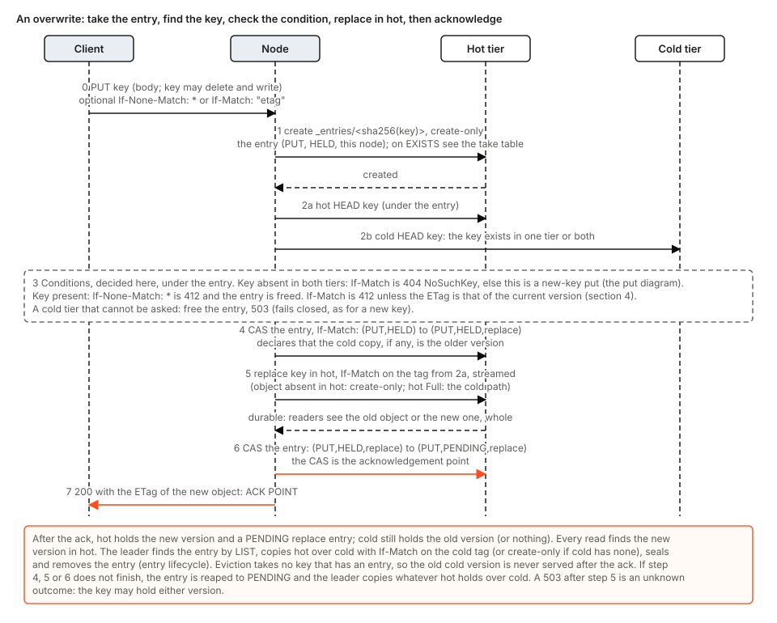
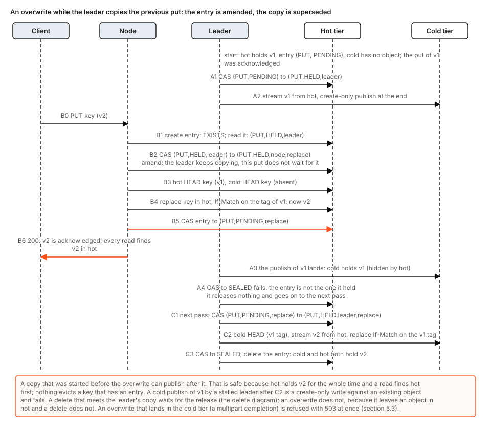
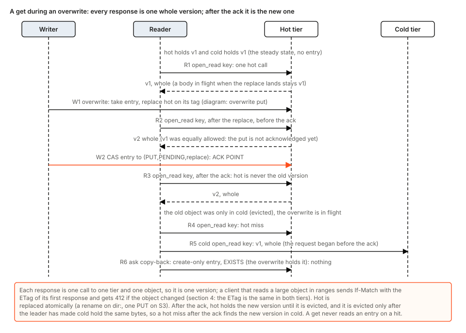

# Overwrite: a put over an existing key, last writer wins

Status: **decided (CEO, 2026-11-05), designed here, not built.** Everything in this document that is not marked "today" describes the plan; the code is write-once until the pull requests of section 14 land. It is a living document: each of those pull requests changes the text it makes true (what is built moves out of "plan" in the same pull request, rule P10), and the parts of [tierstore-design.md](tierstore-design.md) it contradicts are changed with it (section 16 lists them). Terms in bold are those of the glossary of tierstore-design.md (section 16 there): entry, hot tier, cold tier, leader, seal, amend, claim, reap.

It closes gap G10 of the S3 compatibility list (a put over an existing key is 412 today, `If-Match` on a put is 501 for the right tag) and the overwrite parts of G31 (`If-Match` on the completion of a multipart upload) and G11 (a copy onto an existing key). The rule of the decision: **a client uses tierstore exactly as it uses S3.** Where the AWS documentation says what S3 does, tierstore does that; MinIO is a proxy for S3 only where the documentation is silent. The model of the decision (CEO, 2026-11-05): **an overwrite is a delete of the key followed by a write of the key, to drive cache coherence.** Section 3 says what that means and where the implementation needs more than a literal delete and write. The choices that were open are settled in "Decided" at the end.

## 1. The problem

Every part of tierstore was built on one fact: **an object never changes.** A put creates, a delete removes, and nothing in between replaces bytes under a key. The design says so ([tierstore-design.md](tierstore-design.md), requirement 2 and the non-goals) and [limits.md](../../crates/tierstore/docs/limits.md) tells operators. The fact is what made the rest simple, and each part leans on it in its own way. This is what the code does today, and what overwrite does to it.

| Part | What it assumes today | What overwrite breaks |
|---|---|---|
| S3 front (`server/ops.rs`) | A put is create-only: the body goes to `put_stream`, which refuses a key that exists. `If-Match` is answered 412 for another tag and 501 ("objects are immutable") for the right one. A copy (`x-amz-copy-source`) is 501. | The answers are wrong against S3: a changed file cannot be uploaded again (`aws s3 cp`, `sync`, `mc mirror`, `rclone`), and a compare-and-swap cannot be done. |
| Proxy put (`tiered/entry_put.rs`) | One entry per key; under it a hot HEAD and a cold HEAD, and a key found in either tier is 412. Landing is create-only. | "Exists" is no longer a refusal. The put must replace, in the right tier, and say what the old version was. |
| Leader copy to cold (`entry_reconciler/work.rs`) | The cold copy is create-only. A cold object that already exists is compared byte for byte with hot, and a difference is an anomaly: hot is kept, counted, logged, never evicted. | After an overwrite cold legitimately differs from hot. The leader must replace cold, and must still be able to tell that from the anomaly. |
| Eviction (`entry_reconciler/evict.rs`) | Compare hot and cold outside the entry, seal, re-read both tags, delete hot. A tag is a function of the content, so equal tags are equal bytes. The leader remembers the tags of copies it made. | A key can change between the compare and the delete. The seal and the tag re-check already catch that (section 6.3). |
| Copy-back | Streams the current cold object into hot, create-only, under a seal. | A copy-back of an old cold version must never land over a newer put (section 6.4). |
| Reap of a put | Aborts every open multipart upload of the key, on both tiers, by listing. | Two clients may now legitimately upload the same key at once; aborting all of them for one dead put kills a live upload (section 6.5). |
| Stray sweep | Adopts a hot object with no cold object and no entry. | A hot object that is newer than a cold object (no entry) is not a stray by this test (section 6.6). |
| Reads | Hot first, cold on a hot miss, no entry read; a hot hit is one round trip. | A read must never return an old version after the new one was acknowledged, and never a mix of two (section 5.7). |
| Version identity | A proxy's tag is the tag of the tier that answers, and it moves when the object moves between tiers. `Proxy::same_version` compares sizes only. | Overwrite makes "is this still the same version" a question clients and the cache ask on every read (section 4). The ETag design ([section 16 of tierstore-design.md](tierstore-design.md#16-object-metadata-digests-and-checksums)) makes the answer much simpler for new objects. |
| Delete | A delete that meets a copy in flight waits for the leader, because the copy could republish what the delete removed. | The delete half of an overwrite does not need the wait, because the write half leaves a hot object (section 5.2). |
| Local cache (`server/local_cache/`) | A hit is answered from disk with no call upstream. The keep check compares sizes. A put through the cache first HEADs the upstream and answers 412 for a key that exists. | A hit can be stale for ever. The put-through check is wrong (section 7). |
| Scoped and presigned keys | `write_prefixes` is a create-only put, so a scoped key cannot replace an object. | As in S3, the right to write (PutObject) includes replacing an existing object; no delete right is needed. A scoped key replaces only under its own `write_prefixes`, so a build job overwrites only within its prefix (section 8). |
| OCI front | Tags are directories of immutable versions written create-only. | Nothing: it calls `put_stream`, which stays create-only (section 3). |

The problem is therefore not one race but the removal of an invariant that eight components lean on. The design below keeps the entry protocol, adds one optional field to the entry, makes the local cache as coherent as a CDN is (section 7), and states for each component what it does when a key can change elsewhere.

### 1.1 What S3 does, which is what tierstore must do

From the AWS documentation (data consistency model; PutObject and CompleteMultipartUpload conditional writes; CopyObject):

- A put over an existing key replaces it. Updates to one key are atomic: a reader gets the old object or the new one, never a mix. If two puts of one key are made at once, the last one wins.
- Strong read-after-write consistency: after a successful put, every get, head and list sees the new object.
- `If-None-Match: *` on a put or a completion makes it create-only: 412 `PreconditionFailed` if the key exists. `If-Match: "<etag>"` makes it a compare-and-swap: 404 `NoSuchKey` if the key is absent, 412 if the ETag differs. S3 answers 409 `ConditionalRequestConflict` when conditional writes to one key race.
- CopyObject writes its destination like a put; the source is read as one object (`x-amz-copy-source-if-match` and its siblings test the source). A copy of an object onto itself with nothing changed is 400.

## 2. Goals and non-goals

Goals:

- A plain put, a put with `If-Match`, the completion of a multipart upload, and a copy replace an existing key, and answer as S3 does (section 5.4). Overwrite is allowed under every prefix, as in S3, for any key that may write the key; no delete right is needed (section 8).
- **Last writer wins, strongly consistent through one tierstore** (any number of processes over the same hot and cold pair): from the acknowledgement of an overwrite, every get, head and list returns the new version, and a reader never sees a mix of two versions in one response.
- **No lost acknowledged overwrite, no resurrected old version, no wrong bytes**, with the same stated residuals as the write-once protocol and the few new ones of section 15.
- Nothing that is correct today gets slower or changes: a put of a new key costs what it costs now; a hot hit is one hot round trip and reads no entry; `put_stream` and every internal caller (the leader's copy, the copy-back, the OCI front) stay create-only.
- No new store requirement: the hot and cold tiers already need `If-Match` puts (also on a multipart completion for cold).
- **A cache is coherent as a CDN in front of S3 is**: an object is served from a cache without a call upstream only while its own `Cache-Control` says it is fresh; every other hit is checked with the upstream first (section 7). The one stated exception is an object a writer marked fresh for a time and then overwrote: a cache may serve the old version for the rest of that time, exactly as a CDN would.
- **Additive formats only**; overwrite is on with the release, with no switch and no data conversion (section 12).
- Every arbitrary number is a config key with a default (section 13).

Non-goals:

- Versioning (`versionId`), object lock, and a version history; an overwritten object is gone.
- Metadata and storage-class handling on copy (G16), the form of the ETag (G17), `UploadPartCopy` (G12), `DeleteObject` with `If-Match` (G37). Each is its own gap; this design only says how it must not conflict with them.
- Ordering concurrent puts by the time their requests started. S3 orders by timestamp; tierstore orders by who takes the entry first (section 5.2). A put that meets another put in flight is refused at once with 503 `SlowDown`, which S3 clients retry.
- Telling caches about overwrites and deletes (section 7, "Later work").

## 3. The design in one page

### 3.1 The model: a delete followed by a write

The decision's model is that **an overwrite of K is the delete of K followed by a write of K**, to drive cache coherence: the old version of the key ends and a new one begins, and anything that held the old one (a client's ETag, a cache's copy) learns it by the key's identity changing. This design uses the model in that sense throughout: the entry that serialises a delete serialises an overwrite; the right to overwrite is the right to write, as in S3, with no delete right (section 8); the new object has its own ETag, which is what a cache checks (section 7); and a delete of the key in flight is something an overwrite does not run beside (section 5.2).

A literal delete followed by a literal write is not enough, and the implementation does more in five places.

| A literal delete, then a write | What the implementation does instead | Why |
|---|---|---|
| Between the two calls the key is absent: a get is 404, or, once hot is gone, falls through to an old cold copy. | **The two halves are fused.** In hot, one conditional replace removes the old object and puts the new one in a single step (a rename under the lock on `dir:`, one PUT with `If-Match` on S3). Cold keeps the old object, hidden by hot, until the leader replaces it (section 6.2). | S3 never shows an absent key during an overwrite: a reader gets the old object or the new one, whole (section 1.1). The delete half is therefore *done* by the replace; no delete call is made to a store, and no reader sees the key absent. |
| Delete both tiers, then write. | **A hot landing replaces hot and leaves cold for the leader. A cold landing writes cold first and deletes hot after** (section 5.3): for that tier the order is reversed. | A failure between the halves of a literal delete and write loses the object. In both orders here the old version is whole until the new one is durable. |
| The delete waits for a copy of the previous put that is in flight, because the copy could republish what the delete removed (tierstore-design.md section 8). | A hot landing does not wait (section 5.2). | The write half leaves an object in hot, so a read never falls through to cold, and a late publish of the old version to cold is hidden and then replaced. A cold landing, which removes hot, is refused while the old hot version is not yet in cold. |
| Two entries in turn: `DEL`, released, then `PUT`. | **One `PUT` entry with the flag `replace`** (section 6.1), held from the first read of the key to the acknowledgement. | Between two entries another writer could take the key and a reader could see it absent. The flag is the delete half still owed to cold: "hot is the version to keep; cold, if present, is older and is to be replaced". |
| A failed write after a delete leaves no object. | A failed overwrite leaves the old version, whole; the only states a crash leaves are the rows of section 10. | S3: a put that fails leaves the old object. |

### 3.2 Five ideas

Each is used throughout.

1. **Hot wins.** The current version of a key is its hot object if hot has one, and otherwise its cold object. Every write path keeps this true at its acknowledgement and afterwards. This is already how reads work (hot first, cold on a miss); the design makes it the definition. It is why a reader never needs the entry.
2. **The entry still serialises the key, and says one more thing.** A put entry gets an optional flag, `replace`. `(PUT, PENDING, replace)` means: hot, if present, is the version to keep, and cold, if present, is older and is to be replaced. Without the flag, a cold object that differs from hot is still the anomaly it is today.
3. **An overwrite replaces in place, in the tier it lands in, conditional on the tag it read under the entry.** The condition is a fence against a stalled actor, not the mechanism: the entry gives exclusion, as for a delete.
4. **An overwrite that lands in hot never needs the leader; one that lands in cold needs the old hot version to be in cold already.** A hot landing leaves the new version where reads look first, so a copy of the old version that is still running can do no harm. A cold landing (a multipart completion, or hot full) must first be sure the old hot version is already in cold, or it could destroy the only copy of an acknowledged version (section 5.3); if it is not, the put is 503 `SlowDown` and the client retries.
5. **The old calls keep their meaning.** `Backend::put_stream` stays create-only. Overwrite is a new call, `put_stream_replace`, that only the S3 front and the cache's write-through use. Nothing that relies on write-once (the OCI tags, the leader, the copy-back) changes.

The rest is the consequences: the version token (section 4), each operation (section 5), the background work (section 6), the local cache (section 7), access (section 8), and then the tables: edge cases (section 9), crashes (section 10), races and their tests (section 11), compatibility (section 12), keys (section 13), the order of the pull requests (section 14).

**No switch.** Overwrite is on with the release: there is no format flag and no enable verb. A fleet that mixes the previous release and this one is the operator's to avoid; section 12 says what each does with an overwritten key and what to do (upgrade every node before any client overwrites).

## 4. The version of an object, and its ETag

**What a client holds.** An ETag, as with S3. [Section 16 of tierstore-design.md](tierstore-design.md#16-object-metadata-digests-and-checksums) (PR #173, which merges before this one) makes it a property of the content: the MD5 of the body for an object made by one put or copy, `md5-of-the-part-md5s-N` for a multipart one, kept in the object's record and carried with the bytes whenever the leader copies to cold or back, so **it is the same in every tier and does not move when the object moves**. That design decides the form; this one relies on three of its properties: the ETag is the same string in hot and in cold for an object with a record, it never changes after the object's first write, and the put answers it (G17).

The tier's own `Meta.tag` stays what it is, and the two have different jobs. **The ETag is what a client condition (`If-Match`, `If-None-Match`, the copy-source conditions) and a cache compare. `Meta.tag` is the compare-and-swap value of every conditional write the proxy makes to a tier** (the replace on the hot tag, the leader's replace on the cold tag, entries, leases, deletes). A tag is never compared across tiers, because the two tiers may tag the same bytes differently (`dir:` tags with the SHA-256 of the body, an S3 tier with the store's ETag).

**The fact that says which version is current:**

> **When a key has no entry, its hot object (if any) and its cold object (if any) are the same version.** An entry is released only after cold holds what hot holds (or hot is gone). While an overwrite is not finished, its entry exists.

So the version of a key is its hot object if hot has one, and its cold object otherwise. A client's ETag matches if it is the ETag of that version; when the key has no entry the cold object's ETag counts as well, since it is the same version.

- **Under the entry** (every write): the writer holds the entry and has read both tiers, so it knows exactly. A fresh entry means hot and cold are the same version. An amended `(PUT, PENDING)` or `(PUT, HELD, leader)` entry, or any with `replace`, means hot is newer, and **only the hot object's ETag counts**: cold holds the older version, and its ETag must not match a condition on the new one.
- **On a read** (`If-Match` or `If-None-Match` on a get or head; the cache's revalidation, section 7): the answer is judged against the ETag of the tier that answered. For an object with a record this is the whole rule: the ETag is the same in both tiers, so a mismatch is a real change, and an eviction or a copy-back in the middle of a ranged download is not mistaken for one.
- **An object stored before metadata existed** has no record, and its ETag is its tier's tag ([section 16.8 of tierstore-design.md](tierstore-design.md#168-old-objects-and-compatibility)). For it the answer is judged first against the tier that answered; only when that does not match does a slow path run: read the entry; if there is none, head the other tier and accept its tag too; if there is one, accept only the hot tag. The slow path runs only on what would otherwise be a refusal, so a hit stays one round trip. An overwrite writes a record, so a key leaves this case at its first overwrite.
- `Backend::same_version(a, b)` stays (it is synchronous and a tier-local question), and a new `Backend::still_current(key, seen: &Meta)` asks the question above for a backend that can answer it (the proxy). Its provided implementation is a HEAD and `same_version`. The proxy's `same_version`, which compares sizes only and so cannot tell two same-size versions apart, is no longer used by any caller that needs the answer (the cache's fill check calls `still_current`); this removes the documented limit "Versions are compared by size" and closes R8 of tierstore-design.md (section 11 there).

**What changes at an overwrite:** the ETag, as with S3, unless the new body has the same MD5 (the ETag then does not change, and an `If-Match` on it still matches, as in S3). The put answers with the ETag of the object it landed.

**No version token is needed.** The limit that a tag a client got from a tier that no longer holds the object cannot be told from a changed one (a put answered with the hot tag, the object evicted, then `If-Match` with that tag is 412 although nothing changed) does not arise here, and a stored version token (a persisted format, the "write id" of tierstore-design.md section 12) is not needed. With the ETag of section 16 of tierstore-design.md every tier answers the same ETag for an object with a record, so the limit does not arise for it. What is left is the slow path above, for objects with no record, which shrinks as they are overwritten.

**Order of the two designs.** Until the MD5 is turned on (change 7b of [section 16.13 of tierstore-design.md](tierstore-design.md#1613-migration-plan), `digests.always`), an object's ETag is still its tier's tag, so the slow path covers every object; after it, only the objects written before. Overwrite is correct either way and does not wait for it.

## 5. How each operation works

The sequences are for configuration B (a storage node). Notation as in tierstore-design.md section 5: K is a key, H(K) and C(K) its objects, E(K) its entry `(op, state, owner)`. The new flag is written `replace`: `(PUT, HELD, replace)`. In the terms of section 3.1, steps 2 to 4 take and declare the delete half, step 5 is the fused delete and write in hot, and step 6 is the acknowledgement of both.

### 5.1 Overwrite put, landing in hot

The S3 front sends a put that is not a multipart part and is not `If-None-Match: *`, from a key that may write the key (section 8), to `Proxy::put_stream_replace(key, len, body, if_match)`. `if_match` is the client's ETag or none. A put with `If-None-Match: *` goes to `put_stream` as today, including its one-request 412 when hot has the key.

0. **Refuse** a reserved key. There is no early exit on a hot HEAD: the key may exist, and that is allowed.
1. **Take the entry.** Create-only `(PUT, HELD, this node)`. On `EXISTS`, read the entry and act by the take table of section 5.2.
2. **Look under the entry.** A hot HEAD and a cold HEAD, as for a new key. A cold tier that cannot be asked: free the entry, 503. Neither tier has the key: it is a new-key put (the put of tierstore-design.md section 5); with `If-Match` the answer is 404 `NoSuchKey` and the entry is freed.
3. **Conditions** (section 5.4) against the ETag of the current version (section 4). A failure frees the entry and answers 412.
4. **Declare.** CAS the entry from `(PUT, HELD)` to `(PUT, HELD, replace)` (E2r). From here, a reap or a leader that finds the entry knows hot is the version to keep. This is one more small hot write, and only for an overwrite; a put of a new key is unchanged. (A create that found `EXISTS` and amended an entry already declares it: the amend sets the flag.)
5. **Land.** If hot has the key: replace it, streamed, conditional on the hot tag read in step 2 (`put_stream_if_match` on the hot tier; one PUT with `If-Match` on S3, a rename under the lock on `dir:`), so a reader sees the old object or the new one, whole, and an object that is not there afterwards is never a result. The new record (the ETag, the digests, and the `Cache-Control` and other headers the client sent) goes with the bytes, in the order of [section 16.4 of tierstore-design.md](tierstore-design.md#164-where-the-record-lives-for-each-kind-of-tier) (object first, then the `dir:` sidecar, whose `bind` makes a reader in the gap see the new object with no record, never with the old one's). If the condition fails (a writer outside the entry, which should not exist) the put re-reads once and tries again, at most `overwrite_rounds` times, then answers 503. If hot does not have the key: a create-only write, as a new key. If the hot tier is at level `Full`, or answers `Full` before it took a byte: the cold path of section 5.3. A definite failure before the object landed (a body error) leaves the old object as it was, removes only this put's temporary object, and frees the entry (the entry is still `(PUT, HELD, replace)`, and freeing it is the owner's delete, as for a new key).
6. **Acknowledge.** CAS the entry from `(PUT, HELD, replace)` to `(PUT, PENDING, replace)`. **That CAS is the acknowledgement point,** with the same rules as for a new key (a failed CAS is 503 and the node never touches the entry or the data again; an ambiguous result is read back by its nonce). The put answers 200 with the ETag of the object it landed.

After the acknowledgement: hot holds the new version, cold holds the old one (or nothing), and the entry says so. The leader replaces cold later (section 6.2). The old cold version is hidden by hot until then and nothing evicts the key while its entry exists.

### 5.2 Overwrite meets an entry: pending, running, held

What a second put of a key does while the first is pending or being copied is the heart of the design. At step 1 the create finds `EXISTS` and the put reads the entry. The put is either a **hot landing** (the normal case) or a **cold landing** (a multipart completion, or hot full: section 5.3); the table gives the answer for each. **No put waits:** where it cannot amend, it is refused at once with 503 `SlowDown` (with the `Retry-After` the front already gives for that error), nothing changed, and the client retries.

| Entry found | Hot landing | Cold landing |
|---|---|---|
| none (released meanwhile) | look again (up to `entry_rounds`) | look again |
| `(PUT, PENDING)`, plain or `replace`: an earlier put landed in hot, the leader has not started | **Amend** to `(PUT, HELD, this node, replace)` by CAS (E10). The leader's CAS to HELD now fails, so no copy of the old version starts. The old version in hot is replaced; it was never copied and is overwritten, as S3 would have it. | **503 `SlowDown`** at once: the old hot version is not in cold yet (below); the leader copies it within seconds and the retry finds the key released |
| `(CB, PENDING)`: a read asked for a copy-back | Amend (E10). The leader's seal fails; no copy-back starts. | Amend (hot has nothing to lose) |
| `(PUT, HELD, leader)`: the leader is copying the earlier put | **Amend** (E10'). The copy is allowed to finish publishing the old version to cold: hot already holds the new one, so no read can see it, and the leader replaces it (section 6.2). | **503 `SlowDown`** at once |
| `(PUT, HELD, another client)` (a write in flight), `(DEL, any)`, any `SEALED`, `(PUT, HELD)` of a live owner | **503 `SlowDown`** at once, nothing changed | 503 at once |
| an `op` or `st` this release does not know | 503, nothing changed | 503 |

Why a hot landing may amend and a cold landing may not:

- **A delete waits for a copy in flight** because it removes the object from hot, after which a read can fall through to cold, and the copy may publish the deleted version there (the model's counterexample, tierstore-design.md section 8). An overwrite that lands in hot leaves a hot object, so a read never falls through for as long as the entry exists, and the entry exists until cold holds the same version as hot. A late publish of the old version to cold is therefore invisible, and the leader's next step replaces it.
- **A cold landing removes the hot object** (it must, or reads would keep returning the old hot version). That is safe only if the old hot version is already in cold, so that a failed overwrite loses nothing. A `(PUT, PENDING)` or `(PUT, HELD, leader)` entry says it is not. So the cold landing is refused until the leader has finished, and takes the key afresh on the retry.
- **Amending a pending put discards an acknowledged version.** That is correct: the second put is the last writer, and the first was acknowledged before it. The first version was durable in hot until the replacement, and nothing observes a state with neither.

A hot landing that amends `(PUT, HELD, leader)` leaves the leader's copy running. When it ends, its CAS to SEALED fails (the entry is no longer the one it held), it removes nothing, and the next scan finds `(PUT, PENDING, replace)` and copies the new version over whatever cold now holds (section 6.2). That is C1 to C3 in the diagram.

**Two overwrites at once.** Both create; one wins the entry; the other reads `(PUT, HELD, winner)` and is refused with 503 `SlowDown` at once, and its retry (S3 clients retry that error) finds either the winner still in flight (503 again) or the winner acknowledged as `(PUT, PENDING, replace)`, which it amends (E10), replacing the winner's version. The order of the two is the order of their entries: last writer wins. S3 would run both in the order of their timestamps; tierstore never answers 409 because it never runs two at once.

### 5.3 Overwrite landing in cold: a multipart completion, or hot full

A multipart upload keeps its parts in cold, so its completion lands in cold, and a put that finds the hot tier full lands in cold (tierstore-design.md section 5, "Hot tier full"). Hot may hold the old version, and a read would find it first, so the old hot object has to go before the acknowledgement.

1. Take the entry by the **cold** column of the take table. A 503 here is the cost of safety: the old hot version may not be in cold yet.
2. Look: a hot HEAD and a cold HEAD. Hot has the object and cold has none, with no entry: a stray (section 6.6); free the entry, 503, retry later. Neither: a new key, create-only as today.
3. Conditions (section 5.4). `If-Match` and `If-None-Match` on a completion are evaluated here, which is what closes the `If-Match`-on-Complete part of G31.
4. Declare the replacement (E2r).
5. **Land in cold, replacing:** conditional on the cold tag from step 2 (`complete_upload_if_match`, or `put_stream_if_match` for the streamed put; create-only if cold has none). If the condition fails, re-read and retry up to `overwrite_rounds`, then 503. The multipart completion is a metadata operation, so the window below is short for it; for the streamed put at `Full` the cold write is as long as the body.
6. **Delete the hot object** (`delete_if_match` on the hot tag where the store honours it, else a plain delete: the entry is held). From here a read finds the new version in cold.
7. **Acknowledge:** CAS to `(PUT, PENDING, replace)`. The leader finds hot absent and nothing to copy, and releases.

Why this order: the new version is durable in cold before the old one is removed from hot, and the old hot version was already in cold (step 1 refused until that was so), so a failure at any step leaves one complete version. Between steps 5 and 6 a read still finds the old hot object, which is allowed, because nothing is acknowledged. The cost of the streamed `Full` case is that, for the length of the cold write, the key is served from hot as before; nothing waits for it.

### 5.4 The conditions, as S3 answers them

| Request | Key absent | Key present |
|---|---|---|
| plain put | create, 200 | replace, 200 with the new ETag |
| `If-None-Match: *` | create, 200 | 412 `PreconditionFailed` (one hot HEAD when hot has it, no entry; as today) |
| `If-Match: "<etag>"` | 404 `NoSuchKey` | the ETag is that of the current version (section 4): replace, 200. Otherwise 412 |
| `If-None-Match: "<tag>"` | 501 `NotImplemented` (S3 supports only `*` on a put) | 501 |
| `If-Modified-Since`, `If-Unmodified-Since` | ignored on a put, as S3 | ignored |
| completion with `If-None-Match: *` | create | 412 |
| completion with `If-Match` | 404 | as for a put |
| completion with `x-amz-mp-object-size` that differs from the size of the parts | 400 `InvalidRequest` (the small, independent part of G31) | 400 |

The conditions are decided under the entry, so a compare-and-swap is a real one: no other put of the key can land between the check and the replacement. tierstore never answers 409 `ConditionalRequestConflict`; where S3 would, a client of tierstore sees 412 (the other put won) or 503 (a put is in flight), and an S3 client retries both.

### 5.5 CopyObject

A copy is a put whose body is another object. `Proxy::copy(src, dst, conditions)`:

- Both keys are checked: a reserved key is refused; a source that is absent is 404 `NoSuchKey`; **a copy of a key onto itself is 400 `InvalidRequest`** with S3's text, because tierstore keeps no metadata to change (G16 may change that).
- The destination is put by the path of section 5.1 or 5.3, as a put with a known length (the size of the source, so an S3 tier can stream it). **The source is opened inside the landing step**, after the destination entry is held and the conditions have passed, so a copy that waits for an entry holds no open read of the source.
- The source is read as one object, by one `open_read` (hot first), so the copy is of one version, even if the source is overwritten while it is copied: the stream in flight is the old version, whole. `x-amz-copy-source-if-match` and `-if-none-match` are tested against the ETag of that read (section 4); the two time conditions are 501, as they are on a read.
- No entry is taken on the source, and the destination's entry is the only one held, so two copies in opposite directions cannot wait on each other.
- The answer is the XML `CopyObjectResult` with the ETag of the new object.

### 5.6 Delete

A delete is unchanged. How it meets an overwrite:

- **A delete while an overwrite is in flight**, `(PUT, HELD, client)`: the delete waits within its own budget (today's rule for any HELD entry it cannot amend; `delete_wait` is the delete's, not new), then deletes. The order is: overwrite, then delete.
- **A delete after the overwrite was acknowledged**, `(PUT, PENDING, replace)`: it amends the entry (E3) and deletes cold, then hot. Cold holds the old version and is deleted at once, so nothing of either version survives, and the leader's CAS to HELD fails, so no copy-over starts.
- **A delete while the leader copies the new version over the old** `(PUT, HELD, leader, replace)`: today's rule (E3'): amend, delete both tiers, hand over, wait for the release. Where cold held the old version, the leader's replace is conditional on the cold tag it read, and cold was deleted, so it fails (an `If-Match` on an absent object does not create it) instead of republishing. Where cold held nothing, the leader's create-only publish is the case the delete's wait already covers. Either way the leader then seals, finds the entry amended, and the roll-forward deletes both tiers again before the delete answers.
- **An overwrite while a delete is in flight** (`(DEL, any)`): the overwrite is 503 `SlowDown` at once (table of section 5.2); its retry takes the key afresh, finds it gone, and is a new-key put, or 404 with `If-Match`.

### 5.7 Get, head and list: what a reader sees

Reads do not change. A get is one `open_read`: one call to one tier, one object, so **a response is one version, whole.** A body that is being streamed when hot is replaced stays the old version (an open file on `dir:`, one GET on S3). **From the acknowledgement of an overwrite every new get returns the new version**, because hot holds it (replaced atomically, before the ack) and hot is only emptied by an eviction (which needs cold to hold the same bytes) or a delete; or, for a cold landing, because hot is empty and cold holds it. Before the acknowledgement a reader may get either version, as with S3. This is the consistency of reads *at tierstore*; a cache in front of it may serve an older version for as long as the object's `Cache-Control` says it is fresh (section 7).

- **A hot miss** reads cold and asks for a copy-back as today. The ask is create-only on the entry, so it does nothing while an overwrite holds the key; after it, the leader copies the *current* cold object (the request carries no bytes), so a copy-back can never bring back an old version (section 6.4).
- **A client that reads in ranges** sends `If-Match` with the ETag of its first response (some SDK transfer managers send it on the later ranges). A range whose object has changed is 412 and the client starts again; the ETag is the same in both tiers (section 4), so an eviction or a copy-back in the middle is not mistaken for a change.
- **HEAD** is a get without the body; the ETag and `Last-Modified` are those of the tier that answers.
- **List.** The union of both tiers, hot winning on a duplicate, so after an overwrite the listing shows the new size from hot; a listing that began before the acknowledgement may show the old one, as R5 of tierstore-design.md says for a delete. `Last-Modified` is the tier's, as today, so it moves when the object is copied (not changed by this design).

## 6. Background work

### 6.1 The entry

The body stays `{v, key, op, st, owner, nonce, created_ms}` and gains two **optional** fields. A reader ignores unknown fields, and a writer leaves an absent field out, so an entry without them is byte for byte today's.

- `replace` (bool, default false): set on a `PUT` entry of an overwrite, from the declare step (or the amend) on. It is kept by every later CAS of the entry (hold, seal, reap).
- `upload` (string, optional): the id of the multipart upload a completion is finishing. Used by the reap (section 6.5).

New transitions, beside those of tierstore-design.md section 6.2:

| id | from | to | by | when |
|---|---|---|---|---|
| E2r | `(PUT, HELD)` | `(PUT, HELD, replace)` | owner, CAS | both HEADs found the key; declares the replacement |
| E10 | `(PUT, PENDING)` or `(CB, PENDING)` | `(PUT, HELD, replace)`, owner the new put | client overwrite, CAS | amend; the leader's CAS to HELD or SEALED fails; no wait |
| E10' | `(PUT, HELD, leader)` | `(PUT, HELD, replace)`, owner the new put | client overwrite, CAS | amend of a copy that may be in flight; hot landing only |
| E2 | `(PUT, HELD, replace)` | `(PUT, PENDING, replace)` | owner, CAS | landing returned. **The acknowledgement point** (as before) |
| E6a, E6, E7, E8' | as before | as before, `replace` kept | leader | hold, seal, reap and release do not touch the flag |

New invariants, beside those of tierstore-design.md section 6.2:

- **Hot wins.** At every moment that matters to a client (after any acknowledgement, and for every read that begins after it), a key's version is its hot object if there is one and its cold object otherwise.
- **The flag says which tier is newer.** A `PUT` entry with `replace` means a hot object is newer than any cold object; without it, a cold object that differs from hot is an anomaly and is handled as today (kept, counted, never evicted).
- **An entry is released only when cold holds what hot holds,** or hot holds nothing. So a key with no entry has one version in both tiers (section 4).
- **A cold landing removes hot only after the new version is durable in cold, and acknowledges only after both.**
- **Exclusion is as before:** the data of K is changed only by the holder of E(K), with the one stated overlap that a copy the leader started before an amend can still publish to cold (section 5.2).

### 6.2 The leader's copy-over

The leader's table (tierstore-design.md section 6.5) gains the replace arm. For `(PUT, PENDING, replace)`:

1. **E6a:** CAS to `(PUT, HELD, leader, replace)`. If it fails, a client amended: re-read and handle the new state; no copy starts.
2. Hot HEAD. Absent: nothing to copy (a cold landing, or a delete finished): go to the seal.
3. Cold HEAD. **Absent:** stream hot to cold create-only (the lease margin is checked before the publish), exactly as a new key. **Present:** *replace* it: stream hot to cold with `put_stream_if_match` on the cold tag just read, margin checked right before. A byte compare is **not** done for a `replace` entry, because the bytes legitimately differ. If the condition fails (cold changed since the HEAD, or was deleted: an `If-Match` on an absent object fails, which is what stops a late republish after a delete) re-read and decide again, up to `overwrite_rounds`, then fail the item for its retry back-off.
4. Remember the tags of the two objects for the eviction's fast path (section 6.3). Then E6 to SEALED and E8' (release). If the seal fails, an overwrite or a delete amended the entry during the copy: the item ends, the next scan handles the new state (section 5.2).

A `(PUT, SEALED, replace)` entry is released. A reaped `(PUT, HELD, replace)` goes to PENDING with the flag, so it is copied the same way. **Whatever hot holds when the leader copies is what cold gets:** an overwrite that died before landing leaves the old version in hot, and the copy makes cold equal to it (a rewrite of equal bytes); one that died after landing leaves the new version, and cold gets that. Either is a valid outcome of a put that was never acknowledged.

A `replace` entry without a cold object is a plain copy, so the flag costs nothing when cold has nothing to replace. **Cost:** every overwrite rewrites the whole object in cold (there is no delta), and puts that arrive faster than the leader copies coalesce: each amend discards the version before it, so only the last is copied.

### 6.3 Eviction

Unchanged in its steps, and sound for the reasons it was: it takes only a key with no entry; it compares hot and cold, creates `(EVICT, SEALED)` create-only (which fails if any entry exists), re-reads both tags under it, and deletes hot only if both equal the ones compared. An overwrite between the compare and the seal changes the hot tag (or, if the bytes are equal, changes nothing that matters), so the re-check keeps the key. The leader's memory of copied tags is keyed by both tags; after an overwrite the hot tag is new, so the fast path does not match and the compare runs. A copy-over records the new pair.

### 6.4 Copy-back

Unchanged: a `(CB, PENDING)` entry is sealed first, and under the seal the leader streams the current cold object into hot if hot has none. An overwrite that finds a pending copy-back amends it (the leader's seal fails); one that finds it sealed waits for its release (section 5.2). The request carries no bytes, so a copy-back asked for before an overwrite and taken after it copies the new cold version.

### 6.5 The reap, and open uploads

Today a reap of a departed put aborts every open multipart upload of the key on both tiers, by listing, which is safe only because nothing else could usefully be uploading that key. With overwrite, two clients may upload the same key at once, and each completes in its turn. A reap must not abort an upload that is not the dead put's. The completion therefore records the id of its upload in the entry (`upload`, section 6.1), and the reap aborts that upload, and no other. Uploads that nobody completes are left to the bucket's `AbortIncompleteMultipartUpload` rule, which tierstore-design.md section 13 already requires. An entry without `upload` (a plain put) has no upload to abort.

### 6.6 The stray sweep

Unchanged, and still right for what it is for: a hot object with no entry and no cold object. An overwrite leaves hot newer than cold only while its entry exists, so the sweep, which skips keys with an entry and objects younger than the grace, does not meet it. If the entry is lost (R4 of tierstore-design.md: a stalled holder's late plain delete of an entry on a store that ignores conditional deletes, or an operator error), hot is newer than cold with no entry. The sweep does not see that (cold has the key); the eviction compare does and keeps hot, counted as a mismatch (section 15, R15). The sweep does not compare bytes and does not read any store's clock, which decision 8 of tierstore-design.md forbids. The operator verb `tierstore entries adopt --key K` (held, dry-run default; section 14) makes `(PUT, PENDING, replace)` for a key the operator knows has the newer hot object.

### 6.7 Usage

An overwrite changes the bytes hot holds by the difference of the two sizes. The leader's figure is corrected by its next listing (as for a delete that a client finishes alone); until then it may be off by the sizes of the objects overwritten, and the hot tier's own `Full` answer is still what stops a landing that has no room. The leader counts the bytes of the objects it copies as before.

## 7. The local cache and chained proxies

On a build node (configuration A) a hit is answered from disk with no call upstream, and a kept copy is trusted by its size. With overwrite upstream both are wrong: a kept copy can be stale for ever. The decision: **the cache behaves like a CDN in front of S3**, using what S3 and HTTP already have and no key of its own: the object's own `Cache-Control`, which S3 stores and returns (round trip of `Cache-Control` and the other headers is gap G16, designed in [section 16 of tierstore-design.md](tierstore-design.md#16-object-metadata-digests-and-checksums)), read as RFC 9111 (`max-age`, `s-maxage`, `no-cache`, `must-revalidate`) and RFC 8246 (`immutable`) define it. These are the standard headers a client already sets through the normal S3 API (for example `aws s3 cp --cache-control`); tierstore stores and returns them unchanged, as S3 does, and has no setting of its own for them. A client that sets nothing still reads correctly: each hit is checked. In the terms of section 3.1, the delete half of an overwrite is what ends the old version, and a cache learns it the way a CDN does: by asking, once the copy is no longer fresh.

**What a hit does.** The cache keeps, with each object, the record its upstream answered (the `record` of the cache sidecar, [section 16.4 of tierstore-design.md](tierstore-design.md#164-where-the-record-lives-for-each-kind-of-tier), which carries the headers, so `Cache-Control` as the writer's client sent it, a string the cache reads for freshness and the front returns verbatim, and the ETag) and the time it last filled or validated the object (a new optional sidecar field, `validated`; a sidecar without it is read as never validated). Then:

| The object's `Cache-Control` | A hit |
|---|---|
| `max-age=N` (or `s-maxage=N`, which wins in a shared cache), with or without `immutable`, and the copy is younger than N (its age is the time since `validated` plus the `Age` the upstream answered, which is 0 for a storage node) | **Fresh: served from disk, no call upstream.** `immutable` (RFC 8246) says the object will not change within that lifetime; the cache treats it as the stronger form of the same rule and never revalidates inside it |
| `max-age=N` and the copy is older | Stale: revalidated, below |
| none, or `no-cache`, `must-revalidate`, `proxy-revalidate`, `max-age=0`, or `immutable` with no lifetime | **Revalidated on every hit.** An object stored before metadata existed has no `Cache-Control`, so it is in this row |
| `no-store` | Not kept: every read is a miss |

Other directives are ignored, and so are the request's (a build node's clients are tools, not browsers). The freshness clock is an injected clock, as for every other time in tierstore.

**Revalidation** is a conditional request to the upstream with `If-None-Match: "<kept ETag>"`: **304** means fresh (the copy is served and `validated` is renewed), **200** carries the new object (the cache serves it and keeps it, which is the fill, in the same request), **404** means the key is gone (the copy is dropped and the read is 404). A conditional GET is used for a whole-object read; a ranged read first makes a conditional HEAD, and on a change takes the miss path. The ETag is the same in every tier of a storage node (section 4), so a key that was only moved between tiers is 304. For an object with no record the storage node applies the slow path of section 4 to the condition, with the same result. An upstream that cannot answer fails the read with the upstream's error (fail closed, as a hot error does on a storage node): **a build node's hit under a revalidating `Cache-Control` needs its upstream to be reachable**, and only a fresh object is served through an outage.

**The cached bytes may be read while the check is in flight:** the cache opens the file and reads ahead while the conditional request runs, so a 304 costs one small round trip and no more latency than that. **No byte is sent to the client before the answer is 304**, because a read that begins after an acknowledged overwrite must not return the old version. On 200 the read-ahead is dropped and the new object is what the client gets. Reads that arrive while a revalidation of the key is in flight wait for it only if it began after they arrived; otherwise the next one is started, and the reads that wait for it share it. A revalidation is never shared with a read that began after the answer was sent.

**Put through a cache with `write_through`.** The cache sends the put to its upstream as `put_stream_replace(if_match)` (so `If-Match` and an overwrite reach the upstream, which decides), drops its own copy of the key before the call and again after it (as a delete does: a fill that began between must not keep the old object), and then, under a `cache = true` policy, keeps the new body and its record as it does for a create (the HEAD for the ETag, the stage file, the link). The early HEAD that answers 412 for a key that exists is made only for `If-None-Match: *`; for any other put it is gone, since "exists" is no longer a refusal. A refusal by the upstream (412, 404, 503) is passed on as it is. A completion drops the key's copy, as today.

**The fill's version check** (a HEAD before the first chunk and another after the last, which fails a fill whose object changed) uses the ETag and `still_current` instead of the proxy's size comparison, so two same-size versions are told apart (R8 closed for a proxy upstream; for a plain S3 upstream the tags already differ with the bytes).

**Chains.** A build node A whose upstream is a storage node S, and a storage node that has its own cache in front of its proxy (configuration C), are the same case: each hop revalidates against its own upstream, and an object that a hop serves fresh was fresh at the hop above (the `Age` of the answer is carried, as RFC 9111 has it), so the staleness along a chain is bounded by the `max-age` the writer set, not summed. When the pair hot+cold is the cache's upstream in process, revalidation is a direct call; across processes it is the conditional request above, which needs nothing the S3 front does not already do for `If-None-Match`.

**What the writer chooses, and what a cache may then do, said plainly.** Overwrite is allowed under every prefix, as in S3, and there is no refusal for "immutable" data. A writer that marks an object `Cache-Control: immutable` or `max-age=N` has told every cache that the object does not change for that time. **If it then overwrites or deletes the key, a cache that holds the old object may keep serving it until its freshness runs out, exactly as a CDN would;** a tierstore storage node answers the new version from the moment of the acknowledgement, but a cache in front of it does not ask. The same holds for a delete. That is the contract of the header, and the writer owns it.

**Build-farm clients should write content-addressed blobs** (`cas/`, whose key is the hash of the content, so the key never means other bytes) **with `Cache-Control: immutable, max-age=31536000`**, so that their hits stay at disk speed: no call upstream, as today. Objects written without it (and every object stored before metadata existed) are revalidated on every hit; an operator who wants old blobs at disk speed sets the header on them with a copy onto themselves with `REPLACE` (["Changing the record of an existing object" in section 16.5 of tierstore-design.md](tierstore-design.md#changing-the-record-of-an-existing-object-tagging-and-a-copy-onto-itself)). Nothing in tierstore knows what `cas/` is; the header says it.

**What is lost, deliberately.** The promise of tierstore-design.md section 4 that a hit makes no call upstream holds only for an object that says it is fresh. A revalidation is one small request, so for an object that can change the saving of the cache is bandwidth, not round trips. This is the cost of S3 behaviour.

**Strong consistency through one cache.** A write through node A is kept by A before it answers, so A's next read of the key is the new version. A read through node B sees it at once if the object is revalidated on every hit, and when its freshness runs out otherwise.

**Later work, not in this design.** The proxy could notify the caches registered with it of a delete or an overwrite, so that a cache skips revalidation (and a fresh object is dropped) until it is told. That needs a registration of caches and a delivery path that survives their absence, and the freshness rules above stay correct without it.

## 8. Who may overwrite

**As in S3, the permission to write (PutObject) includes overwriting an existing object; no delete right is needed.** Nothing is invented on the S3 interface: a client that may put a key may put it again, and `aws s3 cp`, `sync`, `mc mirror` and `rclone` work unchanged. The model of section 3.1 is about how the implementation keeps caches coherent; it adds no permission. Scoped keys stay confined to their own prefixes as today, so a job can overwrite only within its prefix.

- **The full key** may write every key, so it may overwrite.
- **A scoped key** (`read_prefixes`, `write_prefixes`, `delete_prefixes`) may overwrite a key that lies under a prefix of `write_prefixes`, and no other. A build-job key has `write_prefixes` for its own output path and no `delete_prefixes`, so it overwrites only within that path and still **cannot delete anything**. The key file is unchanged, and so are today's files; what changes is that a put under `write_prefixes` of an existing key succeeds where it was 412.
- **B16 of AGENTS.md** ("jobs write only to their own output path with no delete privilege") is still satisfied: the write stays inside the output path, and an overwrite is not a delete. The key has no delete right, no `DeleteObject` is allowed to it, and replacing an object under its own path is a write (the old version ends because the new one replaces it, not because the key deleted it).
- **A presigned PUT** may overwrite if the key that signs it may write the key, which is the same check on the signing key.
- **A read-only key and a GC key** never overwrite: the first never writes, and a GC key deletes but does not write.
- The reserved prefixes stay refused to everyone.

The front makes the check before it calls `put_stream_replace` (section 5.1): a caller that may not write the key is refused 403 `AccessDenied` as today, and no new error appears.

## 9. Edge cases and their mechanism

Each row is a mechanism and the reason it works; the races between actors are in section 11, each with its test.

| Case | Mechanism |
|---|---|
| Plain put of an existing key | Section 5.1: take the entry, both HEADs, declare, replace in hot on its tag, acknowledge. 200 with the new ETag. |
| `If-None-Match: *` of an existing key | 412 as today; one hot HEAD and no entry when hot has the key; under the entry otherwise. |
| `If-Match`, key absent | 404 `NoSuchKey`, entry freed (section 5.4). |
| `If-Match`, the ETag of the cold object | The same string as hot's for an object with a record (section 4). While a `replace` entry exists, the ETag of the old version, which only cold holds, is refused (hot is newer). |
| `If-Match`, an ETag from a tier that has since lost the object | Matches, for an object with a record (the ETag is the same in every tier). 412 though nothing changed only for an object with no record (R16). |
| Two overwrites of one key at once | One takes the entry; the other is 503 `SlowDown` at once, and its retry amends the acknowledged first (section 5.2). Both 200 in the end, in entry order; or 412 if its `If-Match` no longer holds. |
| Overwrite while the first put is pending, cold has nothing | Amend (E10); the first version is replaced in hot and never reaches cold. |
| Overwrite while the leader copies the first put | Amend (E10'), no wait; the late publish of the old version is hidden by hot; the leader's next step replaces it (diagram, C1 to C3). |
| Overwrite while a copy-over of the previous overwrite runs | The same: amend; the copy-over's seal fails; the next scan copies the newest. |
| Overwrite while a copy-back is pending or sealed | Pending: amend, no copy-back starts. Sealed: 503 `SlowDown` at once (the leader is landing a copy of cold into hot); the retry finds a hot object and replaces it. |
| Overwrite while an eviction holds the key | `(EVICT, SEALED)` is a held-or-sealed entry: 503 `SlowDown` at once; the retry takes the key afresh. An eviction in its compare phase holds no entry; the overwrite takes the entry, and the eviction's create-only of its own entry then fails, so the key is skipped. |
| Delete and overwrite in either order | Section 5.6. Overwrite then delete: the delete removes both versions. Delete then overwrite: a new-key put (404 with `If-Match`). |
| Hot `Full` | At level `Full`, or when hot answers `Full` before a byte: the cold landing (5.3). If hot answers `Full` after bytes were taken: 503 and the retry takes the cold path, as for a new key. A presigned put at `Full` is 503. |
| Multipart completion over a key hot holds, replicated | Cold landing: replace cold on its tag, delete hot, acknowledge (5.3). |
| Multipart completion over a key hot holds, not yet replicated | 503 `SlowDown` at once (the entry is `(PUT, PENDING)` or HELD by the leader); the leader releases it within seconds and the retry lands (a completion is cheap to retry: the parts are in cold). |
| Cold down | An overwrite needs the cold HEAD under the entry, like a new key (decision 2 of tierstore-design.md section 15): 503. |
| Overwrite with identical bytes | A normal overwrite; the new tag equals the old when the tier computes tags from content, and the leader rewrites equal bytes to cold. Correct, wasteful. |
| A client retries after a 503 whose outcome is unknown | A put without a condition is safe to repeat. A put with `If-Match` that did land is then 412 (the tag moved), as with S3. |
| A reader streaming a body while its object is replaced | One open file or one GET: it finishes the old version, whole. |
| A ranged download across an overwrite | `If-Match` on each range gives 412 once the object changed (section 5.7). |
| List and head during an overwrite | Head and list answer for the tier that answers; both are consistent from the acknowledgement. |
| ETag and `Last-Modified` | Change at an overwrite (the ETag not, if the MD5 is the same). On a move between tiers the ETag stays and `Last-Modified` moves, as today (an object with no record: both move). |
| Presigned put over an existing key | Replaces it if the signing key may write the key, as in S3 (section 8). It lands in hot only, so at `Full` it is 503. |
| A cache holds the key under `Cache-Control: immutable, max-age=N` and a writer overwrites or deletes it | The cache serves the old version until its freshness runs out; the storage node answers the new one at once (section 7). The same as a CDN. |
| A cache holds the key with no `Cache-Control`, or with `no-cache` | The next hit revalidates with `If-None-Match`; 304 serves the copy, 200 serves and keeps the new object, 404 drops the copy (section 7). |
| Key under a reserved prefix | Refused by the proxy core for put, copy source and copy destination, as for every call. |
| A build node with no `write_through` | Refuses every write before it reaches the cache, as today; no overwrite, no copy. |
| OCI blobs and tag versions | They call `put_stream`, which stays create-only; a push of an existing digest is as today. |
| Self-copy | 400 `InvalidRequest` (section 5.5). |
| A versioned bucket under either tier | Every overwrite leaves a non-current version in the bucket. The operator sets a lifecycle rule that expires them (hot: one day, as the entries already need; cold: the operator's retention). |
| A node of the previous release in the fleet | Not guarded: the operator upgrades every node before any client overwrites (section 12). |
| A large object overwritten often | Each overwrite rewrites the whole object in cold, and a burst coalesces to the last version (section 6.2). |

## 10. A crash at every step

Each row is a process dying (or being cut off) after the step named, with the put not yet answered. "Reap" is the leader's after-D move of a held entry of a departed owner to `(PUT, PENDING)` with the flag kept. The answer to every row is a single complete version in each tier, and no acknowledged version lost.

**Hot landing** (steps of section 5.1):

| After | State | What recovers it |
|---|---|---|
| 1, entry taken | `(PUT, HELD)`, nothing else | Reap; the leader finds hot and cold equal (or hot only: copy) and releases. Nothing changed for readers. |
| 2, HEADs read | the same | The same. |
| 4, declared | `(PUT, HELD, replace)`; hot v1, cold v1 | Reap; the leader copies v1 over cold (equal bytes, a rewrite). |
| 5, hot replaced, not acknowledged | hot v2, cold v1, `(PUT, HELD, replace)` | Reap; the leader copies v2 over cold. v2 is an outcome of a put that was never acknowledged, which S3 allows. |
| 5, in the middle of the landing | an unfinished temporary object; hot v1 | The replace is atomic: v1 stays; the temporary is removed as for a new key. |
| 6 landed, before the answer | `(PUT, PENDING, replace)`, hot v2 | Acknowledged. The client sees a timeout and may retry (section 9). |
| The leader, during the copy-over | `(PUT, HELD, leader, replace)` | After D, reap (the leader departed), the new leader copies again; a replace over a replaced object is a rewrite. |
| The leader, after the cold replace, before the seal | cold v2, hot v2, entry held | The same; the copy finds the same bytes and rewrites them. |

**Cold landing** (steps of section 5.3):

| After | State | What recovers it |
|---|---|---|
| 4, declared | hot v1, cold v1, `(PUT, HELD, replace)` | Reap; the leader rewrites cold v1. |
| 5, cold replaced | hot v1, cold v2, entry held | Reap; **hot wins**: the leader copies v1 over cold v2. v2, never acknowledged, is rolled back. If the late overwriter instead deletes hot first (it was only stalled) the state is cold v2 alone. Either is one version. |
| 6, hot deleted | cold v2, hot none, entry held | Reap; hot absent, nothing to copy, released. v2, never acknowledged, stands. |
| 7, acknowledged | cold v2, `(PUT, PENDING, replace)` | Released by the leader. |

**Other:** a **hot tier that is lost** before the copy-over loses the acknowledged overwrite, and the key reverts to the version cold holds (or is absent), the same exposure as a new put (tierstore-design.md section 11, "Other limits"), with the difference that the old version, not a not-found, then reappears (R13). A **cold tier that is down** during the leader's copy fails the item for its back-off; hot keeps serving the new version. A **frozen** process that wakes after a reap has its `live_until` past, or its CAS fails against the changed tag, so it acknowledges nothing; the late landings it can still make are R14.

## 11. Races and the tests that prove them

Each test is a table-driven schedule on the gate backend and the injected clock, as the tests of tierstore-design.md section 8: no test sleeps against a real timeout, reads the wall clock, uses a fixed port or asserts a duration.

| Race | Mechanism | Test |
|---|---|---|
| **Overwrite and the leader's copy of the first put** | Amend of `(PUT, PENDING)` makes the leader's CAS to HELD fail; amend of `(PUT, HELD, leader)` lets the old copy finish and the next step replaces it. | `overwrite_amends_pending_put_and_leader_cas_to_held_fails`, `overwrite_amending_leader_held_copy_acks_without_waiting`, `late_publish_of_old_version_is_hidden_by_hot_and_replaced` |
| **Two overwrites at once** | Create-only entry has one winner; the other waits, then amends. | `two_overwrites_serialise_in_entry_order_and_last_one_is_read` (the second is 503 at once, then amends), `second_writer_to_a_key_with_a_put_in_flight_is_503_slowdown_at_once_and_changes_nothing` |
| **A read around the replace** | One call, one tier, one object; hot replaced atomically; the ack follows the replace. | `get_between_replace_and_ack_is_old_or_new_never_mixed`, `get_after_ack_is_new_even_with_leader_copying_old` (a schedule: reader parked after the ack, leader publishing old to cold), `open_body_survives_replace_as_old_version` |
| **Eviction and an overwrite** | Eviction's create-only entry fails against an overwrite's entry; re-read of tags keeps a changed key. | `evict_vs_overwrite_keeps_new_version` (the evictor compares and stalls, an overwrite and its copy-over complete, the evictor skips), `evict_skips_key_with_replace_entry` |
| **Delete and overwrite** | Section 5.6. | `delete_after_acked_overwrite_removes_both_versions`, `delete_waits_for_overwrite_in_flight_then_deletes`, `overwrite_meeting_a_delete_is_503_and_its_retry_is_a_new_key`, `delete_amending_copy_over_makes_leader_replace_fail_not_republish` |
| **Cold landing and the unreplicated hot version** | The cold landing is refused until the release. | `cold_overwrite_is_503_while_hot_version_is_not_in_cold_and_lands_after_the_release`, `cold_overwrite_never_loses_hot_version_when_cold_replace_fails`, `cold_overwrite_deletes_hot_only_after_cold_replace` |
| **Copy-back and an overwrite** | Pending: amended; sealed: 503; the request has no bytes. | `copy_back_pending_is_amended_by_overwrite`, `overwrite_meeting_a_sealed_copy_back_is_503_slowdown`, `copy_back_taken_after_overwrite_copies_the_new_cold_version` |
| **Conditions** | Decided under the entry. | `if_match_on_absent_key_is_404`, `if_match_wrong_tag_is_412_and_frees_entry`, `if_match_accepts_the_etag_of_either_tier_when_no_entry_and_rejects_the_old_etag_while_replace_entry_exists`, `if_match_with_etag_of_an_evicted_object_matches_when_it_has_a_record`, `if_none_match_star_is_412_for_existing_key_in_either_tier`, `complete_honours_if_match_and_if_none_match`, `complete_rejects_wrong_mp_object_size_400` |
| **The reap and open uploads** | The reap aborts only the entry's `upload`. | `reap_aborts_only_the_upload_named_in_the_entry`, `two_clients_may_upload_one_key_and_both_complete_in_turn` |
| **Leader copy-over** | Replace on the cold tag; absent: create-only; no byte compare for a `replace` entry; the flag survives hold, seal and reap. | `copy_over_replaces_cold_on_its_tag`, `copy_over_without_cold_object_is_create_only`, `replace_entry_does_not_count_a_mismatch`, `plain_put_with_differing_cold_is_still_a_mismatch`, `replace_flag_survives_hold_seal_and_reap` |
| **A stalled actor** | Conditions fence a late replace. | `late_cold_replace_by_reaped_overwriter_fails_when_cold_tag_moved`, `late_copy_over_after_delete_fails_on_missing_object` |
| **The cache** | Fresh by `Cache-Control` or revalidated; the write-through drops and keeps. | `cache_serves_fresh_immutable_object_with_no_upstream_call`, `cache_revalidates_object_without_cache_control_on_every_hit`, `cache_revalidation_304_serves_the_copy_and_200_serves_the_new_object`, `cache_serves_overwritten_immutable_object_until_max_age_runs_out` (injected clock), `cache_sends_no_byte_before_the_revalidation_answers`, `cache_drops_the_copy_when_revalidation_says_404`, `cache_does_not_keep_no_store_objects` |
| **Conformance** | The explorer of tierstore-design.md section 14 item 19 gets an overwrite actor and rules (section 14, PR 9). | `explorer_overwrite_put_delete_get_schedules`; rule: the last acknowledged put is what a get returns; no get returns a version older than the last acknowledged put that began before it; no mixed bytes; at rest, equal bytes in both tiers and no entry |

## 12. Compatibility and rollout (B8)

**What is stored, and what changes:** nothing but optional fields, each added, none re-meant.

- Objects in both tiers are the client's bytes at the client's key. An overwrite writes the same kind of object; no object format changes.
- The entry gains `replace` and `upload`, both optional and left out when absent. The existing fixtures read and write byte for byte as before (`crates/tierstore/tests/stored_formats/`); two new fixtures (`entry_put_replace.json`, `entry_put_upload.json`) are added and the old ones are not edited.
- The registration's `proto` becomes 3 in the release that understands `replace` entries. The registration body is unchanged otherwise; the number is information for the operator's check below, and no node refuses on it.
- The cache sidecar gains the optional `validated` (and the `record` of section 16.4 of tierstore-design.md). Both are read as optional.
- There is **no format flag, no gate and no enable or disable verb.** Overwrite is on with the release.

**What an older node does with an overwritten key** (a mixed fleet: the previous release beside this one, or after a rollback). The previous release's structs know no `replace` field, and a transition it makes rewrites an entry from its own struct, which drops the field.

| The older node is | An overwritten key | Result |
|---|---|---|
| a proxy serving a **get, head or list** | an ordinary object (hot first, cold on a miss) | Right: hot holds the version to keep, and nothing about the read depends on the entry. |
| a proxy serving a **put of an existing key** | n/a | 412, as it always was. It never overwrites. |
| a proxy serving a **delete** | an entry `(PUT, PENDING, replace)` or `(PUT, HELD, leader, replace)` | Right: it amends the entry (the unknown field is ignored on read and dropped on write) and deletes both tiers. |
| the **leader** (it copies, evicts and reaps) | an entry `(PUT, PENDING, replace)`, hot v2, cold v1 | **Wrong.** It reads cold-differs-from-hot as the anomaly, copies nothing, releases the entry, and leaves hot v2 against cold v1 with no entry. Reads stay right (hot wins). Eviction then keeps hot, counts a mismatch and never frees the space, and no sweep adopts it. If hot is lost, v1 comes back. |
| a **reaper** of a dead overwriter's held entry (the leader's step) | `(PUT, HELD, replace)` | The same as the leader: it drops the flag. |

So an older node that is, or becomes, the leader mishandles the keys that were overwritten after the flag was lost; the damage is bounded to those keys and is repaired by `tierstore entries adopt` (section 6.6) once the node is upgraded. Nothing is lost that was acknowledged and held in hot. **Operator note: upgrade every node to this release before any client overwrites a key.** `tierstore format-epoch --check` (existing) lists the registrations with their `proto`, and a `proto` below 3 is a node still to upgrade. A roll-back is the same note read backwards: stop clients overwriting, wait until `tierstore entries ls` shows no entry with `replace` (the leader copies them within seconds), then roll back. Keys that were overwritten are ordinary objects and need no conversion.

**A cache node** has no entry protocol. Its overwrite is its upstream's decision: an upstream of the previous release answers 412 to a put of an existing key and the cache passes it on. A node that reads `Cache-Control` before its upstream returns it (before section 16 of tierstore-design.md is built) sees none and revalidates every hit, which is correct.

**Tests that run the previous release on new data and the reverse** (`crates/compat`, which pins the previous release, as `tests/dir.rs` does for the `_entries` keys):

- `previous_release_reads_gets_heads_lists_and_deletes_keys_this_release_overwrote` (dir tiers written by this release; the previous release's binary reads them).
- `previous_release_still_refuses_a_put_over_an_existing_key_with_412`.
- `previous_release_reads_an_entry_with_replace_and_upload_fields` (the fixtures).
- `previous_release_leader_given_a_replace_entry_keeps_hot_and_counts_a_mismatch` (documents the row above: reads stay right, cold is not replaced; the operator note follows from it).
- `previous_release_delete_of_a_key_with_a_replace_entry_removes_both_versions`.
- `this_release_reads_a_store_the_previous_release_wrote_and_overwrites_it`.
- `proto_3_registration_is_listed_by_format_epoch_check_and_proto_2_is_flagged`.
- `cache_sidecar_with_validated_is_read_by_the_previous_release_and_one_without_is_read_as_never_validated`.

## 13. Config keys

Every arbitrary number is a config key with a default from the start (decision 11 of tierstore-design.md section 15). Like the other proxy tunables they are settings of the library (`ProxyConfig`) until the file keys are added; the names are the design's proposal.

| Key | Default | What it sets |
|---|---|---|
| `overwrite_rounds` | 3 (as `entry_rounds`) | how often an overwrite re-reads and retries after a conditional write failed because the tag moved |

That is the whole list. There is no wait budget (a second writer is 503 at once, section 5.2), no format flag (section 12), no cache key (the object's own `Cache-Control` decides, section 7) and no `replace_prefixes` right (the right to write includes overwriting, as in S3, section 8). The freshness of a cached object is a number the writer sends with the object, not one the operator sets. No new number is hidden in code: the copy-over uses the leader's existing item timeout, retry back-off and lease margin, and the 503 uses the front's existing `Retry-After`.

**Signals.** A small fixed set, no per-key label: `tierstore_overwrites_total{landing="hot"|"cold"}`, `tierstore_overwrite_busy_total` (503 `SlowDown` because a put was in flight), `tierstore_replace_copies_total`, `tierstore_conditional_failed_total{kind="if_match"|"if_none_match"|"absent"}`, `tierstore_cache_hits_total{result="fresh"|"revalidated_304"|"changed"|"absent"|"error"}`, and the existing `tierstore_compare_mismatch_total` (which now also counts R15).

## 14. The plan: ordered pull requests

Each lands alone, interfaces before the code that uses them (rule P7), with its docs, goldens and tests (T19, T8). **There is no switch, so a pull request is dark only because nothing calls it yet: the S3 front is wired to the overwrite calls in the last behaviour change (PR 12), and every pull request before it changes nothing a client can see**, except PR 4 (conditionals that become correct) and PR 11 (the cache revalidates). Coverage is held at 99% line and branch for each touched crate (T1), and every new test is hermetic (T12).

1. **This design** (docs only): `docs/design/overwrite.md`, its three diagrams, and the pointers in tierstore-design.md.
2. **`Backend` replace calls (dark).** `put_stream_replace(key, len, body, if_match: Option<&str>)` and `complete_upload_replace(key, id, parts, if_match)`, with the provided implementation `Unsupported`; implemented for the in-memory, `dir:` and S3 backends and forwarded by the fault and gate wrappers. The tiers use the existing `put_stream_if_match` for their own replace; `complete_upload_if_match` is new for cold. Tests (conformance, all backends): `replace_over_existing_gives_new_bytes_and_tag`, `replace_with_wrong_tag_is_precondition_failed_and_keeps_object`, `replace_if_match_on_absent_key_is_not_found`, `failed_body_leaves_old_object`, `reader_of_open_body_keeps_old_version`, `complete_upload_replace_is_conditional_on_tag`.
3. **The entry body and its transitions (dark).** `replace` and `upload` fields, carried through the `Shape` that every transition builds the next body from (it drops a field it does not name, which is also why the previous release cannot be trusted with a `replace` entry); E2r, E10, E10'; `Step` guards; registration `proto` 3 and its line in `format-epoch --check`. Tests: `entry_replace_fixture_round_trips_and_old_fixtures_are_unchanged`, `entry_with_unknown_fields_still_reads`, one case per row of the new transitions (a step that does not apply is refused), `replace_flag_survives_hold_seal_and_reap`, `proto_3_registration_is_listed_by_format_epoch_check_and_proto_2_is_flagged`; in `crates/compat`: the entry and leader tests of section 12.
4. **Version-aware conditionals.** `Backend::still_current`; the front's `If-Match`, `If-None-Match` and the cache's fill check judge the ETag of section 4 (the slow path for an object with no record); the PUT answers an ETag header (G17, change 7 of [section 16.13 of tierstore-design.md](tierstore-design.md#1613-migration-plan), in the order of that plan). It stands on its own: it removes the "versions are compared by size" and "ETag of a hit may differ" limits of limits.md. Tests: `if_match_get_survives_eviction_and_copy_back`, `if_none_match_304_survives_a_tier_move`, `same_size_different_bytes_is_a_changed_version`, `still_current_reads_the_entry_only_on_a_mismatch` (call counting), `put_answers_etag_of_the_landed_object`.
5. **The leader's copy-over (dark).** The replace arm of section 6.2; the reap keeps the flag and aborts by `upload`; metrics. Tests: the leader rows of section 11, `reap_aborts_only_the_upload_named_in_the_entry`, and the eviction rows (`evict_vs_overwrite_keeps_new_version`).
6. **Overwrite put, hot landing (dark).** `Proxy::put_stream_replace`: sections 5.1, 5.2 (hot column, 503 at once), 5.4. Tests: the first rows of sections 9 and 11, `overwrite_then_get_returns_new_bytes_from_both_tiers` (proxy level: second put 200, get returns the new bytes from hot and, after eviction, from cold).
7. **Overwrite put, cold landing; completion (dark).** Section 5.3; `If-Match` and `If-None-Match` on a completion; `x-amz-mp-object-size` (the independent G31 fix; it may land before PR 6 on its own). Tests: the cold-landing rows.
8. **The explorer.** An overwrite actor and the rules of section 11 in the Rust conformance explorer, with its negative cases (a lost acknowledged overwrite, an old version after the acknowledgement, a mix), each reported on a history made by hand.
9. **CopyObject (dark).** Section 5.5 in the proxy, the source conditions. Tests: `copy_onto_existing_key_replaces_it`, `copy_onto_itself_is_400`, `copy_of_source_overwritten_during_the_copy_is_one_whole_version`, `copy_source_if_match_uses_the_etag_of_the_read`, `waiting_copy_holds_no_source_read` (renamed: `refused_copy_holds_no_source_read`).
10. **`tierstore entries adopt`.** The operator verb of section 6.6 (held, dry-run default), which section 12 relies on for the mixed-fleet repair.
11. **The local cache.** Section 7: `Cache-Control` freshness, revalidation by `If-None-Match`, the `validated` sidecar field, write-through overwrite, `forget`, keep. **It lands after changes 5 and 6 of [section 16.13 of tierstore-design.md](tierstore-design.md#1613-migration-plan)** (the S3 front round trips `Cache-Control`; the cache sidecar carries the record), so that clients can already mark their blobs `immutable, max-age=31536000` before the release in which every other hit is revalidated; its release notes say so. Tests: the cache rows of section 11, `write_through_overwrite_drops_and_keeps_the_new_copy`, `fill_started_before_an_overwrite_is_not_kept`, `chained_cache_sees_overwrite_through_two_hops_when_revalidating`, `chained_cache_carries_age_so_staleness_is_not_summed`.
12. **Switch on: the S3 front and who may overwrite.** The front sends `If-Match` and the plain put, a completion and a copy to the replace calls, for a key that may write it (section 8); a caller that may not write it is refused as today; limits.md, overview.md, operations.md, configuration.md, packaging/README.md change in this PR. Tests: `scoped_key_with_write_prefix_overwrites_under_it_without_delete_right`, `scoped_key_cannot_overwrite_outside_its_write_prefixes`, `scoped_key_with_delete_prefix_only_never_writes`, `presigned_put_over_existing_key_needs_the_signing_key_to_write`, `read_only_and_gc_keys_never_write`, and an end-to-end `aws`-shaped test (`overwrite_then_get_returns_new_bytes_from_both_tiers`, the G10 pass criterion), and `put_over_existing_key_is_200_with_new_etag`.
13. **The clean-up of the docs.** The final pass over tierstore-design.md (requirement 2, non-goals, sections 1, 5, 11 and 14 now say what is built) and the operator docs.

The operator's step (upgrade every node before any client overwrites, section 12) is the operator's, never a CI step (rule S3).

## 15. Limits and residuals

The residuals R1 to R12 of tierstore-design.md section 11 are unchanged except where this section says. New:

- **R13: a lost hot tier reverts an overwrite.** Between the acknowledgement and the leader's copy-over, hot alone holds the new version. If hot is lost, the key returns to the version cold holds (or is absent). The window is the ack-to-cold lag, as for a new put; the difference is that a client sees the old object come back rather than a not-found.
- **R14: a late cold replace.** A reaped overwriter that is stalled and wakes can still land a cold replace, which succeeds if the cold tag is still the one it read. It is a late landing of an unacknowledged put (R3), now able to replace an object where R3 could only create one. If hot and cold then differ the compare counts it and keeps hot. A conditional on the cold tag cannot tell the object from a byte-identical successor, as R1 says for deletes.
- **R15: a lost `replace` entry.** If a stalled actor's late plain entry delete removes a `replace` entry (R4's shape) before the leader copied, hot is newer than cold with no entry and the sweep does not see it; the eviction compare counts the mismatch and keeps hot, and `tierstore entries adopt` repairs it. Signal: `tierstore_compare_mismatch_total`.
- **R16: a tag from a tier that no longer holds the object** cannot be matched, for an object with no record only (section 4); with a record the ETag is the same in every tier.
- **A cache serves a stale object for its freshness.** An object marked `immutable` or `max-age=N` and then overwritten or deleted is served from a cache that holds it until N runs out (section 7), as a CDN would. Overwrite is allowed everywhere, so nothing prevents it.
- **A mixed fleet** with an older node as the leader mishandles replace entries (section 12): the operator upgrades every node first.
- **An overwrite may be 503 under contention** where S3 would have run both writes; it never answers 409.
- **Order by entry, not by request time** (section 2).
- **Every overwrite rewrites the whole cold object**, and a store with versioning keeps the old one (section 9).
- **A cache hit costs one upstream request** unless the object says it is fresh, and needs the upstream to be reachable (section 7).
- Not covered: versioning, object lock, metadata on copy, `UploadPartCopy`.

R8 of tierstore-design.md (the cache's size-only keep check) is closed by section 4 and section 7 for a proxy upstream.

## 16. What this changes in other documents

When the pull requests land, in the same pull request (rule T19):

- tierstore-design.md: requirement 2 and the non-goals (overwrite is a goal), section 1 (the second property), section 5 (the put, the cache), section 6.2 and 6.5 (the new transitions and the replace arm), section 7 (edge cases), section 11 (R8 closed, R13 to R16), section 14 (the plan), section 15 (decision 14). Today they say overwrite is a non-goal and point here.
- [limits.md](../../crates/tierstore/docs/limits.md): "Objects are immutable" and the cache limits ("A kept object is not checked again", "Versions are compared by size", "The ETag of a hit may differ").
- [overview.md](../../crates/tierstore/docs/overview.md): "Objects are immutable".
- [operations.md](../../crates/tierstore/docs/operations.md): the put on entries (an existing key), the rollout note (upgrade every node before clients overwrite), "Put `cache = true` only on prefixes never rewritten" (now: write such blobs with `Cache-Control: immutable, max-age=31536000`).
- [configuration.md](../../crates/tierstore/docs/configuration.md) and [packaging/README.md](../../packaging/README.md): "a put that replaces (`If-Match`) and a copy are still refused", the create-only rows of the scoped key table, and the `Cache-Control` rule of the cache (no new config key).
- [stored-formats.md](../stored-formats.md): the two entry fields, the proto, the cache sidecar's `validated`, with their fixtures.
- The S3 front's module docs and `docs/` for scoped and presigned keys.

### Decided

The CEO's decisions of 2026-11-05, which replace the list of open choices an earlier draft had. Each is applied in the sections named.

1. **The model is a delete followed by a write.** An overwrite is the delete of the key and the write of the key, to drive cache coherence. Section 3.1 says where the implementation needs more than a literal delete and write: the two halves are fused so that no reader ever sees the key absent (as in S3), the order is reversed for a cold landing, one `PUT` entry carries the flag, and no wait for a copy in flight is needed for a hot landing.
2. **As in S3, the right to write includes overwriting; no delete right is needed** (section 8). A scoped key stays confined to its own `write_prefixes`, so a build-job key overwrites only within its prefix, and it still has no delete right (B16: overwrite is not delete). There is no `replace_prefixes` right and nothing else is added to the S3 interface.
3. **Cache coherence is HTTP's, from the object's own `Cache-Control`** (section 7): `immutable` and `max-age` are served from the cache with no upstream call within their freshness; an object with none, or `no-cache` or `must-revalidate`, is revalidated on every hit with `If-None-Match: <ETag>` (304, or the new object), and the cached bytes are read while the check is in flight. Overwrite is allowed under every prefix, as in S3; a writer that marks an object immutable and then overwrites it may be served stale by a cache for the rest of its freshness, as with a CDN. Objects stored before metadata existed have no `Cache-Control` and are revalidated. There is no config key for this (no `immutable` prefix, no `revalidate_after`). Build-farm clients write `cas/` blobs with `Cache-Control: immutable, max-age=31536000`. **Later work only:** the proxy notifying registered caches of deletes and overwrites so they skip revalidation.
4. **Overwrite is on with the release** (section 12). There is no `_tiering/format.overwrite` gate and no enable or disable verb. The B8 analysis of what an older node does with an overwritten key, and the operator note (upgrade every node before clients overwrite), are in section 12.
5. **A second writer to a key that has a write in flight gets 503 `SlowDown` at once** (section 5.2), which is retryable. There is no `overwrite_wait`.
6. **The ETag is the S3 ETag of the content, the same in every tier** ([section 16 of tierstore-design.md](tierstore-design.md#16-object-metadata-digests-and-checksums), PR #173; section 4). The earlier open decision to accept the ETag limit of a tag from a tier that lost the object, rather than store a version token, goes away: the limit does not arise for an object with a record, and no token is needed.
