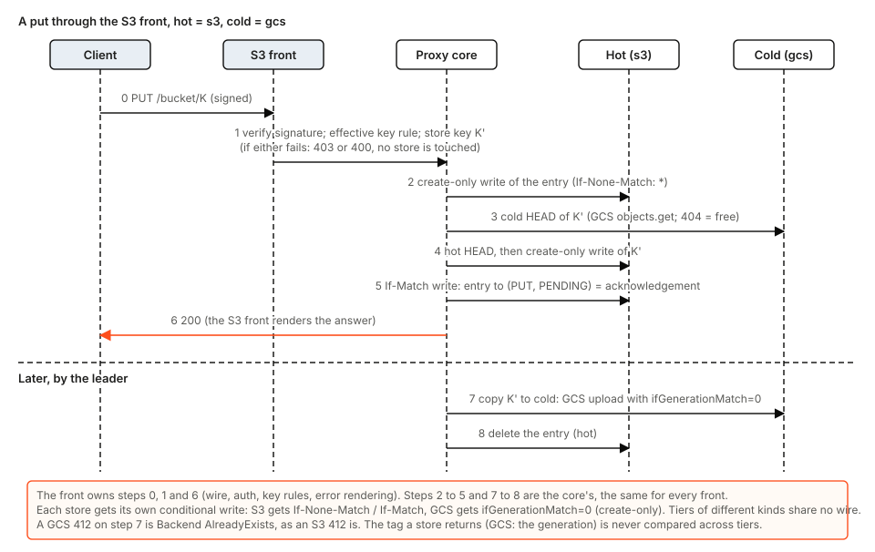
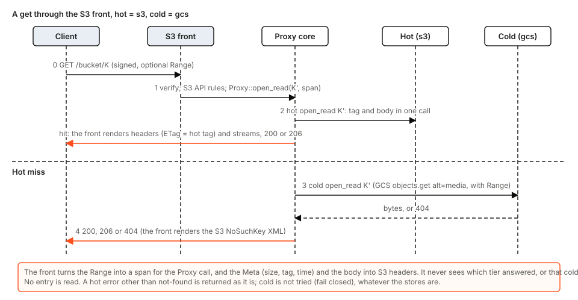
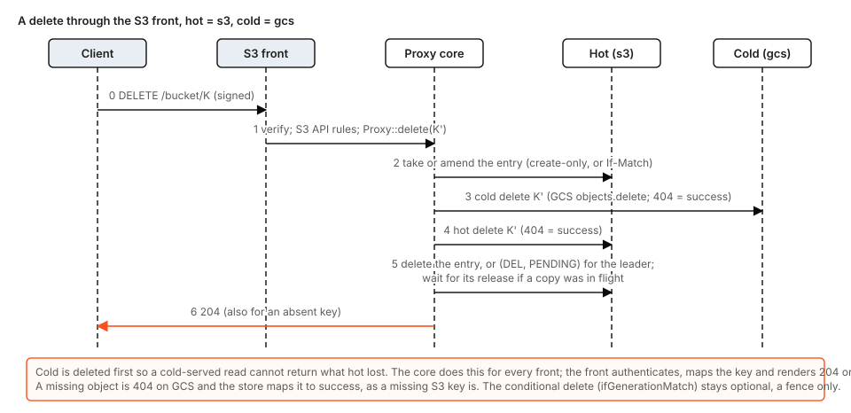
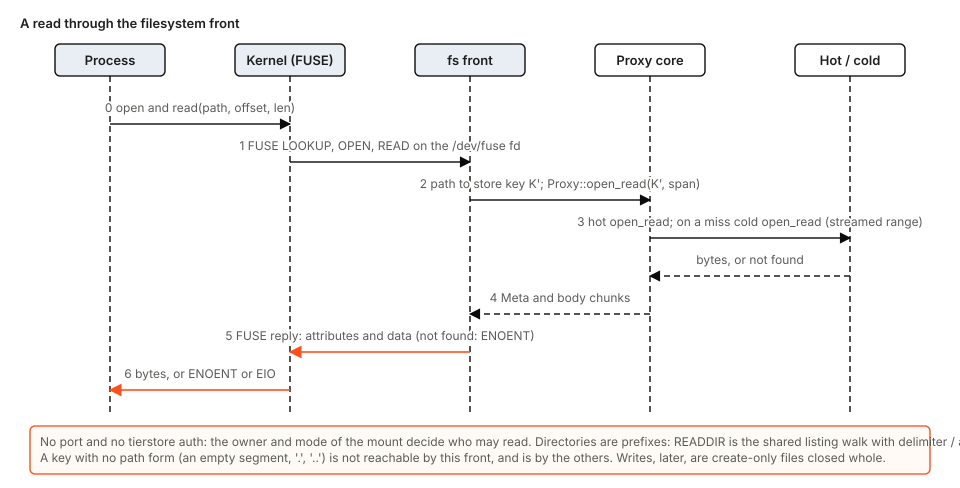

# Pluggable interfaces and stores

Status: proposal, for review. No code changes come with this document. It extends section 14(a) and 14(b) of [the tierstore design](tierstore-design.md). Everything it calls "built" was read in the code at the time of writing; everything else is the proposal.

The direction (CEO, 2026-11-05): an abstraction for the interface, so that GCS or a file system can be slotted in later; the implementation decides whether tierstore hosts a server and what the API is; hot and cold may run two different APIs.

Second CEO direction (2026-11-05, corrected): tierstore is an API converter. If a front speaks the S3 API, tierstore supports the S3 API in full, and the store side converts the calls to whatever the store can do (S3 multipart on a GCS store is staged parts and a compose). A configuration is never reduced to the common denominator of its stores. Section 3 gives the model; GCS itself is not built now.

Earlier decisions this builds on: the S3 front matches S3 behaviour exactly; configuration is `--config` with an `[[interface]]` list; a chained local cache's upstream is another store behind the same store interface; tierstore documents what a store must do and never probes it (decision 9 of the design); every tunable is a config key with a default.


## 1. Problem

tierstore is not a pass-through proxy. Every request is answered by tierstore itself and turned into its own calls on the tiers (entry, write-once check, landing, copy, delete). That is why the client's API and the store's API are independent, and the code already shows it on one side only.

**Store side, already pluggable.** The `Backend` trait (`backend.rs`) is the seam. `S3Backend`, `DirBackend` and `MemoryBackend` implement it, and `CachedStore` and the wrappers (bounded, faulty, tiered) are built on it. Each tier picks its own `kind` (`config_tier.rs`), so a hot `dir` tier over a cold `s3` tier already works (`config_combined.rs`).

**Front side, hard-wired.** There is no trait. The S3 front and the OCI front are separate paths in `server/` (`mod.rs` `serve` and `serve_all`, `listen.rs`, `oci/`). The S3 front also carries `/healthz`, `/readyz`, `/usagez` and `/metricz` (`mod.rs`), so an `s3` interface is required (`config_interface.rs`), and the names `usagez` and `metricz` are reserved bucket names. `type = "fs"` is reserved in the config and refused. Each new front today means a new copy of the listen, drain, hand-off and metrics wiring.

**What we want.**

- A GCS JSON API front, for clients that speak GCS.
- A filesystem front: a FUSE mount, no port, for tools that want paths.
- OCI stays as it is.
- GCS (native JSON API) and filesystem as store kinds per tier, with GCS's generation preconditions as the conditional-write mechanism.

## 2. The front abstraction: `Interface`

Two implementations exist today (s3, oci), and three more are planned (gcs, fs, ops), so the trait is not a speculative single-implementation trait (R9). The sketch below is the shape, not final signatures.

```rust
trait Interface: Send + Sync {
    /// What the config said it is: "s3", "oci", "gcs", "fs", "ops".
    fn kind(&self) -> &'static str;
    /// How it is reached: sockets to bind, a mount point, or nothing.
    fn reach(&self) -> Reach;                  // Sockets(Vec<SocketAddr>) | Mount(PathBuf) | None
    /// Serve until the drain; the sockets may be inherited from a predecessor.
    async fn serve(self: Arc<Self>, core: Arc<Proxy>, channel: Channel, drain: Drain) -> Drained;
}
```

A front is a *decoder*: it turns its wire API into the canonical operations of section 3 and the answers back. The core (`Proxy`) knows no wire format, no auth and no store API. What an implementation owns:

| Concern | Owned by the implementation | Today |
|---|---|---|
| Reach | Listening sockets (`s3`, `gcs`, `oci`, `ops`), a mount (`fs`), or nothing | `listen.rs`, per front |
| Wire API | Request parsing, headers, status codes, body framing | `server/request.rs`, `reply.rs`, `oci/` |
| Wire rules | The rules of its own API, enforced as the real service does: S3's key length and part-size limits, OCI's `Digest` and `names.rs`, a file system's path rules. How a wire name becomes a canonical key | the request path in `server/`; `oci/names.rs` |
| Listing format | Rendering the shared walk: S3 `ListObjectsV2` XML, GCS `objects.list` JSON, a directory read | `xml.rs`; the walk is the proxy's `list_page` use |
| Auth | Who may do what, and how that is checked | `keys.rs`, `scoped.rs`, `presign.rs`, `oci/auth.rs` |
| Error mapping | The proxy's `Error` into the API's error body and status | per front |
| Drain and hand-off | Taking part in the drain, and in the socket hand-off of the update hook | `drain.rs`, `handoff/` |

What stays shared and is not repeated per front: reserved-prefix filtering (decision 10 of the design), write-once, the entry, delete waiting, streaming limits, the listening-socket and drain wiring, and the listing walk.

**The listing walk.** Delimiter folding, paging and continuation are the same arithmetic in every API, so they move to one store-neutral walk (`server/listing.rs`, proposed in PR #161). It yields an ordered stream of entries and folded prefixes over the union of both tiers, from a `start_after` key. A front passes its delimiter rule and page size, and gets a page and a *cursor*. The token a client sees is the front's own encoding of the cursor (S3 `NextContinuationToken`, GCS `nextPageToken`, an fs directory offset). The cursor holds the last key returned and nothing else, so no server state is kept and a token works across processes, restarts and the hand-off.

**Ops split out.** `/healthz`, `/readyz`, `/usagez` and `/metricz` move to their own small `ops` interface, so no front type is mandatory: a fs-only node can still be health-checked. To be additive (B8), nothing is removed in the same release:

- `s3` gets a param `ops` (default `true`), which keeps the endpoints on the S3 sockets exactly as today, including the reserved bucket names.
- A file may add `type = "ops"` and set `ops = false` on its `s3` interface; the bucket names are then free.
- The rule "at least one `s3` interface" becomes "at least one interface of any type".

**Config.** Each entry is `type` plus `params`, as now. `type` is the only thing that selects an implementation; a type that is not built is refused with its name, as `fs` is today.

```toml
[[interface]]
type   = "s3"
params = { port = 9300 }                       # ops = true keeps /healthz etc. here

[[interface]]
type   = "gcs"                                  # planned
params = { port = 9301, token_file = "/etc/tierstore/gcs-tokens.json" }

[[interface]]
type   = "oci"
params = { addresses = ["127.0.0.1:5000"], prefix = "oci/" }

[[interface]]
type   = "fs"                                   # planned; Linux first
params = { mount = "/mnt/tierstore", read_only = true, key_prefix = "builds/" }

[[interface]]
type   = "ops"                                  # planned
params = { addresses = ["127.0.0.1:9390"] }
```

`fs` is the case with no listening socket: it takes `mount` and no `port` or `addresses`, and the existing rule "give port or addresses, not both, not neither" becomes a rule of the implementation (each type states which reach params it takes). `key_prefix` is a tunable with the default empty (all keys).

## 3. The model: an API converter with one canonical set

Three layers:

1. **Front adapter** (`Interface`): the wire API of a client into tierstore's canonical operations, and the answers back.
2. **Core** (`Proxy`, tiers, entries, reconciler, cache): works only in canonical operations. It knows neither side's API.
3. **Store adapter** (`Backend`): the canonical operations into a store's own API.

Because every conversion goes front-decode, canonical operation, store-encode, there are N front decoders and M store encoders, never N times M pairwise converters. A new front is written once and works over every store; a new store is written once and serves every front.

**The canonical set is the `Backend` trait**, and it must be the union of what any front needs. If a front can ask for it, the trait has it and every store adapter implements it:

| Canonical operation | Needed by |
|---|---|
| `put` create-only; `put_stream` with optional length; `put_tagged` | every front's PUT; the entry and the lease |
| `put_if_match`, `put_stream_if_match` | the entry CAS, lease renewal |
| `open_read` / `get_stream` with a byte range or suffix | GET with `Range`; fs reads; cache fill |
| `head` | HEAD; write-once check |
| `delete`, `delete_if_match` | DELETE; fences |
| `list_page`: ordered by key, `start_after`, `max_keys` | every listing, over the shared walk |
| Multipart: `create_upload`, `upload_part`, `complete_upload` (create-only), `abort_upload`, `list_uploads` | S3 multipart; large OCI blobs |
| An opaque version token (`Meta.tag`) | ETag, generation, conditional ops |

**Every store adapter implements every canonical operation**, natively or by emulation. A store adapter never answers a canonical call with "unsupported", and no front ever answers `NotImplemented` because of a tier. What one store cannot do, a shared helper does for it (section 4).

**The one thing no helper can do** is make a conditional write atomic. Create-only and `If-Match` are the store's own, as design section 9 and decision 9 say: a documented requirement of the store, chosen by the operator, never probed. That stays exactly as it is.

**Capabilities shrink to a declaration.** Each store adapter declares, as constants of its kind, only (a) which emulations it uses and (b) its hard limits (section 4.4). There is no intersection across tiers and no start-up check that a front "can be served": any front can be served on any store that meets the atomic-write requirement.

## 4. Store adapters and the shared emulations

The `Backend` trait stays the seam. Emulations are **shared helpers a store adapter opts into** in its declaration; none is per-store code. GCS is described to show the seam fits and is not built now.

### 4.1 Multipart without native parts

For a store with no multipart (a file, GCS, any plain object store). The helper `StagedMultipart` implements the five multipart calls over three things the adapter already has: create-only `put_stream`, `delete`, `list_page`, plus a join if the store has one.

- `create_upload(key)` writes a small create-only marker `<staging>/<id>/open` (holding the key), and returns the id. The id is a random string; all state is in the store, none in the process.
- `upload_part(n)` writes `<staging>/<id>/<n zero-padded>` with `put_stream`: any size, streamed, replaced by a later part of the same number (`delete` then create, under the id).
- `complete_upload` takes the list of part numbers from the caller, checks them against the staged parts, and lands the final key create-only (`AlreadyExists` if it exists):
  - **Store-side join**, if the adapter declares one (`Compose { max_sources }`: GCS compose, a file concat): compose the parts into the final key with the create-only precondition. More parts than `max_sources` compose in rounds into intermediate staged objects, then one last create-only compose.
  - **Otherwise a streamed copy**: read the parts in order and write them as one create-only `put_stream` to the final key; one pass, nothing held whole (B16). It costs the object's size in time at completion.
  - Then the staged parts are deleted.
- `abort_upload` deletes everything under `<staging>/<id>/`. `list_uploads` lists the markers.

The staging namespace is hidden by the adapter: its names begin with a lead byte the key codec (4.2) always escapes in a user key, so no user key can collide with it and no reserved key name is taken from users. Its names are skipped by the adapter's own `list_page`.

### 4.2 Keys a store cannot name

A **reversible key codec**, applied inside the adapter, so the core and the fronts always see the canonical key. The dir backend's percent-encoding (`dir_names.rs`: `/` as `~`, every byte but a few as `%XX`, a leading `.` escaped) is the first instance and moves to a shared `key_codec` module; GCS would use another (CR and LF, a name of `.` or `..`). A codec is a pair `encode` / `decode` with these properties, each a property test: decode(encode(k)) = k; encode(prefix) is a prefix of encode(k) for every k that has that prefix; encoded names never start with the staging lead byte; the encoded form is deterministic.

**How listing order is kept.** `list_page` must return canonical keys in canonical byte order, whatever the store's order of encoded names is. Two classes of codec, declared by the adapter:

- *Monotone*: encode preserves byte order. This is possible when the store forbids only a few bytes that sit together at the edge of the byte range (CR and LF are low control bytes, so the escape lead is chosen next to them in order). The adapter pages the store's own listing: `start_after` is encoded, the page is decoded, nothing is re-sorted.
- *Reordering*: encode does not preserve order (the dir backend: `~`, `%`, and every special byte). The adapter lists the encoded names under the encoded prefix, decodes, sorts, and cuts the page, as the dir backend does today (`dir_list.rs`). It declares this, because the cost is the listing under the prefix per page, not the page.

Both classes pass the same order test: a listing over random UTF-8 keys equals the sorted canonical keys, in pages of every size.

### 4.3 The version token

The adapter maps its native token to the one opaque string `Meta.tag`: ETag for S3, the generation (decimal) for GCS, a content hash for the dir and memory backends (a file's mtime and inode is the cheaper choice for a kind that cannot hash, as long as it changes with every write). The core never looks inside it and never compares tokens across tiers; `same_version` stays the adapter's own judgement. Each front renders it in its own form: the S3 front as a quoted `ETag`; the GCS front as `generation` (a number derived from the token when the token is not numeric, deterministic per version) and `etag`. A client's precondition comes back through the same function in the other direction.

### 4.4 What an adapter declares, and the hard limits

| Declaration | Meaning |
|---|---|
| `multipart` | `Native`, or `Staged { join: Compose { max_sources } or CopyStream }` |
| `key_codec` | `Identity`, `Dir`, or another codec, and its class (monotone or reordering) |
| `max_encoded_key_bytes` | The longest encoded name the store takes |
| `max_object_bytes` | The largest object, or none |
| `needs_length` | As today: a store that needs a body's length before it is sent |

Today's kinds declare themselves native: `s3` (native multipart, identity codec, 1024 bytes, 5 TiB), `dir` (its own multipart, the dir codec, 255-byte file names), `memory`, and a chained upstream (a proxy or `S3Backend`, which declares what its own kind does).

**What can still be refused, and why each is a true hard limit.** Nothing else:

1. *An encoded key longer than the store takes* (a long key whose percent-encoded file name exceeds 255 bytes). No transformation can name it, so it is refused with a distinct error that the S3 front renders as its own `KeyTooLongError` (400). It is found without a special check: the core's cold HEAD under the entry (design section 5, put, step 2) fails with it, so the put is refused before anything lands.
2. *An object larger than the store's maximum* (`max_object_bytes`). The store cannot hold it. The S3 front renders `EntityTooLarge`. A front's own S3 limit (5 TiB) applies regardless.
3. *The API's own rules*, enforced by each front as the real service does and independent of any store: the S3 front's 1024-byte key limit, its 5 MiB minimum part size (the last part is exempt), its 10,000 parts. The staged emulation takes parts of any size; the S3 front is what enforces S3's minimum, because it is a rule of the S3 API.
4. *A store without atomic conditional writes* is not refused at run time. It is outside the documented requirement, and a deployment on it is the operator's.

### 4.5 Kinds, mixing and chaining

| | S3 | GCS (later) | dir | memory |
|---|---|---|---|---|
| Create-only put | `If-None-Match: *` | `ifGenerationMatch=0` | under the directory lock | in-process |
| Replace if tag matches | `If-Match` | `ifGenerationMatch=<generation>` | tag compare under the lock | in-process |
| Token | ETag | generation | SHA-256 of the body | SHA-256 |
| Multipart | native | staged, `Compose` | native (its own) | native |
| Key codec | identity | GCS codec | dir codec (reordering) | identity |
| Missing key on delete | 204 | 404 mapped to success | success | success |

Each tier picks its `kind` independently: hot `s3` with cold `gcs`; hot `dir` with cold `s3`. The hot tier needs both conditional writes; the cold tier the create-only put and completion. A GCS 412 maps as `S3Backend` maps 412: `AlreadyExists` on create-only, `PreconditionFailed` on `put_if_match`; 429, 5xx and transport failures are `Unavailable`. Credentials are provider-standard (rule S2); `endpoint` is a config key so tests run on a fake server (T12).

```toml
[hot]
kind   = "s3"
bucket = "tier-hot"

[cold]
kind             = "gcs"                  # later
bucket           = "tier-cold"
credentials_file = "/etc/tierstore/gcs-sa.json"
```

**Chaining.** local_cache's upstream is another `Backend`, so it is a store adapter like any other: a hot+cold proxy in the same process, or another process reached through the front of its choice. Its canonical calls convert the same way.

## 5. How the operations look through a front

The core's steps are in section 5 of the design. These diagrams show the split of work between a front and the core, with the stores chosen to differ (hot = s3, cold = gcs, a later kind), to show that neither side knows the other.

### Put



The front verifies the signature, applies the S3 rules of its own API, and calls the canonical `Proxy::put_stream`. The core's steps are the design's: entry, check both tiers, land in hot, acknowledge with the `If-Match` write. Each store adapter turns the canonical calls into its store's API, with that store's own conditional write. Later the leader copies to cold; the GCS adapter sends `ifGenerationMatch=0`. If the client's put is multipart, the S3 front's multipart calls reach the cold adapter as the same canonical calls, and the staged helper (4.1) serves them.

### Get



One `open_read`, hot first, cold on a miss. The front renders the headers from the meta; the ETag it shows is the tag of the tier that answered, as today.

### Delete



The core takes or amends the entry, deletes cold then hot, and finishes or waits for the leader. The front renders 204 or 503.

### A filesystem front read



The kernel's FUSE request reaches the `fs` front on the `/dev/fuse` descriptor. The front maps the path to a key and makes the same `Proxy::open_read` an S3 front makes; the bytes go back as a FUSE reply. READDIR is the listing walk with delimiter `/`. The first version is read-only; writes, later, are create-only files that become an object when the file is closed whole (no overwrite, no rename, as design 14(b) says).

## 6. Edge cases and the mechanism for each

| Case | Mechanism |
|---|---|
| A key valid in the S3 API that a store cannot name as it is (GCS: CR or LF; dir: `/` and special bytes). | The adapter's key codec names it (4.2). The core, the other tier and the fronts see the canonical key. Nothing is refused. |
| The same key through two fronts (S3 and GCS and fs). | One canonical key, one object. Each front applies its own API's rules to its own requests: a front may fail to express a key on its wire (an fs path with an empty segment or `..` cannot be opened as a file) and then that key is not reachable by that front, and is by the others. Nothing is deleted or hidden by tierstore. |
| A file and a directory of one name (`a` and `a/b`). | A property of the `fs` front: its view shows the directory, the file stays reachable through the other fronts, and a create through `fs` that would clash is refused (`EEXIST`, `ENOTDIR`). In the `fs` front's documentation. |
| An encoded key longer than the store takes. | The one hard key refusal (4.4, item 1): the cold HEAD under the entry fails with the key-too-long error before anything lands; the S3 front answers `KeyTooLongError` (400). For a key written before the tier was added, see the last row. |
| Multipart parts of any size on a store without native parts. | The staged helper takes any part size. The S3 front enforces S3's 5 MiB minimum (not for the last part) and the 10,000-part limit before the call reaches the core, because those are rules of the S3 API. A GCS front would apply its own. |
| A crash, a restart or a hand-off in the middle of a multipart upload. | The upload's state is in the store (the `open` marker and the staged parts), not in a process. The successor serves `upload_part` and `complete_upload` for the same id; the hand-off carries no upload state. |
| Staged parts left behind (a client that never completes, a crashed completion). | `complete_upload` deletes its parts after landing, best effort; `abort_upload` deletes the upload. The leader also runs a sweep over `list_uploads`: an upload whose marker and parts have not changed for `multipart_stale_after` (default 7 days, a config key) on the leader's own monotonic clock, seen first by the same rule as the usage object (design decision 8), is aborted. A complete that finds its parts gone answers `NoSuchUpload`. |
| Listing and the staging namespace. | The adapter's `list_page` skips staged names and decodes every other name to its canonical key, in canonical order (4.2); reserved prefixes (`_entries/`, `_journal/`, `_tiering/`) are filtered once in the core (decision 10). A listing through any front sees the same keys in the same order. |
| Listing consistency across fronts. | All fronts list through the same walk over the union of both tiers, in byte order of the key; they differ only in rendering (S3 any delimiter and `NextContinuationToken`, GCS `prefixes` and `nextPageToken`, fs `/` and an offset). The cursor is the last key, so tokens work across processes and the hand-off. A store whose listing lags is tolerated, as the design says. |
| Conditional writes that differ per store. | The core uses three conditional operations (create-only, replace-if-tag, delete-if-tag) and each adapter maps them (4.5). The fronts expose what tierstore guarantees: objects are write-once, so a client's create-only (`If-None-Match: *`, `ifGenerationMatch=0`) means "create" and an existing key gives the API's 412; a client replace-if-tag precondition on a write is 412 as well. |
| A key already stored before a tier with a shorter limit was added. | Not scanned (no probes). It stays readable and deletable. Its copy to the new tier fails with the key-too-long error, is retried with the usual per-item back-off and counted by the existing failed-copy metric, and the hot copy stays (eviction never removes the only copy). Documented: list against the limit before adding such a tier and rename the few keys. |
| Auth per front. | Each front authenticates in its own terms, keys read from files (S2). `s3`, `oci` as now. `gcs`: bearer tokens from `token_file`, full and read-only. `fs`: the mount's owner and mode, `allow_other` off, `read_only` a key. A request is authorized by the front it came in on and never by the store, which sees tierstore's credentials. |

**A front with no port in the hand-off.** The hand-off (`handoff/`) passes `<front> <address>` lines with the sockets over `SCM_RIGHTS`. A FUSE mount has no socket but has a descriptor, the `/dev/fuse` connection. The `fs` front offers it the same way, with a line `fs <mount path>` and the descriptor; the successor checks the path, answers `ack`, and serves the same connection, so the kernel sees no unmount. The old instance stops reading and finishes its requests in flight. An instance without an `fs` front never offers such a line, so a mixed pair of old and new releases hands off as before (B8). Which platforms the `fs` front runs on, and what it does where the descriptor hand-off is not available, is that implementation's own concern (section 8, item 3).

**Drain.** `Reach::None` and `Reach::Mount` fronts take part in the drain like the others: stop taking new requests, finish those in flight, release the mount. `/readyz` is the ops interface's and covers all fronts.

## 7. Migration plan

Each step is one pull request that can land alone, interfaces before the code that uses them (P7). Coverage stays at the floor of each crate (T1); every new front and store gets a fake peer, not the network (T12). **Now** is (a) to (c). **Later** is section 8.

| | Change | Tests to add |
|---|---|---|
| (a) | `Interface` trait and `Reach`; `s3` and `oci` moved behind it; `serve` / `serve_all` iterate over the list. Pure refactor: no wire, config or metric change. | The existing front tests pass unchanged. New: a config's interfaces are served by one loop (two types together, port 0); a front that fails to bind fails the start naming the interface; the drain ends every front; the socket hand-off offers the same lines as before. |
| (b) | `ops` interface split out; `ops` param on `s3` (default true); "at least one interface of any type". | `/healthz` and the others answer on the `ops` address, and on the S3 address when `ops = true`; `ops = false` frees the bucket names `usagez` and `metricz`; a file with no `s3` and an `ops` starts; an old file still starts as it did; `/readyz` goes 503 on drain on each. |
| (c) | The canonical set made explicit and complete in `Backend`; the shared key codec; the emulation slots and the staged-multipart helper. Detail below. | Below. |

**(c) in four parts, one pull request or split at the seams.**

1. *Canonical set.* Audit the provided methods of `Backend`. Those read so far silently degrade or hold a whole body: `put_stream` (collects the body, then `put`), `get_stream` (reads whole, then streams), `put_tagged` (a HEAD after the write, not bound to it), `list_page` (cuts the whole listing), `delete_if_match` (returns `Unsupported`), and the five multipart calls (`Unsupported`). They become required methods. A fake in a test that wants the old behaviour calls an explicit helper (`put_stream_buffered` and the like), so a degrading implementation is a visible choice. The audit lists every provided method it keeps and why; an `Unsupported` answer is gone from the trait.
2. *Shared key codec.* `dir_names.rs` `encode` / `decode` move to a shared `key_codec` module with the `Dir` codec; the dir backend uses it with no change in file names (the on-disk format is additive-only, B8).
3. *Declaration and slots.* The adapter declaration of 4.4 and the helper slots. Today's kinds (`s3`, `dir`, `memory`, the chained upstream) declare themselves native, with their limits.
4. *Staged multipart helper*, built and tested against the memory backend configured to have no native multipart, with and without a store-side join, so the seam is proven before any real store uses it.

Tests for (c):

- Codec: decode(encode(k)) = k, prefix preservation, and no encoded name beginning with the staging lead, over random UTF-8 keys; the dir backend's existing file names are unchanged (golden names).
- Order: a listing through an adapter with a reordering codec equals the sorted canonical keys, for page sizes 1 to the whole, with `start_after` at and between keys, with the staging namespace populated.
- Staged multipart on the no-native-multipart memory backend: create, parts out of order and replaced, complete with a join, complete without a join (streamed copy), the result equal byte for byte to the whole body; complete of an existing key is `AlreadyExists` and leaves the old object; abort leaves no staged name; a complete with a missing or wrong-numbered part fails and changes nothing; a join over more parts than `max_sources` composes in rounds.
- A body larger than any single buffer completes without a whole-body allocation (the join-less path streams).
- Crash safety: build the helper, drop it, build a second over the same store, and complete the first's upload; the sweep aborts an upload unchanged for `multipart_stale_after` on an injected clock (T10) and leaves a live one.
- The S3 front over this backend: a multipart upload and a ranged read give the S3 answers; parts under 5 MiB (not last) are refused by the front with S3's `EntityTooSmall`, not by the store; the listing through the front shows no staged name.
- Hard limits: a key whose encoded name exceeds the store's limit makes the S3 front answer `KeyTooLongError` (400) with nothing written; a body above `max_object_bytes` gives `EntityTooLarge`.
- The conformance suite (`crates/tierstore/tests/tierstore/conformance.rs`) runs the multipart and listing cases on every kind, native and staged, so a new kind is accepted by the same tests.

(c) changes behaviour in one place: a `Backend` that answered `Unsupported` for multipart now has a real answer. `s3`, `dir` and `memory` already have native multipart, so no user-visible change.

## 8. Future work

Later, each its own pull request; none reshapes `Backend`, `Interface` or the declaration.

- **`gcs` store adapter.** Implements `Backend` with the GCS column of 4.5: `ifGenerationMatch` preconditions, generation as the token, a resumable upload for `put_stream`, the GCS key codec, `multipart = Staged { Compose { 32 } }` (GCS compose takes 32 sources, so large uploads compose in rounds). Acceptance: the conformance suite on a fake GCS server, and hot = s3 with cold = gcs end to end through the S3 front.
- **`gcs` front.** Implements `Interface`: JSON API, bearer-token auth, error bodies, listing over the shared walk, rendering the token as `generation`.
- **`fs` front.** Implements `Interface`: reach is a mount; the descriptor hand-off of section 6. Platform support (Linux, macOS) is its own concern behind `Interface`: constructing it on an unsupported platform is a start-up error naming the platform. Writes (create-only files closed whole) later, and an NFS gateway.
- Further fronts and stores as `Interface` and `Backend` implementations (Azure Blob), per-interface connection limits shared by all types, and a store kind for a shared POSIX file system that proves its own create-only.

The three questions of the first draft need no new seam:

1. *Multipart on a store without native parts*: the staged helper of 4.1, chosen by the adapter's declaration.
2. *A token rendered as an ETag or a generation*: the opaque `Meta.tag` of 4.3 and the front's render function.
3. *Platform support of the `fs` front*: behind `Interface`, as above.
