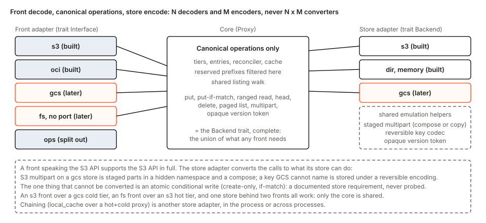

# Pluggable interfaces and stores: avoiding one-way doors

Status: proposal, for review. No code changes come with this document. It extends section 14(a) and 14(b) of [the tierstore design](tierstore-design.md). What it says about "main" was read in the code at the time of writing.

**Scope (CEO, 2026-11-05).** Only S3 front, S3 hot, S3 cold, as today. Nothing here builds a GCS, Azure or file-system front or store, an emulation helper, a key codec or a new trait. The goal is that a later S3 to Azure to GCS (or to a file system) is a pathway, not a rewrite: the first release must not lock tierstore to S3 in anything that is persisted or public. So the core of this document is an audit of main for such **one-way doors** (section 2), and the work it asks for now is only what the audit finds (section 3).

A door is one-way if, once released, changing it breaks data on disk or in a store, a config file, a client, a dashboard or a running peer. Everything else, however large, is a two-way door and waits (section 4).

## 1. The pathway, in short

Three layers, joined by one canonical operation set:

1. **Front adapter**: a wire API into tierstore's canonical operations, and the answers back. Today: the S3 and OCI paths in `server/`.
2. **Core** (`Proxy`, entries, reconciler, cache): works only in canonical operations.
3. **Store adapter**: canonical operations into a store's API. The canonical set is the `Backend` trait.

A conversion is front-decode then store-encode, so N fronts and M stores cost N plus M adapters, never N times M. A front that speaks S3 supports S3 in full; where a store lacks something, the store adapter emulates it (S3 multipart on GCS is staged parts and a compose), through shared helpers it opts into. The one thing no helper can do is make a conditional write atomic: create-only and `If-Match` stay a documented store requirement, never probed (design section 9, decision 9).

None of that is built now. Section 4 lists it with the seam each piece uses.

## 2. The audit: what could lock tierstore to S3

Each row is read from the code on main. "One-way" says whether it is persisted or public. "Verdict" is either why it is already fine or the cheap fix.

### 2.1 Persisted formats

| Item (file, function) | One-way? | Does it bind to S3? | Verdict |
|---|---|---|---|
| Entry objects `_entries/<sha256(key)>`, JSON `v`, `key`, `op`, `st`, `owner`, `nonce`, `created_ms` (`entry.rs`: `entry_key`, `Entry`) | Yes: shared by releases during a live update | No. The name is a fixed-length hash, so any store's key-length limit holds. The body holds no tag, upload id or ETag. Unknown fields are ignored and unknown `op` / `st` read as `Unknown` (`#[serde(other)]`). | Fine. Rule: additive changes only (B8). |
| Lease `_tiering/lease`, three text lines holder, nonce, generation (`lease.rs`: `body`) | Yes | No. It is not parsed; a lease is judged by the content tag alone. It has no version field. | Fine. One requirement on a future store, written down: its tag must change when the body changes. Every body is unique (nonce and generation), so a content-derived token is enough; a token from modification time alone is not. |
| Registrations `_tiering/proxies/*`, JSON `proto`, `boot`, `hb` (`registration.rs`) | Yes | No. Versioned by `proto`. | Fine. |
| `_tiering/usage`, JSON `hot_bytes`, `copy_lag`, `time` (`journal.rs`: `Usage`) | Yes | No. Wall time of the reconciler, no store notion. No version field, and a reader ignores unknown fields. | Fine under additive-only. |
| `_tiering/format`, JSON `phase`, `epoch` (`format.rs`) | Yes | No. Unknown phases are read as no pause. | Fine. |
| Journal `_journal/*` and `_tiering/checkpoint/*` (`journal.rs`: `JournalEntry`, `Checkpoint`) | Read only, by the bridge | They hold `cold_tag` and `hot_tag`, store tags, but S3Backend already strips the quotes (`s3.rs`: `unquoted`), and the release no longer writes them. | Fine. |
| **The reserved prefixes `_entries/`, `_journal/`, `_tiering/`** (`journal.rs`: `RESERVED_PREFIXES`, `is_reserved`; `Error::Reserved`) | **Yes, public: they are carved out of the user's key space** | Not S3-specific, but any internal object a later feature adds outside them (for example staged multipart parts) takes names from users that exist today and breaks them. | **Fix now: a rule and a guard (section 3).** |
| Directory tier layout (`dir.rs`, `dir_names.rs`: `encode`, `dir_entries.rs`): percent-encoded file names, `.uploads/<id>`, `.entries/`, `.lock` | Yes, on disk | No S3 notion. | Fine. When the encoding later moves to a shared codec, the file names must stay byte for byte (golden names in the test). |
| Local cache directory `digest-v1`, with a sidecar of `key`, `size`, `sha256`, `tag`, `modified` (`server/local_cache/layout.rs`) | Yes, on build nodes | The tag is the upstream's, kept as an opaque string; the file name is the SHA-256 of the key. Versioned in the layout name. | Fine. A changed upstream kind gives different tags, so a cached object is refetched, nothing breaks. |
| Store key equals client key (`s3.rs` names the object by the key; no tier prefix) | Yes: objects in a bucket are named by client keys | It fixes the mapping, but a later tier key prefix or an adapter-internal key codec applies only where configured, and the default is today's mapping. | Fine. Additive. |

### 2.2 Public contracts

| Item | One-way? | Binds to S3? | Verdict |
|---|---|---|---|
| Config file shape: `[[interface]]` with `type` and `params` (`server/config_interface.rs`); per-tier `kind` of `memory`, `dir`, `s3` and flat keys `bucket`, `endpoint`, `region`, `credentials_file`, `conditional_delete` (`config.rs`: `Kind`; `config_tier.rs`) | Yes | The `s3` tier keys are flat, but each key is already refused for the kinds it does not belong to (`config_tier.rs`: `refuse`), and `--hot` / `--cold` specs are `kind:target`. A front type `s3` and a store kind `s3` are separate namespaces. | Fine. A new kind or type, and its own keys, are additive. Rule: never rename an existing key. |
| Metrics and endpoints: `tierstore_*` names, `/healthz` `/readyz` `/usagez` `/metricz` on the S3 front, and the bucket names `usagez` and `metricz` they reserve | Yes | No metric name contains `s3`. The endpoints live on the S3 front. | Fine. Rule: when the ops endpoints get their own interface, the S3 front keeps serving them by default. |
| The chain protocol: a `local_cache`'s upstream is any S3 endpoint over SigV4, including another tierstore's S3 front (`server/local_cache/mod.rs`) | Yes | It is S3, a public standard, with no tierstore-only header (`x-tierstore-grant` is gone and refused). | Fine. A chain across processes needs an S3 front on the upstream while its link is S3; that is a deployment choice, not a format. |
| Hand-off control socket: `take 1`, lines `<front> <address>` plus descriptors (`server/handoff/wire.rs`) | Yes, between running releases | The front name is an open string, the frame is versioned. | Fine. A front with no port adds a line kind later (additive). |
| What clients see of the store: ETag, multipart upload ids and part ETags, listing tokens | Yes | ETag and upload ids are the tier's opaque strings (`Meta.tag`; `create_upload`, `upload_part`, `complete_upload` return and take `String`). The doc `limits.md` already says the ETag of a hit may differ from a miss. The listing token is the last key (`tiered.rs`), so it is store-neutral. | Fine. Do not promise that an ETag is an MD5. |
| The Content-MD5 and checksum handling, `NotImplemented` for `delimiter`, copy, ListParts | The refusals can only be lifted later | Front rules of the S3 API. | Fine: lifting a refusal is additive. |

### 2.3 Code coupling

| Item | One-way? | Verdict |
|---|---|---|
| Does the core use S3 types or S3 errors? | No: internal | `S3Backend` is named only where it is constructed (`lib.rs`, `server/cli.rs`, `server/config_tuning.rs`). The proxy, entry protocol, reconciler and cache (`tiered.rs`, `entry.rs`, `lease.rs`, `reconciler.rs`, `cache.rs`) use `Backend` and `Error`; none imports `hyper` or a status code. The S3 error codes are produced in `server/`. Already a clean seam. |
| `Backend` has provided methods that hold a whole body or degrade (`put_stream`, `get_stream`, `put_tagged`, `list_page`; `delete_if_match` and the multipart calls return `Unsupported`) | No: the workspace has `publish = false` and no implementor outside it | A two-way door. Tightening them waits (section 4). |
| Moving the s3 and oci paths behind an `Interface` trait | No | Two-way. Waits. |

**Result.** Nothing persisted or public is S3-specific. Every stored body is store-neutral and tolerant of unknown fields, tags and upload ids are opaque strings, the core talks to `Backend` only, and the config and metric names are generic. The audit finds **one** real one-way door: the reserved prefix set, which is a promise about the user's key space and can only be kept by a rule.

## 3. Now: what to fix

One small pull request, so that a later feature cannot take names from users.

**Fix: internal objects live only under the three reserved prefixes.**

- Add the rule to the design (section 7 and the decisions list): any internal object a later feature needs (staged multipart parts, a new coordination object) is named under `_tiering/`. No fourth reserved prefix is added; the reserved set stays `_entries/`, `_journal/`, `_tiering/`.
- Add the guard: a unit test next to the constants in `journal.rs` that lists every internal key and prefix constant in the crate and asserts that each starts with one of the three, and that `RESERVED_PREFIXES` (what `is_reserved` and so the proxy refuse) is exactly those three.

Tests: `internal_keys_are_under_reserved_prefixes` (every internal key constant is under a reserved prefix); `reserved_set_is_the_three_prefixes` (a key under each is refused, and a key under any other prefix such as `_uploads/` is accepted as an ordinary key). Neither touches a format.

Nothing else is needed now: no format changes, no config change, no renames.

## 4. Later: the pathway, all two-way doors

Each is its own pull request, when needed, and none reshapes what section 3 protects.

- **`Interface` trait** with s3 and oci behind it (pure refactor), and the **ops split** (`type = "ops"`, an `ops` param on `s3`, default true, so the endpoints stay on the S3 front).
- **Complete canonical `Backend`**: provided methods that silently degrade become required; fakes call explicit helpers.
- **Emulation helpers**, opted into by an adapter's declaration of its emulations and hard limits:
  - *Multipart without native parts*: parts staged as hidden objects under `_tiering/` (section 3), completion by a store-side join (compose or concat) or else a streamed copy, create-only; abort and a sweep (judged on the leader's monotonic clock, a config key for the age) clean up; the S3 front enforces S3's 5 MiB minimum part size, not the store. State lives in the store, so a crash or a hand-off loses nothing.
  - *Keys a store cannot name*: a reversible key codec inside the adapter (the dir backend's encoding is the first instance); listing order kept either by a monotone codec or by listing, decoding and sorting as the dir backend does. An encoded key longer than the store takes is the one true hard refusal (S3: `KeyTooLongError`, 400).
  - *Version token*: the adapter maps its native token into the opaque `Meta.tag` (a content-derived value, per the lease note); each front renders it (ETag, generation).
- **`gcs` store adapter** (generation preconditions as the conditional-write mechanism) and **`gcs` front**.
- Writes through `fs`, an NFS gateway, further stores and fronts.
- **The `fs` front is not built, and is replaced by a process of its own.** [virtual-build-fs.md](virtual-build-fs.md) serves trees as a filesystem from `tierstore fs`, a subcommand of the same binary with its own unit, its own control socket and (later) its own hand-off, not as a front of the S3 process: giving the S3 process the right to mount would give it to anyone who finds a bug in its parsers (that document, section 6.2). The `fs` front sketched here put the mount in the S3 process and its descriptor in the S3 hand-off; nothing relies on that sketch, and `[[interface]] type = "fs"` stays refused, with a message that says `tierstore fs` is a process of its own with an `[fs]` table (`crates/tierstore/docs/configuration.md`). What is built: the Linux frontend, read-only trees, one mount, attachments on a control socket (with `prefetch all`), kernel passthrough where the kernel offers it (and the mode of kernel 6.8 where it does not), and a fill socket on the build node's `tierstore`; the crash recovery and the hand-over of its descriptor and the macOS frontend are the later pull requests of that document's section 12. Writes through a filesystem to the store (a general read/write interface) are a later design of their own.

The three questions of the first drafts (compose multipart, ETag or generation rendering, `fs` platform support) are each answered by a piece above and need no change to the formats of section 2.
