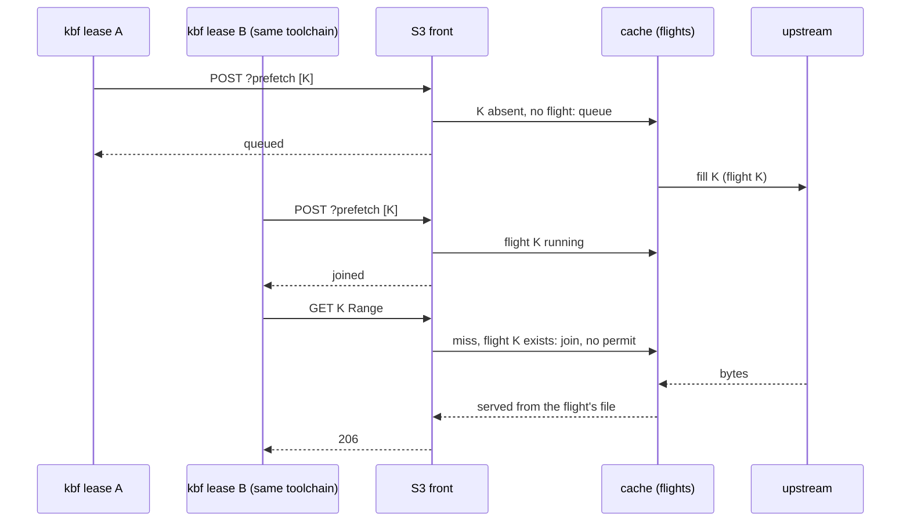
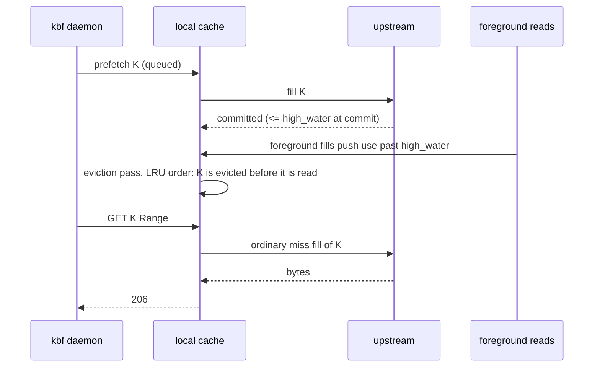

# Prefetch API: ask the build node's cache to fetch objects before they are read

Status: **proposed (owner request, 2026-11-10), not built.** Everything here is the plan; the code is the S3 front and local cache of [tierstore-design.md](tierstore-design.md) until the pull requests of section 11 land, and each of them moves its part of this text out of "plan" in the same pull request (rule P10). Terms in bold are those of the glossary of tierstore-design.md (section 17).

The request (owner, 2026-11-10): "on tierstore we need to add an API to allow prefetching. The use case is that kbf will send an API request with a list of objects to prefetch."

Figures: **measured** means from `/data/workplace/vbfs-experiments/inputs/RESULTS.md` (kbf input measurements, node-05); **read** means from the code or docs at `origin/main` 37ffa7d7 (kbf at d494947); **inferred** means computed here from those and says how (rule P11); **unmeasured** has no source yet and is in section 12.

## 1. The problem

kbf's daemon reads the inputs of an action from tierstore, one ranged GET per blob that misses its node cache (read: `PackedCas`, one `Locate` plus one ranged request per blob, at most 16 at a time). Each such read arrives at the build node's local cache cold, so it waits for the fill from the hot or cold tier. The daemon knows the whole list of what it will read right after it has walked the action's input root (read: `kbf-daemon/src/tree.rs`), and the design notes of kbf list "prefetching an offered lease's inputs" as planned and unbuilt. Nothing in tierstore lets a client say "fetch these now, I will read them in a moment".

Measured size of the need: 21.8% of 204,111 actions had a node-cache miss; fetched bytes per missing action are p50 166 kB, p90 5.0 MB, p99 29.4 MB. The cold first fetcher of a toolchain fetches 518 to 555 MB (81 to 89 misses) and opens 68% of it, the first open of a 150 to 190 MB executable waiting for the whole blob. So the steady state is mostly already warm and the call must be cheap when everything is present; the tail is a few hundred MB that a prefetch started at lease offer can overlap with the directory walk (p50 3.0 s, 49 directory reads).

What does not change: every kbf read still works with no prefetch (read-through, then fallback to the frontend). Prefetch is an optimisation; a refused, failed or lost prefetch never fails a read.

## 2. Decisions

| # | Decision | Reason |
|---|---|---|
| D1 | The API is an S3-front extension: `POST /<bucket>?prefetch` on the S3 listener, same SigV4, same keys. | kbf already has that endpoint, bucket and read-only key; it needs no new socket, uid or port. DeleteObjects (`POST /<bucket>?delete`) is the model: a subresource, a body of keys, a per-key result. |
| D2 | Not the fill socket. | The socket is 0600 for the instance's own uid and fills `_tiering/fill/<sha>` blobs the S3 front refuses to serve (read: `fill_blob`). kbf's daemon is another account, and a blob filled there would not make kbf's next S3 read a hit. |
| D3 | Not a separate control socket or port. | Another listener is more operator surface and a second auth scheme for one verb (minimal operator surface). |
| D4 | The unit is an object key, whole. A key is what kbf holds after `Locate`: a pack `cas/d/<writer>/<boot>/<seq>`. No digests, no ranges in v1. | Only kbf has the pack index; tierstore resolving digests would mean learning it (a request per digest, out of scope). The S3 miss path already fills a whole object of at most `whole_fill_limit` (64 MiB; kbf packs are at most 32 MiB from the frontend) and passes larger ranges through uncached (read), so a ranged prefetch of a bigger object could not make the read a hit. A range field is additive later. |
| D5 | The body is JSON: `{"keys": [...], "id": "..."}` (`id` optional). Unknown fields are ignored. | There is no S3 call to match, so S3 XML has no authority here; JSON is what kbf can build without an XML writer. Ignoring unknown fields keeps later fields additive (rule B8). |
| D6 | Asynchronous only in v1: the answer says what the call found and what it queued; it does not wait for the fills, and there is no job id and no status query. | A poll API and a job id are public names and a wire format nobody needs yet (avoid one-way doors). The reads that follow join a running fill (D8), which is the only waiting kbf wants. A `wait_ms` field is additive later if a measurement asks for it. |
| D7 | A prefetch fill uses the S3 path's `flights` table. | Today the socket has `source_flights` and the S3 miss path has `flights`, so a read does not join a socket fill (read, A2 of the research). Using `flights` makes the duplicate fetch impossible and needs no new table. |
| D8 | Prefetch has its own permit pool and a bounded queue; it never takes `max_concurrent_fills`. | A prefetch must not starve a foreground miss; a miss that finds the key in `flights` joins it and needs no permit (read). |
| D9 | A prefetch never evicts. It starts and commits a fill only while the cache would stay at or below `high_water`. | A prefetch is a guess; the working set is not. Eviction is the foreground fills' job. |
| D10 | No pins in v1. | Pins are owned by a (mount, tree) and resolve only `_tiering/fill/<sha>` and `cas/l/<sha>` (read); a pack cannot be pinned and kbf has no mount or tree. An owner concept for pins is a one-way door; a prefetched object is read within seconds and the recency of a fill protects it. Additive later (`pin_for_ms` in the body). |
| D11 | No priority field. Prefetch is always below a foreground read. | One level cannot be mis-set. |
| D12 | The size and the budget are judged where the size is known, in the fill, not by a call to the store. | A HEAD per key costs a request each (service time per request dominates). The answer to the call is what the index tells with no store request. |
| D13 | A storage node answers 501 `NotImplemented`. | It has no local cache (`config.cache` is `None`). |

## 3. The API

```
POST /<bucket>?prefetch
Content-Type: application/json
x-amz-content-sha256: <sha256 of the body>

{"id": "lease-4f2a", "keys": ["cas/d/w1/7/12", "cas/d/w1/7/13"]}
```

Answer, `200 OK`, `application/json`:

```
{"id": "lease-4f2a",
 "results": [{"key": "cas/d/w1/7/12", "outcome": "present"},
             {"key": "cas/d/w1/7/13", "outcome": "queued"}],
 "counts": {"present": 1, "joined": 0, "queued": 1, "rejected": 0}}
```

`results` has one entry per key, in request order. Outcomes:

| Outcome | Meaning | Store requests |
|---|---|---|
| `present` | The index holds the key (marks it used, as a hit does). | 0 |
| `joined` | A fill of the key is running (in `flights`); nothing added. | 0 |
| `queued` | Accepted; a worker fetches it when a permit is free. | 0 now |
| `rejected` with `reason` | `reserved` (the key is under `_tiering/` or otherwise reserved), `access denied` (outside the key's read prefixes), `invalid key`, `duplicate` (earlier in the same request), `busy` (the queue is full), `too many` (beyond `prefetch_max_keys`; see 6). | 0 |

The call answers 400 `MalformedJSON` for a body that is not the shape, 413 `EntityTooLarge` for a body over the limit (`prefetch_max_keys` times the key length limit plus slack, as `ops::body_limit` does for DeleteObjects), 501 on a storage node, and 403 as S3 does for a bad signature. A request with a valid body is 200 even if every key is rejected, as DeleteObjects does. A request that ends in a fill that fails (`upstream`, `too large`, `no space`, `would evict`, `changed`) is not reported: it is counted (section 8), and the read that comes later is an ordinary miss.

`id` is echoed and put in the log line of the call. It is a correlation label for the operator; tierstore does not index it.

S3 rules stay in one seam: the new handler sits beside `delete_objects.rs` (new `prefetch.rs`), the subresource goes in the `SUPPORTED` list of `ops.rs`, and the key checks (reserved, scope) are the ones the S3 calls already use (`journal::is_reserved`, `scoped::covers`).

## 4. Semantics

- **Best effort.** Nothing is promised about when or whether an object is cached.
- **Fills the local cache only.** The object lands under its own key, as an S3 miss fill of it would, with the same sidecar and the same freshness rules (`Cache-Control`, revalidation) as any fill.
- **Same bytes as a read.** The fill is the S3 miss path's (HEAD, then a GET of the whole object when it is at most `whole_fill_limit`); there is no second fill code path to keep right. An object over `whole_fill_limit` is not cached by any path, so its prefetch ends as `too large` in the counters.
- **Deduplicated.** Within a request (`duplicate`), with the index (`present`), with a running fill (`joined`, from either a read or an earlier prefetch), and with the queue (a key already queued is `joined`).
- **Never evicts.** Before it starts a fill, and again at commit, the worker checks that cache bytes plus running-fill bytes plus the object's size stay at or below `high_water` (90% of the budget by default). If not, the fill is dropped and counted `would_evict`, and no eviction is requested. The `critical` mark of `reserve` still applies to foreground fills, so a prefetch can never push a read into a skipped fill. It never touches pinned entries, because it evicts nothing.
- **Lower priority than a foreground read.** A read that misses does not take a prefetch permit and a prefetch does not take a foreground one (`max_concurrent_fills`); the two cannot wait on each other. Prefetch workers are `prefetch_concurrency` in number.
- **Cancellation.** A worker that finds the cache past `high_water` at commit throws the fill away (the fill keeps nothing when it answers `changed`, so the path exists). A delete or put through the front of the key during the fill invalidates it exactly as for a read fill.
- **No pin, no promise of residence.** See D10 and the eviction race in 7.3.

## 5. Sequences

### 5.1 kbf prefetches, then the action reads

```mermaid
sequenceDiagram
    participant D as kbf daemon
    participant F as kbf frontend
    participant S as tierstore S3 front
    participant C as local cache
    participant U as upstream tier
    D->>F: walk input root (49 dir reads)
    D->>F: Locate(<=1000 digests) x ceil(N/1000)
    F-->>D: pack key, offset, length per digest
    D->>S: POST /bucket?prefetch {keys: distinct packs}
    S->>C: present? / joined? for each key (no store call)
    C-->>S: outcomes
    S-->>D: 200 {present, joined, queued, rejected}
    Note over D: does not wait; links node-cache hits meanwhile
    C->>U: HEAD + GET key (prefetch permit)
    U-->>C: bytes (committed under the key)
    D->>S: GET key, Range (one per blob)
    S->>C: hit
    C-->>S: bytes from disk
    S-->>D: 206
```

kbf's reads come from the same `Locate` answer, so the pack key it prefetches is the pack key it reads.

### 5.2 A duplicate prefetch, and a read that races it



One upstream fetch for all three. Today a socket fill and a read use different tables and would fetch twice; D7 closes that.

### 5.3 The eviction race



The prefetch was wasted, the read is correct. It costs one upstream fetch and one counter step (`prefetch_filled_total` without a following hit). It cannot be removed without pins (D10); the `high_water` rule makes it rare, because a prefetch commits only with room under the mark that triggers eviction. The other race, where the cache is already past `high_water` when the worker starts, ends as `would_evict` and costs no store request.

## 6. Configuration, auth and limits

New keys in `[local_cache]`, each with a default from the start (no key is required), documented in `configuration.md` with the other tunables:

| Key | Default | Range | What |
|---|---|---|---|
| `prefetch_concurrency` | 2 | 0..64 | Workers, a pool of their own. 0 turns the API off: the call answers 501, as on a storage node. |
| `prefetch_queue` | 4096 | 1..1000000 | Keys waiting for a worker, across all requests. A key past it is `rejected: busy`. |
| `prefetch_max_keys` | 1000 | 1..10000 | Keys in one call, the global cap per request; keys past it are `rejected: too many`. Matches the 1000 digests of one `Locate`. |

There is no key for bytes per request: an object is at most `whole_fill_limit`, and the sum is bounded by the `high_water` rule and by `prefetch_queue` times that limit. The rule is on the cache, not on the call, and a second bound would be a second place to set it wrong (rule B20).

Who may prefetch: any key that may read the key. A full or read-only key may name any non-reserved key; a scoped key only keys under its read prefixes (`covers(&scopes.read, key, true)`; any other key is `rejected: access denied`); a presigned URL cannot (it is for one GET). `scoped::permit` and `Role::permit` get a `POST ?prefetch` arm; nothing else changes for them. A read-only key can start fills because its GET already does; the call adds no right, only earlier use of it. A key that may only prefetch is not added (nothing asks for it).

Limits by construction: 1000 keys a call, a bounded queue, two workers, the budget rule. A call costs the index lookups of its keys and one JSON parse.

Docs touched: `operations.md` (a section beside the fill socket, the S3 call list), `configuration.md`, `metrics.md`, `clients.md`, `keys.md`, and the module docs of `server/mod.rs` and `server/local_cache/`.

## 7. Failure modes and edge cases

| Case | Mechanism |
|---|---|
| Call on a storage node | 501 `NotImplemented`; `config.cache` is `None`. kbf treats it as "no prefetch" and stops sending. |
| Read-only instance (another holds the cache-dir lock) | The cache answers its watch mode; the whole call answers 503 `SlowDown` (Q2 of section 12). |
| Queue full | Keys past it are `rejected: busy`; kbf may retry later. Nothing is queued past the bound. |
| Prefetch of a key that does not exist | The fill's HEAD answers 404; counted `not_found`; no sidecar, no negative cache. The later read gets its own 404. |
| Object over `whole_fill_limit` or over the budget | `too large`, counted, not cached (as for a read). |
| Upstream error or timeout | `upstream`, counted; no retry. The read retries as a miss. |
| Delete or put of the key during the fill | The fill answers `changed` and keeps nothing (existing mechanism). |
| tierstore restarts | The queue is in memory and is lost; kbf's reads are ordinary misses. A prefetch fill that was running leaves a partial file that the cache's startup scan removes, as for any fill. |
| kbf sends the same list on every lease | Each key is a `present` lookup, no store request; at 1000 keys the call is one JSON parse and 1000 index probes (unmeasured, Q1). |
| A key that moves tiers (hot to cold) | Not the cache's concern: the fill reads through the tiers as a read does. |
| The caller hangs up before the answer | The call has no side effect other than queueing; the queued keys are filled anyway (a caller that gives up does not cancel a fetch, as for the socket). |
| Reserved or hostile keys | Refused per key before any lookup (`reserved`, `invalid key`); a key over 1024 bytes is `invalid key`. |

## 8. Observability

Counters on `/metricz`, in `metrics.md`, each with its meaning:

| Counter | Meaning |
|---|---|
| `prefetch_requests_total` | Calls that parsed. |
| `prefetch_keys_total{outcome}` | `present`, `joined`, `queued`, `rejected` (and by reason as a second label). |
| `prefetch_fills_total` | Fills a worker finished. |
| `prefetch_fill_failures_total{reason}` | `upstream`, `not_found`, `too large`, `no space`, `would_evict`, `changed`. |
| `prefetch_queue_depth` | Keys waiting now (a gauge, as the cache's other gauges). |

The fills a worker makes also count in `fills_total` and `upstream_reads_total`, as every fill does. There is no counter of prefetched-then-evicted-unread: it needs a per-entry flag and no decision rests on it yet (section 12, Q3).

## 9. Request and latency budget

Per call, N keys, P of them absent and not running:

| Operation | Requests to the store | Wait for the caller |
|---|---|---|
| Call, all keys present or joined | 0 | One loopback round trip plus N index probes (unmeasured; expected well under a millisecond per hundred keys, Q1). |
| Call, P to fill | 0 inside the call | Same; the fills are in the background. |
| Each fill | 1 HEAD + 1 GET of the object (the miss path's; the same two requests a read would have made) | None for the caller. |
| The read after a prefetch | 0 (a hit) | The disk read; no store service time. |
| The read after a prefetch still running | 0 extra (joins the flight) | The rest of the fill, never more than the unprefetched miss. |
| The read after an evicted prefetch | 1 HEAD + 1 GET, as a miss | One wasted fetch (5.3). |

The budget win over today, **inferred** from the kbf code: today each of N blobs that miss the node cache costs one `Locate`-resolved ranged GET at tierstore, and a miss at the local cache is a fill of the whole pack on the first, with the other ranges waiting on that fill or passing through. With a list of N=15,000 digests in P distinct packs, kbf sends ceil(N/1000)=15 `Locate` calls and one prefetch call; tierstore makes at most P fills (P is at least 15 for 470 MB of 32 MiB packs; unmeasured for the real trees, Q1). The fetch moves from "after the walk, on the first read" to "started at the end of the walk, in parallel with linking". That the saving is real is a measurement (section 10, T-M), not a claim of this document: RESULTS.md says fetch is not the main cost of `inputs_ms` (cold p50 3.6 s against warm 4.7 s), and the stated case for the API is the first-fetcher toolchain, whose bytes dominate.

What to send: the distinct packs of the digests that missed kbf's node cache (not all 15k digests of the tree). The measured opened share (about 1% of the files, at most 40% of the bytes of a production tree, inferred) is why the list must be the missing inputs, not "everything in the tree"; an access-profile list is the later refinement of virtual-build-fs.md 6.4 and the same API carries it.

## 10. Tests

All in Rust (T11), hermetic (the fake S3 of `objstore-s3`, scratch directories, no sleeps against real timeouts; the worker pool and queue are driven by injected permits and explicit progress events, T10, T12). Each test names the behaviour it proves.

1. `prefetch_present_key_costs_no_store_request`: a key in the index answers `present`, the fake store saw 0 requests, the entry was marked used.
2. `prefetch_queued_key_is_filled_under_its_own_key`: after the worker finishes, a ranged S3 GET of the key is a hit with no store request.
3. `prefetch_joins_running_read_fill_and_read_joins_prefetch`: a prefetch of a key whose miss fill is running answers `joined`, and a read during a prefetch fill takes no permit; the store sees one GET (D7).
4. `prefetch_never_takes_foreground_permits`: with every `max_concurrent_fills` permit held, a prefetch still runs; with every prefetch permit held, a read miss still fills.
5. `prefetch_does_not_evict`: a cache at the edge of `high_water` drops the fill (`would_evict`) and no entry is evicted, pinned or not.
6. `prefetch_over_whole_fill_limit_is_not_cached`: counted `too large`, later read passes through.
7. `prefetch_rejects_reserved_and_out_of_scope_keys`: `_tiering/...` is `reserved`, a scoped key's key outside its read prefix is `access denied`, per key, and the others in the call proceed.
8. `prefetch_caps_keys_and_queue`: key 1001 is `too many`, a full queue answers `busy`, with the full message by exact equality (T13).
9. `prefetch_duplicate_keys_in_one_call`: the second is `duplicate`.
10. `prefetch_on_storage_node_is_501` and `prefetch_malformed_body_is_400`, `prefetch_body_over_limit_is_413`.
11. `prefetch_delete_during_fill_keeps_nothing`: the fill answers `changed`.
12. `prefetch_needs_signed_payload_hash`: a body whose hash does not match the signed one is refused as for any POST.
13. Compatibility (B8): a body with an unknown field is accepted; an older client that never calls the API is unaffected, and the previous release answers a new client's call with its ordinary unsupported-subresource error, which kbf treats as "no prefetch".
14. Counters: one test per counter in section 8 asserting the exact value after a scripted run.

Coverage of every touched crate stays at 99% lines and branches (T1); `local_cache/mod.rs` is at 995 lines and does not grow (R12), the new code is `local_cache/prefetch.rs` and `server/prefetch.rs`.

## 11. Tasks, one pull request each, smallest first

| # | Where | Task | Size |
|---|---|---|---|
| 1 | tierstore | Config keys `prefetch_concurrency`, `prefetch_queue`, `prefetch_max_keys` with defaults and range checks, documented in `configuration.md`. No behaviour. | S (about 150 lines) |
| 2 | tierstore | Refactor, no behaviour: the socket's `source_flights` and the S3 path's `flights` become one table (D7), the lock order and the cross-checks of `Flying::drop` simplified. Behaviour test: a socket fill and a read for one key fetch once. | M (about 300 lines; the risky one, so early) |
| 3 | tierstore | `local_cache/prefetch.rs`: the queue, the workers and the `high_water` rule, with counters and tests 1 to 6, 11 and 14; no HTTP yet (driven by tests). | M (about 500 lines) |
| 4 | tierstore | The S3 handler `server/prefetch.rs`, the `?prefetch` subresource, `scoped::permit` and `Role::permit` arms, the 501, and tests 7 to 10, 12 and 13; docs (`operations.md`, `metrics.md`, `clients.md`, `keys.md`, module docs). | M (about 450 lines) |
| 5 | kbf | The client: a `POST` with a signed payload hash in `kbf-node/src/tierstore/client.rs` (its `sign()` today hard-codes the empty-body hash), `prefetch(keys)` returning the outcomes, timeouts as for a read, any error ignored. Test against a fake. | S (about 200 lines) |
| 6 | kbf | The daemon calls it: after the input-root walk and `Locate`, collect the distinct pack keys of digests that missed the node cache and send them in calls of at most 1000, fire-and-forget on a task that never blocks the lease; a 501 or a refusal switches it off for the process. Flag-free (the tierstore client is already configured). | M (about 400 lines) |
| 7 | kbf + measurement | Measure on node-05 and the farm: `inputs_ms` and fetched-bytes wait for cold first-fetcher leases with and without the call, and the hit rate of prefetched keys (counters). The result goes in section 12 before anything is added (pins, a wait field). | S (a run and a doc edit) |

Order: 1, 2, 3, 4 in tierstore (tierstore 4 is the point kbf can start; 2 may merge in parallel with 1); 5, 6 in kbf after 4 is released; 7 after 6. The pull requests of tierstore are a stack only in this order and each stands alone on main.

## 12. Open questions and later additions

- **Q1 (unmeasured):** the cost of a call of 1000 present keys, and P (distinct packs) of the real trees. Measure in task 7; if the index probe is not cheap the fix is in the probe, not a new API.
- **Q2:** a read-only instance (the cache is locked by another) answers the whole call 503 `SlowDown`, so kbf backs off; per-key `busy` would send 1000 keys of noise for one fact.
- **Q3:** a per-entry "prefetched, not yet read" flag to count wasted prefetches (5.3). Not built until the measurement of task 7 shows waste.
- **Later, additive only:** `pin_for_ms` (needs an owner concept for pins that kbf has no (mount, tree) for; decide with the pin owner design), `ranges` per key (needs the miss path to cache ranges of objects over 64 MiB), `wait_ms` (a bounded wait), digest keys for `tierstore fs` manifests (`cas/l/<sha>` is already a key and needs nothing new). Each is a new optional field of the body, so none changes a shipped name.
