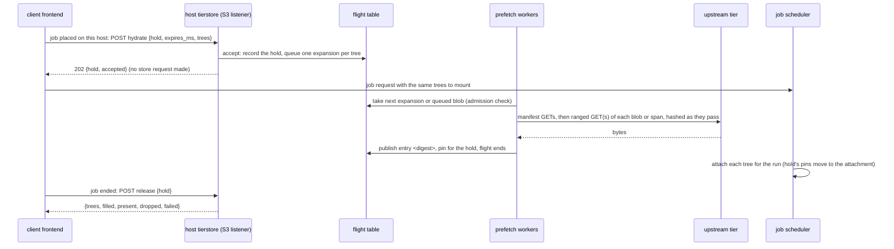
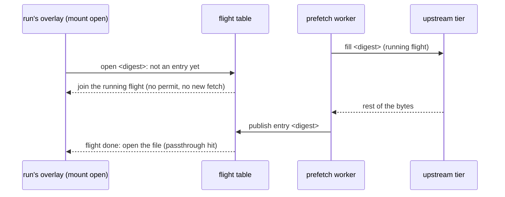
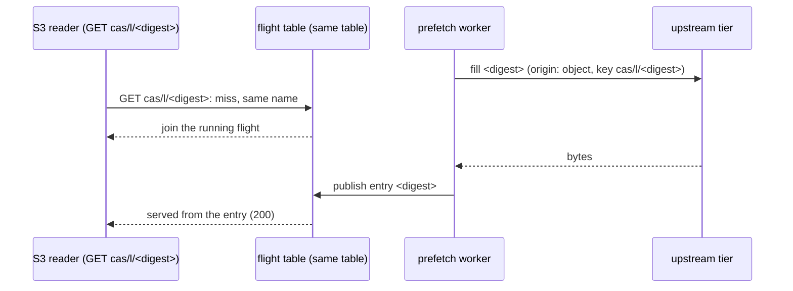

# Prefetch API: the client sends the trees a job will mount, and every read of their blobs joins the fill

Status: **proposed (owner request and direction, 2026-11-10; refined by the owner flow below the same day), not built.** This text replaces the design of pull request #289 (a `POST ?prefetch` on the S3 front that queued whole-object fills of pack keys) and the amendment that split the work into "attach prefetch all for large blobs" and "`?prefetch` for small packs". The unified design below supersedes both splits: there is one call, one cache entry per object and one table of running fills, whichever path reads. Everything here is the plan; the code is the S3 front, the fill socket and the local cache of [tierstore-design.md](tierstore-design.md) until the pull requests of section 11 land, and each moves its part of this text out of "plan" in the same pull request (rule P10). Terms in bold are those of the glossary of tierstore-design.md (section 17).

The owner's direction (2026-11-10): "What does the build frontend see? Does it have the full list of artifacts needed for the build? If so, it should send that whole list to the host's tierstore. The key thing is if we're still downloading when the caller asks for it, we keep waiting instead of re-downloading."

The owner flow (2026-11-10), which refines the design from its list of blobs to a list of trees: "The client is going to send the job scheduler a list of trees to mount. That is an extensible framework. The client should send the same list as a prefetch request to tierstore; tierstore confirms it received it and kicks off the hydration; then the client sends the job scheduler request." And: the same mechanism for Macs and Linux, the low-level implementation may differ. Five consequences, each worked out below:

1. The request carries **tree digests**, the same trees the job will mount through `tierstore fs`, not a per-blob list. tierstore reads each tree's manifests as an attach does and queues every blob of the tree (D3, D4, section 4.1).
2. **Mac and Linux are one mechanism.** A Mac reads through the mount (NFSv3 over loopback, decision C9 of [virtual-build-fs.md](virtual-build-fs.md)) as Linux does, so the daemon's ranged S3 reads of pack keys are not a path this design serves and the span table is dropped (D13).
3. The unit is a **whole tree**, the list the mounts will use; nothing is chosen per file.
4. The call returns as soon as the request is accepted (queued). The client then calls the job scheduler; a mount open of a blob still downloading waits on that download (D5).
5. The hold **hands over to the attachment**: when the job scheduler attaches the same tree for the run, the attachment's pins take over; release or expiry ends the hydrate hold (D7, section 4.2).

Figures: **read** means from the code or docs of tierstore `origin/main` 7eece3b8 or of the client's repository at its main (file and function named); **measured** means from the client input measurements (node-05); **inferred** says how it was computed (rule P11); **unmeasured** has no source yet and is in section 12.

## 1. What the client's frontend sees (read)

The client is a REAPI build farm. It hands one action at a time to a node. Reading its code:

- **It does not have the whole build's list.** The build tool sends each action when it is ready (REAPI `Execute`, one Action digest); nothing in the frontend holds the build's graph. So "the whole build" is not available; the per-action list is, which is the fallback the owner named.
- **It has the whole input root of each action, early.** Before it starts an action, the frontend reads the Action, the input root `Directory` and every `Directory` under it, and asks the store whether every file is held (the frontend's `prepare_run/closure.rs`, `collect_closure`; level by level, 16 `Directory` reads at once). The result is the sorted set of every file digest of the tree with its size (a REAPI digest is the SHA-256 and the size), at most 500,000 digests and 32 GiB (`ClosureLimits::DEFAULT`). Today it keeps only the digests and drops each `Directory` after reading it.
- **It can say where each blob is.** The pack index gives, per digest, `{pack_key, offset, length}` (`Location` in the pack index crate; the call is `PackIndex/Locate`), and a large blob (over the 64 MiB packed-read limit) is the whole object `cas/l/<sha256>`. The client's tree-job design (4.1 of its actions-as-jobs design) already writes this into manifests as `{"sha256", "size", "source": {"key", "offset"}}` with no `source` for a whole object, and `source` is exactly what tierstore's fill socket takes (`fill <sha256> <size> from <key> @ <offset>`).
- **When, relative to the host starting the action.** Two paths:
  - *The tree-job path (planned, one build action per job):* the executor takes the farm's `Start`, prepares the job (this walk), submits it, and polls the job. The first poll that names the job's host (state `PLACED` or `STARTING`) is when the executor can talk to that host's tierstore, while the container is being made (4.5, D8 of that design). Its design already names a call for that, `hydrate` with a hold id, a list of blobs `{sha256, size, source}` and `expires_ms`, and a `release` at the end, and asks tierstore for them (its section 13). The list is available **before** placement (the walk comes first); the host is known only **at placement**. So the earliest the frontend can send to the chosen host is the placement answer; the lead over the first open is the container start (unmeasured; measurement 10.3 of that design is to say).
  - *Today's daemon path (and the Mac native path):* the scheduler's `LeaseOffer` carries only the Action digest (the farm's `farm/side.rs`, `offer`), and the daemon ignores it until `Start` (`daemon.rs`, `on_message`; `lease.rs`). The daemon walks the input root itself and reads through `PackedCas` (one `Locate`, one ranged read per blob, at most 16 at once) after `Start`; the walk (p50 3.0 s, 49 directory reads, measured) is the lead. Here the daemon, which has the list after its walk and `Locate`, is the one that can send to its loopback tierstore.
- **Identifiers per input:** the SHA-256 and size of every file (certain), the pack key and offset (from the index, one batch call per up to a thousand digests), the whole-object key for a large blob. It does not hold an S3 object key by digest for a packed blob, because there is none: a packed blob is a span of a pack.

So the owner's model holds with one change: the list is per action, sent to the chosen host at placement, not the whole build in advance. If the build tool ever hands the frontend a larger list, the same call takes it (section 3).

**The owner flow replaces the unit of that list.** The client already sends the job scheduler a list of trees to mount (an extensible framework); it does not have to resolve a tree to blobs, `Locate` them and send per-blob spans for tierstore, which has the manifests (a `file` entry carries `sha256`, `size` and the `source` span, [tree-manifest.md](../../crates/tierstore/docs/tree-manifest.md)). The client sends that same list of tree digests first, as a hydrate request, and the call order of a job becomes (section 5.1):

1. the client sends `hydrate` with the trees to the host's tierstore; tierstore answers `202` (received) and starts hydrating;
2. the client sends the job scheduler request with the same trees;
3. the job scheduler attaches each tree on the node (`attach <tree> for <run>`), and the job reads through the mount.

On a Mac the same three steps run, with the daemon's loopback tierstore and the NFS mount. The paragraphs above about the daemon reading through `PackedCas` describe the path the Mac native flow moves off (Q2, answered in section 12).

## 2. The problem

Each blob an action reads that misses the build node's cache waits for a fill from the hot or cold tier, on the action's clock. Measured: 21.8% of 204,111 actions had a node-cache miss; fetched bytes per missing action are p50 166 kB, p90 5.0 MB, p99 29.4 MB; the cold first fetcher of a toolchain fetches 518 to 555 MB (81 to 89 misses) and opens 68% of it, the first open of a 150 to 190 MB executable waiting for the whole blob. The steady state is mostly warm, so a list call must be cheap when everything is present; the tail is a few hundred MB that a fill started at placement can overlap with the container start and the walk.

Two things make a prefetch that only queues fills not enough, and they are the heart of the owner's direction:

1. **A read that arrives while the fill runs must wait for it, not fetch again.** Today that is true only inside one path. The S3 front keeps an object under its own key (a `cas/l/<sha256>` is named by its digest on disk, `layout::name_of`) and its running fills in `flights` (`join_or_start`, `local_cache/fill.rs`). The mount's fill socket keeps a blob under the reserved key `_tiering/fill/<sha256>`, whose on-disk name is the hash of that key, and its running fills in `source_flights` (`source_fill`, `local_cache/source.rs`). A prefetch through one path and a read through the other fetch the same bytes twice and hold them twice against the budget. (Read at `origin/main`; the two tables share only the removal marks, `Flight::drop` and `Flying::drop`.)
2. **The reads that follow come by two paths**, the mount (the run's overlay: `open` on Linux passthrough, a `pread` on macOS (NFS) and on 6.8) and S3 `GET`; the call must not have to know which. The trees of a job are read through the mount on both systems, so a hydrated blob is joined mostly by the mount's `open`; the S3 `GET` path joins the same table for the objects it does read.

What does not change: every read still works with no prefetch (read-through, then fallback). Prefetch is an optimisation; a refused, failed, late or lost list never fails a read.

## 3. Decisions

| # | Decision | Reason |
|---|---|---|
| D1 | **One cache entry per object, named by its digest.** A blob is one entry whichever path fills it: the mount's `_tiering/fill/<sha256>` and the S3 front's `cas/l/<sha256>` become one entry named by the digest (what `name_of` already gives a `cas/l/<sha256>`). A key that is not content-named (a pack `cas/d/...`) keeps its name, the hash of its key. | One entry means one budget charge, one set of pins, one answer to "is it there". The blob's bytes are verified against the digest as they are filled (the fill socket already does); a content-named S3 fill is verified the same way. |
| D2 | **One table of running fills, one single-flight per entry.** `flights` and `source_flights` become one table keyed by the entry name. A fill is described by a plan (a whole object of a key, or a span `{key, offset, size}` hashed to the digest); the table holds one flight per name whichever path starts it; every other path's request for the name joins it and takes no permit. | This is the owner's rule: if a fill is running when the caller asks, keep waiting. It also removes the double entry of section 2. |
| D3 | **One call: `POST /_tierstore/v1/hydrate`, the name the client's design already uses**, with `{"hold": "<id>", "expires_ms": n, "trees": ["<sha256>", ...]}`, the same trees the client sends the job scheduler to mount, answered `202` as soon as the request is accepted, and `POST /_tierstore/v1/release` with `{"hold"}`. It lives on the S3 listener, signed as any request with the client's key (the client's frontend has that endpoint and key; on a Mac node the daemon has its loopback tierstore and read-only key). | The caller has the tree digests (it sends them to the job scheduler anyway), which is all the call needs: tierstore has the manifests, and with them every blob's digest, size and source. No new socket, uid or port (minimal operator surface). The control socket is for the node's own `tierstore fs`, not a caller on another account, and the fill socket is 0600 for the instance's uid (it was never reachable by the frontend). One name for one verb: no `?prefetch` is built. A per-blob `blobs` field is not built; if one is ever wanted it is added, additively (B8). |
| D4 | **The unit is a tree digest; tierstore expands it.** A tree is the digest of a root manifest, a content-addressed object `cas/l/<sha256>` ([tree-manifest.md](../../crates/tierstore/docs/tree-manifest.md)). tierstore reads the root manifest and every manifest below it through the fill path, exactly as an attach does, and queues every `file` entry that has contents (size above 0) as a blob: the entry's `sha256`, `size` and, when present, `source` span. Expansion is bounded by `hydrate_max_trees`, `hydrate_max_blobs` and `hydrate_max_bytes` (section 6). The sequence is in 5.5 and the rules in 4.1. | The client does not resolve a tree to blobs: it has no reason to hold the manifests, and tierstore already must read them to attach. This keeps the client's request equal to the job scheduler's list, so the two cannot disagree about what the job reads. A whole pack is not fetched for a few blobs of it; only the manifest's spans are. |
| D5 | **Filling is background; reading is foreground; a read that joins is promoted; the call does not wait for any of it.** `hydrate` is answered when the request is accepted, before any manifest or blob is fetched; expansion and fills run on a pool of their own (`prefetch_concurrency`) and never take a foreground permit. A foreground read (mount or S3) that finds the entry queued or running joins it: if it is still queued it is **promoted**, started at once on a foreground permit, jumping the prefetch queue; if it is running it simply waits. A read of a blob that expansion has not reached yet is an ordinary read-through miss, and is joined by a later queueing of the same blob. | A read must never wait behind prefetch work it could start itself. The client calls the job scheduler right after the answer, so the answer must not wait for manifests (which can be thousands of fetches for a large tree). Queued entries live in the one table (state `queued`), which also removes the old wart that a queued key was invisible to a read. |
| D6 | **No eviction for a prefetch, admission once.** Before a queued blob starts: held bytes + bytes reserved by running fills + its size must be at most `high_water`; otherwise it is dropped (`would_evict`). No check at commit, so a fill a read has joined is never dropped. | A prefetch is a guess; the working set is not. Unchanged from #289 (D9 there). |
| D7 | **Pins: one hold, handed to the attachment.** A hold is a pin owner: each blob of each tree of the hold is pinned for the hold when it is in the cache (filled, or already there), up to the existing `local_cache.pin_limit`, by the existing pin machinery (owner `{mount: "hold", tree: "<hold id>/<tree digest>"}`, the shape the pin machinery already has), which resolves any digest entry now that there is one entry per digest. When the job scheduler attaches a tree the hold lists (`attach <tree> for <run>`), the attachment's pins take over for that tree: the cache moves the hold's pins on the tree's blobs to the attachment's owner (`{mount: <mount id>, tree}`), and a blob of the tree that is filled later is pinned for the attachment, not the hold (4.2). The hold ends at `release`, or at `expires_ms` (clamped to `hold_max`, default 4 hours, the longest a grant lives), whichever first; ending unpins what the hold still owns and leaves the attachment's pins alone. A blob past `pin_limit` is kept by recency only. | Hydrated-not-yet-read objects must survive until the run is done; a TTL bounds a frontend that died. Once the run attaches the tree, the attachment (which ends at `detach`) is the owner that knows when the job is done, so a `release` that arrives while the job still runs, or one that never arrives, cannot unpin what the job reads. Pins never outlive their owner, a refused pin costs speed only (existing rules). No per-blob TTL, no second mechanism. |
| D8 | **Cancellation is `release`.** It ends the hold, unpins what the hold still owns, stops the expansion of the hold's trees that is still running, and drops the hold's blobs that are still queued and that no other hold and no attachment wants and no read has joined (a running fill is left to finish: its bytes are paid for and a joined read may want it). The answer says, for the hold's trees, how many trees were expanded, and how many blobs were filled, already present, dropped, or failed. A hold that never sends `release` ends by itself at expiry. | The only waiting the caller wants is the join; cancelling queued work saves upstream bandwidth for the jobs that are running. |
| D9 | **Duplicate trees are free.** A blob already present is only marked used and pinned; one in the table (queued or running) is joined and the hold added to its holders; a tree listed twice (in one hold or two) adds nothing; a manifest is one cache entry, fetched once, whether expansion or an attach reads it first. | Two jobs of one toolchain on a node send overlapping trees; each blob and each manifest is fetched once. |
| D10 | **A tree larger than the cache is cut, never thrashed.** Blobs are queued in manifest order (the order `flatten` lists entries, depth first); admission (D6) stops a blob that does not fit under `high_water`, and the rest is counted `would_evict` and left to lazy reads. The client orders the trees as it wants them filled, first first. A blob larger than the whole budget is `too_large`. After the bounds of section 6 (`hydrate_max_blobs`, `hydrate_max_bytes`) the rest of a tree is not queued (`too_many_blobs`, `too_many_bytes`). | The same rule as one blob, repeated: never evict what may be in use to hold what may be read. |
| D11 | **Bounds are config keys with defaults from the start** (section 6). No key is required. | Tunables are config. |
| D12 | **Failure and loss are silent to the job.** `hydrate` is answered `202` before any fetch; a tree whose manifest cannot be read or is refused (`unsupported manifest version`, `manifest digest mismatch`, a limit of the format) is counted and, while the hold is open, recorded for `release`'s answer, and the attach of that tree fails by its own rule; a blob whose fill fails is counted and recorded the same way, and the read that follows is an ordinary miss. | The client's design already treats a late or failed hydrate as speed lost, never a start. |
| D13 | **Same mechanism on Mac and Linux; no pack-span table.** A Mac reads through the mount (NFSv3 over loopback, built on the same core as Linux; decision C9 of virtual-build-fs.md), so its job reads join the flight table as a Linux job's do. The earlier optional table of listed pack spans, for ranged S3 reads of a pack key by the daemon's `PackedCas`, is **dropped**: it served a path that the Mac native flow no longer takes, and no pull request builds it. The low-level fill differs only where the mount differs: the cache entry and the table are the same; what reads the entry is the passthrough `open` on Linux (7.0) or a `pread` through the mount (6.8, NFS). | Two mechanisms for one question would be two lists for the client to keep equal. The owner's rule is one mechanism. |
| D14 | A storage node answers 501 `HydrateNotAvailable` (a code of its own, so that it differs from the answer a previous release gives to the path: 404 `NoSuchBucket`, see the compatibility table). A read-only instance answers 503 `SlowDown`. | A storage node has no local cache; a read-only instance holds no lock of the cache directory. |

### What this replaces

- The `POST /<bucket>?prefetch` of #289 (keys of whole pack objects, outcomes per key, D1 to D15 there) is **not built**. A whole pack is a coarse unit; the unit now is the tree.
- The first form of this design (a list of blobs `{sha256, size, source}` sent by the client, with `Locate` done by the client) is **refined** by the owner flow: the client sends tree digests, tierstore expands them (D3, D4). The per-blob call is not built.
- The split of the earlier amendment ("large blobs: `attach <tree> prefetch all` on the control socket; small blobs: `?prefetch`") is **superseded**: `attach ... prefetch all` stays what it is (the mount's own warm-up of an attached tree) and now fills into the same entries and the same table, so it and a `hydrate` share, but the client does not need it for this purpose.
- The earlier "unifying `source_flights` and `flights` is an optional refactor (task opt)" is **promoted** to the first task, because the owner's rule needs it.

## 4. Unifying the entry and the flight table

What exists (read at `origin/main`): `name_of(key)` gives a content-named key (`cas/l/<hex>`) the digest as its name and any other key the hash of the key; the mount's `blob_name(sha)` is `name_of("_tiering/fill/<sha>")`, a hash. `source_fill` waits on `source_flights` and a permit of `fill_socket_concurrency`; the S3 miss path's `join_or_start` waits on `flights` and a permit of `max_concurrent_fills`. The two tables are consulted together only to clear removal marks.

The change:

1. `blob_name(sha)` becomes the digest itself (the name `name_of("cas/l/<sha>")` gives). `blob_path`, `touch_blobs`, `pin` and the mount's opens use it unchanged in shape. An entry carries its **origin** in the sidecar, additively: `object` (the bytes are the upstream object `cas/l/<sha>`) or `span` (they were cut out of a pack, and no upstream object has that key).
2. The S3 front serves a content-named key from the entry only for origin `object`. A `span` entry is not an S3 object (a `GET` or `HEAD` of `cas/l/<sha>` goes upstream and answers what upstream says, 404 included), because the client decides whether a large object needs writing by its presence; a blob that exists only as a span must not look written. Mount reads and `hydrate` use both origins.
3. One table, `flights`, keyed by name, with states `queued(plan)` and `running`. `join_or_start(name, plan, class)` is the one entry point: present, else join the flight (promoting it if queued and the caller is foreground), else start it. `class` picks the permit pool: `foreground-mount` (`fill_socket_concurrency`), `foreground-s3` (`max_concurrent_fills`), `prefetch` (`prefetch_concurrency`). The two foreground keys stay as they are (no renamed key, no new public name); a flight holds the permit of the class that started it.
4. `Flight::drop`, `Flying::drop` and the invalidation marks collapse into one `Drop` (the lock-order note in `fill.rs` goes away). A delete or put through the front during a fill still invalidates (`changed`) as today.
5. **Disk compatibility (B8).** At start, an entry whose sidecar key is `_tiering/fill/<sha>` is renamed to the digest name if that name is free, else removed (the digest-named entry is the same bytes). The previous release, run again on this directory, finds digest-named entries it already understands as `cas/l` objects and finds no fill entries: it refills them (a cache costs speed, not data). A test runs that both ways (task 1).

Why this is safe: the bytes are content-addressed and verified to the digest on every fill, so which path filled an entry cannot change what a reader gets; only the S3 visibility of a `span` entry needed a rule (item 2).

### 4.1 Expanding a tree

The expander is a task of the prefetch pool, one per tree of a hold, started after the `202`:

1. Fetch the root manifest as an attach does: the whole object `cas/l/<tree>` (its size is unknown to the caller, up to the 64 MiB manifest limit) through `join_or_start` of the one table, so an attach, or another hold, that wants the same manifest joins this fetch and the reverse. A manifest is an ordinary cache entry; once read it is present for the attach that follows, which is the point.
2. Parse it with the library's `parse_manifest`, which refuses an unknown `v` or `kind`, a digest mismatch and an over-size manifest by name. A refused tree stops its own expansion, is counted `tree_refused` with the library's reason, and does not stop the other trees of the hold.
3. Walk depth first in manifest order, the order `flatten` indexes entries. A `dir` entry's child manifest is fetched the same way (its `size` is known, so one ranged fetch, no HEAD); a manifest listed at two places is fetched once, as `flatten` does. A `file` entry with size above 0 is queued as a blob with its `sha256`, `size` and `source` (absent means the object `cas/l/<sha256>`); a symlink and an empty file need nothing.
4. A `file` is queued only after the checks of section 6 (reserved or out-of-scope `source.key`, `access_denied` for a scoped key) and admission (D6). The walk stops at `hydrate_max_blobs` blobs or `hydrate_max_bytes` bytes of the call, counting the rest `too_many_blobs` or `too_many_bytes`, and at the library's own limits (`MAX_ENTRIES`, `MAX_DEPTH`).
5. Memory is bounded by the distinct manifests of one tree being walked, not by the call: the walk keeps a stack of the directories being listed and the digests it has seen, never the flattened tree (an attach flattens its own copy, 6.3 of virtual-build-fs.md).

Blobs are queued as the walk meets them, not after it, so the first fills start while the walk is still reading manifests. Several trees of one hold are walked in the order the request lists them, one tree at a time up to `prefetch_concurrency`.

### 4.2 The hold and the attachment

The request and the job scheduler's list are the same trees, so the same tree digest reaches tierstore twice: as a hold's tree (from the client) and as an attachment (from the job scheduler, through `tierstore fs`, which sends `pin <mount id> <tree> <sha256> ...` to the cache, 6.5 of virtual-build-fs.md). The handover:

- Until the tree is attached, the hold pins each of its blobs that is in the cache, up to `pin_limit` (D7).
- At the first `pin` of a mount for a tree that a hold lists, the cache moves the hold's pins on that tree's blobs to the attachment's owner and marks the tree **attached** in the hold. A blob of the tree that finishes filling after that is pinned for the attachment. The hold keeps expanding and queueing (hydration goes on), and still owns nothing of that tree.
- `detach` of the tree's last attachment unpins as today (6.5); if the hold is still open and the tree's expansion is not done, the rest continues for recency only, since nobody pinned for it.
- `release` or expiry of the hold ends its pins, drops its queued blobs that no attachment or other hold wants, and does not touch the attachment's pins. A hold whose trees are all attached and fully filled is only its bookkeeping; ending it frees nothing the job needs.
- If the job scheduler attaches the tree before the client's `hydrate` (the order is not enforced), the attachment already owns pins; the hold finds the tree attached when it starts and pins nothing for it; expansion still queues the blobs that are not present.

Pins never outlive their owner (6.5): the cache's `pins-live` sweep covers attachments, and the hold's TTL covers a hold. The takeover is a change of owner in the cache's memory and in its pins file. A hold owner has the shape of every owner (a mount id, here the fixed word `hold`, and a tree string), so there is no new format; the previous release, reading the file, finds a mount id that is not live and drops that pin at its first `pins-live` sweep, which costs speed only (B8; a test runs it, section 10).

## 5. Sequences

### 5.1 The client sends the trees, then the job scheduler request



The call order is fixed by the client: `hydrate` answered, then the job scheduler. tierstore does not depend on it (4.2): a job that arrives first reads through as before.

### 5.2 The action opens a blob mid-fill and waits on the same flight



If the blob was still queued, the open **promotes** it: it starts at once on a foreground permit and the prefetch worker later finds it present and drops its queue slot. One fetch either way.

### 5.3 An S3 GET mid-fill joins too



For an `object` blob this is exact. For a `span` blob no S3 key exists by digest (section 4, item 2); a ranged `GET` of its pack is not joined (D13: the Mac and Linux jobs read through the mount, not by ranged S3 reads).

### 5.4 Two jobs, overlapping trees

```mermaid
sequenceDiagram
    participant A as hold A (job 1)
    participant B as hold B (job 2, same toolchain)
    participant H as hydrate handler
    participant T as flight table
    A->>H: hydrate {trees: [X, Y]}
    H->>T: expand X, expand Y: blobs queued
    B->>H: hydrate {trees: [X, Z]}
    H->>T: X's manifest and blobs in table or present: add hold B as holder; expand Z
    Note over T: each blob of X is fetched once, pinned for A and B; B's release leaves A's pin
```

### 5.5 Expanding a tree (4.1)

```mermaid
sequenceDiagram
    participant X as expander (prefetch pool)
    participant T as flight table
    participant U as upstream tier
    participant Q as queue
    X->>T: join_or_start(cas/l/<tree>) (a mount attach of the same tree joins this)
    T->>U: GET whole manifest object
    U-->>T: manifest bytes, hashed, entry published
    T-->>X: manifest present
    X->>X: parse_manifest (refuse unknown v or kind, digest mismatch)
    loop each entry, manifest order
        X->>T: dir: join_or_start(child manifest, size known)
        X->>Q: file with size above 0: admission, queue {sha256, size, source}
    end
    Note over Q: workers fill while the walk goes on; a bound of section 6 ends the walk
```

### 5.6 The hold hands over to the attachment (4.2)

```mermaid
sequenceDiagram
    participant F as client frontend
    participant H as hydrate handler
    participant C as cache (pins, holds)
    participant J as job scheduler
    participant S as tierstore fs
    F->>H: hydrate {hold, trees: [T]}
    H-->>F: 202
    Note over C: blobs of T fill and are pinned for the hold
    F->>J: job request (trees: [T])
    J->>S: attach T for run
    S->>C: pin <mount id> T <sha256> ...
    C->>C: T attached: hold's pins on T's blobs move to the attachment; later fills of T pin for the attachment
    S-->>J: attached, path to mount
    F->>H: release {hold}
    H->>C: end hold: drop its queued blobs nobody wants; the attachment's pins stay
```

## 6. Configuration and limits

New keys in `[local_cache]`, each with a default, documented in `configuration.md`, each landing with the code that reads it:

| Key | Default | Range | What |
|---|---|---|---|
| `prefetch_concurrency` | 2 | 0..64 | Prefetch workers, a pool of their own. 0 turns `hydrate` off (501 `HydrateNotAvailable`). |
| `prefetch_queue` | 16384 | 1..1000000 | Blobs queued, all holds together; past it a blob is counted `busy` and dropped. |
| `hydrate_max_trees` | 64 | 1..4096 | Trees in one call; the call is 413 `EntityTooLarge` past it (the body limit follows from it: 64 hex digits per tree). |
| `hydrate_max_blobs` | 500000 | 1..10000000 | Blobs one call may queue **after expansion**, all its trees together (the default is the client's closure limit of 500,000 digests); the rest is counted `too_many_blobs`, the call is not refused. |
| `hydrate_max_bytes` | 32 GiB | 1 MiB..1 TiB | Sum of the sizes of the blobs one call may queue after expansion (the default is the client's closure limit of 32 GiB); the rest is counted `too_many_bytes`. Admission (D6) is the tighter bound for a small cache. |
| `prefetch_queue_ttl` | 120s | 1s..1h | Longest a blob waits queued; older is dropped (`expired`): the job has likely read it. |
| `hold_max` | 4h | 1m..24h | The longest a hold lives; `expires_ms` is clamped to it. |
| `hold_max_count` | 256 | 1..100000 | Holds open at once; a new one past it is 429. |
| `prefetch_merge_gap` | 0 (off) | 0..8 MiB | With a value above 0, spans of one pack closer than this are fetched by one ranged GET and split (task 9, only if measured to save requests). |

The existing `pin_limit` bounds the pinned bytes. There is no per-request byte rate: bounds are the queue, the workers, `high_water` admission and `hydrate_max_bytes` (rule B20).

**Who may call:** the full key and the read-only key may `hydrate` and `release` (a read-only key gains no right to read anything it could not; it gains a way to spend cache budget and upstream reads, bounded as above). A scoped key may expand only what it may read: each manifest object (`cas/l/<sha256>`) and each blob's `source.key` (or `cas/l/` for a whole-object blob) is checked against its read prefixes with the existing `scoped::covers`; a tree whose root manifest is outside is counted `access_denied` and not expanded, a blob outside is dropped and counted `access_denied`, the call is not 403. A presigned URL and a PresignPut key cannot call it. Reserved keys (`_tiering/...`) are refused as a `source.key` found in a manifest (counted `reserved_key`). The role check is made where the target is known (a `hydrates` helper beside `deletes_many` in `ops.rs`), as `Role::permit` sees only the method.

Request: `{"hold": "<id>", "expires_ms": n, "trees": ["<sha256>", ...]}`; `hold` and `trees` are required, `expires_ms` is optional (default `hold_max`). Answer to `hydrate`: `202` with `{"hold": "...", "accepted": n}`, `n` the number of distinct trees accepted for expansion (a count, since neither manifests nor fills are waited for; no blob count exists yet). 400 for a body that is not the shape, an id over 128 bytes, or a `sha256` that is not 64 lower-case hex; 413 for more than `hydrate_max_trees`; unknown fields ignored (B8). The same `hold` id sent again adds its trees to the hold (the client may send trees in several calls) and extends nothing else. Answer to `release`: `200` with `{"trees": n, "expanded": n, "refused": n, "blobs": {"filled": n, "present": n, "dropped": n, "failed": n}}`; an unknown or ended hold is `404` and the client ignores it. The wire names are snake_case.

## 7. Failure modes and edge cases

| Case | Mechanism |
|---|---|
| Storage node, or `prefetch_concurrency = 0` | 501 `HydrateNotAvailable`. |
| Previous release | A signed POST to the bare path `/_tierstore/v1/hydrate` is read as a request to a bucket named `_tierstore` and answers 404 `NoSuchBucket` (501 `NotImplemented` comes only under a real bucket, `/<bucket>/_tierstore/v1/hydrate`); both are pinned by tests on main now. The client treats a 404 or a 501 on that path as "unsupported now", backs off and probes again after, so a host updated by the updater is found without a client restart. 503 and 429 back off the same way. |
| Read-only instance | 503 `SlowDown` for the call. |
| A blob already present | Marked used and pinned; no request. |
| Tree's root manifest does not exist upstream, is refused by `parse_manifest`, or does not match its digest | That tree is not expanded: counted `tree_refused` with the library's reason, recorded for `release`; the other trees go on; the attach of it fails by its own rule (6.3 of virtual-build-fs.md). |
| `hydrate` arrives after the job scheduler attached the tree, or the job reads before expansion reaches a blob | Correct either way (4.2, D5): the attachment already owns the pins, the read is a read-through miss that a later queueing of the blob joins. |
| Tree over a bound (`hydrate_max_blobs`, `hydrate_max_bytes`, the library's `MAX_ENTRIES` or `MAX_DEPTH`) | The expansion stops there; blobs met so far stay queued; the rest is counted (`too_many_blobs`, `too_many_bytes`, or `tree_refused` for a library limit) and left to lazy reads. |
| Blob does not exist upstream (404 on the span or object) | Dropped, counted `not_found`; no negative cache; the read gets its own error. |
| The bytes are not the digest | The fill fails (`bad_digest`), nothing is kept (existing fill-socket behaviour); counted. |
| Upstream error or timeout | `upstream`, counted, no retry; the read retries as a miss. |
| A read joins a flight that then fails | The reader gets the flight's error as a fill socket request does today (`FillError`), and the mount reads through as it does for any failed fill; no second attempt inside the flight. |
| Delete or put of the key during a fill | `changed`: nothing kept (existing mechanism). |
| Eviction between fill and read | The pin (D7) holds it up to `pin_limit`; past it, an ordinary re-fill. |
| Trees larger than the cache | D10: cut at `high_water`, the rest `would_evict`. |
| Hold released while the job runs | The attachment's pins stay (D7, 4.2); only queued blobs nobody else wants are dropped. |
| tierstore restarts | Queue, expansions and holds are in memory and are lost; running fills leave partial files the startup scan removes; the pins file already survives (existing). The attachments are re-asserted by `tierstore fs` as today (6.5). The client's next `hydrate` is a new request. |
| Hold never released | Ends at `expires_ms` (clamped to `hold_max`). |
| Two instances during a live hand-off | The call goes to whichever instance holds the cache lock; the other answers 503 and the client backs off. |
| Hostile list | Per-blob checks before any lookup; sizes and counts bounded (section 6); nothing is fetched at call time. |

## 8. Observability

Counters on `/metricz`, in `metrics.md`: `hydrate_requests_total`, `hydrate_trees_total{outcome}` (`expanded`, `refused`, `access_denied`), `hydrate_blobs_total{outcome}` (`present`, `joined`, `queued`, `dropped` with `reason` as a label: `would_evict`, `too_large`, `busy`, `access_denied`, `reserved_key`, `too_many_blobs`, `too_many_bytes`), `hold_handovers_total` (trees whose hold pins moved to an attachment), `prefetch_fills_total`, `prefetch_fill_failures_total{reason}` (`upstream`, `not_found`, `bad_digest`, `no_space`, `changed`, `expired`), `prefetch_promotions_total` (a read took a queued blob), `fill_joins_total{path}` (`mount` or `s3`: a read that joined a running fill, the number the owner's rule is about), `prefetch_queue_depth` and `holds_open` (gauges). The fills also count in `fills_total` and `upstream_reads_total`.

## 9. Request budget

Per `hydrate` call: 0 store requests at call time (the answer is made from the request alone), one JSON parse of at most `hydrate_max_trees` digests. Per tree, after the answer: one GET of the root manifest (whole object, size unknown) and one ranged GET of each distinct child manifest (its size is in the entry, no HEAD), none when a manifest is already an entry, which is the case for the attach that follows (inferred from 5.5; the number of manifests of a real tree is unmeasured, Q4). Per fill, for a blob of S bytes: ceil(S / `fill_chunk`) ranged GETs of 8 MiB, **no HEAD** (the manifest gives the size and the digest, as the fill socket's `Read::Range` does); a 150 to 190 MB executable is 19 to 24 GETs, a small blob 1 GET (inferred from `fetch_from`). This is one HEAD less than the S3 miss that #289 replaced, and for small blobs it fetches only the manifest's spans, not the whole pack (one GET per blob instead of 1 HEAD + ceil(pack / 8 MiB) per pack; `prefetch_merge_gap` can turn adjacent spans back into one GET, task 9). Hydrating a whole tree fills blobs the job never opens; that waste is the price of the owner's whole-tree rule and is what task 8 measures (inferred: up to 40% of the bytes of an input root are never opened). A read after a completed fill: 0 requests. A read that joins a running fill: 0 extra, and never longer than the unprefetched miss. A tree sent twice: 0 for every manifest and blob already present or in the table. Whether the saving is real is a measurement (task 8); the client's input measurements (fetch is a part of `inputs_ms`, cold p50 3.6 s against warm 4.7 s) say the case rests on the first-fetcher toolchains.

## 10. Tests

Rust, hermetic (the fake store, scratch directories, injected clock and permits and explicit progress events; no sleeps against real timeouts; T10, T12).

1. `one_digest_is_one_entry_whichever_path_fills_it`: a mount fill and an S3 fill of `cas/l/<sha>` end in the same on-disk name; the second finds the first present.
2. `mount_open_during_s3_fill_joins_it` and `s3_get_during_mount_fill_joins_it`: with the store held at a gate, the second reader takes no permit, the store sees one fetch, both get the bytes.
3. `prefetch_fill_is_joined_by_mount_open_and_s3_get`: the same for a prefetch fill (5.2, 5.3).
4. `read_of_queued_prefetch_blob_promotes_it`: with every prefetch worker held, a foreground read of a queued blob starts at once on a foreground permit; the worker later drops its slot; one fetch.
5. `foreground_and_prefetch_use_their_own_permits`: with every foreground permit held a prefetch runs; with every prefetch permit held a read fills.
6. `span_entry_is_not_an_s3_object`: a `span` entry is not served for `GET` or `HEAD` of `cas/l/<sha>`, which go upstream; an `object` entry is.
7. `hydrate_answers_202_before_any_store_request` (the store is held at a gate and the answer arrives with zero requests seen), `hydrate_present_blob_costs_no_store_request`, `hydrate_fills_a_span_with_ranged_gets_and_no_head`, `hydrate_blob_with_wrong_bytes_keeps_nothing`.
8. Tree expansion (4.1): `tree_expands_to_every_blob_of_its_manifests_in_manifest_order`, `shared_manifest_is_fetched_once`, `empty_files_and_symlinks_queue_nothing`, `refused_manifest_stops_only_its_own_tree` (unknown `v`, digest mismatch, over-size, each by its exact message), `expansion_queues_blobs_while_the_walk_goes_on` (explicit progress events), `attach_of_a_tree_joins_the_expansion_manifest_fetch` and the reverse.
9. `duplicate_trees_fetch_each_blob_once` and `release_of_one_hold_keeps_the_pin_of_another` (5.4).
10. `hold_pins_filled_blobs_and_release_unpins`, `hold_expires_at_hold_max` (injected clock), `pin_past_limit_is_kept_by_recency_only`.
11. Handover (4.2, 5.6): `attach_moves_the_holds_pins_to_the_attachment`, `blob_filled_after_attach_is_pinned_for_the_attachment`, `release_after_attach_leaves_the_attachments_pins`, `attach_before_hydrate_leaves_the_hold_pinning_nothing`, `detach_after_release_unpins_everything`.
12. `release_drops_queued_blobs_nobody_else_wants_and_leaves_running_fills_and_stops_the_expansion`, with the exact counts of its answer.
13. `trees_larger_than_the_cache_are_cut_at_high_water_in_manifest_order`; `blob_larger_than_budget_is_too_large`; `prefetch_never_evicts`; `a_joined_fill_is_never_dropped_at_commit`.
14. `queue_bound_busy`, `max_trees_413`, `max_blobs_after_expansion_drops_the_rest`, `max_bytes_after_expansion_drops_the_rest`, `queue_ttl_expires` (injected clock), `hold_count_429`; exact-equality messages (T13).
15. `scoped_key_is_checked_per_manifest_and_per_blob`, `read_only_key_may_hydrate`, `presigned_keys_cannot_hydrate`, `reserved_source_key_in_a_manifest_is_refused`.
16. Compatibility (B8): `entries_of_the_previous_layout_are_renamed_at_start` and `previous_release_runs_on_the_new_directory` (and the reverse, including a hold's pin entry in the pins file); an unknown field in the body is accepted; `an_unknown_path_outside_the_bucket_answers_404_no_such_bucket` and `an_unknown_path_under_the_bucket_answers_501_not_implemented` pinned on main now.
17. One test per counter of section 8 asserting its exact value after a scripted run.

Coverage of every touched crate stays at 99% lines and branches (T1). `local_cache/mod.rs` is near 1000 lines and does not grow (R12): the table, queue, holds and expander are new files (`local_cache/flights.rs`, `local_cache/prefetch.rs`, `local_cache/holds.rs`, `local_cache/expand.rs`, `server/hydrate.rs`).

## 11. Tasks, one pull request each, smallest first

| # | Where | Task | Size |
|---|---|---|---|
| 0 | tierstore | Pin-down tests on main that pass today and fail when the design changes: the two names differ now (`s3_object_and_mount_blob_of_one_digest_are_different_cache_entries`), and the unknown path answers 404 `NoSuchBucket` outside the bucket and 501 `NotImplemented` under it. Task 1 changes the first on purpose. Branch `hydrate-pin-down-tests`. | S |
| 1 | tierstore | **Unify the entry and the flight table** (section 4): digest-named blob entries, origin in the sidecar, one `flights` table with `join_or_start(name, plan, class)`, start-up rename of old fill entries, and tests 1, 2, 5, 6, 16 (layout part). No new call, no new key. A refactor with a stated behaviour change (one fetch where two happened) and no API (P7). Branch `hydrate-unify-entry`. | M (about 500 lines) |
| 2 | tierstore | The prefetch queue and workers in the table, the `queued` state and **promotion**, admission, counters, config keys `prefetch_concurrency`, `prefetch_queue`, `prefetch_queue_ttl`; no HTTP; driven by tests 3, 4, 13, 14 (queue part), 17. Branch `hydrate-queue-promotion`. | M (about 450 lines) |
| 3 | tierstore | Holds and pins by hold (`holds.rs`, `hold_max`, `hold_max_count`), by the existing pin machinery; tests 9, 10, 12 (without the expansion part). Branch `hydrate-holds`. | M (about 350 lines) |
| 4 | tierstore | **Tree expansion** (`local_cache/expand.rs`, 4.1, 5.5): a tree digest to its manifests through the table and to queued blobs, with `hydrate_max_trees`, `hydrate_max_blobs`, `hydrate_max_bytes` and the refusal counters; driven by tests 8, 13, 14 (bounds part), no HTTP. Branch `hydrate-tree-expansion`. | M (about 400 lines) |
| 5 | tierstore | `server/hydrate.rs`: `hydrate {hold, expires_ms, trees}` and `release` on the S3 listener, answered at acceptance, the auth helper, 501/503/429/400/413; tests 7, 14 (call part), 15; docs (`operations.md`, `configuration.md`, `metrics.md`, `clients.md`, `keys.md`). Marked experimental until task 8. Branch `hydrate-endpoint`. | M (about 400 lines) |
| 6 | tierstore | **Handover of the hold to the attachment** (4.2, 5.6): the cache moves a hold's pins on a tree to the attachment's owner at the first `pin` of a mount for that tree, later fills pin for the attachment, `hold_handovers_total`, and the pins-file compatibility test; test 11 and the hold part of 16. Branch `hydrate-attach-handover`. | M (about 300 lines) |
| 7 | the client | The frontend sends `hydrate` with the same trees as the job scheduler request, waits for the `202` (any error ignored, backoff on 404/501/503/429), then sends the job scheduler request, and sends `release` after the result; the Mac daemon does the same to its loopback tierstore (a signed POST, which the client's request signer cannot make today: it hard-codes GET). No `Locate` and no per-blob list. Branch `hydrate-client`. | M |
| 8 | the client + measurement | On node-05 and the farm Mac: blobs opened that were in the cache at first open, with and without the call; bytes hydrated and never opened (the waste of the whole-tree rule); time from the `202` to the first open; fills joined (`fill_joins_total`). The result goes in section 12 and the docs lose "experimental". Branch `hydrate-measure`. | S |
| 9 | tierstore | Optional: `prefetch_merge_gap`, merging adjacent spans of one pack into one ranged GET, only if task 8 shows the request count matters. Branch `hydrate-merge-gap`. | S |

Order: 0 and 1 first (1 stands alone and fixes the double fetch on its own); then 2; then 3 and 4, which are independent of each other; then 5 and 6, each needing both 3 and 4; 7 may be written beside 5 and released after it; 8 last; 9 only on evidence. The span-table task of the earlier plan is gone (D13). Each pull request stands alone on main.

## 12. Open questions and later additions

Owner questions, in plain language:

- **Q1.** The client's frontend knows one action's trees when it places the action, not the whole build. Is that enough, or does the build tool hand the frontend a larger list early (a build-wide set of trees) that you want sent at the start of a build? The call takes either; only the client side changes.
- **Q2 (answered 2026-11-10).** On a Mac node the same mechanism as Linux: the client sends the trees as a hydrate request, then the job scheduler request, and the job reads through the mount. The daemon's ranged S3 reads of pack keys are not served, and the span table is not built (D13).
- **Q3 (answered 2026-11-10).** The list is whole trees, the same list as the mounts (the owner flow). The cost is blobs hydrated that the job never opens (inferred: up to 40% of the bytes of an input root); task 8 measures it, and `hydrate_max_bytes` bounds it.
- **Q4 (unmeasured).** The cost of expanding a tree of thousands of present manifests and blobs, the number of manifests of a real tree, and how much lead the `202` gives over the first open. Measured in task 8.
- **Q5.** A pack-sourced blob is not an S3 object by digest (section 4, item 2). Is it acceptable that an S3 `GET cas/l/<sha>` of such a blob goes upstream (and 404s) while the mount reads it from the cache?
- **Q6.** The issue this work is tracked under. The commit of this branch says `Refs komira-ai/tierstore#274` (the virtual build fs issue); no issue for this work exists yet.
- **Q7.** At the handover (4.2) the hold's pins move to the attachment. If the job scheduler never attaches a tree the client sent (the job is cancelled before it starts), the hold keeps its pins until `release` or `hold_max`. Is a 4 hour ceiling acceptable for that case, or should the client's cancel path always send `release`? The design assumes the client sends `release` and the ceiling is the backstop.
- **Later, additive only:** a per-blob `blobs` field in `hydrate`, per-tree `priority`, a bounded `wait_ms`, a per-entry "hydrated, not yet read" flag to count waste.
