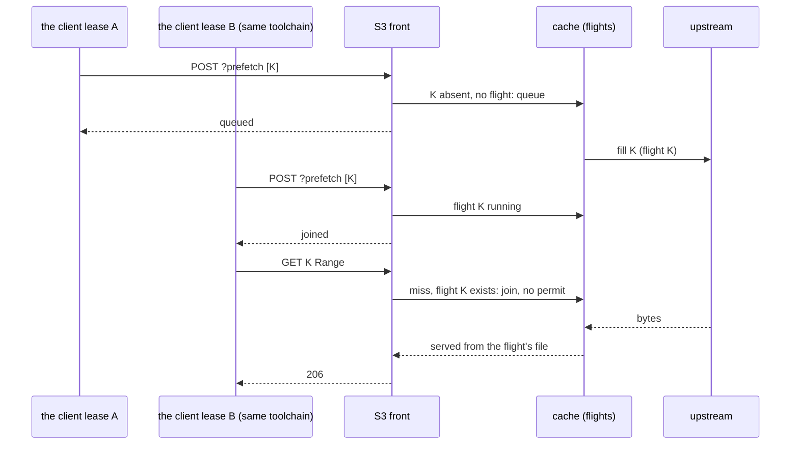
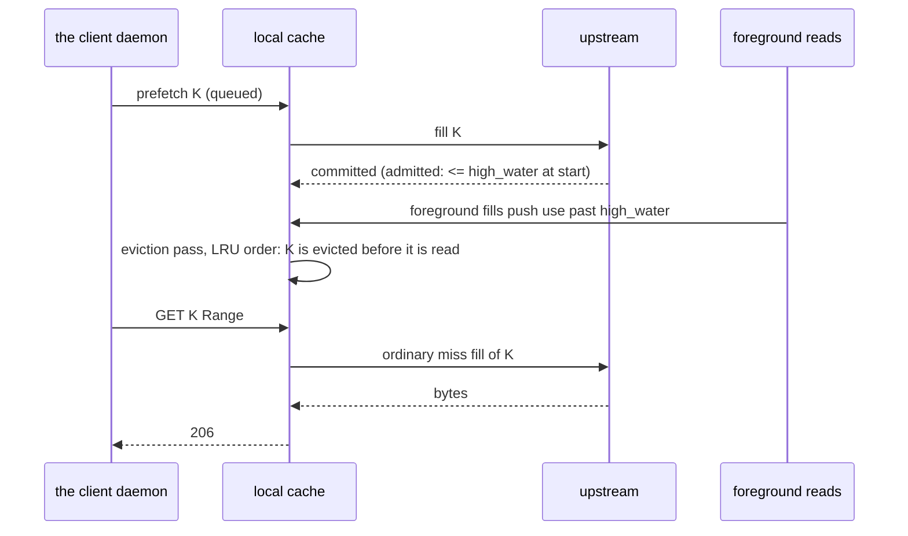
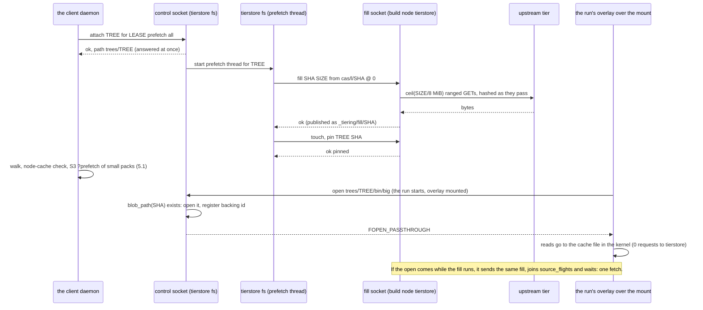

# Prefetch API: ask the build node's cache to fetch objects before they are read

Status: **proposed (owner request, 2026-11-10), not built.** This text amends the merged design of pull request #289 with the owner's answer of 2026-11-10 to its Q4: the client reads large blobs through tierstore's filesystem mount, not over S3 (D16 to D18, section 4.1). Everything here is the plan; the code is the S3 front and local cache of [tierstore-design.md](tierstore-design.md) until the pull requests of section 11 land, and each of them moves its part of this text out of "plan" in the same pull request (rule P10). Terms in bold are those of the glossary of tierstore-design.md (section 17).

The request (owner, 2026-11-10): "on tierstore we need to add an API to allow prefetching. The use case is that the client will send an API request with a list of objects to prefetch."

Figures: **measured** means from `/data/workplace/vbfs-experiments/inputs/RESULTS.md` (the client input measurements, node-05); **read** means from the code or docs at `origin/main` 37ffa7d7 (the build client at d494947); **inferred** means computed here from those and says how (rule P11); **reviewed** means a claim about the client code taken from the design review of this document (the build client, d494947, `packed.rs`, `client.rs`), to be re-read before task 6; **unmeasured** has no source yet and is in section 12.

## 1. The problem

The client's daemon reads the inputs of an action from tierstore, one ranged GET per blob that misses its node cache (read: `PackedCas`, one `Locate` plus one ranged request per blob, at most 16 at a time). Each such read arrives at the build node's local cache cold, so it waits for the fill from the hot or cold tier. The daemon knows the whole list of what it will read right after it has walked the action's input root (read: the daemon's tree walk), and the design notes of the client list "prefetching an offered lease's inputs" as planned and unbuilt. Nothing in tierstore lets a client say "fetch these now, I will read them in a moment".

Measured size of the need: 21.8% of 204,111 actions had a node-cache miss; fetched bytes per missing action are p50 166 kB, p90 5.0 MB, p99 29.4 MB. The cold first fetcher of a toolchain fetches 518 to 555 MB (81 to 89 misses) and opens 68% of it, the first open of a 150 to 190 MB executable waiting for the whole blob. So the steady state is mostly already warm and the call must be cheap when everything is present; the tail is a few hundred MB that a prefetch started at lease offer can overlap with the directory walk (p50 3.0 s, 49 directory reads).

There are two read paths on the build node and the client uses both (owner, 2026-11-10). Blobs that are small enough are read over the S3 front as ranged reads of pack objects (above). Large blobs (the 150 to 190 MB executables, `cas/l/<hex>`, anything over `MAX_PACKED_READ_BYTES`) are read through `tierstore fs`: the run's overlayfs sits over the mount, and on Linux with passthrough the kernel reads the cache file in place, without copying the blob again (virtual-build-fs.md 6.4; on macOS the NFSv3 server reads it). The two paths fill different cache entries (section 4.1), so a prefetch has to be aimed at the path that will read.

What does not change: every the client read still works with no prefetch (read-through, then fallback to the frontend). Prefetch is an optimisation; a refused, failed or lost prefetch never fails a read.

## 2. Decisions

| # | Decision | Reason |
|---|---|---|
| D1 | The API is an S3-front extension: `POST /<bucket>?prefetch` on the S3 listener, same SigV4, same keys. | The client already has that endpoint, bucket and read-only key; it needs no new socket, uid or port. DeleteObjects (`POST /<bucket>?delete`) is the model: a subresource, a body of keys, a per-key result. |
| D2 | Not the fill socket. | The socket is 0600 for the instance's own uid and fills `_tiering/fill/<sha>` blobs the S3 front refuses to serve (read: `fill_blob`). The client's daemon is another account, and a blob filled there would not make the client's next S3 read a hit. |
| D3 | Not a separate control socket or port. | Another listener is more operator surface and a second auth scheme for one verb (minimal operator surface). |
| D4 | The unit is an object key, whole. A key is what the client holds after `Locate`: a pack `cas/d/<writer>/<boot>/<seq>`. No digests, no ranges in v1. | Only the client has the pack index; tierstore resolving digests would mean learning it (a request per digest, out of scope). The S3 miss path fills a whole object for a whole GET up to the budget, and for a ranged GET only when the object is at most `whole_fill_limit` (64 MiB; the client packs are at most 32 MiB from the frontend), passing larger ranged reads through uncached (read: `meta.size > whole_limit` is checked on the ranged path only). A prefetch is a whole-object fill, so it follows the whole-GET rule: size is bounded by the admission check of D9, not by `whole_fill_limit`. A `cas/l/<hex>` key is allowed (it is an S3 key and a later S3 read of it would hit), but it does **not** warm the mount: the mount reads a different cache entry (4.1), and the client reads large blobs through the mount (Q4, answered), so the client does not send them here. A range field is additive later. |
| D5 | The body is JSON: `{"keys": [...], "id": "..."}` (`id` optional). Unknown fields are ignored; `id` is a string of at most 128 bytes (more is 400, it goes into the log). | There is no S3 call to match, so S3 XML has no authority here; JSON is what the client can build without an XML writer. Ignoring unknown fields keeps later fields additive (rule B8). |
| D6 | Asynchronous only in v1: the answer says what the call found and what it queued; it does not wait for the fills, and there is no job id and no status query. | A poll API and a job id are public names and a wire format nobody needs yet (avoid one-way doors). The reads that follow join a running fill (D8), which is the only waiting the client wants. A `wait_ms` field is additive later if a measurement asks for it. |
| D7 | A prefetch fill uses the S3 path's `flights` table, through `join_or_start`. Unifying it with the socket's `source_flights` is not part of this design. | A prefetch and a racing S3 read then fetch once. The mount's fills (the fill socket) are a different cache population: they are kept under the reserved key `_tiering/fill/<sha>`, whose on-disk name is the hash of that key, while an S3 `cas/l/<sha>` is named by its digest (`layout::name_of`); so the two never share an entry or a flight, even for the same bytes (read; 4.1). A prefetch therefore cannot warm the mount, and the mount's own prefetch (D16) is used for that. Unifying the two is an optional refactor (task opt). |
| D8 | Prefetch has its own permit pool (`prefetch_permits`) and a bounded queue; it never takes `max_concurrent_fills`. The seam: `join_or_start` (today it does `self.permits.try_acquire_owned()` itself) takes the permit as an argument, or a `start_with(permit)` variant is added; the foreground caller passes a permit from `permits`, the prefetch worker one from `prefetch_permits`. The table, the `Flight` drop and the invalidation marks stay shared. | A prefetch must not starve a foreground miss; a miss that finds the key in `flights` joins it and needs no permit (read). The change is made in task 3 and is small: one parameter. |
| D9 | A prefetch never evicts. It is an admission check, made once before `join_or_start`: bytes held + bytes reserved by running fills + the object's size (from the worker's one HEAD) must be at most `high_water`; otherwise the key is counted `would_evict` and no fill starts. There is no check at commit. | A prefetch is a guess; the working set is not. A fill that a foreground read has joined cannot be dropped at commit (the reader would get `Skipped` and pass through uncached), and the fill path commits and then calls `relieve()` (read: it evicts above `high_water`; `reserve` tests the `critical` mark, not `high_water`). So concurrent foreground fills may push the cache over `high_water` after the commit, and `relieve` then runs as it does for any fill. |
| D10 | No pins for the S3 `?prefetch` in v1; the mount's prefetch is pinned by its attachment (D16). | Pins are owned by a (mount, tree) and resolve only `_tiering/fill/<sha>` and `cas/l/<sha>` (read); a pack cannot be pinned and an S3 prefetch has no mount or tree. An owner concept for pins is a one-way door; a prefetched pack is read within seconds and the recency of a fill protects it. Additive later (`pin_for_ms` in the body). |
| D11 | No priority field. Prefetch is always below a foreground read. | One level cannot be mis-set. |
| D12 | The call itself makes no store request. The size and the budget are judged by the worker, which HEADs once and hands the result to the fill (`Read::Headed`), so a fill costs one HEAD, not two. | A HEAD per key inside the call costs a request each and the caller waits for it (service time per request dominates). The answer to the call is what the index and the queue tell. |
| D14 | Wire names are snake_case everywhere, and `outcome` and `reason` are open sets: a client treats a value it does not know as `rejected` and ignorable, and never fails on one. | These names are lock-in (avoid one-way doors); the sets will grow. |
| D15 | A key is prefetched only if the cache would keep it: `cacheable(key)` (a `[[policy]]` prefix with `cache = true`). Otherwise `rejected: not_cached`. | A fetch of a key the cache then throws away is waste reported as `queued`. The client's pack prefix must be a cache policy on the build node (a note for `clients.md`). |
| D13 | A storage node answers 501 `NotImplemented`. | It has no local cache (`config.cache` is `None`). |
| D16 | Large blobs read through the mount are prefetched with what the mount already has: `attach <tree sha256> for <run> prefetch all` on the control socket, sent at lease offer under the run's id (the lease id). No tree digest and no blob list in `?prefetch`, and no new tierstore API for them in v1. | The mount reads `_tiering/fill/<sha>` entries filled over the fill socket, verified against the blob's digest; only a fill over that socket warms them (4.1). `prefetch all` runs that same path (`Core::cache_file`, one blob at a time on its own thread, on the socket's permits), shares its flights with the run's opens, and pins what it filled (D17). The client already uses the control socket for the overlay. A tree digest in `?prefetch` would make the S3 front read tree manifests and fill the fill socket's reserved names, which D2 keeps out of it; a blob list needs each blob's (pack key, offset, size), which only the manifest has (D4). |
| D17 | A prefetched, not yet opened blob of the mount is pinned by the attachment, with no new rule: `prefetch all` pins each blob it filled for the tree, in batches, up to `local_cache.pin_limit` (#277); a blob past the limit is kept by recency only. The client detaches the run when it is not started (`detach <run>`), and after its own restart sends `detach-all-except <runs>` as 6.5 of virtual-build-fs.md says. | Opened blobs are already pinned by the first open; a prefetched blob is pinned from the moment it is filled until the tree's last detach, so it cannot be evicted between the prefetch and the overlay's open (this is the eviction race of 5.3, closed for the mount). It costs nothing new: pins never outlive their attachment, and a refused pin costs speed only. |
| D18 | One cleanest API for the client is not one verb. There is one verb for each cache population: the control socket's `attach ... prefetch all` for what the mount reads, `?prefetch` for the pack objects the S3 front reads. Task 0 decides whether the second is built at all (11). | The two populations are different entries by construction (4.1); one verb over both would have to know both namespaces, which puts fs names in the S3 seam or S3 rules in the fs seam (owner: S3 rules in one seam). If the client can put every input it reads in an attached tree, the second verb is not needed and the S3 API is dropped: the simplest outcome (Q7). |

## 3. The API

```
POST /<bucket>?prefetch
Content-Type: application/json
x-amz-content-sha256: <sha256 of the body>

{"id": "lease-4f2a", "keys": ["cas/d/w1/7/12", "cas/d/w1/7/13"]}
```

Answer, `200 OK`, `application/json`:

```
{"id": "lease-4f2a",
 "results": [{"key": "cas/d/w1/7/12", "outcome": "present"},
             {"key": "cas/d/w1/7/13", "outcome": "queued"}]}
```

`results` has one entry per key, in request order; there is no separate count (a client counts). `outcome` and `reason` are open sets (D14): a client treats an unknown value as `rejected` and ignorable. Outcomes:

| Outcome | Meaning | Store requests |
|---|---|---|
| `present` | The index holds the key and the entry is fresh (marks it used, as a hit does). A stale entry (`Cache-Control` freshness) is not `present`: a read would revalidate it with a HEAD, so it is treated as absent and queued. | 0 |
| `joined` | A fill of the key is running (in `flights`) or the key is already in the queue (the `queued` set, 4); nothing added. | 0 |
| `queued` | Accepted; a worker fetches it when a permit is free. | 0 now |
| `rejected` with `reason` | `reserved` (the key is under `_tiering/` or otherwise reserved), `access_denied` (outside the key's read prefixes), `invalid_key`, `not_cached` (no cache policy keeps the key, D15), `duplicate` (earlier in the same request), `busy` (the queue is full), `too_many` (beyond `prefetch_max_keys`; see 6). | 0 |

The call answers 400 `MalformedJSON` for a body that is not the shape (an `id` over 128 bytes included), 413 `EntityTooLarge` for a body over the limit (`prefetch_max_keys` times the key length limit plus slack, as `ops::body_limit` does for DeleteObjects), 501 `PrefetchNotAvailable` on a storage node or with `prefetch_concurrency = 0` (a code of its own, so that it differs from the 501 `NotImplemented` of a previous release, see 7), and 403 as S3 does for a bad signature. A request with a valid body is 200 even if every key is rejected, as DeleteObjects does. A key whose fill later fails or is dropped (`upstream`, `not_found`, `too_large`, `no_space`, `would_evict`, `changed`, `expired`) is not reported: it is counted (section 8), and the read that comes later is an ordinary miss.

`id` is echoed and put in the log line of the call. It is a correlation label for the operator; tierstore does not index it.

S3 rules stay in one seam: the new handler sits beside `delete_objects.rs` (new `prefetch.rs`), the subresource goes in the `SUPPORTED` list of `ops.rs`, and the key checks (reserved, scope, `cacheable`) are the ones the S3 calls already use (`journal::is_reserved`, `scoped::covers`).

## 4. Semantics

- **Best effort.** Nothing is promised about when or whether an object is cached.
- **Fills the local cache only.** The object lands under its own key, as an S3 miss fill of it would, with the same sidecar and the same freshness rules (`Cache-Control`, revalidation) as any fill.
- **Same bytes as a read.** The fill is the miss path's whole-object fill (`Read::Headed` after the worker's HEAD); there is no second fill code path to keep right. A whole-object fill is bounded by the admission check and `reserve`, not by `whole_fill_limit`, which the miss path applies to ranged reads only.
- **Deduplicated.** Within a request (`duplicate`), with the index (`present`), with a running fill (`joined`, from a read or an earlier prefetch), and with the queue: `local_cache/prefetch.rs` keeps a small `queued` set (a `HashSet` of index names), so a second call for a queued key answers `joined` and adds no second entry. A queued key is in no flight table, so a read of it is an ordinary miss with a foreground permit and may start the fill first; the worker then finds the key present or in `flights` and drops its entry. One fetch happens either way.
- **Never evicts.** The admission check of D9, once, before the fill starts: cache bytes plus running-fill reservations plus the object's size must be at most `high_water` (90% of the budget by default). If not, the key is counted `would_evict`, no fill starts and no eviction is requested. The cache may pass `high_water` after the commit because of foreground fills; `relieve` then runs as for any fill. It never touches pinned entries, because it evicts nothing itself.
- **Lower priority only in permits.** A read that misses does not take a prefetch permit and a prefetch does not take a foreground one (`max_concurrent_fills`); the two cannot wait on each other. Upstream bandwidth is not prioritised: prefetch fills and foreground fills share it, which is why `prefetch_concurrency` defaults to 2.
- **Stale work is dropped.** At dequeue the worker skips a key that is now present or in `flights`. A key that waited longer than `prefetch_queue_ttl` (default 60 s) is dropped and counted `expired`: the build has likely read it already.
- **Fair between calls.** Workers take keys round-robin by call (an internal call number; `id` is not used for it). One call holds at most `prefetch_max_keys` (1000) of the `prefetch_queue` (4096), so at least four calls fit before `busy`.
- **Cancellation.** A delete or put through the front of the key during the fill invalidates it exactly as for a read fill (`changed`). There is no commit-time drop (D9).
- **No pin, no promise of residence.** See D10 and the eviction race in 7.3.

### 4.1 The mount's reads: one cache directory, two populations of entries

All read at `origin/main` bf389dd9 (`treefs/core.rs`, `treefs/core/prefetch.rs`, `fill_socket/`, `local_cache/source.rs`, `local_cache/layout.rs`):

| | S3 front (`?prefetch`, ranged reads) | The mount (`tierstore fs`) |
|---|---|---|
| Reader | The client daemon, ranged GET of a pack | The kernel, through the run's overlay: passthrough on Linux 6.9 and later, a read through the server on 6.8 and on macOS |
| Entry | The object under its own key, e.g. `cas/l/<sha>` (named by its digest) or `cas/d/...` (named by the hash of the key) | The blob under `_tiering/fill/<sha>` (named by the hash of that key), verified against its digest, one entry per blob even when it lies inside a pack |
| Miss | `join_or_start` on `flights`, a permit of `max_concurrent_fills` | `fill <sha> <size> from <key> @ <offset>` on the fill socket, `source_flights`, a permit of `fill_socket_concurrency` (`Core::cache_file`: a large blob with no recorded source is `fill ... from cas/l/<sha> @ 0`) |
| Upstream cost | 1 HEAD plus ceil(size / `fill_chunk`) ranged GETs (D12) | ceil(size / `fill_chunk`) ranged GETs and no HEAD: the manifest gives the size (`Read::Range`) |
| Pinned | No (D10) | Yes: the first open pins the blob for the tree, `prefetch all` pins each blob it filled (D17) |

What this means for the question "no double fetch when the mount opens a blob that a prefetch is filling":

- **A mount prefetch and a mount open share one flight and one entry.** `attach ... prefetch all` runs `Core::cache_file`, the function an open runs: it opens `blob_path(sha)` and, if it is not there, sends the fill. A fill running for the blob is in `source_flights`, so an open that arrives joins it (`source_fill` awaits the running flight) and one that arrives after it opens the published file; a prefetch that finds the file there does not fill. One upstream fetch either way, and the open is a passthrough hit, not a read through the server.
- **An S3 prefetch and a mount open share nothing.** `?prefetch` of `cas/l/<sha>` fills the S3 entry named `<sha>`; the mount opens `_tiering/fill/<sha>`, a different name, found by a different table. The mount's open would miss, fill again, and the bytes would be held twice against the budget. This is why D4 does not send large keys here and why D16 aims the mount at its own prefetch. A test pins the names (task 0c).
- **The cache, the budget and the lock are one.** Both populations are entries of the node's one index and one `local_cache` budget, are evicted by the same `relieve`, and are subject to the same lock of the cache directory (`read_write()`): a read-only instance answers both with `read-only` or 503.

The client's flow for a run, then: at lease offer, attach the tree of its large blobs with `prefetch all` (the control socket, run id = lease id); send `?prefetch` for the packs of the small blobs that missed its node cache (only if task 0 shows they matter); the executor's run mounts the overlay over `trees/<sha256>` as it does today. What the attach starts is the fill of the large blobs, pinned.

Two limits of `prefetch all` that task 0 measures before anything is added. First, it fills every blob of the tree, not only the ones the run will open: if the tree holds the whole input root, the opened share (about 1% of the files, at most 40% of the bytes, inferred) says most of the fill is wasted and pins up to `pin_limit`; if the tree holds only the large blobs the client chose, it is exactly the list. Which of the two the client builds is Q7. A list form, `prefetch <run> <sha256> ...` on the control socket (only digests of the attached tree, resolved through the manifest, so the S3 seam is untouched), is the additive answer if the tree is the whole root; it is not built in v1 (avoid one-way doors: a new verb is a public name). Second, the prefetch thread fills one blob at a time per tree; the socket's other permits serve the run's own opens in parallel, so a run that opens before the prefetch reaches a blob fills it itself. Whether one thread is fast enough for 500 MB is a measurement (task 0).

## 5. Sequences

### 5.1 the client prefetches, then the action reads

```mermaid
sequenceDiagram
    participant D as the client daemon
    participant F as the client frontend
    participant S as tierstore S3 front
    participant C as local cache
    participant U as upstream tier
    D->>F: walk input root (49 dir reads)
    D->>D: node-cache check: digests that miss
    D->>F: batch Locate (<=1000 digests) x ceil(M/1000), M = misses
    F-->>D: pack key, offset, length per digest
    D->>S: POST /bucket?prefetch {keys: distinct packs}
    S->>C: present? / joined? for each key (no store call)
    C-->>S: outcomes
    S-->>D: 200 {present, joined, queued, rejected}
    Note over D: does not wait; links node-cache hits meanwhile
    C->>U: HEAD + GET key (prefetch permit)
    U-->>C: bytes (committed under the key)
    D->>S: GET key, Range (one per blob)
    S->>C: hit
    C-->>S: bytes from disk
    S-->>D: 206
```

the client's reads come from the same `Locate` answer, so the pack key it prefetches is the pack key it reads. This flow does not exist in the client today (section 6.1).

### 5.2 A duplicate prefetch, and a read that races it



One upstream fetch for all three. A queued but not yet started key is in no flight table: if B's read arrives before the worker starts, it is an ordinary miss that starts the flight and the worker later drops its entry (4).

### 5.3 The eviction race



This is the race of the S3 prefetch. A blob of the mount's prefetch does not have it: it is pinned by the attachment (D17) up to `pin_limit`. The prefetch was wasted, the read is correct. It costs one fetch (a HEAD and the GETs of the object). It cannot be removed without pins (D10); the admission rule makes it rare, because a prefetch starts only with room under the mark that triggers eviction. The other case, the cache already past `high_water` when the worker starts, ends as `would_evict` and costs one HEAD (the size is needed for the check).

### 5.4 the client prefetches a large blob, then the run's overlay opens it



The open is a hit served by passthrough (macOS: a `pread` of the same file by the NFS server). Nothing in this flow is a request of the S3 front.

## 6. Configuration, auth and limits

New keys in `[local_cache]`, each with a default from the start (no key is required), documented in `configuration.md` with the other tunables:

| Key | Default | Range | What |
|---|---|---|---|
| `prefetch_concurrency` | 2 | 0..64 | Workers, a pool of their own. 0 turns the API off: the call answers 501, as on a storage node. |
| `prefetch_queue` | 4096 | 1..1000000 | Keys waiting for a worker, across all requests. A key past it is `rejected: busy`. |
| `prefetch_max_keys` | 1000 | 1..10000 | Keys in one call; keys past it are `rejected: too_many`. Matches the 1000 digests of one `Locate`. |
| `prefetch_queue_ttl` | 60s | 1s..1h | Longest a key waits in the queue; an older key is dropped, counted `expired`. |

Each key lands with the code that reads it (tasks of section 11), not before.

There is no key for bytes per request: the sum is bounded by the admission rule on the cache (D9) and by the queue, and a second bound would be a second place to set it wrong (rule B20).

Who may prefetch: any key that may read the key. A full or read-only key may name any non-reserved key; a scoped key only keys under its read prefixes (`covers(&scopes.read, key, true)`), checked per key, so a key outside is `rejected: access_denied` and the others proceed (the call is not 403). A presigned URL cannot: `presign::permit_read` is the place that refuses it, and a PresignPut key is refused too.

The seam: `Role::permit` takes only the method, so it cannot see the query (`ReadOnly` would refuse every POST, `Scoped` needs POST in `SCOPED_METHODS`). The role check is therefore made where the target and query are known: a `prefetches(method, target, query)` helper beside `deletes_many` in `ops.rs`, called before `Role::permit`, which admits `ReadOnly`, `Full` and `Scoped` keys for this call only and leaves `Role::permit` as it is. A read-only key gains no right to read anything it could not, but it gains a way to spend cache budget and upstream reads on keys it may read; `prefetch_concurrency`, the queue and `high_water` bound that spend. A key that may only prefetch is not added (nothing asks for it).

Limits by construction: 1000 keys a call, a bounded queue, two workers, the budget rule. A call costs the index lookups of its keys and one JSON parse.

### 6.1 The client side (reviewed, not yet designed in detail)

Today the client's `PackedCas` does one `Locate` and one ranged request per blob, inside the read, at most 16 at a time (its comment: batching is a change to the trait). So the flow of 5.1 needs two the client changes before the send, and this document does not hide them:

1. The list exists after the node-cache check and before the reads: the digests of an action's inputs that miss the node cache. The client needs a batch `Locate` (up to 1000 digests per call, a trait change) or a pre-read pass that calls today's `Locate` for the misses. Either adds `Locate` load that is not budgeted yet (open question Q5).
2. A signed POST: `sign()` hard-codes GET, a `range` header and the empty-body hash, so task 3 is a general signed request, not an addition.

Blobs over `MAX_PACKED_READ_BYTES` (64 MiB) go to the plane underneath (`C`), not to tierstore pack ranges, so a pack prefetch does not cover them. The owner's answer (2026-11-10) is that the client reads them through the mount, so they are covered by the mount's prefetch (D16), and the client side of that is: build the tree of the large blobs (the manifest the overlay already needs), `attach` it with `prefetch all` at lease offer under the lease id, `detach` it if the lease is not run (4.1). Before any tierstore code is released, task 0 measures how much of the cold first-fetcher's 518 to 555 MB is in packs of at most 64 MiB and how much is read through the mount.

Docs touched: `operations.md` (a section beside the fill socket, the S3 call list), `configuration.md`, `metrics.md`, `clients.md`, `keys.md`, and the module docs of `server/mod.rs` and `server/local_cache/`.

## 7. Failure modes and edge cases

| Case | Mechanism |
|---|---|
| Call on a storage node, or `prefetch_concurrency = 0` | 501 `PrefetchNotAvailable`; `config.cache` is `None` on a storage node. |
| Call to a previous release | 501 `NotImplemented` (`refuse_unsupported`: "this query parameter is not supported"; a test on main pins this status and code now). The client treats any 501 as "unsupported now": it pauses sending for a backoff (a the client setting with a default) and probes again after it or on reconnect, so a tierstore updated by hostkeeper is found without a the client restart. 503 and 429 (read-only, overload) back off the same way; no other error switches it off. |
| Read-only instance (another holds the cache-dir lock) | The whole call answers 503 `SlowDown` (Q2 of section 12). |
| Queue full | Keys past it are `rejected: busy`; the client may retry later. Nothing is queued past the bound. A call of 1000 keys cannot take the whole queue (4). |
| Key outside every cache policy | `rejected: not_cached`. |
| Key waits too long | Dropped at dequeue, counted `expired`. |
| Prefetch of a key that does not exist | The fill's HEAD answers 404; counted `not_found`; no sidecar, no negative cache. The later read gets its own 404. |
| Object over the budget, or not admitted under `high_water` | `would_evict` (admission) or `too_large` (does not fit the budget at all); counted, no fill, one HEAD spent. |
| Upstream error or timeout | `upstream`, counted; no retry. The read retries as a miss. |
| Delete or put of the key during the fill | The fill answers `changed` and keeps nothing (existing mechanism). |
| tierstore restarts | The queue is in memory and is lost; the client's reads are ordinary misses. A prefetch fill that was running leaves a partial file that the cache's startup scan removes, as for any fill. |
| The client sends the same list on every lease | Each fresh key is a `present` lookup, no store request; at 1000 keys the call is one JSON parse and 1000 index probes (unmeasured, Q1). A stale key costs the HEAD a read would. |
| A key that moves tiers (hot to cold) | Not the cache's concern: the fill reads through the tiers as a read does. |
| The caller hangs up before the answer | The call has no side effect other than queueing; the queued keys are filled anyway (a caller that gives up does not cancel a fetch, as for the socket). |
| Reserved or hostile keys | Refused per key before any lookup (`reserved`, `invalid_key`); a key over 1024 bytes is `invalid_key`. |

## 8. Observability

Counters on `/metricz`, in `metrics.md`, each with its meaning:

| Counter | Meaning |
|---|---|
| `prefetch_requests_total` | Calls that parsed. |
| `prefetch_keys_total{outcome}` | `present`, `joined`, `queued`, `rejected` (and by `reason` as a second label). |
| `prefetch_fills_total` | Fills a worker finished. |
| `prefetch_fill_failures_total{reason}` | `upstream`, `not_found`, `too_large`, `no_space`, `would_evict`, `changed`, `expired`. |
| `prefetch_queue_depth` | Keys waiting now (a gauge, as the cache's other gauges). |

The fills a worker makes also count in `fills_total` and `upstream_reads_total`, as every fill does. There is no counter of prefetched-then-evicted-unread: it needs a per-entry flag and no decision rests on it yet (section 12, Q3).

## 9. Request and latency budget

Per call, N keys, P of them absent and not running:

| Operation | Requests to the store | Wait for the caller |
|---|---|---|
| Call, all keys present or joined | 0 | One loopback round trip plus N index probes (unmeasured; expected well under a millisecond per hundred keys, Q1). |
| Call, P to fill | 0 inside the call | Same; the fills are in the background. |
| Each fill | 1 HEAD (the worker's, handed to the fill as `Read::Headed`) + ceil(size / `fill_chunk`) ranged GETs of 8 MiB: a 32 MiB pack is 1 HEAD + 4 GETs, a 64 MiB object 1 HEAD + 8 (read: `fetch_from`). A read's ranged path makes its own `upstream_head` before `join_or_start` and the fill HEADs again (`Read::Object`), so a prefetch is one HEAD cheaper than the miss it replaces. | None for the caller. |
| A key not admitted (`would_evict`) | 1 HEAD | None. |
| The read after a prefetch | 0 (a hit) | The disk read; no store service time. |
| The read after a prefetch still running | 0 extra (joins the flight) | The rest of the fill, never more than the unprefetched miss. |
| The read after an evicted prefetch | A miss: HEAD(s) + the GETs | One wasted fetch (5.3). |

The mount's path (5.4), per large blob of S bytes, all on the control and fill sockets and none on the S3 front:

| Operation | Requests to the store | Wait for the caller |
|---|---|---|
| `attach ... prefetch all` | 0 inside the call (the manifests are read from the cache, as for any attach) | The attach's own answer; the fills are on a thread. |
| Each blob the prefetch fills | ceil(S / `fill_chunk`) ranged GETs of 8 MiB, no HEAD (the manifest gives the size and the digest): 190 MB is 24 GETs (inferred, 190 / 8 rounded up; `Read::Range`). | None for the client. |
| Each blob already in the cache | 0 (`File::open` finds it) | None. |
| The open after a prefetch | 0 (a passthrough hit; on 6.8 and macOS a `pread` by the server) | The open and the reads from the cache file. |
| The open while the prefetch fill runs | 0 extra (joins `source_flights`) | The rest of the fill, never more than the unprefetched open, which waits for the whole blob (virtual-build-fs.md 6.4). |
| The same blob through `?prefetch` and the mount | The GETs twice, and the bytes held twice | Why the client must not send a mount-read blob to `?prefetch` (4.1). |

The budget win over today, **inferred** from the client code: today each of N blobs that miss the node cache costs one `Locate`-resolved ranged GET at tierstore, and a miss at the local cache is a fill of the whole pack on the first, with the other ranges waiting on that fill or passing through (the client side of this is **reviewed**, 6.1). With a list of N=15,000 digests in P distinct packs, the client sends ceil(N/1000)=15 `Locate` calls and one prefetch call; tierstore makes at most P fills, each 1 HEAD + ceil(size/8 MiB) GETs (P is at least 15 for 470 MB of 32 MiB packs; unmeasured for the real trees, Q1). Each fill saves one HEAD against the miss it replaces; the GET count is the same. The fetch moves from "after the walk, on the first read" to "started at the end of the walk, in parallel with linking". That the saving is real is a measurement (task 6 of section 11), not a claim of this document (the figures of section 1: 21.8%, 204,111 actions and the p50/p90/p99 fetched bytes are RESULTS.md 3.1 and 5, a one-pass journal scan; the 518.5 and 555.4 MB first fetchers, their 81 and 89 misses and the 68% opened are 4.1 to 5, from the inventory of the probe builds; the 49 directory reads and walk p50 3.0 s are 3.3; the 40% opened-byte bound is **inferred** from 4.3. Section 10 of RESULTS.md supersedes 4.2 and 5 for the open share, and task 0 re-derives the pack-only share from it): RESULTS.md says fetch is not the main cost of `inputs_ms` (cold p50 3.6 s against warm 4.7 s), and the stated case for the API is the first-fetcher toolchain, whose bytes dominate.

What to send: the distinct packs of the digests that missed the client's node cache (not all 15k digests of the tree). The measured opened share (about 1% of the files, at most 40% of the bytes of a production tree, inferred) is why the list must be the missing inputs, not "everything in the tree"; an access-profile list is the later refinement of virtual-build-fs.md 6.4 and the same API carries it.

## 10. Tests

All in Rust (T11), hermetic (the fake S3 of `objstore-s3`, scratch directories, no sleeps against real timeouts; the worker pool and queue are driven by injected permits and explicit progress events, T10, T12). Each test names the behaviour it proves.

1. `prefetch_present_key_costs_no_store_request`: a fresh key in the index answers `present`, the fake store saw 0 requests, the entry was marked used. A stale key is queued, not `present`.
2. `prefetch_queued_key_is_filled_under_its_own_key`: after the worker finishes, a ranged S3 GET of the key is a hit with no store request; the fill cost one HEAD and ceil(size/`fill_chunk`) GETs.
3. `prefetch_joins_running_read_fill_and_read_joins_prefetch`: a prefetch of a key whose miss fill is running answers `joined`, a read during a prefetch fill takes no permit; the store sees one fetch (D7).
4. `queued_key_read_first_is_fetched_once`: a read of a queued, not started key starts the flight; the worker drops its entry; one fetch. A second call for a queued key answers `joined` with no second queue entry.
5. `prefetch_uses_its_own_permits_in_both_directions`: with every `max_concurrent_fills` permit of the real `permits` held, a prefetch still runs; with every `prefetch_permits` permit held, a read miss still fills (the `join_or_start` seam of D8).
6. `prefetch_does_not_evict`: a cache whose held plus reserved bytes plus the object's size pass `high_water` does not start the fill (`would_evict`), nothing is evicted, pinned or not; a read that joined an admitted prefetch fill is never skipped.
7. `prefetch_of_large_whole_object_is_admitted_by_budget`: a `cas/l/` key over `whole_fill_limit` and under `high_water` is filled; one that does not fit is `too_large` and not cached.
8. `prefetch_rejects_reserved_out_of_scope_and_uncacheable_keys`: `_tiering/...` is `reserved`, a scoped key's key outside its read prefix is `access_denied`, a key under no cache policy is `not_cached`; per key, and the others in the call proceed.
9. `prefetch_caps_keys_and_queue`: key 1001 is `too_many`, a full queue answers `busy`, one call cannot take the whole queue; exact-equality messages (T13).
10. `prefetch_duplicate_keys_in_one_call`: the second is `duplicate`.
11. `prefetch_queue_ttl_and_dequeue_checks`: a key older than `prefetch_queue_ttl` is dropped and counted `expired` (injected clock, T10); a key that became present or joined is skipped at dequeue.
12. `prefetch_on_storage_node_is_501_prefetch_not_available`, `prefetch_concurrency_zero_is_501`, `prefetch_malformed_body_is_400`, `prefetch_id_over_128_bytes_is_400`, `prefetch_body_over_limit_is_413`, `read_only_instance_is_503`.
13. `prefetch_delete_during_fill_keeps_nothing`: the fill answers `changed`.
14. `prefetch_needs_signed_payload_hash`: a body whose hash does not match the signed one is refused as for any POST.
15. `presigned_and_presign_put_keys_cannot_prefetch`, `read_only_key_may_prefetch_readable_keys`, `scoped_key_is_checked_per_key`: the `prefetches` helper and `presign::permit_read` (6).
16. Compatibility (B8): a body with an unknown field is accepted; an unknown `outcome` or `reason` is handled as ignorable by the test client; and a test on main now, `previous_release_answers_prefetch_subresource_501_not_implemented`, pins the exact status and code that a previous release gives to `?prefetch`, which task 2 keeps true for releases without the API.
17. Counters: one test per counter in section 8 asserting the exact value after a scripted run.

Coverage of every touched crate stays at 99% lines and branches (T1); `local_cache/mod.rs` is at 995 lines and does not grow (R12), the new code is `local_cache/prefetch.rs` and `server/prefetch.rs`.

## 11. Tasks, one pull request each, smallest first

| # | Where | Task | Size |
|---|---|---|---|
| 0 | tierstore + the client | Measure first, before any release of the API: on node-05, the bytes missed per lease split by the path that reads them: packs of at most 64 MiB over the S3 front, and large blobs (`cas/l/`, over `MAX_PACKED_READ_BYTES`) through the mount, out of the 518 to 555 MB of the cold first fetcher; for the mount, the time of the first open of a cold large blob with and without `attach ... prefetch all` first, the fill rate of the one prefetch thread, and the share of the tree's bytes that `prefetch all` fills but the run never opens (Q7). The go/no-go for tasks 1 and 2 is the pack-only result: if large blobs hold the bytes and the packs show no gain, the S3 API is not built and the client's change is task 3b alone. | S (a run and a doc edit) |
| 0b | tierstore | The pin-down test `previous_release_answers_prefetch_subresource_501_not_implemented` on main (it passes today). | S |
| 0c | tierstore | The pin-down test `s3_object_and_mount_blob_of_one_digest_are_different_cache_entries` (4.1): the on-disk name of `cas/l/<sha>` is not the name of `_tiering/fill/<sha>`, and a filled S3 entry is not found by the mount's `blob_path` (passes today); it makes the claim of D7 a test and fails if the two ever unify, so that this document is changed with them. | S |
| 1 | tierstore | `local_cache/prefetch.rs`: the config keys (`prefetch_concurrency`, `prefetch_queue`, `prefetch_max_keys`, `prefetch_queue_ttl`, with defaults, range checks and `configuration.md`), the queue, the `queued` set, the workers, the admission rule, counters, and the permit argument of `join_or_start`; no HTTP yet (driven by tests 1 to 7, 11, 13, 17). The keys land with the code that reads them. | M (about 600 lines) |
| 2 | tierstore | `server/prefetch.rs`: the `?prefetch` entry in the `SUPPORTED` list, the `prefetches` helper, the 501 and 503, the per-key checks, and tests 8 to 10, 12, 14 to 16; docs (`operations.md`, `metrics.md`, `clients.md`, `keys.md`, module docs). Documented as experimental until task 6. | M (about 450 lines) |
| 3 | client | a general signed request in the client's tierstore module (`sign()` hard-codes GET, a `range` header and the empty-body hash today, so this is a rewrite of the signer, not an addition), `prefetch(keys)` returning the outcomes, timeouts as for a read, any error ignored. Test against a fake. | M (about 350 lines) |
| 3b | client | Large blobs: build the tree of the large blobs, `attach <tree> for <lease> prefetch all` at lease offer, `detach <lease>` if the lease is not run, `detach-all-except` after its own restart; a refused or failed attach is ignored (the run's own opens fill). Needs no tierstore change. Which tree it builds is Q7. | S to M |
| 4 | client | A batch `Locate` (or a pre-read pass over the node-cache misses), with its load measured (Q5). | M |
| 5 | client | The daemon sends the distinct pack keys of node-cache misses after the walk and `Locate`, in calls of at most 1000, fire-and-forget on a task that never blocks the lease; any 501, 503 or 429 pauses sending for a backoff and re-probes after it or on reconnect (7). | M (about 300 lines) |
| 6 | client + measurement | Measure on node-05 and the farm: `inputs_ms` and fetched-bytes wait for cold first-fetcher leases with and without the call and with and without the early attach of 3b, and the hit rate of prefetched keys (counters). The result goes in section 12, and the docs lose "experimental", before anything is added (pins, a wait field). | S |
| opt | tierstore | Unify `source_flights` and `flights` (refactor, no behaviour change, P7), only if the `cas/l/<sha>` overlap of a socket fill and a read is shown to cost fetches. Independent of the others. | M (about 300 lines) |

Order: 0, 0b and 0c first; 1, 2 in tierstore (2 after 1); 3, 3b and 4 in the client may run beside them (3b needs nothing from tierstore and may be released first); 5 after 2 is released; 6 last. Each pull request stands alone on main; the optional one is independent.

## 12. Open questions and later additions

- **Q1 (unmeasured):** the cost of a call of 1000 present keys, and P (distinct packs) of the real trees. Measure in task 6; if the index probe is not cheap the fix is in the probe, not a new API.
- **Q2:** a read-only instance answers the whole call 503 `SlowDown`, so the client backs off; per-key `busy` would send 1000 keys of noise for one fact.
- **Q3:** a per-entry "prefetched, not yet read" flag to count wasted prefetches (5.3). Not built until the measurement of task 6 shows waste.
- **Q7 (owner / the client):** which blobs does the tree the client attaches list: only the large blobs it will read through the mount, or its whole input root? Only the first makes `prefetch all` the exact list; the second over-fetches (4.1) and wants the list form `prefetch <run> <sha256> ...`, or, if the client attaches everything it reads, makes the S3 `?prefetch` unnecessary (D18). Also: is attaching at lease offer, before the run starts, acceptable for the executor (the run id is the lease id; a lease that is never run is detached)?
- **Q5:** the extra `Locate` load of a batch or pre-read pass on the client frontend.
- **Q6 (owner):** the issue this work is tracked under. The commit of this branch says `Refs komira-ai/tierstore#274`, which is the virtual build fs issue, not this work, and no issue for the prefetch API exists. The pull request body names the right one once the owner gives or opens it.
- **Later, additive only:** `pin_for_ms` (needs an owner concept for pins that the client has no (mount, tree) for), `ranges` per key (needs the miss path to cache ranges of objects over 64 MiB), `wait_ms` (a bounded wait), and for the mount the list form `prefetch <run> <sha256> ...` of the control socket (4.1). Each is a new optional field of the body, so none changes a shipped name.
