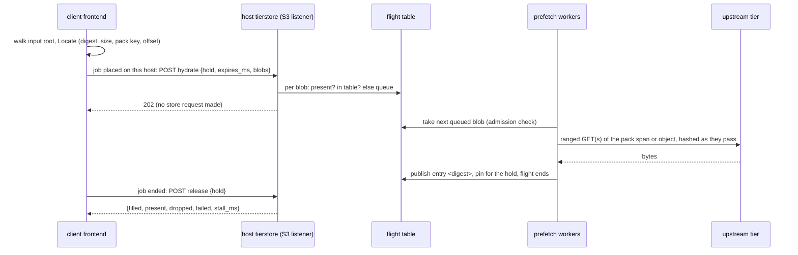
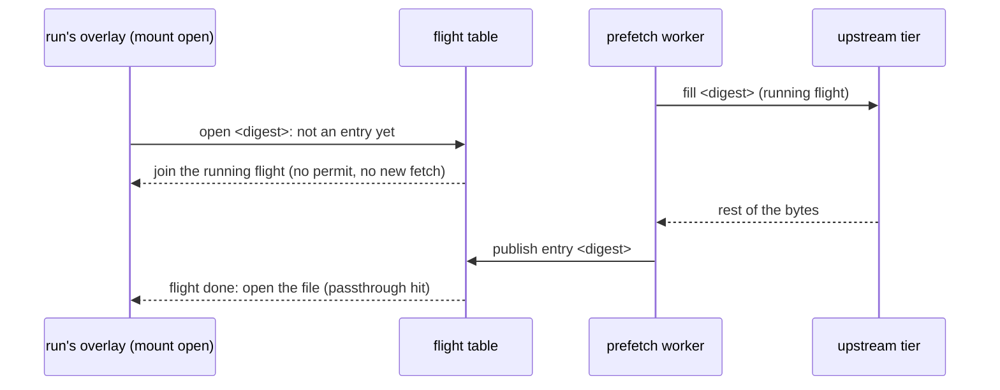
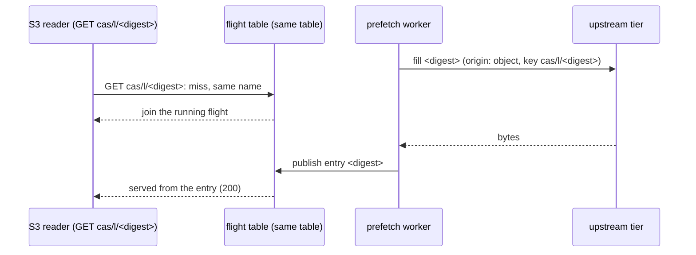

# Prefetch API: the client sends the list of what a job will read, and every read of those objects joins the fill

Status: **proposed (owner request and direction, 2026-11-10), not built.** This text replaces the design of pull request #289 (a `POST ?prefetch` on the S3 front that queued whole-object fills of pack keys) and the amendment that split the work into "attach prefetch all for large blobs" and "`?prefetch` for small packs". The unified design below supersedes both splits: there is one call, one cache entry per object and one table of running fills, whichever path reads. Everything here is the plan; the code is the S3 front, the fill socket and the local cache of [tierstore-design.md](tierstore-design.md) until the pull requests of section 11 land, and each moves its part of this text out of "plan" in the same pull request (rule P10). Terms in bold are those of the glossary of tierstore-design.md (section 17).

The owner's direction (2026-11-10): "What does the build frontend see? Does it have the full list of artifacts needed for the build? If so, it should send that whole list to the host's tierstore. The key thing is if we're still downloading when the caller asks for it, we keep waiting instead of re-downloading."

Figures: **read** means from the code or docs of tierstore `origin/main` 7eece3b8 or of the client's repository at its main (file and function named); **measured** means from the client input measurements (node-05); **inferred** says how it was computed (rule P11); **unmeasured** has no source yet and is in section 12.

## 1. What the client's frontend sees (read)

The client is a REAPI build farm. It hands one action at a time to a node. Reading its code:

- **It does not have the whole build's list.** The build tool sends each action when it is ready (REAPI `Execute`, one Action digest); nothing in the frontend holds the build's graph. So "the whole build" is not available; the per-action list is, which is the fallback the owner named.
- **It has the whole input root of each action, early.** Before it starts an action, the frontend reads the Action, the input root `Directory` and every `Directory` under it, and asks the store whether every file is held (the frontend's `prepare_run/closure.rs`, `collect_closure`; level by level, 16 `Directory` reads at once). The result is the sorted set of every file digest of the tree with its size (a REAPI digest is the SHA-256 and the size), at most 500,000 digests and 32 GiB (`ClosureLimits::DEFAULT`). Today it keeps only the digests and drops each `Directory` after reading it.
- **It can say where each blob is.** The pack index gives, per digest, `{pack_key, offset, length}` (`Location` in the pack index crate; the call is `PackIndex/Locate`), and a large blob (over the 64 MiB packed-read limit) is the whole object `cas/l/<sha256>`. The client's tree-job design (4.1 of its actions-as-jobs design) already writes this into manifests as `{"sha256", "size", "source": {"key", "offset"}}` with no `source` for a whole object, and `source` is exactly what tierstore's fill socket takes (`fill <sha256> <size> from <key> @ <offset>`).
- **When, relative to the host starting the action.** Two paths:
  - *The tree-job path (planned, one build action per job):* the executor takes the farm's `Start`, prepares the job (this walk), submits it, and polls the job. The first poll that names the job's host (state `PLACED` or `STARTING`) is when the executor can talk to that host's tierstore, while the container is being made (4.5, D8 of that design). Its design already names a call for that, `hydrate` with a hold id, a list of blobs `{sha256, size, source}` and `expires_ms`, and a `release` at the end, and asks tierstore for them (its section 13). The list is available **before** placement (the walk comes first); the host is known only **at placement**. So the earliest the frontend can send to the chosen host is the placement answer; the lead over the first open is the container start (unmeasured; measurement 10.3 of that design is to say).
  - *Today's daemon path (and the Mac native path):* the scheduler's `LeaseOffer` carries only the Action digest (the farm's `farm/side.rs`, `offer`), and the daemon ignores it until `Start` (`daemon.rs`, `on_message`; `lease.rs`). The daemon walks the input root itself and reads through `PackedCas` (one `Locate`, one ranged read per blob, at most 16 at once) after `Start`; the walk (p50 3.0 s, 49 directory reads, measured) is the lead. Here the daemon, which has the list after its walk and `Locate`, is the one that can send to its loopback tierstore.
- **Identifiers per input:** the SHA-256 and size of every file (certain), the pack key and offset (from the index, one batch call per up to a thousand digests), the whole-object key for a large blob. It does not hold an S3 object key by digest for a packed blob, because there is none: a packed blob is a span of a pack.

So the owner's model holds with one change: the list is per action (its whole input root, or the part of it the client chooses to name), sent to the chosen host at placement, not the whole build in advance. If the build tool ever hands the frontend a larger list, the same call takes it (section 3).

## 2. The problem

Each blob an action reads that misses the build node's cache waits for a fill from the hot or cold tier, on the action's clock. Measured: 21.8% of 204,111 actions had a node-cache miss; fetched bytes per missing action are p50 166 kB, p90 5.0 MB, p99 29.4 MB; the cold first fetcher of a toolchain fetches 518 to 555 MB (81 to 89 misses) and opens 68% of it, the first open of a 150 to 190 MB executable waiting for the whole blob. The steady state is mostly warm, so a list call must be cheap when everything is present; the tail is a few hundred MB that a fill started at placement can overlap with the container start and the walk.

Two things make a prefetch that only queues fills not enough, and they are the heart of the owner's direction:

1. **A read that arrives while the fill runs must wait for it, not fetch again.** Today that is true only inside one path. The S3 front keeps an object under its own key (a `cas/l/<sha256>` is named by its digest on disk, `layout::name_of`) and its running fills in `flights` (`join_or_start`, `local_cache/fill.rs`). The mount's fill socket keeps a blob under the reserved key `_tiering/fill/<sha256>`, whose on-disk name is the hash of that key, and its running fills in `source_flights` (`source_fill`, `local_cache/source.rs`). A prefetch through one path and a read through the other fetch the same bytes twice and hold them twice against the budget. (Read at `origin/main`; the two tables share only the removal marks, `Flight::drop` and `Flying::drop`.)
2. **The reads that follow come by two paths**, the mount (the run's overlay: `open` on Linux passthrough, a `pread` on macOS and on 6.8) and S3 `GET`; the call must not have to know which.

What does not change: every read still works with no prefetch (read-through, then fallback). Prefetch is an optimisation; a refused, failed, late or lost list never fails a read.

## 3. Decisions

| # | Decision | Reason |
|---|---|---|
| D1 | **One cache entry per object, named by its digest.** A blob is one entry whichever path fills it: the mount's `_tiering/fill/<sha256>` and the S3 front's `cas/l/<sha256>` become one entry named by the digest (what `name_of` already gives a `cas/l/<sha256>`). A key that is not content-named (a pack `cas/d/...`) keeps its name, the hash of its key. | One entry means one budget charge, one set of pins, one answer to "is it there". The blob's bytes are verified against the digest as they are filled (the fill socket already does); a content-named S3 fill is verified the same way. |
| D2 | **One table of running fills, one single-flight per entry.** `flights` and `source_flights` become one table keyed by the entry name. A fill is described by a plan (a whole object of a key, or a span `{key, offset, size}` hashed to the digest); the table holds one flight per name whichever path starts it; every other path's request for the name joins it and takes no permit. | This is the owner's rule: if a fill is running when the caller asks, keep waiting. It also removes the double entry of section 2. |
| D3 | **One call: `POST /_tierstore/v1/hydrate`, the name the client's design already uses**, with `{"hold": "<id>", "expires_ms": n, "blobs": [{"sha256", "size", "source"?}]}` answered `202` at once, and `POST /_tierstore/v1/release` with `{"hold"}`. It lives on the S3 listener, signed as any request with the client's key (the client's frontend has that endpoint and key; on a Mac node the daemon has its loopback tierstore and read-only key). | The caller has digests and sizes (and the pack span), which is what the list carries; it needs no new socket, uid or port (minimal operator surface). The control socket is for the node's own `tierstore fs`, not a caller on another account, and the fill socket is 0600 for the instance's uid (it was never reachable by the frontend). One name for one verb: no `?prefetch` is built. A `trees` field is added later, additively, by the tree design (the client's `hydrate` names three trees too); this design does not need it. |
| D4 | **The unit is a digest, with an optional source.** `sha256` and `size` are required; `source` is `{"key", "offset"}` of the pack holding it, absent for a whole object `cas/l/<sha256>`. tierstore does not resolve digests (no index to learn). | These are the client's identifiers (section 1) and the arguments of `fill`. A whole pack is no longer fetched for a few blobs of it (the opened share is about 1% of the files, at most 40% of the bytes, inferred); only the named spans are. |
| D5 | **Filling is background; reading is foreground; a read that joins is promoted.** Prefetch fills run on a pool of their own (`prefetch_concurrency`) and never take a foreground permit. A foreground read (mount or S3) that finds the entry queued or running joins it: if it is still queued it is **promoted**, started at once on a foreground permit, jumping the prefetch queue; if it is running it simply waits. | A read must never wait behind prefetch work it could start itself. Queued entries live in the one table (state `queued`), which also removes the old wart that a queued key was invisible to a read. |
| D6 | **No eviction for a prefetch, admission once.** Before a queued blob starts: held bytes + bytes reserved by running fills + its size must be at most `high_water`; otherwise it is dropped (`would_evict`). No check at commit, so a fill a read has joined is never dropped. | A prefetch is a guess; the working set is not. Unchanged from #289 (D9 there). |
| D7 | **Pins: one hold, keep it simple.** A hold is a pin owner: each blob a hold's list names is pinned for the hold when it is in the cache (filled, or already there), up to the existing `local_cache.pin_limit`, by the existing pin machinery (owner `{mount: "hold", tree: <hold id>}`), which resolves any digest entry now that there is one entry per digest. The hold ends at `release`, or at `expires_ms` (clamped to `hold_max`, default 4 hours, the longest a grant lives), whichever first; ending unpins. A blob past `pin_limit` is kept by recency only. | Prefetched-not-yet-read objects must survive until the run is done; a TTL bounds a frontend that died. Pins never outlive their owner, a refused pin costs speed only (existing rules). No per-blob TTL, no second mechanism. |
| D8 | **Cancellation is `release`.** It ends the hold, unpins, and drops the hold's blobs that are still queued and that no other hold wants and no read has joined (a running fill is left to finish: its bytes are paid for and a joined read may want it). The answer says how many of the hold's blobs were filled, already present, dropped, or failed. A hold that never sends `release` ends by itself at expiry. | The only waiting the caller wants is the join; cancelling queued work saves upstream bandwidth for the jobs that are running. |
| D9 | **Duplicate lists are free.** A blob already present is only marked used and pinned; one in the table (queued or running) is joined and the hold added to its holders; the same list twice (the same hold or another) adds nothing. | Two jobs of one toolchain on a node send overlapping lists; each blob is fetched once. |
| D10 | **A list larger than the cache is cut, never thrashed.** Entries are taken in list order; admission (D6) stops a blob that does not fit under `high_water`, and the rest of the list is counted `would_evict` and left to lazy reads. The caller sends the files it wants first, first (the client's design: largest last, up to 256 MiB). A blob larger than the whole budget is `too_large`. | The same rule as one blob, repeated: never evict what may be in use to hold what may be read. |
| D11 | **Bounds are config keys with defaults from the start** (section 6). No key is required. | Tunables are config. |
| D12 | **Failure and loss are silent to the job.** `hydrate` is answered `202` before any fill; a blob whose fill fails is counted and, while the hold is open, recorded for `release`'s answer; the read that follows is an ordinary miss. | The client's design already treats a late or failed hydrate as speed lost, never a start. |
| D13 | **Pack-span reads on S3 are an optional later step.** The one thing the digest entry does not serve is a ranged `GET` of a pack key (the daemon's `PackedCas` path), because the S3 front knows a key and a range, not a digest. A small in-memory table of the spans a list named (`{key, offset, size}` to digest, bounded, dropped with the hold) lets such a read whose range is exactly a listed span join the digest's flight or hit its entry. It is task 5 and built only if the daemon path is to use prefetch (Q2). | The tree-job path reads by the mount and needs none of it; building it first would be speculation (avoid one-way doors). |
| D14 | A storage node answers 501 `HydrateNotAvailable` (a code of its own, so that it differs from the 501 `NotImplemented` a previous release gives to an unknown path). A read-only instance answers 503 `SlowDown`. | A storage node has no local cache; a read-only instance holds no lock of the cache directory. |

### What this replaces

- The `POST /<bucket>?prefetch` of #289 (keys of whole pack objects, outcomes per key, D1 to D15 there) is **not built**. A whole pack is a coarse unit for a call that has the digests.
- The split of the earlier amendment ("large blobs: `attach <tree> prefetch all` on the control socket; small blobs: `?prefetch`") is **superseded**: `attach ... prefetch all` stays what it is (the mount's own warm-up of an attached tree) and now fills into the same entries and the same table, so it and a `hydrate` share, but the client does not need it for this purpose.
- The earlier "unifying `source_flights` and `flights` is an optional refactor (task opt)" is **promoted** to the first task, because the owner's rule needs it.

## 4. Unifying the entry and the flight table

What exists (read at `origin/main`): `name_of(key)` gives a content-named key (`cas/l/<hex>`) the digest as its name and any other key the hash of the key; the mount's `blob_name(sha)` is `name_of("_tiering/fill/<sha>")`, a hash. `source_fill` waits on `source_flights` and a permit of `fill_socket_concurrency`; the S3 miss path's `join_or_start` waits on `flights` and a permit of `max_concurrent_fills`. The two tables are consulted together only to clear removal marks.

The change:

1. `blob_name(sha)` becomes the digest itself (the name `name_of("cas/l/<sha>")` gives). `blob_path`, `touch_blobs`, `pin` and the mount's opens use it unchanged in shape. An entry carries its **origin** in the sidecar, additively: `object` (the bytes are the upstream object `cas/l/<sha>`) or `span` (they were cut out of a pack, and no upstream object has that key).
2. The S3 front serves a content-named key from the entry only for origin `object`. A `span` entry is not an S3 object (a `GET` or `HEAD` of `cas/l/<sha>` goes upstream and answers what upstream says, 404 included), because the client decides whether a large object needs writing by its presence; a blob that exists only as a span must not look written. Mount reads and `hydrate` use both origins.
3. One table, `flights`, keyed by name, with states `queued(plan)` and `running`. `join_or_start(name, plan, class)` is the one entry point: present, else join the flight (promoting it if queued and the caller is foreground), else start it. `class` picks the permit pool: `foreground-mount` (`fill_socket_concurrency`), `foreground-s3` (`max_concurrent_fills`), `prefetch` (`prefetch_concurrency`). The two foreground keys stay as they are (no renamed key, no new public name); a flight holds the permit of the class that started it.
4. `Flight::drop`, `Flying::drop` and the invalidation marks collapse into one `Drop` (the lock-order note in `fill.rs` goes away). A delete or put through the front during a fill still invalidates (`changed`) as today.
5. **Disk compatibility (B8).** At start, an entry whose sidecar key is `_tiering/fill/<sha>` is renamed to the digest name if that name is free, else removed (the digest-named entry is the same bytes). The previous release, run again on this directory, finds digest-named entries it already understands as `cas/l` objects and finds no fill entries: it refills them (a cache costs speed, not data). A test runs that both ways (task 1).

Why this is safe: the bytes are content-addressed and verified to the digest on every fill, so which path filled an entry cannot change what a reader gets; only the S3 visibility of a `span` entry needed a rule (item 2).

## 5. Sequences

### 5.1 The frontend sends the list, the host fills



### 5.2 The action opens a blob mid-fill and waits on the same flight



If the blob was still queued, the open **promotes** it: it starts at once on a foreground permit and the prefetch worker later finds it present and drops its queue slot. One fetch either way.

### 5.3 An S3 GET mid-fill joins too



For an `object` blob this is exact. For a `span` blob no S3 key exists by digest (section 4, item 2); a ranged `GET` of its pack joins only with task 5 (D13).

### 5.4 A duplicate list

```mermaid
sequenceDiagram
    participant A as hold A (job 1)
    participant B as hold B (job 2, same toolchain)
    participant H as hydrate handler
    participant T as flight table
    A->>H: hydrate {blobs: [X, Y]}
    H->>T: X queued, Y queued
    B->>H: hydrate {blobs: [X, Z]}
    H->>T: X in table: add hold B as holder; Z queued
    Note over T: X is fetched once, pinned for A and B; B's release leaves A's pin
```

## 6. Configuration and limits

New keys in `[local_cache]`, each with a default, documented in `configuration.md`, each landing with the code that reads it:

| Key | Default | Range | What |
|---|---|---|---|
| `prefetch_concurrency` | 2 | 0..64 | Prefetch workers, a pool of their own. 0 turns `hydrate` off (501 `HydrateNotAvailable`). |
| `prefetch_queue` | 16384 | 1..1000000 | Blobs queued, all holds together; past it a blob is counted `busy` and dropped. |
| `hydrate_max_blobs` | 4096 | 1..100000 | Blobs in one call; the call is 413 `EntityTooLarge` past it (the body limit follows from it). |
| `hydrate_max_bytes` | 1 GiB | 1 MiB..1 TiB | Sum of the sizes one call may name; blobs past it are dropped, counted `too_many_bytes`. |
| `prefetch_queue_ttl` | 120s | 1s..1h | Longest a blob waits queued; older is dropped (`expired`): the job has likely read it. |
| `hold_max` | 4h | 1m..24h | The longest a hold lives; `expires_ms` is clamped to it. |
| `hold_max_count` | 256 | 1..100000 | Holds open at once; a new one past it is 429. |
| `prefetch_merge_gap` | 0 (off) | 0..8 MiB | With a value above 0, spans of one pack closer than this are fetched by one ranged GET and split (task 6, only if measured to save requests). |

The existing `pin_limit` bounds the pinned bytes. There is no per-request byte rate: bounds are the queue, the workers, `high_water` admission and `hydrate_max_bytes` (rule B20).

**Who may call:** the full key and the read-only key may `hydrate` and `release` (a read-only key gains no right to read anything it could not; it gains a way to spend cache budget and upstream reads, bounded as above). A scoped key may name only blobs it may read: `source.key` is checked against its read prefixes with the existing `scoped::covers`, and a whole-object blob against `cas/l/`; blobs outside are dropped and counted `access_denied`, the call is not 403. A presigned URL and a PresignPut key cannot call it. Reserved keys (`_tiering/...`) are refused as a `source.key`. The role check is made where the target is known (a `hydrates` helper beside `deletes_many` in `ops.rs`), as `Role::permit` sees only the method.

Answer to `hydrate`: `202` with `{"hold": "...", "accepted": n}` (a count, since fills are not waited for). 400 for a body that is not the shape, an id over 128 bytes, or a `sha256` that is not 64 lower-case hex; unknown fields ignored (B8). The wire names are snake_case.

## 7. Failure modes and edge cases

| Case | Mechanism |
|---|---|
| Storage node, or `prefetch_concurrency = 0` | 501 `HydrateNotAvailable`. |
| Previous release | 501 `NotImplemented` for the path (pinned by a test on main now); the client treats any 501 as "unsupported now", backs off and probes again after, so a host updated by the updater is found without a client restart. 503 and 429 back off the same way. |
| Read-only instance | 503 `SlowDown` for the call. |
| A blob already present | Marked used and pinned; no request. |
| Blob does not exist upstream (404 on the span or object) | Dropped, counted `not_found`; no negative cache; the read gets its own error. |
| The bytes are not the digest | The fill fails (`bad_digest`), nothing is kept (existing fill-socket behaviour); counted. |
| Upstream error or timeout | `upstream`, counted, no retry; the read retries as a miss. |
| A read joins a flight that then fails | The reader gets the flight's error as a fill socket request does today (`FillError`), and the mount reads through as it does for any failed fill; no second attempt inside the flight. |
| Delete or put of the key during a fill | `changed`: nothing kept (existing mechanism). |
| Eviction between fill and read | The pin (D7) holds it up to `pin_limit`; past it, an ordinary re-fill. |
| List larger than the cache | D10: cut at `high_water`, the rest `would_evict`. |
| tierstore restarts | Queue and holds are in memory and are lost; running fills leave partial files the startup scan removes; the pins file already survives (existing). The client's next `hydrate` is a new list. |
| Hold never released | Ends at `expires_ms` (clamped to `hold_max`). |
| Two instances during a live hand-off | The call goes to whichever instance holds the cache lock; the other answers 503 and the client backs off. |
| Hostile list | Per-blob checks before any lookup; sizes and counts bounded (section 6); nothing is fetched at call time. |

## 8. Observability

Counters on `/metricz`, in `metrics.md`: `hydrate_requests_total`, `hydrate_blobs_total{outcome}` (`present`, `joined`, `queued`, `dropped` with `reason` as a label: `would_evict`, `too_large`, `busy`, `access_denied`, `too_many_bytes`), `prefetch_fills_total`, `prefetch_fill_failures_total{reason}` (`upstream`, `not_found`, `bad_digest`, `no_space`, `changed`, `expired`), `prefetch_promotions_total` (a read took a queued blob), `fill_joins_total{path}` (`mount` or `s3`: a read that joined a running fill, the number the owner's rule is about), `prefetch_queue_depth` and `holds_open` (gauges). The fills also count in `fills_total` and `upstream_reads_total`.

## 9. Request budget

Per `hydrate` call: 0 store requests (judged from the index and the table), one JSON parse, N index probes (unmeasured; Q4). Per fill, for a blob of S bytes: ceil(S / `fill_chunk`) ranged GETs of 8 MiB, **no HEAD** (the list gives the size and the digest, as the fill socket's `Read::Range` does); a 150 to 190 MB executable is 19 to 24 GETs, a small blob 1 GET (inferred from `fetch_from`). This is one HEAD less than the S3 miss that #289 replaced, and for small blobs it fetches only the named spans, not the whole pack (one GET per blob instead of 1 HEAD + ceil(pack / 8 MiB) per pack; `prefetch_merge_gap` can turn adjacent spans back into one GET, task 6). A read after a completed fill: 0 requests. A read that joins a running fill: 0 extra, and never longer than the unprefetched miss. A duplicate list: 0 for every blob already present or in the table. Whether the saving is real is a measurement (task 8); the client's input measurements (fetch is a part of `inputs_ms`, cold p50 3.6 s against warm 4.7 s) say the case rests on the first-fetcher toolchains.

## 10. Tests

Rust, hermetic (the fake store, scratch directories, injected clock and permits and explicit progress events; no sleeps against real timeouts; T10, T12).

1. `one_digest_is_one_entry_whichever_path_fills_it`: a mount fill and an S3 fill of `cas/l/<sha>` end in the same on-disk name; the second finds the first present.
2. `mount_open_during_s3_fill_joins_it` and `s3_get_during_mount_fill_joins_it`: with the store held at a gate, the second reader takes no permit, the store sees one fetch, both get the bytes.
3. `prefetch_fill_is_joined_by_mount_open_and_s3_get`: the same for a prefetch fill (5.2, 5.3).
4. `read_of_queued_prefetch_blob_promotes_it`: with every prefetch worker held, a foreground read of a queued blob starts at once on a foreground permit; the worker later drops its slot; one fetch.
5. `foreground_and_prefetch_use_their_own_permits`: with every foreground permit held a prefetch runs; with every prefetch permit held a read fills.
6. `span_entry_is_not_an_s3_object`: a `span` entry is not served for `GET` or `HEAD` of `cas/l/<sha>`, which go upstream; an `object` entry is.
7. `hydrate_present_blob_costs_no_store_request`, `hydrate_fills_a_span_with_ranged_gets_and_no_head`, `hydrate_blob_with_wrong_bytes_keeps_nothing`.
8. `duplicate_list_fetches_each_blob_once` and `release_of_one_hold_keeps_the_pin_of_another` (5.4).
9. `hold_pins_filled_blobs_and_release_unpins`, `hold_expires_at_hold_max`, `pin_past_limit_is_kept_by_recency_only`.
10. `release_drops_queued_blobs_nobody_else_wants_and_leaves_running_fills`, with the exact counts of its answer.
11. `list_larger_than_the_cache_is_cut_at_high_water_in_list_order`; `blob_larger_than_budget_is_too_large`; `prefetch_never_evicts`; `a_joined_fill_is_never_dropped_at_commit`.
12. `queue_bound_busy`, `max_blobs_413`, `max_bytes_drops_the_rest`, `queue_ttl_expires` (injected clock), `hold_count_429`; exact-equality messages (T13).
13. `scoped_key_is_checked_per_blob`, `read_only_key_may_hydrate`, `presigned_keys_cannot_hydrate`, `reserved_source_key_is_refused`.
14. Compatibility (B8): `entries_of_the_previous_layout_are_renamed_at_start` and `previous_release_runs_on_the_new_directory` (and the reverse); an unknown field in the body is accepted; `previous_release_answers_hydrate_501_not_implemented` pinned on main now.
15. One test per counter of section 8 asserting its exact value after a scripted run.

Coverage of every touched crate stays at 99% lines and branches (T1). `local_cache/mod.rs` is near 1000 lines and does not grow (R12): the table, queue and holds are new files (`local_cache/flights.rs`, `local_cache/prefetch.rs`, `local_cache/holds.rs`, `server/hydrate.rs`).

## 11. Tasks, one pull request each, smallest first

| # | Where | Task | Size |
|---|---|---|---|
| 0 | tierstore | Pin-down tests on main that pass today and fail when the design changes: the two names differ now (`s3_object_and_mount_blob_of_one_digest_are_different_cache_entries`), and the unknown path answers 501 `NotImplemented`. Task 1 changes the first on purpose. | S |
| 1 | tierstore | **Unify the entry and the flight table** (section 4): digest-named blob entries, origin in the sidecar, one `flights` table with `join_or_start(name, plan, class)`, start-up rename of old fill entries, and tests 1, 2, 5, 6, 14. No new call, no new key. A refactor with a stated behaviour change (one fetch where two happened) and no API (P7). | M (about 500 lines) |
| 2 | tierstore | The prefetch queue and workers in the table, the `queued` state and **promotion**, admission, counters, config keys `prefetch_concurrency`, `prefetch_queue`, `prefetch_queue_ttl`; no HTTP; driven by tests 3, 4, 11, 12 (queue part), 15. | M (about 450 lines) |
| 3 | tierstore | Holds and pins by hold (`holds.rs`, `hold_max`, `hold_max_count`), by the existing pin machinery; tests 8 to 10. | M (about 350 lines) |
| 4 | tierstore | `server/hydrate.rs`: `hydrate` and `release` on the S3 listener, the auth helper, 501/503/429/400/413, `hydrate_max_blobs`, `hydrate_max_bytes`; tests 7, 12 (call part), 13; docs (`operations.md`, `configuration.md`, `metrics.md`, `clients.md`, `keys.md`). Marked experimental until task 8. | M (about 450 lines) |
| 5 | tierstore | Optional (D13): the span table, so that a ranged S3 read of a pack that equals a listed span joins the digest's flight. Only if the daemon path is to use prefetch (Q2). | S to M |
| 6 | tierstore | Optional: `prefetch_merge_gap`, merging adjacent spans of one pack into one ranged GET, only if task 8 shows the request count matters. | S |
| 7 | the client | The frontend keeps the sizes and locations its walk already reads, sends `hydrate` at the placement answer and `release` after the result (any error ignored, backoff on 501/503/429), and the daemon sends to its loopback tierstore after its walk and `Locate` (a signed POST, which the client's request signer cannot make today: it hard-codes GET). | M |
| 8 | the client + measurement | On node-05 and the farm: blobs opened that were in the cache at first open, with and without the list; time from placement to the call's arrival and to the first read; fills joined (`fill_joins_total`). The result goes in section 12 and the docs lose "experimental". | S |

Order: 0 and 1 first (1 stands alone and fixes the double fetch on its own); 2, then 3, then 4 in tierstore; 7 may be written beside 4 and released after it; 8 last; 5 and 6 only on evidence. Each pull request stands alone on main.

## 12. Open questions and later additions

Owner questions, in plain language:

- **Q1.** The client's frontend knows one action's whole input list when it places the action, not the whole build. Is that enough, or does the build tool hand the frontend a larger list early (a build-wide manifest) that you want sent at the start of a build? The call takes either; only the client side changes.
- **Q2.** On a Mac node the daemon, not a job, reads the inputs, through ranged reads of pack keys by S3. Should it use this call (then task 5 is needed so those reads join), or will the Mac native path move to the mount too, so that task 5 is never built?
- **Q3.** Should the list be the action's whole input root or only what the client expects to be opened? The whole root fills up to 40% of its bytes that are never opened (inferred); the client's design already says "new files first, up to 256 MiB". Is that cap the right default for the client to send?
- **Q4 (unmeasured).** The cost of a call of thousands of present digests, and how much lead the placement answer gives over the first open. Measured in task 8.
- **Q5.** A pack-sourced blob is not an S3 object by digest (section 4, item 2). Is it acceptable that an S3 `GET cas/l/<sha>` of such a blob goes upstream (and 404s) while the mount reads it from the cache?
- **Q6.** The issue this work is tracked under. The commit of this branch says `Refs komira-ai/tierstore#274` (the virtual build fs issue); no issue for this work exists yet.
- **Later, additive only:** a `trees` field in `hydrate` (the tree design), per-blob `priority`, a bounded `wait_ms`, a per-entry "prefetched, not yet read" flag to count waste.
