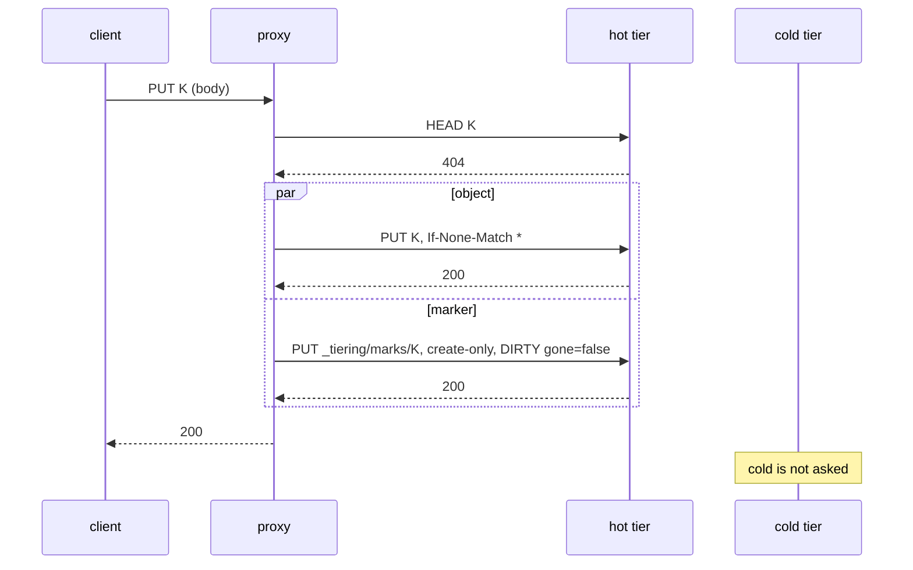
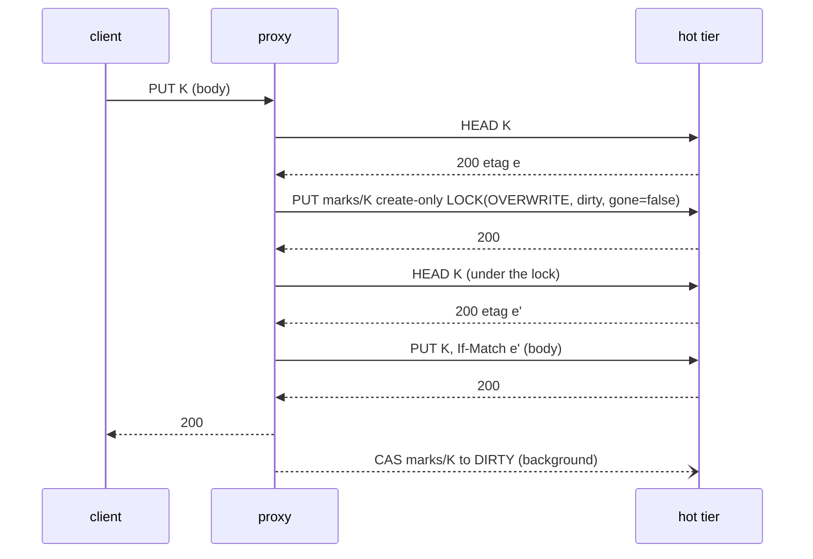
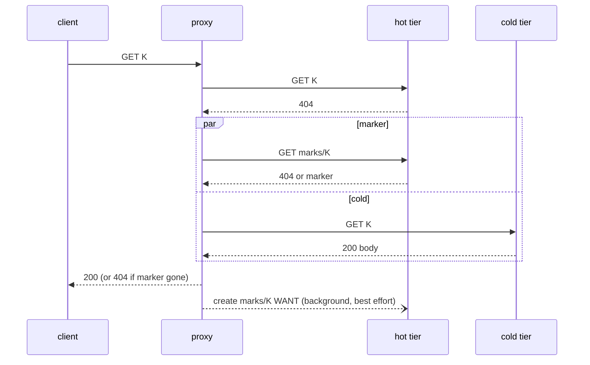
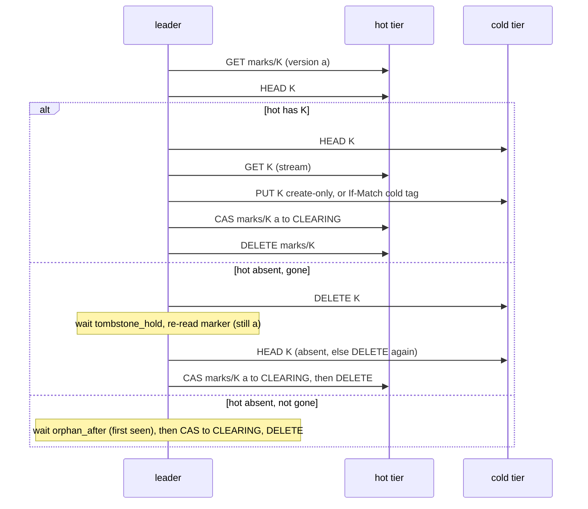

# Put without a lock: S3 semantics, a marker instead of an entry

Status: **proposed (CEO direction, 2026-11-05), not built, not model-checked.** Everything here is the plan; the code is the entry protocol of [tierstore-design.md](tierstore-design.md) until the pull requests of section 10 land. It is a living document: each of those pull requests moves the text it makes true out of "plan" in the same pull request (rule P10). Terms in bold are those of the glossary of tierstore-design.md (section 17): hot tier, cold tier, leader, reap, seal. New terms: **marker**, **lock**, **gone**, **dirty**, **tombstone hold**.

The direction (CEO, 2026-11-05): **match S3 exactly.** Strong read-after-write, after-delete and after-list for every key; no lock a client can see; two plain puts of one key both succeed and the last writer wins; `If-None-Match: *` and `If-Match` are the client's compare-and-swap; the cold copy is eventually consistent and no client can tell. This document replaces the per-key entry of tierstore-design.md and the entry extensions of [overwrite.md](overwrite.md) (section 10 lists what).

Figures: **measured** means a farm or local measurement with its source in the capability and cost report of 2026-11-05 (`results-farm/RESULTS.md`, `raw.jsonl`, `raw2.jsonl`, `evidence/head_miss_latency.jsonl`; local `$S/exp/caps-*.txt`, `extra-*.txt`, `lat-*.txt`); **inferred** means computed here from those, and says how (rule P11).

## 1. The problem

A put of a new 4 KiB key takes **47.3 ms** through tierstore (p50, storage proxy, 1 in flight, range of passes 45.3 to 49.9) and **8.5 to 9.3 ms** straight to the hot MinIO (measured; the 8.5 is the median of three passes, the 9.3 the single-run p50 the CEO quoted). A 64 KiB put is 57.4 ms against 10.3 ms. 38 ms of every put is protocol.

The protocol is the per-key entry `_entries/<sha256(key)>` as a lock (tierstore-design.md 6.2). A put does, in order, with each line waiting for the one above:

| # | Request on the acknowledgement path | Kind | Farm cost |
|---|---|---|---|
| 1 | hot HEAD of K (a found key is 412, no entry) | read | 3 ms (measured: 2.9) |
| 2 | hot PUT `_entries/h` create-only, `(PUT, HELD, me)` | write, new key | 8.5 ms |
| 3 | hot HEAD K ∥ cold HEAD K (`check_tiers`) | read, read | 3.3 ms (measured: 3.3, the slower) |
| 4 | hot PUT K create-only (the data) | write, new key | 8.5 ms |
| 5 | hot PUT `_entries/h` with `If-Match`, `(PUT, PENDING)`: the acknowledgement | write over an existing key | 17 ms (inferred, below) |

Five serial waves, three hot writes. Sum 40.3 ms; the remaining 7.0 ms of the 47.3 is proxy work (HTTP, SigV4, hashing, five round trips), which we price below as 1.4 ms per wave (inferred: 7.0 / 5; a calibration on this one figure, not an independent estimate).

The write over an existing key costs twice a write that creates one. Locally, on both MinIO `RELEASE.2025-09-07T16-13-09Z` (the farm's release) and silo: 64 B create 16.6 ms against 64 B over an existing key 30.0 ms; 4 KiB 14.0 against 30.0 (measured, 400 requests each, one client over six processes). The farm has no measurement of it; the factor 2.0 gives 17 ms for step 5 and reproduces the measured 47.3 within the calibration above, so we use it, and section 11 asks for the farm figure.

**Why the lock is there.** The entry gives exclusion to the three operations that destroy or replace a hot object and cannot be made safe otherwise, because **our stores have no conditional DELETE** (section 2): a delete removes whatever is at the key when it arrives. If an evictor checks that hot equals cold and then deletes, a put that replaced hot in between is deleted unseen; if a client delete races a copy, the copy republishes the key. The entry also made every put wait on cold (step 3 HEADs cold to keep write-once), so **a cold outage stops all new-key puts** (R12, decision 2 of tierstore-design.md section 15).

Two facts make most of the lock unnecessary:

1. **Creating an object where none exists needs no lock.** A create-only PUT is ordered by the store against every other write to the key, including a DELETE (silo and MinIO: 200 trials of create-only racing DELETE, never a 200 with the old object, never a 412 with the key present). Nearly every build-farm write is of this kind, because keys are content-addressed.
2. **Only an operation that deletes or replaces an existing hot object has to exclude the others.** That is an overwrite put, a client delete, an eviction, a copy-back's landing and the undo of a refused create. The copy to cold does not change hot, and writes cold only by compare-and-swap, so it needs no lock at all (section 5.9).

The design below keeps the lock for exactly those operations and takes it for them only. Everything else costs one write.

## 2. What S3 guarantees, and what our stores give

### 2.1 S3

From the AWS documentation (Amazon S3 data consistency model; PutObject and CompleteMultipartUpload conditional writes):

- **Strong consistency** since 2020-12-01: after a successful PUT or DELETE, every GET, HEAD and LIST sees it (a new object, an overwrite or a delete), in every region, with no stale read.
- **Atomic per key.** A reader gets the old object or the new one, never a mix.
- **Last writer wins.** S3 takes no lock on a key; if two PUTs of one key are made at once, the one with the latest timestamp wins. Both are acknowledged 200.
- **`If-None-Match: *`** (PutObject, CompleteMultipartUpload): 412 `PreconditionFailed` if the key exists. **`If-Match: "<etag>"`**: 404 `NoSuchKey` if the key is absent, 412 if the ETag differs. 409 `ConditionalRequestConflict` when conditional writes to one key race. These are the client's compare-and-swap.
- **A delete of an absent key** is 204.

### 2.2 Our stores (measured 2026-11-05, 200 trials a cell unless noted; six processes, one drive each, one erasure set, as the farm's 6×1)

| Fact | MinIO `2025-09-07` (the farm's) | silo `2026-09-16` | Evidence |
|---|---|---|---|
| Create-only PUT (`If-None-Match: *`) of a present key | 412, old body kept | same | B1/B2 |
| 16 racing create-only PUTs, six nodes | exactly one 200 in 200/200 | same | F1 |
| `If-Match` PUT, right etag / wrong etag / absent key | 200 / 412 / 404 | same | B3 to B9 |
| 16 racing `If-Match` PUTs with one etag | exactly one 200 in 200/200 | same | F2 |
| CompleteMultipartUpload with `If-None-Match: *` and with `If-Match` | same answers as PUT; 4 racing completes: one 200 | same | C1 to C6 |
| **DELETE with `If-Match`, wrong etag** | **204, object deleted (header ignored)** | 412, object kept | D1 |
| DELETE `If-Match` racing an overwriting PUT (300) | 145 ended absent: the delete removed the new object | 300 ended with the new object | G8 |
| Create-only PUT racing DELETE, key present (200) | delete→put (200, new) or put→delete (412, absent); never 200 with old, never 412 with the key present | same | G |
| GET, HEAD, LIST on another node after PUT, overwrite, DELETE (200 × 8 checks) | 0 violations | 0 violations | E, G6, G7 |
| 4 KiB PUT create / over existing key / rejected with 412 / HEAD / DELETE (p50, local) | 14.0 / 30.0 / 3.0 / 1.9 / 2.1 ms | 13.3 / 28.8 / 2.9 / 1.2 / 3.5 ms | lat |
| Two independent create-only PUTs in parallel (4 KiB ∥ 64 B) against one | 18.2 against 14.0 ms | 14.3 against 13.3 ms | lat |
| Create-only PUT refused with 412, body ≥ 8 MiB | connection reset before the 412 is read (stdlib client) | same | G5 |

Consequences, each used below:

- **C-1.** The farm's DELETE is unconditional. Tierstore's `delete_if_match` on MinIO is HEAD, compare, plain DELETE, with a window between the two (`conditional_delete=false`, the default). The CEO's statement that conditional DELETE is missing on both stores is true of MinIO and **not of silo**: silo honours `If-Match` on DELETE (D1, G8, G9; its 2026-09-16 notes say "honor single-object conditional DELETE"). The design does not depend on it, because the farm runs MinIO; with silo it can close residuals R1 and R4' (section 7.3) by setting `conditional_delete = true` on the hot tier.
- **C-2.** The only compare-and-swap on MinIO is a PUT with `If-Match` (or create-only). A marker is therefore never cleared by a conditional DELETE; it is first CAS-written to a state nobody else may write, and then deleted (section 4.3).
- **C-3.** A write over an existing key costs 2×. Every design choice that rewrites an existing marker pays it, and the latency table (section 6) prices it.
- **C-4.** A create-only PUT that fails with a large body may reset the connection before the 412. A create-only that ends in a reset is **unknown, to be re-checked**, never an error. The fast path therefore asks a hot HEAD first for a streamed body (section 5.1).
- **C-5.** Two writes in parallel take about one write's time (1.0× to 1.3× locally).

## 3. Invariants

Terms: *truth(K)* is the version a client must be shown for K: the hot object if hot has one, otherwise the cold object unless K is **gone**, otherwise absent. An *acknowledged* operation is one whose 2xx has been sent. An operation *started after* X is one whose request reached the proxy after X's response was sent. *Quiescent* means no operation on K is in flight and no process of K's protocol has stalled.

- **I1. No acknowledged operation is lost or undone.** An acknowledged put or overwrite of K is truth(K) from its acknowledgement until a later operation changes it: a later acknowledged put, a later acknowledged delete, or an eviction that does not change truth. An acknowledged delete stays in force until a later put creates K. (Residuals R1, R2', R3', R4' of section 7.3 are the stalled-actor exceptions, as in the entry protocol.)
- **I2. No superseded or deleted version is served after a newer acknowledged operation.** After the acknowledgement of a put, overwrite or delete of K, no GET, HEAD, LIST or copy-back of an operation started after it returns a version older than that operation's, from either tier.
- **I3. Strong read-after-write, after-delete and after-list through any proxy** over the same hot and cold pair. A GET, HEAD or LIST started after an acknowledgement reflects it. (The local cache of a build node is outside I3 except for its own writes; section 5.16.)
- **I4. Cold converges to truth.** For every key, from quiescence, within a bounded time, with the leader alive and cold up: cold holds truth(K) (the hot object if hot has one; absent if K is gone; otherwise unchanged) and K's marker is gone. Bounded by: marker discovery time, `orphan_after`, `tombstone_hold`, the copy.
- **I5. Client conditions behave exactly as S3.** `If-None-Match: *` is 412 iff truth(K) exists at the operation's linearization point; `If-Match` is 404 for an absent key and 412 for a different ETag; of N racing `If-Match` puts with one ETag exactly one is 200, and the others 412 (or 409; we answer 412). A plain put is never refused because the key exists. Dependency: the ETag a client holds must be the same whichever tier serves it (section 11, Q4).
- **I6. No lock is visible.** A client sees no response caused by a lock other than a 503 `SlowDown` after `lock_wait` expires or when a streamed create loses a creation race (section 5.1). A second writer waits and then wins.
- **I7. The no-marker rule.** If K has no marker and no operation on it is in flight, then hot and cold agree: either hot is absent and cold holds truth (or nothing), or both hold the same bytes. Two crash windows break it for an unacknowledged put only (an object landed before its marker); the stray sweep and the eviction compare repair them (section 5.12) and no read is wrong meanwhile, because hot wins.
- **I8. Exclusion.** A hot object is deleted, or replaced by a store call that does not carry its tag, only by the live holder of K's lock. A hot object is created only where none exists (create-only), or replaced by `If-Match` on the tag the replacer read under its lock. Exceptions: the stalled holder (R1).
- **I9. Cold is not trusted while a marker exists.** A cold object is served for K only if K has no marker, or its marker says `gone = false`, read **before or concurrently within `read_window`** of the cold read.
- **I10. Marker discipline.** A marker is deleted only after its owner wrote it to `CLEARING` by a CAS on the version the owner had read before the work the clear completes, and while it is `CLEARING` no one else writes it. A copier's clear that races any write to the marker fails.
- **I11. Cold is written by CAS only.** Every write to cold is create-only or `If-Match` on the tag read, so a late write by a stalled leader cannot overwrite a newer cold version.
- **I12. Reads never wait.** A GET, HEAD or LIST never waits on a lock and takes none; a hot hit reads nothing but the object.
- **I13. Bounded blocking.** A writer waits for a lock at most `lock_wait`. A lock whose owner has departed is reaped within `departure` (60 s) plus one leader pass; a crash blocks one key for that time (R6, unchanged).
- **I14. Additive formats.** Every stored format changes by addition (B8); old binaries fail closed beside the new protocol (section 8).
- **I15. The cold tier is not on the acknowledgement path of a plain put, an overwrite, or a delete.** (New: R12 is removed for them. A create-only client put still asks cold, because S3 requires it to see a key that lives only in cold.)

## 4. The marker

### 4.1 Where and what

The marker of K is the hot object **`_tiering/marks/<K>`**: named by the key, not by a hash, so a listing of the marks of a key range is a range listing (the LIST and the stray sweep need that), and under `_tiering/`, already reserved, so no reserved prefix is added (the comment on `RESERVED_PREFIXES` forbids it) and every release hides it from clients. `_entries/` is untouched and unused when the marker protocol is active. A key longer than 1009 bytes cannot be marked; a write of such a key is refused 400 `KeyTooLongError` (a deviation from S3's 1024; Q1).

Body (JSON, `v: 1`; unknown fields are ignored on read and dropped on rewrite, as for entries, so a later release adds fields only by bumping through the format gate):

| Field | Meaning |
|---|---|
| `key` | K |
| `st` | `DIRTY`, `LOCK`, `CLEARING` or `WANT` |
| `gone` | bool. True: K is deleted and **no cold copy may be served**. |
| `dirty` | bool. True: hot has a change cold does not have yet (always true in `DIRTY`). |
| `why` | for `LOCK`: `OVERWRITE`, `DELETE`, `EVICT`, `COPYBACK`, `COLDLAND`, `ABORT` |
| `owner` | proxy id or leader id for `LOCK` and `CLEARING`; the registration (`departure`) says whether it lives |
| `nonce` | random 128 bit, fresh at every write, so the object's ETag (MD5 of the body) is unique per write and **the marker's version is its ETag**; ambiguity is read back by nonce, as for entries |
| `created_ms` | metrics only |

### 4.2 States

| State | Meaning | Truth(K) |
|---|---|---|
| no marker | the tiers agree (I7) | hot if present, else cold |
| `DIRTY, gone=false` | hot has a change cold lacks; or a put is in flight; or a put crashed | hot if present, else cold |
| `DIRTY, gone=true` | K was deleted; cold may still hold the old object | hot if present (an unacknowledged recreate), else **absent** |
| `LOCK(why, owner)` | one actor is deleting or replacing hot, or reading cold into it; `gone` and `dirty` carry what the key was before and what the holder makes it | as `gone` says |
| `CLEARING(owner)` | the owner won the CAS to clear; no one writes until it is deleted | as `gone` says |
| `WANT` | cold holds truth; a cold read asked for a copy-back; no one holds anything | hot if present, else cold |

**The reader's rule on a hot miss:** `gone = true` → absent; anything else (no marker, `WANT`, `DIRTY` or `LOCK` or `CLEARING` with `gone=false`) → the cold object, if any. A hot hit is served as it is.

### 4.3 Transitions

Write modes: *create* = create-only PUT; *CAS* = PUT with `If-Match` on the marker's ETag as read; *delete* = plain DELETE (not conditional on MinIO, C-2).

| # | Actor | From → To | Mode | Used by |
|---|---|---|---|---|
| M1 | fast put | none → `DIRTY(gone=false)` | create, in parallel with the object | 5.1 |
| M2 | fast put, marker existed | `DIRTY` or `WANT` → `DIRTY(gone=false)` | CAS, **after** the object landed | 5.1 |
| M3 | locker | none → `LOCK(why, dirty, gone)` | create | 5.3, 5.5, 5.10, 5.11 |
| M4 | locker | `DIRTY` or `WANT` → `LOCK(why)`, keeping `dirty`, setting `gone=true` for `DELETE` | CAS | same |
| M5 | holder, release with a change | `LOCK` → `DIRTY(gone)` | CAS | same |
| M6 | holder, release with no change | `LOCK` → `CLEARING` | CAS | eviction, copy-back landed |
| M7 | copier, done | `DIRTY(a)` → `CLEARING` | CAS on version `a` read **before** the copy | 5.9 |
| M8 | owner | `CLEARING` → none | delete | all |
| M9 | leader, reap | `LOCK(owner departed)` → `DIRTY` if `dirty` else `CLEARING` | CAS | 5.13 |
| M10 | read, background | none → `WANT` | create (failure ignored) | 5.7 |
| M11 | leader | `WANT` → `LOCK(COPYBACK)` | CAS | 5.11 |
| M12 | sweep | none → `DIRTY(gone=false)` | create | 5.12 |
| M13 | leader | `DIRTY(gone=false)`, hot absent for `orphan_after` → `CLEARING` | CAS | 5.9 |

**Who may write which state.** `none`, `DIRTY` and `WANT` are written by anyone (create or CAS). `LOCK` and `CLEARING` are written only by their owner, or by the leader reaping an owner that has departed (M9). A writer that finds `LOCK` or `CLEARING` and is not its owner **waits** (section 5.2) and writes nothing. This one rule removes every marker race: a stale writer's CAS fails on the ETag; a waiting writer never changes what the holder reads back.

The table above is the definition of the state machine.

## 5. Every operation

Cost abbreviations (farm, section 6): Hh hot HEAD, Hw hot write creating a key, Hw2 hot write over an existing key, Hd hot DELETE, Ch cold HEAD. Each subsection ends with **Why the invariants hold**. A *wave* is requests issued together.

### 5.1 Put, key absent on hot (the fast path)

Every plain put, every create-only client put, a multipart completion (the object write is `complete_upload`), a presigned put (hot only) and the OCI front's puts take this path when hot does not hold K.



1. `admit_write` (format, cached), `require_live` (no I/O).
2. **Wave 1: hot HEAD K.** Found → the put is an overwrite (5.3) or a same-bytes put (5.4), or, for a create-only client put, 412 now. For a **create-only client put** (an `If-None-Match: *` header, the OCI front, a presigned put, a completion with `If-None-Match`) wave 1 also issues, in parallel, **cold HEAD K** and **GET `_tiering/marks/K`**; the key exists iff hot has it, or (cold has it and the marker is not `gone`); a hot hit answers 412 at once without waiting for the other two. A cold error with hot absent and no `gone` marker is 503 (create-only only; plain puts never ask cold, I15).
3. **Wave 2, in parallel: the object and the marker.**
   - Object: hot PUT K create-only (`put_stream`, or `complete_upload` for a multipart).
   - Marker: hot PUT `_tiering/marks/K` create-only, body `DIRTY, gone=false, dirty=true`, a fresh nonce. (If the level is `Full`, this is the cold landing, 5.5; a presigned put is 503.)
4. **Acknowledge 200 iff the object landed and the marker is `DIRTY` (ours or any other's) after our write.** The table gives every result pair.

| Object | Marker | Action |
|---|---|---|
| 200 | 200 | **200.** |
| 200 | 412, marker is `DIRTY` or `WANT` | GET it, **CAS it to `DIRTY(gone=false)`** (M2) with a fresh nonce; loop on 412 up to `entry_rounds`; 200. The CAS is after the object by construction (it follows the object's 200), so a reader never sees `gone=false` with hot absent where the key was deleted (a deleted key's marker keeps `gone=true` until the object exists). |
| 200 | 412, marker is `LOCK` or `CLEARING` | **Wait** (5.2) for the marker to leave that state (≤ `lock_wait`), then HEAD K: if hot has an object, make the marker `DIRTY` as in the row above (or create it if gone); if hot is absent, a delete or an eviction removed it after it landed, which is the order put→delete: **200**. |
| 200 | error / timeout | Read back by nonce; retry the marker (create or CAS) until `deadline`; at the deadline 503 "may not have landed" (an unknown outcome; the object is in hot and the stray sweep or the next write adopts it, 5.12). |
| 412 (the key now exists: lost a creation race) | any | **Create-only client put: 412.** Plain put of a **replayable** body (held bytes, a staged file, an in-memory chunk): continue as an overwrite (5.3). Plain put of a one-shot stream: **503 `SlowDown`** (the bytes the store consumed are gone; S3 clients retry on it and the retry is an overwrite). A marker we created stays (`DIRTY`, nothing of ours behind it: the copier copies the winner's object). |
| error / reset | any | Unknown outcome: **503**, nothing more is written; a reset on a create-only is re-checked by a hot HEAD first (C-4): found with our bytes' size → 200 only for a replayable body whose digest equals the object's ETag, else 503. |

A multipart completion differs only in the object write (`complete_upload`) and in wave 1: parts are written to the upload id's tier before, as today.

**The speculative form.** For a body that can be replayed, wave 1 and wave 2 merge: hot HEAD ∥ object ∥ marker in one wave. A found key (the object write answers 412, the HEAD says present) continues as an overwrite with the body replayed. It costs one wave less (section 6) and one wasted marker write when the key existed; whether to build it first is Q5.

**Why the invariants hold.**
- *I1, I2, I3.* The ack requires the object (hot wins at every read, so the new version is truth from the object's 200) and the marker `DIRTY` (the copier will make cold agree; until then reads that miss hot read the marker and do not use cold for a `gone` key). A put over a deleted key writes the object **before** it clears `gone` (M2), so no reader sees `gone=false` and hot absent for a deleted key; two parallel writes are only done when no marker exists (M1), where there is no deletion to forget.
- *I7.* Both writes exist at the ack. The two crash windows are the table's rows 3 and 4 (5.12, 7.1).
- *I8.* The object write is create-only: it lands only where hot is absent.
- *I15.* Wave 2 has no cold request.

### 5.2 Waiting for a lock (used by 5.1, 5.3, 5.5, 5.6, 5.10, 5.11)

A writer that finds `LOCK` or `CLEARING` (not its own) polls the marker with a GET at `lock_poll_min` (20 ms) doubling to `lock_poll_max` (1 s), until the state is not `LOCK`/`CLEARING` or `lock_wait` (30 s) passes → 503 `SlowDown`. A dead owner is reaped by the leader (5.13) within `departure`. The poll uses the injected clock and a recording sleeper. A writer that finds `DIRTY` or `WANT` does not wait; it locks by CAS. A reader never waits (I12).

### 5.3 Overwrite put (hot holds K)



1. Hot HEAD (wave 1). A plain put whose body digest is known and equals the hot ETag is 5.4.
2. **Take the lock:** create-only `LOCK(OVERWRITE, owner=me, dirty=true, gone=false)` (M3). On 412 GET the marker: `DIRTY` or `WANT` → CAS to `LOCK` (M4); `LOCK` or `CLEARING` → wait (5.2), then again.
3. **HEAD K under the lock** (tag `e'`; hot cannot change now: every changer holds the lock). A replayable body may skip this HEAD and use `e` (the tag of wave 1), re-reading only on a 412 from step 4; a stream may not, because its bytes cannot be replayed (the ABA of a marker that was created, used and deleted again between wave 1 and the lock cannot be told apart by the lock's success).
4. **Replace:** hot `put_stream_if_match(K, e')`. Answers: 200 → continue. 412 → someone replaced without the lock (a reaped holder woke): HEAD again and retry (replayable) or 503 (stream). 404 (a delete between wave 1 and the lock) → create-only PUT K (hot is absent and we hold the lock).
5. **Acknowledge 200.** The ack follows the replace; it does not wait for the release.
6. **Release in background** (M5): CAS the marker to `DIRTY(gone=false)`. A copier that read the marker before step 2 fails its clear (M7). A failed release is retried; if the proxy dies the leader reaps the lock (5.13).

A second writer that meets the lock waits and then runs the same steps: it wins, as S3's last writer does; its wait is the first writer's remaining time (about one write over an existing key, 17 ms, plus the release, plus a poll), not a refusal.

**Why.** *I8:* the replace is `If-Match` on the tag read under the lock, so a stalled holder whose lock was reaped cannot clobber a newer version (its 412), and no other actor deletes while the lock is held. *I1/I2:* the new object is truth from step 4; the marker was `dirty` from step 2. *I5:* the same step 3 and 4 yield `If-Match` (5.4b). *I6:* the second writer waits.

### 5.4 Same-bytes put and conditional puts

**(a) Same bytes.** If the body's MD5 is known before the body is stored (`Content-MD5`, `x-amz-checksum-md5`, a held or staged replayable body) and equals the hot object's ETag and the size is equal (a single-part object's ETag is the body's MD5; a multipart ETag `md5-N` never matches and the put is an overwrite), the answer is **200 with no write: one hot HEAD** (about 3 ms). The one visible difference from S3 is that `LastModified` does not move (Q3). Without a known digest the put is an overwrite.

**(b) `If-Match: "<etag>"`** (put and completion):
1. Wave 1: hot HEAD ∥ GET marker; if hot is absent also cold HEAD (resolve K as a read does, 5.7). Absent → **404**. ETag differs → **412**. Equal → continue.
2. Take the lock (as 5.3 step 2).
3. **Resolve again under the lock** (hot HEAD, and cold HEAD if hot is absent) and compare: different or absent → release (M6 or M5 as before) and 412/404. This is the compare-and-swap; it is atomic because no changer runs under our lock.
4. Replace: hot present → `If-Match` replace (5.3 step 4); hot absent and cold holds the matching version (an evicted key) → create-only PUT of K in hot (we hold the lock, hot is absent); the cold object is replaced later by the copier. Completion: `complete_upload_if_match` on hot (new, additive on `Backend`; MinIO does it, C3 to C5).
5. 200; release in background.

N racing `If-Match` puts with one ETag: one takes the lock first and wins; each later one waits, resolves under its own lock, finds a different ETag and answers 412 (I5). `If-None-Match` with a value other than `*` stays 501.

**(c) `If-None-Match: *`** is 5.1 (hot hit → 412 with no write).

### 5.5 Landing in cold: hot is `Full`, or an upload that began in cold

The level (`usage`, cached, one GET per `usage_refresh`) decides today whether a put lands in cold. A cold landing deletes or replaces hot when hot holds the key, so it takes the lock, whatever the key was.

1. Wave 1: hot HEAD ∥ cold HEAD (the replace needs the cold tag).
2. Lock: `LOCK(COLDLAND, dirty=true, gone=false)` (M3/M4).
3. Cold write: create-only if cold is absent, `If-Match` on the cold tag otherwise (a presigned put is 503 and writes nothing).
4. Hot present: hot DELETE K (we hold the lock).
5. 200. Release in background: `LOCK` → `CLEARING` → none (M6, M8), because hot is now absent and cold holds truth; if hot could not be deleted, → `DIRTY` (M5) and the copier makes cold agree with hot.

A crash after step 3 before step 4: unacknowledged; the leader reaps the lock to `DIRTY(gone=false)` (M9); hot (older) is truth and the copier overwrites the cold landing; if hot was absent, cold's new object stands and the marker is cleared (M13). Either outcome is a legal result of an unacknowledged put.

### 5.6 Delete

```mermaid
sequenceDiagram
    participant C as client
    participant P as proxy
    participant H as hot tier
    participant L as leader
    participant K as cold tier
    C->>P: DELETE K
    P->>H: PUT marks/K create-only LOCK(DELETE, gone=true, dirty)
    H-->>P: 200
    P->>H: DELETE K
    H-->>P: 204
    P-->>C: 204
    P--)H: CAS marks/K to DIRTY(gone=true) (background)
    L->>H: GET marks/K; HEAD K (absent)
    L->>K: DELETE K
    Note over L: tombstone_hold passes
    L->>K: HEAD K (absent)
    L->>H: CAS marks/K to CLEARING, then DELETE marks/K
```

1. **Lock with `gone=true` written at once:** create-only `LOCK(DELETE, owner=me, dirty=true, gone=true)` (M3). If a marker exists: create fails (3 ms); GET it; `DIRTY`/`WANT` → CAS to `LOCK` with `gone=true` (M4); `LOCK`/`CLEARING` → wait (5.2).
2. **Hot DELETE K** (plain, Hd). The marker says `gone` before the delete, so from the delete on, a reader that misses hot finds `gone` and answers 404; a reader before it finds the hot object (the delete is not acknowledged).
3. **204.** No cold request: the delete returns after one create and one DELETE. (Today it also deletes cold, serially, and waits for any copy.)
4. **Release in background** (M5): CAS to `DIRTY(gone=true)`.
5. **Leader, later (5.9):** hot absent → cold DELETE → `tombstone_hold` → cold HEAD absent → clear (M7, M8).

A delete of a key that does not exist anywhere still writes the marker and costs the same (S3 answers 204 for it too); the leader clears it after the hold (Q7).

**Why.** *I1:* an acknowledged delete has hot absent (step 2) and a `gone` marker (step 1); no put recreates the key except by the fast path or an overwrite, both of which write hot first and then clear `gone` (M2), so `gone` outlives only deletes nobody has reversed. *I2/I3:* a read that starts after the 204 misses hot and reads `gone` or the cleared marker after the cold object was deleted (5.7). *I8:* the DELETE is under the lock. A crash after step 1 before step 2: the leader reaps to `DIRTY(gone=true)` with hot present: the copier treats a marker with hot present as a change to copy (5.9), so the unacknowledged delete rolls back (reads saw the hot object throughout, so nothing is undone). A crash after step 2: the leader reaps and the copier rolls the delete forward on cold; the 204 may not have been sent, which is an unknown outcome the client retries (delete of an absent key is 204).

### 5.7 Reads



- **Hot hit: one request, nothing else, unchanged.**
- **Hot miss (GET, HEAD, range GET, open_read):** GET `_tiering/marks/K` ∥ the cold read (GET, HEAD or open). The marker says `gone` → 404 and the cold response is dropped; otherwise the cold response is the answer (404 if cold has none). A hot error other than 404 fails closed. Only a whole-object cold hit with no marker asks for a copy-back (M10), as today.
- **Why parallel is safe.** The only way the pair misleads is the cold read returning an object that a delete removed *after* it, with the marker read returning "no marker" because the delete's marker was cleared in the meantime. The copier clears a `gone` marker only `tombstone_hold` after the cold delete (5.9), and the proxy discards a pair whose second response took longer than `read_window` (measured on its monotonic clock) and reads it again; `read_window < tombstone_hold` is checked when the config loads. A serial read (marker, then cold) is correct without the hold and costs one marker GET (about 3 ms) more on a cold hit of about 25 to 35 ms; we take the parallel one as decided, and Q8 records the option.
- *I2/I3:* the cases of a read after a put (hot hit), a delete (`gone` or cleared-after-delete), an eviction (`gone=false` marker or none: cold holds the same bytes), a copy-back (hot present or cold the same).
- *I12:* a read never waits on `LOCK`: a `LOCK(DELETE)` has `gone=true` already.

**HEAD** is the same with HEAD requests. **ETag.** The tag of the tier that answered, as today, until the record of tierstore-design.md section 16 gives one tag per object (Q4).

### 5.8 List

`list_objects` and `list_objects_page` with a prefix and an `after` key:

1. **Wave 1:** hot page ∥ marker page (`list_page("_tiering/marks/" + prefix, after, max_keys)`, names only).
2. **Wave 2:** cold page. (Marks before cold for the reason of 5.7; hot before cold so a key evicted between still shows from cold, as today.)
3. Merge: hot wins. A key that only cold lists and that also has a marker name in the marker page: **GET the marker** (parallel over such keys, normally none): `gone` → drop; marker vanished by then → HEAD cold K and keep K iff found. Cut to `max_keys`; the marker page is extended until it passes the merged page's last key.
4. Reserved keys are filtered as today.

Requests on the common path: two waves, one more request than today (the marker page, in wave 1 beside the hot page).

*I3 for LIST:* a LIST started after a delete's 204 has hot without K and either K's marker (gone) in the marker page, or the marker already cleared, which is after the cold delete, which is before wave 2.

### 5.9 The copier (the leader's copy to cold)

Discovery: `list("_tiering/marks/")` pages, as the reconciler lists entries now, but the objects listed are only the keys with something pending: markers are deleted when done (M8). Cost is proportional to the backlog, not to the keys ever written. Ordered: `DIRTY` markers; `LOCK`/`CLEARING` whose owner departed (5.13); `WANT` (5.11).

For a `DIRTY` marker `m` (version `a` = its ETag from the GET that returned it):



- **Hot has K** (whatever `gone` says): cold HEAD for its tag; if both tags are plain MD5s and equal and the sizes equal, nothing to copy. Otherwise `hot.get_stream`, `require_lease`, and `cold.put_stream` **create-only if cold has none, `put_stream_if_match(cold tag)` if it has** (I11: the leader's cold write is a CAS; a stale leader's late write fails). Then **M7: CAS the marker to `CLEARING` on version `a`.** If the CAS fails, something wrote the marker during the copy (an overwrite, a delete, a bump): loop from the GET (the cold object written is untrusted while a marker exists, I9, so nothing is wrong meanwhile). On success, delete the marker (M8) and record the (hot tag, cold tag) pair for the eviction (bounded by `tag_record_limit`).
- **Hot absent, `gone`:** cold DELETE (plain; absent is 204); remember the marker's nonce and the time on the leader's monotonic clock; revisit after `tombstone_hold` (default 120 s, at least the lease TTL plus margin, checked at load); re-read the marker (a different version → start over); cold HEAD: absent → M7/M8; present (a stale leader published late) → delete again and hold again.
- **Hot absent, not `gone`:** a put in flight or crashed, or an eviction/copy-back that crashed after its work. Wait until the marker has been seen unchanged for `orphan_after` (default 120 s, monotonic first-seen by nonce, as copy-backs are today), then M13. (A put's object lands within its deadline, so after `orphan_after` none can land except a frozen process's late call, R3'.)
- **Ordering across keys:** the copier does not need the lock and does not wait for a client. An overwrite or a delete that runs during a copy takes the lock (changing the marker's version), the copier's clear fails, and the key is processed again. This replaces "a delete waits for an in-flight copy" (tierstore-design.md 5, decision 1): the delete never waits for the copy, because a cold object published late is never trusted while the marker exists (I9) and the marker, not a wait, orders the cold delete after the late publish (the loop above).
- The copier never writes hot except the marker.

Writes to hot per copied put: **two** (M7 over an existing marker: Hw2; M8: delete), against three (hold, seal, delete) now; hot reads: GET marker, HEAD hot, the copy's GET; cold: HEAD, PUT.

### 5.10 Eviction

When usage is over `high_water`, the oldest objects (the usage listing) down to `low_water`, skipping any younger than `evict_min_age` (600 s; closes the create-copy-evict-recreate-within-one-request window of 5.1's create-only wave):

1. **Create-only `LOCK(EVICT, dirty=false, gone=false)`** (M3). 412 (any marker) → skip this key.
2. Hot HEAD, cold HEAD. Cold absent → release as `DIRTY` (M5: hot is the only copy; the copier copies it) and skip.
3. Compare: if the recorded (hot tag, cold tag) pair equals both current tags, equal; otherwise the byte compare of today (`compare`, ranges). **A mismatch makes the marker `DIRTY(gone=false)` (M5), not an anomaly:** hot is the only place a version can be newer (cold is written only by the copier and the cold landing), so the copier overwrites cold. The `Mismatched` count and the "never evicted" state disappear.
4. Equal: hot DELETE K (we hold the lock: no put can have replaced hot since step 2; I8).
5. Release: `LOCK` → `CLEARING` → none (M6, M8): hot is absent and cold holds truth.

A put or delete that arrives during 1 to 5 finds the lock and waits (a few requests). A fast put that lands after step 4 finds hot absent, creates its object, fails its marker create (412 `LOCK`), waits, and then writes `DIRTY` (5.1 row 3): it overwrote an evicted key, correctly.

### 5.11 Copy-back

A cold read with no marker (5.7) tries M10 `WANT`, best effort, never failing the read. The leader's pass, under the existing cap, age limit and priority (`copy_back_max`, `copy_back_ttl`): CAS `WANT` → `LOCK(COPYBACK, dirty=false)` (M11); hot HEAD (present → done); cold `open_read`; `require_lease`; hot `put_stream` **create-only** (fed through `while_leased`); then, hot landed → `CLEARING` (M6), delete (M8); hot said 412 (a newer put or another copy-back created it) → `DIRTY` (M5; the copier reconciles cold with whatever hot holds). Dropped (ttl, cap): CAS `WANT` → `CLEARING` → delete.

A client delete or overwrite of a key with a `WANT` marker locks it by CAS (M4); the copy-back's CAS then fails or its lock wait applies. A copy-back can never land over a newer put (create-only), nor resurrect a deleted key: `gone` markers are not `WANT`, and a `WANT` the delete found became `LOCK(DELETE, gone=true)` before the delete's hot DELETE.

### 5.12 Stray sweep

At takeover and every `stray_interval` (24 h), a merge-join of two sorted listings: hot objects (`list_page("")`) and marker names (`list_page("_tiering/marks/")`). A hot object older than `stray_grace` (600 s) with **no marker** is checked against cold (HEAD, `stray_rate`): cold absent, or sizes differ, or hot `modified` newer than cold `modified` by more than `stray_skew` (60 s; cold's copy is made after hot's, so a hot object newer than cold's is an uncopied change) → create `DIRTY(gone=false)` (M12). Equal size and similar times are left; a mismatch hiding there is found by the eviction compare (5.10). The sweep repairs the two crash windows of I7 (an object landed with no marker): it generalizes "hot with no cold" to "hot with no marker and a cold that is not a copy".

### 5.13 Reap and crash takeover

The leader reads `LOCK` and `CLEARING` markers like entries: a registration absent, or unchanged for `departure` on the leader's monotonic clock, makes the owner departed. Then (M9):

| Marker | Reaped to | Effect |
|---|---|---|
| `LOCK(OVERWRITE)` | `DIRTY(gone=false)` | hot is truth (the replace landed or not); the copier recopies |
| `LOCK(DELETE, gone=true)` | `DIRTY(gone=true)` | hot absent → delete rolls forward on cold; hot present → rolls back (the copier copies) |
| `LOCK(COLDLAND)` | `DIRTY(gone=false)` | 5.5 |
| `LOCK(EVICT)`, `LOCK(COPYBACK)` | `CLEARING` | no change owed; the next pass redoes the work if needed |
| `CLEARING` | stays; the leader finishes the delete | |

Multipart uploads of a dead put are **not** aborted by the reap any more (no put holds a lock on the fast path). They stay until the client aborts or the sweep's `abandoned_upload_after` (default 0, off; today's value) or the operator's lifecycle rule acts, as in S3.

### 5.14 Usage

Unchanged in form: the leader's tally counts an object when it copies it (a replaced key adds the size difference), when it evicts, and at the listing every `usage_scan_interval`. Added: the leader subtracts a key's last counted size when it finishes a `gone` marker (the current figure over-counts deletes until the next listing); `copy_lag` is the sum of the sizes of the objects under `DIRTY` markers with hot present. The proxy's read of `_tiering/usage` and `usage_stale_after` are unchanged.

### 5.15 DeleteObjects

Up to 1000 keys, each as 5.6, `buffer_unordered(delete_concurrency)`, detached as today. No batching (the store has none). The response lists each key as deleted (S3 does so for absent keys too).

### 5.16 Local cache

`put_through` (create-only) becomes `put_through` (plain or conditional, as the request): no pre-HEAD of the upstream (it answered 412 for an existing key, which is no longer S3), the staged file is replayable (so the speculative form of 5.1 applies), and `Proxy::put_stream_answered` is implemented to return the hot PUT's tag and size, which removes the post-put HEAD of the keep check. A delete is `forget`, upstream delete, `forget`, as now. **What stays:** a hit is served from disk with no upstream call; a delete or overwrite by another node is not seen until the entry is evicted or the overwrite design's freshness rules (overwrite.md section 7) apply. I3 holds through a cache only for the writes made through that cache. The fill's `same_version` check is size only for a proxy upstream; with overwrite possible it needs the ETag of the record (tierstore-design.md section 16; Q4).

### 5.17 OCI front

All its writes are create-only and take 5.1: blobs (`put_stream`), chunk and session objects, manifests, tag version objects. Each create-only put with a new key costs the create-only row of section 6. `discard()` deletes chunk and session objects by 5.6: about half of today's cost. Tag versions: the front's contract (create-only, one winner, listing consistent with writes) is the store's, and holds. The doc comment of `tags.rs` that a landed version "is removed if that push fails" is false today and stays false here (a landed put is never removed); the header is corrected in the same pull request as the front's change (P10).

### 5.18 Scoped keys, presigned keys, the GC key

Authorization is unchanged. A scoped key's `write_prefixes` allow a put, now including the overwrite of an existing key under the prefix (as S3's PutObject does; overwrite.md section 8). A presigned key is create-only by its grant and takes the create-only path with `hot_only`. The GC key's delete is 5.6.

## 6. Latency budget

**Unit costs, farm** (measured unless marked): Hh 3.0 ms (head_miss_latency, hot 2.9, p99 3.3); hot GET hit 4.1; Hw 8.5 (bare SSD, 4 KiB, 1 in flight; 10.3 at 64 KiB); Hw2 17 (inferred, ×2.0, C-3); parallel pair of writes Hw∥Hw 11 (inferred, ×1.3, the worse of MinIO's local factors; C-5); rejected write Hr 3.0 (inferred from the local 2.9 to 3.1, the farm has no figure); Hd 3.0 (inferred; local 2.1 to 3.5; the farm has no figure); cold HEAD 3.3 (measured, miss); cold GET 25 to 35 (measured); cold DELETE and cold PUT: cold PUT 4 KiB is 95 to 931 ms and unstable (measured), cold DELETE has no figure. Proxy work: **1.4 ms per wave** (inferred, calibrated on today's put). "Waves" count serial request waves on the acknowledgement path; the price is the sum of each wave's slowest request plus 1.4 ms a wave. The bench was running while this was written, so nothing here was re-measured on the farm.

| Client operation | Today: waves → price | New: waves → price | Notes |
|---|---|---|---|
| Put, new key, plain, streamed body | 5 → **47.3** (measured) | 2: HEAD 3.0; (object ∥ marker) 11 → **16.8** | no cold request (R12 gone for plain puts) |
| Put, new key, plain, replayable body, speculative | 5 → 47.3 | 1: (HEAD ∥ object ∥ marker) 11 → **12.4** | one wasted marker write if the key existed |
| Put, new key, create-only (S3 `If-None-Match`, OCI, presigned) | 5 → 47.3 | 2: (hot HEAD ∥ cold HEAD ∥ marker GET) 3.3; (object ∥ marker) 11 → **17.1** | cold asked in parallel; cold error → 503 as today |
| Put, key exists, create-only | 1 → 3.0 + 1.4 = **4.4** | 1 → **4.4** (hot HEAD answers 412 first) | unchanged |
| Put, key exists, same bytes (digest known) | 412 today (not S3) | 1 → **4.4**, no write | 200; `LastModified` unchanged (Q3) |
| Put, key exists, overwrite, stream | 412 today (not S3) | 4: HEAD 3.0; lock create 8.5; HEAD 3.0; replace 17 → **31.5 + 5.6 = 37.1** | + background release 17 |
| Put, key exists, overwrite, replayable | | 3: HEAD; lock; replace 17 → 28.5 + 4.2 = **32.7** | |
| Put over a key with a `DIRTY` marker | | lock create fails 3.0, GET 3.0, CAS 17, then 3.0 + 17 → **+ 12 over the row above** (~49) | a re-put soon after a put; 4 waves become 7 |
| Put with `If-Match` | 412 or 501 today | 4: wave 1 (HEAD ∥ marker GET) 3.0; lock 8.5; resolve 3.0; replace 17 → **37.1** | 404 or 412 in wave 1 costs 4.4 |
| Multipart completion, new key | 5 → 47.3 + completion | as the put, with completion instead of PUT → **≈ 17** | completion cost on the farm is not measured (Q11) |
| Put landing in cold (hot Full) | 5, cold PUT | wave 1 (HEAD ∥ cold HEAD) 3.3; lock 8.5; cold write (95 to 931); hot DELETE 3.0 | dominated by the cold write, as today |
| Delete, key exists, no marker | 5 serial: entry create 8.5; cold DELETE (unmeasured, assume 5); hot DELETE 3.0; entry HEAD 3.0 + DELETE 3.0 → ≈ **29.5 + 7 = 36.5** (inferred) | 2: lock create 8.5; hot DELETE 3.0 → **11.5 + 2.8 = 14.3** | + background release 17; cold DELETE by the leader |
| Delete, key has a `DIRTY` marker | | create fails 3.0; GET 3.0; CAS 17; DELETE 3.0 → **26 + 5.6 = 31.6** | a delete soon after a put (OCI chunks, `discard()`) |
| DeleteObjects n keys | n × the delete, `delete_concurrency` at a time | ⌈n / c⌉ × 14.3 | same shape |
| GET/HEAD hot hit | 1 → 4.1 | 1 → 4.1 | unchanged |
| GET/HEAD hot miss, cold hit | 2: hot 404 (≈ 3); cold GET 25 to 35 → 30 to 40 | 2: hot 404; (marker GET ∥ cold GET) → **same, + ≈ 0** | +1 hot request per cold hit, in parallel |
| GET/HEAD absent everywhere | hot 404; cold 404 | hot 404; (marker ∥ cold) 404 | |
| GET/HEAD of a deleted key whose cold copy remains | not possible (cold deleted first) | hot 404; marker `gone` → 404 | |
| LIST page | 2 waves (hot; cold) | 2 waves: (hot ∥ marker page); cold; rare marker GETs | +1 request per page |
| Local cache `put_through` (build node) | HEAD 3 + put 47.3 + keep-HEAD 3 → **≈ 53** | put 12.4 to 16.8 (answered with the tag) → **≈ 13 to 17** | three fewer requests |
| OCI `discard` of one chunk | ≈ 36.5 | 14.3 (31.6 if the chunk's marker is still `DIRTY`) | |

**Store load per client write** (hot store, protocol counts, inferred from the sequences above):

| | Hot writes, ack path | Hot writes, background | Hot reads on the path | Cold requests |
|---|---|---|---|---|
| Put new key, today | 3 (entry, object, ack CAS) | 3 (hold, seal, entry delete) | 3 (HEAD, HEAD, + leader's HEAD+GET of the entry) | HEAD on path; HEAD, PUT in copy |
| Put new key, new | 2 (object, marker) | 2 (clear CAS, marker delete) | 1 (HEAD) + copier's GET marker, HEAD | none on path; HEAD, PUT in copy |
| Delete, today | 1 (entry) + data DELETE | 0 | HEAD, GET | DELETE on path |
| Delete, new | 1 (marker) + data DELETE | 1 (release CAS), then clear 2 | 0 | DELETE in the copier |

Hot writes per new-key put fall from 6 to 4, which at the 9 ms per write of the farm hot tier is the capacity that matters when the build farm saturates it.

## 7. Failure and crash cases

Every row is a test (section 7.4 names them). "Unknown outcome" is a 503 for the client, with no retry inside the proxy.

### 7.1 Fast put (5.1), a crash or error after each step

| After | State left | What happens |
|---|---|---|
| HEAD, before any write | nothing | the client retries |
| marker landed, object not | `DIRTY(gone=false)`, hot absent | **marker with nothing behind it.** Reads: hot miss, marker not `gone` → cold or 404, correct (the put never acknowledged). The copier waits `orphan_after`, then clears (M13). |
| object landed, marker not | hot object, no marker (if cold had K, hot is newer than cold) | **unmarked landing.** Reads: hot wins. Eviction cannot evict (no matching tag pair; the compare finds a mismatch → `DIRTY`). The sweep adopts it (cold absent, or sizes differ, or hot newer by `stray_skew`). I4 holds after the next sweep or eviction pass. |
| both, before the 200 is sent | object and marker | the put took effect; the client sees a timeout or reset and retries: a plain put overwrites with the same bytes (or 5.4a), a create-only retry gets 412 (S3 gives the same for a retried create-only that did land). |
| object landed, marker create answered 412 `LOCK`, then the proxy dies | object, `LOCK` of someone else | the lock's owner finishes or is reaped; the object stands unmarked until the sweep (as the second row). |
| a hot object landed by a stalled process after `orphan_after` and after the marker was cleared | late landing of an unacknowledged put | R3'. |

### 7.2 Other operations

| Operation, after | State | Outcome |
|---|---|---|
| overwrite: lock, before replace | `LOCK(OVERWRITE)`, hot old | reaped to `DIRTY`; old stays truth; copier recopies old (a no-op if tags match) |
| overwrite: replace done, before ack | hot new, `LOCK` | the put is unacknowledged but landed; reaped to `DIRTY`; new is truth; the client's retry overwrites again |
| overwrite: ack sent, before release | hot new, `LOCK` | others wait ≤ `departure`, then the leader reaps to `DIRTY` (R6) |
| delete: lock, before hot DELETE | `LOCK(DELETE, gone)`, hot present | rolls back (5.13); nothing was observed |
| delete: hot DELETE done, before ack | hot absent, `gone` | rolls forward; client retries; 204 |
| copier: cold written, before M7 | cold new, `DIRTY` | cold untrusted while a marker exists; next pass finds cold with the same tag and sizes and does no copy, then M7 |
| copier: `CLEARING` written, before M8 | `CLEARING(leader)` | the leader (or its successor) deletes it; writers wait meanwhile |
| copier leader replaced mid-copy | old leader's cold write is create-only/`If-Match`; its M7 fails if the marker moved | I11 |
| eviction: lock, before DELETE | `LOCK(EVICT)` | reaped to `CLEARING`; hot stays |
| eviction: hot DELETE done, before release | hot absent, `LOCK(EVICT)` | reaped to `CLEARING`; cold holds truth; a put that landed meanwhile is unmarked-or-marked, section 5.10 |
| copy-back: lock taken, cold read fails | `LOCK(COPYBACK)` | released to `CLEARING` by the leader's error path, or reaped |
| cold down | | plain puts, overwrites, deletes, hot reads: unaffected (I15). Create-only puts of an absent key: 503 (cold HEAD fails, unless the marker is `gone`). Cold reads: 503. The copier backs off and the backlog grows: `copy_lag` and the level rise as today. |
| hot down | | everything fails closed as today |
| hot store answers 5xx or times out on a marker write | | the nonce is read back before anything acts (create: GET; CAS: GET and compare); unknown after `deadline` → 503 |
| leader down | | no copying, no reaping: a dead lock owner blocks its key until a leader exists (R6); puts of unlocked keys are unaffected |
| `_tiering/format` unreadable | | writes 503 as today |

### 7.3 Residuals (stalled or frozen actors)

R1 to R12 of tierstore-design.md section 11 are re-read:

- **R1 late plain DELETE of data** stays: a client delete or an eviction whose hot DELETE reaches the store after the holder's lock was reaped deletes the new object. The deadline checks (`allows_start`, `is_live`, margin) before the call bound it to a store-side stall longer than the margin. Set `conditional_delete = true` on a silo hot tier to fence it (C-1).
- **R2' late cold publish** is **narrowed**: the copier's cold writes are CAS (I11), and a late publish after a delete lands while the `gone` marker still hides cold (`tombstone_hold` ≥ lease TTL plus margin), and the leader's second cold HEAD deletes it. What remains: a publish stalled longer than `tombstone_hold`.
- **R3' late landing of an unacknowledged put.** Stays, with the new repair: the object is unmarked and newer than cold; the eviction compare and the sweep make it `DIRTY`; meanwhile a read returns it (hot wins), which is the unacknowledged put's bytes where the acknowledged ones were an earlier version.
- **R4' late marker delete.** A frozen leader's plain DELETE of a `CLEARING` marker, delivered after another writer re-created the marker, erases it: a `gone` marker lost this way lets cold serve a deleted object. The leader checks its lease margin before M8; the residual is a stall past it. Fenced by `conditional_delete` on silo.
- **R5' read windows.** A read pair that took longer than `read_window` is retried; a stall inside one cold read past `tombstone_hold` can return an object deleted since.
- **R12 is removed for plain puts** (I15) and kept for create-only puts of an absent key.
- **New: a streamed plain put that loses a creation race is 503** (5.1). It happens only when two puts of one new key reach the store within one HEAD-to-write interval (about 10 ms) and the loser's body cannot be replayed.
- **New: a re-put of a key within `departure` of a crashed overwrite or delete of it** waits up to `lock_wait` and then 503.

### 7.4 Tests, by name

The tests below are written against the in-memory backends under the gate scheduler, the injected clock and recording sleeper of tierstore-design.md section 8; none sleeps against a real timeout or asserts a duration (T10). Each asserts the final state of both tiers and the marker, and the answers given.

| Behaviour | Test |
|---|---|
| a new-key put makes exactly one HEAD, then the object and the marker in parallel, and no cold request | `a_plain_put_of_a_new_key_asks_hot_once_then_writes_the_object_and_the_marker_and_never_cold` |
| the same with the cold tier down | `a_plain_put_succeeds_while_the_cold_tier_is_down` |
| marker landed, object not: reads right, copier clears after `orphan_after` and not before | `a_marker_with_no_object_is_cleared_only_after_orphan_after_and_reads_stay_right` |
| object landed, marker not: sweep adopts; eviction makes it dirty | `an_object_landed_without_its_marker_is_adopted_by_the_sweep_and_never_evicted_unequal` |
| marker existed `gone`: the object is written before `gone` clears | `a_put_over_a_deleted_key_writes_the_object_before_the_marker_stops_saying_gone` |
| a reader parked between those two writes gets 404 or the new object, never the old cold one | `a_read_between_the_object_and_the_marker_of_a_recreate_never_returns_the_deleted_cold_copy` |
| marker `LOCK` at the put: waits, then dirty or, if hot was deleted meanwhile, 200 | `a_put_that_finds_a_lock_waits_and_then_marks_dirty_or_is_overtaken_by_the_delete` |
| lost creation race, stream / replayable / create-only | `a_streamed_put_that_loses_a_creation_race_is_503`, `a_replayable_put_that_loses_a_creation_race_becomes_an_overwrite`, `a_create_only_put_that_loses_a_creation_race_is_412` |
| a reset on a create-only is re-checked before it is an error | `a_connection_reset_on_a_create_only_put_is_checked_by_a_head_not_reported` |
| create-only of a key only cold has is 412 and writes nothing | `a_create_only_put_of_a_cold_only_key_is_412_and_writes_nothing` |
| create-only of a key cold has under a `gone` marker succeeds | `a_create_only_put_of_a_deleted_key_whose_cold_copy_remains_succeeds` |
| create-only answers from the hot HEAD without waiting for the other two | `a_create_only_put_of_a_hot_key_answers_412_from_the_first_head` |
| same bytes: 200, one request | `a_put_of_the_bytes_already_there_is_200_after_one_head_and_writes_nothing` |
| same size, other bytes → overwrite | `a_put_of_other_bytes_of_the_same_size_overwrites` |
| overwrite: HEAD, lock, HEAD, `If-Match` replace, ack, release | `an_overwrite_takes_the_lock_replaces_by_the_tag_read_under_it_and_releases_after_the_ack` |
| two overwrites of one key: both 200, the later holder's bytes remain | `two_overwrites_of_one_key_both_succeed_and_the_second_to_take_the_lock_wins` |
| a reaped holder's late replace fails on its tag | `a_replace_by_a_holder_whose_lock_was_reaped_fails_on_the_tag_and_changes_nothing` |
| a stream is not replayed after a 412 on the replace | `a_streamed_overwrite_whose_replace_gets_412_is_503_and_a_replayable_one_retries` |
| `If-Match`: absent 404, different 412, equal replaces | `if_match_is_404_on_an_absent_key_412_on_another_tag_and_replaces_on_the_same` |
| N racing `If-Match` with one tag: one 200 | `of_n_racing_if_match_puts_with_one_tag_exactly_one_is_200` |
| `If-Match` on a cold-only key creates in hot and leaves cold for the copier | `an_if_match_put_of_an_evicted_key_lands_in_hot_and_is_copied_over_cold` |
| delete: create-only lock with `gone`, hot DELETE, 204, no cold request | `a_delete_takes_a_gone_lock_deletes_hot_answers_204_and_asks_cold_nothing` |
| delete of a key with a dirty marker locks by CAS | `a_delete_of_a_key_with_a_dirty_marker_locks_it_by_cas` |
| delete of an absent key is 204 | `a_delete_of_an_absent_key_is_204` |
| delete then get through another proxy is 404 before cold is deleted | `a_get_after_an_acknowledged_delete_is_404_while_cold_still_holds_the_object` |
| delete then head and list likewise | `a_head_and_a_list_after_an_acknowledged_delete_do_not_show_the_key_while_cold_holds_it` |
| delete then re-put then get | `a_put_after_an_acknowledged_delete_is_served_not_the_old_cold_copy` |
| delete during a copy: no resurrection, no wait | `a_delete_during_a_copy_is_acknowledged_at_once_and_the_late_cold_publish_is_deleted_by_the_tombstone_pass` |
| the parallel read pair cannot see a cleared marker with an old cold read | `a_read_pair_slower_than_the_window_is_read_again_and_the_clear_waits_the_hold` |
| `read_window` below `tombstone_hold` is enforced | `a_config_with_a_read_window_above_the_tombstone_hold_is_refused` |
| hot hit reads nothing else | `a_hot_hit_is_one_request_and_reads_no_marker` |
| LIST filters gone keys by the marker page read before cold | `a_listing_drops_a_cold_only_key_that_has_a_gone_marker` and `a_listing_keeps_a_cold_only_key_that_an_eviction_is_deleting` |
| a marker that vanishes between the page and the GET is decided by a cold HEAD | `a_listed_marker_that_vanishes_is_decided_by_the_cold_head` |
| copier: stream, CAS to clear, delete marker, two hot writes | `the_copier_streams_hot_to_cold_by_create_only_or_by_tag_and_clears_by_cas` |
| a write during the copy makes the clear fail and the key is recopied | `an_overwrite_during_a_copy_makes_the_clear_fail_and_the_key_is_copied_again` |
| copier over a stale cold version replaces by `If-Match`, not delete | `the_copier_replaces_a_cold_version_by_its_tag_and_never_shows_a_gap` |
| a stale leader's cold write fails | `a_cold_write_by_a_leader_that_lost_the_lease_fails_on_its_condition` |
| eviction takes the lock, compares, deletes hot, clears | `eviction_takes_the_lock_checks_the_tags_deletes_hot_and_clears` |
| eviction vs an overwrite or put | `an_eviction_never_deletes_a_version_that_replaced_the_one_it_checked` |
| eviction compare mismatch becomes dirty, not an anomaly | `an_eviction_compare_that_finds_other_bytes_marks_the_key_dirty_and_keeps_hot` |
| young objects are not evicted | `an_object_younger_than_evict_min_age_is_not_evicted` |
| eviction → fast put of that key | `a_put_of_a_key_during_its_eviction_waits_for_the_lock_and_lands_dirty` |
| copy-back lands by create-only and clears | `a_copy_back_lands_by_create_only_and_clears_its_marker` |
| copy-back vs a newer put | `a_copy_back_that_finds_a_newer_put_leaves_the_marker_dirty` |
| copy-back vs a delete | `a_copy_back_never_resurrects_a_deleted_key` |
| the sweep's merge-join | `the_sweep_adopts_a_hot_object_with_no_marker_and_no_cold_or_a_different_cold` and `the_sweep_leaves_an_object_with_a_marker_or_a_matching_cold` |
| reap table | `a_dead_owner_s_lock_is_reaped_to_the_state_its_why_requires` (one case per row of 5.13) |
| a live owner's lock is not reaped | `a_lock_whose_owner_heartbeats_is_never_reaped` |
| lock wait | `a_writer_waits_for_a_lock_with_the_polls_of_the_config_and_gets_503_at_lock_wait` |
| lock is never visible to reads | `a_read_never_waits_on_a_lock` |
| multipart completion new key / over existing / `If-Match` / cold-begun | `a_completion_of_a_new_key_takes_the_fast_path`, `a_completion_over_an_existing_key_replaces_it_under_the_lock`, `a_completion_with_if_match_replaces_only_the_matching_version`, `an_upload_begun_in_cold_completes_in_cold_under_the_lock` |
| presigned put | `a_presigned_put_is_create_only_hot_only_and_503_at_full` |
| cold landing | `a_put_at_full_writes_cold_by_the_lock_deletes_hot_and_clears` |
| usage | `a_finished_gone_marker_takes_the_key_out_of_the_tally` and `copy_lag_is_the_dirty_bytes_with_hot_present` |
| local cache | `a_put_through_makes_no_head_before_and_none_after_when_the_proxy_answers_with_the_tag` |
| OCI | `the_oci_front_pushes_blobs_manifests_and_tags_on_the_fast_path_and_discards_by_delete` |
| ambiguity | `an_ambiguous_marker_create_is_read_back_by_nonce`, `an_ambiguous_marker_cas_is_read_back_by_nonce`, `an_ambiguous_lock_is_not_assumed_taken` |
| exhaustive interleavings | the explorer scenarios of section 8 of tierstore-design.md rewritten for markers: `two_puts_of_one_key_against_the_copier_break_no_rule`, `a_put_a_delete_and_a_get_break_no_rule`, `an_eviction_against_a_delete_and_a_put_breaks_no_rule`, `a_copy_back_against_a_delete_breaks_no_rule`, `seeded_walks_over_four_actors_break_no_rule`; checker negatives `a_get_of_a_deleted_key_from_cold_is_reported`, `an_acknowledged_overwrite_that_is_replaced_by_an_older_version_is_reported` |

## 8. Rollout

### 8.1 What is additive

| Item | Change | Old binary beside it |
|---|---|---|
| `_tiering/marks/<K>` objects | a new object kind under a reserved prefix | never read, listed or served: `_tiering/` is hidden from clients and not listed by the old copier |
| marker body | `v: 1`, JSON, unknown fields ignored | n/a |
| `_tiering/format` | a new `phase` word, `active-marks` | `Format` decodes unknown phases as `Unknown`; the old proxy answers writes 503 "writes wait until ... active at epoch 2" and the old leader does nothing (`phase == Active` is its only test): **fail closed, no write, no reconcile** |
| registration `proto` | 3 | nothing on the node refuses a proto number; the operator verb checks it |
| `Backend` | `complete_upload_if_match` (new); `Proxy::put_stream_answered` (implemented) | internal |
| `_entries/` | no longer written; read only by `format-epoch --check` | n/a |

The epoch is **not** bumped. `runs_entries()` is `phase == Active && epoch >= 2`, so an old binary would run the entry protocol beside markers at epoch 3 and corrupt them; a new `phase` word is the only value the old comparison refuses. This is the use the format gate was built for (tierstore-design.md 13), and not a switch in the data: nothing is converted.

### 8.2 The sequence (one planned write pause, as decision 5 of tierstore-design.md section 15 accepted for the entries)

1. **`tierstore format-epoch --drain`.** Writes are 503; the (old) leader finishes every open entry; `_entries/` empty; phase `drained`. Reads keep working on every node.
2. **Roll the new release** (the socket hand-off). A new binary reads `drained`: serves reads, answers writes 503, runs no copier. It speaks the marker protocol only when the format says `active-marks`; it has no entry protocol. Registration proto 3.
3. **`tierstore format-epoch --activate-marks`** (held, dry-run default; Rust tests). Refuses unless every live registration is proto 3 and `_entries/` is empty and no `_journal/` object exists. Writes `{phase: "active-marks", epoch: 3}` (the epoch is informational; the phase word is the gate) and prints the credential rotation that fences a restarted old binary (R9: an old binary that starts after activation reads, and its hot-miss reads ignore markers, so it must not run; the rotation is what stops it). Nodes see it within `format_refresh` (5 s).
4. **Rollback:** `format-epoch --drain` (writes 503); the new leader runs every marker to completion (copies `DIRTY`, finishes `gone`, clears; `WANT` dropped) until `_tiering/marks/` is empty, then writes `drained`; roll the old release back; `format-epoch --restore-entries` writes `{phase: "active", epoch: 2}` (verb, held). Needs cold up. The old binaries see no entry and no marker.
5. **Clean-up, one release later:** nothing to delete; `_tiering/marks/` is empty after a drain.

A pause-free rollout needs the new binary to carry the entry protocol for the window between steps 2 and 3, and the two protocols never to run at once: roughly the whole of the old code kept for one release. Not proposed (Q2).

### 8.3 The compatibility tests B8 asks for (`crates/compat/tests/`)

Each runs the previous release on a store the new code wrote, and the new code on one the previous release wrote.

| Test | Asserts |
|---|---|
| `marks_put.rs::the_previous_release_reads_what_a_marker_put_wrote_and_sees_no_entry` | old binary serves a hot object the fast path made; the marker is invisible to its listing, GET, HEAD |
| `marks_put.rs::this_branch_reads_and_marks_what_the_previous_release_put_and_left_pending` | after the drain the new code treats earlier objects as clean (no marker) |
| `marks_format.rs::the_previous_release_refuses_writes_and_does_not_reconcile_under_active_marks` | old proxy 503 on PUT, DELETE, completion; reads fine; old leader writes nothing |
| `marks_format.rs::activate_marks_refuses_while_entries_are_open_or_a_registration_is_older` | verb negatives |
| `marks_format.rs::restore_entries_refuses_while_markers_exist` | rollback negative |
| `marks_delete.rs::the_previous_release_after_a_drain_sees_gone_what_this_branch_deleted` | after rollback, cold holds no deleted key |
| `marks_copy_back.rs::the_previous_release_after_a_drain_finds_no_want_markers` | WANT dropped |
| `marks_dir.rs::two_processes_of_one_dir_tier_share_create_only_and_if_match_on_a_marker` | `dir:` tier atomic markers under the file lock, keys with `/` |
| `stored_formats/marker_objects.rs::the_marker_fixtures_read_and_an_added_field_state_and_why_still_read` | fixture `marker.json`, `marker_newer.json` |

## 9. Config keys

Every number is a key with a default (decision 11); the keys are the design's proposal, under the `[tiering]` table that holds the entry keys (`entry_rounds` is reused as the bound on CAS retries).

| Key | Default | Meaning |
|---|---|---|
| `lock_wait` | 30 s | longest a writer waits for a lock (the existing `DeleteWait.wait`) |
| `lock_poll_min`, `lock_poll_max` | 20 ms, 1 s | polling backoff (the existing `poll_min`/`poll_max` of 1 s and 10 s are too slow for a 17 ms hold) |
| `orphan_after` | 120 s | a `DIRTY(gone=false)` marker with hot absent is cleared after this long unchanged |
| `tombstone_hold` | 120 s | a `gone` marker is kept this long after cold was seen deleted; at least `lease_ttl + lease_margin`, checked at load |
| `read_window` | 5 s | a hot-miss read pair slower than this is read again; below `tombstone_hold`, checked at load |
| `evict_min_age` | 600 s | an object younger than this is not evicted |
| `stray_skew` | 60 s | hot `modified` newer than cold's by this much with no marker is a change to copy |
| `tag_record_limit` | 100000 | as today |
| existing keys reused | | `entry_rounds`, `departure`, `usage_refresh`, `format_refresh`, `copy_back_*`, `stray_*`, `delete_concurrency`, `conditional_delete` (hot tier setting) |

## 10. What this changes in other documents

### 10.1 tierstore-design.md (superseded, and by which pull request)

| Section | Change |
|---|---|
| 1.1, 3 (the design in one picture) | the coordination problem is restated: a lock only for operations that delete or replace; diagrams redrawn |
| 5 Put, Get, Head, Delete, Eviction, List and multipart, local cache | **replaced** by section 5 here. "Write-once", "a delete waits for a copy", "cold is deleted before hot" no longer hold |
| 6.1 where things live, 6.2 the entry (E1 to E8', invariants Exclusion, Write-once, Acknowledged put, Acknowledged delete, Delete waits for a copy, Hot hit/hot miss, Seal before landing) | **replaced** by section 4 and 3 here; the entry types stay in the code for `format-epoch --check` only |
| 6.3, 6.4 heartbeat, leader | unchanged (a lock's owner liveness uses them) |
| 6.5 the life of a write, 6.6 the loop, 6.8 death of a node or leader | rewritten: discovery lists `_tiering/marks/`; reap table 5.13 |
| 6.9 usage and the timings and config tables | keys added (section 9); `DeleteWait` defaults replaced by `lock_*` |
| 7 edge cases (crashed put, ambiguous answer, two leaders, stray sweep) | rewritten as sections 5.12, 7 |
| 8 races table and "the model check" | the table's rows are replaced by section 7.4; the model is re-run on the marker protocol (appendix A is the specification of the claims) |
| 9 store contract | adds nothing new; states that **a DELETE is assumed unconditional** and `If-Match` PUT/create-only atomic |
| 10 state (who writes each path), "Formats and versioning" | `_tiering/marks/` row; `_entries/` row retired |
| 11 residuals R1 to R12 | replaced by 7.3 |
| 12 why this shape | "per-key busy markers, tombstones, write ids were rejected" is **reversed** for markers and tombstones: the rejection was the cost of a LIST under every destructive act; a key-named marker is a GET and a range LIST only for LIST and the sweep. Unique hot names and write ids stay rejected |
| 13 rollout | steps 3 to 5 replaced by section 8 here |
| 15 decisions | **decision 1 (a GET never reads the entry) is superseded**: a hot miss reads the marker, in parallel with cold; a hot hit is unchanged. **Decision 2 (new-key puts fail while cold is down) is superseded** for plain puts. Decisions 9, 10, 11 stand |
| 16 object metadata | untouched; Q4 depends on it |

### 10.2 overwrite.md (superseded)

| Section | Change |
|---|---|
| 1, 3 (the model "a delete followed by a write", five ideas, the `replace` entry flag) | superseded by the lock and the marker; "an overwrite is a delete then a write" survives only as the cache-coherence rationale |
| 4 version identity | **stands** (Q4 is its dependency) |
| 5 operations (5.1 to 5.6) | superseded by 5.3, 5.4, 5.5, 5.6 here; "a second writer gets 503 at once" is replaced by "waits and wins" (I6) |
| 6 background work (the copy-over, eviction, copy-back, reap, sweep) | superseded by 5.9 to 5.13; the leader's `Backend::put_stream_replace` is not needed (the copier uses `put_stream_if_match`) |
| 7 local cache and chained proxies | **stands**, plus 5.16 |
| 8 who may overwrite | **stands** |
| 9 to 11 edge cases, crashes, races | superseded by 7 here |
| 12 compatibility (proto 3, optional entry fields `replace`/`upload`) | superseded by 8 here; the statement that an older leader mishandles `replace` entries no longer applies (no new entry fields) |
| 13 config, 14 PR order, 16 what this changes | superseded by 9, 10 here |
| CopyObject (5.5 there) | not covered here: a copy writes its destination like a put and takes 5.1 or 5.3; its source read is 5.7 |

### 10.3 Code comments and operator docs that go stale (P10)

`evict.rs:24-27` (says delete and copy-back take no entry: already false); `server/oci/tags.rs:16-62`; `crates/tierstore/docs/limits.md` line 9 and the local-cache section; `overview.md:30`; `server/mod.rs:15-23`; `tiered.rs:173,551`; `backend.rs:341`; `cache.rs:188`; `lib.rs:3`; `server/presign.rs` header.

### 10.4 Pull requests (P7, one subject each; interfaces before their users)

1. `Backend::complete_upload_if_match`, `Proxy::put_stream_answered`; format `active-marks` phase word, marker type and fixtures, compat tests (no behaviour).
2. Marker module: create, CAS, read, wait, nonce read-back; transition table tests.
3. The read side: hot-miss pair, HEAD, LIST (inert until activation).
4. The fast path put, create-only client put, completion, presigned.
5. Overwrite, `If-Match`, same bytes, cold landing.
6. Delete and DeleteObjects.
7. The copier, tombstone hold, reap, usage.
8. Eviction, copy-back, sweep.
9. Local cache and OCI front adjustments.
10. `format-epoch --activate-marks`, `--restore-entries`; docs rewritten (tierstore-design.md, overwrite.md, limits.md); the entry protocol removed.

The activation is the last pull request to merge to a release; before it nothing in a running farm changes.

## 11. Open questions

- **Q1. Key length.** `_tiering/marks/` costs 15 bytes, so keys above 1009 bytes are refused (S3: 1024). Recommend: accept, and confirm no client uses such keys (cas and OCI keys are about 70 bytes). The alternative, a hashed name for long keys, breaks the range listing of 5.8 for them.
- **Q2. Pause-free rollout.** Costs carrying the entry protocol one release. Recommend the pause (one, planned, as decision 5).
- **Q3. Same-bytes put leaves `LastModified`.** S3 moves it. Recommend: accept; the shortcut is only taken when the digest is known up front, and a build farm does not read `LastModified` of a content-addressed blob. Option: drop the shortcut (an unchanged overwrite then costs 37 ms).
- **Q4. Tier-independent ETag.** I5 (`If-Match`) and the local cache's version check need one ETag whichever tier answers (overwrite.md decision 6, section 16 of tierstore-design.md, PR #173). Without it, an `If-Match` with the ETag of an object read from cold fails after the object is copied back (different tag). Recommend: do not enable `If-Match` (keep 501/412) until #173; plain overwrite and `If-None-Match: *` do not depend on it.
- **Q5. Speculative create for streams.** Whether MinIO answers a create-only 412 before it has consumed the body decides if a replay window of `N` bytes would let streams take the one-wave path. It is one local experiment (a create-only PUT of 8 MiB over a present key, counting bytes read by the server) and was not run for this document. Recommend building the replayable form first.
- **Q6. Overwrite costs about 37 ms, not the ~20 estimated.** The HEAD that decides the route, the lock write (a create), the HEAD under the lock and the replace (over an existing key, 2×) are four serial requests. Cutting the HEAD under the lock for streams needs a lock that detects an interleaved create-use-delete of the marker (a generation number that survives the marker's deletion), which needs a persistent object per key. Recommend: ship as is; overwrites are rare on a content-addressed farm.
- **Q7. A delete of an absent key writes a marker.** Recommend: accept; skip with a hot HEAD ∥ cold HEAD ∥ marker GET before the lock only if the farm shows deletes of absent keys in volume (the GC key lists first, so it does not).
- **Q8. Serial or parallel hot-miss read.** Serial (marker, then cold) is correct without the tombstone hold and costs a marker GET (3 ms) on a cold hit of 25 to 35 ms. Recommend parallel, as decided, with the hold.
- **Q9. `tombstone_hold` and `orphan_after` at 120 s** delay clearing, so a deleted key's marker lives two minutes at least. Cost: marker count rises with the delete rate (at 1000 deletes a second, 120 000 markers; the discovery listing reads them every pass). Recommend: measure; if needed list `gone` markers at a lower frequency.
- **Q10. silo.** If silo is rolled out as hot tier, `conditional_delete = true` fences R1 and R4'. Recommend: set it when the takeover lands; nothing else changes.
- **Q11. Farm measurements to take when the benchmark is done** (none were taken for this document): a 4 KiB PUT over an existing key (Hw2), a DELETE of an existing key (Hd), a rejected create-only (Hr), a CompleteMultipartUpload, a cold DELETE, and two parallel PUTs, on the hot and cold MinIOs. They replace the inferred rows of section 6.
- **Q12. Presigned puts are create-only by their grant.** The CEO direction allows overwrite for plain puts; a presigned key stays create-only. Recommend: keep; a presigned overwrite needs an `If-Match` grant.
- **Q13. The explorer and the model.** The model check (appendix A) must pass before the first pull request after 10.4 item 2.

## Appendix A. Claims the model check must verify

One key, up to four client operations (put, overwrite, `If-Match` put, create-only put, delete, get, list), the copier, the evictor, the copy-back, the sweep and the reaper; each actor's store calls are separate steps; a crash is allowed at every step; "ghost" mode lets a departed or frozen actor's in-flight call land at any later step; stores are linearizable per object with the primitives of section 2.2 (create-only, `If-Match`, plain unconditional DELETE, plain PUT) and a LIST that is consistent with them.

1. **A1 (I1).** In every run without ghosts, an acknowledged put or overwrite of K is followed by only: a later acknowledged put or delete, or truth unchanged; an acknowledged delete is followed by absent until a put creates K.
2. **A2 (I2).** No GET, HEAD or LIST that starts after an acknowledgement returns an older version or a deleted one; in particular a cold object of a deleted key, and a cold object older than an acknowledged overwrite.
3. **A3 (I3).** Reads that start after an acknowledgement through any proxy see it (the model has several proxies sharing the stores).
4. **A4 (I4).** From any state reachable with no further client operations, with the leader alive and cold up, every run reaches: no marker, cold = truth, in finitely many steps (liveness), including after a crash at any step and after a reap.
5. **A5 (I5).** `If-None-Match: *` is 412 iff truth exists at its linearization point; `If-Match` is 404/412/200 as S3; of two racing `If-Match` puts with one tag exactly one is 200.
6. **A6 (I6).** No client answer is caused by a lock except 503 after `lock_wait` and the stream-loses-creation-race 503; two plain puts of one key both return 200 when neither is conditional and neither fails ambiguously.
7. **A7 (I7).** In every state with no marker and no operation in flight on K, hot and cold agree (with the two named crash windows excluded and shown to reach agreement by the sweep).
8. **A8 (I8).** Every hot DELETE and every hot replace is performed by an actor whose lock is live at the call's linearization point, or is `If-Match` on a tag read under its lock; the only exceptions are ghost runs (R1).
9. **A9 (I9, I10).** No cold object is returned while a `gone` marker exists; a marker is deleted only from `CLEARING` by its owner; a copier's clear is a CAS on the version it read before its copy, and never succeeds if any write to the marker occurred between.
10. **A10 (I11).** Every cold write is create-only or `If-Match` on the cold tag read in the same copy; in ghost runs a stale leader's cold write fails or is deleted by the tombstone pass.
11. **A11 (I12, I13).** A read takes no lock and never waits; a writer's wait ends within `lock_wait` or by a reap; a dead owner's lock is reaped within `departure` plus one pass.
12. **A12 (the order of M2).** In every run, no reader returns the deleted cold object in the interval between a recreate's object write and its marker write; the object write precedes the `gone = false` write in every recreate.
13. **A13 (read pair).** The parallel hot-miss read never returns a deleted key's cold object when the pair completes within `read_window` and the hold exceeds it; the model includes a variant with the hold removed and reports the counterexample (negative test of the claim).
14. **A14 (ordering of the delete).** For a delete, the `gone` marker is written before the hot DELETE; a run with the order swapped reports a non-monotonic read (negative).
15. **A15 (cold landing).** A cold landing and a hot create-only put of one key cannot both be acknowledged with the earlier-acknowledged one losing without a delete between them (the lock orders them).
16. **A16 (eviction).** Eviction never deletes a hot version other than the one it compared to cold; with the lock removed the model reports the loss of an acknowledged overwrite (negative).
17. **A17 (copy-back).** A copy-back never lands over a newer put and never resurrects a deleted key.
18. **A18 (reap table).** Each row of 5.13 leaves a state from which A1 to A5 and A7 still hold, for every crash point of 7.2.
19. **A19 (residuals).** Ghost runs find exactly R1, R2', R3', R4' and R5' of 7.3, no other violation.
20. **A20 (ambiguity).** A marker or object write whose answer is lost is settled by read-back of the nonce, and no actor acts on an unconfirmed lock.
21. **A21 (create-only, cold).** A create-only put of a key that only cold has is 412; of a key whose cold copy is `gone`, 200; the model includes an eviction between the wave-1 check and the landing and shows `evict_min_age` excludes it.
22. **A22 (rollout).** An old-protocol actor (entry protocol) in the model with phase `active-marks` never writes; with `active` and epoch ≥ 2 beside markers it corrupts (negative, the reason for the new phase word).
23. **A23 (copier and delete without wait).** A client delete never waits for the copier, and no interleaving of a delete with a copy in flight leaves a cold object with no `gone` marker after the delete's acknowledgement.
24. **A24 (stream loses race).** A one-shot stream whose create-only 412s is never acknowledged 200 and never leaves its bytes as truth.
