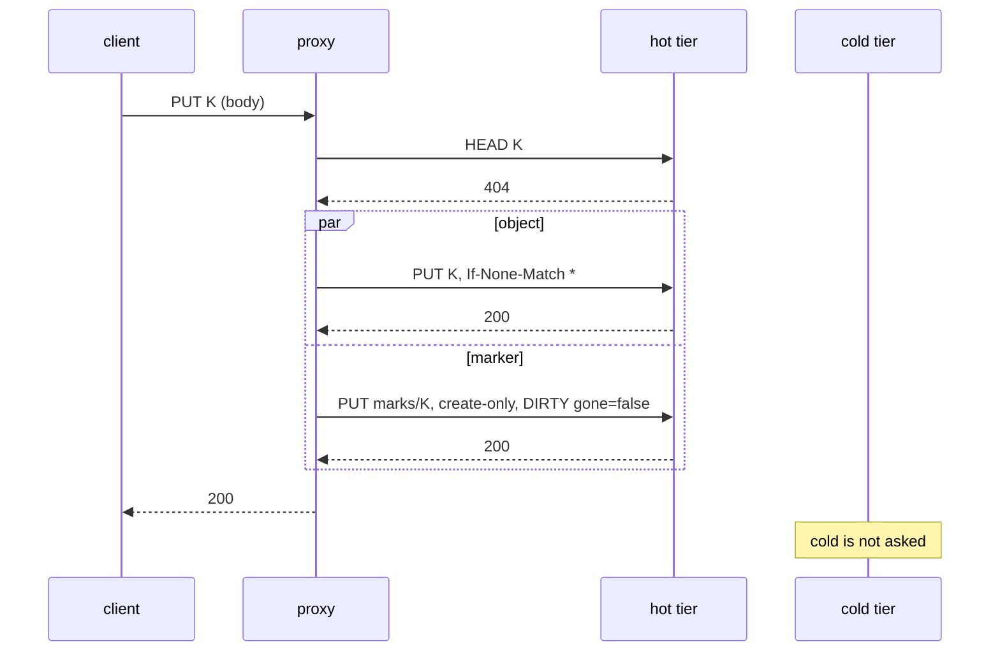
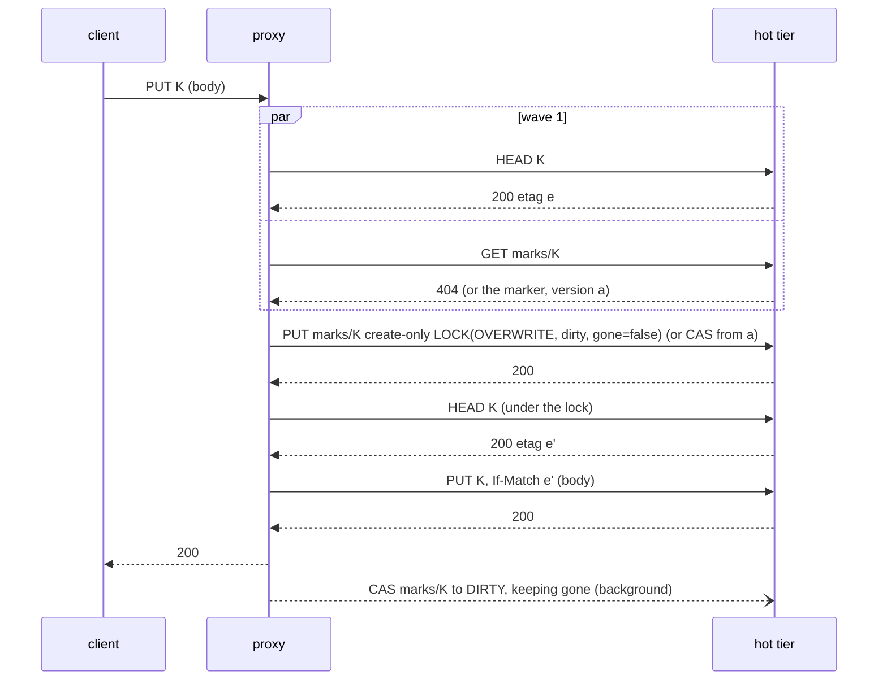
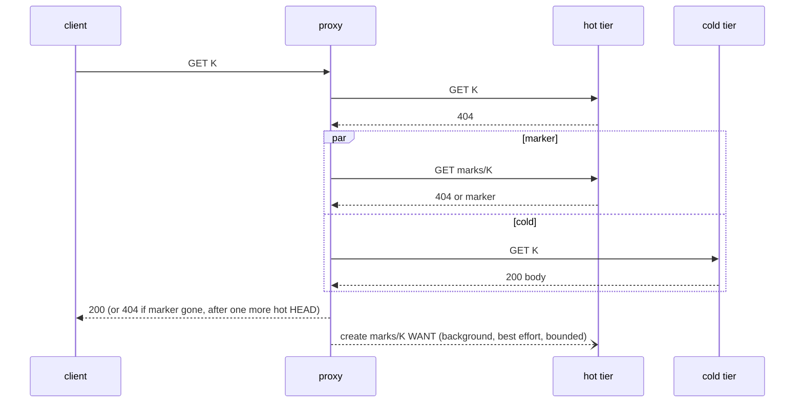
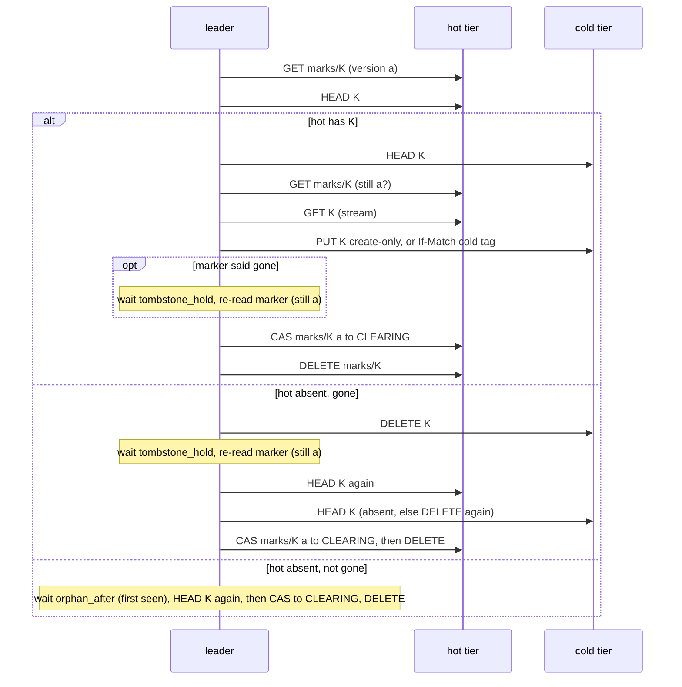

# Put without a lock: S3 semantics, a marker instead of an entry

Status: **proposed (CEO direction, 2026-11-05), not built; model-checked within the bounds of Appendix B.** Everything here is the plan; the code is the entry protocol of [tierstore-design.md](tierstore-design.md) until the pull requests of section 10 land. Section 5 is written in the present tense, as the plan reads once built: each of its subsections names the pull request of 10.4 that makes it true, and that pull request moves the text out of "plan" in the same pull request (rule P10). Terms in bold are those of the glossary of tierstore-design.md (section 17): hot tier, cold tier, leader, reap, seal. New terms: **marker**, **lock**, **lease**, **gone**, **dirty**, **tombstone hold**.

The direction (CEO, 2026-11-05): **match S3 exactly.** Strong read-after-write, after-delete and after-list for every key; no lock a client can see; two plain puts of one key both succeed and the last writer wins; `If-None-Match: *` and `If-Match` are the client's compare-and-swap; the cold copy is eventually consistent and no client can tell. "Exactly" has the exceptions this document states and no others: the `If-Match` gate of Q4, the local-cache exception of 5.16 (bounded by `local_cache.revalidate_after`), the `lock_wait` 503 of I6, the emergency cold landing of 5.5 (off by default), and the 503 that a create-only put gets while cold is down (I15). The former deviations D1 and D2 (2.1) and the refusal of keys over 1009 bytes (4.1) are gone. This document replaces the per-key entry of tierstore-design.md and the entry extensions of [overwrite.md](overwrite.md) (section 10 lists what).

**Decided 2026-11-06 (CEO).** (1) The one-time write pause of the rollout, the B8 exception, is **approved** (Q2). (2) The slower delete (about 41.5 ms against 29.5) and its extra hot load are **accepted** (Q15). (3) A create-only put re-checks once before it answers 412, and answers 409 when the key is gone (D2 removed, 2.1, 5.1); an `If-Match` put that loses a race answers 409 (D1 removed, 5.4b). (4) The local cache's staleness is a config key, `local_cache.revalidate_after`, with a stated bound (5.16, Q17). (5) The per-key lock between proxies **stays for every user**: there is no write-once or content-addressed mode, and the lock is never on the new-key put path (7.5). (6) Every key S3 accepts, up to 1024 bytes, is accepted: markers live in their own bucket, named exactly by the key (4.1, Q1, Appendix C).

Figures: **measured** means a farm or local measurement with its source in the capability and cost report of 2026-11-05 (`results-farm/RESULTS.md`, `raw.jsonl`, `raw2.jsonl`, `evidence/head_miss_latency.jsonl`; local `$S/exp/caps-*.txt`, `extra-*.txt`, `lat-*.txt`); **inferred** means computed here from those, and says how (rule P11); **unmeasured** means an assumption that has no source yet and is listed in Q11 or Q14. A **model** result is a run of `crates/tierstore-model` (Appendix B): it is "no counterexample within the bounds", never a proof.

## 1. The problem

A put of a new 4 KiB key takes **47.3 ms** through tierstore (p50, storage proxy, 1 in flight, range of passes 45.3 to 49.9) and **8.5 to 9.3 ms** straight to the hot MinIO (measured; the 8.5 is the median of three passes, the 9.3 the single-run p50 the CEO quoted). A 64 KiB put is 57.4 ms against 10.3 ms. Protocol is **38.0 ms** of the 4 KiB put (47.3 less 9.3) and **47.1 ms** of the 64 KiB put (57.4 less 10.3; inferred).

The protocol is the per-key entry `_entries/<sha256(key)>` as a lock (tierstore-design.md 6.2). A put does, in order, with each line waiting for the one above:

| # | Request on the acknowledgement path | Kind | Farm cost |
|---|---|---|---|
| 1 | hot HEAD of K (a found key is 412, no entry) | read | 3 ms (measured: 2.9) |
| 2 | hot PUT `_entries/h` create-only, `(PUT, HELD, me)` | write, new key | 8.5 ms |
| 3 | hot HEAD K ∥ cold HEAD K (`check_tiers`) | read, read | 3.3 ms (measured: 3.3, the slower) |
| 4 | hot PUT K create-only (the data) | write, new key | 8.5 ms |
| 5 | hot PUT `_entries/h` with `If-Match`, `(PUT, PENDING)`: the acknowledgement | write over an existing key | 17 ms (inferred, below) |

Five serial waves, three hot writes. Sum 40.3 ms; the remaining 7.0 ms of the 47.3 is proxy work (HTTP, SigV4, hashing, five round trips), which we price below as 1.4 ms per wave (inferred: 7.0 / 5).

**This is a calibration, not a prediction.** Two free parameters, the cost of a write over an existing key (Hw2) and the proxy cost per wave, are fitted to one measured figure, 47.3 ms. The fit is not unique: with Hw2 at the local ratio of 2.14 times a create (18.2 ms) the wave cost is 1.16 ms and the same figure comes out. Section 6 prints the first fit (Hw2 = 17, 1.4 ms a wave) and shows the second beside the put row; it moves a new-key put by 0.5 ms (16.8 to 16.3) and an overwrite by 0.2 ms (37.1 to 37.3), so no conclusion below depends on the choice. What the fit cannot support is a price for three requests in parallel (the pair factor 1.3 rests on a measurement of a pair, not of a triple), so the design takes no row that needs one (the speculative one-wave put is Q5, not planned).

The write over an existing key costs twice a write that creates one. Locally, on both MinIO `RELEASE.2025-09-07T16-13-09Z` (the farm's release) and silo: 64 B create 16.6 ms against 64 B over an existing key 30.0 ms; 4 KiB 14.0 against 30.0 (measured, 400 requests each, one client over six processes). The farm has no measurement of it; section 11 (Q11) asks for it, and **pull request 4 does not merge before Q11's figures exist** (10.4).

**Why the lock is there.** The entry gives exclusion to the three operations that destroy or replace a hot object and cannot be made safe otherwise, because **our stores have no conditional DELETE** (section 2): a delete removes whatever is at the key when it arrives. If an evictor checks that hot equals cold and then deletes, a put that replaced hot in between is deleted unseen; if a client delete races a copy, the copy republishes the key. The entry also made every put wait on cold (step 3 HEADs cold to keep write-once), so **a cold outage stops all new-key puts** (R12, decision 2 of tierstore-design.md section 15). This design removes that for plain puts, overwrites and deletes; a create-only put of a key hot lacks still asks cold (I15), so the gain is as large as the share of puts that are plain, which nobody has measured (Q14).

Two facts make most of the lock unnecessary:

1. **Creating an object where none exists needs no lock.** A create-only PUT is ordered by the store against every other write to the key, including a DELETE (silo and MinIO: 200 trials of create-only racing DELETE, never a 200 with the old object, never a 412 with the key present). Every put whose key hot lacks takes this path.
2. **Only an operation that deletes or replaces an existing hot object has to exclude the others.** That is an overwrite put, a client delete, an eviction, a copy-back's landing and, when the operator enables it, the emergency cold landing. The copy to cold does not change hot, and writes cold only by compare-and-swap, so it needs no lock at all (section 5.9).

The design below keeps the lock for exactly those operations and takes it for them only. A new-key put costs one HEAD and one parallel pair of writes. **A delete costs more than today's** (section 6): the lock must decide `gone` from a HEAD taken under it, which is one more serial request than the first draft of this document claimed; 5.6 says which invariant forces it.

## 2. What S3 guarantees, and what our stores give

### 2.1 S3

From the AWS documentation (Amazon S3 data consistency model; PutObject and CompleteMultipartUpload conditional writes):

- **Strong consistency** since 2020-12-01: after a successful PUT or DELETE, every GET, HEAD and LIST sees it (a new object, an overwrite or a delete), in every region, with no stale read.
- **Atomic per key.** A reader gets the old object or the new one, never a mix.
- **Last writer wins.** S3 takes no lock on a key; if two PUTs of one key are made at once, the one with the latest timestamp wins. Both are acknowledged 200.
- **`If-None-Match: *`** (PutObject, CompleteMultipartUpload): 412 `PreconditionFailed` if the key exists. **`If-Match: "<etag>"`**: 404 `NoSuchKey` if the key is absent, 412 if the ETag differs.
- **409 `ConditionalRequestConflict`.** S3 documents 412 for the later writer when conditional writes race, and also answers 409 when a conditional write meets a concurrent operation on the key: `If-None-Match` gets 409, and `If-Match` gets 404, when a DELETE of the key completes first. SDKs retry a 409 of PutObject and do not retry a 412.
- **A delete of an absent key** is 204.

**No deviation remains in these answers** (the CEO's decisions of 2026-11-06 removed the three this document first stated):

- **D1 (removed).** Of N racing `If-Match` puts with one ETag exactly one is 200, as in S3. A loser whose tag already differs at wave 1 is 412; a loser whose tag matched at wave 1 and no longer matches when it resolves under its lock (the key changed during the put) is **409 `ConditionalRequestConflict`**, the retryable answer; its retry sees the new tag in wave 1 and gets 412. It costs no request (5.4b). `If-Match` stays 501 until Q4 either way.
- **D2 (removed).** A create-only put that is about to answer 412 because the key is present re-checks once (5.1 step 2) and answers 409 when a delete has completed or is in flight. Residual, stated plainly: the re-check is the last read; a delete that completes after it and before the answer reaches the client is ordered after the put, which is a legal order in S3 too (the two requests overlap). The model's A5 judges the key at the step that decides the answer.
- **Key length (removed).** Every key up to 1024 bytes of UTF-8 is accepted (4.1, Appendix C); a longer key is refused as S3 refuses it, 400 `KeyTooLongError`.

### 2.2 Our stores (measured 2026-11-05, 200 trials a cell unless noted; six processes, one drive each, one erasure set, as the farm's 6×1)

| Fact | MinIO `2025-09-07` (the farm's) | silo `2026-09-16` | Evidence |
|---|---|---|---|
| Create-only PUT (`If-None-Match: *`) of a present key | 412, old body kept | same | B1/B2 |
| 16 racing create-only PUTs, six nodes | exactly one 200 in 200/200 | same | F1 |
| `If-Match` PUT, right etag / wrong etag / absent key | 200 / 412 / 404 | same | B3 to B9 |
| 16 racing `If-Match` PUTs with one etag | exactly one 200 in 200/200 | same | F2 |
| CompleteMultipartUpload with `If-None-Match: *` and with `If-Match` | same answers as PUT; 4 racing completes: one 200 | same | C1 to C6 |
| **DELETE with `If-Match`, wrong etag** | **204, object deleted (header ignored)** | 412, object kept | D1 |
| DELETE `If-Match` racing an overwriting PUT (300) | 145 ended absent: the delete removed the new object | 300 ended with the new object | G8 |
| Create-only PUT racing DELETE, key present (200) | delete→put (200, new) or put→delete (412, absent); never 200 with old, never 412 with the key present | same | G |
| GET, HEAD, LIST on another node after PUT, overwrite, DELETE (200 × 8 checks) | 0 violations | 0 violations | E, G6, G7 |
| 4 KiB PUT create / over existing key / rejected with 412 / HEAD / DELETE (p50, local) | 14.0 / 30.0 / 3.0 / 1.9 / 2.1 ms | 13.3 / 28.8 / 2.9 / 1.2 / 3.5 ms | lat |
| Two independent create-only PUTs in parallel (4 KiB ∥ 64 B) against one | 18.2 against 14.0 ms | 14.3 against 13.3 ms | lat |
| Create-only PUT refused with 412, body ≥ 8 MiB | connection reset before the 412 is read (stdlib client) | same | G5 |

Consequences, each used below:

- **C-1.** The farm's DELETE is unconditional. Tierstore's `delete_if_match` on MinIO is HEAD, compare, plain DELETE, with a window between the two (`conditional_delete=false`, the default). The CEO's statement that conditional DELETE is missing on both stores is true of MinIO and **not of silo**: silo honours `If-Match` on DELETE (D1, G8, G9; its 2026-09-16 notes say "honor single-object conditional DELETE"). The design does not depend on it, because the farm runs MinIO; with silo it can close residuals R1 and R4' (section 7.3) by setting `conditional_delete = true` on the hot tier.
- **C-2.** The only compare-and-swap on MinIO is a PUT with `If-Match` (or create-only). A marker is therefore never cleared by a conditional DELETE; it is first CAS-written to a state nobody else may write, and then deleted (section 4.3).
- **C-3.** A write over an existing key costs 2×. Every design choice that rewrites an existing marker pays it, and the latency table (section 6) prices it.
- **C-4.** A create-only PUT that fails with a large body may reset the connection before the 412. A create-only that ends in a reset is **unknown, to be re-checked**, never an error. The fast path therefore asks a hot HEAD first for a streamed body (section 5.1).
- **C-5.** Two writes in parallel take about one write's time (1.0× to 1.3× locally; a pair, not a triple).

## 3. Invariants

Terms: *truth(K)* is the version a client must be shown for K: the hot object if hot has one, otherwise the cold object unless K is **gone**, otherwise absent. An *acknowledged* operation is one whose 2xx has been sent. An operation *started after* X is one whose request reached the proxy after X's response was sent. *Quiescent* means no operation on K is in flight and no process of K's protocol has stalled. A version id stands for the bytes, so the model assumes one ETag whichever tier answers (Q4).

- **I1. No acknowledged operation is lost or undone.** An acknowledged put or overwrite of K is truth(K) from its acknowledgement until a later operation changes it: a later acknowledged put, a later acknowledged delete, or an eviction that does not change truth. An acknowledged delete stays in force until a later put creates K. (Residuals R1, R2', R3', R4', R5' and, with the emergency landing on, R6' of section 7.3 are the stalled-actor and emergency exceptions, as in the entry protocol.)
- **I2. No superseded or deleted version is served after a newer acknowledged operation.** After the acknowledgement of a put, overwrite or delete of K, no GET, HEAD, LIST or copy-back of an operation started after it returns a version older than that operation's, from either tier.
- **I3. Strong read-after-write, after-delete and after-list through any proxy** over the same hot and cold pair. A GET, HEAD or LIST started after an acknowledgement reflects it. **Exception: the local cache of a build node** (5.16) serves a hit with no upstream call, so it does not see another node's overwrite or delete until its entry is evicted or `local_cache.revalidate_after` has passed; I3 holds through a cache for the writes made through that cache, and for another node's change only within `revalidate_after` of it (never, while the key is unset). 5.16 states the bound. This is a deliberate exception to "match S3 exactly".
- **I4. Cold converges to truth.** For every key, from quiescence, within a bounded time, with the leader alive and cold up: cold holds truth(K) (the hot object if hot has one; absent if K is gone; otherwise unchanged) and K's marker is gone. Bounded by: marker discovery time, `orphan_after`, `tombstone_hold`, the copy, and `lock_lease` for a lock whose holder stalled. An acknowledged put whose marker was cleared while its body was still streaming (5.1 step 5) is re-marked by the put itself, so I4 does not wait for the 24 h sweep.
- **I5. Client conditions behave as S3.** `If-None-Match: *` is 412 iff truth(K) exists when the answer is decided, and **409 `ConditionalRequestConflict`** when a delete of K is in flight or has completed by then (the re-check of 5.1 step 2); `If-Match` is 404 for an absent key, 412 for a different ETag at wave 1, and 409 when the tag matched at wave 1 and the key changed before the put resolved under its lock (5.4b); of N racing `If-Match` puts with one ETag exactly one is 200. A plain put is never refused because the key exists. **`If-Match` is not enabled until a tier-independent ETag exists (Q4, PR #173): until then it stays 501**, because a client that holds the hot ETag of a multipart object (`md5-N`) gets a spurious 412 once the object is read from cold, whose copy has a plain MD5.
- **I6. No lock is visible.** A client sees no response caused by a lock other than a 503 `SlowDown` after `lock_wait` expires, which is **not a throttle** (it carries `Retry-After`, 5.2), and the 503 of a streamed plain put that loses a creation race with bytes that differ from the winner's (5.1). A second writer waits and then wins.
- **I7. The no-marker rule.** If K has no marker and no operation on it is in flight, then hot and cold agree: either hot is absent and cold holds truth (or nothing), or both hold the same bytes. Two crash windows break it for an unacknowledged put only (an object landed before its marker); the stray sweep and the eviction compare repair them (5.12) and no read is wrong meanwhile, because hot wins. A put acknowledged after its marker was cleared is re-marked before the acknowledgement (5.1 step 5).
- **I8. Exclusion.** A hot object is deleted, or replaced by a store call that does not carry its tag, only by the live holder of K's lock. A hot object is created only where none exists (create-only), or replaced by `If-Match` on the tag the replacer read under its lock. A holder whose hot DELETE ended unknown keeps its lock until the call can no longer land (5.2, `queued_call_margin`). Exceptions: the frozen holder (R1).
- **I9. Cold is not trusted while a marker exists.** A cold object is served for K only if K has no marker, or its marker says `gone = false`, read **before or concurrently within `read_window`** of the cold read; the window bounds a hot-miss read pair, wave 1 of a create-only put and the cold-then-marker pair of a LIST. A read that finds `gone` HEADs hot once more before it answers absent (5.7).
- **I10. Marker discipline.** A marker is deleted only after its owner wrote it to `CLEARING` by a CAS on the version the owner had read before the work the clear completes, and while it is `CLEARING` no one else writes it. A copier's clear that races any write to the marker fails. `gone` is never rewritten to false: it ends only when the marker is deleted, after cold holds the truth.
- **I11. Cold is written by CAS only.** Every write to cold is create-only or `If-Match` on the tag read, and the copier re-reads the marker after its cold HEAD and gives up if it moved, so a late write by a stalled leader cannot overwrite a newer cold version and the copier cannot overwrite a cold landing.
- **I12. Reads never wait.** A GET, HEAD or LIST never waits on a lock and takes none; a hot hit reads nothing but the object.
- **I13. Bounded blocking.** A writer waits for a lock at most `lock_wait` (5 s). A lock whose owner has departed is reaped within `departure` (60 s) plus one leader pass; a lock whose holder lives but has not refreshed it for `lock_lease` (120 s) is reaped within that plus one pass. A crash or a leak blocks one key for that time (R6, unchanged for crashes).
- **I14. Additive formats, with one stated exception.** Every stored format changes by addition (B8): a marker reader keeps fields and `st`/`why` values it does not know. The one exception is the rollout of section 8: an old binary fails closed beside the new protocol, and the activation raises a floor (every live registration must be proto 3). 8.1 states it; the exception was approved on 2026-11-06 (Q2).
- **I15. The cold tier is not on the acknowledgement path of a plain put, an overwrite, or a delete.** R12 is removed for them. **A create-only client put (S3 `If-None-Match`, OCI, presigned) of a key hot lacks still asks cold, because S3 requires it to see a key that lives only in cold: while cold is down it is 503.** How much of the farm's traffic that is has not been measured (Q14), so the gain over today is that much smaller.

## 4. The marker

### 4.1 Where and what

The marker of K is the object named **exactly K** in a second bucket of the hot store, the **marks bucket** (`hot_store.marks_bucket`, default `<hot bucket>-marks`; written `mark(K)`, and `marks/K` in the diagrams). It has no prefix, so **every key S3 accepts, up to 1024 bytes, can be marked**, and a listing of the markers of a key range is a range listing of the marks bucket with the client's own `prefix` and `after` (the LIST, the copier's discovery and the stray sweep need that). The marks bucket holds markers and nothing else. `_tiering/` stays reserved for the format record and the checkpoints that remain in the hot bucket (`_tiering/format`, `_tiering/checkpoint/`), so no client key under `_tiering/` becomes legal; the marks no longer sit under it. `_entries/` is untouched and unused when the marker protocol is active. A throwaway local MinIO (the farm's release) accepted both `a` and `a/b` as object names in either order, so key-named markers do not collide with each other (measured, local); this holds in the marks bucket as it does in any bucket.

- **Atomicity.** Every marker operation is one read, one create-only PUT, one `If-Match` PUT or one DELETE of **one object**; no operation spans the two buckets. The ordering the protocol relies on across them (the object has landed before the marker CAS of a recreate, 5.1; the HEAD under the lock before the DELETE of hot, 5.6) is by acknowledgement of the first request before the second is sent, as it was when both objects were in one bucket. So the second bucket changes none of the model's transitions, and `Backend` gains one value only: the handle on the marks bucket.
- **Setup (operator, once, before the drain of 8.2 step 1).** Create the bucket on the hot store and grant the proxies' credentials list, read, write and delete on it, as for the hot bucket. **It must exist before the release is rolled (8.2 step 2), not only before `--activate-marks`:** from `drained` on, a hot miss reads it, and a bucket that does not exist is an error of the hot store like any other, so a read of a key only the cold tier has would be 503 until it does. A client's scoped key (5.18) never names it. A `dir:` hot tier uses a sibling directory `<dir>-marks`, opened with `DirBackend::with_locked_keys` (the `flock` that the conditional writes of `_entries/` keys take, taken for every key, so that a compare-and-swap of a marker is atomic between the processes over the directory, which two instances of one node are during a socket hand-off); a memory tier a second map. **The directory is opened by the release that uses it, not at start**: opening it makes a directory beside the hot one, which a unit with `ProtectSystem=strict` and the hot directory alone in `ReadWritePaths=` cannot, and a start that worked would fail. Pull request 1 therefore opens the second `Backend` handle (`ProxyConfig::marks`) for `s3` and `memory` hot tiers and leaves it `None` for `dir`. **Check (once, at deploy, not at run time):** `--activate-marks` refuses unless the configured marks bucket exists (a bucket HEAD) and is not the hot bucket, and prints the name; no object is written to test it, and no proxy probes it while serving (a missing or unreadable marks bucket is an error of the hot store like any other: marker operations fail closed with 503).
- **Where the name is recorded (format phase).** The format record `_tiering/format` stays in the hot bucket, where the previous release reads it. `--activate-marks` writes `{phase: "active-marks", epoch: 3, marks_bucket: "<name>"}`; `marks_bucket` is a new optional field (additive, B8). A proxy whose `hot_store.marks_bucket` differs from the record's refuses writes (503, logged) until the config matches, so two names cannot be in use at once. The previous release ignores the field and refuses writes beside `active-marks` anyway (8.1).
- **Rollback (8.2 step 4).** The drain empties the marks bucket (every marker run to completion, the verb re-checks it empty) before `drained` is written; the empty bucket stays and the operator may delete it. The previous release never reads it.
- **Other places that name a key** (the entry `_entries/<sha256>` of the old protocol, the journal, the local cache's files) have a fixed-length name and are not affected; Appendix C lists every place on origin/main that could refuse a long or unusual key.

Body (JSON, `v: 1`; **a reader keeps the fields and the `st` and `why` values it does not know, and a rewrite carries them over**; an unknown `st` is treated as `LOCK` (writers wait, the leader reaps it by the lease), so a later release adds fields and states without a version bump):

| Field | Meaning |
|---|---|
| `key` | K |
| `st` | `DIRTY`, `LOCK`, `CLEARING` or `WANT` |
| `gone` | bool. True: K is deleted and **no cold copy may be served**. |
| `dirty` | bool. True: hot has a change cold does not have yet (always true in `DIRTY`). |
| `why` | for `LOCK`: `OVERWRITE`, `DELETE`, `EVICT`, `COPYBACK`, `COLDLAND` |
| `owner` | proxy id or leader id for `LOCK` and `CLEARING`; the registration (`departure`) says whether it lives |
| `nonce` | `<boot>.<counter>`: 128 random bits drawn once for each `Markers` (the actor's handle on the markers), a dot, and the count of that `Markers`'s writes; unique per write, so the object's ETag (MD5 of the body) is unique per write and **the marker's version is its ETag**; ambiguity is read back by nonce, as for entries |

### 4.2 States

| State | Meaning | Truth(K) |
|---|---|---|
| no marker | the tiers agree (I7) | hot if present, else cold |
| `DIRTY, gone=false` | hot has a change cold lacks; or a put is in flight; or a put crashed | hot if present, else cold |
| `DIRTY, gone=true` | K was deleted; cold may still hold the old object | hot if present (a recreate), else **absent** |
| `LOCK(why, owner)` | one actor is deleting or replacing hot, or reading cold into it; `gone` and `dirty` carry what the key was before and what the holder makes it | as `gone` says |
| `CLEARING(owner)` | the owner won the CAS to clear; no one writes until it is deleted | as `gone` says |
| `WANT` | cold holds truth; a cold read asked for a copy-back; no one holds anything | hot if present, else cold |

**The reader's rule on a hot miss:** `gone = true` → HEAD hot once more, and absent if it is still missing (a put may have landed since the first miss); anything else (no marker, `WANT`, `DIRTY` or `LOCK` or `CLEARING` with `gone=false`) → the cold object, if any. A hot hit is served as it is.

### 4.3 Transitions

Write modes: *create* = create-only PUT; *CAS* = PUT with `If-Match` on the marker's ETag as read; *delete* = plain DELETE (not conditional on MinIO, C-2).

| # | Actor | From → To | Mode | Used by |
|---|---|---|---|---|
| M1 | fast put | none → `DIRTY(gone=false)` | create, in parallel with the object | 5.1 |
| M2 | fast put, marker existed (also the re-assertion of a slow put) | `DIRTY` or `WANT` → `DIRTY`, **keeping `gone`** | CAS, **after** the object landed | 5.1 |
| M3 | locker | none → `LOCK(why, dirty, gone=false)` | create | 5.3, 5.5, 5.6, 5.10, 5.11 |
| M4 | locker | `DIRTY` or `WANT` → `LOCK(why)`, keeping `dirty` and **`gone` as found** | CAS | same |
| M4' | deleter, after the HEAD under its lock | `LOCK(DELETE)` → `LOCK(DELETE, gone=true)` | CAS | 5.6 |
| M5 | holder, release with a change | `LOCK` → `DIRTY`, keeping the lock's `gone` (a delete's is true) | CAS | same |
| M6 | holder, release with no change | `LOCK` → `CLEARING` | CAS | eviction, copy-back landed |
| M7 | copier, done | `DIRTY(a)` → `CLEARING` | CAS on version `a` read **before** the copy | 5.9 |
| M8 | owner | `CLEARING` → none | delete | all |
| M9 | leader, reap | `LOCK(owner departed, or unchanged for lock_lease)` → `DIRTY` (keeping `gone`) if `dirty` else `CLEARING` | CAS | 5.13 |
| M10 | read, background, bounded (5.7) | none → `WANT` | create (failure ignored) | 5.7 |
| M11 | leader | `WANT` → `LOCK(COPYBACK)` | CAS | 5.11 |
| M12 | sweep | none → `DIRTY(gone=false)` | create | 5.12 |
| M13 | leader | `DIRTY(gone=false)`, hot absent (HEAD again) for `orphan_after` → `CLEARING` | CAS | 5.9 |
| M14 | holder, refresh | `LOCK` (own) → `LOCK` (own), fresh nonce, every `lock_refresh` while the operation runs | CAS | 5.2 |

**Who may write which state.** `none`, `DIRTY` and `WANT` are written by anyone (create or CAS). `LOCK` and `CLEARING` are written only by their owner, or by the leader reaping an owner that has departed or a holder whose lease ran out (M9). A writer that finds `LOCK` or `CLEARING` and is not its owner **waits** (section 5.2) and writes nothing. This one rule removes every marker race: a stale writer's CAS fails on the ETag; a waiting writer never changes what the holder reads back.

The table above is the definition of the state machine.

**Where it is built (pull request 2, `crates/tierstore/src/marks.rs`).** `MarkBirth` makes the creations (M1, M3, M10, M12), `MarkMove::apply` is the guard of every other row and refuses a move where the table does not allow it, and `Markers` makes the store calls. Three things the table leaves open are decided there, in the model's direction:

- **`dirty` of a lock is set by its reason.** A lock owes cold a copy (`dirty = true`) for `OVERWRITE`, `DELETE`, `COLDLAND` and a reason this release does not know, and not for `EVICT` and `COPYBACK`, which leave hot and cold equal; a lock taken over a `DIRTY` marker keeps owing (`dirty` is kept, not cleared). The release (M5, M6) and the reap (M9) then end in `DIRTY` if the lock owes a copy and `CLEARING` if it does not, which is the table of 5.13 whatever the reason; a holder that changed hot though its reason does not say so (an eviction whose compare found other bytes, 5.10) releases with `changed` and ends `DIRTY`. The model gives every lock `dirty = true` except the leader's copy-back lock, and reaps by reason; the two agree on every row of 5.13. They differ in one case the table does not list: a `LOCK(DELETE)` whose holder died before it wrote `gone = true` (M4'). The move keeps the `gone` it finds (`false`), so that delete rolls back (hot was not touched: the hot DELETE follows M4', and the delete was never acknowledged); the model's reap writes `gone = true` there and rolls it forward. Pull request 7 decided: the leader takes the move as it is here, keeping `gone` as found, so a `LOCK(DELETE)` that never reached its decision is rolled back (`entry_reconciler/reap.rs`); the model's switch `reap_delete_keeps_gone` runs that choice (scenario `crash/delete-lock-rolled-back`, which passes), and the model's own reap, which writes `gone = true`, stays the default of the other scenarios.
- **A `CLEARING` marker has `dirty = false`** and `why` is written only for a lock; the model keeps both from the marker it replaced, and neither is read in `CLEARING`.
- **The nonce is `<boot>.<counter>`.** The `boot` is 128 random bits drawn once for each `Markers`, and the counter is that `Markers`'s count of writes, so a restart under one actor id does not repeat a nonce and the marker's tag is unique per write (4.1).

**`MarkMove::Settle` (pull request 5)** is M6 for a lock that owes a copy: it ends the holder's own lock as `CLEARING` whatever `dirty` says, keeping `gone`. The emergency landing needs it (5.5, step 5: hot is absent and cold holds the truth), where `Release` would leave `DIRTY`.

A marker whose `st` this release does not know is reaped (M9) to `DIRTY`, keeping `gone`, so that nothing it may owe is dropped; a writer treats it as a lock and waits (`MarkerState::is_held`).

## 5. Every operation

Cost abbreviations (farm, section 6): Hh hot HEAD, Hw hot write creating a key, Hw2 hot write over an existing key, Hd hot DELETE, Ch cold HEAD. Each subsection ends with **Why the invariants hold**. A *wave* is requests issued together. Every subsection opens with the pull request of 10.4 that builds it; until then it is a plan.

### 5.1 Put, key absent on hot (the fast path)

*Built in part by pull request 4 of 10.4 (`tiered/marked_put.rs`, taken while `_tiering/format` says `active-marks` and records the proxy's marks bucket). What it builds: steps 1 to 5 for every put the `Backend` trait can express, which are all create-only (`Backend::put` and its streamed forms only create): so wave 1 always asks cold and the marker (the create-only branch of step 2), the re-check before the 412 with its new answer `Error::Conflict` (409), the object and the marker in parallel (step 3, at any level: the cold landing is pull request 5), the table of step 4 for those puts, the re-assertion of a slow put (step 5), the cleanup of a failed put, the completion of a hot upload (`complete_upload`) and the presigned put. What waits: the plain put, which needs a call on `Backend` to say "may overwrite" (pull request 5 adds it with the overwrite, 5.3, and the `If-Match` completion with `complete_upload_if_match` rides with it); the one-shot-stream row of the table (a plain put only); the reset re-check by a hot HEAD (a reset on a put is a 503 and nothing more is written); the digest the proxy keeps of a streamed body (it serves that row and that re-check only); the background refresh of the format (a stale format is read by the put that finds it so, as for any write today); the completion of an upload begun in the cold tier (a 503 until the cold landing, 5.5; an upload is begun in the hot tier whatever the level). The settings are the fields of `ProxyConfig::marks_put` (`MarkedPutConfig`) and `ProxyConfig::marks_name`; their TOML keys of section 9 come with the first pull request that sets them from the file. Plan: the rest.*

Every plain put, every create-only client put, a multipart completion (the object write is `complete_upload`), a presigned put (hot only) and the OCI front's puts take this path when hot does not hold K. **A put at level `Full` takes it too** (5.5: hot's budget is configured below its capacity, so a put that fits is written to hot and the leader evicts to make room).



1. **Admission.** The cached format phase and level decide (`admit_write`, `require_live`). They are refreshed by a background task, every `format_refresh` (5 s) and `usage_refresh`, **never on the acknowledgement path**: no put pays a refresh. A format or usage that cannot be read, or is stale, is decided as today (503 for the format; `Open` for the usage).
2. **Wave 1: hot HEAD K.** Found → the put is an overwrite (5.3) or a same-bytes put (5.4), or, for a create-only client put, the **re-check** below. For a **create-only client put** (an `If-None-Match` header, the OCI front, a presigned put, a completion with `If-None-Match`) wave 1 also issues, in parallel, **cold HEAD K** and **GET `marks/K`**; the key exists iff hot has it, or (cold has it and the marker is not `gone`). A cold error with hot absent and no `gone` marker is 503 (create-only only; plain puts never ask cold, I15). The wave is discarded and run again, at most `read_retries` times, when it took longer than `read_window` (I9); then 503.

   **The re-check before a 412 (removes D2).** A create-only put is about to answer 412 when wave 1 found the key (hot hit, or cold hit with no `gone` marker) or when its object write in step 3 was refused because the key now exists. Before it answers it **re-checks once: GET `marks/K`**. `LOCK(DELETE)` → **409 `ConditionalRequestConflict`** (a delete is in flight). `gone` → **HEAD hot once**: present → 412 (the key was recreated, and a `gone` marker legitimately stays with hot present until the copier replaced cold), absent → **409** (the key was deleted). Any other marker or none → 412. So a 412 is never given for a key that a delete had already made absent when the answer was decided. The marker is read alone first, and hot only when it says `gone`: a parallel hot HEAD and marker GET can pair an older hot answer with a later marker answer (reasoned here, not a model run); the marker alone decides the common case, in one request, and the hot HEAD runs only on the rare path. Cost: one more serial wave on the 412 path only (3.0 + 1.4 = 4.4 ms; 8.8 ms in all for a key that exists, 12.2 with the extra HEAD; section 6.1). The tombstone hold waits for a re-check in flight as for any read pair (`read_window`), so a `gone` marker cannot be cleared under it. Model: `create-only-recheck/*` hold, and `negative/create-only-no-recheck*` (the document before this revision) is rejected by A5.
3. **Wave 2, in parallel: the object and the marker.**
   - Object: hot PUT K create-only (`put_stream`, or `complete_upload` for a multipart). The proxy hashes the body as it streams it (one pass, no buffering, B16) and keeps the digest.
   - Marker: hot PUT `marks/K` (the marks bucket) create-only, body `DIRTY, gone=false, dirty=true`, a fresh nonce; the time of the request is taken on the proxy's monotonic clock. A hot store that answers `Full` before it took a byte is 5.5.
4. **Acknowledge 200 iff the object landed and the marker is `DIRTY` (ours or any other's) after our write**, and, if more than `reassert_after` passed between the marker's creation and the object's landing, after step 5. The table gives every result pair.

| Object | Marker | Action |
|---|---|---|
| 200 | 200 | **200**, after step 5 if the put was slow. |
| 200 | 412, marker is `DIRTY` or `WANT` | GET it (404 now: create it, M1), then **CAS it to `DIRTY`, keeping its `gone`** (M2) with a fresh nonce; loop on 412 up to `entry_rounds`, then **503 "may not have landed"** (an unknown outcome, below); 200. The CAS is after the object by construction (it follows the object's 200), and it keeps `gone`: a reader that missed hot before the object landed must still find `gone` and answer absent (the copier ends `gone` only after cold holds the new object, 5.9). |
| 200 | 412, marker is `LOCK` or `CLEARING` | **Wait** (5.2) for the marker to leave that state (≤ `lock_wait`), then HEAD K: if hot has an object, make the marker `DIRTY` as in the row above (or create it if it is gone); if hot is absent, a delete or an eviction removed it after it landed, which is the order put→delete: **200**. A wait that ends in 503 is an unknown outcome: the object landed. |
| 200 | error / timeout | Read back by nonce; retry the marker (create or CAS) until `marker_deadline` (30 s); then 503 "may not have landed" (an unknown outcome; the object is in hot and the stray sweep or the next write adopts it, 5.12). |
| 412 (the key now exists: lost a creation race) | any | **Create-only client put: the re-check of step 2, then 412 or 409.** Plain put of a **replayable** body (held bytes, a staged file, an in-memory chunk): continue as an overwrite (5.3). **Plain put of a one-shot stream:** if the whole body was sent and its digest equals the ETag of the object now in hot (a single-part ETag is the MD5 of the body) and the sizes are equal, **200**: the winner holds the same bytes, which is what last-writer-wins would leave. Otherwise **503 `SlowDown`** with `Retry-After` (the bytes the store consumed are gone; S3 clients retry on it and the retry is an overwrite). A marker we created is cleaned up: CAS it to `CLEARING` on the version we created, then delete it; a failed CAS means another writer took it over, and it stays. |
| error / reset | any | Unknown outcome: **503**, nothing more is written; a reset on a create-only is re-checked by a hot HEAD first (C-4): found with our bytes' size → 200 only for a replayable body whose digest equals the object's ETag, else 503. |
| completion fails definitely (`InvalidPart`, a part missing) | marker 200 | the marker we created is cleaned up as in the 412 row. |

5. **A slow put re-asserts its marker.** A put has no size cap (B16) and so no deadline short of its transfer: a 5 GB body on a slow link streams for minutes after its marker was created. The copier clears an orphan marker (hot absent) after `orphan_after` (120 s) unchanged (5.9). So a put whose object landed more than `reassert_after` (30 s) after its marker was created does not trust the marker: it GETs it; none → create `DIRTY(gone=false)`; `DIRTY` or `WANT` → CAS to `DIRTY` (M2); `LOCK` or `CLEARING` → wait, then HEAD K, as in the table. A put that took less than `reassert_after` cannot have had its marker cleared, because the copier counts `orphan_after` from when it first saw the marker, which is after its creation, and `reassert_after < orphan_after` is checked when the configuration loads. This costs a short put nothing and a long put one GET. The same applies to a multipart completion that takes longer than `reassert_after`. (Model: `put_reasserts_marker`, with the copier's guards on pending puts removed.)

A multipart completion differs only in the object write (`complete_upload`) and in wave 1: parts are written to the upload id's tier before, as today.

**Failed puts.** A put that fails after its marker landed (a refused create, a failed completion) removes the marker it made (table), at a cost of one Hw2 and one Hd, only when the put fails. Without it the copier would spend a GET, a HEAD, a CAS and a DELETE on it after `orphan_after`.

**The speculative one-wave form is not planned** (it was a second code path for a saving of 4.4 ms on a new key and a cost of about 16.5 ms on every re-put: section 6, Q5).

**Why the invariants hold.**
- *I1, I2, I3.* The ack requires the object (hot wins at every read, so the new version is truth from the object's 200) and the marker `DIRTY` (the copier will make cold agree; until then reads that miss hot read the marker and do not use cold for a `gone` key). A put over a deleted key writes the object **before** it touches the marker and the CAS keeps `gone` (M2), so no reader sees `gone=false` with hot absent for a deleted key; two parallel writes are only done when no marker exists (M1), where there is no deletion to forget.
- *I7.* Both writes exist at the ack, or the put wrote the marker again. The two crash windows are the table's rows 3 and 4 (5.12, 7.1).
- *I8.* The object write is create-only: it lands only where hot is absent.
- *I15.* Wave 2 has no cold request.

### 5.2 Waiting for a lock, and keeping one (used by 5.1, 5.3, 5.5, 5.6, 5.10, 5.11)

*Built in part by pull request 2 of 10.4 (`Markers::wait`, `Markers::refresh_due`, `Markers::may_destroy` and `MarkMove::Refresh` in `marks.rs`, with `MarkersConfig` holding `lock_wait`, `lock_poll_min`, `lock_poll_max`, `lock_poll_factor`, `lock_lease`, `lock_refresh` and `queued_call_margin` and refusing values that do not hold together), and in part by pull request 5 (`tiered/lock_hold.rs`: the refresh of the lock beside a call that may take long, the check before a call that destroys, the release in a task of its own, the guard that releases a lock whose operation was dropped, and the keeping of a lock for `queued_call_margin` after a hot DELETE of unknown outcome, whether it returned an ambiguous error or its future was dropped while it was in flight, used by the emergency landing). Differences from the text below, for pull request 5: (1) the guard releases when the future of the put is dropped, but the call under way (the replace, the cold write) is dropped with it, because a streamed body is borrowed and cannot move to a task; the "detached" task of a client's request is the S3 front's own task around the backend call (`put_streamed` in `ops.rs`), which this release does not change. A replace that the store still receives names a tag, so it lands only if nothing replaced the object since. (2) A release the store fails is tried again up to `hot_store.step_attempts` times with the pauses of `hot_store.step_retry_min` doubling to `step_retry_max`, reading the marker between tries, as the last step of a put on an entry is; after that the leader's reap is the way out. The delete of pull request 6 has the detached task, its drop guard and the keeping of a lock for `queued_call_margin` after an unknown hot DELETE of its own (`tiered/marks_delete.rs`, 5.6); Pull request 8 takes the `EVICT` and `COPYBACK` locks of the leader and keeps them by these calls (`may_destroy` before the hot DELETE, `refresh_due` at each chunk of the copy-back's stream), and keeps the lock after a hot call of unknown outcome by leaving it to the leader's reap (5.10, 5.11). Plan: the leader's reap by the lease (7), and the `lock_*`, `queued_call_margin` and `marker_deadline` TOML keys of section 9, which come with the first pull request that sets the settings from the file (pull request 4 constructs the `Markers` in `Proxy::open` from `ProxyConfig::marks_put` and calls `read`, `create`, `advance`, `remove` and `wait` from the put of 5.1; the reads of pull request 3 call `read` and `create` through the same `Markers`; the plain puts of pull request 5 call them through `Proxy::put_plain`).*

A writer that finds `LOCK` or `CLEARING` (not its own) polls the marker with a GET at `lock_poll_min` (20 ms), multiplied by `lock_poll_factor` (2) each time up to `lock_poll_max` (1 s), until the state is not `LOCK`/`CLEARING` or `lock_wait` passes → 503 `SlowDown`. **`lock_wait` defaults to 5 s**, under the 10 to 30 s default timeouts of common S3 SDKs, so the client sees the 503 and not its own timeout. The 503 carries `Retry-After: 1`, and this document states that a `SlowDown` here is **not a throttle**: S3 SDKs apply a global back-off to `SlowDown`, and a deployment whose clients do so should read a lock 503 as an unusual event (a crash or a leak), not as a normal one. A dead owner is reaped by the leader (5.13) within `departure` (60 s), which is longer than `lock_wait`: a crashed owner's key yields a 503 at least once, and `Retry-After` says when to come back. The poll uses the injected clock and a recording sleeper. A writer that finds `DIRTY` or `WANT` does not wait; it locks by CAS. A reader never waits (I12).

**Keeping a lock: lease, detachment, and calls that may still land.**

- **Detached.** Everything a proxy does after it took a lock (the HEAD, the replace or DELETE, the release) runs in a task that is not tied to the client's connection, and carries a drop guard that releases the lock if the task ends any other way. A client that disconnects after the lock was taken does not leak it; in Rust a dropped handler future would otherwise leave the lock with a live, heartbeating owner.
- **Lease.** The lock is refreshed by its holder every `lock_refresh` (30 s) by a CAS with a fresh nonce (M14) while the operation runs. The leader reaps a lock that has been unchanged for `lock_lease` (120 s) on its monotonic clock **even if its owner is alive** (M9), which closes the leak of a hung store call that never errors. A holder starts a destructive call (hot DELETE, replace, cold write) only if its last write of the lock is younger than `lock_lease - queued_call_margin`, so a call it started cannot land after the leader reaped the lock unless the process itself was frozen (R1).
- **A call whose outcome is unknown does not release the lock.** When a hot DELETE (a delete, an eviction, an emergency landing) times out or its connection breaks, the call may still be queued at the store, and MinIO does not cancel it. The holder answers 503 (unknown outcome) but **keeps the lock for `queued_call_margin` (60 s, longer than the store's request lifetime), then releases it** (to `DIRTY`, keeping `gone` for a delete). A put that arrives meanwhile waits `lock_wait` and gets 503 (a cost of up to 60 s of unwritability for that key after a timeout; it is the price of having no conditional DELETE). Model: `timeout_keeps_lock`; with the lock released at once, the late DELETE removes a newer acknowledged put.

### 5.3 Overwrite put (hot holds K)

*Built by pull request 5 of 10.4 as `Proxy::put_plain` (`tiered/overwrite.rs`, `tiered/plain_put.rs`). It is not a `Backend` call (a put of the trait is create-only, and is answered as before under every format), only the format `active-marks` admits it, and no server code calls it yet. A plain put of a key that hot does not hold takes the fast path of 5.1 (`land_marked` in `tiered/marked_put.rs`, with the look of wave 1 that the overwrite makes: the hot HEAD and the marker GET together, so a new key costs one marker GET more than the design counts, in parallel with the HEAD): a body held whole whose creation lost a race goes on as an overwrite, and a stream is `Unavailable`. Steps 1 to 6 are as written, with these differences: a body held whole uses the tag of wave 1 for the replace (the HEAD under the lock is read only after a 412), a stream reads it; the lock rounds are `entry_rounds` for lost races and for waits, counted apart; a 404 or a refused create on the replace of a held body reads the tag again and tries again, at most `entry_rounds` times, then `Unavailable`; the tests are `overwrite_tests.rs`. A proxy refuses (`Unavailable`) a plain put while the `marks_bucket` of the format record is not `ProxyConfig::marks_name`, which the server sets (7.2, `a_proxy_with_another_marks_bucket_than_the_format_record_refuses_writes`); a proxy with no name never agrees with a record.*



1. **Wave 1: hot HEAD ∥ GET marker.** A plain put whose body digest is known and equals the hot ETag is 5.4a. Reading the marker here saves the failed create and the GET that the lock would otherwise cost when a marker exists (a re-put soon after a put).
2. **Take the lock:** marker none → create-only `LOCK(OVERWRITE, owner=me, dirty=true, gone=false)` (M3); marker `DIRTY` or `WANT` (version `a`) → CAS from `a` to `LOCK`, **keeping the `gone` it found** (M4). A create that answers 412, or a CAS that does, means the marker changed since wave 1: GET again and decide again. `LOCK` or `CLEARING` → wait (5.2), then again.
3. **HEAD K under the lock** (tag `e'`; hot cannot change now: every changer holds the lock). A replayable body may skip this HEAD and use `e` (the tag of wave 1), re-reading only on a 412 from step 4; a stream may not, because its bytes cannot be replayed (the ABA of a marker that was created, used and deleted again between wave 1 and the lock cannot be told apart by the lock's success).
4. **Replace:** hot `put_stream_if_match(K, e')`. Answers: 200 → continue. 412 → someone replaced without the lock (a reaped holder woke): HEAD again and retry (replayable) or 503 (stream). 404 (a delete between wave 1 and the lock) → create-only PUT K (hot is absent and we hold the lock). An unknown outcome keeps the lock (5.2).
5. **Acknowledge 200.** The ack follows the replace; it does not wait for the release.
6. **Release in background** (M5): CAS the marker to `DIRTY`, keeping the lock's `gone`. A copier that read the marker before step 2 fails its clear (M7). A failed release is retried; if the proxy dies the leader reaps the lock (5.13).

A second writer that meets the lock waits and then runs the same steps: it wins, as S3's last writer does; its wait is the first writer's remaining time (about one write over an existing key, 17 ms, plus the release, plus a poll), not a refusal. A writer whose key is locked by a copy-back, an eviction or an emergency landing waits for that holder, whose lock covers a bounded span (5.10, 5.11, 5.5).

**Why.** *I8:* the replace is `If-Match` on the tag read under the lock, so a stalled holder whose lock was reaped cannot clobber a newer version (its 412), and no other actor deletes while the lock is held. *I1/I2:* the new object is truth from step 4; the marker was `dirty` from step 2. *I5:* the same step 3 and 4 yield `If-Match` (5.4b). *I6:* the second writer waits. *Gone:* an overwrite of a recreated key, whose marker still says `gone`, keeps `gone` through lock and release (the copier ends it, 5.9); a reap does the same (5.13).

### 5.4 Same-bytes put and conditional puts

*(a) and (c) are built by pull request 5 (a: `PutClaim` in `tiered/overwrite.rs`; c is 5.1). (b) is not: `If-Match` stays 501 until PR #173 (Q4), as 10.4 says, and the front's answers to it are untouched. In (a) the caller names the content tags the body is known to have (`PutClaim::tags`), the library compares them with the tag of the hot object and the size, and reads a stream to its end before it answers so that the check the front makes as the body passes is made. The condition that the request changes no header is always met in this tier: it keeps no content type, user metadata or other header of an object (every GET and HEAD answers the same content type), so a put changes nothing but the bytes. The `Content-MD5` and `x-amz-checksum-sha256` headers become tags in the front, which a later pull request wires.*

**(a) Same bytes.** The shortcut is taken only when all of these hold: the request carries a digest before the body is stored, which is **`Content-MD5`** or one of S3's checksum headers (`x-amz-checksum-sha256`, `-sha1`, `-crc32`, `-crc32c`, `-crc64nvme`; there is no `x-amz-checksum-md5` in S3), compared with the hot object's ETag (a single-part ETag is the MD5 of the body) or with the checksum hot stored for the object (tierstore-design.md section 16); the sizes are equal; and **the request changes nothing else**: no `Content-Type`, user metadata, `Cache-Control`, `Content-Encoding`, `Content-Disposition`, tagging or storage class header, or each equals what the HEAD returned. A multipart ETag `md5-N` never matches and the put is an overwrite. The answer is **200 with no write: one hot HEAD** (about 3 ms). The visible difference from S3 is that `LastModified` does not move (Q3). Without a digest, or with a header that differs, the put is an overwrite. SDKs rarely send `Content-MD5`, so on most clients a re-put is an overwrite (section 6 prices it; Q16 names the query that says how common it is).

**(b) `If-Match: "<etag>"`** (put and completion). **Not enabled until Q4's tier-independent ETag exists (PR #173); until then the answer stays 501.** After it:
1. Wave 1: hot HEAD ∥ GET marker; if hot is absent also cold HEAD (resolve K as a read does, 5.7). Absent → **404**. ETag differs → **412**. Equal → continue.
2. Take the lock (as 5.3 step 2).
3. **Resolve again under the lock** (hot HEAD, and cold HEAD if hot is absent) and compare: different → release (M6 or M5 as before) and **409** (the tag matched at wave 1 and the key changed since: a conflicting write overlapped this put; the retry gets 412 from wave 1); absent → release and 404. This is the compare-and-swap; it is atomic because no changer runs under our lock.
4. Replace: hot present → `If-Match` replace (5.3 step 4); hot absent and cold holds the matching version (an evicted key) → create-only PUT of K in hot (we hold the lock, hot is absent); the cold object is replaced later by the copier. Completion: `complete_upload_if_match` on hot (new, additive on `Backend`; MinIO does it, C3 to C5).
5. 200; release in background.

N racing `If-Match` puts with one ETag: one takes the lock first and wins; each later one waits, resolves under its own lock, finds a different ETag and answers 409; its retry answers 412 (I5; D1 removed). The model: `if-match-race` and `heavy/overwrite-if-match` hold with A5 judging a 409 legal only when the key held the tag and then another value. `If-None-Match` with a value other than `*` stays 501.

**(c) `If-None-Match: *`** is 5.1 (hot hit → the re-check, then 412 with no write, or 409 if a delete is in flight or has completed).

### 5.5 Landing in cold: the emergency landing

*Built by pull request 5 of 10.4 as `Proxy::land_in_cold` (`tiered/cold_land.rs`), off by default (`hot_store.emergency_cold_landing = false`, 503 when off). The fast path of pull request 4 calls it when its object write answers `Full` before it took a byte; until then nothing does, and the call is for a library caller. Differences from the steps below: wave 1 is the cold HEAD and the marker (the hot HEAD is made under the lock, as the model does, `Pc::ClH`); a cold write refused because cold changed since the HEAD (the key was created, its tag moved, or it was removed: `AlreadyExists`, `PreconditionFailed` or `NotFound`) is `Unavailable` and the client retries; the lock is settled by a new move, `MarkMove::Settle` (M6 for a lock that owes a copy: the release of a `COLDLAND` lock would leave `DIRTY` there), and the `CLEARING` marker is then removed.*

**The decision.** Today a put at level `Full` (usage at or above the budget) lands in cold (tierstore-design.md 5). That cannot be kept as it is. A cold landing writes cold before it removes hot, and **no lock orders it against a fast put**, because the fast put (5.1) never takes one: a create-only put whose wave-1 reads preceded the cold write lands in hot afterwards, and the lander's hot DELETE then removes it. Readers see 3, 5, 3 with only two operations (model: `residual/cold-land-vs-create-only`, `residual/cold-land-vs-plain-put`, and a list that missed hot before the landing, `residual/cold-land-vs-stale-list`). The creation of an object in hot is arbitrated by the store; the creation of one in cold is not arbitrated against hot at all, so no protocol that keeps the one-write fast path closes it. The invariants that force the choice are I1 and I5 (an acknowledged create-only put must not be silently replaced). The best correct alternatives cost:

| Alternative | Cost |
|---|---|
| **Chosen: level `Full` does not send puts to cold.** Hot's budget is configured below its capacity (tierstore-design.md, usage and level), so a put at `Full` is written to hot by 5.1 and the leader's eviction (5.10) makes room. Only a hot store that answers `Full` (507) before it took a byte is a put that cannot land in hot; it is **503 `SlowDown`** (S3 itself throttles at capacity) and the client retries. | No new request. Hot may hold more than its budget until eviction catches up; with cold down, nothing is evictable, as today. |
| `emergency_cold_landing = true` (operator's choice): the landing below. | The residual R6' of 7.3 stays: a fast put of the same key that races the landing can be acknowledged and then lose its object, or be seen between two reads of the landed one. |
| Every put at `Full` takes a lock first | One more write on the fast path at `Full`, and it still does not order a fast put on a proxy whose cached level is `Open`. |

**The landing, when enabled** (a plain put whose hot store answered `Full` before it took a byte; a presigned put and a create-only put are 503):

1. Wave 1: hot HEAD ∥ cold HEAD (the replace needs the cold tag).
2. Lock: `LOCK(COLDLAND, dirty=true, gone=false)` (M3/M4). **A marker that says `gone` is 503 `SlowDown`** until the copier has ended the tombstone: nothing here can clear `gone` safely before cold holds the new object and no read of the old one is open (model: `coldland_503_on_gone`; the first draft cleared it at once and resurrected the deleted cold object).
3. Cold write: create-only if cold is absent, `If-Match` on the cold tag otherwise.
4. Hot present: hot DELETE K (we hold the lock). **If it fails or its outcome is unknown, the answer is 503 and the release is `DIRTY`**: hot is the truth, the put was not acknowledged, and the copier makes cold agree with hot (the lock is kept for `queued_call_margin` on an unknown outcome, 5.2).
5. **200 only after the hot DELETE returned.** Release in background: `LOCK` → `CLEARING` → none (M6, M8), because hot is absent and cold holds truth. After the ack the release always resolves to cold truth: the only way it can end `DIRTY` is a reap of a crashed holder, and a reaped `COLDLAND` lock with hot absent finds nothing to copy (5.13), so the copier never overwrites an acknowledged cold object with an older hot one.

A crash after step 3 before step 4: unacknowledged; the leader reaps the lock to `DIRTY(gone=false)` (M9); hot (older) is truth and the copier overwrites the cold landing; if hot was absent, cold's new object stands and the marker is cleared (M13). Either outcome is a legal result of an unacknowledged put. The copier, after its cold HEAD, re-reads the marker and gives up if it moved (5.9), so it cannot copy an older hot object over a landing in progress.

### 5.6 Delete

*Built by pull request 6 of 10.4 (`crates/tierstore/src/tiered/marks_delete.rs`, called by `Proxy::delete` only while the format says `active-marks` at epoch 3 or more with the marks bucket of the proxy's own `ProxyConfig::marks_bucket`; with the format `active` the delete is the entry's, unchanged). It is inert until the activation of pull request 10: nothing writes that phase yet. What differs from the plan below, or is decided where the plan is silent:*

- *The cold request is not made by the proxy at all, and the leader's cold DELETE, the tombstone hold and the clearing of the marker (steps 7 of the diagram, 5.9) are pull request 7's: until it lands a `gone` marker stands.*
- *Wave 1 reads the marker first, as the diagram has it (the model creates first and reads on a 412; the transitions are the same). A delete waits for a lock once: a lock that is still there after `Markers::wait`, or comes back after it, is `Error::SlowDown` (503 `SlowDown`, `Retry-After: 1`), so that a delete waits `lock_wait` at most (I13). Creates and changes that lose a race read again up to `entry_rounds` times, and then are `Error::Unavailable`.*
- *The task after the lock (HEAD, `gone`, DELETE, release) is spawned from `Proxy::delete`; the answer is sent when the delete is acknowledged and the release follows it. A drop guard (`Drop` of the running delete) releases the lock on a new task if the task is aborted or panics, after `queued_call_margin` if the hot DELETE was in flight (5.2). If no runtime is there to run it, the lock is left to the leader's reap (7).*
- *The release is a change by tag to `DIRTY` keeping the lock's `gone` (M5), tried again up to `hot_store.step_attempts` times when it fails ambiguously, and again only while the marker is still the one the lock wrote. A delete that failed before `gone` was written therefore leaves `DIRTY` with the `gone` it found (the model's release always writes `gone = true`; the two differ only for a delete that is not acknowledged).*
- *The lock is not refreshed (M14): the `gone` write is its refresh, and a delete whose last write of the lock is older than `lock_lease - queued_call_margin` at the DELETE makes no DELETE (`Markers::may_destroy`) and is `SlowDown`.*
- *A hot DELETE whose outcome is unknown (cut at the margin of the registration, or failed ambiguously) is answered `SlowDown`; one the store refused outright is the store's error and releases the lock at once. Both HEAD and DELETE are cut at the margin of the registration like the entry delete's calls.*
- *The times are `ProxyConfig::markers` (the `MarkersConfig` defaults of section 9); the TOML keys of section 9 are not read yet.*

```mermaid
sequenceDiagram
    participant C as client
    participant P as proxy
    participant H as hot tier
    participant L as leader
    participant K as cold tier
    C->>P: DELETE K
    P->>H: GET marks/K
    H-->>P: 404 (or the marker)
    P->>H: PUT marks/K create-only LOCK(DELETE, dirty, gone=false) (or CAS)
    H-->>P: 200
    P->>H: HEAD K (under the lock)
    H-->>P: 200 or 404
    P->>H: CAS marks/K to LOCK(DELETE, gone=true)
    H-->>P: 200
    P->>H: DELETE K (if the HEAD found it)
    H-->>P: 204
    P-->>C: 204
    P--)H: CAS marks/K to DIRTY(gone=true) (background)
    L->>H: GET marks/K; HEAD K (absent)
    L->>K: DELETE K
    Note over L: tombstone_hold passes
    L->>H: GET marks/K (same), HEAD K (absent)
    L->>K: HEAD K (absent)
    L->>H: CAS marks/K to CLEARING, then DELETE marks/K
```

1. **Wave 1: GET marker.** None → create-only `LOCK(DELETE, owner=me, dirty=true, gone=false)` (M3); `DIRTY` or `WANT` (version `a`) → CAS from `a` to `LOCK(DELETE)` keeping the **`gone` it found** (M4); `LOCK` or `CLEARING` → wait (5.2). A create or CAS that fails: GET again.
2. **HEAD K under the lock.** Hot cannot change now except by a put that creates K where it is absent, which cannot be acknowledged while we hold the lock (its marker create meets our lock, 5.1).
3. **Decide `gone`: CAS the lock to `gone=true`** (M4'). Written here, not at step 1: a lock that says `gone` while hot is absent takes effect at once for a key that only cold holds, so a put that lands between the lock and the DELETE is deleted by it (truth 2, 0, 3, 0 with two operations; model `doc/cold-only-delete-create`).
4. **Hot DELETE K** (plain, Hd), only if the HEAD found an object. The marker says `gone` before the delete, so from the delete on, a reader that misses hot finds `gone`, HEADs hot once more and answers 404; a reader before it finds the hot object (the delete is not acknowledged). An unknown outcome keeps the lock (5.2).
5. **204.** No cold request. A put that landed its object between steps 2 and 3 stays visible (hot wins): the delete is ordered before it.
6. **Release in background** (M5): CAS to `DIRTY(gone=true)`.
7. **Leader, later (5.9):** hot absent → cold DELETE → `tombstone_hold` → marker and hot read again → cold HEAD absent → clear (M7, M8).

**What this costs, and which invariant forces it.** The delete is four serial requests after the marker read: create, HEAD, CAS, DELETE. Each is forced. *No conditional DELETE (C-1)*: the DELETE can only be safe if it removes the object the HEAD saw, which only the lock guarantees, so the HEAD comes after the lock. *I1 and I2*: `gone` must not take effect while hot is absent unless hot was absent under the lock, so `gone=true` is decided after the HEAD; and a reader that misses hot after the DELETE must find `gone`, so it is written before the DELETE. The first draft wrote `gone` with the lock (one request fewer) and the model found the counterexample in 8 steps. The best correct alternative that avoids the CAS is a DELETE that is conditional on the object's tag, which MinIO does not honour; on silo (`conditional_delete = true`) the lock could carry `gone=true` at once and the delete would be create, DELETE. The price is in section 6: 41.5 ms for a clean key against about 29.5 today, and 50.0 ms with a `DIRTY` marker. **A delete is slower than today's; the cold DELETE leaves the ack path, the hot work grows** (section 6, load table). Q15 describes a shortcut for the `DIRTY`-marker case (CAS straight to `gone=true` when wave 1 saw hot present and the CAS succeeds, because a marker CAS on the version read proves nothing changed) that would cost 27.2 ms; it is not in the model yet and so not in the plan.

A delete of a key that does not exist anywhere still writes the marker and costs create, HEAD, CAS (S3 answers 204 for it too); the leader clears it after the hold (Q7).

**Why.** *I1:* an acknowledged delete has hot absent (step 4, or step 2) and a `gone` marker (step 3); no put recreates the key except by the fast path or an overwrite, both of which write hot first and keep `gone` until the copier ends it (M2). *I2/I3:* a read that starts after the 204 misses hot and reads `gone` (or the cleared marker after the cold object was deleted, 5.7). *I8:* the DELETE is under the lock. A crash after step 1 before step 4: the leader reaps to `DIRTY(gone=true)` with hot present: the copier treats a marker with hot present as a change to copy (5.9), so the unacknowledged delete rolls back (reads saw the hot object throughout, so nothing is undone). A crash after step 4: the leader reaps and the copier rolls the delete forward on cold; the 204 may not have been sent, which is an unknown outcome the client retries (delete of an absent key is 204).

### 5.7 Reads

*Built by pull request 3 of 10.4 (`tiered/mark_reads.rs`, `read.rs`, `pause.rs`). Inert until activation. **The phases that read the marker:** `drain`, `drained`, `active-marks`, a phase this release does not know, and a format object that has not been read yet; **not** the entry protocol's `active`, an `active` below epoch 2, or a missing object. 8.2 had the marker read in every phase, so that a node that has not yet seen `active-marks` cannot serve a deleted key; that holds from `drained` on, which is the only phase a node is rolled in (8.2 step 2). Reading it under the entry protocol as well would have made every hot miss of a running farm ask a bucket that need not exist yet, and the requests to the marks bucket are to stay none until the activation. The hot tier is asked one thing more: the phase must be known before the marker can be read beside the cold read, so a hot miss reads `_tiering/format` (kept for `format_refresh`) before the cold read, where a head, a ranged read or a miss of both tiers did not read it before, and a whole-object read of a cold key read it after the cold read (`in_the_entry_protocol_a_hot_miss_asks_the_hot_tier_for_the_format_at_most_once_more`). A proxy with no marks bucket (a `dir` hot tier, until the release that opens its directory) reads no marker.*



- **Hot hit: one request, nothing else, unchanged.**
- **Hot miss (GET, HEAD, range GET, open_read):** GET `marks/K` ∥ the cold read (GET, HEAD or open). The marker says `gone` → **HEAD hot once more**; found → serve that object (a put landed since the first miss), still missing → 404 and the cold response is dropped. Otherwise the cold response is the answer (404 if cold has none). A hot error other than 404 fails closed. The pair is discarded and read again when it took longer than `read_window` (5 s, measured on the proxy's monotonic clock), at most `read_retries` (3) times, after which the read is 503 `SlowDown`.
- **A cold hit with no marker asks for a copy-back (M10), bounded:** only below level `Critical`, only for a whole-object read whose size is at most `copy_back_max_bytes`, and only if this proxy has not asked for the key within `want_retry` (60 s; a bounded in-memory set of `want_recent_limit` keys, no store request). A cold-only key read a thousand times a second makes one create attempt a minute per proxy, not a thousand a second. The `WANT` create is background and its failure is ignored.
- **Built as.** `miss_read` runs the pair for `open_read`, `get` (whole or ranged) and `head` and returns the cold answer, or the hot tier's second read when the marker says `gone`; the second read is the hot tier's own `open_read`, `get` or `head`, not a separate HEAD, so that a key that landed since is served by one request. A pair longer than `read_window` is dropped (`>`; a pair of exactly `read_window` is taken) and read again `read_retries` times, then `Error::Unavailable`, which the front answers 503 `ServiceUnavailable` (the front has no `SlowDown` for it). The `WANT` create (M10) is made only in `active-marks`, and by a whole read (`open_read` or `get` without a range); a head and a ranged read ask for none. The set of keys asked is cleaned of asks older than `want_retry` when it is full, at most once in `want_retry`, and a full set of recent asks makes no ask.
- **Why parallel is safe.** The only way the pair misleads is the cold read returning an object that a delete removed *after* it, with the marker read returning "no marker" because the delete's marker was cleared in the meantime. The copier clears a `gone` marker only `tombstone_hold` after the cold delete (5.9), and the proxy discards a pair whose second response took longer than `read_window`; `read_window < tombstone_hold` is checked when the config loads. **The same bound covers wave 1 of a create-only put (5.1) and the cold-then-marker pair of a LIST (5.8)**: the model found each as a counterexample when the hold did not wait for them. A serial read (marker, then cold) is correct without the hold and costs one marker GET (about 3 ms) on a cold hit of about 25 to 35 ms and 3.3 ms on every create-only put; **we keep the parallel one for that saving, with a retry cap so a cold read slower than `read_window` cannot loop** (Q8 records the decision and the option).
- *I2/I3:* the cases of a read after a put (hot hit), a delete (`gone` or cleared-after-delete), an eviction (`gone=false` marker or none: cold holds the same bytes), a copy-back (hot present or cold the same), and a recreate (a reader whose marker read saw `gone=false` after the recreate's object landed reads hot; the one that saw `gone` HEADs hot).
- *I12:* a read never waits on `LOCK`: a `LOCK(DELETE)` has `gone` only after its HEAD, and before it the key is still served.

**HEAD** is the same with HEAD requests. **ETag.** The tag of the tier that answered, as today, until the record of tierstore-design.md section 16 gives one tag per object (Q4).

### 5.8 List

*Built by pull request 3 of 10.4 (`tiered/mark_listing.rs`), in the phases that read the marker (5.7). Two things differ from the plan below. A page of the `Backend` trait is `max_keys` keys unless the listing has ended, because a caller takes a short page for the last (`server/listing.rs`), so a page that step 4 would cut is **not returned short**: the proxy goes on in rounds from the last key a round looked at, each round bounded by step 4, until the page is full or the listing ends (the same rounds fill a page from which step 3 dropped keys). And step 5 is not built: the front folds a delimiter itself, from the keys this listing gives, so a prefix of only deleted keys is never produced, and `list_prefix_probe` does not exist.*

`list_objects` and `list_objects_page` with a prefix, an optional `delimiter` and an `after` key:

1. **Wave 1:** hot page ∥ marker page (`list_page(prefix, after, max_keys)` on the marks bucket: the same `prefix` and `after` as the client's, names only).
2. **Wave 2:** cold page. (Marks before cold for the reason of 5.7; hot before cold so a key evicted between still shows from cold, as today.) The cold-then-marker pair is bounded by `read_window` as a read pair is: slower than it, the page is read again, at most `read_retries` times.
3. Merge: hot wins. A key that only cold lists and that also has a marker name in the marker page: **GET the marker** (parallel over such keys, normally none): `gone` → **HEAD hot** (found: keep, from hot) and otherwise drop; marker vanished by then → HEAD cold K and keep K iff found. Cut to `max_keys`.
4. **The marker page covers the merged page.** Markers exist for every recently written hot key, so a page of `max_keys` markers can end before the merged page does. The marker page is extended, one more wave per extension, until it passes the merged page's last key, **at most `list_marker_pages` (4) extensions**; beyond that the round keeps the keys the marker pages cover and the listing goes on from the last key they reach (built as the rounds above). Worst case of a round is 2 + `list_marker_pages` serial waves.
5. **Delimiter.** The front (`server/listing.rs`) lists keys through this page and folds them into common prefixes itself, so a prefix exists only if a key under it was listed, and no key this listing drops makes one. A prefix made of deleted cold keys is therefore not listed, and no probe of it is needed (`list_prefix_probe` is not a key). The cost is the front's: it walks the flat keys under the prefix, as it does today.
6. Reserved keys are filtered as today.

Requests on the common path: two waves, one more request than today (the marker page, in wave 1 beside the hot page).

*I3 for LIST:* a LIST started after a delete's 204 has hot without K and either K's marker (gone) in the marker page, or the marker already cleared, which is after the cold delete, which is before wave 2.

### 5.9 The copier (the leader's copy to cold)

*Built by pull request 7 of 10.4 (`entry_reconciler/marks.rs`, `copier.rs`), inert until the format says `active-marks` and the leader was given the marks bucket the record names. Where it differs from the text below: the waits of `orphan_after`, `lock_lease` and `tombstone_hold` are not sleeps but notes of when the leader first saw a version of the marker (or wrote the cold object) on its monotonic clock, and a pass that finds a wait not over leaves the marker; the leader works a page of markers at a time, `DIRTY` ones before the others of that page; a copy of a key whose marker says `gone` records the tags of the pair it wrote under that version of the marker, so that the pass after the hold does not copy again where the tags of the two tiers cannot be compared; the (hot tag, cold tag) record is made when the clear has won, and the time of the cold write that eviction needs (5.10) is not kept yet.*

Discovery: `list("")` of the marks bucket, in pages of `marks_page` (1000) markers, as the reconciler lists entries now, but the objects listed are only the keys with something pending: markers are deleted when done (M8). Cost is proportional to the backlog, not to the keys ever written; at 120 000 live markers (Q9) a pass is 120 list requests. Ordered: `DIRTY` markers; `LOCK`/`CLEARING` whose owner departed or whose lease ran out (5.13); `WANT` (5.11). The copier works `copy_concurrency` (128) keys at a time; section 6 shows why that figure.

For a `DIRTY` marker `m` (version `a` = its ETag from the GET that returned it):



- **Hot has K** (whatever `gone` says): cold HEAD for its tag; if both tags are plain MD5s and equal and the sizes equal, nothing to copy. Otherwise **GET the marker again: if it is not `a`, give up this pass** (a cold landing or an overwrite moved it; the copier must not copy an older hot object over a cold object a landing just wrote). Then `hot.get_stream`, `require_lease`, and `cold.put_stream` **create-only if cold has none, `put_stream_if_match(cold tag)` if it has** (I11). **If the marker said `gone` (cold held a deleted object), the copier then holds `tombstone_hold` and re-reads the marker before it clears** (a reader whose marker read preceded the recreate may still be reading the old cold object; the hold applies after a cold overwrite too). Then **M7: CAS the marker to `CLEARING` on version `a`.** If the CAS fails, something wrote the marker during the copy (an overwrite, a delete, a bump): loop from the GET (the cold object written is untrusted while a marker exists, I9, so nothing is wrong meanwhile). On success, delete the marker (M8) and record the (hot tag, cold tag) pair and the **time of the cold write** for the eviction (bounded by `tag_record_limit`). A marker that says `gone` with hot present is a change to copy, never a marker to delete (test `a_marker_that_says_gone_with_hot_present_is_copied_not_deleted`).
- **Hot absent, `gone`:** cold DELETE (plain; absent is 204); remember the marker's nonce and the time on the leader's monotonic clock; revisit after `tombstone_hold` (default 120 s, at least `lease_ttl` (30 s) plus `lease_margin` (10 s), checked at load, and longer than `read_window`); re-read the marker (a different version → start over); **HEAD hot again** (a put whose marker landed before the delete may have landed its object during the hold: found → continue as "hot has K"); cold HEAD: absent → M7/M8; present (a stale leader published late) → delete again and hold again.
- **Hot absent, not `gone`:** a put in flight or crashed, or an eviction/copy-back that crashed after its work. Wait until the marker has been seen unchanged for `orphan_after` (default 120 s, monotonic first-seen by nonce, as copy-backs are today), **HEAD hot again**, then, still absent, M13. A put that is still streaming its body is not harmed: it re-asserts its marker when its object lands (5.1 step 5), so the clear costs the put one GET and I7 does not rest on a bound on how long a put takes. A frozen process's late landing is R3'.
- **Ordering across keys:** the copier does not need the lock and does not wait for a client. An overwrite or a delete that runs during a copy takes the lock (changing the marker's version), the copier's clear fails, and the key is processed again. This replaces "a delete waits for an in-flight copy" (tierstore-design.md 5, decision 1): the delete never waits for the copy, because a cold object published late is never trusted while the marker exists (I9) and the marker, not a wait, orders the cold delete after the late publish (the loop above).
- The copier never writes hot except the marker.

**Throughput.** One copy is a cold PUT, measured at 95 to 931 ms for 4 KiB and unstable; at `copy_concurrency` 128 the copier sustains 128 / 0.095 ≈ 1350 copies a second at the fast end and 128 / 0.931 ≈ 137 at the slow end (inferred, no queueing). Section 6 sets this against the ack rate.

Writes to hot per copied put: **two** (M7 over an existing marker: Hw2; M8: delete), against three (hold, seal, delete) now; hot reads: GET marker, HEAD hot, GET marker again, the copy's GET; cold: HEAD, PUT.

### 5.10 Eviction

*Built by pull request 8 of 10.4 (`marks_evict.rs`: `MarkEvictor::evict_one` and `evict_pass`, `CopyRecords`). Not called by the server yet: the usage books that pick the candidates and the water marks come with pull request 7 and the leader's step that calls it with pull request 10. The pass reads `_tiering/format` and does nothing unless it says `active-marks` at epoch 3 or later and names the marks bucket the pass was given (the condition of a put and of the copier). What differs from the steps below: step 3's hot HEAD under the lock and step 4's DELETE are one call, `delete_if_match` on the tag the first HEAD gave (a store that enforces `If-Match` on a DELETE does it in one request, the default S3 backend in its own HEAD, comparison and DELETE, the memory and directory backends atomically), and a tag that differs there is the `DIRTY` of step 3; a hot DELETE whose outcome is unknown keeps the lock and leaves it to the leader's reap (5.13) at `lock_lease`, which is longer than `queued_call_margin`; a lock older than `lock_lease - queued_call_margin` is written again (M14) before the DELETE. The copier writes `CopyRecords` (pull request 7); an evictor with none counts every pair as copied at takeover.*

When usage is over `high_water`, the oldest objects (the usage listing) down to `low_water`, skipping any whose **cold copy is younger than `evict_min_age` (600 s)**. The age counts from the copier's cold write (the time recorded with the tag pair, 5.9), not from the hot object's creation: a create-only put that read cold before the copy, and then waited, must not meet a hot object that was evicted soon after the copy (model: `evict_age_from_copy`; counted from the hot object's creation, the gap between copy and eviction can be short for an old object). A pair with no record (a new leader) counts as copied at takeover. **The byte compare runs before the lock, and the lock covers only requests that are short:**

1. Byte compare of hot and cold, as today (`compare`, ranges), skipped when the recorded (hot tag, cold tag) pair equals both current tags. No lock is held; the compare reads two big objects and must not stall a writer.
2. **Create-only `LOCK(EVICT, dirty=false, gone=false)`** (M3). 412 (any marker) → skip this key.
3. Hot HEAD, cold HEAD under the lock. Cold absent → release as `DIRTY` (M5: hot is the only copy; the copier copies it) and skip. **Either tag differs from the one the compare used → release as `DIRTY(gone=false)` (M5) and skip**: hot is the only place a version can be newer (cold is written only by the copier and the emergency landing), so the copier overwrites cold. A compare that found different bytes is the same: `DIRTY`, not an anomaly. The `Mismatched` count and the "never evicted" state disappear.
4. Equal: hot DELETE K (we hold the lock: no put can have replaced hot since step 3; I8). An unknown outcome keeps the lock (5.2).
5. Release: `LOCK` → `CLEARING` → none (M6, M8): hot is absent and cold holds truth.

The lock covers two HEADs and a DELETE (a few requests, about 10 ms): a put or delete that arrives during it finds the lock and waits that long. A fast put that lands after step 4 finds hot absent, creates its object, fails its marker create (412 `LOCK`), waits, and then writes `DIRTY` (5.1 row 3): it overwrote an evicted key, correctly.

### 5.11 Copy-back

*Built by pull request 8 of 10.4 (`marks_copy_back.rs`: `WantRequests::ask` for the read side, `CopyBacker::pass` for the leader). Not called by the server yet: the hot-miss read that calls `ask` is pull request 3 and the leader's step that calls `pass` pull request 10; the pass reads `_tiering/format` and does nothing unless it says `active-marks` at epoch 3 or later and names the marks bucket the pass was given (the condition of a put and of the copier). What differs from the text below: a dropped ask (ttl, cap, size) takes the lock (M11) and releases it at once (M6, M8) instead of a CAS from `WANT` to `CLEARING`, so that no row is added to the table of 4.3 beyond what the model checks; the lock is written again at each chunk of the stream that finds `lock_refresh` passed (the clock is the monotonic clock of the leader, no timer); a hot write that ends with an outcome that is not known keeps the lock for the leader's reap, because the write may still land.*

A cold read with no marker (5.7) tries M10 `WANT`, best effort, never failing the read, and bounded (5.7). The leader's pass, under the existing cap, age limit and priority (`copy_back_max`, `copy_back_ttl`): CAS `WANT` → `LOCK(COPYBACK, dirty=false)` (M11); hot HEAD (present → done); cold `open_read`; `require_lease`; hot `put_stream` **create-only** (fed through `while_leased`); then, hot landed → `CLEARING` (M6), delete (M8); hot said 412 (a newer put or another copy-back created it) → `DIRTY` (M5; the copier reconciles cold with whatever hot holds). Dropped (ttl, cap, **size**): CAS `WANT` → `CLEARING` → delete. **An object larger than `copy_back_max_bytes` (64 MiB) is not copied back**: the lock is held for the whole stream, and a writer of the key waits for it, so the stream's length is bounded (a cold read of such an object is served from cold each time, as a read of a key never copied back is). The lock is refreshed (M14) while the stream runs.

A client delete or overwrite of a key with a `WANT` marker locks it by CAS (M4); the copy-back's CAS then fails or its lock wait applies. A copy-back can never land over a newer put (create-only), nor resurrect a deleted key: `gone` markers are not `WANT`, and a `WANT` the delete found became `LOCK(DELETE)` before the delete's hot DELETE. A write that waits behind a copy-back, an eviction or an emergency landing waits for a bounded span (the copy-back's size cap, the eviction's two HEADs and a DELETE, the cold write); a fast put whose object already landed and whose wait ends in 503 reports an unknown outcome.

**Why no preemption.** A writer could take a `COPYBACK` or `EVICT` lock over by CAS and leave the holder to fail on its next marker CAS, so that nobody waits long. It is not safe: the holder's landing or DELETE is already in flight and cannot be recalled, and without a conditional DELETE a copy-back's late landing over a deleted key, or an eviction's late DELETE of a newer object, cannot be undone. The bounds above replace it.

### 5.12 Stray sweep

*Built by pull request 8 of 10.4 (`marks_sweep.rs`: `StraySweep::run`). Not called by the server yet; it reads `_tiering/format` first and does nothing unless it says `active-marks` at epoch 3 or later and names the marks bucket the pass was given (the condition of a put and of the copier). "Older than `stray_grace`" is the hot tier's time of the last write against the leader's wall clock, as the entry sweep counts it; the cold tier's time is never read. The abort of abandoned hot uploads is the entry sweep's, moved over.*

At takeover and every `stray_interval` (24 h), a merge-join of two sorted listings: hot objects (`list_page("")`) and marker names (`list_page("")` of the marks bucket). A hot object older than `stray_grace` (600 s) with **no marker** is checked against cold (HEAD, `stray_rate`): cold absent, or sizes differ, or both tags are plain MD5s and differ → create `DIRTY(gone=false)` (M12). **No clock of either store is compared** (hot and cold are separate clusters, and a cold clock ahead of hot's by more than the real gap would hide an uncopied overwrite; `stray_skew` and `modified` are gone). Equal size with tags that cannot be compared (a `dir:` hot tier tags with SHA-256, tierstore-design.md section 9) is left, unless the leader has a recorded (hot tag, cold tag) pair for the key that no longer matches the current hot tag, which is a change; a mismatch hiding in the rest is found by the eviction compare (5.10). The sweep repairs the two crash windows of I7 (an object landed with no marker): it generalizes "hot with no cold" to "hot with no marker and a cold that is not a copy".

The sweep also aborts **hot-tier multipart uploads** older than `abandoned_upload_after` (7 days) at the same pass (5.13).

### 5.13 Reap and crash takeover

*Built by pull request 7 of 10.4 (`entry_reconciler/reap.rs`). A `LOCK(DELETE)` whose holder died before it wrote `gone` is reaped keeping `gone = false`, which rolls the delete back; a `CLEARING` is removed by the leader at once if it is the leader's own or its owner is gone, and a marker of a `st` this release does not know is reaped like a lock.*

The leader reads `LOCK` and `CLEARING` markers like entries: a registration absent, or unchanged for `departure` on the leader's monotonic clock, makes the owner departed; **a marker unchanged for `lock_lease` makes its holder presumed stalled whether or not it heartbeats** (5.2). Then (M9):

| Marker | Reaped to | Effect |
|---|---|---|
| `LOCK(OVERWRITE)` | `DIRTY`, **keeping the lock's `gone`** | hot is truth (the replace landed or not); the copier recopies; a deleted key's tombstone is not cleared (a reaped overwrite over `DIRTY(gone)` with hot absent and cold holding the deleted object would otherwise resurrect it; model `reap_keeps_gone`) |
| `LOCK(DELETE, gone=true)` | `DIRTY(gone=true)` | hot absent → delete rolls forward on cold; hot present → rolls back (the copier copies) |
| `LOCK(COLDLAND)` | `DIRTY`, keeping `gone` | 5.5 |
| `LOCK(EVICT)`, `LOCK(COPYBACK)` | `CLEARING` | no change owed; the next pass redoes the work if needed |
| `CLEARING` | stays; the leader finishes the delete | |

**Multipart uploads of a dead put are no longer aborted by the reap** (no put holds a lock on the fast path). This is a behaviour change and a leak on the hot tier, which is the paid resource: parts and uploads stay until the client aborts, the operator's lifecycle rule acts, or the sweep (5.12) aborts a hot upload older than `abandoned_upload_after` (**7 days**; before this design it was off, 0, and the entry reap aborted a dead put's uploads at once). Cold uploads are left to the client, as in S3. A test pins the default and the abort.

### 5.14 Usage

*Built by pull request 7 of 10.4 (`entry_reconciler/marks.rs`, `usage.rs`): the pass reuses the usage listing, the tally and the publication of the entry reconciler; `copy_lag` is kept per key as the pass sees a `DIRTY` marker with hot present, and a key is dropped from it when its marker is cleared or vanishes.*

Unchanged in form: the leader's tally counts an object when it copies it (a replaced key adds the size difference), when it evicts, and at the listing every `usage_scan_interval`. Added: the leader subtracts a key's last counted size when it finishes a `gone` marker (the current figure over-counts deletes until the next listing); `copy_lag` is the sum of the sizes of the objects under `DIRTY` markers with hot present. The proxy's read of `_tiering/usage` and `usage_stale_after` are unchanged. Hot may exceed its budget while the copier is behind (5.5): the level is `Full`, eviction runs, and nothing else changes; a hot store that answers `Full` is 503 `SlowDown`.

### 5.15 DeleteObjects

*Built by pull request 6 of 10.4. The S3 front already ran the keys of a call on a task of its own, `buffer_unordered(delete_concurrency)`, and answered only after every key had finished, with an `<Error>` for each key that failed; what the pull request adds is the failure a busy key gives, `Error::SlowDown`, which that listing shows as code `SlowDown` (the text a client reads is fixed, the reason goes to the log). The delete of each key is 5.6, so under `active-marks` the call is a delete on the marker of each key.*

Up to 1000 keys, each as 5.6, `buffer_unordered(delete_concurrency)`. No batching (the store has none). The work is **detached from the client's connection** (5.2: it runs to completion, and releases its locks, if the client disconnects), **but the response is sent only after every key has finished**, so a 200 is an acknowledgement of each key listed as deleted (I1, I3). A key whose delete ended in 503 (a lock wait, an unknown outcome) is listed as `<Error><Key>..</Key><Code>SlowDown</Code></Error>`, S3's per-key form; in Quiet mode only the errors are listed. A key that does not exist is listed as deleted (S3 does so too). Test names in 7.4.

### 5.16 Local cache

*Built in part by pull request 9 of 10.4: `local_cache.revalidate_after` (the bullets below, `local_cache/revalidate.rs`; the check compares with the upstream's own `Backend::same_version`, which is the tag and the size for an S3 upstream and the size alone for an in-process proxy, as the fill's check already did; the entry's time is kept in memory, an entry found on the disk at start is checked once by its first hit, hits that arrive while a check is out are served and send none, and a check that does not end is given back; the counter is `tierstore_cache_revalidations_total{result}`). Plan, not built there: `put_through` as a plain or conditional put with no pre-HEAD. The cache's `Backend` has only the create-only put until the proxy has a plain put to call (pull request 5), and with the entry protocol still the only one the pre-HEAD is what keeps a duplicate push of a large blob from being uploaded whole and refused at its end, so removing it before the activation would change the requests of a running farm. It rides with pull request 10. `Proxy::put_stream_answered` and the keep without a HEAD after the put are on main already (pull request 1).* Inert until activation: `revalidate_after` is unset by default, which is today's behaviour.

`put_through` (create-only) becomes `put_through` (plain or conditional, as the request): no pre-HEAD of the upstream (it answered 412 for an existing key, which is no longer S3), the staged file is replayable, and `Proxy::put_stream_answered` is implemented (pull request 1) to return the hot PUT's tag, which removes the post-put HEAD of the keep check. A delete is `forget`, upstream delete, `forget`, as now; a same-node fill against a write is guarded by `forget` (`local_cache/write.rs`), so a fill cannot republish what the node just overwrote or deleted.

**What stays, and is a deliberate exception to "match S3 exactly" (I3):** a hit is served from disk with no upstream call, so another node's delete or overwrite is not seen until the entry is evicted, or until it is revalidated. Plain puts now overwrite where they used to answer 412, so for the first time a build node's cache can serve a stale or deleted object. The build farm's keys are content-addressed, so there overwrites never happen and an entry may stay in the cache indefinitely; the staleness is therefore a config key (decided 2026-11-06, Q17):

- **`local_cache.revalidate_after`** (a duration; **default: never**, which is today's behaviour). The entry records the time it was filled or last revalidated. A hit **older than that** (with `0s`, every hit, also one in the millisecond of the fill or of the last check) is checked before it is served by **one HEAD through its upstream (the proxy)**, comparing **only the ETag and the size; the body is never downloaded on a match**.
  - **Match:** the entry's time is set to now and the hit is served from disk.
  - **Mismatch, or the key is gone (404):** the entry is dropped (`forget`) and the request goes upstream as a miss: the new object is fetched and kept, or the 404 is the answer.
  - **The HEAD fails** (error, timeout, upstream down): **the cached copy is served and the failure is logged**, and the entry's time is not refreshed, so the next hit tries again. Reason: the node cached the object to survive exactly this (the build farm must not stop because the proxy is slow); the staleness bound below then reads "while the proxy answers". It is one fixed behaviour, not a second key; a deployment that wants fail-closed adds the key when it has a use for it (tunables are keys, but not before a use).
- **What the cache compares against.** The entry's sidecar stores the **ETag of the record that filled it** (the `Proxy::put_stream_answered` tag of this section, or the ETag of the GET that filled it) and the size. The comparison is of those two with the HEAD's. **Dependency on Q4 (#173):** the ETag must be the same whichever tier answers, or a key copied to cold changes its ETag and every revalidation of it would "mismatch" and re-download. Until #173, the compare is **size only** for a proxy upstream, as the fill's `same_version` check is today, and the key is documented as unsafe for overwrite-heavy workloads; with #173 it is ETag and size. **A multipart object (`md5-N` on hot, a plain MD5 on cold)** is the case #173 exists for; until then a mismatch caused only by the tier is a wasted re-download, never a stale serve (the failure is in the safe direction).
- **Cost.** One HEAD per revalidated hit: 4.4 ms on the pricing of section 6 (about 3 ms of store time), against 0 for a plain hit; a hit within the interval costs nothing. At an interval T the node adds at most one HEAD per cached object per T.
- **The bound, stated plainly.** With `revalidate_after = T`, a build node serves a stale or deleted object **for at most T after the change is acknowledged, plus the one HEAD** that discovers it (and, if that HEAD fails, for as long as the proxy fails to answer). With the key unset the bound is the lifetime of the entry. A node's own writes and deletes are not subject to it: `forget` runs on them (`local_cache/write.rs`), so I3 holds for them.
- **What it does not do.** It does not make the node see another node's change at once, and it does not need the proxy lock: 7.5.

The fill's `same_version` check is size only for a proxy upstream; with overwrite possible it needs the ETag of the record (tierstore-design.md section 16; Q4).

### 5.17 OCI front

*Built by pull request 9 of 10.4, which changes no behaviour of the front: it corrects the header and doc comments of `tags.rs` (a landed version is not removed if its push fails) and adds `a_push_of_every_kind_writes_create_only_and_deletes_only_upload_objects`, which pins what this section rests on (the front writes only create-only objects and deletes only the chunk and session objects of an upload). The costs and the 412 of a blob hot already has are those of pull requests 4 and 6, and `the_oci_front_pushes_blobs_manifests_and_tags_on_the_fast_path_and_discards_by_delete` of 7.4 is written with pull request 4, when there is a fast path to assert.*

All its writes are create-only and take 5.1: blobs (`put_stream`), chunk and session objects, manifests, tag version objects. Each create-only put with a new key costs the create-only row of section 6. **`discard()` deletes chunk and session objects by 5.6, which is not faster than today's: 41.5 ms for a chunk the copier has copied and 50.0 ms for one whose marker is still `DIRTY`, against about 29.5 ms** (section 6; every `discard()` follows a put, so the `DIRTY` case is the common one). Q15 describes the shortcut that would bring the `DIRTY` case to about 27 ms. **While cold is down the OCI front's puts are 503** (they are create-only, I15); a push of a blob that hot already has answers 412 or its OCI equivalent from the hot HEAD, with no cold request. Tag versions: the front's contract (create-only, one winner, listing consistent with writes) is the store's, and holds. The doc comment of `tags.rs` that a landed version "is removed if that push fails" is false today and stays false here (a landed put is never removed); the header is corrected in the same pull request as the front's change (P10).


### 5.18 Scoped keys, presigned keys, the GC key

Authorization is unchanged. A scoped key's `write_prefixes` allow a put, now including the overwrite of an existing key under the prefix (as S3's PutObject does; overwrite.md section 8). A presigned key is create-only by its grant and takes the create-only path with `hot_only`. The GC key's delete is 5.6.

## 6. Latency budget

**Unit costs, farm** (measured unless marked): Hh 3.0 ms (head_miss_latency, hot 2.9, p99 3.3); the GET of a marker is priced as a HEAD, 3.0 (inferred); hot GET hit 4.1; Hw 8.5 (bare SSD, 4 KiB, 1 in flight; 10.3 at 64 KiB); Hw2 17 (inferred, ×2.0, C-3; or 18.2 at the local ratio of 2.14, section 1); parallel pair of writes Hw∥Hw 11 (inferred, ×1.3, the worse of MinIO's local factors; C-5; a pair, not a triple); rejected write Hr 3.0 (inferred from the local 2.9 to 3.1, the farm has no figure); Hd 3.0 (inferred; local 2.1 to 3.5; the farm has no figure); cold HEAD 3.3 (measured, miss); cold GET 25 to 35 (measured); cold DELETE and cold PUT: cold PUT 4 KiB is 95 to 931 ms and unstable (measured), cold DELETE has no figure (**unmeasured**; 5 ms is assumed where a figure is needed). Proxy work: **1.4 ms per wave** (inferred, calibrated on today's put with Hw2 = 17; 1.16 with Hw2 = 18.2). "Waves" count serial request waves on the acknowledgement path; the price is the sum of each wave's slowest request plus the wave cost. The bench was running while this was written, so nothing here was re-measured on the farm; each "inferred" is the sum of the unit costs along the sequences of section 5, which is the query that produced it.

### 6.1 Latency on the acknowledgement path

| Client operation | Today: waves → price | New: waves → price | Notes |
|---|---|---|---|
| Put, new key, plain, any body | 5 → **47.3** (measured) | 2: HEAD 3.0; (object ∥ marker) 11 → 14.0 + 2.8 = **16.8** (16.3 with the second fit) | no cold request (R12 gone for plain puts); a slow put adds one marker GET (5.1 step 5) |
| Put, new key, create-only (S3 `If-None-Match`, OCI, presigned) | 5 → 47.3 | 2: (hot HEAD ∥ cold HEAD ∥ marker GET) 3.3; (object ∥ marker) 11 → **17.1** | cold asked in parallel; cold error → 503 as today (I15) |
| Put, key exists, create-only | 1 → 3.0 + 1.4 = **4.4** | 2: hot HEAD 3.0; re-check, marker GET 3.0 → 6.0 + 2.8 = **8.8**; **12.2** when the marker says `gone` (one more HEAD) | **+4.4 for the re-check of 5.1 step 2** (CEO, 2026-11-06; 3 ms of store time plus a wave); only on the 412 path, so a put of a new key is unchanged; the cold HEAD is not awaited |
| Put, key exists, same bytes, digest and headers allow | 412 today (not S3) | 1 → **4.4**, no write | 200; `LastModified` unchanged (Q3) |
| **Put, key exists, no digest (a re-put of a content-addressed blob)** | 412 today, 4.4 | 4: (HEAD ∥ marker GET) 3.0; lock create 8.5; HEAD 3.0; replace 17 → 31.5 + 5.6 = **37.1** | the same-bytes shortcut needs `Content-MD5` or a checksum header; most SDKs send neither; Q16 asks how common re-puts are |
| Put, key exists, overwrite, replayable body | | 3: (HEAD ∥ marker GET) 3.0; lock 8.5; replace 17 → 28.5 + 4.2 = **32.7** | skips the HEAD under the lock |
| Put over a key with a `DIRTY` marker, stream | | 4: (HEAD ∥ marker GET) 3.0; CAS to `LOCK` 17; HEAD 3.0; replace 17 → 40.0 + 5.6 = **45.6** | a re-put soon after a put; **+8.5 over the row above** (the first draft said 49 for 7 waves; the path is 4 waves here because the marker is read in wave 1) |
| Put over a key with a `DIRTY` marker, replayable | | 3: (HEAD ∥ marker GET) 3.0; CAS 17; replace 17 → 37.0 + 4.2 = **41.2** | |
| Put with `If-Match` (after #173 only; 501 today) | 412 or 501 today | 4: wave 1 (HEAD ∥ marker GET) 3.0; lock 8.5; resolve 3.0; replace 17 → **37.1** | 404 or 412 in wave 1 costs 4.4 |
| Multipart completion, new key | 5 → 47.3 + completion | as the put, with completion instead of PUT → **≈ 17** | completion cost on the farm is not measured (Q11) |
| Emergency cold landing (hot answered `Full`; off by default) | 5, cold PUT | wave 1 (HEAD ∥ cold HEAD) 3.3; lock 8.5; cold write (95 to 931); hot DELETE 3.0 | dominated by the cold write, as today |
| **Delete, key exists, no marker** | 5 serial: entry create 8.5; cold DELETE (unmeasured, assume 5); hot DELETE 3.0; entry HEAD 3.0 + DELETE 3.0 → 22.5 + proxy work 7.0 = **29.5** (inferred) | 5: marker GET 3.0; lock create 8.5; HEAD 3.0; CAS `gone` 17; DELETE 3.0 → 34.5 + 7.0 = **41.5** | **slower than today by 12.0, accepted by the CEO on 2026-11-06 (Q15)**: the HEAD and the CAS are forced (5.6); the cold DELETE leaves the ack path; + background release 17 |
| **Delete, key has a `DIRTY` marker** | 29.5 | 5: marker GET 3.0; CAS to `LOCK` 17; HEAD 3.0; CAS `gone` 17; DELETE 3.0 → 43.0 + 7.0 = **50.0** | **slower than today by 20.5**; a delete soon after a put (OCI chunks, `discard()`) |
| Delete, key absent everywhere | 29.5 (entry, cold DELETE, ...) | 4: marker GET; create; HEAD; CAS `gone` → 31.5 + 5.6 = **37.1** | no hot DELETE; the marker stays 120 s (Q7) |
| DeleteObjects n keys | n × the delete, `delete_concurrency` at a time | ⌈n / c⌉ × 41.5 | the response waits for every key (5.15) |
| GET/HEAD hot hit | 1 → 4.1 | 1 → 4.1 | unchanged |
| GET/HEAD hot miss, cold hit | 2: hot 404 (≈ 3); cold GET 25 to 35 → 30 to 40 | 2: hot 404; (marker GET ∥ cold GET) → **same latency** | +1 hot request, in parallel with the cold read (6.2) |
| GET/HEAD absent everywhere | hot 404; cold 404 | hot 404; (marker ∥ cold) 404 | latency the same (the cold 404, 3.3, is slower than the marker GET); **2 hot requests instead of 1** (6.2) |
| GET/HEAD of a deleted key whose cold copy remains | not possible (cold deleted first) | hot 404; marker `gone`; one more hot HEAD → 404 | +3.0 on this path only |
| LIST page | 2 waves (hot; cold) | 2 waves: (hot ∥ marker page); cold; rare marker GETs; up to `list_marker_pages` more | +1 request per page |
| Local cache hit older than `revalidate_after` (build node) | 0 (served from disk) | 1: HEAD through the proxy for the ETag and size, **no body** → hot HEAD 3.0 + 1.4 = **4.4** (inferred; about 3 ms of store time; 12 ms and more when the key is cold-only: cold HEAD 3.3 in parallel with the marker GET) | only a hit older than the key; a match serves the disk copy (5.16) |
| Local cache `put_through` (build node) | HEAD 3 + put 47.3 + keep-HEAD 3 → **≈ 53** | put 16.8 (answered with the tag) → **≈ 17** | three fewer requests |
| OCI `discard` of one chunk | ≈ 29.5 | **41.5** (50.0 if the chunk's marker is still `DIRTY`) | **not faster**; the first draft said half |

The one-wave speculative put (HEAD ∥ object ∥ marker) is **not in this table: unmeasured and not planned**. It would price at 12.4 on a new key, but a re-put then pays the wasted marker create, and the marker it created is a `DIRTY` marker that makes the overwrite that follows the 41.2 or 45.6 row: about 12.4 + 41.2 = 53.6 ms, 16.5 ms more than the plain re-put above. Whether it pays depends on the share of re-puts (Q16), which nobody has measured.

### 6.2 Hot-store load, weighted by service time

A write count says little when a write over an existing key costs twice a create. The table weights every hot request by its unit cost (Hw 8.5, Hw2 17, a HEAD, a marker GET, a DELETE or a rejected write 3.0, a GET of the object 4.1; hot milliseconds of store service time per client operation; **inferred** from the sequences of section 5, with the first fit). "Today" is the entry protocol (tierstore-design.md 6.5): the same unit costs along its sequence.

| Client operation | Ack path | Background (leader, release) | **New total** | **Today total** | Ratio |
|---|---|---|---|---|---|
| Put, new key, plain | HEAD 3.0 + object 8.5 + marker 8.5 = 20.0 | copier: GET marker 3.0, HEAD 3.0, GET marker 3.0, GET K 4.1, CAS 17, DELETE 3.0 = 33.1 | **53.1** | 87.1 (ack: HEAD 3.0, entry create 8.5, HEAD 3.0, object 8.5, entry CAS 17 = 40.0; leader: entry GET 3.0, HEAD 3.0, hold CAS 17, GET K 4.1, seal CAS 17, entry DELETE 3.0 = 47.1) | 0.61 |
| Put, new key, create-only | + marker GET 3.0 = 23.0 | 33.1 | **56.1** | 87.1 | 0.64 |
| Put, key exists, overwrite (no marker) | HEAD 3.0 + marker GET 3.0 + lock 8.5 + HEAD 3.0 + replace 17 = 34.5 | release CAS 17 + copier 33.1 = 50.1 | **84.6** | 3.0 (412) | 28 |
| Put, key exists, overwrite (`DIRTY` marker) | 3.0 + 3.0 + CAS 17 + 3.0 + 17 = 43.0 | 50.1 | **93.1** | 3.0 | 31 |
| Put that fails after its marker landed | | cleanup CAS 17 + DELETE 3.0 = 20.0 | + 20.0 | | |
| **Delete, key exists, no marker** | marker GET 3.0 + create 8.5 + HEAD 3.0 + CAS 17 + DELETE 3.0 = 34.5 | release CAS 17; leader: GET marker 3.0, HEAD 3.0, marker GET 3.0, HEAD 3.0, CAS 17, DELETE 3.0 = 32.0 → 49.0 | **83.5** | 17.5 (entry create 8.5, DELETE 3.0, entry HEAD 3.0, entry DELETE 3.0) | **4.8** |
| **Delete, `DIRTY` marker** | 43.0 | 49.0 | **92.0** | 17.5 | 5.3 |
| Copy-back (cold hit asks, leader lands it) | `WANT` create 8.5 (once a minute per key per proxy) | GET marker 3.0, CAS to `LOCK` 17, HEAD 3.0, object 8.5, CAS to `CLEARING` 17, DELETE 3.0 = 51.5 | **60.0** | 43.0 (entry create 8.5; leader: entry GET 3.0, SEAL CAS 17, HEAD 3.0, object 8.5, entry DELETE 3.0) | 1.4 |
| Read, hot miss, cold hit | hot GET 3.0 + marker GET 3.0 = 6.0 | | **6.0** (+ 8.5 for a `WANT`, bounded) | 3.0 (+ 8.5 entry per request) | 2.0 |
| Read, absent everywhere | hot GET 3.0 + marker GET 3.0 = 6.0 | | **6.0** | 3.0 | **2.0** |

What this says, plainly:

- **A new-key put loads hot less than today's** (53.1 against 87.1: the entry's two CASes and its deletes are replaced by one marker write and one CAS). The earlier statement that the capacity falls "from 6 to 4 writes" counted writes and not what they cost; weighted, the saving is 39%, and it is smaller than the saving in latency (16.8 against 47.3).
- **A delete loads hot about 4.8 times as much as today's** (83.5 against 17.5), and an overwrite 28 times as much as the 412 it replaces (that one is the new capability, not a regression). The delete's cost is the lock's create, HEAD and CAS, the release, and the copier's pass over the tombstone. A GC that deletes at the rate the build farm puts will load hot noticeably; its rate on the farm is worth measuring (Q15, accepted) to size the hot store.
- **A miss loads hot twice as much.** A hot miss reads the marker (I2: a delete leaves a `gone` marker while cold still holds the object). Cache-miss probes, a HEAD or GET of a key that is absent, are the dominant operation on the farm (`evidence/head_miss_latency.jsonl`), and each now costs two hot requests where it cost one. The marker read cannot be skipped for an absent key without giving up I2 for a key whose cold copy remains; whether hot has the capacity is a farm question (Q11, Q15). The cost of the `WANT` create, which used to be unbounded (one per cold hit), is bounded by `want_retry` (5.7).

### 6.3 Concurrency 16

At 16 operations in flight (the benchmark's setting), the ack path of a new-key put is 3 hot requests (HEAD, object, marker) and the copier adds 6 (GET marker, HEAD, GET marker, GET K, CAS, DELETE): **9 hot requests per put**, of which 3 are on the ack path and 6 are not. All of the following are **inferred**, from the unit costs with no queueing at the store (which the farm does not give: it was measured at 1 in flight):

| Quantity | Value | How |
|---|---|---|
| Ack throughput | 16 / 0.0168 s ≈ **950 puts a second** | 16 in flight, 16.8 ms each (today: 16 / 0.0473 ≈ 340) |
| Hot service demand at that rate | 950 × 53.1 ms ≈ **50 hot-seconds a second** | needs the hot store to serve about 50 requests at once; the farm's concurrency at the store was not measured (Q11) |
| Copier demand at that rate | 950 copies a second | each copy is one cold PUT, 95 to 931 ms (measured, unstable) |
| Concurrent copies needed | 950 × 0.095 ≈ 90 (fast end); 950 × 0.931 ≈ 880 (slow end) | Little's law |
| Copier capacity at `copy_concurrency` = 128 | 128 / 0.095 ≈ 1350 a second (fast end); 128 / 0.931 ≈ 137 a second (slow end) | 5.9 |
| Backlog if the cold PUT runs at the slow end | 950 − 137 ≈ **810 markers a second** | unbounded growth of live markers and of uncopied hot bytes until the level reaches `Full` |
| Listing cost | at 120 000 live markers (Q9), 120 list pages of `marks_page` = 1000 a pass | each page is one hot request (unmeasured) |

So with a fast cold tier the copier keeps up at 128; with a cold tier that answers slowly it does not, whatever the number, and what happens is the same as today's: `copy_lag` and the level rise, eviction cannot evict what is not copied, and at `Full` a put is 503 `SlowDown` (5.5, no cold landing) until the copier catches up. The design adds the two keys `copy_concurrency` and `marks_page` so the operator can raise them, and states the consequence instead of leaving it to be found.

## 7. Failure and crash cases

Every row is a test; the Test column names it. "Unknown outcome" is a 503 for the client, with no retry inside the proxy. All tests are *to be added* by the pull request that builds the operation (10.4). Pull request 5 adds those of the overwrite, the same-bytes put and the emergency landing under the names below (`tiered/overwrite_tests.rs`, `tiered/cold_land_tests.rs`, `tiered/lock_hold_tests.rs`, `tiered/marked_put_tests.rs`); the rows that need the If-Match code (#173), the fast path, the delete, the copier and the reap wait for their pull requests.

### 7.1 Fast put (5.1), a crash or error after each step

| After | State left | What happens | Test |
|---|---|---|---|
| HEAD, before any write | nothing | the client retries | `a_put_that_dies_after_its_head_leaves_nothing` |
| marker landed, object not | `DIRTY(gone=false)`, hot absent | **marker with nothing behind it.** Reads: hot miss, marker not `gone` → cold or 404, correct (the put never acknowledged). The copier waits `orphan_after`, HEADs hot again, then clears (M13). | `a_marker_with_no_object_is_cleared_only_after_orphan_after` (pull request 7, the clear; the reads: `a_read_of_a_key_whose_marker_has_no_object_is_served_by_cold_or_404`, pull request 3) |
| object landed, marker not | hot object, no marker (if cold had K, hot is newer than cold) | **unmarked landing.** Reads: hot wins. Eviction cannot evict (no matching tag pair; the compare finds a mismatch → `DIRTY`). The sweep adopts it (cold absent, or sizes differ, or tags differ, 5.12). I4 holds after the next sweep or eviction pass. | `a_put_that_dies_after_its_object_landed_leaves_it_unmarked` (the state and the read; the adoption is `an_object_landed_without_its_marker_is_adopted_by_the_sweep_and_never_evicted_unequal`, pull request 8) |
| both, before the 200 is sent | object and marker | the put took effect; the client sees a timeout or reset and retries: a plain put overwrites with the same bytes (or 5.4a), a create-only retry gets 412 (S3 gives the same for a retried create-only that did land). | `a_retried_create_only_put_after_a_lost_answer_is_412` (the plain half, `a_retried_plain_put_after_a_lost_answer_overwrites`, with pull request 5) |
| object landed, marker create answered 412 `LOCK`, then the proxy dies | object, `LOCK` of someone else | the lock's owner finishes or is reaped; the object stands unmarked until the sweep (as the third row). | `a_put_that_dies_after_its_object_landed_and_its_marker_met_a_lock_leaves_the_object_unmarked` (the adoption: pull request 8) |
| the body outlasts `orphan_after`; the copier clears the marker; the object lands | object, no marker, **put alive** | the put re-asserts its marker before it acknowledges (5.1 step 5): GET → create; the put is acknowledged with a marker | `a_put_whose_body_outlasts_orphan_after_re_asserts_its_marker_before_the_ack` (a gated object write held past the orphan clear) |
| the same, then the proxy dies before the re-assertion | object, no marker | unacknowledged; R3' repair: the sweep | `a_slow_put_that_dies_before_its_reassertion_is_adopted_by_the_sweep` |
| marker landed before a delete's tombstone cleanup, object lands during the hold | object, marker cleared or `gone` | the copier HEADs hot after the hold and copies; a put that landed after that HEAD re-asserts | `a_put_whose_marker_landed_before_a_delete_and_whose_object_lands_during_the_hold_is_marked_after_it` |
| marker create or CAS loop exhausted (`entry_rounds`) | object, marker moving | 503 "may not have landed" | `a_marker_cas_loop_that_exhausts_entry_rounds_is_503_unknown` |
| marker vanished between the 412 and the GET | object | the put creates the marker | `a_marker_that_vanishes_between_the_412_and_the_get_is_created` |
| marker says `gone` with hot present (a delete overtook the put between its two writes) | `DIRTY(gone=true)` + object | safe: the copier copies, never deletes, a marker with hot present; reads are hot-first | `a_marker_that_says_gone_with_hot_present_is_copied_not_deleted` |
| marker wait ends (`lock_wait`) with the object landed | object, foreign lock | 503, an unknown outcome | `a_put_whose_object_landed_and_whose_lock_wait_ended_is_503_unknown` |
| marker or object call passes its deadline | maybe landed | 503 "may not have landed" | `a_put_whose_marker_retries_pass_marker_deadline_is_503_unknown` |
| a hot object landed by a stalled process after `orphan_after` and after the marker was cleared | late landing of an unacknowledged put | R3'. | (a residual, 7.3) |

### 7.2 Other operations

| Operation, after | State | Outcome | Test |
|---|---|---|---|
| overwrite: lock, before replace | `LOCK(OVERWRITE)`, hot old | reaped to `DIRTY`; old stays truth; copier recopies old (a no-op if tags match) | `a_crash_after_the_overwrite_lock_before_the_replace_keeps_the_old_version` |
| overwrite: replace done, before ack | hot new, `LOCK` | the put is unacknowledged but landed; reaped to `DIRTY`; new is truth; the client's retry overwrites again | `a_crash_after_the_replace_before_the_ack_keeps_the_new_version` |
| overwrite: ack sent, before release | hot new, `LOCK` | others wait ≤ `lock_wait` and get 503; the leader reaps to `DIRTY` within `departure` (R6) | `a_crash_after_the_overwrite_ack_is_reaped_to_dirty_and_others_get_503_meanwhile` |
| the client disconnects while the proxy holds a lock | lock held, process alive | the detached task finishes and releases | `a_client_that_disconnects_after_the_lock_was_taken_does_not_leak_it` |
| a store call that never answers while the proxy heartbeats | lock held, owner alive | the leader reaps it after `lock_lease` | `a_lock_whose_holder_lives_but_does_not_refresh_is_reaped_after_lock_lease` |
| a hot DELETE times out | lock held | 503; the lock is kept `queued_call_margin`, then released | `a_delete_whose_hot_delete_times_out_keeps_its_lock_until_the_queued_call_is_gone` |
| delete: marker GET, lock, before the HEAD | `LOCK(DELETE, gone=found)` | reaped to `DIRTY(gone=found)`; nothing observed | `a_crash_after_the_delete_lock_before_the_head_changes_nothing` |
| delete: HEAD, `gone` CAS, before the hot DELETE | `LOCK(DELETE, gone=true)`, hot present | rolls back (5.13); nothing was observed | `a_crash_after_the_gone_cas_before_the_hot_delete_rolls_back` |
| delete: hot DELETE done, before ack | hot absent, `gone` | rolls forward; client retries; 204 | `a_crash_after_the_hot_delete_before_the_ack_rolls_forward_and_the_retry_is_204` |
| delete of a cold-only key: a put lands between the lock and the `gone` CAS | `LOCK(DELETE)` + new object | the put stays visible; the delete is ordered before it; `gone` is kept until the copier replaced cold | `a_create_only_put_between_a_cold_only_deletes_lock_and_its_gone_write_is_not_deleted` |
| copier: cold written, before M7 | cold new, `DIRTY` | cold untrusted while a marker exists; next pass finds cold with the same tag and sizes and does no copy, then M7 | `a_crash_after_the_cold_write_before_the_clear_is_finished_by_the_next_pass` |
| copier: `CLEARING` written, before M8 | `CLEARING(leader)` | the leader (or its successor) deletes it; writers wait meanwhile | `a_crash_between_clearing_and_the_marker_delete_is_finished_by_the_successor` |
| copier leader replaced mid-copy | old leader's cold write is create-only/`If-Match`; its M7 fails if the marker moved | I11 | `a_cold_write_by_a_leader_that_lost_the_lease_fails_on_its_condition` |
| eviction: lock, before DELETE | `LOCK(EVICT)` | reaped to `CLEARING`; hot stays | `a_crash_holding_the_evict_lock_before_the_delete_keeps_hot` |
| eviction: hot DELETE done, before release | hot absent, `LOCK(EVICT)` | reaped to `CLEARING`; cold holds truth; a put that landed meanwhile is unmarked-or-marked, section 5.10 | `a_crash_after_the_evict_delete_before_the_release_leaves_cold_as_truth` |
| copy-back: lock taken, cold read fails | `LOCK(COPYBACK)` | released to `CLEARING` by the leader's error path, or reaped | `a_copy_back_whose_cold_read_fails_releases_its_lock` |
| emergency landing (only when enabled): after the lock; after the cold write; after the hot DELETE | `LOCK(COLDLAND)` | reaped to `DIRTY`; either outcome is a legal result of an unacknowledged put; after the hot DELETE the release resolves to cold truth | `a_crash_holding_the_coldland_lock_before_the_cold_write_keeps_hot`, `..._after_the_cold_write_before_the_hot_delete_...`, `..._after_the_hot_delete_before_the_release_...` |
| emergency landing: hot DELETE fails or is unknown | hot truth | 503, `DIRTY`, the copier makes cold agree; never an acknowledged put overwritten | `a_cold_landing_whose_hot_delete_fails_is_503_and_dirty_and_never_acknowledged` |
| cold down | | plain puts, overwrites, deletes, hot reads: unaffected (I15). Create-only puts of a key hot lacks: 503 (cold HEAD fails, unless the marker is `gone`). Cold reads: 503. The copier backs off and the backlog grows: `copy_lag` and the level rise as today. | `a_plain_put_succeeds_while_the_cold_tier_is_down`, `a_create_only_put_and_an_oci_push_are_503_while_the_cold_tier_is_down`, `a_presigned_put_is_503_while_the_cold_tier_is_down` (pull request 4 has the create-only and the presigned put in `a_create_only_put_and_a_presigned_put_are_503_while_the_cold_tier_is_down_unless_a_gone_marker_hides_cold`; the push is pull request 9) |
| hot down | | everything fails closed as today | `every_operation_fails_closed_while_the_hot_tier_is_down` |
| hot store answers 5xx or times out on a marker write | | the nonce is read back before anything acts (create: GET; CAS: GET and compare); unknown after `marker_deadline` → 503 | `an_ambiguous_marker_create_is_read_back_by_nonce`, `an_ambiguous_marker_cas_is_read_back_by_nonce` |
| leader down | | no copying, no reaping: a dead lock owner blocks its key until a leader exists (R6); puts of unlocked keys are unaffected | `with_no_leader_puts_of_unlocked_keys_succeed_and_a_dead_owners_key_is_503` |
| `_tiering/format` unreadable | | writes 503 as today | `a_put_while_the_format_is_unreadable_is_503` |
| key of 1024 bytes, or of 1024 bytes of multi-byte text | | accepted, marked in the marks bucket under the same name; listed, read, deleted | `a_key_of_1024_bytes_is_put_marked_listed_and_deleted`; a key of 1025 bytes is 400 `KeyTooLongError` as in S3: `a_key_of_1025_bytes_is_refused_with_key_too_long` |
| marks bucket missing or unreadable | | marker operations fail closed (503) like any hot error; `--activate-marks` refuses a missing bucket | `activate_marks_refuses_a_missing_marks_bucket` |
| a proxy configured with another `marks_bucket` than the format record | | writes 503, logged | `a_proxy_with_another_marks_bucket_than_the_format_record_refuses_writes` (pull request 4: `a_put_is_refused_unless_the_format_records_the_marks_bucket_this_proxy_has`) |
| a scoped key overwrites under its `write_prefixes` | | allowed under the prefix, 403 outside | `a_scoped_key_may_overwrite_under_its_write_prefixes_and_not_outside` |
| lock polling past `lock_wait` | | the poll interval doubles to `lock_poll_max` and the wait ends at `lock_wait` with 503 and `Retry-After` | `lock_polling_doubles_to_the_maximum_and_the_wait_ends_at_lock_wait_with_retry_after` |

**Built by pull request 6 (the delete rows).** Tests in `tiered/marks_delete_tests.rs` and `tiered/marks_delete_failure_tests.rs`, named for the behaviour: the three crash rows of the delete are `a_delete_that_dies_at_each_step_leaves_a_lock_that_blocks_the_key_until_it_is_reaped` (what each death leaves, that a second delete is `SlowDown`, and that after a reap by `MarkMove::Reap` the retry is 204; the roll-forward and roll-back on cold are the copier's, so the names `..._rolls_back` and `..._rolls_forward_...` of the table go with pull request 7); `a_delete_whose_hot_delete_times_out_keeps_its_lock_until_the_queued_call_is_gone` and `a_client_that_disconnects_after_the_lock_was_taken_does_not_leak_it` have the names above; `a_create_only_put_between_a_cold_only_deletes_lock_and_its_gone_write_is_not_deleted` is built from the delete side as `a_delete_of_a_cold_only_key_does_not_delete_an_object_that_landed_after_its_head` (the create-only put itself is pull request 4's). The cold-down, hot-down and marks-bucket rows are `a_delete_fails_closed_while_the_marks_bucket_is_down_and_ignores_a_cold_tier_that_is_down` and `a_delete_is_unavailable_while_the_format_does_not_open_writes_on_markers`. The rows of the 7.4 table for the delete read side (`a_get_after_an_acknowledged_delete_is_404_...` and the like) need the read side of pull request 3, and `a_delete_during_a_copy_...` the copier of 7.

### 7.3 Residuals (stalled or frozen actors, and one emergency)

R1 to R12 of tierstore-design.md section 11 are re-read:

- **R1 late plain DELETE of data** stays for a frozen holder: a client delete or an eviction whose hot DELETE reaches the store after the holder's lock was reaped deletes the new object. The deadline checks (`allows_start`, `is_live`, margin) bound it to a store-side stall longer than the margin. **A live, healthy holder whose hot DELETE times out is no longer an R1 case**: it keeps its lock for `queued_call_margin` (5.2), and the model finds no counterexample (`timeout/delete-keeps-lock`) where releasing at once finds one (`timeout/release-at-once`). Set `conditional_delete = true` on a silo hot tier to fence R1 (C-1).
- **R2' late cold publish** is **narrowed**: the copier's cold writes are CAS (I11), and a late publish after a delete lands while the `gone` marker still hides cold (`tombstone_hold` ≥ `lease_ttl` + `lease_margin`), and the leader's second cold HEAD deletes it. What remains: a publish stalled longer than `tombstone_hold`.
- **R3' late landing of an unacknowledged put.** Stays, with the new repair: the object is unmarked and newer than cold; the eviction compare and the sweep make it `DIRTY`; meanwhile a read returns it (hot wins), which is the unacknowledged put's bytes where the acknowledged ones were an earlier version. (A slow put that is alive is not R3': it re-asserts its marker, 5.1 step 5.)
- **R4' late marker delete.** A frozen leader's plain DELETE of a `CLEARING` marker, delivered after another writer re-created the marker, erases it: a `gone` marker lost this way lets cold serve a deleted object. The leader checks its lease margin before M8; the residual is a stall past it. Fenced by `conditional_delete` on silo.
- **R5' read windows.** A read pair that took longer than `read_window` is retried; a stall inside one cold read past `tombstone_hold` can return an object deleted since.
- **R6' emergency landing (only with `emergency_cold_landing = true`).** A landing's cold write is not ordered against a fast put of the same key whose hot write succeeded: readers can see the landed version, the put's, and the landed one again, or an acknowledged create-only put can be removed by the landing's hot DELETE (model, A15: `residual/cold-land-*`). Off by default; with it off a put that hot refuses is 503.
- **R12 is removed for plain puts** (I15) and kept for create-only puts of a key hot lacks.
- **A streamed plain put that loses a creation race and whose bytes differ from the winner's is 503** (5.1). The loser is 200 when the bytes are the same, which is the common case on a content-addressed farm (two clients uploading the same blob); the 503 is left for two different bodies of one key within about 10 ms (the HEAD-to-write interval).
- **A re-put of a key within `departure` of a crashed overwrite or delete of it** waits up to `lock_wait` and then 503 (and up to `lock_lease` for a leaked lock).
- **A key whose hot DELETE timed out is unwritable for `queued_call_margin`** (60 s): the price of having no conditional DELETE.

### 7.4 Tests, by name

The tests are written against the in-memory backends under the gate scheduler, the injected clock and recording sleeper of tierstore-design.md section 8; none sleeps against a real timeout or asserts a duration (T10). Each asserts the final state of both tiers and the marker, and the answers given. The tests of 7.1 and 7.2 are named in those tables. The rest:

| Behaviour | Test |
|---|---|
| a new-key put makes exactly one HEAD, then the object and the marker in parallel, and no cold request | `a_plain_put_of_a_new_key_asks_hot_once_then_writes_the_object_and_the_marker_and_never_cold` (pull request 5, with the plain put); the create-only form, which asks cold and the marker in wave 1: `a_put_of_a_new_key_asks_each_store_once_then_writes_the_object_and_the_marker` and `the_object_and_the_marker_of_a_new_key_are_written_in_parallel` (pull request 4) |
| marker existed `gone`: the object is written before the marker is touched, and `gone` is kept | `a_put_over_a_deleted_key_writes_the_object_before_the_marker_and_keeps_gone` (pull request 4; the copier's half, `..._until_the_copier_replaced_cold`, is pull request 7) |
| a reader parked between those two writes gets 404 or the new object, never the old cold one | `a_read_between_the_object_and_the_marker_of_a_recreate_never_returns_the_deleted_cold_copy` |
| marker `LOCK` at the put: waits, then dirty or, if hot was deleted meanwhile, 200 | `a_put_that_finds_a_lock_waits_and_then_marks_dirty_or_is_overtaken_by_the_delete` (pull request 4) |
| lost creation race, stream / replayable / create-only / same bytes | `a_streamed_put_that_loses_a_creation_race_with_other_bytes_is_503`, `a_streamed_put_that_loses_a_creation_race_with_the_same_bytes_is_200`, `a_replayable_put_that_loses_a_creation_race_becomes_an_overwrite`, `a_create_only_put_that_loses_a_creation_race_is_412` |
| a failed put removes its own marker | `a_put_that_fails_after_its_marker_landed_removes_the_marker_by_cas_and_delete` and `a_failed_completion_removes_its_marker` (pull request 4) |
| a reset on a create-only is re-checked before it is an error | `a_connection_reset_on_a_create_only_put_is_checked_by_a_head_not_reported` (not built: a reset is a 503, see 5.1) |
| create-only of a key only cold has is 412 and writes nothing | `a_create_only_put_of_a_cold_only_key_is_412_and_writes_nothing` |
| create-only of a key cold has under a `gone` marker succeeds | `a_create_only_put_of_a_deleted_key_whose_cold_copy_remains_succeeds` |
| create-only of a hot key is 412, or 409 if a delete is in flight | `a_create_only_put_of_a_hot_key_is_412`, `a_create_only_put_is_409_when_the_marker_shows_a_delete_in_flight`, `a_create_only_put_whose_key_was_deleted_after_its_head_is_409_and_not_412`, `a_create_only_put_of_a_recreated_key_is_412_not_409` |
| refresh of format and level never on the ack path | `a_put_never_refreshes_the_format_or_the_level_on_the_ack_path` (not built: see 5.1) |
| same bytes: 200, one request; headers or sizes that differ → overwrite; multipart ETag never matches | `a_put_of_the_bytes_already_there_is_200_after_one_head_and_writes_nothing`, `a_same_bytes_put_that_changes_content_type_or_metadata_is_an_overwrite`, `a_put_of_other_bytes_of_the_same_size_overwrites`, `a_multipart_etag_never_takes_the_same_bytes_shortcut` |
| overwrite: HEAD ∥ marker GET, lock, HEAD, `If-Match` replace, ack, release | `an_overwrite_takes_the_lock_replaces_by_the_tag_read_under_it_and_releases_after_the_ack` |
| overwrite reads the marker in wave 1 and CASes a `DIRTY` marker without a failed create | `an_overwrite_over_a_dirty_marker_locks_it_by_cas_without_a_failed_create` |
| two overwrites of one key: both 200, the later holder's bytes remain | `two_overwrites_of_one_key_both_succeed_and_the_second_to_take_the_lock_wins` |
| a reaped holder's late replace fails on its tag | `a_replace_by_a_holder_whose_lock_was_reaped_fails_on_the_tag_and_changes_nothing` |
| a stream is not replayed after a 412 on the replace | `a_streamed_overwrite_whose_replace_gets_412_is_503_and_a_replayable_one_retries` |
| `If-Match`: 501 until #173; then absent 404, different 412, equal replaces | `if_match_is_501_until_the_tier_independent_etag_exists`, `if_match_is_404_on_an_absent_key_412_on_another_tag_and_replaces_on_the_same` |
| N racing `If-Match` with one tag: one 200, the losers 409 or 412 | `of_n_racing_if_match_puts_with_one_tag_exactly_one_is_200`, `an_if_match_put_whose_tag_changed_under_its_lock_is_409_and_its_retry_is_412` |
| `If-Match` on a cold-only key creates in hot and leaves cold for the copier | `an_if_match_put_of_an_evicted_key_lands_in_hot_and_is_copied_over_cold` |
| delete: lock, HEAD, `gone` CAS, hot DELETE, 204, no cold request | `a_delete_takes_a_lock_heads_decides_gone_deletes_hot_answers_204_and_asks_cold_nothing` |
| delete of a cold-only key writes `gone` only after its HEAD | `a_delete_of_a_cold_only_key_decides_gone_after_the_head_under_the_lock` |
| delete of a key with a dirty marker locks by CAS from the wave-1 read | `a_delete_of_a_key_with_a_dirty_marker_locks_it_by_cas` |
| delete of an absent key is 204 | `a_delete_of_an_absent_key_is_204` |
| delete then get through another proxy is 404 before cold is deleted | `a_get_after_an_acknowledged_delete_is_404_while_cold_still_holds_the_object` |
| a read that finds `gone` HEADs hot once more | `a_read_that_finds_gone_heads_hot_once_more_and_serves_a_put_that_landed_since` |
| delete then head and list likewise | `a_head_and_a_list_after_an_acknowledged_delete_do_not_show_the_key_while_cold_holds_it` |
| delete then re-put then get | `a_put_after_an_acknowledged_delete_is_served_not_the_old_cold_copy` |
| delete during a copy: no resurrection, no wait | `a_delete_during_a_copy_is_acknowledged_at_once_and_the_late_cold_publish_is_deleted_by_the_tombstone_pass` |
| DeleteObjects answers after every key finished; per-key `SlowDown`; Quiet mode; detached work | `delete_objects_answers_only_after_every_key_has_finished`, `delete_objects_lists_a_key_whose_lock_wait_ended_as_a_slowdown_error`, `delete_objects_quiet_mode_lists_only_the_errors`, `delete_objects_finishes_its_keys_after_the_client_disconnects` |
| the parallel read pair cannot see a cleared marker with an old cold read; retries are capped | pull request 3: `a_read_pair_slower_than_the_window_is_read_again_and_sees_a_delete_that_came_between`, `a_read_pair_that_took_exactly_the_window_is_taken`, `a_read_pair_slower_than_the_window_is_503_after_read_retries`, and for a listing `a_listing_whose_markers_are_read_too_long_after_the_cold_page_is_read_again`, `a_listing_whose_every_round_is_late_is_503_after_read_retries`; pull request 7: `a_read_pair_slower_than_the_window_is_read_again_and_the_clear_waits_the_hold` |
| config checks at load: `read_window` below `tombstone_hold`; `tombstone_hold` at least `lease_ttl + lease_margin`; `reassert_after` below `orphan_after`; `lock_lease` at least twice `lock_refresh` plus `queued_call_margin` | `a_config_with_a_read_window_above_the_tombstone_hold_is_refused` (with `tombstone_hold`, pull request 7), `a_config_with_a_tombstone_hold_below_the_lease_plus_margin_is_refused`, `a_config_with_a_reassert_after_above_orphan_after_is_refused`, `a_config_with_a_lock_lease_below_its_refreshes_plus_the_queued_call_margin_is_refused` |
| hot hit reads nothing else | `a_hot_hit_is_one_request_and_reads_no_marker` |
| `WANT` is bounded | pull request 3: `a_whole_read_of_a_cold_only_key_creates_want_once_in_each_want_retry`, `the_set_of_asks_is_bounded_and_cleaned_at_most_once_in_want_retry`, `an_object_above_copy_back_max_bytes_is_not_asked_for`, `no_copy_back_is_asked_for_while_the_hot_tier_is_critical`, `a_head_a_ranged_read_and_a_read_before_activation_ask_for_no_copy_back`, `a_marked_key_is_not_asked_for_and_a_failed_ask_is_ignored` |
| LIST filters gone keys by the marker page read before cold | `a_listing_drops_a_cold_only_key_that_has_a_gone_marker` and `a_listing_keeps_a_cold_only_key_that_an_eviction_is_deleting` |
| a marker that vanishes between the page and the GET is decided by a cold HEAD | `a_listed_marker_that_vanishes_is_decided_by_the_cold_head` |
| LIST pagination and delimiter | `a_listing_prefixes_the_after_key_for_the_marker_page`, `a_listing_extends_the_marker_page_at_most_list_marker_pages_times_and_goes_on`, `a_page_is_made_full_after_gone_keys_are_dropped_and_the_last_is_short`, `a_common_prefix_made_only_of_gone_cold_keys_is_not_listed` |
| copier: stream, marker re-read, CAS to clear, delete marker, two hot writes | `the_copier_streams_hot_to_cold_by_create_only_and_clears_by_cas` (pull request 7; by tag: `the_copier_replaces_a_cold_version_by_its_tag_and_never_shows_a_gap`) || the copier gives up when the marker moved after its cold HEAD | `the_copier_does_not_copy_over_a_cold_landing_when_the_marker_moved_after_its_cold_head` |
| a write during the copy makes the clear fail and the key is recopied | `an_overwrite_during_a_copy_makes_the_clear_fail_and_the_key_is_copied_again` |
| copier over a stale cold version replaces by `If-Match`, not delete | `the_copier_replaces_a_cold_version_by_its_tag_and_never_shows_a_gap` |
| a stale leader's cold write fails | `a_cold_write_by_a_leader_that_lost_the_lease_fails_on_its_condition` |
| the leader's pass is inert unless the format says `active-marks` with the node's marks bucket; pages; the pool; `DIRTY` before locks; `WANT` left | `the_marker_pass_is_inert_until_the_format_says_active_marks_with_the_configured_bucket`, `a_round_works_the_markers_only_where_the_record_names_the_nodes_marks_bucket`, `the_pass_lists_the_marks_bucket_in_pages_of_marks_page`, `the_copier_works_at_most_copy_concurrency_keys_at_once`, `the_dirty_markers_of_a_page_are_worked_before_its_locks`, `a_want_marker_is_left_alone` (pull request 7) |
| tags that say the copy is there; a failed copy is backed off; a delete that overtook a copy | `a_cold_copy_with_the_same_plain_md5_tag_and_size_is_not_copied_again`, `a_copy_that_fails_is_tried_again_after_the_retry_delay`, `a_cold_publish_that_lands_after_a_delete_is_deleted_by_the_tombstone_pass`, `a_cold_tier_that_is_down_backs_the_copier_off_and_the_copy_lag_rises` (pull request 7) |
| the tombstone hold and the orphan wait | `a_gone_marker_with_no_hot_object_deletes_cold_holds_for_the_tombstone_hold_and_clears`, `a_cold_object_that_appears_during_the_hold_is_deleted_again_and_held_again`, `an_object_that_lands_during_the_hold_is_copied_to_cold_and_not_deleted_with_the_tombstone`, `a_marker_written_during_the_hold_starts_the_hold_over`, `an_orphan_marker_that_was_rewritten_starts_its_wait_over`, `an_orphan_clear_that_races_a_write_to_the_marker_loses` (pull request 7) |
| a recreate over a gone marker holds before clearing | `a_marker_that_said_gone_is_held_after_the_cold_overwrite_before_it_is_cleared` |
| eviction compares outside the lock, then locks, re-heads, deletes hot, clears | `eviction_compares_before_the_lock_then_checks_the_tags_under_it_deletes_hot_and_clears` |
| eviction vs an overwrite or put | `an_eviction_never_deletes_a_version_that_replaced_the_one_it_checked` |
| eviction compare mismatch becomes dirty, not an anomaly | `an_eviction_compare_that_finds_other_bytes_marks_the_key_dirty_and_keeps_hot` |
| the age counts from the cold copy | `an_object_whose_cold_copy_is_younger_than_evict_min_age_is_not_evicted_however_old_the_hot_object` |
| eviction → fast put of that key | `a_put_of_a_key_during_its_eviction_waits_for_the_lock_and_lands_dirty` |
| copy-back lands by create-only and clears | `a_copy_back_lands_by_create_only_and_clears_its_marker` |
| copy-back vs a newer put / a delete / a size above the cap | `a_copy_back_that_finds_a_newer_put_leaves_the_marker_dirty`, `a_copy_back_never_resurrects_a_deleted_key`, `an_object_above_copy_back_max_bytes_is_not_copied_back` |
| the sweep's merge-join, with no clock compared | `the_sweep_adopts_a_hot_object_with_no_marker_and_no_cold_or_a_different_cold`, `the_sweep_leaves_an_object_with_a_marker_or_a_matching_cold`, `the_sweep_compares_no_modified_time` |
| reap table | `a_dead_owner_s_lock_is_reaped_to_the_state_its_why_requires` (one case per row of 5.13), `a_reaped_overwrite_lock_over_a_gone_marker_keeps_gone` |
| a live owner's lock is refreshed and not reaped | `a_lock_whose_owner_refreshes_is_never_reaped` |
| lock wait | `a_writer_waits_for_a_lock_with_the_polls_of_the_config_and_gets_503_at_lock_wait` |
| lock is never visible to reads | `a_read_never_waits_on_a_lock_and_serves_cold_for_any_marker_that_is_not_gone` (pull request 3) |
| multipart completion new key / over existing / `If-Match` / cold-begun | `a_completion_of_a_new_key_takes_the_fast_path` (pull request 4), `a_completion_over_an_existing_key_replaces_it_under_the_lock`, `a_completion_with_if_match_replaces_only_the_matching_version`, `an_upload_begun_in_cold_completes_in_cold` (pull request 5; pull request 4 has `an_upload_begun_in_cold_is_not_completed_on_markers`) |
| abandoned hot uploads | `the_sweep_aborts_a_hot_upload_older_than_abandoned_upload_after_and_leaves_a_cold_one` |
| presigned put | `a_presigned_put_is_create_only_and_hot_only_and_503_when_hot_answers_full` (pull request 4, as `a_streamed_put_and_a_presigned_put_land_in_hot_with_a_marker` and `a_put_the_hot_store_refuses_with_full_is_full_and_leaves_nothing`) |
| level `Full` and a full hot store | `a_put_at_level_full_is_written_to_hot_by_the_fast_path` (pull request 4), `a_put_the_hot_store_refuses_with_full_is_503_with_emergency_cold_landing_off` (pull request 4, as `a_put_the_hot_store_refuses_with_full_is_full_and_leaves_nothing`), `a_put_the_hot_store_refuses_with_full_lands_in_cold_under_the_lock_when_it_is_on` |
| usage | `a_finished_gone_marker_takes_the_key_out_of_the_tally` and `copy_lag_is_the_dirty_bytes_with_hot_present` |
| local cache | `a_put_through_makes_no_head_before_and_none_after_when_the_proxy_answers_with_the_tag` (the half "none after" is `a_put_is_a_local_hit_with_the_tag_the_upstream_gave`, on main; "none before" rides with 10), `a_cache_hit_older_than_revalidate_after_is_checked_by_a_head_and_dropped_when_the_key_changed` (built as the tests of the next row) |
| OCI | `the_oci_front_pushes_blobs_manifests_and_tags_on_the_fast_path_and_discards_by_delete` (with pull request 4; pull request 9 has `a_push_of_every_kind_writes_create_only_and_deletes_only_upload_objects`) |
| ambiguity | `an_ambiguous_lock_is_not_assumed_taken` |
| local cache revalidation (5.16) | `a_hit_older_than_revalidate_after_is_checked_by_a_head_and_served_without_a_body_download_on_a_match`, `a_revalidation_that_finds_another_etag_drops_the_entry_and_goes_upstream` and `a_revalidation_that_finds_a_missing_key_drops_the_entry_and_answers_not_found` (the design's one test, split in two), `a_revalidation_whose_head_fails_serves_the_cached_copy_counts_it_and_asks_again` (the failure is counted as well as logged), `with_revalidate_after_unset_a_hit_never_calls_the_upstream` (time by the injected clock); also `hits_that_arrive_while_a_check_is_out_are_served_and_send_none_of_their_own`, `a_check_whose_request_is_dropped_is_given_back_and_the_next_hit_asks_again`, `an_entry_found_on_the_disk_at_start_is_checked_by_its_first_hit` and `a_revalidation_over_two_tiers_compares_by_size_and_ignores_a_tag_that_moved` |
| exhaustive interleavings | the scenarios of Appendix B, in `crates/tierstore-model/tests/scenarios.rs`, one test each (for example `holds_in_slow_put_orphan`, `holds_in_timeout_delete_keeps_lock`, `rejects_a8_in_timeout_release_at_once`) |

### 7.5 Why the lock is still needed, and when it is not

*Decided 2026-11-06 (CEO): the per-key lock between proxies stays for every user. There is no write-once or content-addressed mode; tierstore is correct for general S3 use, and the farm does not pay for the lock on its new-key puts.*

The CEO asked: if the local cache's configuration says how long data may be stale (5.16), do we need the lock at all? The two bound different things:

| | `local_cache.revalidate_after` | the per-key lock |
|---|---|---|
| Where | a build node's disk cache, in front of the proxy | inside the proxy tier, between hot and cold |
| What goes wrong without it | the node serves a copy that another node has since overwritten or deleted, for a time | the proxy **loses an acknowledged object** or **brings a deleted one back**, for every client, with no time bound |
| What bounds it | T plus one HEAD (5.16) | nothing: the damage is permanent (an object is gone, or a deleted key reappears) |
| Why a bound cannot replace it | a stale read ends when the entry is revalidated | hot's DELETE is unconditional on MinIO (C-1): an eviction, a client delete, a copy-back's landing and an overwrite each destroy or republish what they did not read, unless the others are excluded |

So the staleness bound makes a cache's old copy harmless after T; it does not stop the proxy's tiers from losing or resurrecting data, and no cache setting reaches that. With content-addressed keys (every put of a key carries the same bytes, no overwrites, deletes only from GC) the *overwrite* lock has nothing to protect, but eviction, copy-back and delete still race each other and the copier on a key that is deleted and recreated: an eviction that read the key before a delete-and-recreate can delete the recreated object, and a copy-back that read cold before a delete can create the object again after it. **That sentence is an argument, not a model result:** the model's existing negatives `negative/evict-without-lock` and `negative/copy-back-without-lock` show the loss and the resurrection with distinct versions, and the experiment with one version for every put (the "identical bytes" configuration) was **not built** once the decision above was made. Dropping any lock for a write-once policy would need the policy to be enforced (refuse a put of an existing key with different bytes) and would give a mode other users must not use; the CEO declined it.

**What the lock costs the farm.** The new-key put (5.1) takes no lock: a create-only object write beside a create-only marker write. The lock is on overwrite (5.3, absent on the farm by construction), delete (5.6; the 41.5 ms accepted in Q15), and, in the background, eviction and copy-back (5.10, 5.11).

## 8. Rollout

### 8.1 What is additive, and the one exception to B8

| Item | Change | Old binary beside it |
|---|---|---|
| marks bucket (objects named by the key) | a new bucket of the hot store, `hot_store.marks_bucket` | never read, listed or served: the old release does not know the bucket; `--activate-marks` records its name in `_tiering/format` as an optional field `marks_bucket` |
| marker body | `v: 1`, JSON; a reader keeps unknown fields and unknown `st` and `why` values and a rewrite carries them over | n/a |
| `_tiering/format` | a new `phase` word, `active-marks` | `Format` decodes unknown phases as `Unknown`; the old proxy answers writes 503 "writes wait until ... active at epoch 2" and the old leader does nothing (`phase == Active` is its only test): **fail closed, no write, no reconcile** |
| registration `proto` | 3; and two optional fields, `phase` (the phase the proxy acts on) and `writes_in_flight` | nothing on the node refuses a proto number; the operator verb checks it. **Pull request 1 added the two fields and left `proto` at 2; pull request 3 makes a proxy that has a marks bucket say 3** (at its start and at every beat), because it reads the marker on a hot miss from `drained` on, which is what the verb takes 3 to mean; a proxy with none says 2. The two fields are written by the pull request that has writes to count (4) |
| `Backend` | `complete_upload_if_match` (new); `Proxy::put_stream_answered` (implemented) | internal |
| `_entries/` | no longer written; read only by `format-epoch --check` | n/a |

**The exception.** B8 rejects "refusing unknown data, or raising a version floor". This rollout does both, once: the old binary answers writes 503 beside `active-marks` (it refuses data it does not know, by design: the alternative is the corruption of A22), `--activate-marks` refuses unless every live registration is proto 3 (a floor), and rollback needs a drain. It rests on **decision 5 of tierstore-design.md section 15** (the one planned write pause, accepted for the entries) and on the single pause of 8.2. **The CEO approved this exception on 2026-11-06 (Q2): one planned write pause, once.** The alternative that needs no exception is a new binary that carries the entry protocol for one release and switches on a format word, roughly the whole of the old code kept, with the two protocols never running at once (Q2 recommends the pause and states the cost of the alternative). The epoch is **not** bumped: `runs_entries()` is `phase == Active && epoch >= 2`, so an old binary would run the entry protocol beside markers at epoch 3 and corrupt them; a new `phase` word is the only value the old comparison refuses. This is the use the format gate was built for (tierstore-design.md 13), and not a switch in the data: nothing is converted.

### 8.2 The sequence (one planned write pause)

1. **`tierstore format-epoch --drain`.** Writes are 503; the (old) leader finishes every open entry; `_entries/` empty; phase `drained`. Reads keep working on every node.
2. **Roll the new release** (the socket hand-off). A new binary reads `drained`: **it reads the marker on every hot miss from this phase on** (`drained`, and `active-marks`; a node that has not yet seen `active-marks` must not serve a cold copy of a key a node that has seen it just deleted: the first draft had stale-phase nodes skip the marker for up to `format_refresh` after activation, and the deleted object was served; it skips the marker only under the entry protocol's `active`, which the format never returns to between `drained` and the activation), answers writes 503, runs no copier. It writes markers only when the format says `active-marks`; it has no entry protocol. Registration proto 3, with its `phase` and `writes_in_flight`.
3. **`tierstore format-epoch --activate-marks`** (held, dry-run default; Rust tests). Refuses unless the configured marks bucket exists (a bucket HEAD; the one-time check of 4.1) and every live registration is proto 3 and `_entries/` is empty and no `_journal/` object exists, **and the operator has passed `--old-release-fenced`**: an old binary that starts after activation reads and its hot-miss reads ignore markers, so serves cold copies of deleted keys (R9). The credential rotation that fences a restarted old binary is therefore a **precondition the verb checks for with that flag, printed in its dry-run and in the runbook**, not an after-the-fact print. Writes `{phase: "active-marks", epoch: 3, marks_bucket: "<name>"}` (the epoch is informational; the phase word is the gate; `marks_bucket` is an optional field, 4.1). Nodes see it within `format_refresh` (5 s); until then they answer writes 503 and read markers.
4. **Rollback:** `format-epoch --drain` (writes 503), and then **the verb waits until every live registration reports `phase = drained` and `writes_in_flight = 0`** (a proxy that sees a phase other than `active-marks` starts no write, and answers an in-flight one 503 without writing its marker; its object, if it landed, is adopted by the old release's stray sweep), **then re-reads `marks/` and refuses to go on while a marker exists the leader has not finished**: the new leader runs every marker to completion (copies `DIRTY`, finishes `gone`, clears; `WANT` dropped) until the marks bucket is empty, and the verb re-checks it empty after the last registration reported `drained`; then it writes `drained`; roll the old release back; `format-epoch --restore-entries` writes `{phase: "active", epoch: 2}` (verb, held). Needs cold up. The old binaries see no entry and no marker. A registration that stops (a node gone) counts as departed after `departure`.
5. **Clean-up, one release later:** nothing to delete; the marks bucket is empty after a drain and may be deleted.

A pause-free rollout needs the new binary to carry the entry protocol for the window between steps 2 and 3, and the two protocols never to run at once: roughly the whole of the old code kept for one release. Not proposed (Q2).

### 8.3 The compatibility tests B8 asks for (`crates/compat/tests/`; **pull request 1 of 10.4 adds those marked below, the rest come with the pull request that builds what they run**)

Each runs the previous release on a store the new code wrote, and the new code on one the previous release wrote.

| Test | Asserts |
|---|---|
| `marks_put.rs::the_previous_release_reads_what_a_marker_put_wrote_and_sees_no_entry` | old binary serves a hot object the fast path made; the marker is invisible to its listing, GET, HEAD |
| `marks_put.rs::this_branch_reads_and_marks_what_the_previous_release_put_and_left_pending` | after the drain the new code treats earlier objects as clean (no marker) |
| `marks_format.rs::the_previous_release_refuses_writes_and_does_not_reconcile_under_active_marks` | old proxy 503 on PUT, DELETE, completion; reads fine; old leader writes nothing |
| `marks_format.rs::activate_marks_refuses_while_entries_are_open_or_a_registration_is_older_or_the_old_release_is_not_fenced` | verb negatives |
| `marks_format.rs::a_new_binary_that_still_reads_drained_reads_the_marker_on_a_hot_miss` | no deleted key is served by a node that has not seen `active-marks` |
| `marks_format.rs::restore_entries_refuses_while_markers_exist_or_a_registration_is_not_drained_with_no_writes_in_flight` | rollback negatives, including the window after the phase change |
| `marks_delete.rs::the_previous_release_after_a_drain_sees_gone_what_this_branch_deleted` | after rollback, cold holds no deleted key |
| `marks_copy_back.rs::the_previous_release_after_a_drain_finds_no_want_markers` | WANT dropped |
| `marks_dir.rs::two_processes_of_one_dir_tier_share_create_only_and_if_match_on_a_marker` | `dir:` tier atomic markers under the file lock, keys with `/` |
| `stored_formats/marker_objects.rs::the_marker_fixtures_read_and_an_added_field_state_and_why_still_read_and_are_kept_on_rewrite` | fixtures `marker.json`, `marker_newer.json` |

**What pull request 1 adds** (it writes no marker, so the tests that need one wait): the marker fixtures test above (`crates/tierstore/tests/stored_formats/`); `marks_dir.rs::two_processes_of_one_dir_tier_share_create_only_and_if_match_on_a_marker`, which also has the previous release read and replace the marker object and this branch the one it wrote; two tests of `marks_format.rs` (`the_previous_release_serves_a_store_whose_format_says_active_marks` and `this_branch_serves_what_the_previous_release_put_and_writes_nothing_under_active_marks`); and `config.rs::the_marks_bucket_key_is_read_here_and_refused_by_the_release_before`. **The previous release these tests run is the pinned one, v0.3.17, which is older than the entry protocol and the format object: it reads no format, so it does not refuse writes under `active-marks`, and the claim of the first `marks_format.rs` row (an old proxy answers writes 503) is held to this branch's own reader instead (`format_object.rs::the_active_marks_fixture_pauses_nothing_and_makes_no_write`, `format_tests.rs`), which is the previous release's reader once the pin moves to the release that contains this one.** The pinned release also refuses a configuration key it does not know, where this branch warns and starts (`config_unknown`).

## 9. Config keys

Every number is a key with a default (decision 11); the keys are the design's proposal, under the `[tiering]` table that holds the entry keys (`entry_rounds` is reused as the bound on CAS retries). Existing values this design relies on, from tierstore-design.md: `lease_ttl` 30 s, `lease_margin` 10 s, `departure` 60 s, `usage_refresh` 1 s, `format_refresh` 5 s.

| Key | Default | Meaning |
|---|---|---|
| `lock_wait` | 5 s | longest a writer waits for a lock (the existing `DeleteWait.wait`, 30 s, is replaced): under the usual client timeout |
| `lock_poll_min`, `lock_poll_max`, `lock_poll_factor` | 20 ms, 1 s, 2 | polling backoff (the existing `poll_min`/`poll_max` of 1 s and 10 s are too slow for a 17 ms hold) |
| `lock_lease` | 120 s | a lock unchanged this long is reaped even if its holder lives (5.2); at least `2 × lock_refresh + queued_call_margin`, checked at load |
| `lock_refresh` | 30 s | a holder refreshes its lock this often while it works |
| `queued_call_margin` | 60 s | a holder whose hot DELETE ended unknown keeps its lock this long (longer than the store's request lifetime) |
| `marker_deadline` | 30 s | longest the retries of a marker write or read-back run before 503 "may not have landed" |
| `reassert_after` | 30 s | a put whose object landed this long after its marker re-asserts the marker; below `orphan_after`, checked at load. There is no put deadline: a put runs as long as its body |
| `orphan_after` | 120 s | a `DIRTY(gone=false)` marker with hot absent is cleared after this long unchanged |
| `tombstone_hold` | 120 s | a `gone` marker is kept this long after cold was seen deleted or overwritten; at least `lease_ttl + lease_margin` (40 s), and above `read_window`, checked at load |
| `read_window` | 5 s | a hot-miss read pair, a create-only wave 1 or a LIST's cold-then-marker pair slower than this is read again; below `tombstone_hold`, checked at load |
| `read_retries` | 3 | how often such a pair is read again before 503 `SlowDown` |
| `evict_min_age` | 600 s | an object whose cold copy is younger than this is not evicted |
| `tag_record_limit` | 100000 | as today |
| `copy_concurrency` | 128 | keys the copier works at once (6.3) |
| `marks_page` | 1000 | markers per discovery listing page (a `[hot_store]` key since pull request 7, as are `copy_concurrency`, `orphan_after`, `tombstone_hold` and `lock_lease`; the rest of the table comes with the pull request that reads it) |
| `want_retry`, `want_recent_limit` | 60 s, 100000 | a proxy asks for a copy-back of a key at most once per `want_retry`; the in-memory set holds this many keys |
| `copy_back_max_bytes` | 64 MiB | larger objects are not copied back (the lock is held for the whole stream) |
| `list_marker_pages` | 4 | extensions of the marker page, per round of a LIST page |
| `emergency_cold_landing` (built as `hot_store.emergency_cold_landing`) | false | true: a plain put that the hot store refuses with `Full` lands in cold under the lock (5.5, R6'); false: 503 |
| `abandoned_upload_after` | 7 days | the sweep aborts a hot-tier multipart upload older than this (it was 0, off, and the entry reap aborted a dead put's uploads; 5.13) |
| `hot_store.marks_bucket` | `<hot bucket>-marks` | the bucket of the markers, named exactly by the key (4.1); created and granted by the operator before `--activate-marks`, which checks it exists and records the name in `_tiering/format` |
| `local_cache.revalidate_after` | never (unset) | a cache hit older than this (since filled or last revalidated) is checked by one HEAD through the proxy, ETag and size only, no body; a mismatch or a missing key drops the entry; a failed HEAD serves the cached copy and logs it (5.16) |
| existing keys reused | | `entry_rounds`, `departure`, `usage_refresh`, `format_refresh`, `copy_back_max`, `copy_back_ttl`, `stray_interval`, `stray_grace`, `stray_rate`, `delete_concurrency`, `conditional_delete` (hot tier setting) |

Removed: `stray_skew` (no clock is compared, 5.12).

## 10. What this changes in other documents

### 10.1 tierstore-design.md (superseded, and by which pull request)

| Section | Change |
|---|---|
| 1.1, 3 (the design in one picture) | the coordination problem is restated: a lock only for operations that delete or replace; diagrams redrawn |
| 5 Put, Get, Head, Delete, Eviction, List and multipart, local cache | **replaced** by section 5 here. "Write-once", "a delete waits for a copy", "cold is deleted before hot" and "a put at level `Full` lands in cold" no longer hold (5.5) |
| 6.1 where things live, 6.2 the entry (E1 to E8', invariants Exclusion, Write-once, Acknowledged put, Acknowledged delete, Delete waits for a copy, Hot hit/hot miss, Seal before landing) | **replaced** by section 4 and 3 here; the entry types stay in the code for `format-epoch --check` only |
| 6.3, 6.4 heartbeat, leader | unchanged (a lock's owner liveness uses them) |
| 6.5 the life of a write, 6.6 the loop, 6.8 death of a node or leader | rewritten: discovery lists the marks bucket; reap table 5.13 |
| 6.9 usage and the timings and config tables | keys added (section 9); `DeleteWait` defaults replaced by `lock_*` |
| 7 edge cases (crashed put, ambiguous answer, two leaders, stray sweep) | rewritten as sections 5.12, 7 |
| 8 races table and "the model check" | the table's rows are replaced by section 7.4; the model of Appendix B (`crates/tierstore-model`) is the check of the marker protocol; Appendix A is the specification of its claims |
| 9 store contract | adds nothing new; states that **a DELETE is assumed unconditional** and `If-Match` PUT/create-only atomic |
| 10 state (who writes each path), "Formats and versioning" | marks bucket row; `_entries/` row retired |
| 11 residuals R1 to R12 | replaced by 7.3 |
| 12 why this shape | "per-key busy markers, tombstones, write ids were rejected" is **reversed** for markers and tombstones: the rejection was the cost of a LIST under every destructive act; a key-named marker is a GET and a range LIST only for LIST and the sweep. Unique hot names and write ids stay rejected |
| 13 rollout | steps 3 to 5 replaced by section 8 here |
| 15 decisions | **decision 1 (a GET never reads the entry) is superseded**: a hot miss reads the marker, in parallel with cold; a hot hit is unchanged. **Decision 2 (new-key puts fail while cold is down) is superseded** for plain puts, overwrites and deletes, and **stands** for create-only puts (I15). Decisions 9, 10, 11 stand |
| 16 object metadata | untouched; Q4 depends on it |

### 10.2 overwrite.md (superseded)

| Section | Change |
|---|---|
| 1, 3 (the model "a delete followed by a write", five ideas, the `replace` entry flag) | superseded by the lock and the marker; "an overwrite is a delete then a write" survives only as the cache-coherence rationale |
| 4 version identity | **stands** (Q4 is its dependency) |
| 5 operations (5.1 to 5.6) | superseded by 5.3, 5.4, 5.5, 5.6 here; "a second writer gets 503 at once" is replaced by "waits and wins" (I6) |
| 6 background work (the copy-over, eviction, copy-back, reap, sweep) | superseded by 5.9 to 5.13; the leader's `Backend::put_stream_replace` is not needed (the copier uses `put_stream_if_match`) |
| 7 local cache and chained proxies | **stands**, plus 5.16 |
| 8 who may overwrite | **stands** |
| 9 to 11 edge cases, crashes, races | superseded by 7 here |
| 12 compatibility (proto 3, optional entry fields `replace`/`upload`) | superseded by 8 here; the statement that an older leader mishandles `replace` entries no longer applies (no new entry fields) |
| 13 config, 14 PR order, 16 what this changes | superseded by 9, 10 here |
| CopyObject (5.5 there) | not covered here: a copy writes its destination like a put and takes 5.1 or 5.3; its source read is 5.7 |

### 10.3 Code comments and operator docs that go stale (P10)

`evict.rs:24-27` (says delete and copy-back take no entry: already false); `server/oci/tags.rs:16-62` (corrected by pull request 9); `crates/tierstore/docs/limits.md` line 9 and the local-cache section; `overview.md:30`; `server/mod.rs:15-23`; `tiered.rs:173,551`; `backend.rs:341`; `cache.rs:188`; `lib.rs:3`; `server/presign.rs` header.

### 10.4 Pull requests (P7, one subject each; interfaces before their users)

-1. **Independent of the pull requests below:** rows 1 to 4 of Appendix C (the error code of the dot-segment refusal, the presign name check, optionally the `dir` tier's long names): none blocks this design.
0. **This branch:** `crates/tierstore-model` (the model check, Appendix B) and this document. No behaviour.
1. `Backend::complete_upload_if_match`, `Proxy::put_stream_answered`; `hot_store.marks_bucket` and the second `Backend` handle; the optional `marks_bucket` field of the format record; format `active-marks` phase word, marker type and fixtures, the registration fields `phase` and `writes_in_flight`, the compat tests of 8.3 (no behaviour).
2. Marker module: create, CAS, read, wait, lease and refresh, nonce read-back; transition table tests.
3. The read side: hot-miss pair (always reads the marker), HEAD, LIST (inert until activation).
4. The fast path put, create-only client put, completion, presigned, re-assertion, failed-put cleanup. **Does not merge before Q11's farm figures (Hw2, Hd, Hr, a pair of parallel PUTs, a completion) exist and replace the inferred rows of section 6.**
5. Overwrite, same bytes, the emergency landing (off). `If-Match` stays 501 until PR #173 (Q4) lands; the `If-Match` code and tests ride with #173's follow-up, not with this pull request.
6. Delete and DeleteObjects. (The slower delete and its 4.8-fold hot load, 6.2, are accepted, Q15; the farm's delete rate is still worth measuring to size the hot store.)
7. The copier, tombstone hold, reap, usage.
8. Eviction, copy-back, sweep.
9. Local cache and OCI front adjustments: `local_cache.revalidate_after` and the correction of `tags.rs`. The plain or conditional `put_through` without the pre-HEAD moves to 10 (5.16 says why).
10. `format-epoch --activate-marks`, `--restore-entries`; docs rewritten (tierstore-design.md, overwrite.md, limits.md); the entry protocol removed.

The activation is the last pull request to merge to a release; before it nothing in a running farm changes. The design is linked from every one of these (B22).

## 11. Open questions and declined review points

- **Q1. Where the markers live, so that every key S3 accepts works (decided 2026-11-06: option B).** The CEO's requirement: tierstore accepts every key up to 1024 bytes of UTF-8, as S3 does, and today's entry protocol (named by `sha256`) must not be regressed. The first draft named the marker `_tiering/marks/<K>` (15 bytes), which refuses keys of 1010 to 1024 bytes. Two designs were costed:

  | | A. hashed names for long keys only | **B. a marks bucket (chosen)** |
  |---|---|---|
  | Name | `_tiering/marks/<K>` if it fits in 1024 bytes, else `_tiering/marks-long/<sha256(K)>` with `K` in the body | `K` in bucket `hot_store.marks_bucket` |
  | Requests per operation | none for short keys; LIST: one point GET of the hashed marker per long key on a page; sweep and copier walk two prefixes | none, ever; LIST, sweep, copier list one namespace |
  | Complexity | two naming schemes behind one function; a merge of two listings; a key-in-body check on every long-key read | one scheme; the marker name is the key |
  | Operator burden | none | create the bucket and grant the proxies' credentials once; `--activate-marks` checks it exists |
  | Atomicity the protocol relies on | unchanged | unchanged: each marker operation is one read or one conditional write of one object (4.1) |
  | Range listing for every key | no (long keys are not in the range) | yes |

  B costs one bucket and one config key and removes every hashed path and every extra request; A costs nothing to deploy and adds the second scheme, a point GET per long key on LIST pages, and a second prefix in the copier and the sweep. **Chosen: B**, and A is **considered and rejected** (its complexity is permanent and its saving is one `create-bucket`). The model has one key and treats the marker as one object, so its results do not depend on where it is stored (Appendix B); no scenario with a long key was added. Appendix C lists what still refuses a key S3 accepts on origin/main (the `.`/`..` segment, XML-invalid control characters, the `dir` tier's 255-byte file name, the presign name check) and one measured limit of the farm's MinIO (a path segment over 255 bytes).
- **Q2. Pause-free rollout, and the B8 exception. DECIDED 2026-11-06: the pause is approved** (one planned write pause, as decision 5 of tierstore-design.md section 15; 8.1, 8.2). The pause-free alternative (carrying the entry protocol one release) is not built.
- **Q3. Same-bytes put leaves `LastModified`.** S3 moves it. Recommend: accept; the shortcut is taken only when the digest is known up front and no other header changes (5.4a), and a build farm does not read `LastModified` of a content-addressed blob. Option: drop the shortcut (an unchanged overwrite then costs 37 ms).
- **Q4. Tier-independent ETag.** I5 (`If-Match`) and the local cache's version check need one ETag whichever tier answers (overwrite.md decision 6, section 16 of tierstore-design.md, PR #173). Without it, an `If-Match` with the ETag of an object read from cold fails after the object is copied back, and a multipart object's hot ETag `md5-N` never equals the plain MD5 of its cold copy. **Decision in this document: `If-Match` stays 501 until #173** (I5, 5.4b, 10.4 item 5). Plain overwrite and `If-None-Match: *` do not depend on it. The model assumes one ETag (a version id stands for the bytes).
- **Q5. Speculative create (HEAD ∥ object ∥ marker), not planned.** It would save one wave on a new key (16.8 to 12.4) and cost about 16.5 ms on a re-put (6.1), and it is a second code path (B20). Build it only if Q16's query shows re-puts are rare, and only after the farm measures a triple of parallel writes (the pair factor is not a measurement of three). Whether MinIO answers a create-only 412 before it has consumed the body, which decides if a replay window would let streams use it, is one local experiment (a create-only PUT of 8 MiB over a present key, counting bytes read by the server); it was not run.
- **Q6. Overwrite costs about 37 ms, not the ~20 estimated.** The HEAD that decides the route (parallel with the marker read), the lock write (a create), the HEAD under the lock and the replace (over an existing key, 2×) are four serial requests. Cutting the HEAD under the lock for streams needs a lock that detects an interleaved create-use-delete of the marker (a generation number that survives the marker's deletion), which needs a persistent object per key. Recommend: ship as is. Whether overwrites are rare on a content-addressed farm **has not been measured**: it is Q16.
- **Q7. A delete of an absent key writes a marker.** Recommend: accept; skip with a hot HEAD ∥ cold HEAD ∥ marker GET before the lock only if the farm shows deletes of absent keys in volume (the GC key lists first, so it does not).
- **Q8. Serial or parallel hot-miss read (declined: B20 review point).** Serial (marker, then cold) is correct without the tombstone hold and without `read_window`, and costs a marker GET (3 ms) on a cold hit of 25 to 35 ms and 3.3 ms on every create-only new-key put (wave 1 would split in two). The review asked to read serially and drop `read_window`. **Declined, with a cap added**: the parallel pair is the CEO's decision, the saving is a wave on every create-only put (the OCI front's whole write path), and the retry cap `read_retries` removes the one defect the review found (a cold read slower than `read_window` looping). Q9 notes the hold also keeps every `gone` marker for at least 120 s; the hold has a second reason that does not depend on the read (a stalled leader's late cold publish, `lease_ttl + lease_margin`), so dropping `read_window` would shorten the hold only to 40 s.
- **Q9. `tombstone_hold` and `orphan_after` at 120 s** delay clearing, so a deleted key's marker lives two minutes at least. Cost: marker count rises with the delete rate (at 1000 deletes a second, 120 000 markers; the discovery listing reads them every pass, 6.3). Recommend: measure; if needed list `gone` markers at a lower frequency.
- **Q10. silo.** If silo is rolled out as hot tier, `conditional_delete = true` fences R1 and R4' and would take the CAS out of the delete (5.6). Recommend: set it when the takeover lands.
- **Q11. Farm measurements to take when the benchmark is done** (none were taken for this document): a 4 KiB PUT over an existing key (Hw2), a DELETE of an existing key (Hd), a rejected create-only (Hr), a CompleteMultipartUpload, a cold DELETE, a LIST page of 1000 markers, hot-store concurrency under 50 in-flight requests, and two and three parallel PUTs, on the hot and cold MinIOs. They replace the inferred rows of section 6. **Pull request 4 waits for them.**
- **Q12. Presigned puts are create-only by their grant.** The CEO direction allows overwrite for plain puts; a presigned key stays create-only. Recommend: keep; a presigned overwrite needs an `If-Match` grant.
- **Q13. The model.** Done within bounds (Appendix B). It must be re-run, with the scenarios extended, by each pull request that changes the protocol it models.
- **Q14. What share of puts is create-only?** I15 and the cold outage: a create-only put of a key hot lacks stays 503 while cold is down, the OCI front's pushes included. If most farm writes are create-only (the first draft claimed "nearly every build-farm write"), removing R12 for plain puts gains little. The query: the proxy's request log counted by method and `If-None-Match` header, plain `PutObject` against `If-None-Match: *` and OCI pushes, over a week of farm traffic; **not run, and the document does not rely on its answer**. If the share is high, the lever is an operator choice, `create_only_when_cold_down = refuse | assume-absent`, where "assume-absent" gives up I5 for keys that only cold holds; not built, not recommended without the number.
- **Q15. Delete cost. DECIDED 2026-11-06: accepted.** The delete is slower (41.5 ms against 29.5) and loads hot 4.8 times as much (6.2); the CEO accepted both. Two shortcuts exist and neither is in the plan: (a) when wave 1 finds the marker `DIRTY` and hot present, CAS straight to `LOCK(DELETE, gone=true)` (a CAS on the version read proves hot is unchanged) and DELETE: 27.2 ms, but it is not in the model; (b) on silo, the conditional DELETE. The farm's delete rate is still worth measuring before pull request 6 (it sizes the hot store), but it no longer gates the decision.
- **Q16. Re-put share.** The query: the S3 front's count of PUT requests answered 412 today (the key exists), over total PUTs, in the farm access log of the benchmark window; **not run**. It decides between the plain overwrite and the speculative form (Q5) and says how often the 37.1 ms re-put row is paid.
- **Q17. Local cache coherence. DECIDED 2026-11-06: configurable.** The staleness bound is `local_cache.revalidate_after` (5.16): default never; when set, a hit older than it is revalidated by a HEAD (ETag and size, no body), a failed HEAD serves the cached copy and logs it, and the bound is T plus one HEAD. The build farm's keys are content-addressed, so it can leave the key unset.
- **Declined review points.** (1) **Preemption of a long lock** (review S-1): not safe without a conditional DELETE, 5.11; bounds instead. (2) **Dropping `read_window`** (review point 17): Q8. (3) **Same-bytes shortcut `x-amz-checksum-md5`:** removed, not defended (5.4a). (4) Everything else in the two reviews is fixed in the text; the per-point list is in the commit message of the revision.

## Appendix A. Claims the model check verifies

One key, up to four client operations (put, overwrite, `If-Match` put, create-only put, delete, get, list), the copier, the evictor, the copy-back, the sweep and the reaper; each actor's store calls are separate steps; a crash is allowed at every step; "ghost" mode lets a departed or frozen actor's in-flight call land at any later step, and a live proxy's timed-out hot DELETE is a ghost of a live proxy; stores are linearizable per object with the primitives of section 2.2 (create-only, `If-Match`, plain unconditional DELETE, plain PUT) and a LIST that is consistent with them. Appendix B says what each claim's verdict is and what the model does not cover.

1. **A1 (I1).** In every run without ghosts, an acknowledged put or overwrite of K is followed by only: a later acknowledged put or delete, or truth unchanged; an acknowledged delete is followed by absent until a put creates K.
2. **A2 (I2).** No GET, HEAD or LIST that starts after an acknowledgement returns an older version or a deleted one; in particular a cold object of a deleted key, and a cold object older than an acknowledged overwrite.
3. **A3 (I3).** Reads that start after an acknowledgement through any proxy see it (the model has several proxies sharing the stores).
4. **A4 (I4).** From any state reachable with no further client operations, with the leader alive and cold up, every run reaches: no marker, cold = truth, in finitely many steps (liveness), including after a crash at any step and after a reap.
5. **A5 (I5).** `If-None-Match: *` is 412 iff truth exists at its linearization point, and **never 412 when the key is absent at the step that decides the answer: a create-only put that overlaps a delete that completes before its answer gets 409 or 200** (the re-check of 5.1 step 2; a 409 is legal only if the key was absent at some point, or a delete or an eviction can run); `If-Match` is 404/412/200 as S3, or 409 when the tag held and then another value (D1 removed); of two racing `If-Match` puts with one tag exactly one is 200.
6. **A6 (I6).** No client answer is caused by a lock except 503 after `lock_wait` and the stream-loses-creation-race 503; two plain puts of one key both return 200 when neither is conditional and neither fails ambiguously.
7. **A7 (I7).** In every state with no marker and no operation in flight on K, hot and cold agree (with the two named crash windows excluded and shown to reach agreement by the sweep). **This holds with puts that outlast `orphan_after` and the tombstone hold: a put re-asserts its marker (A25).**
8. **A8 (I8).** Every hot DELETE and every hot replace is performed by an actor whose lock is live at the call's linearization point, or is `If-Match` on a tag read under its lock; the only exceptions are ghost runs of frozen actors (R1). A live holder whose call timed out is not an exception (A26).
9. **A9 (I9, I10).** No cold object is returned while a `gone` marker exists; a marker is deleted only from `CLEARING` by its owner; a copier's clear is a CAS on the version it read before its copy, and never succeeds if any write to the marker occurred between.
10. **A10 (I11).** Every cold write is create-only or `If-Match` on the cold tag read in the same copy; in ghost runs a stale leader's cold write fails or is deleted by the tombstone pass.
11. **A11 (I12, I13).** A read takes no lock and never waits; a writer's wait ends within `lock_wait` or by a reap; a dead owner's lock is reaped within `departure` plus one pass.
12. **A12 (the order of M2).** In every run, no reader returns the deleted cold object in the interval between a recreate's object write and its marker write; the object write precedes any marker write of a recreate, and `gone` is kept until the copier ended it.
13. **A13 (read pair).** The parallel hot-miss read never returns a deleted key's cold object when the pair completes within `read_window` and the hold exceeds it; the model includes a variant with the hold removed and reports the counterexample (negative test of the claim).
14. **A14 (ordering of the delete).** For a delete, `gone` is written after the HEAD under the lock and before the hot DELETE; a run with the order swapped reports a non-monotonic read (negative).
15. **A15 (cold landing).** **Not a claim of the design any more**: with `emergency_cold_landing` off no put lands in cold. With it on, the landing and a hot create-only or plain put of one key **can** both be acknowledged with the earlier one lost or seen between two reads of the landed one (R6'; scenarios `residual/cold-land-*` keep the counterexample). The landing against deletes, plain puts of the same proxy pair and a `gone` marker holds (`cold-land`, `cold-land-over-deleted`).
16. **A16 (eviction).** Eviction never deletes a hot version other than the one it compared to cold; with the lock removed the model reports the loss of an acknowledged overwrite (negative).
17. **A17 (copy-back).** A copy-back never lands over a newer put and never resurrects a deleted key.
18. **A18 (reap table).** Each row of 5.13 leaves a state from which A1 to A5 and A7 still hold, for every crash point of 7.2.
19. **A19 (residuals).** Ghost runs find exactly R1, R2', R3', R4' and R5' of 7.3, no other violation.
20. **A20 (ambiguity).** A marker or object write whose answer is lost is settled by read-back of the nonce, and no actor acts on an unconfirmed lock.
21. **A21 (create-only, cold).** A create-only put of a key that only cold has is 412; of a key whose cold copy is `gone`, 200; the model includes an eviction between the wave-1 check and the landing and shows `evict_min_age`, counted from the cold copy, excludes it.
22. **A22 (rollout).** An old-protocol actor (entry protocol) in the model with phase `active-marks` never writes; with `active` and epoch ≥ 2 beside markers it corrupts (negative, the reason for the new phase word).
23. **A23 (copier and delete without wait).** A client delete never waits for the copier, and no interleaving of a delete with a copy in flight leaves a cold object with no `gone` marker after the delete's acknowledgement.
24. **A24 (stream loses race).** A one-shot stream whose create-only 412s is never acknowledged 200 with other bytes and never leaves its bytes as truth. (Equal bytes are not modelled: a version id stands for the bytes, so a duplicate of a version is the same version.)
25. **A25 (slow put).** With puts that can outlast `orphan_after` and the tombstone hold (`puts_unbounded`), A7 and A4 hold when the put re-asserts its marker before it acknowledges, and A7 fails when it does not.
26. **A26 (timed-out holder).** A live holder whose hot DELETE timed out and is still queued never lets that call land without its lock (A8) when it keeps the lock until the call is gone, and does when it releases at once.

## Appendix B. Model check: what ran, what it found, what it does not cover

The crate is `crates/tierstore-model` (no dependencies; a hand-written breadth-first search with 128-bit state fingerprints, because stateright is not in the dependency set). `cargo run --release -p tierstore-model -- [all|list|literal|corrected|ablation|<id>...] [-v]`; `trace <id> <literal|corrected> <rule>` prints one shortest counterexample. Every verdict is "no counterexample within the bounds below", not a proof.

**Bounds.** One key; two proxies, each running 2 to 3 operations, with total mutating operations at most 4, plus reads; a third proxy running the previous release in the rollout scenarios; one leader (copier, reaper, `CLEARING` finisher, copy-back, evictor with 0 to 2 evictions, stray sweep); a crash of any proxy or the leader between any two steps, up to 1 (2 in `heavy/two-crashes`); ghost mode lets one pending call per crashed actor land later. 109 scenarios (96 before the revision of 2026-11-06: thirteen added, three for the create-only re-check, two wrong variants of it, eight for the coverage of the old-release, overwrite, bump, crash and cold-resolve arms); **3,253,665 states and 9,782,283 transitions in all** (searches that hit a violation stop early; `cargo run --release -p tierstore-model -- all`, every verdict as required); the largest passing run is about 1.15 M states (`heavy/crashes-and-ambiguity`). The re-check adds a state per create-only put (`Pc::Rc`, `Pc::RcH`); the verdicts of every earlier scenario are unchanged. The same run counts: `cargo run --release -p tierstore-model -- all`.

**No clock.** Each timed rule is a guard that holds a step back while the requests its timing argument rules out are in flight, listed in the crate's top-level documentation. A run that sets `puts_unbounded` removes the two guards on pending puts (the put's re-assertion replaces them); a run that sets `timeouts` makes a live holder's hot DELETE able to time out and stay queued (a ghost call of a live proxy).

**Baseline.** Today's entry protocol under write-once passes four scenarios (`baseline/*`, up to 30,669 states, with crashes); its four wrong variants are rejected.

**What the first draft got wrong, and where it is fixed.** The model found counterexamples for the first draft's A1, A2, A5, A7, A12 and two rows of A18, and the review found a further class the model had assumed away. Each is a correction in `scenarios::FIXES` with a scenario that fails without it (`ablation`, and `every_correction_is_needed_by_some_scenario` in `tests/cli.rs`):

| Correction | Section | Scenario that needs it |
|---|---|---|
| `bump_keeps_gone` | 4.3 M2, 5.1, 5.3 | `fixed/fast-put-delete-get` |
| `delete_decides_gone` | 5.6 | `fixed/cold-only-delete-create` |
| `reap_keeps_gone` | 5.13 | `crash/fast-put` |
| `hold_rechecks_hot` | 5.9 | `fixed/fast-put-delete-get` |
| `recreate_hold` | 5.9 | `fixed/recreate-read` |
| `gone_rechecks_hot` | 5.7, 5.8 | `copy-back` |
| `evict_age_from_copy` | 5.10 | `eviction-vs-create-only` |
| `copier_rechecks_marker` | 5.9 | `cold-land` |
| `coldland_503_on_gone` | 5.5 | `cold-land` |
| `put_reasserts_marker` | 5.1 step 5 | `slow-put/orphan` |
| `timeout_keeps_lock` | 5.2, 5.6 | `timeout/delete-keeps-lock` |

**The one counterexample with no correction (A15)** is not corrected but removed at its cause: a put at level `Full` no longer lands in cold (5.5). The scenarios `residual/cold-land-vs-create-only`, `-vs-plain-put` and `-vs-stale-list` keep the counterexample for the opt-in landing (R6').

**Ghost runs (A19).** R1 (a stalled delete's hot DELETE after its lock was reaped), R2' (a stalled copier's cold write after the hold), R3' (a stalled put's object or `If-Match` replace after its marker was cleared) and R4' (a stalled leader's marker DELETE onto a marker another writer created after its `CLEARING`) are found; the marker create or CAS, and a late cold write over a newer cold object (it fails on its `If-Match`), find nothing. A8 and A9 pass only without ghosts.

**Not modelled** (a reviewer must not read the verdicts as covering these):
- a second key: listing is a one-key list, `DeleteObjects` is n independent deletes, the page boundaries, `delimiter` and the marker-page extension of 5.8 are not modelled;
- the same-bytes shortcut (5.4a), the digest comparison of a lost creation race (5.1), the failed-put cleanup, and the wave-1 reads of an overwrite or a delete (a CAS on an earlier read of the marker is a CAS the model's lock step already allows to fail);
- the wave-1 HEADs of the emergency landing; lost answers on anything but the lock create and CAS; multipart and presigned puts (they take the put paths);
- the lease reap of a live holder (the model's reap is of a dead owner; a lease-expired live holder that keeps working is a ghost, R1), the refresh M14, and the detached task;
- the quantities: `copy_back_max_bytes`, `copy_concurrency`, and the copy-back's size;
- the rollout's stale-phase nodes (A22 models the old release only) and the registration fields;
- the shortcut of Q15(a);
- where the marker is stored (the marks bucket of 4.1): the model has one key and one marker object whose operations are single-object conditional writes, so the verdicts do not depend on the bucket or the name; no scenario with a long key or a LIST over the marks bucket was added;
- the local cache's revalidation (5.16) and the HEAD that follows a `gone` marker in the re-check are modelled only as far as the re-check (`Pc::Rc`, `Pc::RcH`); the cache is not in the model;
- a version id stands for the bytes, so a tier-independent ETag (Q4) is assumed; the sweep's tag comparison and the eviction's byte compare are the equality of version ids.

**Coverage (T1).** Measured with `cargo llvm-cov --release -p tierstore-model --summary-only`, the two `#[ignore]`d matrix tests excluded: **99.81% of lines** (9 of 4635 missed; 95.07% before the revision of 2026-11-06). Branch coverage, measured with `cargo +nightly llvm-cov --release --branch -p tierstore-model --summary-only`: **99.15%** (8 of 946 branches missed; 92.71% before the second pass), lines 99.73% on the same run. The branches were brought up by making steps that cannot fail infallible in their types and by deleting arms no run reaches (the baseline's late landing and stray sweep, guards that always held), not by exclusions or by tests that fake failures. The few lines left are one outcome of three conditions no scenario reaches and a function reached only by the ignored matrix tests.

## Appendix C. Audit: what still refuses a key that S3 accepts

Requirement (CEO, 2026-11-06): every key S3 accepts (UTF-8, 1 to 1024 bytes) works; today's entry protocol names entries by `sha256`, so this design must not regress it. **Correction of the first version of this appendix:** it was written against a stale local `main` (`dbaec416`) and listed bugs that `origin/main` (`5cb4105b`, this branch's base) has already fixed (the S3 tier's character set, the front's length check). It is redone here against `origin/main`; paths and lines are those of `5cb4105b`. `crates/tierstore/docs/limits.md` ("Keys follow S3's rules, with three exceptions") and `crates/objstore-s3/src/key_rules.rs` are the statement of the rules there. Rows marked *measured* come from a throwaway local MinIO of the farm's release (`RELEASE.2025-09-07T16-13-09Z`, local port, SigV4 signed by a small script that sends the path as written; not the farm).

**Already right on origin/main (no action):** any UTF-8 key of 1 to 1024 bytes passes the S3 tier and the front (`objstore-s3/src/key_rules.rs:s3_key`, `server/ops.rs:179`); a key over 1024 bytes is 400 `KeyTooLongError`; the local cache names its files by the SHA-256 of the key (`server/local_cache/layout.rs:48`), so neither the 255-byte component limit nor `PATH_MAX` depends on the key; the old protocol's `_entries/<sha256 hex>` is 73 bytes whatever the key (`entry.rs:74`); the journal's names do not contain the key; multipart uploads of a `dir` tier keep the key in a file, not in a name, and an S3 tier uses the key as given; no hot or cold setting prepends a prefix to a client key (one bucket per store value, `objstore-s3/src/lib.rs`); the OCI and cas fronts write keys of a few hundred bytes (`<prefix>blobs/sha256/<64 hex>`, repository names of at most 255 bytes), not client keys.

**What still refuses a key S3 accepts on origin/main:**

| # | Place | What it refuses | Can it be removed, and how |
|---|---|---|---|
| 1 | `objstore-s3/src/key_rules.rs:45` (`s3_client_key`, applied by `ObjectKey::new`, `types.rs:39`), answered 400 `KeyTooLongError` by the front (`server/reply.rs:394`) | a key with a `.` or `..` segment (`a/../b`) on an S3 tier. The cause is the HTTP client: `reqwest`'s `Url` removes such segments, also written `%2e%2e`, before it sends (the module comment says so; **not re-measured here**). | **Not by tierstore alone.** (a) The client side could send the path as written (a request target built with `hyper` directly, not through `Url`). (b) **Measured: the farm's MinIO refuses these keys itself**: PUT of `a/../c`, `a/./d` and `x/%2e%2e/e` sent as written are 400 `XMinioInvalidResourceName` ("Resource name contains bad components"), and a GET of them is 400. So on the farm's hot and cold stores the refusal is the store's, and removing the client rule would only change which layer says no (and the wrong error code, `KeyTooLongError`, would become MinIO's). Amazon S3 takes such keys; whether silo does was not measured. Recommend: keep the rule, change its error code to 400 `InvalidArgument` with a message (it is not a length error), and state in `limits.md` that it is the store's limit on MinIO. |
| 2 | `server/ops.rs:172-190` (`refuse_unstorable`) | a key with U+0000 to U+0008, U+000B, U+000C, U+000E to U+001F, U+FFFE or U+FFFF (400 `InvalidArgument`). **Measured: MinIO accepts such a key** (a PUT and a GET of `a<U+0001>b` are 200), so the refusal is tierstore's own, chosen so that an XML 1.0 listing can always carry every key to a client that does not ask for `encoding-type=url`. | **Yes, with a cost to state.** Accept the key, and let a listing without `encoding-type=url` carry it as S3 does (a numeric character reference that a strict XML 1.0 parser rejects) or refuse such a listing (400 `InvalidArgument`: "list this bucket with `encoding-type=url`"). Both are worse for a naive client than today's write-time refusal; the AWS SDKs ask for URL encoding by default. Recommend: leave as is until a client needs such a key; the cost of removing it is a listing that can fail. |
| 3 | `dir.rs:60,504`, `dir_entries.rs:57` | on a `dir` tier, a key whose percent-encoded file name exceeds 255 bytes (255 plain ASCII characters, about 85 characters of other text): 400 `KeyTooLongError` on writes (`limits.md`). Objects stored before the rule stay readable and deletable. | **Yes.** Name a long file `<first 100 encoded bytes>~<sha256 hex>` and keep the full key in the file header (an upload already keeps its key in a file); listing reads the key from the header. Costs one extra read per long name on a listing. `dir` is a test and small-site tier, not the farm's, so this is not urgent; the alternative is to keep stating the limit. |
| 4 | `server/presign.rs:178-190` (`check_name`), used at `presign.rs:206,275,604` and `server/scoped.rs:146` | in a presigned or scoped-key grant: any name containing `..` anywhere (`a..b` is a valid key), a `.` segment, and any control character. 1024 bytes is right. | **Yes, narrow it.** The rule's aim is that no encoding of a dot segment gets past a byte-prefix match (`presign.rs:46`: "a byte prefix, no normalization"). A segment-wise test (a segment equal to `.` or `..`, which is what row 1 refuses anyway) does that without refusing `a..b`. Control characters are refused for the same reason as row 2 or for none; drop that test if row 2 stays. |
| 5 | **The hot and cold stores themselves** (not tierstore) | **Measured on MinIO `2025-09-07`: a key with any path segment over 255 bytes is refused by the store**, 400 `XMinioInvalidObjectName`, although S3 accepts it: `k` repeated 1024 times, 256 bytes in one segment, `d/` plus 300 bytes, and 341 three-byte characters (1023 bytes, one segment) were all refused; a 1024-byte key made of four 255-byte segments, a key with a space, `+` and `%`, and a 1025-byte key (`KeyTooLongError`) behaved as expected. | **Not removable by tierstore.** Say it in `limits.md`: a key is accepted up to 1024 bytes if no segment (text between `/`) exceeds 255 bytes on a MinIO tier. The marks bucket (4.1) is a MinIO bucket and has the same limit, but a key MinIO cannot store as an object has no marker to write, so the limit does not add a refusal. The answer the client gets for it (what tierstore maps MinIO's 400 to) was not checked. |
| 6 | This design's marker | none, after 4.1: the marker is named exactly by the key in the marks bucket. (The first draft's `_tiering/marks/<K>` refused keys of 1010 to 1024 bytes.) | Q1. |

Rows 1 to 4 are not caused by this design and none blocks it. Row 5 is new information for `limits.md`. Tests that would settle what was only read: a front test with a 1024-byte ASCII key made of segments of at most 255 bytes, one with 1024 bytes of 3-byte characters in several segments, and a 1025-byte key, each through a plain request and a presigned URL.
