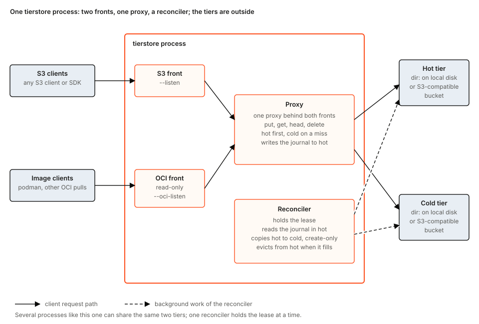
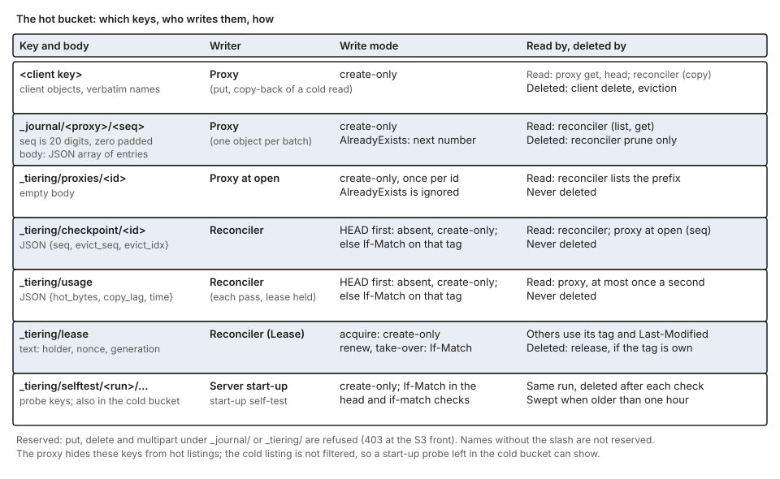
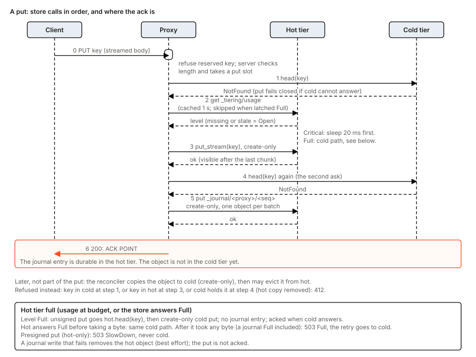
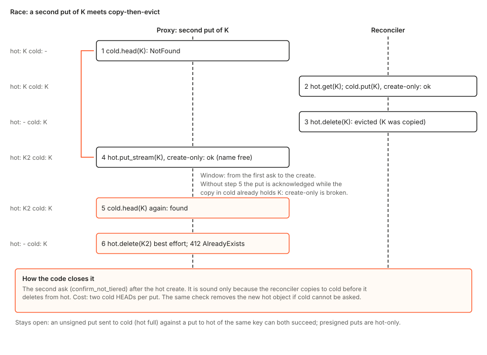
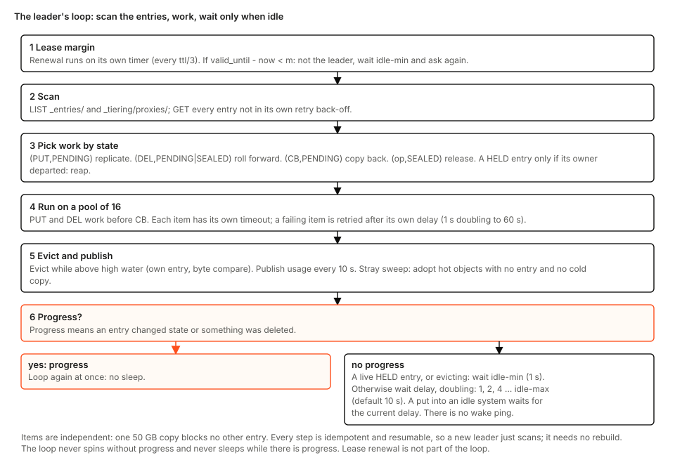
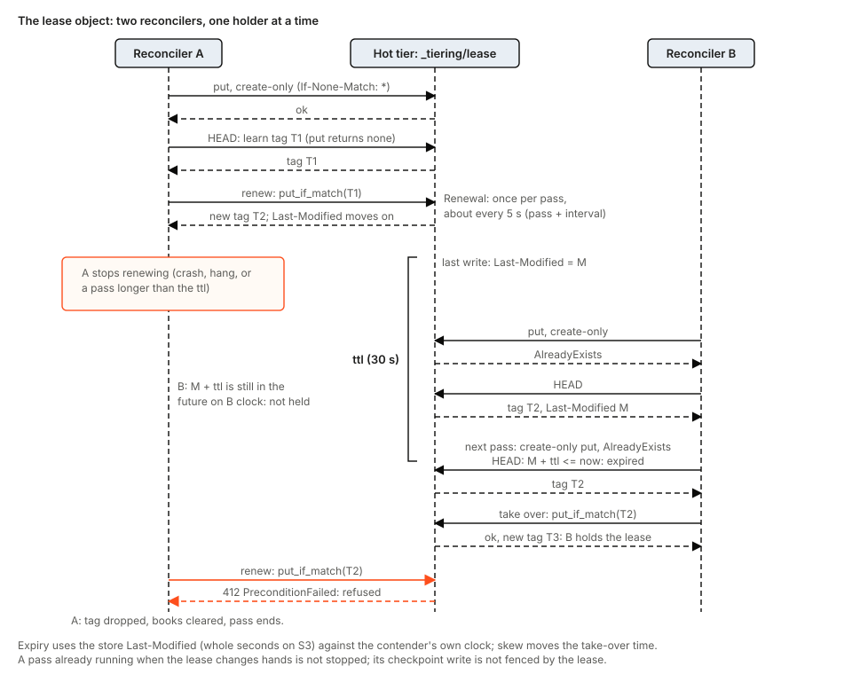

# tierstore core design

## 1. Status and scope

This document describes what the tierstore library core does at commit `a74d4d8`. It is written for a maintainer or contributor who has not read the code. It describes the code as it is, not as it is meant to be. Where a source comment and the code disagree, the code is described and the disagreement is noted. Every non-obvious claim links to the line that supports it.

**Covered:** the proxy, the reconciler, the lease, the journal, and the store contract (the `Backend` trait) with its start-up self-test.

**Not covered**, because each has its own documentation:

- The wire details of the S3 and OCI fronts. Only the points where a front changes what the core sees are mentioned (for example, how a streamed put reaches the proxy).
- The build-node shape (`local_cache` in front of one upstream). It has no journal, lease or reconciler ([configuration.md:176-199](https://github.com/komira-ai/tierstore/blob/a74d4d81d6b11f076277a0debd89eb1b12b0340a/crates/tierstore/docs/configuration.md#L176-L199)).
- The update hook and the hand-over of a running node between two process slots. See [tierstore-handover.md](tierstore-handover.md).
- Operator documentation: [crates/tierstore/docs/](https://github.com/komira-ai/tierstore/blob/a74d4d81d6b11f076277a0debd89eb1b12b0340a/crates/tierstore/docs/) (overview, configuration, operations, limits, metrics).

Two conventions. "The binary" means the `tierstore` server as shipped, whose flags override the library defaults; where they differ, both values are given. Every code link is pinned to commit `a74d4d8`, so it keeps pointing at the code this document describes. Settings are given as flags; each has a file key listed in [configuration.md](https://github.com/komira-ai/tierstore/blob/a74d4d81d6b11f076277a0debd89eb1b12b0340a/crates/tierstore/docs/configuration.md) (for example `--hot-bytes` is `hot_store.budget`). Terms in bold are defined in section 13 (glossary).

## 2. What tierstore is and what it promises

tierstore is an object store for immutable objects that keeps recent objects in a small, fast **hot tier** and the rest in a large, cheap **cold tier**. A client sees one bucket. The **proxy** answers every request. A **reconciler** moves objects from the hot tier to the cold tier in the background and deletes them from the hot tier when it fills ([overview.md:11-33](https://github.com/komira-ai/tierstore/blob/a74d4d81d6b11f076277a0debd89eb1b12b0340a/crates/tierstore/docs/overview.md#L11-L33)).

The tiers hold objects only. All coordination state lives in the hot tier as small objects under reserved prefixes (section 5). A tier is `memory` (tests), `dir:<path>` or `s3:<bucket>` ([cli.rs:643-657](https://github.com/komira-ai/tierstore/blob/a74d4d81d6b11f076277a0debd89eb1b12b0340a/crates/tierstore/src/server/cli.rs#L643-L657)).

### What it promises

| Promise | Precisely | Source |
|---|---|---|
| Create-only | A put of a key that exists in either tier is refused with `AlreadyExists` (HTTP 412). There is no overwrite and no copy. The proxy refuses `put_if_match`. | [tiered.rs:536-551](https://github.com/komira-ai/tierstore/blob/a74d4d81d6b11f076277a0debd89eb1b12b0340a/crates/tierstore/src/tiered.rs#L536-L551), [tiered.rs:834-836](https://github.com/komira-ai/tierstore/blob/a74d4d81d6b11f076277a0debd89eb1b12b0340a/crates/tierstore/src/tiered.rs#L834-L836) |
| Acknowledged means journaled, for a hot put | A put that goes to the hot tier is acknowledged only after the journal object holding its entry is written to the hot tier, and a put whose journaling fails is deleted from the hot tier again. A put the proxy sends straight to the cold tier (hot tier full, or a multipart completion) is not journaled and is acknowledged once the cold tier has it. A put is never acknowledged merely because the reconciler has not yet copied it. | [tiered.rs:405-411](https://github.com/komira-ai/tierstore/blob/a74d4d81d6b11f076277a0debd89eb1b12b0340a/crates/tierstore/src/tiered.rs#L405-L411), [tiered.rs:518-534](https://github.com/komira-ai/tierstore/blob/a74d4d81d6b11f076277a0debd89eb1b12b0340a/crates/tierstore/src/tiered.rs#L518-L534), [tiered.rs:543-544](https://github.com/komira-ai/tierstore/blob/a74d4d81d6b11f076277a0debd89eb1b12b0340a/crates/tierstore/src/tiered.rs#L543-L544), [tiered.rs:486-489](https://github.com/komira-ai/tierstore/blob/a74d4d81d6b11f076277a0debd89eb1b12b0340a/crates/tierstore/src/tiered.rs#L486-L489) |
| Durable as far as the hot tier is | On a `dir:` hot tier the file and its directory entry are synced before the call returns. On an S3 hot tier durability is the store's own. | [dir.rs:441-462](https://github.com/komira-ai/tierstore/blob/a74d4d81d6b11f076277a0debd89eb1b12b0340a/crates/tierstore/src/dir.rs#L441-L462) |
| No partial object | A streamed put whose body ends in error leaves no object in either tier and no journal entry. | [backend.rs:190-222](https://github.com/komira-ai/tierstore/blob/a74d4d81d6b11f076277a0debd89eb1b12b0340a/crates/tierstore/src/backend.rs#L190-L222), [streaming.rs:67](https://github.com/komira-ai/tierstore/blob/a74d4d81d6b11f076277a0debd89eb1b12b0340a/crates/tierstore/tests/tierstore/streaming.rs#L67) |
| Read-your-write | A get or head after an acknowledged put sees the object, from the hot tier or after eviction from the cold tier. This holds because the reconciler copies to cold before it deletes from hot, and the proxy reads hot first, then cold. | [tiered.rs:675-711](https://github.com/komira-ai/tierstore/blob/a74d4d81d6b11f076277a0debd89eb1b12b0340a/crates/tierstore/src/tiered.rs#L675-L711), [reconciler.rs:193-213](https://github.com/komira-ai/tierstore/blob/a74d4d81d6b11f076277a0debd89eb1b12b0340a/crates/tierstore/src/reconciler.rs#L193-L213) |
| Listing | A listing is the union of both tiers, in key order, the hot entry winning on a duplicate. It is as consistent as the two stores' own listings, and a deleted key can still list from the cold tier until the reconciler applies its delete entry (section 7). | [tiered.rs:748-799](https://github.com/komira-ai/tierstore/blob/a74d4d81d6b11f076277a0debd89eb1b12b0340a/crates/tierstore/src/tiered.rs#L748-L799) |

### What it does not promise

- **A hot tier that is lost loses the objects not yet copied.** The window is the copy lag, which the reconciler publishes inside the hot tier; `/metricz` does not export it ([limits.md:11](https://github.com/komira-ai/tierstore/blob/a74d4d81d6b11f076277a0debd89eb1b12b0340a/crates/tierstore/docs/limits.md#L11)).
- **No atomicity across two tiers.** Create-only across both tiers is built from four checks (section 6). It is not atomic: two unsigned puts of one key, one to each tier, can both succeed ([tiered.rs:205-211](https://github.com/komira-ai/tierstore/blob/a74d4d81d6b11f076277a0debd89eb1b12b0340a/crates/tierstore/src/tiered.rs#L205-L211)).
- **No overwrite, no versioning, no scrub.** Nothing re-reads stored objects to find rot ([limits.md:9](https://github.com/komira-ai/tierstore/blob/a74d4d81d6b11f076277a0debd89eb1b12b0340a/crates/tierstore/docs/limits.md#L9)).
- **No guarantee under clock skew.** Lease expiry, journal retention and usage freshness compare timestamps from different machines and the store (section 9).
- **No transactions across keys.** A delete is hot, then cold, then a journal entry, and is not atomic ([tiered.rs:741-746](https://github.com/komira-ai/tierstore/blob/a74d4d81d6b11f076277a0debd89eb1b12b0340a/crates/tierstore/src/tiered.rs#L741-L746)).

### Why it is built this way

- **A journal rather than listing the hot tier.** The reconciler learns what the hot tier holds from journal objects, never from a listing of the data prefixes ([lib.rs:55-57](https://github.com/komira-ai/tierstore/blob/a74d4d81d6b11f076277a0debd89eb1b12b0340a/crates/tierstore/src/lib.rs#L55-L57)), so a pass costs work proportional to new writes, and a put is acknowledged after one small create-only write ([tiered.rs:405-411](https://github.com/komira-ai/tierstore/blob/a74d4d81d6b11f076277a0debd89eb1b12b0340a/crates/tierstore/src/tiered.rs#L405-L411)). Were the hot tier listed, the cost of a pass would grow with the number of objects held.
- **Coordination state in the hot tier.** No third service is needed: the lease, checkpoints and usage need only create-only and `If-Match` writes ([backend.rs:241-247](https://github.com/komira-ai/tierstore/blob/a74d4d81d6b11f076277a0debd89eb1b12b0340a/crates/tierstore/src/backend.rs#L241-L247), [lease.rs:77-82](https://github.com/komira-ai/tierstore/blob/a74d4d81d6b11f076277a0debd89eb1b12b0340a/crates/tierstore/src/lease.rs#L77-L82)). On a store without atomic conditional writes there is no safe way to choose one reconciler.
- **Copy to cold strictly before delete from hot.** This order is the premise of read-your-write and of the second cold HEAD of a put ([reconciler.rs:193-213](https://github.com/komira-ai/tierstore/blob/a74d4d81d6b11f076277a0debd89eb1b12b0340a/crates/tierstore/src/reconciler.rs#L193-L213), [tiered.rs:501-516](https://github.com/komira-ai/tierstore/blob/a74d4d81d6b11f076277a0debd89eb1b12b0340a/crates/tierstore/src/tiered.rs#L501-L516)). Reverse it and an acknowledged object can be in neither tier for a moment.
- **First-in-first-out eviction.** Nothing records reads, so the reconciler needs only journal order ([state.rs:199-240](https://github.com/komira-ai/tierstore/blob/a74d4d81d6b11f076277a0debd89eb1b12b0340a/crates/tierstore/src/state.rs#L199-L240)). Eviction by recency would need a read log the design does not have.
- **Presigned puts are hot-only.** One create-only write in one store decides a race between presigned puts ([tiered.rs:585-588](https://github.com/komira-ai/tierstore/blob/a74d4d81d6b11f076277a0debd89eb1b12b0340a/crates/tierstore/src/tiered.rs#L585-L588)). Sent to cold they would race writes that no single store decides.
- **A proxy reads its checkpoint's `seq` when it opens.** After a prune the journal prefix may be empty, and a proxy that restarted at 1 would reuse numbers the reconciler has already read and never reads again ([tiered.rs:284-317](https://github.com/komira-ai/tierstore/blob/a74d4d81d6b11f076277a0debd89eb1b12b0340a/crates/tierstore/src/tiered.rs#L284-L317), [reconciler.rs:248-271](https://github.com/komira-ai/tierstore/blob/a74d4d81d6b11f076277a0debd89eb1b12b0340a/crates/tierstore/src/reconciler.rs#L248-L271)).

## 3. Components and deployment shapes

One `tierstore` process runs three things over one pair of tiers ([cli.rs:1104-1141](https://github.com/komira-ai/tierstore/blob/a74d4d81d6b11f076277a0debd89eb1b12b0340a/crates/tierstore/src/server/cli.rs#L1104-L1141)):

- **Proxy.** Answers reads, writes, deletes and listings against the two tiers. It keeps almost no state: a cached capacity reading and a full latch ([tiered.rs:76-104](https://github.com/komira-ai/tierstore/blob/a74d4d81d6b11f076277a0debd89eb1b12b0340a/crates/tierstore/src/tiered.rs#L76-L104)), the open journal batch, its next journal number and its read counters ([tiered.rs:262-273](https://github.com/komira-ai/tierstore/blob/a74d4d81d6b11f076277a0debd89eb1b12b0340a/crates/tierstore/src/tiered.rs#L262-L273)). Each proxy has a **proxy id**, which names its journal and is validated non-empty and without `/` ([tiered.rs:289-292](https://github.com/komira-ai/tierstore/blob/a74d4d81d6b11f076277a0debd89eb1b12b0340a/crates/tierstore/src/tiered.rs#L289-L292)). A proxy id must be unique among processes running at once over the same tiers. Nothing enforces it; two writers under one id share one journal and one checkpoint (R23).
- **Front.** The S3 front (SigV4, one bucket, plain HTTP) calls the proxy as a `Backend`. The OCI front is read-only and shares the same proxy. In the binary the S3 server's backend is the proxy itself; there is no cache in between ([cli.rs:1104-1109](https://github.com/komira-ai/tierstore/blob/a74d4d81d6b11f076277a0debd89eb1b12b0340a/crates/tierstore/src/server/cli.rs#L1104-L1109)).
- **Reconciler.** Copies journaled puts to the cold tier, applies journaled deletes, evicts from the hot tier, checkpoints and prunes. It is built over the raw hot and cold backends, not over the proxy ([cli.rs:1133-1140](https://github.com/komira-ai/tierstore/blob/a74d4d81d6b11f076277a0debd89eb1b12b0340a/crates/tierstore/src/server/cli.rs#L1133-L1140)). Exactly one reconciler works at a time, chosen by the **lease** ([reconciler.rs:193-198](https://github.com/komira-ai/tierstore/blob/a74d4d81d6b11f076277a0debd89eb1b12b0340a/crates/tierstore/src/reconciler.rs#L193-L198), [lease.rs:77-82](https://github.com/komira-ai/tierstore/blob/a74d4d81d6b11f076277a0debd89eb1b12b0340a/crates/tierstore/src/lease.rs#L77-L82)).

The proxy needs no state for correctness: any number of proxies, each with its own id, work over the same two backends ([tiered.rs:125-128](https://github.com/komira-ai/tierstore/blob/a74d4d81d6b11f076277a0debd89eb1b12b0340a/crates/tierstore/src/tiered.rs#L125-L128)).

### Deployment shapes

| Shape | What runs | Notes |
|---|---|---|
| One node | One process over `dir:` (or `memory`) tiers | `memory` cannot be shared between processes. |
| Several processes over shared tiers | Several proxies, one reconciler by lease | The lease needs an atomic `If-Match`. A `dir:` hot tier gives that only inside one process (section 9). |
| Hand-over on one node | Two process slots side by side, proxy ids `tierstore-9301` and `tierstore-9302`, one `--lock-file` | The process holding the file lock runs the reconciler; the other only serves. See [tierstore-handover.md](tierstore-handover.md). |
| Build node | `local_cache` over one upstream | Out of scope. No journal, lease or reconciler. |

The documented v1 layout is a hot tier on SSD (`dir:`) in front of a cold tier on disks or an S3 bucket ([overview.md:19-24](https://github.com/komira-ai/tierstore/blob/a74d4d81d6b11f076277a0debd89eb1b12b0340a/crates/tierstore/docs/overview.md#L19-L24)); the example unit uses `s3:` for both ([tierstore@.service:54-60](https://github.com/komira-ai/tierstore/blob/a74d4d81d6b11f076277a0debd89eb1b12b0340a/packaging/tierstore@.service#L54-L60)). `CachedStore`, a RAM read cache, is exported by the library but is not used by the binary ([lib.rs:58-59](https://github.com/komira-ai/tierstore/blob/a74d4d81d6b11f076277a0debd89eb1b12b0340a/crates/tierstore/src/lib.rs#L58-L59)).

## 4. What tierstore assumes of a store

Both tiers are used through one trait, `Backend`, held as `dyn Backend` so a proxy has two tiers without a type parameter ([backend.rs:160-172](https://github.com/komira-ai/tierstore/blob/a74d4d81d6b11f076277a0debd89eb1b12b0340a/crates/tierstore/src/backend.rs#L160-L172)). The contract in short:

- `put` and `put_stream` are create-only and return `AlreadyExists` or `Full` ([backend.rs:183-222](https://github.com/komira-ai/tierstore/blob/a74d4d81d6b11f076277a0debd89eb1b12b0340a/crates/tierstore/src/backend.rs#L183-L222)).
- `put_if_match(key, body, etag)` replaces only if the current content tag equals `etag`, returns the new tag, and fails with `NotFound` or `PreconditionFailed` ([backend.rs:241-247](https://github.com/komira-ai/tierstore/blob/a74d4d81d6b11f076277a0debd89eb1b12b0340a/crates/tierstore/src/backend.rs#L241-L247)). It is used only for the small objects the core rewrites: lease, checkpoint, usage.
- `head` returns size, content tag and modified time. Two metas have the same content if size and tag are equal; the tag must be the same function of the content on both sides of a comparison ([backend.rs:77-101](https://github.com/komira-ai/tierstore/blob/a74d4d81d6b11f076277a0debd89eb1b12b0340a/crates/tierstore/src/backend.rs#L77-L101)).
- `delete` of a missing key succeeds ([backend.rs:277-279](https://github.com/komira-ai/tierstore/blob/a74d4d81d6b11f076277a0debd89eb1b12b0340a/crates/tierstore/src/backend.rs#L277-L279)).
- `list` and `list_page` return keys in ascending order; the last key of a page is the continuation token and a short page is the last ([backend.rs:281-306](https://github.com/komira-ai/tierstore/blob/a74d4d81d6b11f076277a0debd89eb1b12b0340a/crates/tierstore/src/backend.rs#L281-L306)).
- Multipart calls default to `Unsupported`; `complete_upload` is create-only ([backend.rs:308-430](https://github.com/komira-ai/tierstore/blob/a74d4d81d6b11f076277a0debd89eb1b12b0340a/crates/tierstore/src/backend.rs#L308-L430)).
- A network backend bounds each call with its own timeout; a call that never returns stalls copies and deletes ([backend.rs:167-170](https://github.com/komira-ai/tierstore/blob/a74d4d81d6b11f076277a0debd89eb1b12b0340a/crates/tierstore/src/backend.rs#L167-L170)).

### The tag problem

`DirBackend` and `MemoryBackend` tag an object with the hex SHA-256 of its body ([dir.rs:19-20](https://github.com/komira-ai/tierstore/blob/a74d4d81d6b11f076277a0debd89eb1b12b0340a/crates/tierstore/src/dir.rs#L19-L20), [memory.rs:58-61](https://github.com/komira-ai/tierstore/blob/a74d4d81d6b11f076277a0debd89eb1b12b0340a/crates/tierstore/src/memory.rs#L58-L61)). `S3Backend` tags with the store's ETag: an MD5 for a single PUT. The ETag of an object made by a multipart upload is not the MD5 of its bytes ([s3.rs:48-50](https://github.com/komira-ai/tierstore/blob/a74d4d81d6b11f076277a0debd89eb1b12b0340a/crates/tierstore/src/s3.rs#L48-L50)); that shape is S3's behaviour and is not asserted in code. The comment at [s3.rs:71-73](https://github.com/komira-ai/tierstore/blob/a74d4d81d6b11f076277a0debd89eb1b12b0340a/crates/tierstore/src/s3.rs#L71-L73) says every write of this backend is one PUT; in the code a `put_stream` above 16 MiB is a multipart upload ([objstore-s3 s3/mod.rs:605-612](https://github.com/komira-ai/tierstore/blob/a74d4d81d6b11f076277a0debd89eb1b12b0340a/crates/objstore-s3/src/s3/mod.rs#L605-L612)), so a streamed large object in an S3 hot tier has a multipart tag while the reconciler's copy (`cold.put`, a single PUT) has an MD5 tag. A tag from a directory or memory tier and a tag from S3 never agree. The only place the core compares a tag from one tier with a tag from the other is the reconciler's `delete_cold` ([reconciler.rs:341-352](https://github.com/komira-ai/tierstore/blob/a74d4d81d6b11f076277a0debd89eb1b12b0340a/crates/tierstore/src/reconciler.rs#L341-L352)); everything else compares tags of one tier with that same tier ([lease.rs:88-91](https://github.com/komira-ai/tierstore/blob/a74d4d81d6b11f076277a0debd89eb1b12b0340a/crates/tierstore/src/lease.rs#L88-L91), [journal.rs:156-161](https://github.com/komira-ai/tierstore/blob/a74d4d81d6b11f076277a0debd89eb1b12b0340a/crates/tierstore/src/journal.rs#L156-L161)). So a `dir:` or `memory` hot tier over an S3 cold tier compares tags that cannot match. Nothing at start-up checks that the tiers share a tag function. See section 12.

### The start-up self-test

Before binding any address the server runs a self-test against each tier, hot first, then cold ([cli.rs:971-1012](https://github.com/komira-ai/tierstore/blob/a74d4d81d6b11f076277a0debd89eb1b12b0340a/crates/tierstore/src/server/cli.rs#L971-L1012)). Probe keys live under `_tiering/selftest/<run id>/` in the tier's own bucket and are deleted after each check ([selftest.rs:54-76](https://github.com/komira-ai/tierstore/blob/a74d4d81d6b11f076277a0debd89eb1b12b0340a/crates/tierstore/src/selftest.rs#L54-L76)). A wrong answer is a **violation** and the process exits with status 3 without retry. An `Unavailable` answer is retried with pauses of 1 s doubling to 30 s until `--backend-check-wait` (5 minutes); then the start fails with status 1. A `Full` answer skips the write checks with a note ([selftest.rs:309-342](https://github.com/komira-ai/tierstore/blob/a74d4d81d6b11f076277a0debd89eb1b12b0340a/crates/tierstore/src/selftest.rs#L309-L342), [cli.rs:1366-1380](https://github.com/komira-ai/tierstore/blob/a74d4d81d6b11f076277a0debd89eb1b12b0340a/crates/tierstore/src/server/cli.rs#L1366-L1380)). Only `multipart-conditional` can be skipped, and only with a reason ([cli.rs:472-505](https://github.com/komira-ai/tierstore/blob/a74d4d81d6b11f076277a0debd89eb1b12b0340a/crates/tierstore/src/server/cli.rs#L472-L505)).

| Guarantee relied on | Why the core needs it | Self-test check | 
|---|---|---|
| Create-only put refuses a second put | One winner per key; the lease is taken create-only | `create-only`: a second put with different bytes must give `AlreadyExists` or `PreconditionFailed` ([selftest.rs:527-533](https://github.com/komira-ai/tierstore/blob/a74d4d81d6b11f076277a0debd89eb1b12b0340a/crates/tierstore/src/selftest.rs#L527-L533)). It does not read the object back. |
| HEAD gives size and a non-empty tag; the tag `put_if_match` returns equals the next HEAD tag | Lease and checkpoint use the tag from HEAD | `head` ([selftest.rs:535-548](https://github.com/komira-ai/tierstore/blob/a74d4d81d6b11f076277a0debd89eb1b12b0340a/crates/tierstore/src/selftest.rs#L535-L548)). `modified` is not examined by the check. On S3 a HEAD without `Last-Modified` already fails inside the client. |
| `If-Match` refuses a wrong tag and accepts the right one | Lease take-over and renewal | `if-match` ([selftest.rs:550-564](https://github.com/komira-ai/tierstore/blob/a74d4d81d6b11f076277a0debd89eb1b12b0340a/crates/tierstore/src/selftest.rs#L550-L564)) |
| Ranged read returns the exact bytes | Ranged gets | `range`: one in-range read ([selftest.rs:566-574](https://github.com/komira-ai/tierstore/blob/a74d4d81d6b11f076277a0debd89eb1b12b0340a/crates/tierstore/src/selftest.rs#L566-L574)). Past-end, zero-length and offset-equals-size are not checked. |
| Listing is ordered, paged, honours `start_after` | Journal reading by `start_after` | `paging` ([selftest.rs:576-602](https://github.com/komira-ai/tierstore/blob/a74d4d81d6b11f076277a0debd89eb1b12b0340a/crates/tierstore/src/selftest.rs#L576-L602)). Through `S3Backend`, continuation tokens and a store ignoring `max-keys` are hidden. |
| Multipart completion is create-only (cold tier only) | The proxy never HEADs the cold tier at completion | `multipart-conditional` ([selftest.rs:604-629](https://github.com/komira-ai/tierstore/blob/a74d4d81d6b11f076277a0debd89eb1b12b0340a/crates/tierstore/src/selftest.rs#L604-L629)). Skippable. |
| Create-only and `If-Match` are atomic under concurrent writers | One winner; one lease holder | Not checked: every check issues its calls one after another from a single task ([selftest.rs:299-331](https://github.com/komira-ai/tierstore/blob/a74d4d81d6b11f076277a0debd89eb1b12b0340a/crates/tierstore/src/selftest.rs#L299-L331), [selftest.rs:527-564](https://github.com/komira-ai/tierstore/blob/a74d4d81d6b11f076277a0debd89eb1b12b0340a/crates/tierstore/src/selftest.rs#L527-L564)). |
| A tag is the same function on both tiers | `delete_cold` | Not checked |
| Strong read-after-write for get, head, and listing | Probes and journal reading | Implicitly: the checks read immediately after writing, so a lagging store fails them, though the trait says listings need not be consistent ([backend.rs:281-283](https://github.com/komira-ai/tierstore/blob/a74d4d81d6b11f076277a0debd89eb1b12b0340a/crates/tierstore/src/backend.rs#L281-L283)). |
| `NotFound` for a missing key | Many call sites | Not checked directly |
| Clock agreement between the store's `Last-Modified` and this machine | Lease expiry, retention | Not checked. The requirement is stated in [clock.rs:5-14](https://github.com/komira-ai/tierstore/blob/a74d4d81d6b11f076277a0debd89eb1b12b0340a/crates/tierstore/src/clock.rs#L5-L14) and [reconciler.rs:40-41](https://github.com/komira-ai/tierstore/blob/a74d4d81d6b11f076277a0debd89eb1b12b0340a/crates/tierstore/src/reconciler.rs#L40-L41); `build` checks only the flag relations ([cli.rs:659-677](https://github.com/komira-ai/tierstore/blob/a74d4d81d6b11f076277a0debd89eb1b12b0340a/crates/tierstore/src/server/cli.rs#L659-L677)) and the self-test reads no clock. |
| Durability and replication | Acknowledged means durable | Not checked |
| `put_stream`, `get_stream`, `put_stream_hot_only`, the over-16 MiB multipart put path | Client writes | Not checked; the probes use `put`, not streaming |
| `Full` and `Unavailable` are told apart correctly | Fallback to cold; retry | Not checked by the test; the S3 mapping is unit-tested ([s3.rs:237-266](https://github.com/komira-ai/tierstore/blob/a74d4d81d6b11f076277a0debd89eb1b12b0340a/crates/tierstore/src/s3.rs#L237-L266), [s3.rs:547-582](https://github.com/komira-ai/tierstore/blob/a74d4d81d6b11f076277a0debd89eb1b12b0340a/crates/tierstore/src/s3.rs#L547-L582)) |

How `S3Backend` maps store answers: 507 is `Full`; 408, 429, other 5xx (except 501), transport failures and a 409 `ConditionalRequestConflict` are `Unavailable`; 412 on a create-only put is `AlreadyExists`; 412 on `put_if_match` is `PreconditionFailed`; 501 and all else is `Other` ([s3.rs:237-266](https://github.com/komira-ai/tierstore/blob/a74d4d81d6b11f076277a0debd89eb1b12b0340a/crates/tierstore/src/s3.rs#L237-L266)). A 409 conflict means the outcome is unknown, so it is `Unavailable` and a retry then sees 412 if the other writer won. `S3Backend` forces the client to send `If-None-Match: *` on create-only puts ([s3.rs:138-142](https://github.com/komira-ai/tierstore/blob/a74d4d81d6b11f076277a0debd89eb1b12b0340a/crates/tierstore/src/s3.rs#L138-L142)). `DirBackend` returns `Full` only for a storage-full error and never returns `Unavailable` ([dir.rs:145-173](https://github.com/komira-ai/tierstore/blob/a74d4d81d6b11f076277a0debd89eb1b12b0340a/crates/tierstore/src/dir.rs#L145-L173)). Reads are sent again up to twice after a transport failure (three sends in all); writes are sent once ([mod.rs:70-107](https://github.com/komira-ai/tierstore/blob/a74d4d81d6b11f076277a0debd89eb1b12b0340a/crates/objstore-s3/src/s3/mod.rs#L70-L107), [mod.rs:618-635](https://github.com/komira-ai/tierstore/blob/a74d4d81d6b11f076277a0debd89eb1b12b0340a/crates/objstore-s3/src/s3/mod.rs#L618-L635), [tagged.rs:8](https://github.com/komira-ai/tierstore/blob/a74d4d81d6b11f076277a0debd89eb1b12b0340a/crates/objstore-s3/src/s3/tagged.rs#L8)).

After each tier passes its own self-test (hot first, then cold), a **sweep** of that tier deletes probe keys left by a killed start: those not of this run and older than one hour by the store's clock, at most 100 deletes within 10 seconds, looking at the first 1000 keys only. If a tier's test fails, the start ends before that tier's sweep and before the other tier is touched ([cli.rs:989-1010](https://github.com/komira-ai/tierstore/blob/a74d4d81d6b11f076277a0debd89eb1b12b0340a/crates/tierstore/src/server/cli.rs#L989-L1010), [selftest.rs:463-525](https://github.com/komira-ai/tierstore/blob/a74d4d81d6b11f076277a0debd89eb1b12b0340a/crates/tierstore/src/selftest.rs#L463-L525)).

## 5. State

### The hot bucket

The core writes two kinds of name into the hot bucket: client objects under their own keys, and the reserved namespaces `_journal/` and `_tiering/` ([journal.rs:17-35](https://github.com/komira-ai/tierstore/blob/a74d4d81d6b11f076277a0debd89eb1b12b0340a/crates/tierstore/src/journal.rs#L17-L35)). There is no second layout. A key is reserved if it starts with either prefix; a key named exactly `_tiering` is not ([journal.rs:30-33](https://github.com/komira-ai/tierstore/blob/a74d4d81d6b11f076277a0debd89eb1b12b0340a/crates/tierstore/src/journal.rs#L30-L33)).

| Key | Writer | Write mode | Format | Reader | Lifetime |
|---|---|---|---|---|---|
| client key | proxy (put, copy-back) | create-only | the client's bytes | proxy; reconciler (`get` to copy) | until evicted or deleted |
| `_journal/<proxy_id>/<seq:020>` | proxy | create-only; on `AlreadyExists` the next number is tried | JSON array of entries `{op, key, size, time}` | reconciler; the proxy at open lists only to find the highest number | deleted by prune once applied, passed by the eviction cursor and older than retention (24 h in the binary, 1 h library default). Objects before the checkpoint cursor at the time of a restart are not read again and are never deleted ([reconciler.rs:148-149](https://github.com/komira-ai/tierstore/blob/a74d4d81d6b11f076277a0debd89eb1b12b0340a/crates/tierstore/src/reconciler.rs#L148-L149), [cli.rs:333-335](https://github.com/komira-ai/tierstore/blob/a74d4d81d6b11f076277a0debd89eb1b12b0340a/crates/tierstore/src/server/cli.rs#L333-L335)) |
| `_tiering/proxies/<proxy_id>` | proxy at open | create-only, empty body, `AlreadyExists` ignored | empty | reconciler discovery | never deleted by any code |
| `_tiering/checkpoint/<proxy_id>` | reconciler | HEAD, then create-only if absent, else `put_if_match` on the HEAD's tag | JSON `{seq, evict_seq, evict_idx}` | reconciler at discovery; proxy at open (uses `seq`) | never deleted |
| `_tiering/usage` | reconciler, last step of each pass it holds the lease | same as checkpoint | JSON `{hot_bytes, copy_lag, time}` | proxy (cached 1 s); `/usagez` | never deleted |
| `_tiering/lease` | reconciler | create-only to acquire; `put_if_match` to renew and take over | text: `holder`, `nonce`, `generation`, one per line | only its tag and `modified` are used; the body is never read | deleted on release if the tag is still the holder's. The holder is the process's proxy id; across a hand-over the two slots hold under different names, so a release before exit is what lets the second slot acquire without waiting a ttl ([cli.rs:687](https://github.com/komira-ai/tierstore/blob/a74d4d81d6b11f076277a0debd89eb1b12b0340a/crates/tierstore/src/server/cli.rs#L687)) |
| `_tiering/selftest/<run>/...` | self-test | create-only, `put_if_match`, multipart | short literals | the self-test | deleted after each check; swept after an hour |

Sources: journal object and entry ([journal.rs:61-110](https://github.com/komira-ai/tierstore/blob/a74d4d81d6b11f076277a0debd89eb1b12b0340a/crates/tierstore/src/journal.rs#L61-L110), [tiered.rs:371-392](https://github.com/komira-ai/tierstore/blob/a74d4d81d6b11f076277a0debd89eb1b12b0340a/crates/tierstore/src/tiered.rs#L371-L392)); proxy marker ([tiered.rs:300-303](https://github.com/komira-ai/tierstore/blob/a74d4d81d6b11f076277a0debd89eb1b12b0340a/crates/tierstore/src/tiered.rs#L300-L303)); checkpoint and usage ([journal.rs:113-137](https://github.com/komira-ai/tierstore/blob/a74d4d81d6b11f076277a0debd89eb1b12b0340a/crates/tierstore/src/journal.rs#L113-L137)); write mode of those two ([journal.rs:153-161](https://github.com/komira-ai/tierstore/blob/a74d4d81d6b11f076277a0debd89eb1b12b0340a/crates/tierstore/src/journal.rs#L153-L161)); lease body ([lease.rs:98-104](https://github.com/komira-ai/tierstore/blob/a74d4d81d6b11f076277a0debd89eb1b12b0340a/crates/tierstore/src/lease.rs#L98-L104)); self-test ([selftest.rs:54-76](https://github.com/komira-ai/tierstore/blob/a74d4d81d6b11f076277a0debd89eb1b12b0340a/crates/tierstore/src/selftest.rs#L54-L76)).

Notes on the journal:

- Numbers start at 1. A proxy that opens resumes at one more than the larger of the highest journal number it lists under its own prefix and its checkpoint's `seq` ([tiered.rs:284-317](https://github.com/komira-ai/tierstore/blob/a74d4d81d6b11f076277a0debd89eb1b12b0340a/crates/tierstore/src/tiered.rs#L284-L317)).
- On a failed write the number is **not** advanced and the next batch reuses it. On `AlreadyExists` the number is advanced and the write retried with no bound ([tiered.rs:380-391](https://github.com/komira-ai/tierstore/blob/a74d4d81d6b11f076277a0debd89eb1b12b0340a/crates/tierstore/src/tiered.rs#L380-L391)).
- The reconciler reads from one past what it has read and stops, silently, at the first listed key that is not the next number ([reconciler.rs:248-271](https://github.com/komira-ai/tierstore/blob/a74d4d81d6b11f076277a0debd89eb1b12b0340a/crates/tierstore/src/reconciler.rs#L248-L271)).
- A batch holds up to 64 entries (not configurable in the binary) and is written after the linger (20 ms in the binary, 50 ms library default), one journal object at a time per proxy ([tiered.rs:353-401](https://github.com/komira-ai/tierstore/blob/a74d4d81d6b11f076277a0debd89eb1b12b0340a/crates/tierstore/src/tiered.rs#L353-L401), [cli.rs:684-686](https://github.com/komira-ai/tierstore/blob/a74d4d81d6b11f076277a0debd89eb1b12b0340a/crates/tierstore/src/server/cli.rs#L684-L686)).
- A `DELETE` entry has size 0. An unknown `op` decodes as `Unknown` and is skipped ([journal.rs:61-85](https://github.com/komira-ai/tierstore/blob/a74d4d81d6b11f076277a0debd89eb1b12b0340a/crates/tierstore/src/journal.rs#L61-L85)).

### The cold bucket

The cold bucket holds client objects under their own keys, written by the reconciler's copy, by puts that go straight to cold, and by multipart completion. Nothing under `_journal/` or other `_tiering/` names is written there except the self-test's probes ([reconciler.rs:324-352](https://github.com/komira-ai/tierstore/blob/a74d4d81d6b11f076277a0debd89eb1b12b0340a/crates/tierstore/src/reconciler.rs#L324-L352), [tiered.rs:480-499](https://github.com/komira-ai/tierstore/blob/a74d4d81d6b11f076277a0debd89eb1b12b0340a/crates/tierstore/src/tiered.rs#L480-L499)).

### In-memory state

Only the reconciler keeps state worth the name, and none of it is a record; it is rebuilt from checkpoints and journals ([state.rs:1-5](https://github.com/komira-ai/tierstore/blob/a74d4d81d6b11f076277a0debd89eb1b12b0340a/crates/tierstore/src/state.rs#L1-L5)).

- `Books`: an index of the latest put entry per key the hot tier is believed to hold (`proxy`, position `(seq, idx)`, `size`, `copied`), the sum of those sizes (`usage`), the sum of the uncopied ones (`lag`), and a `Stream` per proxy ([state.rs:15-22](https://github.com/komira-ai/tierstore/blob/a74d4d81d6b11f076277a0debd89eb1b12b0340a/crates/tierstore/src/state.rs#L15-L22), [state.rs:84-92](https://github.com/komira-ai/tierstore/blob/a74d4d81d6b11f076277a0debd89eb1b12b0340a/crates/tierstore/src/state.rs#L84-L92)).
- `Stream` per proxy: `read_through`, `checkpoint` (objects up to it are applied), `cursor` (entries before it are done with), a queue of **candidates** (copied puts not yet dropped from hot, in append order), a queue of **pending** objects (read, not applied), **retained** objects awaiting prune, and the **persisted** checkpoint ([state.rs:31-82](https://github.com/komira-ai/tierstore/blob/a74d4d81d6b11f076277a0debd89eb1b12b0340a/crates/tierstore/src/state.rs#L31-L82)).
- Books are reset when the lease is not held after an `ensure` and on `stop` ([reconciler.rs:186-198](https://github.com/komira-ai/tierstore/blob/a74d4d81d6b11f076277a0debd89eb1b12b0340a/crates/tierstore/src/reconciler.rs#L186-L198)).

The proxy's state is a capacity reading and a latch that says the hot tier answered `Full` ([tiered.rs:76-104](https://github.com/komira-ai/tierstore/blob/a74d4d81d6b11f076277a0debd89eb1b12b0340a/crates/tierstore/src/tiered.rs#L76-L104)), the open batch, the next journal number and the read counters ([tiered.rs:262-273](https://github.com/komira-ai/tierstore/blob/a74d4d81d6b11f076277a0debd89eb1b12b0340a/crates/tierstore/src/tiered.rs#L262-L273)).

### Invariants the code relies on and does not check

- A proxy id is unique among live processes (section 3, R23).
- The tag function is the same on both tiers (section 4).
- Create-only and `If-Match` are atomic under concurrent writers (section 4).
- Clock skew between the store and each machine is small against the lease ttl and the retention (section 9).
- A pass is shorter than the lease ttl (section 9).
- An object with no journal entry is invisible to eviction, usage and copy; the entry is written after the object and before the acknowledgement (sections 6, 8 and 10).

### Formats and versioning

No format carries a version: not the journal array, entries, checkpoint, usage, the lease body or the proxy marker. Tolerances that exist: an unknown `op` is skipped; no struct denies unknown fields, so an added field is ignored by an old reader. Missing fields are not tolerated, since none has a default. The journal's root is a bare array, so it cannot gain a top-level field without breaking old readers ([journal.rs:61-137](https://github.com/komira-ai/tierstore/blob/a74d4d81d6b11f076277a0debd89eb1b12b0340a/crates/tierstore/src/journal.rs#L61-L137)). See section 12.

## 6. The write path

Clients always reach the proxy through the **streamed** put. The S3 front sends every create-only put that is not a multipart part to `put_stream`, or to `put_stream_hot_only` if the request is presigned ([ops.rs:410-423](https://github.com/komira-ai/tierstore/blob/a74d4d81d6b11f076277a0debd89eb1b12b0340a/crates/tierstore/src/server/ops.rs#L410-L423)). The in-memory `Proxy::put` (the whole body held in memory) is not called by any server path, but the long comment on the proxy describes it, and the two differ in one place noted below.

### The front, before the proxy

In order: a reserved key is refused with 403 and no body is read; an object without `Content-Length` is refused with 411 if either tier needs a length (an S3 tier does); a declared length over `--max-request-bytes` (256 MiB) is refused with 413 before any byte is read; a permit is taken from a pool of `--max-concurrent-puts` (32), waiting up to `--put-permit-wait` (15 s) before 503 `SlowDown`. The backend call then runs on its own task so a client disconnect after the whole body arrived does not abandon it ([ops.rs:359-438](https://github.com/komira-ai/tierstore/blob/a74d4d81d6b11f076277a0debd89eb1b12b0340a/crates/tierstore/src/server/ops.rs#L359-L438)).

### A put, step by step

For a streamed put to a non-presigned key ([tiered.rs:603-626](https://github.com/komira-ai/tierstore/blob/a74d4d81d6b11f076277a0debd89eb1b12b0340a/crates/tierstore/src/tiered.rs#L603-L626), [tiered.rs:570-599](https://github.com/komira-ai/tierstore/blob/a74d4d81d6b11f076277a0debd89eb1b12b0340a/crates/tierstore/src/tiered.rs#L570-L599)):

1. Refuse a reserved key. No body is taken yet.
2. `cold.head(key)`. Found: `AlreadyExists`. Any error other than not-found fails the put, so a put fails closed if the cold tier cannot be asked.
3. Read the capacity **level** (below).
4. `Open`: continue. `Critical`: sleep 20 ms (fixed), then continue. `Full`: go to the cold path below.
5. `hot.put_stream(key, len, body)`. The object becomes visible only after the last chunk.
6. `cold.head(key)` again (`confirm_not_tiered`). Found: delete the new hot object, best effort, and return `AlreadyExists`. Error: delete it and return the error.
7. Append a `PUT` entry (size = bytes the hot tier actually took) and wait for the batch holding it to be written to the hot tier as `_journal/<id>/<seq>`.
8. **Acknowledge.** If step 7 fails, delete the hot object, best effort, and return the error.

The second cold HEAD exists because the reconciler copies to cold before deleting from hot. A put that wins the hot slot after that delete must therefore find the cold copy ([tiered.rs:501-516](https://github.com/komira-ai/tierstore/blob/a74d4d81d6b11f076277a0debd89eb1b12b0340a/crates/tierstore/src/tiered.rs#L501-L516), test [recheck.rs:118](https://github.com/komira-ai/tierstore/blob/a74d4d81d6b11f076277a0debd89eb1b12b0340a/crates/tierstore/tests/tierstore/recheck.rs#L118)). A put that goes to the hot tier makes two cold HEADs; a put that goes to the cold tier makes one ([tiered.rs:554-562](https://github.com/komira-ai/tierstore/blob/a74d4d81d6b11f076277a0debd89eb1b12b0340a/crates/tierstore/src/tiered.rs#L554-L562), [tiered.rs:603-626](https://github.com/komira-ai/tierstore/blob/a74d4d81d6b11f076277a0debd89eb1b12b0340a/crates/tierstore/src/tiered.rs#L603-L626)).

### Create-only across two tiers

The guarantee is four checks, none atomic with the others: the first cold HEAD; the hot tier's own create-only write (`hard_link` on a directory, `If-None-Match: *` on S3); the second cold HEAD; and, on the cold path, a hot HEAD before the cold create-only write ([tiered.rs:472-484](https://github.com/komira-ai/tierstore/blob/a74d4d81d6b11f076277a0debd89eb1b12b0340a/crates/tierstore/src/tiered.rs#L472-L484), [tiered.rs:508-516](https://github.com/komira-ai/tierstore/blob/a74d4d81d6b11f076277a0debd89eb1b12b0340a/crates/tierstore/src/tiered.rs#L508-L516), [dir.rs:442-445](https://github.com/komira-ai/tierstore/blob/a74d4d81d6b11f076277a0debd89eb1b12b0340a/crates/tierstore/src/dir.rs#L442-L445)). The cold path has no check after its write. That leaves one open window: a key written to cold because the hot tier looked full while another put creates it in hot ([tiered.rs:205-211](https://github.com/komira-ai/tierstore/blob/a74d4d81d6b11f076277a0debd89eb1b12b0340a/crates/tierstore/src/tiered.rs#L205-L211), test [one_winner.rs:419](https://github.com/komira-ai/tierstore/blob/a74d4d81d6b11f076277a0debd89eb1b12b0340a/crates/tierstore/tests/tierstore/one_winner.rs#L419)).

**Presigned puts** use `put_stream_hot_only`: when the level is `Full`, or the hot tier or the journal answers `Full`, the put gets `Error::Full` (503 `SlowDown`, `Retry-After: 1`) and nothing is written to cold. The hot tier's create-only write alone decides a race ([tiered.rs:585-588](https://github.com/komira-ai/tierstore/blob/a74d4d81d6b11f076277a0debd89eb1b12b0340a/crates/tierstore/src/tiered.rs#L585-L588), [backend.rs:224-239](https://github.com/komira-ai/tierstore/blob/a74d4d81d6b11f076277a0debd89eb1b12b0340a/crates/tierstore/src/backend.rs#L224-L239), [one_winner.rs:369-480](https://github.com/komira-ai/tierstore/blob/a74d4d81d6b11f076277a0debd89eb1b12b0340a/crates/tierstore/tests/tierstore/one_winner.rs#L369-L480)).

### Journal and the ack point

An entry joins the open batch. A batch is written when it reaches 64 entries or after the linger. Whichever caller polls first writes it; every caller awaits one shared outcome; if the writer is dropped another waiter writes it ([tiered.rs:353-401](https://github.com/komira-ai/tierstore/blob/a74d4d81d6b11f076277a0debd89eb1b12b0340a/crates/tierstore/src/tiered.rs#L353-L401), tests [journal.rs:12-160](https://github.com/komira-ai/tierstore/blob/a74d4d81d6b11f076277a0debd89eb1b12b0340a/crates/tierstore/tests/tierstore/journal.rs#L12-L160)). A failed batch fails every caller in it. Each put (and each background copy-back) then deletes its own hot object, best effort; a delete simply returns the error ([tiered.rs:741-746](https://github.com/komira-ai/tierstore/blob/a74d4d81d6b11f076277a0debd89eb1b12b0340a/crates/tierstore/src/tiered.rs#L741-L746)). If that delete fails the object stays in the hot tier, never copied, and a retry is refused as existing ([tiered.rs:405-411](https://github.com/komira-ai/tierstore/blob/a74d4d81d6b11f076277a0debd89eb1b12b0340a/crates/tierstore/src/tiered.rs#L405-L411), [journal.rs:88](https://github.com/komira-ai/tierstore/blob/a74d4d81d6b11f076277a0debd89eb1b12b0340a/crates/tierstore/tests/tierstore/journal.rs#L88)).

### Hot tier full

The proxy never measures the hot tier. **Level** comes from the reconciler's published usage ([tiered.rs:413-468](https://github.com/komira-ai/tierstore/blob/a74d4d81d6b11f076277a0debd89eb1b12b0340a/crates/tierstore/src/tiered.rs#L413-L468)):

- Usage at or above the budget (`--hot-bytes`) is `Full`; at or above the critical share (95%) is `Critical`; otherwise `Open`. The proxy rereads the usage object at most once per `usage_refresh` (1 s, fixed; `ProxyConfig::new`, [tiered.rs:50-59](https://github.com/komira-ai/tierstore/blob/a74d4d81d6b11f076277a0debd89eb1b12b0340a/crates/tierstore/src/tiered.rs#L50-L59)) and uses the cached answer in between, a missing or stale one included ([tiered.rs:435-441](https://github.com/komira-ai/tierstore/blob/a74d4d81d6b11f076277a0debd89eb1b12b0340a/crates/tierstore/src/tiered.rs#L435-L441)). A put can therefore act on a level up to 1 s old.
- A missing, unparsable, unreadable or older than 30 seconds usage counts as `Open`. A dead reconciler therefore leaves puts unrestrained ([tiered.rs:418-432](https://github.com/komira-ai/tierstore/blob/a74d4d81d6b11f076277a0debd89eb1b12b0340a/crates/tierstore/src/tiered.rs#L418-L432)). The proxy's 30 s limit is fixed; the flag `--usage-stale-after` (2 minutes) only drives `/usagez` ([cli.rs:680-686](https://github.com/komira-ai/tierstore/blob/a74d4d81d6b11f076277a0debd89eb1b12b0340a/crates/tierstore/src/server/cli.rs#L680-L686)).
- If the hot tier answers `Full` (storage full on a directory, 507 on S3), the proxy latches `Full` for one second (`usage_refresh`) without rereading usage. The latch uses tokio time, not the injected clock ([tiered.rs:413-416](https://github.com/komira-ai/tierstore/blob/a74d4d81d6b11f076277a0debd89eb1b12b0340a/crates/tierstore/src/tiered.rs#L413-L416)).

What a `Full` level does to a non-presigned put:

| Where `Full` shows up | In-memory put | Streamed put (what clients use) |
|---|---|---|
| Level at the start | Straight to cold: hot HEAD, then cold create-only, unjournaled | Same ([tiered.rs:554-562](https://github.com/komira-ai/tierstore/blob/a74d4d81d6b11f076277a0debd89eb1b12b0340a/crates/tierstore/src/tiered.rs#L554-L562)) |
| Hot object write, no bytes taken | Falls back to cold | Falls back to cold with the whole body |
| Hot object write, bytes already taken | Falls back to cold (body is in memory) | Fails with `Full`, unless no byte was taken (see the next row); the latch sends the retry to cold |
| Journal object write | Hot object deleted, falls back to cold | Hot object deleted, then fails with `Full`, except that a put that took no body bytes (a zero-length object) goes to cold instead. The rule is bytes taken, not which write was full ([tiered.rs:589-593](https://github.com/komira-ai/tierstore/blob/a74d4d81d6b11f076277a0debd89eb1b12b0340a/crates/tierstore/src/tiered.rs#L589-L593), [tiered.rs:238-240](https://github.com/komira-ai/tierstore/blob/a74d4d81d6b11f076277a0debd89eb1b12b0340a/crates/tierstore/src/tiered.rs#L238-L240)) |

The comment on the proxy says puts "never fail for lack of room in the hot tier"; that holds for the in-memory put and not for the streamed one. If cold is also full or down, its error goes to the client. Puts to cold are not journaled, so they are neither counted in usage nor copied.

### Multipart

All multipart calls go to the cold tier; the proxy holds no part. At completion the proxy HEADs the hot tier (found: `AlreadyExists`; error: the cold tier is not asked), then calls the cold tier's create-only `complete_upload`. There is no cold HEAD and no check after. The create-only guarantee against an object already in cold rests on the cold backend and on the `multipart-conditional` self-test. Nothing is journaled. A multipart object enters the hot tier only when a get copies it back ([tiered.rs:490-499](https://github.com/komira-ai/tierstore/blob/a74d4d81d6b11f076277a0debd89eb1b12b0340a/crates/tierstore/src/tiered.rs#L490-L499), [tiered.rs:865-952](https://github.com/komira-ai/tierstore/blob/a74d4d81d6b11f076277a0debd89eb1b12b0340a/crates/tierstore/src/tiered.rs#L865-L952), [multipart.rs:271-350](https://github.com/komira-ai/tierstore/blob/a74d4d81d6b11f076277a0debd89eb1b12b0340a/crates/tierstore/tests/tierstore/multipart.rs#L271-L350)).

### Buffering

The streamed put holds no body: the front's queue is four pieces ([handover.rs:27-47](https://github.com/komira-ai/tierstore/blob/a74d4d81d6b11f076277a0debd89eb1b12b0340a/crates/tierstore/src/server/handover.rs#L27-L47)), and `S3Backend` passes chunks through a one-chunk channel to one PUT (up to 16 MiB gathered) or a multipart upload, and holds the whole body only when no length is given, which is why the front demands one ([s3.rs:316-363](https://github.com/komira-ai/tierstore/blob/a74d4d81d6b11f076277a0debd89eb1b12b0340a/crates/tierstore/src/s3.rs#L316-L363)). The in-memory `put`, the reconciler's copy and the proxy's read path do hold whole objects (sections 7 and 8).

## 7. The read path, delete path and listing

### Get

([tiered.rs:675-711](https://github.com/komira-ai/tierstore/blob/a74d4d81d6b11f076277a0debd89eb1b12b0340a/crates/tierstore/src/tiered.rs#L675-L711), [tiered.rs:630-654](https://github.com/komira-ai/tierstore/blob/a74d4d81d6b11f076277a0debd89eb1b12b0340a/crates/tierstore/src/tiered.rs#L630-L654))

1. `hot.get`. Found: return. Any error other than not-found: return it; the cold tier is **not** tried.
2. On a hot miss, an unranged get calls `cold.get` and, unless the level is `Critical` or worse, **copies back**: a create-only `hot.put` of the whole object, awaited by the read.
3. A ranged get that misses hot reads the **whole** object from cold below the critical mark, copies it back and cuts the range. At `Critical` or `Full` it reads only the range from cold and copies nothing back.
4. A successful copy-back spawns a background task that appends a `PUT` entry (so the reconciler can count and evict it) and deletes the hot copy if the append fails. A failed copy-back never fails the read. No code awaits that task, so a process exit before it runs leaves an untracked hot object.

`Proxy` does not override `get_stream`, so the S3 front's streaming read is the default wrapper around `Proxy::get` and one whole `Bytes` ([backend.rs:266-269](https://github.com/komira-ai/tierstore/blob/a74d4d81d6b11f076277a0debd89eb1b12b0340a/crates/tierstore/src/backend.rs#L266-L269), [ops.rs:311-316](https://github.com/komira-ai/tierstore/blob/a74d4d81d6b11f076277a0debd89eb1b12b0340a/crates/tierstore/src/server/ops.rs#L311-L316)). The front does HEAD then GET, two proxy calls ([ops.rs:302-328](https://github.com/komira-ai/tierstore/blob/a74d4d81d6b11f076277a0debd89eb1b12b0340a/crates/tierstore/src/server/ops.rs#L302-L328)). There is no single-flight: N concurrent cold misses read the object N times; one copy-back wins and the others count as raced.

### Head

Hot, else cold, on a hot not-found only; any other hot error is returned without asking cold. No copy-back ([tiered.rs:713-739](https://github.com/komira-ai/tierstore/blob/a74d4d81d6b11f076277a0debd89eb1b12b0340a/crates/tierstore/src/tiered.rs#L713-L739)).

### Delete

([tiered.rs:741-746](https://github.com/komira-ai/tierstore/blob/a74d4d81d6b11f076277a0debd89eb1b12b0340a/crates/tierstore/src/tiered.rs#L741-L746))

1. Refuse a reserved key.
2. `hot.delete`, then `cold.delete`; either failing returns the error and writes no journal entry.
3. Append a `DELETE` entry and wait for its journal object.

Deleting an absent key succeeds and is journaled. A journal failure returns an error for a delete that has taken effect; a retry is safe ([faults.rs:79-122](https://github.com/komira-ai/tierstore/blob/a74d4d81d6b11f076277a0debd89eb1b12b0340a/crates/tierstore/tests/tierstore/faults.rs#L79-L122)). The front runs the delete on its own task so a disconnect cannot split it ([ops.rs:453-459](https://github.com/komira-ai/tierstore/blob/a74d4d81d6b11f076277a0debd89eb1b12b0340a/crates/tierstore/src/server/ops.rs#L453-L459)). The delete entry exists so the reconciler can undo a cold copy that was in flight (section 8).

### Listing

`list` is hot, then cold, merged in key order with the hot entry winning. `list_page` reads the hot tier in as many pages as it takes to find `max_keys` non-reserved objects after `start_after`, reads one page of `max_keys` from the cold tier, merges them (the hot entry wins) and returns the first `max_keys` ([tiered.rs:755-791](https://github.com/komira-ai/tierstore/blob/a74d4d81d6b11f076277a0debd89eb1b12b0340a/crates/tierstore/src/tiered.rs#L755-L791)). The proxy has no continuation token. The S3 front asks for `max_keys + 1` and encodes the last returned key as the token ([ops.rs:161-164](https://github.com/komira-ai/tierstore/blob/a74d4d81d6b11f076277a0debd89eb1b12b0340a/crates/tierstore/src/server/ops.rs#L161-L164), [ops.rs:461-482](https://github.com/komira-ai/tierstore/blob/a74d4d81d6b11f076277a0debd89eb1b12b0340a/crates/tierstore/src/server/ops.rs#L461-L482)). Hot is read first, so a key evicted between the two calls is still seen in cold. Either tier failing fails the listing. The S3 front supports only `list-type=2`, `prefix`, `max-keys` (at most 1000), `continuation-token` and `start-after`; `delimiter` is not supported.

### Reserved keys

The proxy refuses put, delete and the multipart calls under `_journal/` and `_tiering/` ([tiered.rs:111-121](https://github.com/komira-ai/tierstore/blob/a74d4d81d6b11f076277a0debd89eb1b12b0340a/crates/tierstore/src/tiered.rs#L111-L121)). It filters them from the **hot** listing only. The **cold** listing is not filtered, and the self-test writes probe keys to the cold bucket too, so a probe left by a killed start can appear in a client listing until swept ([tiered.rs:748-764](https://github.com/komira-ai/tierstore/blob/a74d4d81d6b11f076277a0debd89eb1b12b0340a/crates/tierstore/src/tiered.rs#L748-L764)). The proxy's own get and head do not refuse reserved keys; the S3 front does ([ops.rs:302-303](https://github.com/komira-ai/tierstore/blob/a74d4d81d6b11f076277a0debd89eb1b12b0340a/crates/tierstore/src/server/ops.rs#L302-L303), [ops.rs:330-331](https://github.com/komira-ai/tierstore/blob/a74d4d81d6b11f076277a0debd89eb1b12b0340a/crates/tierstore/src/server/ops.rs#L330-L331)).

## 8. The reconciler

The binary runs a pass, sleeps `--reconcile-interval` (5 s), and repeats. Library defaults and binary defaults differ; the binary's are shown ([cli.rs:247-262](https://github.com/komira-ai/tierstore/blob/a74d4d81d6b11f076277a0debd89eb1b12b0340a/crates/tierstore/src/server/cli.rs#L247-L262), [cli.rs:333-345](https://github.com/komira-ai/tierstore/blob/a74d4d81d6b11f076277a0debd89eb1b12b0340a/crates/tierstore/src/server/cli.rs#L333-L345)):

| Setting | Binary | Library |
|---|---|---|
| high water / low water | 80% / 70% | same |
| copy parallelism | 16 | 16 |
| lease ttl | 30 s | 30 s |
| journal retention | 24 h | 1 h |
| journal page size | 100 (no flag) | 100 |
| `--usage-stale-after` | 2 min, drives `/usagez` only ([cli.rs:359](https://github.com/komira-ai/tierstore/blob/a74d4d81d6b11f076277a0debd89eb1b12b0340a/crates/tierstore/src/server/cli.rs#L359)) | the proxy's own limit is 30 s, with no flag ([tiered.rs:70](https://github.com/komira-ai/tierstore/blob/a74d4d81d6b11f076277a0debd89eb1b12b0340a/crates/tierstore/src/tiered.rs#L70)) |
| `--s3-request-timeout` | 60 s ([cli.rs:247](https://github.com/komira-ai/tierstore/blob/a74d4d81d6b11f076277a0debd89eb1b12b0340a/crates/tierstore/src/server/cli.rs#L247)); not a hard cap per call (section 9) | none |

### A pass, step by step

([reconciler.rs:193-213](https://github.com/komira-ai/tierstore/blob/a74d4d81d6b11f076277a0debd89eb1b12b0340a/crates/tierstore/src/reconciler.rs#L193-L213))

Steps 3 to 5 run for each proxy in id order, before any eviction.

1. **Lease.** `ensure`: renew if held, else acquire. If not held, reset the books and return having done nothing (`held = false`).
2. **Discover.** List `_tiering/proxies/`; for each id not yet known, load its checkpoint (missing is zero; any other failure to read it, including an undecodable body, is reported and leaves that proxy out of this pass; a failed listing of `_tiering/proxies/` is reported and skips discovery for the pass, though streams already known still run) ([reconciler.rs:216-238](https://github.com/komira-ai/tierstore/blob/a74d4d81d6b11f076277a0debd89eb1b12b0340a/crates/tierstore/src/reconciler.rs#L216-L238), test [reconciler_faults.rs:36](https://github.com/komira-ai/tierstore/blob/a74d4d81d6b11f076277a0debd89eb1b12b0340a/crates/tierstore/tests/tierstore/reconciler_faults.rs#L36)). Streams are never removed.
3. **Read journals.** List journal objects after the last one read, `get` each whole, decode and register its entries ([reconciler.rs:248-302](https://github.com/komira-ai/tierstore/blob/a74d4d81d6b11f076277a0debd89eb1b12b0340a/crates/tierstore/src/reconciler.rs#L248-L302)). Then apply pending objects in order, puts first and then deletes (steps 4 and 5). Any error stops that proxy's apply for the pass and goes in the report. Other proxies continue.
4. **Apply puts (copy).** The distinct put keys of one journal object are copied with up to `parallel` in flight ([reconciler.rs:306-335](https://github.com/komira-ai/tierstore/blob/a74d4d81d6b11f076277a0debd89eb1b12b0340a/crates/tierstore/src/reconciler.rs#L306-L335)). A copy is `hot.get` whole, then create-only `cold.put`. Hot not-found means skipped. `AlreadyExists` from cold counts as copied **without comparing content**.
5. **Apply deletes.** In entry order: `delete_cold` HEADs hot; if hot lacks the key it deletes from cold; if hot has it, it deletes from cold only if the cold copy differs in size or tag ([reconciler.rs:341-352](https://github.com/komira-ai/tierstore/blob/a74d4d81d6b11f076277a0debd89eb1b12b0340a/crates/tierstore/src/reconciler.rs#L341-L352)).
6. **Trim, then evict** ([reconciler.rs:357-385](https://github.com/komira-ai/tierstore/blob/a74d4d81d6b11f076277a0debd89eb1b12b0340a/crates/tierstore/src/reconciler.rs#L357-L385)). Trim drops candidates whose key was deleted or replaced. Eviction runs only if usage is strictly above the high-water share of the budget: re-read every proxy's journal once more; then, while usage is above the low-water share, take the candidate with the smallest `(entry time, proxy id)` among the front candidates of all streams. If its put is still the latest word on that key, `hot.delete` it, **unconditionally**; forget it. A delete error stops eviction for the pass. If no candidate remains, eviction ends even if usage is still high.
7. **Checkpoint**, per proxy. The checkpoint `{seq, evict_seq, evict_idx}` is written if it changed ([reconciler.rs:388-423](https://github.com/komira-ai/tierstore/blob/a74d4d81d6b11f076277a0debd89eb1b12b0340a/crates/tierstore/src/reconciler.rs#L388-L423)).
8. **Prune**, per proxy. Prune deletes retained journal objects while `seq < persisted.evict_seq` and the object's listed `modified + retention <= now`.
9. **Publish** `_tiering/usage` `{hot_bytes, copy_lag, time}`, even if earlier steps failed ([reconciler.rs:425-435](https://github.com/komira-ai/tierstore/blob/a74d4d81d6b11f076277a0debd89eb1b12b0340a/crates/tierstore/src/reconciler.rs#L425-L435)).

### What an operator can see

Every failure of a pass is printed to stderr (see Failure reporting below). `/usagez` answers 200, or 503 when the usage object is missing or older than `--usage-stale-after` ([operations.md:30-39](https://github.com/komira-ai/tierstore/blob/a74d4d81d6b11f076277a0debd89eb1b12b0340a/crates/tierstore/docs/operations.md#L30-L39)). Copy lag is in the usage object only; `/metricz` does not export it.

### Eviction policy

It is first-in-first-out by journal entry time across proxies, and journal order within one proxy; it is not LRU ([state.rs:199-240](https://github.com/komira-ai/tierstore/blob/a74d4d81d6b11f076277a0debd89eb1b12b0340a/crates/tierstore/src/state.rs#L199-L240)). Only entries of applied journal objects are candidates, so the cold tier holds them. The reconciler never lists or HEADs the hot tier: `hot_bytes` is the sum of logical sizes from journal entries, minus deletes and evictions. It does not include puts that went straight to cold, multipart objects, or hot objects with no entry.

### Checkpoints and pruning

The checkpoint says: every journal object up to `seq` is applied; every entry before `(evict_seq, evict_idx)` is done with. The cursor moves only when a candidate is popped (eviction or a superseded candidate) ([state.rs:215-240](https://github.com/komira-ai/tierstore/blob/a74d4d81d6b11f076277a0debd89eb1b12b0340a/crates/tierstore/src/state.rs#L215-L240)). Two consequences:

- Below the high-water mark with no superseded entries, the cursor stays at the start, `evict_seq` stays 0, and prune deletes nothing: journal objects accumulate, about one per hot object.
- After a restart `retained` is empty, so journal objects that are behind the cursor and younger than retention are never deleted ([reconciler.rs:148-149](https://github.com/komira-ai/tierstore/blob/a74d4d81d6b11f076277a0debd89eb1b12b0340a/crates/tierstore/src/reconciler.rs#L148-L149)).

### Usage

Usage is logical journal bytes. Copy lag is the bytes of resident entries not yet copied. `Reconciler::hot_bytes` and `copy_lag` are documented "for metrics" but nothing in the server calls them; the lag appears only in the usage object ([reconciler.rs:174-184](https://github.com/komira-ai/tierstore/blob/a74d4d81d6b11f076277a0debd89eb1b12b0340a/crates/tierstore/src/reconciler.rs#L174-L184)).

### Restart and rebuild

On a restart, or after losing the lease, the books are empty. The next pass that holds the lease rediscovers proxies, loads checkpoints, re-reads journal objects from `evict_seq`, treats objects up to `seq` as already copied without checking, and treats later ones as pending. Whatever was done since the last stored checkpoint is done again: copies find `AlreadyExists`, deletes repeat, evictions repeat (a delete of a missing key succeeds) ([state.rs:62-72](https://github.com/komira-ai/tierstore/blob/a74d4d81d6b11f076277a0debd89eb1b12b0340a/crates/tierstore/src/state.rs#L62-L72), [state.rs:164-197](https://github.com/komira-ai/tierstore/blob/a74d4d81d6b11f076277a0debd89eb1b12b0340a/crates/tierstore/src/state.rs#L164-L197)). Usage can overcount objects evicted but not yet checkpointed until they are evicted again.

### Failure reporting

Every failure in a pass goes into the pass report and is printed to stderr once per pass. A corrupt journal object, or a copy that fails for good, stops that proxy's stream every pass, and the objects behind it wait. A **gap** in journal numbers stops reading with no error at all ([reconciler.rs:131-132](https://github.com/komira-ai/tierstore/blob/a74d4d81d6b11f076277a0debd89eb1b12b0340a/crates/tierstore/src/reconciler.rs#L131-L132), [reconciler.rs:259-262](https://github.com/komira-ai/tierstore/blob/a74d4d81d6b11f076277a0debd89eb1b12b0340a/crates/tierstore/src/reconciler.rs#L259-L262), [reconciler_faults.rs:80-132](https://github.com/komira-ai/tierstore/blob/a74d4d81d6b11f076277a0debd89eb1b12b0340a/crates/tierstore/tests/tierstore/reconciler_faults.rs#L80-L132)).

### Memory and time

A pass has no deadline, no work cap, and no lease renewal after its first step. The backlog read after a restart is held whole in `pending`. Each copy holds a whole object, so peak memory is about `parallel` times the largest object in one journal object ([reconciler.rs:325-335](https://github.com/komira-ai/tierstore/blob/a74d4d81d6b11f076277a0debd89eb1b12b0340a/crates/tierstore/src/reconciler.rs#L325-L335)).

## 9. The lease

The lease is one object, `_tiering/lease`, in the hot tier. Its body is `<holder>\n<nonce>\n<generation>`. The holder is the proxy id. The nonce is 128 random bits per lease object in memory (one per reconciler instance), and the generation counts bodies built (every acquire, renew or take-over attempt, whether or not the write succeeds), so every body, and so every content tag, is different ([lease.rs:98-104](https://github.com/komira-ai/tierstore/blob/a74d4d81d6b11f076277a0debd89eb1b12b0340a/crates/tierstore/src/lease.rs#L98-L104), [lease.rs:48-51](https://github.com/komira-ai/tierstore/blob/a74d4d81d6b11f076277a0debd89eb1b12b0340a/crates/tierstore/src/lease.rs#L48-L51)). The body is never read back; only the object's tag and `modified` time are used.

- **Acquire** ([lease.rs:112-119](https://github.com/komira-ai/tierstore/blob/a74d4d81d6b11f076277a0debd89eb1b12b0340a/crates/tierstore/src/lease.rs#L112-L119)). Create-only `put`. On success, HEAD to learn the tag, since `put` returns none. On `AlreadyExists`, try to take over. Any other error: not held.
- **Renew** ([lease.rs:106-110](https://github.com/komira-ai/tierstore/blob/a74d4d81d6b11f076277a0debd89eb1b12b0340a/crates/tierstore/src/lease.rs#L106-L110)). `put_if_match` on the tag this holder last wrote. **Any** error, including a transient one, sets the tag to none and returns not held.
- **Take over** ([lease.rs:130-139](https://github.com/komira-ai/tierstore/blob/a74d4d81d6b11f076277a0debd89eb1b12b0340a/crates/tierstore/src/lease.rs#L130-L139)). HEAD the object. It has expired if `modified + ttl <= clock.now()`. Then `put_if_match` on the tag just seen, so of two takers only one succeeds.
- **Release** ([lease.rs:86-96](https://github.com/komira-ai/tierstore/blob/a74d4d81d6b11f076277a0debd89eb1b12b0340a/crates/tierstore/src/lease.rs#L86-L96)). HEAD; delete only if the tag is still this holder's. The delete itself is not conditional.

### Exclusion and its limits

- **Expiry is judged on two clocks.** `modified` is the store's `Last-Modified` (whole seconds on S3, file mtime on a directory); `now` is this machine's clock. A taker whose clock is ahead takes over early; behind, late. Tests pin the skew behaviour ([lease_takeover.rs:190-221](https://github.com/komira-ai/tierstore/blob/a74d4d81d6b11f076277a0debd89eb1b12b0340a/crates/tierstore/tests/tierstore/lease_takeover.rs#L190-L221)). Nothing checks clock agreement at start-up ([clock.rs:5-11](https://github.com/komira-ai/tierstore/blob/a74d4d81d6b11f076277a0debd89eb1b12b0340a/crates/tierstore/src/clock.rs#L5-L11) states the requirement; the binary uses `SystemClock`, [cli.rs:678](https://github.com/komira-ai/tierstore/blob/a74d4d81d6b11f076277a0debd89eb1b12b0340a/crates/tierstore/src/server/cli.rs#L678), and `build` checks only the flag relations, [cli.rs:659-676](https://github.com/komira-ai/tierstore/blob/a74d4d81d6b11f076277a0debd89eb1b12b0340a/crates/tierstore/src/server/cli.rs#L659-L676)).
- **A holder learns it lost the lease only at its next renewal**, once per pass. A pass that outlasts the ttl runs to its end beside the new holder. Copies are create-only and the other steps repeat harmlessly, but the old holder's checkpoint write is a HEAD followed by `If-Match` on that fresh tag. It is not conditioned on holding the lease, so the code lets it overwrite a newer checkpoint ([journal.rs:154-162](https://github.com/komira-ai/tierstore/blob/a74d4d81d6b11f076277a0debd89eb1b12b0340a/crates/tierstore/src/journal.rs#L154-L162)). [lease_takeover.rs:101](https://github.com/komira-ai/tierstore/blob/a74d4d81d6b11f076277a0debd89eb1b12b0340a/crates/tierstore/tests/tierstore/lease_takeover.rs#L101) pins only that the stale pass runs to its end, reports no failure and copies everything (the test comment notes its checkpoint write is not conditioned on the lease); it does not read the checkpoint back.
- **One failed renewal costs up to a ttl.** The holder drops the lease and resets its books; its next acquire gets `AlreadyExists` for its own object and `take_over` refuses until the object is a ttl old ([lease.rs:106-139](https://github.com/komira-ai/tierstore/blob/a74d4d81d6b11f076277a0debd89eb1b12b0340a/crates/tierstore/src/lease.rs#L106-L139), [lease.rs:169](https://github.com/komira-ai/tierstore/blob/a74d4d81d6b11f076277a0debd89eb1b12b0340a/crates/tierstore/tests/tierstore/lease.rs#L169)).
- **Create then HEAD** can adopt another holder's tag if the object was replaced in between. The source comment says the nonce does not close this ([lease.rs:121-127](https://github.com/komira-ai/tierstore/blob/a74d4d81d6b11f076277a0debd89eb1b12b0340a/crates/tierstore/src/lease.rs#L121-L127)).
- **A pass can exceed the ttl** (30 s): a small-body call may take up to `--s3-request-timeout` (60 s), and a write (the cold `put` of a copy) may take that plus its body at 1 MiB/s, and a ranged read longer while bytes arrive ([cli.rs:240-247](https://github.com/komira-ai/tierstore/blob/a74d4d81d6b11f076277a0debd89eb1b12b0340a/crates/tierstore/src/server/cli.rs#L240-L247)). Start-up checks only the relations between the flags (low-water < high-water <= critical; reconcile-interval < lease-ttl < usage-stale-after; s3-request-timeout > 0). It does not bound the length of a pass ([cli.rs:659-677](https://github.com/komira-ai/tierstore/blob/a74d4d81d6b11f076277a0debd89eb1b12b0340a/crates/tierstore/src/server/cli.rs#L659-L677)).
- On a `dir:` hot tier `put_if_match` is atomic only among calls of one `DirBackend` (an in-process mutex), so the lease does not exclude two processes. The process lock below is the mitigation on one node ([dir.rs:90-96](https://github.com/komira-ai/tierstore/blob/a74d4d81d6b11f076277a0debd89eb1b12b0340a/crates/tierstore/src/dir.rs#L90-L96), [dir.rs:506-518](https://github.com/komira-ai/tierstore/blob/a74d4d81d6b11f076277a0debd89eb1b12b0340a/crates/tierstore/src/dir.rs#L506-L518)). The lease tests exercise only the in-memory backend ([lease_takeover.rs:8-10](https://github.com/komira-ai/tierstore/blob/a74d4d81d6b11f076277a0debd89eb1b12b0340a/crates/tierstore/tests/tierstore/lease_takeover.rs#L8-L10)).

### The process lock

With `--lock-file`, the process serves traffic but runs no reconciler until it holds an exclusive `flock` on the file. It tries once at start and then every second. The file must be absolute, not a symlink, and not on a network file system (Linux). Before each pass the process checks that the path still names the locked file; if not, it gives the lease up and then drops the lock. On halt the lease is released first, then the lock, so a waiting process finds the lease free ([cli.rs:854-937](https://github.com/komira-ai/tierstore/blob/a74d4d81d6b11f076277a0debd89eb1b12b0340a/crates/tierstore/src/server/cli.rs#L854-L937), [lock.rs:36-137](https://github.com/komira-ai/tierstore/blob/a74d4d81d6b11f076277a0debd89eb1b12b0340a/crates/tierstore/src/server/lock.rs#L36-L137)). Without the flag the reconciler starts as soon as the process does. The binary cuts an in-flight pass on halt and gives `stop` five seconds, whereas the reconciler's comment says "do not cancel a pass" ([cli.rs:797-851](https://github.com/komira-ai/tierstore/blob/a74d4d81d6b11f076277a0debd89eb1b12b0340a/crates/tierstore/src/server/cli.rs#L797-L851), [reconciler.rs:142-145](https://github.com/komira-ai/tierstore/blob/a74d4d81d6b11f076277a0debd89eb1b12b0340a/crates/tierstore/src/reconciler.rs#L142-L145)).

## 10. Failure and concurrency analysis

"Documented" means [limits.md](https://github.com/komira-ai/tierstore/blob/a74d4d81d6b11f076277a0debd89eb1b12b0340a/crates/tierstore/docs/limits.md) lists it. Many are described only in source comments. "Pinned" means a test fixes the behaviour as it is, including behaviour that is a known limit.

| # | Scenario | Outcome | How the code handles it | Test | In limits.md |
|---|---|---|---|---|---|
| R1 | Put creates in hot after the reconciler copied and evicted the key (demotion) | Closed: put refused, new hot object removed | Second cold HEAD ([tiered.rs:508-516](https://github.com/komira-ai/tierstore/blob/a74d4d81d6b11f076277a0debd89eb1b12b0340a/crates/tierstore/src/tiered.rs#L508-L516)) | [recheck.rs:118](https://github.com/komira-ai/tierstore/blob/a74d4d81d6b11f076277a0debd89eb1b12b0340a/crates/tierstore/tests/tierstore/recheck.rs#L118) | no |
| R2 | Two unsigned puts of one key, one to cold (hot full), one to hot; a multipart completion of the key and a hot put can also meet this way | Both succeed; the cold object is the one that stays; the hot body is lost on eviction | Hot HEAD before the cold write and a cold HEAD after the hot create ([tiered.rs:472-484](https://github.com/komira-ai/tierstore/blob/a74d4d81d6b11f076277a0debd89eb1b12b0340a/crates/tierstore/src/tiered.rs#L472-L484), [tiered.rs:508-516](https://github.com/komira-ai/tierstore/blob/a74d4d81d6b11f076277a0debd89eb1b12b0340a/crates/tierstore/src/tiered.rs#L508-L516)) leave only the case where the cold create lands after both; the reconciler counts `AlreadyExists` as copied unchecked ([reconciler.rs:331-333](https://github.com/komira-ai/tierstore/blob/a74d4d81d6b11f076277a0debd89eb1b12b0340a/crates/tierstore/src/reconciler.rs#L331-L333)) | Pinned: both objects stored ([one_winner.rs:419](https://github.com/komira-ai/tierstore/blob/a74d4d81d6b11f076277a0debd89eb1b12b0340a/crates/tierstore/tests/tierstore/one_winner.rs#L419)); cold body kept and lag 0 ([reconciler.rs:128](https://github.com/komira-ai/tierstore/blob/a74d4d81d6b11f076277a0debd89eb1b12b0340a/crates/tierstore/tests/tierstore/reconciler.rs#L128)). Eviction of the hot body is inferred, not tested. | yes (the race; not the later loss) |
| R3 | Presigned puts racing; a multipart completion of the same key | One winner among presigned puts, if the hot store's create-only is atomic; a presigned put never writes cold. A multipart completion (cold, unjournaled) of the same key can still land after the hot put's confirm HEAD, as in R2 | `put_stream_hot_only`; no post-create recheck on the multipart path ([tiered.rs:490-499](https://github.com/komira-ai/tierstore/blob/a74d4d81d6b11f076277a0debd89eb1b12b0340a/crates/tierstore/src/tiered.rs#L490-L499)) | [one_winner.rs:333](https://github.com/komira-ai/tierstore/blob/a74d4d81d6b11f076277a0debd89eb1b12b0340a/crates/tierstore/tests/tierstore/one_winner.rs#L333), [one_winner.rs:369](https://github.com/komira-ai/tierstore/blob/a74d4d81d6b11f076277a0debd89eb1b12b0340a/crates/tierstore/tests/tierstore/one_winner.rs#L369) (presigned puts only) | no |
| R4 | Put dropped or process killed between hot create and journal write | Object in hot with no entry: never copied, evicted or counted; retry refused | Ack waits for the journal; the front finishes a put whose client left; failed append deletes the object | Pinned: [killed_put.rs:178](https://github.com/komira-ai/tierstore/blob/a74d4d81d6b11f076277a0debd89eb1b12b0340a/crates/tierstore/tests/tierstore/killed_put.rs#L178) | yes |
| R5 | Journal write lands but reports an error | Entry for a put reported failed; skipped later if the object is gone. If the reconciler copies the object before the proxy's cleanup delete, cold holds the object of a put the client was told failed | Create-only; next number on `AlreadyExists` | [journal.rs:106](https://github.com/komira-ai/tierstore/blob/a74d4d81d6b11f076277a0debd89eb1b12b0340a/crates/tierstore/tests/tierstore/journal.rs#L106) (number taken); landed-but-errored untested | no |
| R6 | Eviction `hot.delete` of a key deleted and re-put after the pre-eviction journal read | Acknowledged re-put lost before copy | Journals re-read just before evicting; `is_current` check; no conditional delete exists | Only the closed case: [reconciler.rs:500](https://github.com/komira-ai/tierstore/blob/a74d4d81d6b11f076277a0debd89eb1b12b0340a/crates/tierstore/tests/tierstore/reconciler.rs#L500) | no (reconciler comment only) |
| R7 | Reconciler copy in flight while the key is deleted | Deleted key readable and listed from cold until the delete entry is applied; a get can copy it back | Delete entries applied by the reconciler | [reconciler.rs:172](https://github.com/komira-ai/tierstore/blob/a74d4d81d6b11f076277a0debd89eb1b12b0340a/crates/tierstore/tests/tierstore/reconciler.rs#L172); resurrection variant untested | no |
| R8 | Get copy-back races a delete | Deleted object reappears in hot, journaled after the delete entry, and is copied to cold | None | none | no (proxy comment only) |
| R9 | Delete entry applied after the key was re-created without a journal put (cold-path put, multipart) | The new object is deleted from cold | None | none | partly (reconciler comment names the cold-path put; multipart not named) |
| R10 | Delete entry replayed after the re-put was copied and evicted (crash, halt that cuts a pass between eviction and persist, stale checkpoint, cross-proxy order) | Re-put object deleted from cold, absent from hot | None; `delete_cold` treats "hot lacks key" as "delete cold" | none | no |
| R11 | `[DELETE k, PUT k]` in one journal object with a stray cold copy of other content | Cold copy deleted after the put is marked copied; later eviction loses the object | None: puts are applied before deletes | none | no |
| R12 | Dir hot over S3 cold: `delete_cold` compares SHA-256 against an ETag | Cold copy of the same object always judged different and deleted, if hot holds the key | None (see section 4) | none; tests use matching backends | no |
| R13 | Pass longer than the ttl | Two reconcilers overlap; the stale holder's checkpoint write succeeds over the new holder's (conditional on the tag, not on the lease), so an older `evict_seq` can be stored; if the new holder has pruned below its cursor, a restart finds a gap and the stream stalls silently (R18) | Idempotent steps; stops at next renewal | Pinned: the overlap and the stale pass's success ([lease_takeover.rs:101](https://github.com/komira-ai/tierstore/blob/a74d4d81d6b11f076277a0debd89eb1b12b0340a/crates/tierstore/tests/tierstore/lease_takeover.rs#L101)); an older checkpoint being stored is not asserted | no (reconciler comment only) |
| R14 | Eight reconcilers find the lease expired (first test) or absent (second test) at once | One holder | `If-Match` take-over | [lease_takeover.rs:66](https://github.com/komira-ai/tierstore/blob/a74d4d81d6b11f076277a0debd89eb1b12b0340a/crates/tierstore/tests/tierstore/lease_takeover.rs#L66), [lease_takeover.rs:81](https://github.com/komira-ai/tierstore/blob/a74d4d81d6b11f076277a0debd89eb1b12b0340a/crates/tierstore/tests/tierstore/lease_takeover.rs#L81) | no |
| R15 | Clock skew between taker and store | Early or late take-over; usage may look stale or fresh | Documented requirement only | [lease_takeover.rs:190-221](https://github.com/komira-ai/tierstore/blob/a74d4d81d6b11f076277a0debd89eb1b12b0340a/crates/tierstore/tests/tierstore/lease_takeover.rs#L190-L221); usage skew untested | no |
| R16 | One failed renewal | No reconciler for up to a ttl | By design | [lease.rs:169](https://github.com/komira-ai/tierstore/blob/a74d4d81d6b11f076277a0debd89eb1b12b0340a/crates/tierstore/tests/tierstore/lease.rs#L169) | no |
| R17 | Crash or halt mid-pass before the checkpoint | Work redone; usage overcounted | Create-only copies, idempotent deletes | [reconciler.rs:97](https://github.com/komira-ai/tierstore/blob/a74d4d81d6b11f076277a0debd89eb1b12b0340a/crates/tierstore/tests/tierstore/reconciler.rs#L97) (resume without loss); the usage overcount is not asserted | no |
| R18 | Journal gap or corrupt journal object | That proxy's stream stalls; a gap is silent | Reported if corrupt; not if a gap | [reconciler_faults.rs:80](https://github.com/komira-ai/tierstore/blob/a74d4d81d6b11f076277a0debd89eb1b12b0340a/crates/tierstore/tests/tierstore/reconciler_faults.rs#L80), [reconciler_faults.rs:102](https://github.com/komira-ai/tierstore/blob/a74d4d81d6b11f076277a0debd89eb1b12b0340a/crates/tierstore/tests/tierstore/reconciler_faults.rs#L102) | no |
| R19 | Restart: journal objects behind the cursor | Never deleted | Documented | none | no |
| R20 | Copy-back's journal task never runs | Untracked hot object | Failed append deletes the object; a lost task does not | none | no |
| R21 | Delete fails part way | Error to client; retry is safe | Retry idempotent; front runs delete on its own task | [faults.rs:79](https://github.com/komira-ai/tierstore/blob/a74d4d81d6b11f076277a0debd89eb1b12b0340a/crates/tierstore/tests/tierstore/faults.rs#L79), [faults.rs:104](https://github.com/komira-ai/tierstore/blob/a74d4d81d6b11f076277a0debd89eb1b12b0340a/crates/tierstore/tests/tierstore/faults.rs#L104) | no |
| R22 | Hot-full journal object for a streamed put | Client gets 503 `SlowDown`; object removed; hot latched full | See section 6 | journal-object `Full` on a streamed put not covered; the object-`Full` case is [streaming.rs:259](https://github.com/komira-ai/tierstore/blob/a74d4d81d6b11f076277a0debd89eb1b12b0340a/crates/tierstore/tests/tierstore/streaming.rs#L259) | no |
| R23 | Two writers with one proxy id | Interleaved journal; one stream | Create-only numbering skips taken numbers ([tiered.rs:388](https://github.com/komira-ai/tierstore/blob/a74d4d81d6b11f076277a0debd89eb1b12b0340a/crates/tierstore/src/tiered.rs#L388)); the slot units give each instance its own proxy id ([README.md:13](https://github.com/komira-ai/tierstore/blob/a74d4d81d6b11f076277a0debd89eb1b12b0340a/packaging/README.md#L13)) | [journal.rs:106](https://github.com/komira-ai/tierstore/blob/a74d4d81d6b11f076277a0debd89eb1b12b0340a/crates/tierstore/tests/tierstore/journal.rs#L106) (taken number skipped; two live writers not tested) | no |
| R24 | Two processes with a `dir:` hot tier and no lock | Two lease holders possible | `--lock-file` | not tested | no |
| R25 | Start-up probe sweep vs a node starting at the same time | Never deletes a fresh peer's probes | One-hour age on the store's clock; own-prefix check | [selftest_tests.rs:667-864](https://github.com/komira-ai/tierstore/blob/a74d4d81d6b11f076277a0debd89eb1b12b0340a/crates/tierstore/src/selftest_tests.rs#L667-L864) | no |
| R26 | Put reported failed (journal append failed, or the post-create cold HEAD found the key) and the cleanup `hot.delete` also fails | Object stays in hot, readable, with no entry (or only the failed put's entry); retry refused as existing; in the confirm case the key is in both tiers | Cleanup delete is best effort ([tiered.rs:406-410](https://github.com/komira-ai/tierstore/blob/a74d4d81d6b11f076277a0debd89eb1b12b0340a/crates/tierstore/src/tiered.rs#L406-L410), [tiered.rs:514](https://github.com/komira-ai/tierstore/blob/a74d4d81d6b11f076277a0debd89eb1b12b0340a/crates/tierstore/src/tiered.rs#L514)) | none | no |
| R27 | A put entry is read before an older delete entry of the same key (same batch order, or another proxy's stream) | Live hot object forgotten by the books: never counted or evicted; hot fills silently, usage under-reported. It is still copied to cold | None; ordering is journal-read order ([state.rs:183-192](https://github.com/komira-ai/tierstore/blob/a74d4d81d6b11f076277a0debd89eb1b12b0340a/crates/tierstore/src/state.rs#L183-L192), [reconciler.rs:200-205](https://github.com/komira-ai/tierstore/blob/a74d4d81d6b11f076277a0debd89eb1b12b0340a/crates/tierstore/src/reconciler.rs#L200-L205)) | none | no |
| R28 | Lease create then HEAD adopts a tag written by another holder | Two holders believe they hold the lease until the next renewal; a take-over in between is the trigger | Nonce in the body does not close it ([lease.rs:121-123](https://github.com/komira-ai/tierstore/blob/a74d4d81d6b11f076277a0debd89eb1b12b0340a/crates/tierstore/src/lease.rs#L121-L123)) | none | no |
| R29 | Release HEAD then unconditional delete | A lease taken over between the two calls is deleted; the next contender creates it | Tag check only ([lease.rs:84-96](https://github.com/komira-ai/tierstore/blob/a74d4d81d6b11f076277a0debd89eb1b12b0340a/crates/tierstore/src/lease.rs#L84-L96)) | [lease_tests.rs:54](https://github.com/komira-ai/tierstore/blob/a74d4d81d6b11f076277a0debd89eb1b12b0340a/crates/tierstore/src/lease_tests.rs#L54) covers the already-replaced case only | no |

### The ones that can lose or corrupt data

Of the rows above, **R2, R6, R9, R10, R11 and R12** can lose an acknowledged put, and **R8** can resurrect a deleted object. Three patterns repeat.

First, **the reconciler's two destructive steps are unconditional.** `hot.delete` in eviction and `cold.delete` in `delete_cold` act on a state read earlier, and the `Backend` trait has no conditional delete ([reconciler.rs:134-141](https://github.com/komira-ai/tierstore/blob/a74d4d81d6b11f076277a0debd89eb1b12b0340a/crates/tierstore/src/reconciler.rs#L134-L141)). The code narrows the window (journals re-read before evicting, a HEAD of both tiers before a cold delete) but cannot close it.

Second, **"already in cold" is taken as "copied".** `copy_key` does not compare content. In R2 the object that the cold tier holds is not the one the client was told was stored; the hot body is then evicted. The test pins the behaviour: the cold copy is left as it was and lag goes to zero ([reconciler.rs:128-142](https://github.com/komira-ai/tierstore/blob/a74d4d81d6b11f076277a0debd89eb1b12b0340a/crates/tierstore/tests/tierstore/reconciler.rs#L128-L142)).

Third, **a delete entry has no memory of what it deleted.** It applies to whatever is in cold when it is applied, so any object created without a journal entry (cold-path put, multipart completion), or any object copied and evicted in between, is exposed to it (R9 to R11). Entries within one journal object are applied puts first, then deletes, which is the wrong order for `[DELETE k, PUT k]` (R11); the comment on `delete_cold` assumes the put is in a later object ([reconciler.rs:306-322](https://github.com/komira-ai/tierstore/blob/a74d4d81d6b11f076277a0debd89eb1b12b0340a/crates/tierstore/src/reconciler.rs#L306-L322), [reconciler.rs:337-340](https://github.com/komira-ai/tierstore/blob/a74d4d81d6b11f076277a0debd89eb1b12b0340a/crates/tierstore/src/reconciler.rs#L337-L340)).

R12 is a configuration hazard rather than a race: it needs a hot and a cold tier whose tags can never match (a `dir:` or `memory` hot tier over an S3 cold tier, which one of the two layouts in [overview.md:19-24](https://github.com/komira-ai/tierstore/blob/a74d4d81d6b11f076277a0debd89eb1b12b0340a/crates/tierstore/docs/overview.md#L19-L24) allows). Whether it reaches data loss depends on R11's ordering or on a replay; it has not been traced end to end by a test.

R6 and R8 to R11 need a delete and a put of one key. R2 and the multipart variant of R3 need two puts, or a put and a multipart completion, of one key at once while the hot tier is filling. R4, R10 and R20 need a crash, kill or halt. R12 needs the tag mismatch of a `dir:` or `memory` hot tier over an S3 cold tier. For keys whose bytes are fixed by the name (content-addressed keys, where the name is a hash of the bytes), a repeated put writes the same bytes and most of these are harmless; for other keys they are not.

## 11. Invariants and the tests that hold them

| Invariant | Tests |
|---|---|
| A put is refused where either tier holds the key | [tiered.rs:40](https://github.com/komira-ai/tierstore/blob/a74d4d81d6b11f076277a0debd89eb1b12b0340a/crates/tierstore/tests/tierstore/tiered.rs#L40), [tiered.rs:56](https://github.com/komira-ai/tierstore/blob/a74d4d81d6b11f076277a0debd89eb1b12b0340a/crates/tierstore/tests/tierstore/tiered.rs#L56), [streaming.rs:97](https://github.com/komira-ai/tierstore/blob/a74d4d81d6b11f076277a0debd89eb1b12b0340a/crates/tierstore/tests/tierstore/streaming.rs#L97), [multipart.rs:299](https://github.com/komira-ai/tierstore/blob/a74d4d81d6b11f076277a0debd89eb1b12b0340a/crates/tierstore/tests/tierstore/multipart.rs#L299), [capacity.rs:40](https://github.com/komira-ai/tierstore/blob/a74d4d81d6b11f076277a0debd89eb1b12b0340a/crates/tierstore/tests/tierstore/capacity.rs#L40), [capacity.rs:71](https://github.com/komira-ai/tierstore/blob/a74d4d81d6b11f076277a0debd89eb1b12b0340a/crates/tierstore/tests/tierstore/capacity.rs#L71), [recheck.rs:118](https://github.com/komira-ai/tierstore/blob/a74d4d81d6b11f076277a0debd89eb1b12b0340a/crates/tierstore/tests/tierstore/recheck.rs#L118) |
| A store refuses a second put of a key (backend level) | [conformance.rs:10](https://github.com/komira-ai/tierstore/blob/a74d4d81d6b11f076277a0debd89eb1b12b0340a/crates/tierstore/tests/tierstore/conformance.rs#L10), [conformance.rs:151](https://github.com/komira-ai/tierstore/blob/a74d4d81d6b11f076277a0debd89eb1b12b0340a/crates/tierstore/tests/tierstore/conformance.rs#L151) (streamed puts), run over memory, directory and loopback-S3 backends by [backends.rs:17](https://github.com/komira-ai/tierstore/blob/a74d4d81d6b11f076277a0debd89eb1b12b0340a/crates/tierstore/tests/tierstore/backends.rs#L17) and its siblings |
| Concurrent puts of one key have one winner | [one_winner.rs:233](https://github.com/komira-ai/tierstore/blob/a74d4d81d6b11f076277a0debd89eb1b12b0340a/crates/tierstore/tests/tierstore/one_winner.rs#L233), [one_winner.rs:268](https://github.com/komira-ai/tierstore/blob/a74d4d81d6b11f076277a0debd89eb1b12b0340a/crates/tierstore/tests/tierstore/one_winner.rs#L268), [one_winner.rs:333](https://github.com/komira-ai/tierstore/blob/a74d4d81d6b11f076277a0debd89eb1b12b0340a/crates/tierstore/tests/tierstore/one_winner.rs#L333), [one_winner.rs:369](https://github.com/komira-ai/tierstore/blob/a74d4d81d6b11f076277a0debd89eb1b12b0340a/crates/tierstore/tests/tierstore/one_winner.rs#L369), [one_winner.rs:392](https://github.com/komira-ai/tierstore/blob/a74d4d81d6b11f076277a0debd89eb1b12b0340a/crates/tierstore/tests/tierstore/one_winner.rs#L392). The memory rounds show only that the proxy adds no second path, not that a distributed store is atomic ([one_winner.rs:1-17](https://github.com/komira-ai/tierstore/blob/a74d4d81d6b11f076277a0debd89eb1b12b0340a/crates/tierstore/tests/tierstore/one_winner.rs#L1-L17)) |
| A put is acknowledged after its journal entry is in the hot tier | [tiered.rs:24](https://github.com/komira-ai/tierstore/blob/a74d4d81d6b11f076277a0debd89eb1b12b0340a/crates/tierstore/tests/tierstore/tiered.rs#L24), [streaming.rs:41](https://github.com/komira-ai/tierstore/blob/a74d4d81d6b11f076277a0debd89eb1b12b0340a/crates/tierstore/tests/tierstore/streaming.rs#L41), [journal.rs:67](https://github.com/komira-ai/tierstore/blob/a74d4d81d6b11f076277a0debd89eb1b12b0340a/crates/tierstore/tests/tierstore/journal.rs#L67), [journal.rs:124](https://github.com/komira-ai/tierstore/blob/a74d4d81d6b11f076277a0debd89eb1b12b0340a/crates/tierstore/tests/tierstore/journal.rs#L124), [killed_put.rs:224](https://github.com/komira-ai/tierstore/blob/a74d4d81d6b11f076277a0debd89eb1b12b0340a/crates/tierstore/tests/tierstore/killed_put.rs#L224) |
| A failed or cut body leaves no object and no entry | [streaming.rs:67](https://github.com/komira-ai/tierstore/blob/a74d4d81d6b11f076277a0debd89eb1b12b0340a/crates/tierstore/tests/tierstore/streaming.rs#L67), [killed_put.rs:105](https://github.com/komira-ai/tierstore/blob/a74d4d81d6b11f076277a0debd89eb1b12b0340a/crates/tierstore/tests/tierstore/killed_put.rs#L105), [killed_put.rs:156](https://github.com/komira-ai/tierstore/blob/a74d4d81d6b11f076277a0debd89eb1b12b0340a/crates/tierstore/tests/tierstore/killed_put.rs#L156), [s3.rs:836](https://github.com/komira-ai/tierstore/blob/a74d4d81d6b11f076277a0debd89eb1b12b0340a/crates/tierstore/tests/tierstore/s3.rs#L836) |
| Directory backend syncs before it returns | [dir_sync_tests.rs:111-279](https://github.com/komira-ai/tierstore/blob/a74d4d81d6b11f076277a0debd89eb1b12b0340a/crates/tierstore/src/dir_sync_tests.rs#L111-L279) (a recording syncer, no power-loss test) |
| The reconciler copies every put and stores checkpoint and usage | [reconciler.rs:17](https://github.com/komira-ai/tierstore/blob/a74d4d81d6b11f076277a0debd89eb1b12b0340a/crates/tierstore/tests/tierstore/reconciler.rs#L17), [reconciler.rs:64](https://github.com/komira-ai/tierstore/blob/a74d4d81d6b11f076277a0debd89eb1b12b0340a/crates/tierstore/tests/tierstore/reconciler.rs#L64), [reconciler.rs:97](https://github.com/komira-ai/tierstore/blob/a74d4d81d6b11f076277a0debd89eb1b12b0340a/crates/tierstore/tests/tierstore/reconciler.rs#L97), [reconciler.rs:146](https://github.com/komira-ai/tierstore/blob/a74d4d81d6b11f076277a0debd89eb1b12b0340a/crates/tierstore/tests/tierstore/reconciler.rs#L146), [reconciler.rs:240](https://github.com/komira-ai/tierstore/blob/a74d4d81d6b11f076277a0debd89eb1b12b0340a/crates/tierstore/tests/tierstore/reconciler.rs#L240), [reconciler.rs:572](https://github.com/komira-ai/tierstore/blob/a74d4d81d6b11f076277a0debd89eb1b12b0340a/crates/tierstore/tests/tierstore/reconciler.rs#L572), [reconciler.rs:593](https://github.com/komira-ai/tierstore/blob/a74d4d81d6b11f076277a0debd89eb1b12b0340a/crates/tierstore/tests/tierstore/reconciler.rs#L593) |
| Deletes reach the cold tier correctly in the cases tested | [reconciler.rs:172](https://github.com/komira-ai/tierstore/blob/a74d4d81d6b11f076277a0debd89eb1b12b0340a/crates/tierstore/tests/tierstore/reconciler.rs#L172), [reconciler.rs:200](https://github.com/komira-ai/tierstore/blob/a74d4d81d6b11f076277a0debd89eb1b12b0340a/crates/tierstore/tests/tierstore/reconciler.rs#L200), [reconciler.rs:220](https://github.com/komira-ai/tierstore/blob/a74d4d81d6b11f076277a0debd89eb1b12b0340a/crates/tierstore/tests/tierstore/reconciler.rs#L220), [reconciler_faults.rs:155](https://github.com/komira-ai/tierstore/blob/a74d4d81d6b11f076277a0debd89eb1b12b0340a/crates/tierstore/tests/tierstore/reconciler_faults.rs#L155), [reconciler_faults.rs:178](https://github.com/komira-ai/tierstore/blob/a74d4d81d6b11f076277a0debd89eb1b12b0340a/crates/tierstore/tests/tierstore/reconciler_faults.rs#L178). No test puts a delete and a put of one key in one journal object |
| Eviction takes the oldest copied objects only, down to low water | [reconciler.rs:265](https://github.com/komira-ai/tierstore/blob/a74d4d81d6b11f076277a0debd89eb1b12b0340a/crates/tierstore/tests/tierstore/reconciler.rs#L265), [reconciler.rs:291](https://github.com/komira-ai/tierstore/blob/a74d4d81d6b11f076277a0debd89eb1b12b0340a/crates/tierstore/tests/tierstore/reconciler.rs#L291), [reconciler.rs:312](https://github.com/komira-ai/tierstore/blob/a74d4d81d6b11f076277a0debd89eb1b12b0340a/crates/tierstore/tests/tierstore/reconciler.rs#L312), [reconciler.rs:343](https://github.com/komira-ai/tierstore/blob/a74d4d81d6b11f076277a0debd89eb1b12b0340a/crates/tierstore/tests/tierstore/reconciler.rs#L343), [reconciler.rs:472](https://github.com/komira-ai/tierstore/blob/a74d4d81d6b11f076277a0debd89eb1b12b0340a/crates/tierstore/tests/tierstore/reconciler.rs#L472), [reconciler.rs:500](https://github.com/komira-ai/tierstore/blob/a74d4d81d6b11f076277a0debd89eb1b12b0340a/crates/tierstore/tests/tierstore/reconciler.rs#L500), [reconciler.rs:552](https://github.com/komira-ai/tierstore/blob/a74d4d81d6b11f076277a0debd89eb1b12b0340a/crates/tierstore/tests/tierstore/reconciler.rs#L552) |
| A restart rebuilds usage and lag; journal objects are pruned | [reconciler.rs:403](https://github.com/komira-ai/tierstore/blob/a74d4d81d6b11f076277a0debd89eb1b12b0340a/crates/tierstore/tests/tierstore/reconciler.rs#L403), [reconciler.rs:446](https://github.com/komira-ai/tierstore/blob/a74d4d81d6b11f076277a0debd89eb1b12b0340a/crates/tierstore/tests/tierstore/reconciler.rs#L446) |
| Failed steps are retried by the next pass | [reconciler_faults.rs:135](https://github.com/komira-ai/tierstore/blob/a74d4d81d6b11f076277a0debd89eb1b12b0340a/crates/tierstore/tests/tierstore/reconciler_faults.rs#L135), [reconciler_faults.rs:200](https://github.com/komira-ai/tierstore/blob/a74d4d81d6b11f076277a0debd89eb1b12b0340a/crates/tierstore/tests/tierstore/reconciler_faults.rs#L200), [reconciler_faults.rs:229](https://github.com/komira-ai/tierstore/blob/a74d4d81d6b11f076277a0debd89eb1b12b0340a/crates/tierstore/tests/tierstore/reconciler_faults.rs#L229) |
| One reconciler holds the lease; a stale holder cannot take over the new one's | [lease.rs:26](https://github.com/komira-ai/tierstore/blob/a74d4d81d6b11f076277a0debd89eb1b12b0340a/crates/tierstore/tests/tierstore/lease.rs#L26), [lease.rs:51](https://github.com/komira-ai/tierstore/blob/a74d4d81d6b11f076277a0debd89eb1b12b0340a/crates/tierstore/tests/tierstore/lease.rs#L51), [lease.rs:94](https://github.com/komira-ai/tierstore/blob/a74d4d81d6b11f076277a0debd89eb1b12b0340a/crates/tierstore/tests/tierstore/lease.rs#L94), [lease.rs:169](https://github.com/komira-ai/tierstore/blob/a74d4d81d6b11f076277a0debd89eb1b12b0340a/crates/tierstore/tests/tierstore/lease.rs#L169), [lease_takeover.rs:66](https://github.com/komira-ai/tierstore/blob/a74d4d81d6b11f076277a0debd89eb1b12b0340a/crates/tierstore/tests/tierstore/lease_takeover.rs#L66), [lease_takeover.rs:101](https://github.com/komira-ai/tierstore/blob/a74d4d81d6b11f076277a0debd89eb1b12b0340a/crates/tierstore/tests/tierstore/lease_takeover.rs#L101), [lease_tests.rs:33](https://github.com/komira-ai/tierstore/blob/a74d4d81d6b11f076277a0debd89eb1b12b0340a/crates/tierstore/src/lease_tests.rs#L33), [lease_tests.rs:54](https://github.com/komira-ai/tierstore/blob/a74d4d81d6b11f076277a0debd89eb1b12b0340a/crates/tierstore/src/lease_tests.rs#L54) |
| Capacity: back-pressure, stale usage is open, latch, copy-back skipped at critical | [capacity.rs:16](https://github.com/komira-ai/tierstore/blob/a74d4d81d6b11f076277a0debd89eb1b12b0340a/crates/tierstore/tests/tierstore/capacity.rs#L16), [capacity.rs:87](https://github.com/komira-ai/tierstore/blob/a74d4d81d6b11f076277a0debd89eb1b12b0340a/crates/tierstore/tests/tierstore/capacity.rs#L87), [capacity.rs:115](https://github.com/komira-ai/tierstore/blob/a74d4d81d6b11f076277a0debd89eb1b12b0340a/crates/tierstore/tests/tierstore/capacity.rs#L115), [capacity.rs:162](https://github.com/komira-ai/tierstore/blob/a74d4d81d6b11f076277a0debd89eb1b12b0340a/crates/tierstore/tests/tierstore/capacity.rs#L162), [capacity.rs:185](https://github.com/komira-ai/tierstore/blob/a74d4d81d6b11f076277a0debd89eb1b12b0340a/crates/tierstore/tests/tierstore/capacity.rs#L185), [capacity.rs:207](https://github.com/komira-ai/tierstore/blob/a74d4d81d6b11f076277a0debd89eb1b12b0340a/crates/tierstore/tests/tierstore/capacity.rs#L207) |
| The self-test refuses each broken answer | [selftest_tests.rs:298-385](https://github.com/komira-ai/tierstore/blob/a74d4d81d6b11f076277a0debd89eb1b12b0340a/crates/tierstore/src/selftest_tests.rs#L298-L385), [selftest_tests.rs:880](https://github.com/komira-ai/tierstore/blob/a74d4d81d6b11f076277a0debd89eb1b12b0340a/crates/tierstore/src/selftest_tests.rs#L880); against a loopback S3 service [s3.rs:50](https://github.com/komira-ai/tierstore/blob/a74d4d81d6b11f076277a0debd89eb1b12b0340a/crates/tierstore/tests/tierstore/s3.rs#L50), [s3.rs:124](https://github.com/komira-ai/tierstore/blob/a74d4d81d6b11f076277a0debd89eb1b12b0340a/crates/tierstore/tests/tierstore/s3.rs#L124), [s3.rs:241](https://github.com/komira-ai/tierstore/blob/a74d4d81d6b11f076277a0debd89eb1b12b0340a/crates/tierstore/tests/tierstore/s3.rs#L241), [s3.rs:263](https://github.com/komira-ai/tierstore/blob/a74d4d81d6b11f076277a0debd89eb1b12b0340a/crates/tierstore/tests/tierstore/s3.rs#L263) |
| Operator pages match the code | [docs_tests.rs:10-108](https://github.com/komira-ai/tierstore/blob/a74d4d81d6b11f076277a0debd89eb1b12b0340a/crates/tierstore/src/server/docs_tests.rs#L10-L108). It skips sections titled "Not in a release yet". |

Test structure: tests build a `Rig` of two memory backends behind fault injectors with one test clock ([support.rs:16-75](https://github.com/komira-ai/tierstore/blob/a74d4d81d6b11f076277a0debd89eb1b12b0340a/crates/tierstore/tests/tierstore/support.rs#L16-L75)), use gate and stall backends to hold races deterministically ([hold.rs:19-157](https://github.com/komira-ai/tierstore/blob/a74d4d81d6b11f076277a0debd89eb1b12b0340a/crates/tierstore/tests/tierstore/hold.rs#L19-L157)), and mostly run on paused tokio time (the presigned-put races, the lease contention tests and the loopback S3 tests do not). No test kills a process; a kill is an aborted task ([killed_put.rs:1-8](https://github.com/komira-ai/tierstore/blob/a74d4d81d6b11f076277a0debd89eb1b12b0340a/crates/tierstore/tests/tierstore/killed_put.rs#L1-L8)). No test mixes backends with different tag functions.

## 12. Limits and open decisions for v1

### What ships as-is

The core as described above, with these stated limits: two-tier put race (R2), put dropped before its journal entry (R4), and loss of the hot tier ([limits.md](https://github.com/komira-ai/tierstore/blob/a74d4d81d6b11f076277a0debd89eb1b12b0340a/crates/tierstore/docs/limits.md)).

### What limits.md must add

limits.md names two of the windows in section 10 (R2, R4), part of a third (R9), and the loss of the hot tier (section 2), which is not a row. The others appear only in source comments or nowhere:

- Eviction can delete a re-put object before it is copied (R6).
- A pass longer than the lease ttl overlaps the next holder and can store an older checkpoint (R13).
- A delete entry deletes later objects that were created without a journal put, including multipart objects (R9), and can be replayed (R10).
- A get's copy-back can resurrect a concurrent delete (R8).
- Journal objects behind a restarted reconciler's cursor are never deleted; below high water they are deleted only as their entries are superseded or deleted, and with live entries the cursor stays put and nothing is pruned (section 8).
- A stalled journal stream (gap or failing copy) is visible only on stderr.
- Reads and the reconciler's copy hold whole objects in memory; limits.md says only that puts are streamed ([limits.md:8](https://github.com/komira-ai/tierstore/blob/a74d4d81d6b11f076277a0debd89eb1b12b0340a/crates/tierstore/docs/limits.md#L8)).
- Listings can show reserved keys from the cold tier.
- [overview.md:26](https://github.com/komira-ai/tierstore/blob/a74d4d81d6b11f076277a0debd89eb1b12b0340a/crates/tierstore/docs/overview.md#L26) and [operations.md:47](https://github.com/komira-ai/tierstore/blob/a74d4d81d6b11f076277a0debd89eb1b12b0340a/crates/tierstore/docs/operations.md#L47) say a full hot tier sends puts straight to cold. Presigned puts get 503 `SlowDown` and never reach cold, and a streamed put that took bytes or whose journal write answers `Full` fails with 503. Suggested text: "At the budget, an unsigned put that has not yet sent a byte to the hot tier is written straight to the cold tier; a presigned put is refused with 503 `SlowDown`."
- The proxy ignores usage older than 30 seconds regardless of `--usage-stale-after`.
- One failed lease renewal stops reconciliation for up to the ttl.
- `dir:` hot tier with several processes needs `--lock-file`.
- Dropped puts: the server finishes a put after its client leaves, so the real triggers are a process kill, a crash, or a cut at the drain deadline ([mod.rs:43-47](https://github.com/komira-ai/tierstore/blob/a74d4d81d6b11f076277a0debd89eb1b12b0340a/crates/tierstore/src/server/mod.rs#L43-L47), [operations.md:72](https://github.com/komira-ai/tierstore/blob/a74d4d81d6b11f076277a0debd89eb1b12b0340a/crates/tierstore/docs/operations.md#L72)).

### Decisions needed

1. **Tag compatibility.** Should the release support a hot and a cold tier with different tag functions? If yes, what compares content in `delete_cold`? If no, should start-up refuse the pair, or document the layout as unsupported?
2. **Delete versus re-put ordering.** Should a journal object apply a key's entries in entry order rather than puts first? Or should the delete of a key not touch a cold object the reconciler cannot show it deleted?
3. **Unjournaled cold creates.** Is it acceptable that cold-path puts and multipart objects bypass the journal, with the consequences in R9 and R10, or should they be journaled?
4. **Conditional delete.** Eviction and `delete_cold` cannot be made safe without one. Is adding it to `Backend` in scope for v1, or are R6 and R9 shipped as documented limits?
5. **Checkpoint fencing.** Should a checkpoint write be conditioned on holding the lease, or is the "keep a pass shorter than the ttl" rule enough? Should a pass renew the lease, or be bounded?
6. **Halting a pass.** The binary cuts a pass on halt; the reconciler's comment says not to. Which is intended?
7. **Whole-object buffering.** Should the reconciler's copy and the proxy's read path stay whole-object, given that puts are streamed and unbounded in size ([limits.md:8](https://github.com/komira-ai/tierstore/blob/a74d4d81d6b11f076277a0debd89eb1b12b0340a/crates/tierstore/docs/limits.md#L8))?
8. **Format versioning.** Add a version field now (the journal root is a bare array), or commit to additive-only changes and write that down?
9. **Clock agreement.** Should start-up measure the store's clock against the machine's (the sweep already reads the store's time) and refuse beyond a bound?
10. **Self-test scope.** Is a sequential smoke test enough, or should the release say plainly that concurrency atomicity is assumed? Should the paging check tolerate a lagging listing, which the trait allows?
11. **Reserved keys.** Filter them from cold listings and from the proxy's get and head, or keep that to the front?
12. **Tuning constants.** The 20 ms back-pressure, 64-entry batch and 1 s usage refresh have no flags, and the proxy's 30 s usage staleness limit has none either (`--usage-stale-after` reaches only `/usagez`, [cli.rs:359](https://github.com/komira-ai/tierstore/blob/a74d4d81d6b11f076277a0debd89eb1b12b0340a/crates/tierstore/src/server/cli.rs#L359), [cli.rs:680-686](https://github.com/komira-ai/tierstore/blob/a74d4d81d6b11f076277a0debd89eb1b12b0340a/crates/tierstore/src/server/cli.rs#L680-L686)). Keep them fixed?
13. **Retired proxy ids.** Nothing deletes `_tiering/proxies/<id>`; each pass lists every id's journal forever. Is a retirement path needed?

## 13. Glossary

| Term | Meaning |
|---|---|
| Hot tier / `hot_store` | The small, fast store that takes every write and holds all coordination state. A `Backend`. |
| Cold tier / `cold_store` | The large, cheap store that holds every object eventually. A `Backend`. |
| Proxy | The component that answers requests against the two tiers; stateless for correctness; has a proxy id. |
| Proxy id | Non-empty name without `/` that names a proxy's journal and checkpoint; also the lease holder name in the binary. |
| Front | The S3 or OCI HTTP surface over a proxy. |
| Reconciler | The one component, chosen by lease, that copies, applies deletes, evicts, checkpoints, prunes and publishes usage. |
| Journal | Per-proxy sequence of objects `_journal/<id>/<seq>` recording puts and deletes; the reconciler's only source of what the hot tier holds. |
| Entry | One `PUT` or `DELETE` record in a journal object. |
| Checkpoint | Stored per proxy: journal objects applied, and the position before which entries are done with. |
| Cursor | The in-memory position that becomes the checkpoint's `evict_seq` and `evict_idx`. |
| Candidate | A copied put that may be evicted. |
| Lease | The object `_tiering/lease` whose holder is the active reconciler. |
| Usage | The object `_tiering/usage` holding logical hot bytes, copy lag and time. |
| Copy lag | Bytes of puts the journals show that the cold tier does not yet hold. |
| Level | The proxy's reading of capacity: `Open`, `Critical`, `Full`. |
| Budget (`--hot-bytes`) | The bytes of client objects, by their logical sizes, that the hot tier is meant to hold. A number the process compares against, not a measurement of the disk; size it below the real capacity ([operations.md:55](https://github.com/komira-ai/tierstore/blob/a74d4d81d6b11f076277a0debd89eb1b12b0340a/crates/tierstore/docs/operations.md#L55)). |
| In-memory put | `Proxy::put`, which takes the whole body in memory; kept in the library and not called by the server. |
| Critical mark / back-pressure | The usage share (95%) above which a put waits 20 ms first, and copy-back stops. |
| High water / low water | Usage shares (80% / 70%) at which eviction starts and stops. |
| Latch | One-second memory that the hot tier answered `Full`. |
| Copy-back | Writing an object read from cold into hot, journaled so it can be evicted again. |
| Create-only | Write that fails with `AlreadyExists` if the key exists (`If-None-Match: *`). |
| Presigned put | A put signed in the URL; hot-only, so never routed to cold. |
| Reserved prefix | `_journal/` and `_tiering/`; refused to clients. |
| Self-test | The start-up check of each tier's contract. |
| Violation | A self-test failure that ends the start with status 3. |
| Hand-over (request body) | The bounded queue of four pieces between a connection and a backend call; unrelated to the update hand-over. |
