# tierstore design

This document says why tierstore exists, what it promises, and how the code keeps those promises. It is a living document: a change to code that this text describes changes the text with it. It states the problem first and then the solution, and it marks what is not built yet, so a reader can tell the design from the plan. The coordination protocol of sections 5 to 8 and 10 (one journal entry per key) is **decided and not built**: the code today still uses per-node journals, and section 14 is the order in which the code moves to the design, and section 15 records the decisions of 2026-11-03 that fixed it. Everything outside those sections (the fronts, the tiers, the lease, the local cache, the configurations) describes the code, except the entries (sections 3, 4 and 12) and the planned `if-match-missing` start-up probe (sections 9 and 13), which are decided and not built; where the text names a journal, it means the per-node journal the code has today. Operators read [crates/tierstore/docs/](../../crates/tierstore/docs/) (start with [overview.md](../../crates/tierstore/docs/overview.md)); the hand-over of a running node is section 6.7. Terms in bold are defined in the glossary (section 16).

## 1. The problem

Many workloads, such as builds and CI, read and write very large numbers of large, immutable objects: build artifacts, container image layers, dependency caches. Two properties of such a workload decide the design.

- **Most reads are repeats.** The same objects are read again and again, and the set of objects in use changes slowly. A store for it is judged by how rarely a read has to reach its slowest part.
- **Writes arrive in bursts and are never overwritten.** A burst of many writes is hard on hard disks and on a store that must agree across nodes before each write returns. An object that is never overwritten can be copied, retried and re-copied without a reader ever seeing its bytes change.

A single S3 store forces a choice. A small store on fast media answers quickly and runs out of room. A large store on cheap disks, or one that is far away, holds everything and answers slowly. Compute nodes meanwhile have fast local NVMe that no shared store uses. The clients already speak S3, and the machines that run container images already speak OCI (pull by digest); neither should change.

From this follow the requirements:

1. **S3-compatible** for clients, and a read-only OCI front for image pulls, so existing tools work unchanged.
2. **Immutable objects.** A put creates; nothing overwrites.
3. **Recent data is fast.** A write is acknowledged once it is durable on fast media, and a read of a recent object is served from fast media.
4. **All data is durable in a large, cheap store** in the end.
5. **No extra coordination service.** Anything the parts must agree on lives as small objects in a store the deployment already has.
6. **Any number of stateless front processes** over the same stores, with one background worker chosen among them.

### 1.1 The coordination problem

Putting one object in two stores creates a problem no store solves for us. Four actors change the data of one key K: a client PUT, a client DELETE, the leader (copy to cold, evict, copy-back), and a GET that wants K back in hot. The data lives in two places, the hot tier H and the cold tier C, and no store can change both atomically. Between any two steps of one actor, another actor can run.

The race that shaped the design is a DELETE of K, then a byte-identical re-PUT of K, interleaved with the leader's eviction. The evictor checked "cold has K, hot has K with tag T" and then deleted hot K, conditional on T. A content tag is the same before and after the delete and the re-put, so a conditional delete removes the new, acknowledged object. OCI blobs are named by digest, so a garbage collection followed by a re-push is exactly this case. And a conditional DELETE cannot be leaned on at all: MinIO ignores it and RustFS does not enforce it.

What is needed is a way to make the four actors take turns on one key, with no conditional DELETE, no second copy of the object per write, and a hot hit that stays one round trip. That is what the per-key **entry** is (section 6.2).

## 2. Goals and non-goals

Goals:

- One bucket with the S3 object calls clients need (put, get with ranges, head, delete, list, multipart, presigned get and put) and, beside it, a read-only OCI distribution front, both over one proxy.
- Create-only puts across two tiers: a key that exists in either tier is refused (412). The actor holding the key's entry decides, with one cold HEAD under the entry.
- **No lost acknowledged write, no resurrected deleted key, no wrong bytes.** A residual is accepted only where it needs a frozen or stalled actor that only a fencing primitive could stop, and each such residual is stated (section 11).
- **No correctness step relies on a conditional DELETE.** Where the store honours it (`dir:`, AWS), it is used only as a fence against a frozen or stalled actor.
- **A hot-hit GET is one hot round trip,** with the bytes at the client's key. PUT and DELETE may cost more requests.
- A put is acknowledged only when it can be found again: the object is durable in hot (or, hot tier full, in cold) and the key's entry has been moved to PENDING.
- Reads from the fastest tier that holds the object, with a fill of the faster tier on a miss.
- Back-pressure instead of failure when the hot tier fills.
- Recovery from a restart, a crash or a lost lease using only what is stored in the tiers.
- Clients see 503 SlowDown only where it is unavoidable, rarely and briefly.
- A small contract for what a tier must do (section 9), checked when the process starts.

Non-goals:

- Overwrite, versioning, or object locking.
- Transactions across keys.
- Recovery of a lost hot tier: objects not yet copied to the cold tier are lost with it.
- Scrubbing stored objects for bit rot.
- Protection against clock skew between machines: no timestamp from another machine is compared with anything (section 6.3).
- Per-write ids in object metadata (section 12).
- TLS on the S3 listener (the OCI front has it).

## 3. The design in one picture

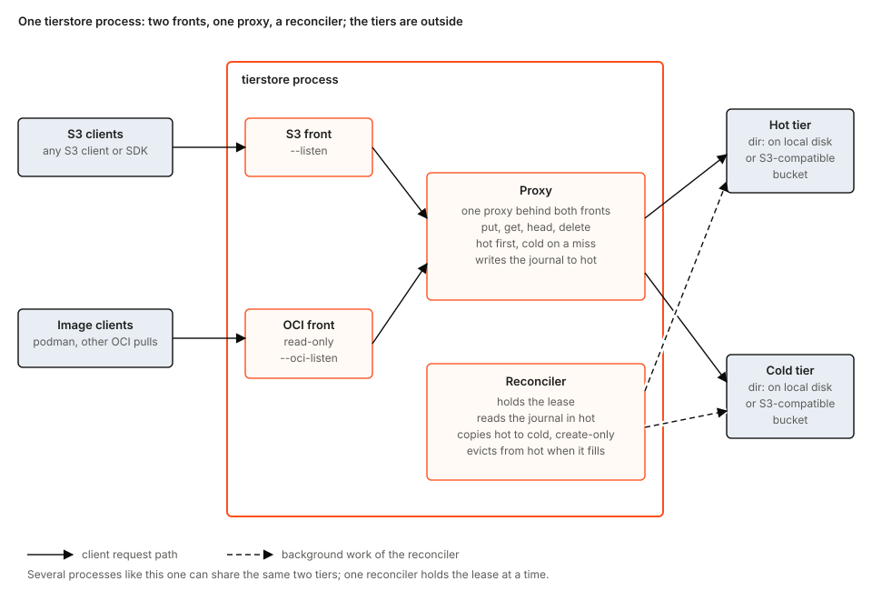

One `tierstore` process serves an S3 front (`--listen`) and, if asked, a read-only OCI front (`--oci-listen`, its own address). Both fronts call the same **proxy**, so an image pulled over OCI and an object read over S3 are answered from the same tiers by the same code ([server/cli.rs](../../crates/tierstore/src/server/cli.rs) module docs). The pieces:

- **Tiers.** A **hot tier** (small, fast: `dir:` on local disk or an S3-compatible bucket) and a **cold tier** (large, cheap: `dir:` or an S3-compatible bucket). Both are used through one trait, [`Backend`](../../crates/tierstore/src/backend.rs). `memory` is also accepted as a tier kind; it keeps nothing across a restart and stamps every object with time zero, so it is for tests.
- **Proxy** ([tiered.rs](../../crates/tierstore/src/tiered.rs), `Proxy`). Answers every request against the two tiers. It keeps no durable state. In the decided design it also heartbeats (section 6.3) and holds a small cached reading of capacity.
- **Fronts** ([server/](../../crates/tierstore/src/server/), `ops.rs` and `oci/`). Check signatures, enforce request limits, and call the proxy as a `Backend`.
- **Entry** (decided, not built). One small object per key that is being changed, `_entries/<sha256 of the key>` in the hot tier. A put, a delete, a copy-back and an eviction each take the key's entry before they touch its data, and release it when done. The entry is both the **lock** and the **journal record**: the leader finds work by listing entries. Today the same job is done by per-node journal objects `_journal/<id>/<seq>`, which the entry replaces (section 14).
- **Reconciler** ([reconciler.rs](../../crates/tierstore/src/reconciler.rs)). Runs in the leader only. Lists the entries, copies each put to the cold tier, finishes deletes, copies back, evicts when the hot tier fills, and is the only actor that releases entries it did not take itself.
- **Lease** ([lease.rs](../../crates/tierstore/src/lease.rs)). One object in the hot tier; its holder is the one active reconciler among all processes.
- **Local cache** ([server/local_cache/](../../crates/tierstore/src/server/local_cache/)). A read-through disk cache on a node's own NVMe, used by the build-node configuration (section 4). It is not part of the storage-node path.

Several processes may run over the same tiers; each has its own proxy and fronts, and only one reconciler works at a time.

**What the OCI front is, and is not.** It is a read-only registry *server* over tierstore's own objects, not a cache of another registry: nothing in [server/oci/](../../crates/tierstore/src/server/oci/) calls out. Each piece of an image (manifest, index, config, layer) is an ordinary object stored by content at `oci/blobs/sha256/<digest>`, written through the S3 front by whatever builds the images. A container engine then pulls by digest (`/v2/<name>/manifests/<digest>`, `/v2/<name>/blobs/<digest>`) from whichever tier holds the object, and every byte is checked against its digest before the response completes. Blobs are named by digest, so a garbage collection followed by a re-push is a delete and a byte-identical re-put of one key, the case of section 1.1. Today there is no push, no tags (only digests), and no fetch from an upstream registry on a miss; push, tags and a pull-through cache are decided and planned (section 14, item d4).

## 4. Configurations

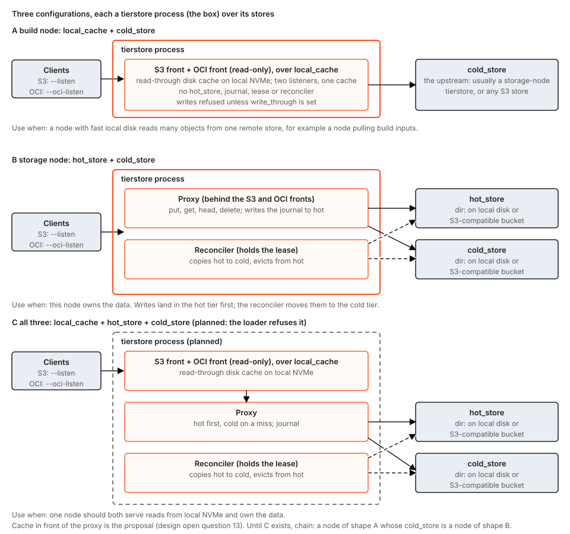

The configuration file ([server/config.rs](../../crates/tierstore/src/server/config.rs)) has two supported shapes, told apart by the tables it has. A third, local_cache + hot_store + cold_store, is planned.

| | Tables | What the process runs | Status |
|---|---|---|---|
| A. Build node | `[local_cache]` + `[cold_store]` | Fronts over a `LocalCache` over one upstream. No entries, lease or reconciler. | supported |
| B. Storage node | `[hot_store]` + `[cold_store]` (or the flags) | Fronts, proxy, per-node journals today (entries once built, section 14), reconciler, lease. | supported |
| C. All three | `[local_cache]` + `[hot_store]` + `[cold_store]` | A and B in one process: fronts, then local cache, then proxy over hot and cold, with the reconciler. | planned (the loader refuses it) |

**A: build node.** `cold_store` is the upstream: usually the S3 endpoint of a storage node's tierstore, or any S3-compatible store. A hit is answered from local disk with no call upstream. A miss on a whole get fills the object; a miss on a ranged get fills the whole object if it is at most 64 MiB and otherwise passes the range through and keeps nothing; the misses of one key fill it once. By default the front refuses every write, so the cache has nothing to recover but files it can delete. With `write_through = true` the cache accepts writes and sends every one to the upstream before acknowledging it; a create-only put under a `cache = true` policy is also kept on the node, best effort, and never fails the put. OCI reads are served from the cache too ([server/local_cache/mod.rs](../../crates/tierstore/src/server/local_cache/mod.rs) module docs). The cache's keep check compares sizes, not content: a key deleted and re-put with a same-size body can be served from an old copy on a build node. That is a separate, documented limit (section 11, R8); no write id is added to fix it (section 12).

**B: storage node.** This is the design of sections 5 to 10.

**C: planned.** One process with a local cache in front of the proxy over a hot and a cold tier. The loader refuses the three tables together (`config.rs`, the match that builds `Settings`) with the error "the hot store is already local disk, and a disk cache in front of it would cache a disk with a disk". That reasoning does not hold when the hot store is an S3 bucket. The design treats C as part of the plan: a node that serves its own reads from NVMe and also owns the data. What it needs is in section 14(c). Until it exists, the same read path is reached by chaining: a build node whose `cold_store` is the S3 endpoint of a storage node.

## 5. How each operation works

The sequences below are for configuration B and are the **decided design** (not built; section 14). Every store call is shown in code order. The proxy refuses a reserved key (section 7) for get, head, put, delete and multipart before anything else, and leaves reserved keys out of every listing. The reserved prefixes are `_entries/`, `_journal/` and `_tiering/`.

Notation: K is a key, H(K) and C(K) are its objects in hot and cold, E(K) is its entry. An entry is `(op, state, owner)`: `op` is PUT, DEL, CB (copy-back) or EVICT; `state` is HELD (its owner is working on the key), PENDING (the work has landed or been asked for, and it is the leader's turn) or SEALED (the leader is finishing, nobody else may act). Section 6.2 gives the full state machine.

### Put

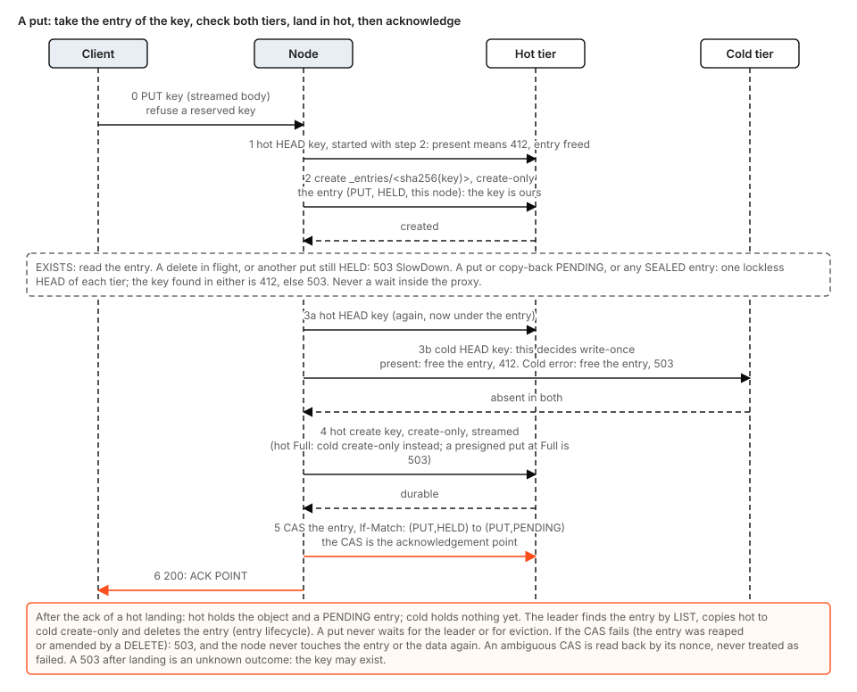

The S3 front sends every create-only put that is not a multipart part to `Proxy::put_stream` (or the hot-only variant when the request is presigned). A multipart completion and a put at hot `Full` take the same path and differ only in step 4. In order:

0. **Refuse** a reserved key. A hot HEAD that finds the key answers 412 with no entry: a put of an existing key costs one request.
1. **Take the entry.** One create-only write of `_entries/<sha256(K)>` in hot, body `(PUT, HELD, this node)`. The winner continues. On `EXISTS` the entry is read: it is absent (it was released meanwhile: retry); it is a DEL in any state, or a PUT that is still HELD: 503 SlowDown; it is a PUT or CB that is PENDING, or any SEALED entry: one lockless hot HEAD and one cold HEAD, and the key found in either is 412, otherwise 503. Nothing waits inside the proxy.
2. **Check under the entry.** A hot HEAD and a cold HEAD of K. K found in either tier: free the entry and answer 412. The cold tier cannot be asked: free the entry and answer 503 (it fails closed). The cold HEAD under the held entry is what decides write-once; there is no reservation object in cold.
3. **Land the object**, streamed. A create-only write of K in hot, visible only when the last chunk has arrived. At level `Full`, or when the hot store answers `Full` before taking a byte, the landing is a create-only write to cold instead (a presigned put at `Full` is 503, as before). A definite failure before landing (a body error, `EXISTS`) removes the node's own temp object or aborts its own upload and frees the entry.
4. **Acknowledge.** A compare-and-swap (If-Match) moves the entry from `(PUT, HELD)` to `(PUT, PENDING)`. **That CAS is the acknowledgement point.** If it fails, the entry was reaped or amended: the node answers 503 and never touches the entry or the data again. An ambiguous CAS result (a timeout, an S3 409 conflict) is read back and compared by nonce, never treated as failed (section 6.2). An ambiguous failure at landing still attempts the CAS and then answers 503: the leader finds H present (replicate) or absent (release).

The ack point is therefore: the object is durable in one tier, and the entry says PENDING. For a put that landed in hot, cold holds nothing for the key yet; the leader copies it later and deletes the entry (section 6.5). A cold-direct or multipart put has already landed in cold at the acknowledgement, and the leader has nothing to copy. A put never waits for the leader or for eviction. A 503 after landing is an unknown outcome (the object may exist), so a client that retries a put-if-absent may then see 412.

Why this order: one atomic place, the entry, serialises every actor on the key. Two puts of one key race for the entry's create-only write and exactly one wins; the loser has written nothing. Because the winner checks both tiers under the entry, and the leader's copy and eviction also need the entry, nothing can slip a second put in behind a copy or an eviction.

**Hot tier full.** At level `Full` (usage at or above the budget) or when the hot store answers `Full` before taking any byte, an unsigned put lands in the cold tier directly (create-only), under the same entry. The fallback applies only when the body has not been read at all, because bytes already taken cannot be offered to the cold tier again. If the hot tier answers `Full` after taking bytes, the put fails with 503 `SlowDown` and the client's retry takes the cold path. There is no back-pressure sleep.

**Presigned puts** are hot-only: at level `Full`, or when the hot tier answers `Full`, the put gets 503 `SlowDown` and nothing is written to cold. A presigned put and a multipart completion follow the same entry path as any put.

**Cold down.** A new-key put needs the cold HEAD under the entry, so while the cold tier is unreachable new-key puts answer 503. Today the hot tier absorbs writes during a cold outage; the design gives that up, because the alternative (checking write-once only at replication) would let two clients both be acknowledged for one key (section 15, decision 2).

**Streaming.** The put holds no body. The front passes chunks through a small queue; `S3Backend` forwards them as one PUT (up to 16 MiB) or a multipart upload, and holds a whole body only when no length is declared, which is why the front requires `Content-Length` when a tier is S3. There is no size cap: a long upload keeps its entry alive by its node's heartbeat (section 6.3). The front runs the proxy call on its own task, so a client that disconnects after the body arrived does not abandon the put half done.

### Get

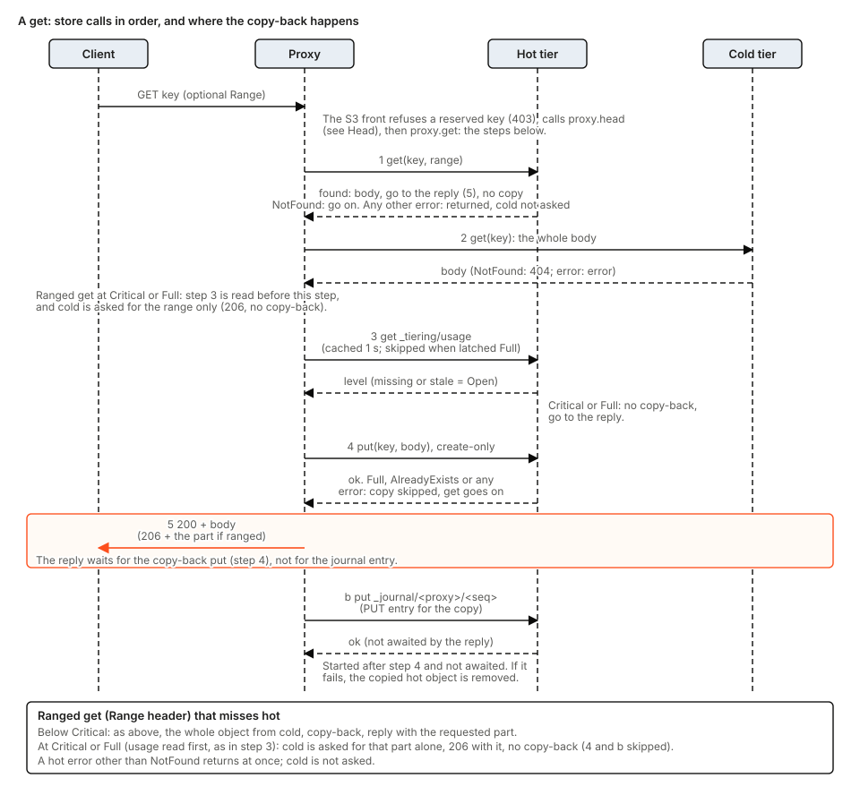

The front calls `Proxy::open_read(key, span)` once. It gives the object's meta (size, tag, time of last write) and the body as chunks, so the front builds its headers, decides a condition (304, 412) or an unsatisfiable range, and streams the body from one call. `span` is the `Range` header as it came (`first-last`, `first-` or `-count`); the read resolves it against the size it finds. A hit in the hot tier is one call to the hot tier (`hot.open_read`: one GET on S3, one open file on `dir:`), whose body the proxy passes on without holding it. `Proxy::get_stream` is the same read for a byte range and returns the body alone. The numbers below are the numbers of the diagram, which shows `Proxy::get`; `open_read` follows the same steps, with step 1 as `hot.open_read` and the cold read of step 2 as `cold.open_read`, whose meta says whether the object is a reservation. In the current code, before the copy-back below is built, a read of the whole object that misses the hot tier (`open_read`, `get_stream`) is held nowhere: its body is given to the caller as it arrives and the same chunks are queued for a streamed create-only write into the hot tier (`put_stream_tagged`), which runs beside the response, never delays or fails it, and is abandoned if it falls more than 16 MiB behind or the caller drops the body before the last byte (so no partial object is left in the hot tier). A read of a range that misses the hot tier is the cold tier's own stream of the range and copies nothing. `Proxy::get` still holds the object whole when it has no range.

1. **Hot hit.** One hot call, `open_read(key, range)`, returns the tag and the body together, at the client's key. The reply is made at once: **a hot hit is one hot round trip and reads no entry.** A hot error other than not-found is returned as it is; cold is not tried (fail closed).
2. **Hot miss: read cold.** Straight away, with no entry read (a range reads only the range; the body is streamed). The result stands: the bytes, or 404. **A get never reads the journal entry.** A hot miss is one cold read, plus the copy-back request of step 3.
3. **Ask for a copy-back.** Below level `Critical`, for a read of the whole object, the proxy creates `(CB, PENDING)` with a create-only write in a task of its own, best effort; if an entry for the key exists the create does nothing, and any failure is ignored. The reply never waits for it. The proxy copies nothing into hot itself. The leader does, under the entry (section 6.5). The proxy does not know how many copy-backs are open and does not ask: the leader drops the surplus (section 6.5). Until the format is active (section 13) a read still copies the object itself and journals the copy.

Why no entry is read: a delete that meets a copy in flight does not answer until that copy has finished (see Delete below). While a copy is running the delete is therefore unacknowledged, and a cold read that returns the key's bytes in that window returns what a not yet acknowledged delete has not covered. Once the delete is acknowledged, both tiers have been deleted after the last cold publish the copy could make, so a cold read answers 404. The earlier draft read the entry first on a hot miss, at the cost of one more hot request in series; the model showed that the wait closes the same window without it (section 8, The model check).

### Head

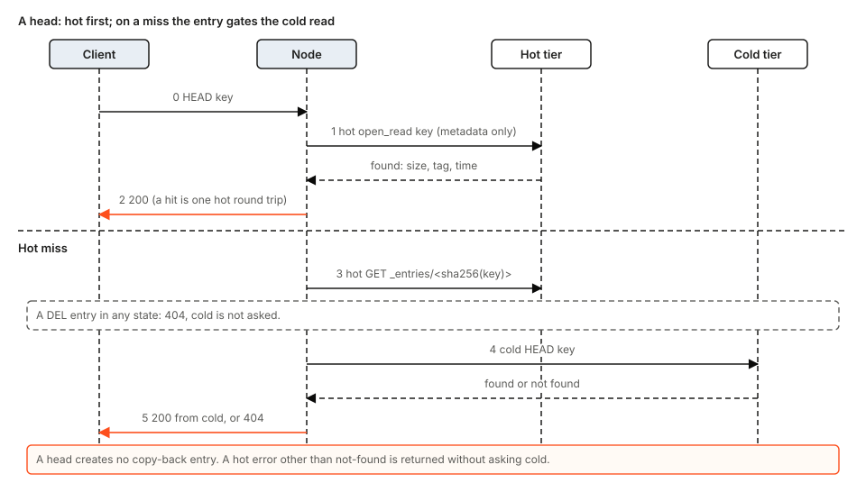

The same as a get without the body and without a copy-back. `hot.open_read` for metadata; on a miss, `cold.head`. No entry is read. A hot error other than not-found is returned without asking cold.

### Delete

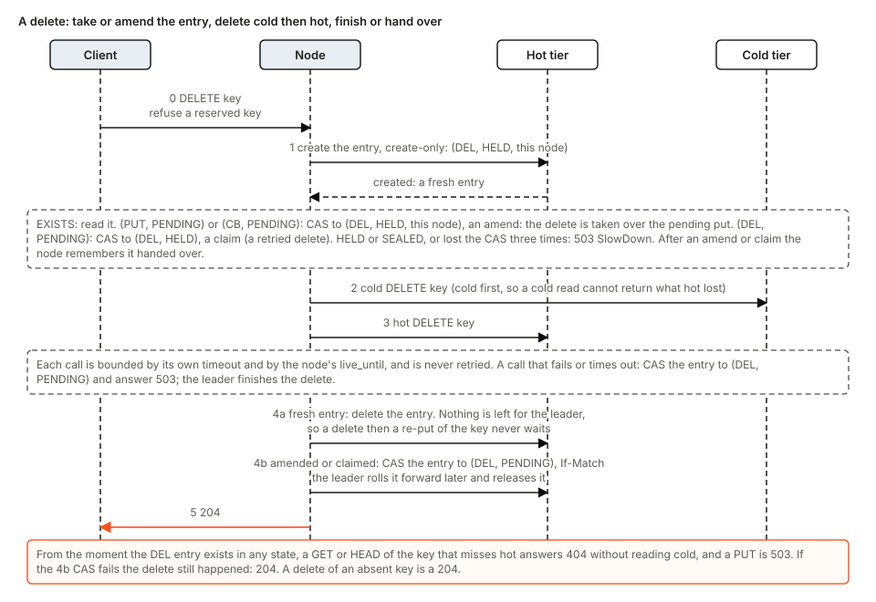

A delete takes the entry, removes the key from both tiers, and either finishes alone, hands the rest to the leader, or, when a copy of the key may still be running, waits until the leader has released the entry.

0. **Refuse** a reserved key.
1. **Take the entry** with a create-only write of `(DEL, HELD, this node)`. On `EXISTS`, read it, and decide by CAS:
   - `(PUT, PENDING)` or `(CB, PENDING)`: **amend** it into `(DEL, HELD, this node)`. The leader has not started on it, and its own CAS to HELD (section 6.5) now fails, so no copy starts. This delete does not wait.
   - `(PUT, HELD, the leader)`: the leader's copy may be in flight. **Amend** it the same way; this delete **waits** (step 3).
   - `(DEL, PENDING)`: a delete handed over earlier, now retried (it may have been half done, with the leader's copy still running). **Claim** it the same way; this delete **waits**.
   - `(CB, SEALED)`: the leader is landing a copy-back. Change nothing; **wait**, polling the entry as in step 3, until it is gone or is another op's, then take the entry afresh and go on. The waits of one delete share one budget. 503 SlowDown only at the request deadline.
   - Anything else (a client's HELD entry, another SEALED entry, or the CAS lost three times): 503 SlowDown.
2. **Delete cold, then hot.** `cold.delete(K)`, then `hot.delete(K)`, each bounded by its own timeout and by the node's `live_until` (section 6.3), neither retried. **Cold is always deleted at once by the delete itself**, whatever the entry said. Cold first, so a cold-served read cannot return what hot lost. A call that fails or times out: CAS the entry to `(DEL, PENDING)` and answer 503; the leader finishes the delete, and a retry claims it and waits.
3. **Finish.**
   - A **fresh** entry (nothing was pending) is deleted by its owner and the answer is 204: nothing is left for the leader, and a delete followed by a re-put of the key never waits.
   - An entry **amended from a PENDING put or copy-back** is moved to `(DEL, PENDING)` by CAS and the answer is 204; the leader rolls it forward and releases it.
   - An entry **amended from the leader's HELD entry, or claimed**, is moved to `(DEL, PENDING)` by CAS (if that CAS fails the delete still happened), and then the delete **polls the entry**, a hot GET at each step of the per-item back-off (1 s, doubling), until the entry is gone or has been replaced by another op's entry. That is the leader's release: its copy has ended and its roll-forward has deleted both tiers once more. Only then is the answer 204. Past the request deadline (a frozen or stalled leader) the answer is a retryable 503: hot and cold are already deleted, and the entry stays `(DEL, PENDING)` for the leader or for the next retry to claim.

After a delete is acknowledged, a GET or HEAD of the key is 404 and a PUT is allowed once the entry is gone. While the delete is in flight, a PUT of the key is 503, and a GET or HEAD may still return the key's bytes, since the delete is not yet acknowledged. A LIST may show the key until the leader has finished (section 11, R5). Deleting an absent key succeeds. The front runs the delete on its own task so a disconnect cannot split it.

The wait costs latency: a delete that overlaps a copy returns when the copy finishes (a copy has no size cap, so this can be long for a large object), and a frozen leader turns it into a 503. A delete that amends a PENDING put pays none of that.

### Eviction

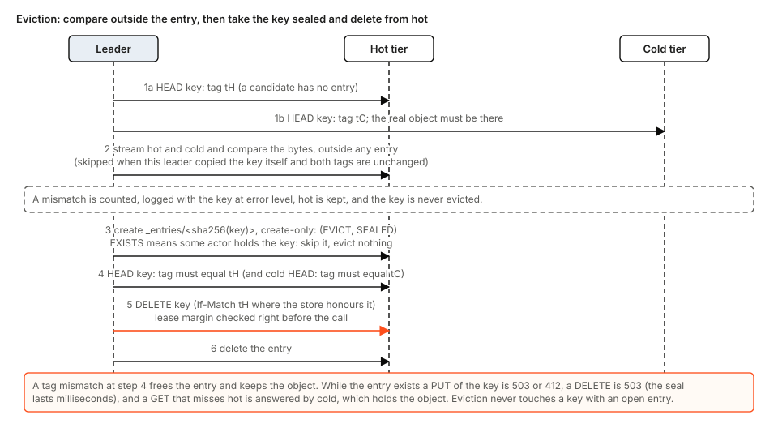

Eviction is the leader's, and **it never touches a key that has an open entry.** Above the high-water share (80% of the budget) it evicts, oldest first, down to the low-water share (70%). Per candidate K, which has no entry:

1. HEAD K in hot (tag tH) and in cold (tag tC; the real object must be there).
2. Stream both and compare the bytes, outside any entry. A mismatch is counted, logged at error level with the key, hot is kept, and the key is never evicted. The compare is skipped when this leader itself copied K and both tags are unchanged since.
3. Create `(EVICT, SEALED)` create-only. If any entry exists, skip the key: some actor holds it.
4. Under the entry, HEAD both again; each tag must equal the one compared. A mismatch frees the entry and keeps the object.
5. Check the lease margin, then delete K from hot (`delete_if_match` on tH where the store honours it), and delete the entry.

Why: cold must hold the object, byte for byte, before the hot copy goes, so a get after an acknowledged put always finds it. The seal means a put, a delete or a copy-back of K cannot act between the check and the delete. Tags are never compared across tiers, since the two tiers may tag content differently. Eviction is first-in-first-out by put order: nothing records reads, so the design chooses the policy that needs only what the leader already knows.

### List and multipart

A listing is the union of both tiers in key order, the hot entry winning on a duplicate. `list_page` reads the hot tier in as many pages as it takes to find `max_keys` data keys after `start_after`, reads one page from the cold tier, merges and cuts. Hot is read first, so a key evicted between the two calls is still seen in cold. Either tier failing fails the listing. The proxy filters `_entries/`, `_journal/` and `_tiering/` from the listings of both tiers. The S3 front supports `list-type=2`, `prefix`, `max-keys`, `continuation-token` and `start-after`; `delimiter` is not supported.

All multipart calls go to the cold tier; the proxy holds no part. A completion is a put in the sense above: it takes the entry first, checks the hot tier, then calls the cold tier's create-only `complete_upload` as its landing. An upload that dies is found by the reaper with `list_uploads(prefix = K)` and aborted (safe, because the reaper holds the key's entry); the bucket lifecycle rule `AbortIncompleteMultipartUpload` is the backstop, and start-up logs a warning if the cold store reports none.

### What a build node's local cache changes

On configuration A the same S3 calls reach a `LocalCache` instead of a proxy. A get or head of a kept key that is in the cache is answered from disk with no upstream call; a miss fills the cache from the upstream in chunks, hashing as it goes, and keeps the file only if it is whole (and, for a content-addressed key, hashes to its name). A key is kept if the longest matching `[[policy]]` prefix says `cache = true` and it is not reserved; other keys and every listing go to the upstream unchanged. Writes are refused unless `write_through` is set, and then every write goes to the upstream first (nothing is acknowledged before the upstream has it, and nothing is only local). A delete through the cache marks any fill of the key as forgotten, so a reader that was given bytes goes on only while the upstream still has that version.

## 6. Background work

This is the **decided design** (not built; section 14). Puts and gets run on every node. The background work, copying to cold, finishing deletes, copying back, evicting and cleaning up, is done by one process at a time, the leader. This section follows one design from the ground up: where things live, the entry, how a node comes and goes, how the leader is chosen, what the leader does with a write, and what happens when something dies. Safety never depends on there being exactly one leader: every step on an entry is a compare-and-swap on its tag, so a process that is wrong about being the leader makes a call that fails. The calls a late actor can still land are the stated residuals (section 11).

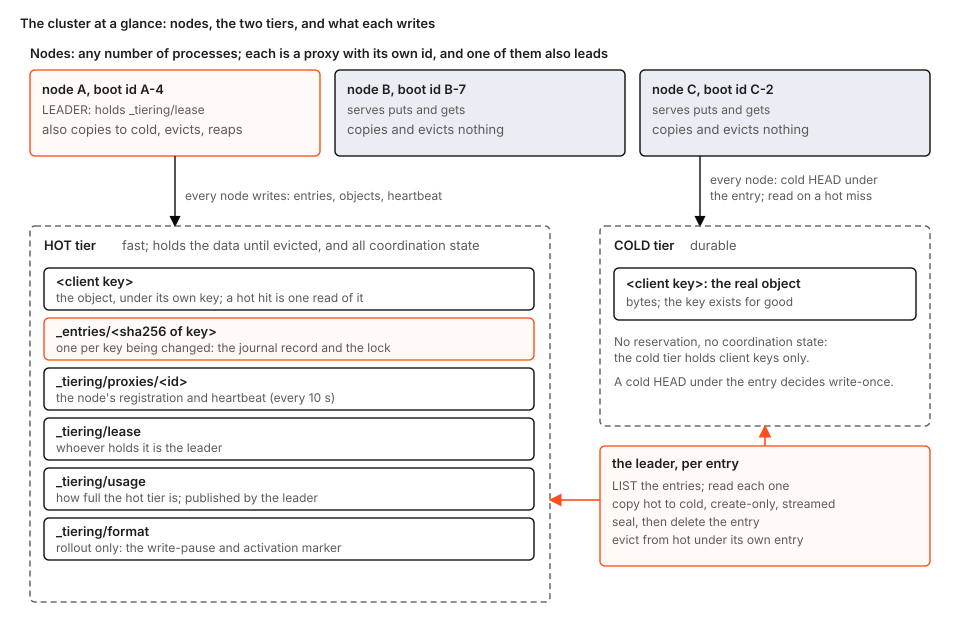

### 6.1 Where things live

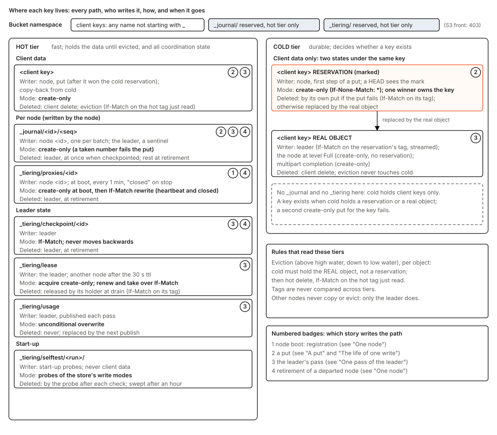

The hot tier holds the data until it is evicted, and all coordination state, under reserved prefixes. The cold tier holds client keys only.

- **Hot tier.** Client objects under their own keys. `_entries/<sha256 hex of the key>`: one object per key being changed, create-only and changed only by If-Match. `_tiering/proxies/<id>`: the node's registration and heartbeat. `_tiering/lease`: the leader's lease. `_tiering/usage`: published by the leader. `_tiering/format`: the rollout marker (section 13). `_tiering/selftest/<run>/`: start-up probes.
- **Cold tier.** Client objects only: no reservation, no `_entries`, no `_tiering`.

Why: the coordination state is in the hot tier because it is small, changes often and must be fast, and the hot tier is the store every node already writes to. It is not in the cold tier because a hot hit must stay one round trip and coordination traffic should not go to the slow tier. The entry's name is a hash so it has a fixed length (on `dir:` a key of 239 to 255 encoded bytes can be stored but could not take a prefixed name, because file names are limited to 255 bytes), and on `dir:` the `_entries/` prefix is a real subdirectory, named `.entries` (a name starts with `.` is never the encoding of a key, so the ordinary key `_entries`, which is outside the reserved prefix, keeps its own file), so that the entries are read from that directory, not found by decoding every name of the root. The previous release kept a client key `_entries/<name>` as a root file `_entries~<name>`; those files stay the keys they were (see Formats and versioning). Section 10 lists each path with its writer and write mode.

### 6.2 The entry

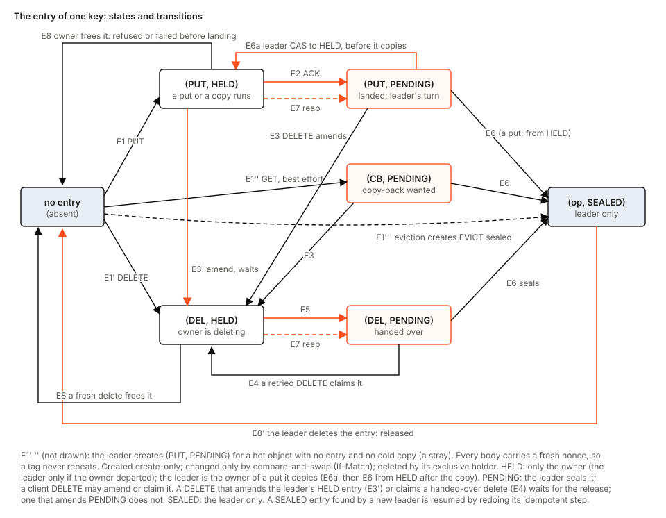

**The body** is JSON, unknown fields ignored: `{v, key, op, st, owner, nonce, created_ms}`. `op` is PUT, DEL, CB or EVICT; `st` is HELD, PENDING or SEALED; `owner` is a proxy id or null; `nonce` is `<actor id>.<boot>.<counter>`, written afresh by every write, so a body never repeats; the actor id is stable across restarts, so every entry handle takes a `boot` of its own (process id, clock at creation, count of handles in the process) and a counter that starts again still writes nonces no earlier handle wrote; `created_ms` is wall-clock time for metrics only and is never used for a decision.

**The discipline.** An entry is created create-only, changed only by compare-and-swap on its tag, and deleted only by its exclusive holder: the owner of a HELD entry, or the leader for SEALED. Whoever holds a key's entry may change that key's data in either tier. Every CAS failure means: re-read the entry and decide again (at most three rounds, then the actor gives up: a client answers 503, the leader skips the entry until its own retry delay runs out). **An ambiguous error is not a failure.** A CAS or create whose error may have landed (an S3 409, a timeout) is read back and the actor compares its own nonce: equal means the call landed. Nothing is destroyed or acknowledged on an unread ambiguous result.

| op | meaning | created by | starts as |
|---|---|---|---|
| PUT | a put in flight, or landed and waiting to be copied to cold | a client put; the leader for a stray hot object | HELD (client); PENDING (stray) |
| DEL | a delete in flight, or handed over for the leader to finish | a client delete | HELD |
| CB | copy-back of cold into hot, wanted by a cold-served get | a get, best effort, no payload | PENDING |
| EVICT | eviction of a hot object | the leader | SEALED |

| state | meaning | who may change it |
|---|---|---|
| HELD | the owner is working on the key: a client putting or deleting, or the leader copying a put to cold | the owner (CAS or delete); a client delete (amend), only when the leader is the owner; the leader for a departed owner |
| PENDING | landed or asked for; the leader's turn | the leader (HELD before a copy, or seal); a client delete (amend or claim) |
| SEALED | the leader is finishing; nobody else may act | the leader only |

**Transitions** (the ids are those of the diagram and the tests):

| id | from | to | by | when |
|---|---|---|---|---|
| E1 | absent | `(PUT, HELD)` | client, create | a put took the key |
| E1' | absent | `(DEL, HELD)` | client, create | a delete took the key |
| E1'' | absent | `(CB, PENDING)` | a get, create, best effort | cold read succeeded, level below `Critical` |
| E1''' | absent | `(EVICT, SEALED)` | leader, create | the byte compare already passed |
| E1'''' | absent | `(PUT, PENDING)` | leader, create | stray: H present, C absent, no entry |
| E2 | `(PUT, HELD)` | `(PUT, PENDING)` | owner, CAS | landing returned. **The acknowledgement point** |
| E3 | `(PUT, PENDING)` or `(CB, PENDING)` | `(DEL, HELD)` | client delete, CAS | amend; this delete does not wait |
| E3' | `(PUT, HELD, leader)` | `(DEL, HELD)` | client delete, CAS | amend of a copy that may be in flight; this delete waits for the release |
| E4 | `(DEL, PENDING)` | `(DEL, HELD)` | client delete, CAS | claim of a retried delete; this delete waits for the release |
| E5 | `(DEL, HELD)` | `(DEL, PENDING)` | owner, CAS | after an amend or claim, or a failed delete call |
| E6a | `(PUT, PENDING)` | `(PUT, HELD, leader)` | leader, CAS | **before it copies.** If it fails, a delete amended the entry: no copy starts |
| E6 | `(op, PENDING)`, or `(PUT, HELD, leader)` | `(op, SEALED)` | leader, CAS | per op, section 6.5; the put arm is after the copy |
| E7 | `(PUT or DEL, HELD)`, owner departed (a client, or a leader that died mid-copy) | `(op, PENDING)` | leader, CAS | reap |
| E8 | `(PUT or DEL, HELD)` | absent | owner, delete | fresh delete; a put or delete that failed before landing or deleting anything |
| E8' | `(op, SEALED)` | absent | leader, delete | its work for the op is done |

**Invariants** (the tests of section 8 and the model check these).

- **Exclusion.** The data of K is changed only by the holder of E(K): the owner of a HELD entry (a client, or the leader copying), or the leader for PENDING and SEALED. Two stated overlaps: a copy the leader started before a delete amended its HELD entry can still publish to cold, and the delete does not answer until the leader has ended it and released the entry (the wait below); and the late landings of a reaped actor (section 11, R3).
- **Write-once.** Objects are created only create-only, and a put lands only after, under its entry, both HEADs were absent.
- **Acknowledged put.** A put is acknowledged only after its E2 CAS succeeded after the landing. The entry is deleted only after cold holds the object (or after a delete took it).
- **Acknowledged delete.** A delete is acknowledged only after it held the entry exclusively, both its deletes returned OK and, if it amended the leader's HELD entry or claimed a handed-over delete, the entry was released (or replaced by another op's entry). From the acknowledgement, GET and HEAD of K answer 404 and no copy of K is still running; K is absent until a later put. Before it, GET and HEAD may return K's bytes, and PUT answers 503 while the DEL entry exists.
- **Delete waits for a copy.** A delete that meets an in-flight copy (an amended `(PUT, HELD, leader)` entry, or a claimed `(DEL, PENDING)` entry) is not acknowledged before the leader releases the entry; past its deadline it answers 503. A delete that amends a PENDING entry makes the leader's CAS to HELD fail, so no copy starts and it does not wait.
- **Hot hit, hot miss.** A hot hit is one hot read of the client's key. A hot miss is one cold read. A GET or HEAD never reads an entry.
- **Seal before landing.** The leader's copy-back lands only after E6 to SEALED, so a delete cannot amend it afterwards and cannot run beside it, and it streams the current cold object, never bytes a get read earlier. A copy-back therefore never brings back a key that a delete took, as long as the leader that sealed it is still the leader. Not covered: a leader that lost its lease while its hot write was still running is not fenced, and the successor releases the sealed entry at once, so that write can still land after a delete that ran in between.
- **Liveness.** With a live leader every entry reaches deletion: PENDING, then HELD or SEALED, then deleted, so a waiting delete is released. A HELD entry of a departed owner (a client, or a leader that died mid-copy) is reaped to PENDING at the next scan after the departure time.

### 6.3 A node's life: boot, heartbeat, stop, silence

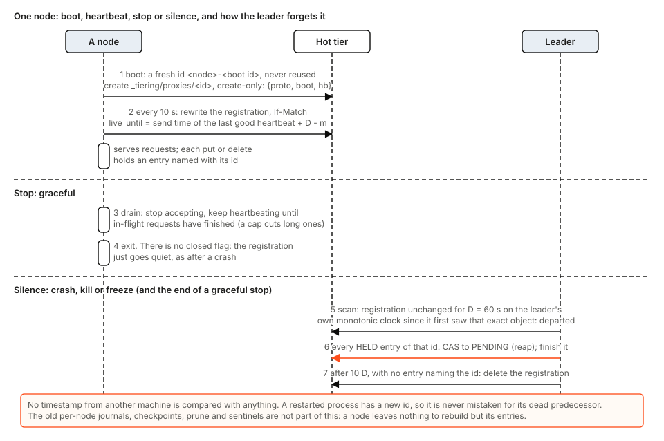

Each process boot gets a fresh id, `<node>-<boot id>`; an id is never reused, so a restarted process is never mistaken for its dead predecessor. On boot the process creates its registration, `_tiering/proxies/<id>`, in the hot tier (create-only, body `{proto, boot, hb}`) and then rewrites it with If-Match every `--heartbeat` (10 s). Each put or delete holds an entry that names this id as its owner.

**Departed.** The leader treats an owner as departed when its registration is absent, or has not changed for D (`--departure`, 60 s), measured on the leader's own monotonic clock since it first saw that exact object (a changed object resets the timer). No timestamp from another machine is compared with anything, so clock skew cannot make a live node look dead. A new leader's timers start at zero, so it notices a departure up to D later than it could.

**Stop.** There is no `closed` flag. A stopping process drains, which means it stops accepting and keeps heartbeating until its in-flight requests have finished, then exits; its registration then goes quiet and is treated as departed after D, like a crash. A stop in the middle of a put therefore blocks that key for up to D. The drain has a cap (the existing drain deadline); when it is hit, the requests are cut and their entries are reaped after D.

**The deadline of a holder.** A proxy keeps `live_until = send time of its last successful heartbeat + D - m` (m is a margin, 10 s). Every step of a holder that destroys or acknowledges checks `now < live_until`; if not, it stops, answers 503 and never touches the entry or the data again. Every destructive call (a hot or cold DELETE, an entry delete) has its own timeout, the smaller of `m` and `live_until - now`. A long upload therefore has a renewable deadline, the heartbeat, and no size cap.

**One check at start-up.** Only one relation breaks exclusion if misconfigured, so it is the only one checked: `D >= 6 * heartbeat` and `m <= D / 4`, refused at config parse with the values named. The other relations are documented defaults.

**Registrations.** The leader deletes a registration that has been departed for 10 D and that no entry names, so ids do not accumulate.

### 6.4 Choosing the leader

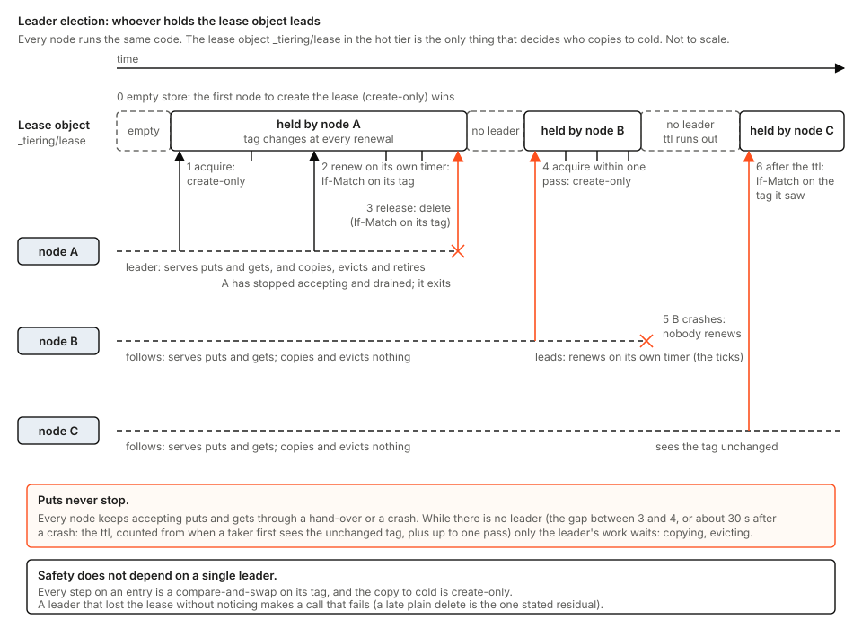

Every process runs the same code; the leader is whoever holds the object `_tiering/lease` in the hot tier.

1. **Acquire** is a create-only put, then a HEAD to learn the tag. On an empty store the first node to try wins.
2. **Renew** runs on its own timer, every ttl/3, as `put_if_match` on the tag this holder last wrote, and sets `valid_until = send time + ttl - m`. It is not part of the reconciler's loop, so a long copy cannot starve it. Any error counts as not held and clears the holder's tag.
3. **Release** happens on drain: the holder, which has already stopped accepting new work, deletes the lease only if the tag is still its own (`If-Match` on its tag), then exits.
4. Another process **acquires** at its next lease check (create-only).
5. If the leader crashes, nobody renews. A process sees the tag unchanged.
6. **Take over**: after the ttl (30 s) has passed on the taker's own monotonic clock since it first saw that tag, it calls `put_if_match` on the tag it saw, so of two takers only one succeeds. The gap after a crash is therefore about 30 s: the ttl, counted from when a taker first sees the unchanged tag, plus up to one wait of the loop.

Every destructive step of the leader, and the cold publish of a copy, requires `valid_until - now >= m` at the moment of the call. The lease body is `holder`, `nonce`, `generation`; it is never read, only its tag is used.

Why a lease object and not a coordination service: requirement 5 says there is none, and a conditional write on one small object in a store the deployment already has gives exactly one winner. Why a single leader at all: copying, releasing and eviction then have one writer in the normal case, and the entry listing is read by one process. Puts never stop: every process keeps accepting puts and gets through a hand-over or a crash. While there is no leader only the leader's work waits.

**What the hot tier must provide.** The entry, lease and registration writes need a hot tier whose create-only and `If-Match` writes are atomic across processes, because during a live update two processes run at once over one hot tier. An S3-compatible hot bucket provides this. A `dir:` hot tier provides it by doing its create-only, `If-Match` and entry-delete writes under a blocking file lock (taken on a blocking thread) inside its own directory, with a hard link for create-only on a local file system (not NFS); today it is atomic only inside one process, which is why the code still has `--lock-file`. The start-up self-test (section 9) checks the sequential behaviour of these writes and refuses a tier that gets it wrong; its probes are sequential, so it cannot detect a lack of atomicity across processes, and the choice of tier is the deployment's.

### 6.5 The life of a write: entry, copy to cold, release, eviction

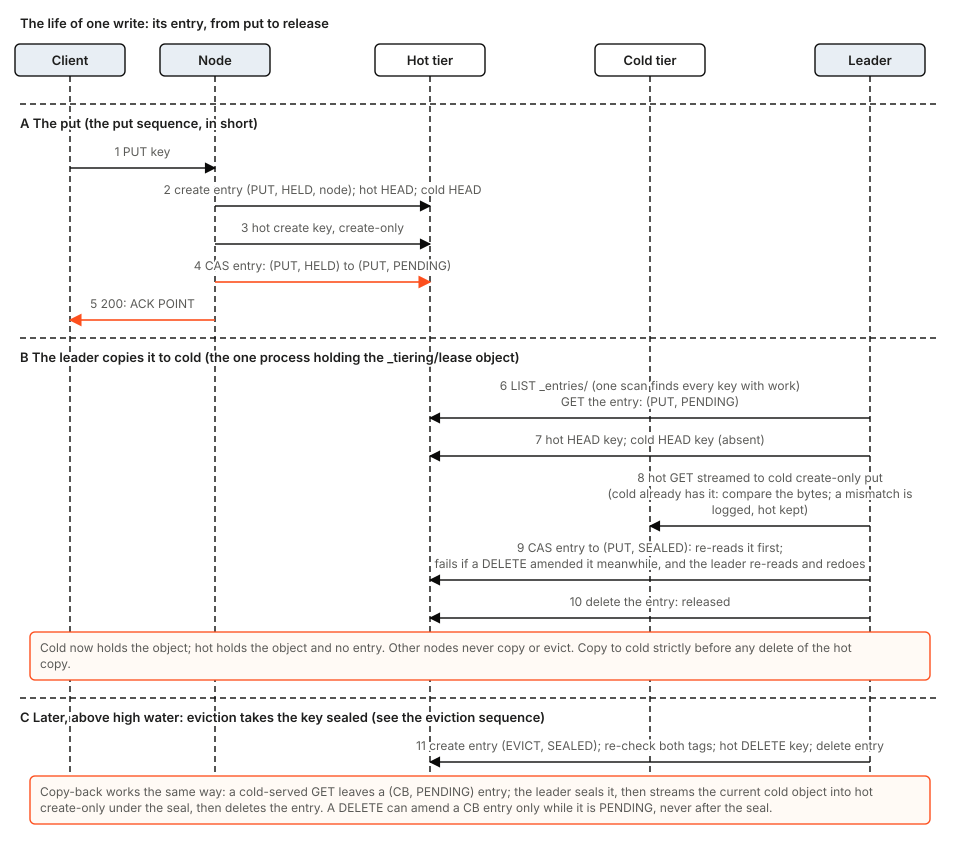

The diagram follows one put through its stages; the leader's step for each entry state is this table (every step is idempotent and resumable).

| entry | the leader's step |
|---|---|
| `(PUT, PENDING)` | **Replicate.** First E6a: CAS to `(PUT, HELD, this leader)`. If it fails, a delete amended the entry: re-read and handle the new state, and no copy starts. Then H absent: nothing to copy (a reaped put that never landed, or a delete already done). H present and C absent: stream H to C with a create-only put; the lease margin is checked right before the publishing call. C present: byte-compare; a mismatch is counted, logged at error level with the key, hot is kept, and the key is never evicted. Then E6 from HELD to SEALED, then E8'. If E6 fails, a delete amended the entry while the copy ran: re-read and handle the new state (a copy still running ends; its late cold publish happens before this re-read, and the delete that amended the entry is waiting for the release, which comes only after the roll-forward below has deleted both tiers again) |
| `(PUT, SEALED)` | E8' (a sealed put was fully replicated) |
| `(PUT, HELD, leader)`, this leader | its own copy is running; nothing else. A new leader finds it only after the owner has departed (reap) |
| `(DEL, PENDING)` | E6, then roll forward: `cold.delete`, `hot.delete`, E8' |
| `(DEL, SEALED)` | roll forward again, then E8' |
| `(CB, PENDING)` | E6 to SEALED first, then, under the seal, H absent and C present: stream the current cold object into hot create-only, then E8'. Any other situation (H present, C absent, hot answers `Full`): seal and release. A copy-back first seen more than `copy_back_ttl` (10 minutes) ago on the leader's monotonic clock, or not among the oldest `copy_back_max` (1000) open ones, is sealed and released without copying, and the pool runs put and delete work before copy-back. The leader does not read the level: the proxy asked only below `Critical`, and a hot tier that is full answers `Full`. There is no hot temp object (the backends have no such call): the seal comes first, so a delete that meets the copy-back finds it SEALED and waits, within the budget of its other waits, until the seal is released, then takes the entry afresh (503 SlowDown, a retry, only when that budget is spent); a delete that came before the seal amended the entry and no copy starts |
| `(CB, SEALED)` | E8' (the landing happened or is abandoned; a later get asks again) |
| `(EVICT, SEALED)` | E8' (the hot delete is redone only by a fresh eviction) |
| `(op, HELD)`, owner departed | E7: reap to PENDING; for a put, abort its multipart uploads by listing. A copy a leader left half done is therefore redone after about D |
| `(op, HELD)`, owner live | nothing |

Why the leader holds the entry before it copies, and releases by a seal: the CAS to HELD is what a delete meets. A delete that arrives before it amends the entry, the CAS fails, and no copy starts. A delete that arrives after finds the entry HELD by the leader, amends it and waits: the leader re-reads the entry (by CAS to SEALED) before releasing it, so the amend is seen, and the delete is rolled forward instead of the entry being released over it, and the waiting delete is acknowledged only after that release. The seal also fixes the copy-back landing after any delete. Copy to cold strictly before any delete of the hot copy is what makes a get after an acknowledged put always find the object.

### 6.6 The leader's loop

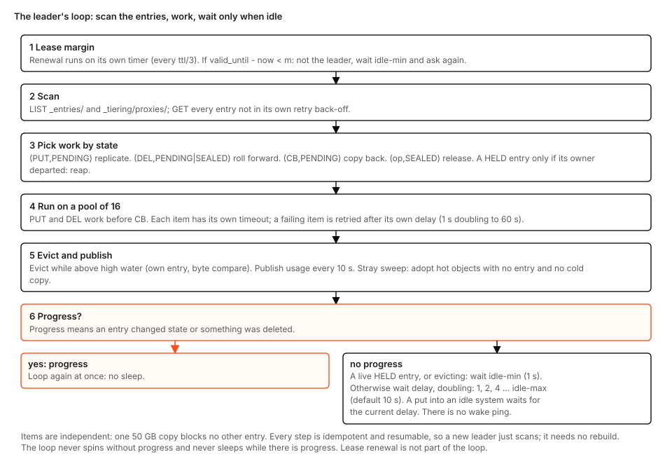

The reconciler discovers work by listing the entries. One call of `step()` does one scan, so tests can drive it; `run()` is the loop. In order:

1. **Lease margin.** If `valid_until - now < m`, this process is not the leader: wait the idle minimum and ask again. Renewal is on its own timer (section 6.4).
2. **Scan.** List `_entries/` (paged) and `_tiering/proxies/`; read every entry that is not in its own retry back-off.
3. **Pick work** by the table of section 6.5 (a HELD entry only if its owner has departed).
4. **Run it on a pool** of 16, put and delete work before copy-back. Each item has its own timeout, and a failing item is retried after its own delay (1 s doubling to 60 s), so a cold outage does not spin. Items are independent: one 50 GB copy blocks no other entry.
5. **Evict** while above high water, **publish usage** every 10 s, and run the **stray sweep**: a hot object with no entry and no cold copy is adopted (E1'''') when eviction reaches it, and also by a sweep at each takeover and with the daily usage listing, for objects older than 10 minutes, rate limited. The leader also deletes registrations departed for 10 D that no entry names.
6. **Progress** means an entry changed state or something was deleted. With progress the loop runs again at once, with no sleep. Without it: if some HELD entry is live, or eviction is running, wait the idle minimum (`--reconcile-idle-min`, 1 s), which never spins; otherwise wait `delay`, which doubles from the minimum (1, 2, 4, ...) up to `--reconcile-idle-max` (default 10 s).

**There is no wake ping.** A put into an idle system waits for the current delay, so the back-off bounds the latency of ack to cold. The loop never spins without progress and never sleeps while there is progress. Because every entry state is resumable, a new leader just scans; it needs nothing rebuilt.

**Usage.** The leader publishes `_tiering/usage` = `{hot_bytes, copy_lag, time}`. At takeover it starts from the published figure (the level is not forced to `Full` while a listing runs) and runs the full hot listing in the background; a full listing then runs daily (a flag), plus the deltas of what the leader lands, copies and evicts. A synchronous delete frees its entry unseen, so usage may over-count until the next listing (safe: it can show a false `Full`).

### 6.7 Live update

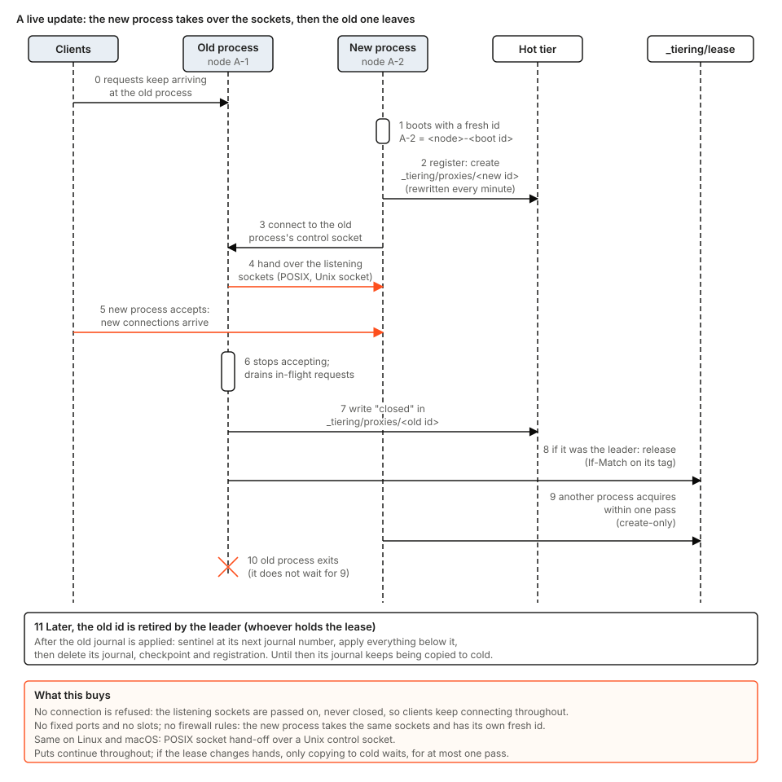

Updates replace a running process without a gap. The running process keeps a control socket (a Unix domain socket in its state directory).

0. Requests keep arriving at the old process.
1. The new process boots with a fresh id (`<node>-<boot id>`).
2. It registers: it creates `_tiering/proxies/<new id>`.
3. It connects to the old process's control socket.
4. The old process hands over the already-bound listening sockets of every interface as file descriptors (`SCM_RIGHTS`), a POSIX hand-off.
5. The new process starts accepting; new connections arrive there.
6. The old process stops accepting and drains its in-flight requests, still heartbeating.
7. When they have finished it stops heartbeating (there is no `closed` flag).
8. If it was the leader, it releases the lease (`If-Match` on its tag).
9. Another process acquires the lease at its next lease check (create-only).
10. The old process exits; it does not wait for step 9.
11. Later, the leader notices the old id has gone quiet (section 6.3) and finishes any entry it still held.

Why: the listening sockets are passed on, never closed, so the kernel's queue of pending connections is never lost and no connection is refused. No fixed ports or slots are involved, because the new process has its own fresh id, and no firewall rules. It is the same on Linux and macOS. Two processes of one node run at once during the hand-off and both write entries, so `dir:` hot needs its cross-process lock (section 6.4). Puts continue throughout; if the lease changes hands, only the leader's work waits, for about the lease ttl. The update hook is a POSIX script, so one hook serves Linux and macOS; only the runner that starts and stops a process differs (systemd, launchd).

### 6.8 When a node or the leader dies

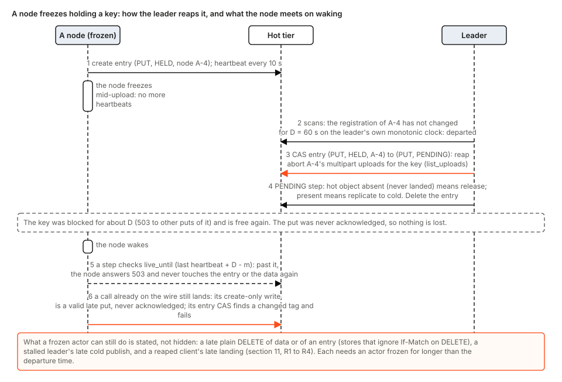

**A node dies or freezes** holding a key. Its entry (HELD) and registration just sit there. After D with no change in the registration, on the leader's own clock, the owner is departed and the leader reaps the entry: it moves it to PENDING by CAS (E7), aborts the owner's multipart uploads for the key by listing, and the PENDING step finishes it: replicate if the object landed, release if it did not. The key answered 503 to other puts for about D and then is free. The put was never acknowledged, so nothing is lost. A node that was only frozen and wakes after the reap finds its `live_until` past (it answers 503 and touches nothing), or, if a call was already on the wire, its CAS on the entry fails against the changed tag, so it acknowledges nothing.

**The leader dies.** It stops renewing the lease, which expires about 30 s later. Another process takes it over, scans, and resumes every entry: a copy the old leader left half done is redone, since a create-only copy gets `EXISTS` on a finished one and the byte compare passes. Puts continue meanwhile on every node: each still takes its entry, lands its object and is acknowledged. Replication waits, and entries only accumulate until it resumes. A put entry the old leader held for a copy, `(PUT, HELD, old leader)`, is reaped like any departed owner's, so that key is copied after about D; a delete that had amended it is not held up, because its handed-over `(DEL, PENDING)` entry is at once the new leader's to roll forward and release. If the hot tier fills in that time, puts answer `Full` and take the cold path (section 5). An old leader that wakes after the takeover makes calls whose conditions fail (a CAS on a changed tag, a create-only write on an existing object), except for its late plain deletes and cold publishes (section 11, R1 and R2).

### 6.9 Usage and back-pressure

The proxy never measures the hot tier. It rereads the usage object at most once per second and maps it to a level: `Open`, `Critical` (at or above 95% of the budget) or `Full` (at or above the budget). A missing or unreadable usage, or one that has stood unchanged for 30 seconds on the proxy's own monotonic clock (counted from the first time it read exactly that object; the leader rewrites it every 10 s, and no time another machine wrote is read), counts as `Open`. A hot tier that answers `Full` is latched `Full` for one second. The budget it is compared with is configured separately (`--hot-bytes` or `hot_store.budget`) and reaches the proxy as `ProxyConfig::hot_budget`; the deployment sets it below the real capacity (and leaves headroom for entries on `dir:`). `/usagez` answers 200, or 503 when the usage has stood unchanged for longer than `--usage-stale-after`, by the same clock.

There is no back-pressure sleep. A put at `Open` or `Critical` takes the normal path; at `Full` it takes the cold path or, if presigned, is refused with 503 `SlowDown` (section 5). `Critical` stops copy-back, so a read does not fill a hot tier that is nearly full.

### The timings

| What | Value | Measured on | Why this long |
|---|---|---|---|
| Heartbeat (registration rewrite) | 10 seconds (`--heartbeat`) | the node | cheap evidence of life; one small write per node per 10 s |
| Departure of a silent node (D) | 60 seconds without a change (`--departure`) | the leader's own monotonic clock | at least 6 heartbeats; no clocks compared across machines |
| Margin (m) | 10 seconds | the holder's monotonic clock | a call may start only if its deadline is at least m away; at most D/4 |
| Lease ttl | 30 seconds; about 30 s from a crash to a new leader | the taker's own monotonic clock | the longest pause in replication after a leader crash |
| Lease renewal | every ttl/3, on its own timer | the leader | a long copy cannot starve it |
| Loop wait | 1 s when idle, doubling to `--reconcile-idle-max` (default 10 s) | the leader | bounds ack to cold after a quiet period; no wake ping |
| Usage refresh | 1 second (proxy), published every 10 s | the proxy | back-pressure reacts within seconds |

**Measured** on release v0.3.18, dir to dir, a 28-core NVMe machine, release binary: with today's fixed pass interval, ack to cold at p50 is about half the interval (2.72 s at a 5 s interval, 0.71 s at 1 s, 0.12 s at 200 ms, for a 1 KiB object; 64 MiB objects add 0.1 to 0.12 s). Query: a pause of random length, a put, then a poll of the cold file's size every millisecond, 25 samples per size per interval, no mismatches and no timeouts. **Inferred** for this design: the wait is the current back-off, not a fixed interval. While work keeps arriving the leader loops with no sleep, so ack to cold is one scan plus about 7 small requests plus the copy (tens of milliseconds on `dir:`; 0.3 to 1 s for small objects over a remote cold tier at 20 to 30 ms round trip). After a quiet period it is up to the back-off at that moment, about half of it at p50.

## 7. Edge cases the design handles

Each entry is a mechanism and the reason it works. The races between actors are in section 8, each with its test.

- **A crashed or killed put.** A put that dies after taking its entry leaves a HELD entry, and possibly a hot object or an unfinished multipart upload. After D the leader reaps the entry (E7), aborts the uploads, and either replicates the landed object or releases the entry (section 6.8). The cost of a crash is one key blocked for about D, never a wrong answer. A client that aborts its request releases nothing, since the front finishes a put whose client has left by running it on its own task; the realistic triggers are a process kill, a crash, or a cut at the drain deadline.
- **A hung but alive client.** A client that is alive but stalled holding a key keeps its node heartbeating, so its key stays 503. There is deliberately no cap, because a long upload is legitimate. The operator verb `tierstore entries release --key K` moves such an entry to PENDING (the owner's later CAS then fails).
- **A delete that meets a copy.** The leader holds the entry `(PUT, HELD, leader)` for the length of a copy. A delete that amends it deletes both tiers, hands the entry over and waits for its release, so it is acknowledged only after the copy has ended and the leader has deleted both tiers once more. A frozen or stalled leader leaves it waiting until the request deadline, then 503, which the client retries; the retry claims the handed-over entry and waits again. The copy of a large object makes such a delete slow; that is the price of a GET that reads no entry.
- **A failed landing or CAS.** A put whose landing failed removes its own temp object or aborts its own upload and frees its entry; a put whose acknowledging CAS failed answers 503 and never touches the entry or data again. A delete that returns an error handed the entry over (E5) and is retried safely, because every step of it is idempotent.
- **An ambiguous answer.** An S3 409 `ConditionalRequestConflict` and a timeout mean "may have landed". The actor re-reads the entry and compares its nonce before it destroys or acknowledges anything.
- **Two leaders at once.** A leader that is slow (a long copy, a frozen process) can believe it holds a lease that another process has taken over. Every step on an entry is a CAS on its tag and the copy to cold is create-only, so the late leader's calls fail on their conditions; the new leader repeats the work, which is safe because every step is idempotent or conditional. A leader that has less than the margin m left on its lease does not start a destructive call or a cold publish (section 6.4).
- **Presigned puts and multipart completions** follow the same entry path as any put. A presigned put never writes cold, so at `Full` it is 503.
- **An object with no entry.** A hot object with no entry and no cold copy (left by an old binary, or by a landing after a reap) is adopted by the leader with a PENDING entry and replicated (the stray sweep, section 6.6).
- **Restart.** Nothing is rebuilt. The leader's memory is a bounded set of candidates and timers; the entries and registrations in the hot tier are the only state.
- **Lease take-over by `If-Match`.** Many processes may find the lease expired or absent at once; create-only, or `If-Match` on the tag just read, lets exactly one succeed. This needs a hot tier whose writes are atomic across processes: an S3 bucket, or a `dir:` tier with its own file lock (section 6.4).
- **Reserved prefixes.** `_entries/`, `_journal/` and `_tiering/` hold coordination state in the hot bucket. The proxy refuses get, head, put, delete and multipart under them and leaves them out of the listings of both tiers; the S3 front refuses each supported call on them (403) before the operation's own processing (a request it refuses as unsupported is answered so first), and the local cache refuses reads and writes of them as well, since its upstream may be a plain bucket.
- **The start-up self-test.** Before any address is bound, each tier is probed (section 9). A store whose create-only put or `If-Match` does not hold, or that recreates a missing key on an `If-Match` put, is refused with exit status 3, so the entry and the lease are never built on a store that cannot keep them.
- **Fail closed.** A put whose cold HEAD fails fails; a get whose hot read errors does not fall through to cold; a copy-back never fails a read; a node past its `live_until` answers 503 and touches nothing.

## 8. Races the design handles

Each race below is a place where several actors touch one key. For each: the mechanism of the design that handles it, and the test that will prove it. Tests land with the change that makes them pass; the earlier scenario tests in `tests/tierstore/edge_cases.rs`, written against the journal protocol, are superseded by these as the code changes.

| Race | Mechanism | Test |
|---|---|---|
| **Eviction, a delete, and a byte-identical re-put.** The evictor compares and stalls; a delete and a re-put of identical bytes (the same tag) complete; the evictor resumes. | Eviction takes `(EVICT, SEALED)` create-only: it fails if the delete or the re-put holds an entry, and under the entry both tags are re-checked. A delete and a put each take the same entry first. No step relies on a tag differing. | `evict_vs_delete_then_identical_reput_keeps_new_object` (a regression test: the evictor stalls, the delete and re-put complete, the evictor skips, and the new object is acknowledged and readable) |
| **A delete meets a pending put.** A put is acknowledged and waiting for the leader; a delete arrives. | The delete amends the entry into a delete by CAS (E3) instead of deleting blind or answering 503, then deletes cold and hot and hands the entry over (E5). The leader's CAS to HELD fails, so no copy starts, and the delete does not wait; the leader seals the handed-over entry and rolls the delete forward. | `delete_under_pending_put_amends_not_deletes_blind`, `delete_amends_pending_put_e3_acks_204_without_waiting`, `reconciler_cas_to_held_fails_after_amend_and_no_copy_starts` |
| **A cold-served get after an acknowledged delete.** The leader is mid-copy of the put when the delete runs, and publishes the cold copy once more after the delete's own deletes. | The get reads no entry. The delete amended the leader's HELD entry (or claimed a handed-over delete) and does not answer until the leader has released the entry, which is after its copy ended and its roll-forward deleted both tiers again. Every get that starts after the acknowledgement therefore finds both tiers empty. A get that overlaps the delete before its acknowledgement may return the bytes: the delete has not been acknowledged. | `cold_served_get_after_acked_delete_is_404`, `get_after_acked_delete_with_replicator_republish_is_404` (the model's counterexample as a schedule), `delete_amending_leader_held_entry_acks_only_after_release`, `delete_claiming_handed_over_entry_acks_only_after_release`, `delete_past_deadline_while_leader_frozen_answers_503_and_retry_claims`, `get_miss_never_reads_the_entry` (call counting: one hot read, one cold read) |
| **A copy-back meets a delete.** A get asks for a copy-back; a delete completes; the copy-back lands. | The copy-back is the leader's and lands only after E6 to SEALED, which a delete cannot amend; it streams the current cold object. A delete that comes first leaves a DEL entry the copy-back finds. | `copy_back_cannot_land_after_delete_ack`, `copy_back_seals_before_landing_and_streams_current_cold` |
| **Two puts of one key** (hot path against hot path, or hot against cold-direct at `Full`). | The create-only write of the entry has exactly one winner. The loser answers 503 or, once the winner has landed, 412 after the lockless HEADs. | table-driven `race_put_put_*`, `put_take_exists_branches` (one case per row of the take step) |
| **A put meets a delete in flight, or a delete and a re-put.** | The put is 503 while a DEL entry exists. A fresh delete frees its own entry, so a delete then a re-put never waits. | `race_put_delete_*`, `delete_then_reput_never_waits_and_lands` |
| **The leader releases an entry a delete amended.** | The leader moves the entry from HELD to SEALED by CAS before it releases it; if the CAS fails it re-reads and handles the delete. Release is a plain delete of a SEALED entry the leader holds. | `reconciler_release_requires_seal_with_plain_entry_delete` (on a store that ignores conditional DELETE) |
| **A client crashes holding a key.** | The leader reaps the entry after D, aborts uploads by listing, and finishes it. | `reconciler_reaps_held_entry_only_when_owner_departed_to_pending_and_aborts_uploads_by_listing`, `departed_means_absent_or_unchanged_for_D_on_own_monotonic_clock` |
| **A client freezes and wakes.** | Its `live_until` has passed, so it answers 503 and touches nothing; a call already on the wire that lands is a create-only write, and its acknowledging CAS fails against the changed tag. | `live_until_stops_ack_and_destroy_after_missed_heartbeat`, `put_that_loses_e2_cas_answers_503_and_never_touches_entry_or_data_again` |
| **Two leaders: a stalled leader and a takeover.** | CAS on changed tags and create-only on existing objects fail; destructive calls are refused inside the lease margin. | `old_leader_late_calls_fail_their_conditions`, `destructive_step_and_cold_publish_refused_when_lease_margin_below_m` |
| **An ambiguous CAS.** | The nonce is read back before anything is destroyed or acknowledged. | `put_ambiguous_cas_is_read_back_by_nonce` (one case landed, one not), `delete_amend_reads_back_nonce_before_deleting_data` |
| **A hot object with no entry.** | The stray sweep adopts it with a PENDING entry. | `stray_sweep_adopts_hot_only_object_older_than_grace_rate_limited` |
| **Two processes of one node during a hand-off.** | Different ids, both write entries; on `dir:` the create-only, `If-Match` and entry-delete writes are atomic across processes under a file lock. | `create_only_and_if_match_and_entry_delete_are_atomic_across_two_processes`, one case in the existing hand-over harness |
| **The loop under load and under a cold outage.** | No sleep only on progress; a live HELD entry or eviction pins the wait at the floor; a failing item backs off on its own delay. | `loop_does_not_sleep_while_progress`, `idle_backoff_sequence_1_2_4_to_idle_max_exact`, `live_held_entry_pins_wait_at_floor_never_spins`, `failing_item_backs_off_on_its_own_delay_without_spinning` |

**How these are tested.** No test reads the wall clock, sleeps against a real timeout, uses a fixed port or path, or asserts a duration.

- A **gate backend** wraps any `Backend` and parks a call before or after it reaches the store, so a test holds an interleaving at an exact step and releases it by event. An **injected monotonic clock** with `advance(d)` drives `live_until`, the first-seen timers and the lease margin. A **recording sleeper** returns at once and records the requested waits, so a test asserts the exact vector as a value. **Call counting** makes request-count claims exact equalities.
- Every pair of actors `{put, put}`, `{put, delete}`, `{delete, delete}`, `{delete, get}`, `{reconciler, put | delete | get}`, `{evict, put | delete}` is a table-driven race test: a list of `(actor, store-call index)` steps, all calls parked, the driver releasing one at a time.
- Frozen-actor tests park one call after its guard passed, advance the clock beyond D (the ttl for a leader), reap, re-put or delete, let the key replicate, release the call and assert the exact final state. Residual tests (section 11) pin exactly the outcomes that section states, and no more.
- Compatibility tests run in both directions (section 13). `dir:` tests cover the subdirectory listing, the fixed-length names, atomicity across two processes, and `If-Match` on a missing entry.
- **Model.** An explicit-state model of one key, with up to three client operations plus the reconciler, a crash at every step and a "ghost" mode in which a departed actor's in-flight call lands later, was run against the protocol (a script kept outside the repository; results below). Every normal and crash run of the protocol as specified is clean, exhaustively, liveness included. The frozen-actor runs find exactly the residuals of section 11 and are bounded, not exhaustive. It does not prove the Rust code: a bounded exhaustive explorer written in Rust, running the real proxy and reconciler on in-memory backends under the gate scheduler, replaces it as the conformance check. The explorer is built (item 19); its checker has the negative cases, as tests on histories made by hand: a lost acknowledged put, and a get of a deleted key's bytes after the delete was acknowledged, are each reported. A variant of the protocol that skips the seal or the delete's wait would need a switch in the production code and is not built.

### The model check

The model of one key is an explicit-state search of every interleaving of up to three client operations (puts of distinct or identical bytes, deletes, gets) and the leader, one store call per step, with a crash of any client or the leader at every step. In **ghost** mode a departed actor's one in-flight call still lands later. Each scenario runs with the conditional-DELETE fence off (MinIO, RustFS) and on (`dir:`, AWS). It checks that an acknowledged put no delete covers stays readable, that two puts are never both acknowledged, that a GET returns only bytes a not yet acknowledged delete has not covered, and, at rest, that no entry remains.

**Why the entry-first get was dropped.** The first draft read the entry in parallel with cold on a hot miss, and the model found a counterexample with no frozen actor: the leader, mid-copy, republishes the cold copy of a key whose delete was amended and acknowledged, and a get that read cold in that window returns the deleted key's bytes. Revision 2 closed it by reading the entry before cold on every hot miss, at the cost of one hot request in series. On 2026-11-03 that was reversed (section 15, decision 1): a get reads no entry, and the delete is what is made safe. Two changes do it. The leader CASes `(PUT, PENDING)` to `(PUT, HELD, leader)` before it copies, so a delete either amends the entry before the copy starts (the leader's CAS fails and nothing is copied) or meets a copy in flight. And any delete that meets a copy in flight, whether it amended the leader's HELD entry or claimed a handed-over `(DEL, PENDING)` entry, deletes hot and cold, hands over, and waits for the leader to release the entry before it is acknowledged. The leader releases only after its copy has ended and it has deleted both tiers again, so no cold publish can follow an acknowledged delete.

**Why the claim case waits too.** A delete that claims a handed-over entry cannot tell whether the copy is still running, so it must wait as well. The model has a scenario where the claimer does not wait, and it finds this: P1 is acknowledged `(PUT, PENDING)`; R1 CASes it to `(PUT, HELD, R1)`; D1 amends it to `(DEL, HELD, D1)`, its cold delete lands but the call times out, D1 hands over and answers 503; R1 is still copying; D2 claims `(DEL, PENDING)`, deletes cold and hot, and would acknowledge without waiting; R1's create-only cold publish lands; G1 misses hot, reads cold and returns P1's bytes after D2's acknowledgement. With the claimer waiting, D2 is acknowledged only after R1 has released, and the run is clean.

**Results.** Run as `systemd-run --user --scope -p MemoryMax=3G -p MemorySwapMax=0 python3 -I model_f2.py`, three workers at 800 MB each, a bound of 3,000,000 states on the ghost runs: 48 runs, 77,360,956 states in all. Normal runs (exhaustive, liveness included):

| scenario | states, fence off / on | result |
|---|---|---|
| distinct | 897,884 / 1,103,654 | clean |
| identical | 876,676 / 1,059,974 | clean |
| two-del (the claimer waits) | 1,019,342 / 1,174,006 | clean |
| cb | 185,694 / 204,517 | clean |
| cold-direct | 629,869 / 726,606 | clean |
| leader | 87,626 / 69,458 | clean |
| leader-ident | 159,524 / 142,666 | clean |
| two-del-claimnowait (the claimer does not wait) | 1,012,416 / 1,142,602 | violation: a GET returns a deleted key's bytes, no frozen actor |
| distinct-noentryGET-nowait (no entry read, no wait) | 876,080 / 1,019,822 | violation |
| distinct-parallelGET (the first draft) | 1,372,800 / 1,639,484 | violation |
| distinct-entryfirstGET (revision 2) | 1,212,562 / 1,448,840 | clean |

The ghost (frozen-actor) runs of the decided rule find only the shapes of R1 to R4 (fence off: a lost put in R1 and R4, R3, R2; fence on: R3 in cold-direct, R2 in leader). No new residual. The cost the model shows is the one stated in section 5: a delete overlapping a copy returns when the copy finishes, and a frozen leader turns the wait into a 503.

## 9. What tierstore assumes of a store

Both tiers are used through the `Backend` trait. The contract: `put` and `put_stream` are create-only (`AlreadyExists`, `Full`); `put_if_match(key, body, tag)` replaces only if the tag matches and fails on a missing key; `head` returns size, tag and modified time; `delete` of a missing key succeeds; `delete_if_match` is optional and used only as a fence; `list_page` is ordered and honours `start_after`; multipart calls are optional, and `complete_upload` is create-only. A network backend bounds each call with its own timeout.

Before binding any address the server runs a self-test against each tier, hot first. Probe keys live under `_tiering/selftest/<run id>/` and are deleted after each check. A wrong answer is a violation: the process exits with status 3 and does not retry. An `Unavailable` answer is retried (1 s doubling to 30 s) until `--backend-check-wait` (5 minutes). A tier that is still unreachable when the wait ends fails the start with exit status 1 (a restart may mend it); a violation exits with status 3, which a restart cannot mend. A `Full` answer skips the write checks with a note. Only the multipart check can be skipped, and only with a stated reason. After a tier passes, a sweep removes probe keys left by a killed start that are older than one hour. The same probes run in `tierstore format-epoch --check` (section 13), before any write is paused.

| Assumption | Why | Checked at start-up |
|---|---|---|
| Create-only put refuses a second put | One winner per key; the entry and the lease are taken create-only | yes (`create-only`; does not read the object back) |
| HEAD gives size and a non-empty tag, and the tag `put_if_match` returns equals the next HEAD tag | Lease and entry CAS use the tag from HEAD | yes (`head`) |
| `If-Match` refuses a wrong tag and accepts the right one | Entry CAS, lease take-over and renewal | yes (`if-match`) |
| `If-Match` put on a missing key fails (new) | A late CAS on a deleted entry must not recreate it | planned, not in the start-up check today (`if-match-missing`, a new probe, item 5 of section 14; whether MinIO and RustFS pass is not verified) |
| Ranged read returns the exact bytes | Ranged gets | yes (`range`, one in-range read) |
| Listing is ordered, paged, honours `start_after` | Reading the entries | yes (`paging`) |
| Delete of a missing key succeeds | Repeated and re-applied deletes, eviction, roll-forward | no |
| Multipart completion is create-only (cold tier) | A completion is a landing under the entry | yes (`multipart-conditional`, skippable) |
| Create-only and `If-Match` are atomic under concurrent writers, across processes | One winner per entry; one lease holder, also while two processes run during a live update | no: the probes are sequential; a `dir:` hot tier gets it from its own file lock (section 6.4) |
| Strong read-after-write for HEAD, GET, LIST | Entry reads and the hot-miss gate | implicitly, by reading right after writing |
| Conditional DELETE is honoured | Nothing relies on it; it only fences a stalled actor (R1, R4) | no, by design |
| Durability and replication of an acknowledged write | An acknowledgement means durable | no |
| Streaming put and read paths | Client writes | no (the probes use `put`) |

On `dir:` the monotonic clock is the only clock used for any decision (`Instant`), and a VM pause that stops it is a frozen actor (R7). How `S3Backend` maps answers: 507 is `Full`; 408, 429, other 5xx (not 501), transport failures and a 409 conflict are `Unavailable`; 412 on a create-only put is `AlreadyExists`, on `put_if_match` `PreconditionFailed`. `DirBackend` and `MemoryBackend` tag an object with the SHA-256 of its body; `S3Backend` uses the store's ETag, which is an MD5 for a single PUT and something else for a multipart object. Tags are never compared across tiers.

## 10. State


All coordination state is small objects in the hot bucket, under reserved prefixes, beside client objects under their own names. The cold bucket holds client keys only. The self-test's probes live in the hot tier under `_tiering/selftest/`.

| Key | Tier | Writer | Write mode | Content | Lifetime |
|---|---|---|---|---|---|
| client key | hot | a put, under its entry; the leader's copy-back | create-only | the client's bytes | until evicted (under its own entry) or deleted |
| client key | cold | the leader's copy; a put at hot `Full`; a multipart completion | create-only | the client's bytes | until deleted by the client (and again by the leader when it finishes a delete) |
| `_entries/<sha256 hex of key>` | hot | a put, delete or copy-back; the leader (HELD before a copy, eviction, strays, reap) | create-only; changed only by `If-Match` | `{v, key, op, st, owner, nonce, created_ms}` | deleted by its holder: a fresh delete frees its own, the leader releases the rest |
| `_tiering/proxies/<id>` | hot | node `<id>`: boot, then every 10 s | create-only, then `If-Match` | `{proto, boot, hb}` | deleted by the leader 10 D after departure, if no entry names it |
| `_tiering/lease` | hot | the leader | create-only to acquire; `If-Match` to renew and take over | `holder`, `nonce`, `generation` | deleted on release if the tag is still the holder's |
| `_tiering/usage` | hot | leader, every 10 s | overwrite: only the leader publishes | `{hot_bytes, copy_lag, time}` | replaced by the next publish |
| `_tiering/format` | hot | the operator verb, rollout only | `If-Match` | `{epoch, phase}` | removed after the cut-over release |
| `_tiering/selftest/<run>/...` | hot | start-up | per check | short literals | deleted after each check; swept after an hour |
| `_journal/*`, `_tiering/checkpoint/*` | hot | nobody after cut-over | read only by the bridge release | the old journal format | left for one release so a rollback finds them, then deleted |

The leader's own memory (an index of eviction candidates, retry timers, first-seen timers, a bounded map of tags it copied itself) is rebuilt from the above and is never a record.

**Formats and versioning.** The rule is additive-only change: a new optional field, a new kind of object, a new table. Every new object is such an addition: `_entries/`, the heartbeat body of the registration, `_tiering/format`. The entry body carries `v` and ignores unknown fields; an entry with an unknown `op` is skipped, not fatal. On `dir:`, `_entries/` is a real subdirectory of the hot root, named `.entries` so that no key of any release can have its name (the encoder writes a leading `.` as `%2E`; the bare key `_entries` stays an ordinary file beside it): the previous release's `list` keeps only regular files whose name does not start with `.`, so it does not surface the subdirectory (a test must prove this against the previous release before anything else lands; it is the likeliest compatibility finding). Old binaries do not reserve `_entries/`, which is why the rollout needs a bridge release (section 13). A client object the previous release stored under a key that starts with `_entries/` is shipped data and stays readable: on `dir:` it is a root file `_entries~<name>`, and this release reads it where `.entries/<name>` is absent (head, get, open read, listing), lists it once (`.entries` wins if both exist), removes it with a delete, refuses a create-only put of the key as taken, and moves it to `.entries` when a replacement by the tag writes the key (the new file is synced before the old one is removed). No write makes a root file for such a key. The test `this_branch_reads_lists_replaces_and_deletes_an_entry_key_the_previous_release_put` in `crates/compat/tests/dir.rs` runs the pinned previous release's put against this branch's head, get, list, replacement and delete, and `the_previous_release_lists_a_directory_that_has_an_entries_subdirectory` runs it the other way (the previous release over a directory this branch wrote).

## 11. Limits and residuals

Operator-facing limits are in [crates/tierstore/docs/limits.md](../../crates/tierstore/docs/limits.md). The design-level limits are below. The residuals R1 to R4 each need a **frozen or stalled actor** that only a fencing primitive could stop; none arises from an actor that is merely slow and alive, because slow actors keep heartbeating or are cut by their deadline (section 6.3). The model reproduces R1 to R4 in ghost mode. They are stated here, and each has a test that pins exactly the outcome stated (the residual tests of section 8).

- **R1: a late plain DELETE of data.** A client delete, a roll-forward or an eviction whose plain DELETE of data reaches the store after its holder lost exclusion (owner stalled for more than D, entry reaped, K re-put and replicated, or lease lost) deletes the new object. The call timeout and the deadline checks cut the window to a store-side stall longer than m. `delete_if_match` fences it on `dir:` and AWS only when the bytes differ; for a byte-identical re-put (OCI digests) a content tag cannot tell the objects apart, so the fence is blind there.
- **R2: a late cold publish or hot landing by a stalled leader.** A stalled old leader's create-only cold publish, or a client's late landing, executes after a delete was acknowledged and the entry released: the key reappears. A create-only call cannot be made conditional on "my entry still exists". It is not seen until a get or the eviction compare does.
- **R3: a late landing of an unacknowledged put.** A reaped client's create-only landing that executes later is a valid late put, not a resurrection, since it was never acknowledged. If another write meanwhile took the other tier, hot and cold differ. The compare counts it, logs the key, keeps hot and never evicts it, **and until the keys are reconciled a get can return the unacknowledged put's bytes instead of the acknowledged ones.**
- **R4: a late entry delete.** A stalled holder's plain entry delete (stores that ignore `If-Match` on DELETE: MinIO, RustFS) executes after the entry was reaped and re-created, or after the leader sealed a DEL entry, and removes it. The new holder's next CAS fails, so it does not acknowledge. **But a holder that already acknowledged loses its put when a live leader, resuming the delete it has in hand, deletes the data.** A conditional entry delete stops this on `dir:` and AWS; on MinIO and RustFS it is a residual. Signal: `tierstore_entry_vanished_total` (the leader's final delete found the entry gone).
- **R5: read windows.** A LIST that began before the delete was acknowledged may still show the key; a LIST that begins after the acknowledgement does not, because the acknowledgement waits for any in-flight copy and for both tiers to be deleted. Get and head answer 404. Before a delete is acknowledged, a get or head can still return the key's bytes, and a delete that overlaps a copy is not acknowledged until the copy ends (section 5, Delete). A 503 after a landing is an unknown outcome. The hot-only window is the ack-to-cold lag.
- **R6: a crash blocks one key** for about D (60 s; up to D more right after a leader change, which also delays the copy of a key whose copy the dead leader held).
- **R7: a monotonic clock that stops during a VM pause.** The deadline check cannot see the pause. Same class as R1 and R2.
- **R8: the local cache.** Its keep check compares sizes, not content, so a build node can return the old bytes of a key deleted and re-put with a same-size body. Not touched here, because no write id is added. A separate, documented limit.
- **R9: an old binary started after activation** writes without entries and its journals are never read. Unsupported; the rollout verb prints the credential rotation that fences it. Hot objects it leaves with no cold copy are adopted by the stray sweep.
- **R10: conformance is proven only within a bound.** The model covers one key at store-call granularity; the Rust explorer runs the real code under the interleavings of a few actors that its bound of preemptions allows (and seeded walks over more), not all of them, and a crash or a frozen actor is not one of its steps.
- **R11: copy-back is skipped under load** (the cap, the age limit, the pool priority): a cold-served key may be served cold longer. Not a correctness issue.
- **R12: cold down stops new-key puts** (section 5; decision 2 of section 15): a consequence of the write-once HEAD under the entry.

Other limits: a lost hot tier loses what was not yet copied, and the window is the ack-to-cold lag. An alive but stalled client holds its key and pins its hot object without limit (the operator verb releases it). Eviction is first-in-first-out. Reserved keys can appear in a cold listing (the filter applies to the hot listing). On `dir:` at ENOSPC an entry create or CAS can fail, so a delete, the operation that frees space, can answer 503: set level `Full` well below disk-full. With cold down nothing is evictable, so hot fills and every write is then 503.

**Cost, inferred from list prices** (S3 Standard, PUT and LIST $0.005 per 1000, GET and HEAD $0.0004 per 1000; check your region). A new-key put with hot and cold on S3 is about 5 PUT-class and 7 GET-class requests, roughly twice today's, about $28 per million puts. A delete with nothing pending is one PUT-class request. Idle: lease renewal and each proxy's heartbeat about $1.3 a month each; polling at a 60 s cap about $0.4 a month, at 10 s about $2 to $3. These are counts from the protocol, not measurements.

**Signals.** A small, fixed set of metrics with no per-id label (ids are fresh per boot): a leader gauge on every proxy, entries and the oldest entry's age by op and state, 503 by reason, reaped, entry-vanished, compare-mismatch and strays-adopted counters, heartbeat failures, `live_until` and lease-margin trips, CAS failures by transition, ack-to-cold seconds. The operator verbs `tierstore entries ls`, `show --key K` and `release --key K` (held, dry-run default) deal with a stuck key; entry names are hashes, so `show` takes the key.

## 12. Why this shape

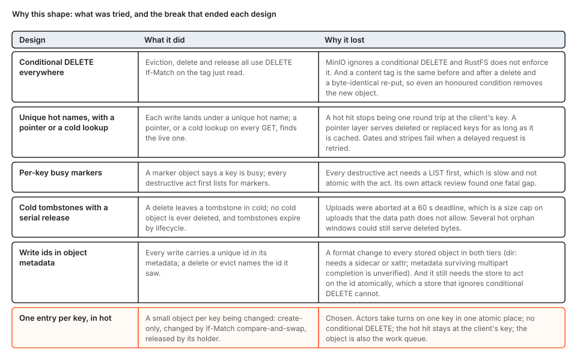

The shape is the end of a sequence of designs, each rejected for a concrete break. The requirements that cut them down: no conditional DELETE for correctness; no lost acknowledged write, resurrected key or wrong bytes outside a stated residual; a hot hit that is one round trip at the client's key; no size cap on uploads; formats that change additively; safety beside old binaries and with two processes running over the tiers during a hand-off.

**Conditional DELETE everywhere.** The obvious fix for the eviction race is to make every destructive step conditional on the tag just read. It lost twice. First, the stores it must run on do not all honour it: MinIO ignores a conditional DELETE and RustFS does not enforce it, so a design built on it is correct on AWS and `dir:` and wrong elsewhere. Second, even where it is honoured, a content tag cannot tell a key from the same key deleted and re-put with identical bytes, which is exactly the OCI digest case: the condition holds and the new object is removed. What survives is the modest use: where the store honours it, `delete_if_match` fences a stalled actor, and R1 and R4 say where it helps.

**Unique hot names, with a pointer or a cold lookup on GET.** Each write lands under a unique hot name so that a delete names exactly one write. It lost to the hot hit: the client's key must be the hot key for a hit to be one round trip with the bytes at the key, and a pointer layer from the key to the unique name either costs a second round trip or serves deleted and replaced keys for as long as the pointer is cached. A cold lookup on every GET puts the slow tier on the hit path. Gates and stripes over the unique names failed when a delayed request was retried.

**Per-key busy markers.** The bytes stay at the client's key and a marker object says the key is busy; every destructive act first lists for markers. It lost because it needs a LIST under every destructive act, which is slow and not atomic with the act, and because its own attack review found a gap with no fix inside the design.

**Cold tombstones with a serial release.** No cold object is ever deleted; a delete writes a tombstone that expires by a bucket lifecycle rule, and one serial release step cleans up. It lost on the upload rule: puts were aborted at the tombstone deadline (60 s), which is a size cap on uploads, and the data path allows none. Several hot orphan windows could also serve deleted bytes.

**Write ids.** A unique id per write in the object's metadata, which a delete or eviction names. It was rejected as a decision and for these reasons. It changes every stored object in both tiers (on `dir:` it needs a sidecar or an extended attribute, and whether metadata survives a multipart completion is unverified), so it is the largest compatibility change of the options. And it still needs the store to act on the id atomically; against a store that ignores a conditional DELETE, naming the id in the delete protects nothing. The entry gives the turn-taking without touching the object's bytes or metadata, and the stored object stays what the client sent. The local cache's size-only keep check therefore stays a separate, documented limit (R8) rather than being fixed here.

**One entry per key, in hot.** Actors that must take turns on one key need one atomic place to do it in. Create-only plus `If-Match` on one small hot object is that place, and the object doubles as the work queue: the leader lists `_entries/` to find work, so there are no per-node journals, checkpoints, prunes or sentinels. It is in hot because hot is the store every node already writes to, and it is small and fast; it is not in cold because a hot hit must stay one round trip and coordination traffic should not go to the slow tier. The cold reservation of the previous plan was dropped for the same reason: with the entry as the lock, a cold HEAD under the entry decides write-once, and nothing needs to be written to cold before the put lands.

**What the entry design keeps and rejects.** From the earlier per-object-entry drafts it keeps only what a concrete break needs: the SEALED state (a release and a copy-back must not race a delete), amend and claim (a delete must not answer 503 under a pending put), hash-named entries, the process deadline `live_until` with a heartbeat, a bridge release for the rollout, and a held operator verb. It rejects several machines that those drafts added (extra entry states, a renewal task per holder, a quarantine, garbage collection of free entries, a 409 for concurrent writers, a `closed` flag, an upload id in the entry, a copy-poll, an entry-etag skip), because the model showed the smaller machine is enough and each cut shrinks the surface to test. There is no wake ping: the reconciler's back-off bounds the latency, and a ping would add a path to test and to secure for a gain the back-off already gives to within a few seconds.

**Why a hot-miss get reads no entry, and a delete waits.** A get that read the entry in parallel with cold lost to the model (a deleted key's bytes, no frozen actor); reading the entry first was safe but put one more hot request in front of every hot-miss get. The decided shape puts the cost on the rarer operation: a delete that meets a copy in flight waits for the leader's release, and the leader holds the entry (HELD) before it copies so the delete can tell. The get is then one hot read on a hit and one cold read on a miss. The price is a slow or 503 delete while a large copy runs or the leader is frozen (section 8, The model check; section 15, decision 1).


**Why no conditional DELETE is needed.** The release of an entry or of data is by its exclusive holder, so a plain DELETE is safe whenever the exclusivity holds. What is left is the stalled actor, R1 and R4, which no primitive of the target stores can stop. The design says so, pins it with tests, and takes the fence where the store offers one.

## 13. Rollout (decided, not built)

New formats are only additions, but the rollout still has to be safe beside old binaries. Two facts shape it: today a registration is an empty object with no heartbeat, so a new binary cannot tell whether an old writer is alive; and an old binary does not reserve `_entries/`, so it would list, serve and delete entries as client keys. Hence a bridge release and a drain.

**Pre-flight (operator, once).** A lifecycle rule `AbortIncompleteMultipartUpload` on the cold bucket. The hot credential's IAM extended to `_entries/*` and `_tiering/proxies/*`. If the hot bucket is versioned, entry churn (a create and a delete per put) piles up delete markers and slows listing: use an unversioned bucket or expire noncurrent versions after one day. Run `tierstore format-epoch --check`: the hot-store probes, `if-match-missing` in particular, run here before any write is paused, so a store that fails them is found while nothing is at stake.

1. **Bridge release.** The previous release plus: `_entries/` is a reserved prefix everywhere it is listed (a client key that already starts with `_entries/` can no longer be read, written or listed through the proxy, which refuses it; on `dir:` the file stays on disk and is kept readable by the backend); the registration becomes a heartbeat object; the release watches `_tiering/format` and, under phase `drain`, answers writes 503 and keeps serving reads while its leader applies the journals until every checkpoint is at the head of its journal; it then writes phase `drained`. It changes no data or wire format. It rolls out with the existing hand-off while writes stay up.
2. **The operator verb `tierstore format-epoch`** (a subcommand, so its tests are Rust; dry-run default; held, never run by CI). `--check` changes nothing. `--drain` refuses unless every registration is of the bridge release with a recent heartbeat, or is named by the operator after a process check (older registrations have no heartbeat and cannot be classified by the tool), then waits for `drained`. `--cancel` writes the previous phase back. Tell the owners of the client fleet before `--drain`: the write pause is minutes, scales with fleet size and cold health, and a cold outage makes the drain wait.
3. **The release of this design** rolls out with the socket hand-off while writes are paused. It serves reads, answers writes 503, and does not campaign for the lease until the format says `{epoch: 2, phase: active}`. Rehearse the whole sequence, rollback included, in staging: there is no canary, because the epoch is fleet-wide.
4. `format-epoch --activate` checks every live registration is of the new protocol and the journals are drained, then writes the active format. Nodes poll it and start writing. The verb prints, and never runs, the credential rotation that fences a restarted old binary (nodes of the new release get the new credential first).
5. **Rollback:** `format-epoch --drain` again: nodes answer writes 503, the leader seals every entry and adopts and replicates every hot object without a cold copy until `_entries/` is empty; then roll back. It needs cold up.
6. **Clean-up, one release later:** the old `_journal/*` and `_tiering/checkpoint/*` objects stay until a release after the cut-over, so a rollback finds them; that release's leader deletes them.

The compatibility tests of section 8 run the previous release on directories and buckets the new code wrote, and the new code on those the previous release wrote, including the refusal to activate over undrained journals.

## 14. Future work

**(a) Other object-store APIs and other backends.** What: further fronts over the same proxy, for example the Google Cloud Storage JSON or XML API and Azure Blob, beside the S3 and OCI fronts. Other stores as tiers would be further implementations of `Backend`. Why: clients that do not speak S3 could use the same tiers; the proxy already has one call per operation and does not know the front. Touches: a new module under `server/` per front (request parsing, auth, errors, listing and range semantics of that API); for a new tier, a `Backend` implementation that passes the conformance tests in `tests/tierstore/conformance.rs` and the self-test. Create-only needs a conditional create on the store; an API without one cannot be a tier.

**(b) Tierstore as a file system.** What: a FUSE mount or an NFS gateway over the proxy, read-mostly first. Why: tools that want paths can use immutable objects without an S3 client, and immutability avoids most of what makes a distributed file system hard (no overwrite, no rename). Touches: a front that maps paths to keys and directories to prefixes (listing is by prefix; `delimiter` is not supported); a read path with ranged gets and local caching, for which the build-node `local_cache` is the starting point; writes later, as create-only files closed whole.

**(c) The single-process local_cache + hot_store + cold_store configuration.** What: configuration C of section 4. Why: a node that also owns the data should serve its own reads from local NVMe without a second process and a hop between them. Touches: `config.rs` (accept the three tables), `config_cache.rs` and `cli.rs` (construct the `LocalCache` with the proxy as its `Arc<dyn Backend>` upstream, which it takes as any `Backend`, rather than over an S3 upstream), the start-up checks (the tiers are already self-tested before the proxy opens, so the cache must not run its write-through self-test against the proxy, which refuses the `_tiering/` probe keys; only the cache directory's own file-system check applies), the drain and hand-over (a local cache holds a directory lock), and `docs/configuration.md`.

**(d) One entry per key (decided, not built).** What: the design of sections 5 to 8, 10 and 13. Each step is a pull request that can land alone, interfaces before the code that uses them, with its docs, goldens and tests (section 8) in the same pull request. Stage 0 changes no protocol.

*Stage 0, no protocol.*

1. Remove the reservation read side that no code path writes any more (the reservation marks in the backends, `get_marked`, the reconciler's reservation steps) and its two test files.
2. Split the files that are over 1000 lines (`dir.rs`, `tiered.rs`, `cli.rs`, `config.rs`) before they grow; moves only.
3. A one-call read, `open_read(key, range)` returning the tag and the body together, and a streaming `Proxy::get_stream`; the S3 front uses it. Gives the one-round-trip hot hit and removes the whole-object buffering of the read path. Pull request #94.
4. `get_marked` becomes `get_tagged` (tag with the body, for entry reads).
5. The `if-match-missing` start-up probe. Pull request #93.
6. `dir:`: the `.entries` subdirectory for the `_entries/` prefix and a blocking cross-process file lock, with the compatibility tests that the previous release lists such a root and that this release still reads, lists, replaces and deletes the root files the previous release made for `_entries/` keys.
7. The test harness: gate backend, injected monotonic clock, recording sleeper, call counting, each with its own tests.
   Built: `GateBackend` with `Gate` (`Pre` and `Post`, one call per gate), `Mono` (a `Clock` that only `advance` moves), the `Sleeper` trait with `TokioSleeper` and `RecordingSleeper`, and `FaultyBackend::calls_on` and `call_log`. Production code uses the `Sleeper` trait and its default `TokioSleeper` for the lease renewal timer of the reconciler and for the heartbeat in both server paths; `GateBackend`, `Gate`, `Mono`, `RecordingSleeper` and the `FaultyBackend` call counts are for tests. The request paths still read `Instant::now()` in `tiered.rs`, which moves to `Mono` with the code that needs it. The per-call timeout is built as `Bounded` (item 9), which no request path calls yet. Not built yet: the in-memory backend models of section 13.1.

*Stage 1, entry layer, dark (nothing calls it).*

8. The entry module: body, nonce, transitions, store calls, nonce read-back.
9. A deadline wrapper for destructive calls; the heartbeat body and `live_until`; a background task and drain hook in the proxy; `--heartbeat` and `--departure`; registration clean-up.
10. The lease on its own timer, with `valid_until` and a monotonic first-seen takeover.
   Built, in `lease.rs` and `Reconciler::pass`: a taker takes the lease over when the same tag has stood for the ttl on its own monotonic clock (`ReconcilerConfig::mono`) from its first look, and no time stamped by the hot tier is read; the holder renews on a timer of its own (`ReconcilerConfig::lease_renew`, a third of the ttl unless set) for as long as a pass works; `valid_until` is the time before the last renewal was sent plus the ttl less `ReconcilerConfig::lease_margin` (a third of the ttl unless set), and `Lease::margin_ok` says whether the margin is left. Nothing yet refuses a destructive call on it: that comes with the steps that need it. The two durations are settings of the library only; `--lease-ttl` sets both until the flags and file keys are added, when `cli.rs` and `config.rs` are under 1000 lines (item 2).

*Stage 2, rollout.*

11. The bridge release: `_entries/` reserved everywhere, `_tiering/format`, the write-503 drain and the `drained` marker.
12. `tierstore format-epoch` (`--check`, `--drain`, `--cancel`, `--activate`) and the `tierstore entries` verbs, with the runbook.

*Stage 3, the protocol behind the epoch gate (nodes are inert until activation).*

13. The reconciler loop: scan, pool, back-off, reap, the entry steps of section 6.5 (including the CAS to HELD before a copy), the stray sweep.
   Built, in `entry_reconciler.rs`: `EntryReconciler::step` reads `_tiering/format` and does nothing until it says `active`; takes the lease; lists `_entries/` and `_tiering/proxies/`; works the entries on a pool of `ReconcilerConfig::parallel` items, puts and deletes before copy-backs, each failing item on its own delay (`retry_min` 1 s doubling to `retry_max` 60 s); takes `(PUT, PENDING)` to `(PUT, HELD, me)` before it copies, copies create-only under the cold `HEAD` write-once check (or compares the bytes, and counts and keeps a difference), seals and removes the entry; finishes `(DEL, PENDING)` and `(DEL, SEALED)` on both tiers and removes the entry, which releases a delete that waits; reaps the held entry of an owner that departed (`departure` 60 s on its own monotonic clock) and aborts a reaped put's uploads on both tiers; checks the lease margin before a cold publish and before the deletes; sweeps the hot tier for strays at takeover and every `stray_interval` (24 h), at `stray_rate` (100) cold lookups a second, for objects older than `stray_grace` (10 min). `EntryReconciler::run` steps without waiting while there is progress, waits `idle_min` (1 s) while a live owner holds an entry or it is not the leader, and otherwise 1 s doubling to `idle_max` (10 s); there is no wake ping. These are settings of the library (`EntryReconcilerConfig`); the binary starts the loop with these defaults at the activation wiring (item 21), and no flag or key sets them yet. A pending copy-back is sealed and removed without a copy: the copy-back is item 18. Item 14 is built too, in `entry_reconciler/usage.rs` and `entry_reconciler/evict.rs`: the leader reads the figure the leader before it published, lists the hot tier `scan_pages` (100) pages a step at takeover and every `usage_scan_interval` (24 h), publishes `_tiering/usage` every `usage_interval` (10 s) with the lease margin left, and moves the figure between listings by the bytes of the objects it copies that landed after the listing started and by the bytes it evicts (a delete that a client finishes by itself is not seen, so the figure can be too high until the next listing; `copy_lag` is the bytes of the keys whose copy failed or that the leader adopted for want of a cold copy, until copied; an object copied while a listing runs is counted once: one the listing has yet to reach is left to the listing, one behind it is added). Above the high water of `ReconcilerConfig::hot_budget` it takes the `candidate_limit` (10000) oldest listed objects, oldest first, `parallel` at a time: a key with any entry is skipped; a hot object with no cold copy gets `(PUT, PENDING)` instead of being evicted; the bytes are compared (skipped when this leader copied or compared the key and both tags are the recorded ones, `tag_record_limit` 100000 keys, forgotten at takeover); then `(EVICT, SEALED)` is created create-only, both tags are read again, and with the lease margin left the hot object is deleted on its tag (a plain delete where the store does not honour that) and the entry removed. The proxy now judges the usage stale when the object has stood unchanged for `usage_stale_after` on its own monotonic clock (it compares the body it read with the one before, and a rewritten object has a new `time`), where it compared the `time` in the object with its wall clock. Not built: the removal of registrations that no entry names, and the metrics of the loop.
14. Entry-held eviction, with the tag fast path and the compare; usage from the entry listing.
15. The client put on entries: hot, cold-direct, multipart completion, presigned.
16. The client delete: create, amend, claim, and the wait for the leader's release when a copy is in flight (503 at the request deadline).
17. The get and head: a hot miss goes straight to cold and reads no entry (the delete's wait of item 16 is what keeps this safe).
18. Copy-back as entries, and the in-request copy-back removed (its own late pull request, decided 2026-11-03; section 15, decision 4).
19. The Rust conformance explorer.
   Built, in `crates/tierstore/tests/tierstore/explorer/`: the real `Proxy` (one per client, live, with its heartbeat parked after the first beat) and the real `EntryReconciler` over a hot and a cold `MemoryBackend`, each actor behind a `GateBackend` of its own that holds every call on the key or on an entry (calls on `_tiering/` pass). An actor runs only until its next held call; the driver releases one call at a time, on a paused tokio clock, so the delete's waits pass at once and no test reads a clock. Searches: every schedule with at most a bound of preemptions (a switch away from an actor that could have gone on), or walks chosen by a seeded generator. Rules: no acknowledged put lost (the last acknowledged put no delete ended after is what a get answers and what the cold tier holds), no get of the bytes of a put an acknowledged delete covered by a get that began after it, write-once (two acknowledged puts need a delete between), an acknowledged delete leaves neither tier holding the key, and from the quiet state the reconciler reaches a step that changes nothing with no entry left and equal bytes in the two tiers. The two counterexamples of the model (a copy in flight against a delete, a retried delete that claims a handed-over entry) are fixed schedules. One key, no crash and no frozen actor. Run `cargo test -p tierstore --test tierstore explorer::`; each exploration asserts the number of schedules it ran.

*Stage 4, cut over.*

20. Delete the per-node journal, its state and checkpoints, and the old flags (`--reconcile-interval`, `--journal-linger`); update the docs and this document.
21. Activation wiring and the release; clean-up of the old `_journal/*` objects one release later.
   Built (the wiring; the clean-up is not): `server/rounds.rs` makes each round of a node's reconciler a pass over the journals until `_tiering/format` says `{epoch: 2, phase: active}`, and from the round that reads it a step of the `EntryReconciler`, after giving the journal reconciler's lease up; a node does not go back, and a format that cannot be read makes the round fail and do nothing. The proxy reads the format at each heartbeat as well as before a write, the registration says `proto` 2, and `docs` has the runbook (`operations.md`, Rolling out the entry protocol). Not built: the keys for the entry reconciler's and the entry puts' tunables, and the rollback after activation.

*The pull requests around the plan (2026-11-03).* #87 (an eviction without a tag first checks that cold holds a real object) and #67 (a checkpoint is stored only under a valid lease and never behind the stored one) are **kept** as interim fixes until the redesign replaces them: entry-held eviction (item 14) replaces #87, and removing the checkpoints (item 20) removes what #67 guards. #88 (the cold reservation writers) is **closed**, because reservations are dropped. #89 (the `Cargo.lock` release fix) is **merged**. Items 5 and 3 are open as #93 and #94. Separately signed off, and independent of the protocol: #91 (the grant flags are removed, and a presigned PUT is refused with AccessDenied) and #90 (the nft tables are renamed and the host updater name is banned).

The bridge release of step 11 must ship and be rolled to every node before any step of stage 3 activates. Stages 1 and 3 leave two protocol paths in the code for a period. Today's conditional delete in `Backend` (`delete_if_match`) stays as the optional fence of section 11.

Why: the earlier gaps, a lost object, a resurrected delete, a double acknowledgement, all came from steps that were not serialised on the key, and from two stores that cannot decide a key together. The entry serialises them; the model and the tests of section 8 show the smaller machine is enough.

**(d2) Interfaces and configuration (decided, not built).** What: tierstore takes only `--config`, and the file declares the interfaces it serves as a list, so the data-path flags and the old `listen` keys go:

```toml
[[interface]]
type = "s3"
params = { port = 9300 }      # or addresses = ["192.0.2.5:9300"]

[[interface]]
type = "oci"
params = { port = 5000, tls_cert_file = "/etc/tierstore/oci.crt", tls_key_file = "/etc/tierstore/oci.key", prefix = "oci/" }
```

An interface is a front over the same proxy; a later `type = "fs"` (item b) has a mount point and no port. Why: one configuration surface instead of 53 flags and a second spelling of them in the file, and a place where new interfaces plug in. Touches: `server/config.rs` and `cli.rs` (the loader and the start), every front's start-up, `packaging/`, the operator docs, and the tests that start the binary. It is a breaking change of the configuration, made before the first public release.

**(d4) A full OCI registry (decided, not built).** What: beyond pull by digest, (1) **push**: blob uploads, monolithic and chunked, and manifest `PUT`; blobs are content-addressed, so they are ordinary create-only objects; (2) **tags**: a tag is a mutable pointer to a manifest digest, kept as a small object in a reserved namespace and moved with `If-Match` compare-and-swap, as the lease is; (3) **pull-through cache**: on a miss, the front fetches the image from a configured upstream registry, verifies every digest, stores the pieces as objects and serves them, so later pulls are local. Authentication reuses tierstore's S3 keys: a read-only key may pull, a full key may push (HTTP Basic over TLS, or the registry token flow backed by the same keys). Why: a complete registry on top of the object store, not only a read path. Touches: `server/oci/` (routes, upload sessions, tag objects, the upstream client), the key roles in `server/keys.rs`, the reserved prefixes, the limits, and the operator docs. A pull-through cache makes tierstore an outbound client of public registries, with their credentials and rate limits.

**(e) Format versioning and the compatibility test.** What: a version in each stored format, or the written additive-only rule enforced by a test that reads the previous release's objects, run in both directions. Why: the entry body carries `v` from the start, but the older formats do not, and the rollout depends on the rule. Touches: the stored-format fixtures and a compatibility test per format.

## 15. Decisions

The decisions of 2026-11-03, taken by the CEO on the design as drafted. They state what the design is; the sections above describe it accordingly.

1. **A GET never reads the journal entry.** A hot hit is one hot GET. A hot miss is one cold GET, plus the best-effort copy-back request. This **reverses** the earlier draft's entry-first GET. In its place the reconciler CASes `(PUT, PENDING)` to `(PUT, HELD, owner)` before it copies, and any DELETE that meets an in-flight copy waits for it: a DELETE that finds the entry HELD by the reconciler, and a DELETE that claims a handed-over `(DEL, PENDING)` entry (a retry finishing a half-done delete) amend or claim by CAS, delete hot and cold, then poll the entry with the per-item back-off until the reconciler releases it, and only then are acknowledged. Past the request deadline (a frozen or stalled reconciler) the answer is a retryable 503. A DELETE that amends a PENDING (not HELD) put makes the reconciler's CAS to HELD fail, so no copy starts and it does not wait. A DELETE with no entry finishes synchronously. Cold is always deleted at once by the DELETE. Sections 5, 6.2, 6.5 and 8 (The model check); cost: a delete overlapping a copy returns when the copy finishes, and 503s on a frozen reconciler.
2. **New-key puts fail (503) while cold is down.** Accepted. A consequence of dropping the reservation: write-once is a cold HEAD under the entry, and a cold error is a 503. The alternative, re-checking write-once at replication, reopens the decision and can acknowledge two puts of one key.
3. **`--reconcile-idle-max` defaults to 10 s.** The idle wait is 1 s and backs off to 10 s. It costs about $2 to $3 a month more than 60 s (inferred) and bounds the idle discovery delay (the time before an idle leader notices new work) at 10 s. It does not bound the hot-only window or the 503 after an amended delete: those also include the copy duration, the per-item retry back-off (up to 60 s for a failed item, section 6.6), outages and the request deadline.
4. **Copy-back is kept,** as its own late pull request (item 18 of the plan, section 14), before the journal is deleted. Cutting it would mean the cache never refills from cold, a regression against today's in-request copy-back.
5. **Rollout: one planned write pause of a few minutes, no canary.** Accepted, with the owners of the client fleet told beforehand (section 13).
6. **Residuals R1 to R4 are accepted as written** in section 11, with R3 and R4 stated at their full strength. The model's frozen-actor runs of decision 1 find only these shapes.
7. **The pull request plan** (section 14): #87 and #67 are kept as interim fixes until the redesign replaces them; #88 is closed; #89 is merged; #93 (the `if-match-missing` probe, item 5) and #94 (the one-call streaming read, item 3) are the new stage-0 pull requests. #91 and #90 are signed off as well.

Still open, not covered by those decisions:

8. Should start-up measure the store's clock against the machine's and refuse beyond a bound (no decision uses a cross-machine clock, so this matters only for the usage staleness check)?
9. Should the self-test say plainly that concurrent atomicity is assumed, and should its paging check tolerate a lagging listing, which the trait allows?
10. Should reserved keys be filtered from cold listings, and from the proxy's get and head, or only at the front?
11. Should the 1 s usage refresh and the proxy's 30 s staleness limit have flags?
12. For configuration C, should the local cache sit in front of the proxy (cache hits skip the hot tier) or beside it?

## 16. Glossary

| Term | Meaning |
|---|---|
| Hot tier / `hot_store` | The small, fast store that takes every write and holds all coordination state. |
| Cold tier / `cold_store` | The large, cheap store that holds every object eventually. On a build node, the upstream. |
| Local cache / `local_cache` | A read-through cache on a node's own disk in front of one upstream. |
| Proxy | The component that answers requests against the two tiers. |
| Proxy id / node id | `<node>-<boot id>`, fresh at every process boot and never reused; names a node's registration and is the owner in its entries. |
| Front | The S3 or OCI HTTP surface over a proxy. |
| Entry | The small object `_entries/<sha256 of the key>` in hot that holds a key while one actor changes it. Created create-only, changed only by `If-Match`, deleted by its exclusive holder. It is both the lock and the journal record. |
| Op, state | An entry's op is PUT, DEL, CB or EVICT; its state is HELD, PENDING or SEALED (section 6.2). |
| HELD / PENDING / SEALED | The owner is working (a client, or the leader copying) / landed, the leader's turn / the leader is finishing and nobody else may act. |
| Amend, claim | A delete turning a pending put or copy-back entry, or a put entry the leader holds for a copy, into its own, or taking over a handed-over delete, by CAS. A delete that amends the leader's HELD entry, or claims, then waits for the release. |
| Seal | The leader's CAS of an entry to SEALED before it releases it or lands a copy-back. |
| Reap | The leader moving a departed owner's HELD entry to PENDING. |
| Reconciler / leader | The one process, chosen by lease, that lists the entries and copies to cold, finishes deletes, copies back, evicts, reaps and publishes usage. The only actor that releases entries it did not take itself. |
| Departed / D | An owner whose registration is absent or unchanged for D (60 s) on the leader's own monotonic clock. |
| `live_until` | A proxy's deadline: its last heartbeat's send time plus D minus the margin m. Past it, the proxy answers 503 and touches nothing. |
| Margin (m) | 10 s; a destructive call may start only if its deadline is at least m away. |
| Stray | A hot object with no entry and no cold copy. |
| CAS | Compare-and-swap: a write conditional on the object's tag (`If-Match`). |
| Nonce | `<actor id>.<boot>.<counter>` in every entry body, so a body never repeats and an ambiguous write can be read back. |
| Lease | The object `_tiering/lease`, whose holder is the leader. |
| Usage / copy lag | `_tiering/usage`: logical hot bytes, and the bytes the cold tier does not yet hold. |
| Level | The proxy's reading of capacity: `Open`, `Critical`, `Full`. |
| Budget | The bytes of client objects, by logical size, the hot tier is meant to hold. |
| Back-pressure | At `Critical`, copy-back stops; at `Full`, a put takes the cold path (presigned: 503). No sleep. |
| High water / low water | Usage shares (80% / 70%) at which eviction starts and stops. |
| Copy-back | Writing an object read from cold into hot, by the leader under a CB entry. |
| Create-only | A write that fails with `AlreadyExists` if the key exists (`If-None-Match: *`). |
| Presigned put | A put signed in the URL; hot-only. |
| Presigned get | A get or head of one object signed in the URL by a key that reads (full, read-only or scoped), with the rights of that key; any `Range` is allowed, so one URL serves a parallel download. |
| Reserved prefix | `_entries/`, `_journal/` and `_tiering/`; refused to clients. |
| Bridge release | The release that reserves `_entries/` everywhere and drains the old journals, so the new protocol can start beside no old writer. |
| Residual | A stated outcome that needs a frozen or stalled actor (R1 to R4, section 11). |
| Self-test | The start-up check of each tier's contract. |
