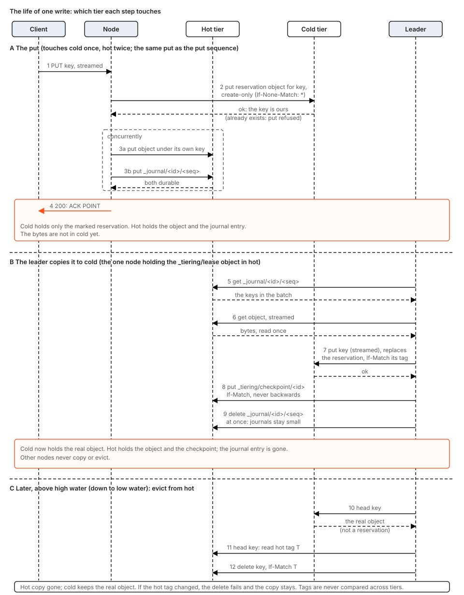

# tierstore design

This document says why tierstore exists, what it promises, and how the code keeps those promises. It is kept in step with the code: a change to code that this text describes changes the text with it. It also marks what is not built yet (section 12), so a reader can tell the design from the plan. Operators read [crates/tierstore/docs/](../../crates/tierstore/docs/) (start with [overview.md](../../crates/tierstore/docs/overview.md)); the hand-over of a running node is section 6.6. Where a source comment and the code differ, this document follows the code. Terms in bold are defined in the glossary (section 14).

## 1. The problem

Many workloads, such as builds and CI, read and write very large numbers of large, immutable objects: build artifacts, container image layers, dependency caches. Two properties of such a workload decide the design.

- **Most reads are repeats.** The same objects are read again and again, and the set of objects in use changes slowly. A store for it is judged by how rarely a read has to reach its slowest part.
- **Writes arrive in bursts and are never overwritten.** A burst of many writes is hard on hard disks and on a store that must agree across nodes before each write returns. An object that is never overwritten can be copied, retried and re-copied without a reader ever seeing its bytes change.

A single S3 store forces a choice. A small store on fast media answers quickly and runs out of room. A large store on cheap disks, or one that is far away, holds everything and answers slowly. Compute nodes meanwhile have fast local NVMe that no shared store uses. The clients already speak S3, and the machines that run container images already speak OCI (pull by digest); neither should change.

From this follow the requirements:

1. **S3-compatible** for clients, and a read-only OCI front for image pulls, so existing tools work unchanged.
2. **Immutable objects.** A put creates; nothing overwrites.
3. **Recent data is fast.** A write is acknowledged once it is durable on fast media, and a read of a recent object is served from fast media.
4. **All data is durable in a large, cheap store** in the end.
5. **No extra coordination service.** Anything the parts must agree on lives as small objects in a store the deployment already has.
6. **Any number of stateless front processes** over the same stores, with one background worker chosen among them.

## 2. Goals and non-goals

Goals:

- One bucket with the S3 object calls clients need (put, get with ranges, head, delete, list, multipart, presigned put) and, beside it, a read-only OCI distribution front, both over one proxy.
- Create-only puts across two tiers: a key that exists in either tier is refused. One write in the cold tier decides every race, except between a presigned (hot-only) put and a put that goes through cold (section 11).
- A put is acknowledged only when it can be found again: the key is reserved in the cold tier and the object and its journal entry are durable in the hot tier, or (hot tier full) the cold tier holds the object.
- Reads from the fastest tier that holds the object, with a fill of the faster tier on a miss.
- Back-pressure instead of failure when the hot tier fills.
- Recovery from a restart or a lost lease using only what is stored in the tiers.
- A small contract for what a tier must do (section 9), stated and not verified: tierstore is a proxy over a hot and a cold store and does not test them.

Non-goals:

- Overwrite, versioning, or object locking.
- Transactions across keys, or atomicity across the two tiers beyond what section 6 describes.
- Recovery of a lost hot tier: objects not yet copied to the cold tier are lost with it.
- Scrubbing stored objects for bit rot.
- Protection against clock skew larger than the lease ttl.
- TLS on the S3 listener (the OCI front has it).

## 3. The design in one picture


One `tierstore` process serves an S3 front (`--listen`) and, if asked, a read-only OCI front (`--oci-listen`, its own address). Both fronts call the same **proxy**, so an image pulled over OCI and an object read over S3 are answered from the same tiers by the same code ([server/cli.rs](../../crates/tierstore/src/server/cli.rs) module docs). The pieces:

- **Tiers.** A **hot tier** (small, fast: `dir:` on local disk or an S3-compatible bucket) and a **cold tier** (large, cheap: `dir:` or an S3-compatible bucket). Both are used through one trait, [`Backend`](../../crates/tierstore/src/backend.rs). `memory` is also accepted as a tier kind; it keeps nothing across a restart and stamps every object with time zero, so it is for tests.
- **Proxy** ([tiered.rs](../../crates/tierstore/src/tiered.rs), `Proxy`). Answers every request against the two tiers. It keeps no durable state: a cached reading of capacity, a full latch, the open journal batch and its next number. Today `Proxy::open` resumes the configured node id and its journal sequence; a fresh id `<node>-<boot id>` on every boot, never reused, is part of the planned protocol (sections 5, 6 and 12).
- **Fronts** ([server/](../../crates/tierstore/src/server/), `ops.rs` and `oci/`). Check signatures, enforce request limits, and call the proxy as a `Backend`.
- **Journal** ([journal.rs](../../crates/tierstore/src/journal.rs)). A put is recorded as an entry in a small object `_journal/<proxy id>/<seq>` in the hot tier (a copy-back appends one too, and today's delete appends a delete entry; section 5). Today a put is acknowledged after the cold tier is checked with a HEAD and the object and its entry are durable in hot; acknowledging once the key is reserved in cold is the planned protocol (sections 5 and 12). The leader learns what the hot tier holds from journal objects and never lists the hot tier's data, so a pass costs work in proportion to new writes.
- **Reconciler** ([reconciler.rs](../../crates/tierstore/src/reconciler.rs)). Runs in the leader only. Copies each journaled put to the cold tier, evicts from the hot tier when it fills and writes checkpoints. Today `Reconciler::prune` keeps a journal object until eviction progress and retention allow deleting it; replacing a reservation, deleting journal objects at once and retiring departed nodes are planned (section 12). (Today's code also applies journaled deletes; section 5, Delete). It works on the raw tiers, not through the proxy.
- **Lease** ([lease.rs](../../crates/tierstore/src/lease.rs)). One object in the hot tier; its holder is the one active reconciler among all processes.
- **Local cache** ([server/local_cache/](../../crates/tierstore/src/server/local_cache/)). A read-through disk cache on a node's own NVMe, used by the build-node configuration (section 4). It is not part of the storage-node path.

Several processes may run over the same tiers; each has its own proxy and fronts, and only one reconciler works at a time.

**What the OCI front is, and is not.** It is a read-only registry *server* over tierstore's own objects, not a cache of another registry: nothing in [server/oci/](../../crates/tierstore/src/server/oci/) calls out. Each piece of an image (manifest, index, config, layer) is an ordinary object stored by content at `oci/blobs/sha256/<digest>`, written through the S3 front by whatever builds the images. A container engine then pulls by digest (`/v2/<name>/manifests/<digest>`, `/v2/<name>/blobs/<digest>`) from whichever tier holds the object, and every byte is checked against its digest before the response completes. Today there is no push, no tags (only digests), and no fetch from an upstream registry on a miss; push, tags and a pull-through cache are decided and planned (section 12, item d4).

## 4. Configurations


The configuration file ([server/config.rs](../../crates/tierstore/src/server/config.rs)) has two supported shapes, told apart by the tables it has. A third, local_cache + hot_store + cold_store, is planned.

| | Tables | What the process runs | Status |
|---|---|---|---|
| A. Build node | `[local_cache]` + `[cold_store]` | Fronts over a `LocalCache` over one upstream. No journal, lease or reconciler. | supported |
| B. Storage node | `[hot_store]` + `[cold_store]` (or the flags) | Fronts, proxy, journal, reconciler, lease. | supported |
| C. All three | `[local_cache]` + `[hot_store]` + `[cold_store]` | A and B in one process: fronts, then local cache, then proxy over hot and cold, with the reconciler. | planned (the loader refuses it) |

**A: build node.** `cold_store` is the upstream: usually the S3 endpoint of a storage node's tierstore, or any S3-compatible store. A hit is answered from local disk with no call upstream. A miss on a whole get fills the object; a miss on a ranged get fills the whole object if it is at most 64 MiB and otherwise passes the range through and keeps nothing; the misses of one key fill it once. By default the front refuses every write, so the cache has nothing to recover but files it can delete. With `write_through = true` the cache accepts writes and sends every one to the upstream before acknowledging it; a create-only put under a `cache = true` policy is also kept on the node, best effort, and never fails the put. OCI reads are served from the cache too ([server/local_cache/mod.rs](../../crates/tierstore/src/server/local_cache/mod.rs) module docs).

**B: storage node.** This is the design of sections 5 to 9.

**C: planned.** One process with a local cache in front of the proxy over a hot and a cold tier. The loader refuses the three tables together (`config.rs`, the match that builds `Settings`) with the error "the hot store is already local disk, and a disk cache in front of it would cache a disk with a disk". That reasoning does not hold when the hot store is an S3 bucket. The design treats C as part of the plan: a node that serves its own reads from NVMe and also owns the data. What it needs is in section 12(c). Until it exists, the same read path is reached by chaining: a build node whose `cold_store` is the S3 endpoint of a storage node.

## 5. How each operation works

The sequences below are for configuration B. Every store call is shown in code order. The proxy refuses a reserved key (section 7) for put, delete and multipart before anything else. A get or head of a reserved key is refused by the S3 front (403); the proxy does not check it.

### Put

This is the decided design; the code moves to it through the pull requests listed in section 12.


The S3 front sends every create-only put that is not a multipart part to `Proxy::put_stream` (or `put_stream_hot_only` when the request is presigned). In order:

1. **Reserve the key in the cold tier.** One create-only conditional write (`If-None-Match: *`) of a small reservation object under the key. It decides who owns the key: the winner continues, a loser gets `AlreadyExists` (HTTP 412). The cold tier is the truth for whether a key exists, so there is no separate HEAD to ask first. A reservation is marked (object metadata), so a HEAD tells it from a real object. If the cold tier cannot be asked, the put fails: it fails closed.
2. **Write the hot tier, twice at once.** The object goes to the hot tier under its own key (`hot.put_stream`, create-only; it becomes visible only when the last chunk has arrived, and a body that ends in error leaves nothing), and this node's journal entry goes to the hot tier as `_journal/<id>/<seq>` (create-only). The entry names the key and the reservation's tag. Entries are written in batches, so that one shared journal write serves every put in the batch: a batch closes at 64 entries or when the journal batch window runs out (a short window set by the binary). That window is not the old fixed sleep, and nothing else in the put path waits. Every put in a batch waits for one shared outcome.
3. **Acknowledge** when both writes are durable. If either fails, the put is not acknowledged, and the proxy removes what it wrote (best effort: its own hot object by its tag, then its own reservation).

The ack point is therefore: the key is reserved in cold, and the object and its journal entry are durable in hot. The cold tier holds only the marked reservation, not the bytes; the leader replaces the reservation with the real object later (section 6.4). A put never waits for the leader or for eviction.

The reason for the order is that one write in one store decides every race for a key. Two puts of the same key race for the reservation and exactly one wins; the loser has written nothing else. Because the reservation is made before anything reaches the hot tier, the leader's copy and eviction can never let a second put in behind them, which is the race the older design closed with a second cold HEAD.

**Hot tier full.** At level `Full` (usage at or above the budget) or when the hot store answers `Full` before taking any byte, an unsigned put makes no reservation and writes no journal entry: it writes the real object straight to the cold tier, create-only. That one write is the decision, `AlreadyExists` is a 412, and the put is acknowledged when the cold tier answers. The fallback applies only when the body has not been read at all (`Offered::taken() == 0`), because bytes already taken cannot be offered to the cold tier again. If the hot tier answers `Full` after taking bytes, or the journal write answers `Full`, the put fails with 503 `SlowDown` (its hot object and reservation are removed) and the client's retry takes the cold path. There is no back-pressure sleep: a full hot tier is answered at once, by one of these two paths.

**Presigned puts** are hot-only: at level `Full`, or when the hot tier or journal answers `Full`, the put gets 503 `SlowDown` and nothing is written to cold. One create-only write in one store then decides a race between presigned puts (section 7).

**Streaming.** The put holds no body. The front passes chunks through a small queue; `S3Backend` forwards them as one PUT (up to 16 MiB) or a multipart upload, and holds a whole body only when no length is declared, which is why the front requires `Content-Length` when a tier is S3. The front runs the proxy call on its own task, so a client that disconnects after the body arrived does not abandon the put half done.

### Get


The front calls `head` (see Head), then `get_stream`; the proxy has no streaming read, so the default `get_stream` calls `Proxy::get`, which holds the whole object (or the cut range). A read is two proxy calls. The numbers below are the numbers of the diagram, which shows `Proxy::get` only.

1. `hot.get(key, range)`. Found: return it (step 5). Any error but not-found is returned; the cold tier is not tried.
2. On a hot miss, a cold answer that is a marked reservation counts as not found: the put that made it is still in flight. Otherwise a ranged get first reads the level (step 3). At `Critical` or `Full` it reads only the range from cold and copies nothing back, since a whole read per chunk of a long object would be quadratic. Otherwise, and for every unranged get, `cold.get` reads the whole object.
3. The level comes from the usage object (cached for one second); it is read here for a ranged get, and in `copy_back` for the others.
4. Unless the level is `Critical` or worse, **copy back**: a create-only `hot.put` of the whole object, awaited by the read; a ranged get is then cut from the whole body. A failed copy-back never fails the read.
5. Reply. A successful copy-back also starts a background task (`b`) that appends a `PUT` entry (so the leader can count and evict the copy; the entry carries no reservation tag, because the real object is already in cold, so the leader only counts and evicts it) and deletes the hot copy if the append fails. The reply does not wait for it.

### Head


`hot.head`, and `cold.head` only on a hot not-found. A marked reservation in cold counts as not found. Any other hot error is returned without asking cold. There is no copy-back.

### Delete

A delete removes the key where the cold tier says it exists, and only then from the hot tier. This is the decided design; the code moves to it with the reservation pull requests (section 12).


1. `cold.head(key)`. A **real object**: delete it with `delete_if_match` on its tag. A **reservation** whose put has already written its hot object: delete the reservation the same way. A **bare reservation** (a put still in flight, before its hot write): leave it; the delete is ordered before that put, which then completes. Nothing: go on.
2. `hot.delete(key)`.
3. Append a `DELETE` entry and wait for its journal object, then reply 204. The entry only updates the leader's books; the leader never deletes from the cold tier.

Because the cold tier is deleted first and the leader copies by replacing a reservation with `If-Match`, a copy in flight when the delete runs finds its reservation gone and writes nothing, and a copy-back that lands after the delete leaves a hot object whose key no longer exists in cold, which the leader removes. Deleting an absent key succeeds and is journaled. A journal failure returns an error for a delete that has taken effect; a retry is safe. The front runs the delete on its own task so a disconnect cannot split it.

### List and multipart

A listing is the union of both tiers in key order, the hot entry winning on a duplicate. `list_page` reads the hot tier in as many pages as it takes to find `max_keys` data keys after `start_after`, reads one page from the cold tier, merges and cuts. Hot is read first, so a key evicted between the two calls is still seen in cold. Either tier failing fails the listing. The S3 front supports `list-type=2`, `prefix`, `max-keys`, `continuation-token` and `start-after`; `delimiter` is not supported.

All multipart calls go to the cold tier; the proxy holds no part. At completion the proxy HEADs the hot tier (found: `AlreadyExists`), then calls the cold tier's create-only `complete_upload`. Nothing is journaled; a multipart object enters the hot tier only when a get copies it back.

### What a build node's local cache changes

On configuration A the same S3 calls reach a `LocalCache` instead of a proxy. A get or head of a kept key that is in the cache is answered from disk with no upstream call; a miss fills the cache from the upstream in chunks, hashing as it goes, and keeps the file only if it is whole (and, for a content-addressed key, hashes to its name). A key is kept if the longest matching `[[policy]]` prefix says `cache = true` and it is not reserved; other keys and every listing go to the upstream unchanged. Writes are refused unless `write_through` is set, and then every write goes to the upstream first (nothing is acknowledged before the upstream has it, and nothing is only local). A delete through the cache marks any fill of the key as forgotten, so a reader that was given bytes goes on only while the upstream still has that version.

## 6. Background work

This is the decided design; the code moves to it through the pull requests listed in section 12.

Puts and gets run on every node. The background work, copying to cold, evicting and cleaning up, is done by one process at a time, the leader. This section follows one design from the ground up: where things live, how a node comes and goes, how the leader is chosen, what the leader does with a write, and what happens when something dies. Safety never depends on there being exactly one leader: every destructive step is conditional on a tag the step just read, so a process that is wrong about being the leader makes a step that fails instead of one that destroys.


The figure is the whole story in one picture: any number of nodes, one of them the leader, over a hot and a cold tier. The sections below zoom in: where each key lives (6.1), how a node comes and goes (6.2), how the leader is chosen (6.3), what the leader does with a write (6.4 and 6.5), live update (6.6) and failures (6.7).

### 6.1 Where things live


The hot tier holds the data until it is evicted, and all coordination state, under reserved prefixes. The cold tier decides whether a key exists, and holds client keys only.

- **Hot tier.** Client objects under their own keys. `_journal/<id>/<seq>`: one create-only object per batch of a node's puts, deleted by the leader as soon as it is checkpointed. `_tiering/proxies/<id>`: the node's registration and heartbeat. `_tiering/checkpoint/<id>`: how far the leader has applied that node's journal. `_tiering/lease`: the leader's lease. `_tiering/usage`: published by the leader.
- **Cold tier.** Client objects, in one of two states under the same key: a marked **reservation** (a small object that says a put owns the key) and then the **real object**. Nothing else lives there: no `_journal`, no `_tiering`.

Why: the coordination state is in the hot tier because it is small, changes often and must be fast, and the hot tier is the store every node already writes to. The key's existence is decided in the cold tier because that is the one place that outlives eviction: a key is taken when cold holds a reservation or a real object for it, and a second create-only put of the key fails there. Section 10 lists each path with its writer and write mode.

### 6.2 A node's life: online, heartbeat, stop, departure


Each process boot gets a fresh id, `<node>-<boot id>`; an id is never reused. On boot the process creates its registration, `_tiering/proxies/<id>`, in the hot tier (create-only) and then rewrites it every minute as a heartbeat. Its puts write `_journal/<id>/<seq>`. On a graceful stop it drains and writes `closed` into the registration.

The leader treats a node as **departed** when either holds: its registration says `closed`, or the registration object has not changed for ten minutes, measured on the leader's own steady clock (the leader notes when it first saw this exact object). No timestamp from another machine is compared with anything, so clock skew between machines cannot make a live node look dead.

To retire a departed node the leader:

1. creates a **sentinel** object at the node's next journal number (create-only);
2. applies everything below the sentinel: copies each object to cold and writes the node's checkpoint;
3. deletes the node's journal, checkpoint and registration.

Why a sentinel: journal objects are create-only, so once the sentinel holds the next number, nothing can write it. A node that was only frozen (a long pause, a partition that heals) still believes it is alive; when it wakes, its next journal write collides with the sentinel and fails, so its put is not acknowledged. The node stops and registers again under a new id. Nothing can be acknowledged past the point where the leader stopped looking. A dead node's journal keeps being copied the whole time; only its cleanup waits for the departure.

### 6.3 Choosing the leader


Every process runs the same code; the leader is whoever holds the object `_tiering/lease` in the hot tier.

1. **Acquire** is a create-only put, then a HEAD to learn the tag. On an empty store the first node to try wins.
2. **Renew** happens each pass, as `put_if_match` on the tag this holder last wrote. Any error counts as not held and clears the holder's tag.
3. **Release** happens on drain: the holder, which has already stopped accepting, deletes the lease only if the tag is still its own (`If-Match` on its tag), then exits.
4. Another process **acquires** within one pass (create-only).
5. If the leader crashes, nobody renews. A process sees the tag unchanged.
6. **Take over**: after the ttl (30 s) has passed on the taker's own clock since it first saw that tag, it calls `put_if_match` on the tag it saw, so of two takers only one succeeds. The gap after a crash is therefore about 30 s: the ttl, counted from when a taker first sees the unchanged tag, plus up to one pass (5 s).

The lease body is `holder`, `nonce`, `generation`; it is never read, only its tag is used. A failed renewal clears the holder's tag, so the next pass can only take the lease over after the ttl, even if the failure was a transient error and nobody else holds it. A holder learns it lost the lease only at its next renewal, once per pass.

Why a lease object and not a coordination service: requirement 5 says there is none, and a conditional write on one small object in a store the deployment already has gives exactly one winner. Why a single leader at all: copying, checkpoints and eviction then have one writer in the normal case, so they never contend, and a journal is read by one process. Puts never stop: every process keeps accepting puts and gets through a hand-over or a crash. While there is no leader, only the leader's work waits: copying to cold, checkpoints, deleting journal objects, evicting.

**What the hot tier must provide.** The lease, checkpoint and registration writes need a hot tier whose create-only and `If-Match` writes are atomic across processes, because during a live update two processes run at once over one hot tier. An S3-compatible hot bucket provides this. A `dir:` hot tier provides it by doing its create-only and `If-Match` writes under a file lock inside its own directory (decided, section 12; today it is atomic only inside one process, which is why the code still has `--lock-file`). Nothing at start-up checks this (section 9): tierstore does not test its stores, so the choice of a tier that meets it is the deployment's.

### 6.4 The life of a write: journal to cold to prune to eviction



The diagram follows one put through its three stages.

**A. The put** (section 5). The node reserves the key in cold (once), then writes the object and its journal entry to hot (twice, concurrently), and acknowledges. Now cold holds only the marked reservation, and hot holds the object and the journal entry. The bytes are not in cold yet.

**B. The leader copies it to cold.** The leader reads the journal object, reads the object from hot (streamed, read once), and puts it to cold under the key, replacing the reservation with `If-Match` on the reservation's tag. It then writes the node's checkpoint (`If-Match`, never backwards) and deletes the journal object at once, so journals stay small. Cold now holds the real object. Other nodes never copy or evict.

Why replace with `If-Match`: the copy replaces that reservation and nothing else. If the key was deleted and re-reserved by another put in the meantime, the tag no longer matches and the copy fails instead of overwriting the newer object. Why delete the journal at once: its only purpose is to tell the leader what to copy; after the checkpoint it is dead weight, and the number of objects stays proportional to the unapplied writes, not to the hot tier's size.

**C. Eviction**, later. Above the high-water share (80% of the budget) the leader evicts, oldest first, down to the low-water share (70%). Per object, in order: HEAD the key in cold, which must show the real object, not a reservation; HEAD the key in hot and read its tag T; delete from hot with `If-Match` T. The hot copy goes and cold keeps the real object. If the hot tag changed in between, the delete fails and the copy stays.

Why: cold must hold the real object before the hot copy is deleted, so a get after an acknowledged put always finds the object, hot first and then cold. The delete is conditional on the tag just read so eviction can only remove the object it decided about. Tags are never compared across tiers, since the two tiers may tag content differently. Eviction is first-in-first-out by put order: nothing records reads, so the design chooses the policy that needs only what the leader already knows. `hot_bytes` is the sum of logical sizes the leader has seen put minus those it has deleted; it does not count puts that went straight to cold, multipart objects, or hot objects with no entry.

The checkpoint `{seq, evict_seq, evict_idx}` says that every journal object up to `seq` is applied. A write that would move it back is refused, so a leader that outlasted its lease cannot undo progress.

### 6.5 The leader's pass


The binary runs a pass, waits `--reconcile-interval` (5 s), and repeats. In order:

1. **Renew the lease** if held; if the renewal fails, stop. If not the holder, try the create-only acquire, or take over with `If-Match` once the ttl has passed. If still not held, the pass ends: this process copies and evicts nothing.
2. **List registrations** under `_tiering/proxies/`.
3. **Read journal objects** per node: those after its checkpoint, in order.
4. **Copy each object to cold**, streamed, replacing the reservation with `If-Match`; up to 16 in flight.
5. **Write the checkpoint** of each node whose journal moved.
6. **Delete the journal objects** at or below the checkpoint just written.
7. **Evict** above high water, per object (6.4).
8. **Retire departed nodes** (6.2).
9. **Publish usage** (6.8).

Steps 3 to 6 run once for each node. Copy to cold strictly before delete from hot is what makes a get after an acknowledged put always find the object. A pass has no deadline of its own but renews the lease once, at its start, so the lease ttl (30 s) must exceed a pass; a leader that is slower loses the lease, and its late steps fail on their conditions.

### 6.6 Live update


Updates replace a running process without a gap. The running process keeps a control socket (a Unix domain socket in its state directory).

0. Requests keep arriving at the old process.
1. The new process boots with a fresh id (`<node>-<boot id>`).
2. It registers: it creates `_tiering/proxies/<new id>`.
3. It connects to the old process's control socket.
4. The old process hands over the already-bound listening sockets of every interface as file descriptors (`SCM_RIGHTS`), a POSIX hand-off.
5. The new process starts accepting; new connections arrive there.
6. The old process stops accepting and drains its in-flight requests.
7. It writes `closed` in its registration.
8. If it was the leader, it releases the lease (`If-Match` on its tag).
9. Another process acquires the lease within one pass (create-only).
10. The old process exits; it does not wait for step 9.
11. Later, the leader retires the old id (6.2): sentinel, apply, delete.

Why: the listening sockets are passed on, never closed, so the kernel's queue of pending connections is never lost and no connection is refused. No fixed ports or slots are involved, because the new process has its own fresh id, and no firewall rules. It is the same on Linux and macOS. Puts continue throughout; if the lease changes hands, only copying to cold waits, for at most one pass.  The update hook is a POSIX script, so one hook serves Linux and macOS; only the runner that starts and stops a process differs (systemd, launchd).

### 6.7 When a node or the leader dies


**A node dies or freezes.** Its journal and registration just sit there. The leader keeps copying its journal like every other node's: each pass it reads the journal, copies each object to cold (replacing the reservation), writes the checkpoint and deletes the journal object. After ten minutes with no change in the registration, on the leader's own clock, the node counts as departed and the leader retires it (6.2). If the node was only frozen and wakes after the sentinel is written, its next journal write fails against the sentinel, its put is not acknowledged, the client sees an error and may retry, and the node stops and registers under a new id.

**The leader dies** (leader election, steps 5 and 6). It stops renewing the lease, which expires about 30 s later: the ttl, counted from when a taker first sees the unchanged tag, plus up to one pass. Another process takes it over with `If-Match` on the expired lease's tag, reads every journal from its checkpoint, copies, and evicts as needed. Puts continue meanwhile on every node: each still reserves its key in cold, writes the object and its entry to hot, and is acknowledged. Copying waits, and journals only grow until it resumes. If the hot tier fills in that time, puts answer `Full` and take the cold path (section 5).

### 6.8 Usage and back-pressure

The leader publishes `_tiering/usage` = `{hot_bytes, copy_lag, time}` at the end of each pass in which it holds the lease. The proxy never measures the hot tier. It rereads the usage object at most once per second and maps it to a level: `Open`, `Critical` (at or above 95% of the budget) or `Full` (at or above the budget). A missing, unreadable or 30-second-old usage counts as `Open`. A hot tier that answers `Full` is latched `Full` for one second. `hot_bytes` in this object is the journal-derived usage that `Reconciler::publish` takes from `Books::usage()`, not a measurement of the disk. The budget it is compared with is configured separately (`--hot-bytes` or `hot_store.budget`) and reaches the proxy as `ProxyConfig::hot_budget`; the deployment sets it below the real capacity. `/usagez` answers 200, or 503 when the usage is older than `--usage-stale-after`.

There is no back-pressure sleep. A put at `Open` or `Critical` takes the normal path; at `Full` it takes the cold path or, if presigned, is refused with 503 `SlowDown` (section 5). `Critical` stops copy-back, so a read does not fill a hot tier that is nearly full.

### The timings

| What | Value | Measured on | Why this long |
|---|---|---|---|
| Heartbeat (registration rewrite) | 1 minute | the node | cheap evidence of life; one small write per node per minute |
| Departure of a silent node | 10 minutes without a change | the leader's own steady clock | longer than any pause that is not a failure; no clocks compared across machines |
| Lease ttl | 30 seconds; about 30 s from a crash to a new leader (the ttl from when a taker first sees the unchanged tag, plus up to one pass) | the taker's own clock | the longest pause in copying after a leader crash |
| Pass interval | 5 seconds (`--reconcile-interval`) | the leader | the lease is renewed once per pass; a new write waits about one pass to reach cold |
| Usage refresh | 1 second (proxy), published each pass | the proxy | back-pressure reacts within seconds |

## 7. Edge cases the design handles

Each entry is a mechanism and the reason it works.

- **The demotion race is closed by the reservation.** A key's reservation is made in the cold tier before anything reaches the hot tier, and it is replaced by the real object only by the leader's `If-Match` copy. A second put of a key that the leader has just copied and evicted meets the real object in cold and gets `AlreadyExists`; a second put of a key still in flight meets the reservation. No second cold HEAD is needed and none exists. The one race left is between a presigned (hot-only) put and a put that goes through cold (section 11).
- **A crashed put's reservation.** A put that dies after reserving (a process kill, a crash, a cut at the drain deadline) leaves a small reservation in cold and possibly a hot object with no journal entry. The reservation names the node that made it. Until the leader has retired that node (it wrote `closed`, or its registration did not change for 10 minutes on the leader's clock, section 6.2), a put of the key is refused as existing, because the put may still finish. After that, a new put of the key takes the reservation over with one compare-and-swap on its tag (one winner among takers, nothing deleted first), and a hot object the crashed put left behind is adopted through a journal entry rather than lost. A put whose journal entry was durable is applied by the leader as usual. A client that aborts its request releases nothing, since the front finishes a put whose client has left (next but one bullet). The cost of a crash is one small object for one key, not a wrong answer.
- **A frozen node and the sentinel.** A node that pauses for longer than the departure time is retired by the leader, which creates a sentinel at the node's next journal number. When the node wakes, its journal write is create-only, collides with the sentinel and fails, so its put is not acknowledged; the node stops and registers under a new id. Without this, a node could acknowledge puts into a journal nobody reads any more. Section 6.2.
- **Two leaders at once.** A leader that is slow (a long pass, a frozen process) can believe it holds a lease that another process has taken over. Every destructive step it makes is conditional: the copy replaces a reservation with `If-Match` on that reservation's tag, a hot delete names the hot tag just read, a checkpoint is `If-Match` and never moves backwards, a renewal fails on a tag it does not hold. The late leader's steps fail instead of destroying; the new leader repeats work the old one did, which is safe because every step is idempotent or conditional. Section 6.3.
- **A killed or dropped put** is the case above: the front finishes a put whose client has left by running it on its own task, so the realistic triggers are a process kill, a crash, or a cut at the drain deadline.
- **A failed journal write.** The proxy deletes its own hot object (best effort), releases its own reservation and returns the error, so a put whose entry failed is not acknowledged and is not left stored by the proxy. A delete that returns an error is retried safely, because every step of it is idempotent.
- **Presigned puts are hot-only.** A presigned put never writes cold, so the hot tier's create-only write alone decides a race between them. Test: `tests/tierstore/one_winner.rs`.
- **Journal numbering.** A journal object is written create-only. If its number is taken by a sentinel, the node stops and registers again (above); a node never skips to the next number, because a taken number means the leader has stopped reading its journal. A node that boots takes a fresh id and starts at the first number, so a number is not reused after a prune.
- **Restart rebuild.** The leader's in-memory books are rebuilt from checkpoints and journals: it reloads each checkpoint and re-reads the journal objects after it, which are exactly the writes not yet applied. Work done since the last stored checkpoint is done again, which is safe because the copy is conditional on the reservation's tag and deletes of missing keys succeed.
- **Lease take-over by `If-Match`.** Many processes may find the lease expired or absent at once; create-only, or `If-Match` on the tag just read, lets exactly one succeed. This needs a hot tier whose writes are atomic across processes: an S3 bucket, or a `dir:` tier with its own file lock (section 6.3).
- **Reserved prefixes.** `_journal/` and `_tiering/` hold coordination state in the hot bucket. The proxy refuses put, delete and multipart under them, and the S3 front refuses every call on them (403). The proxy filters them from the hot listing.
- **No start-up test of the stores.** tierstore does not probe its tiers (decision of 2026-11-03: "tierstore is simply a proxy on top of hot and cold stores"). The lease and the one-winner promise rest on what section 9 says a store must do, and a store that does not do it is not detected. An earlier design ran a start-up self-test of each tier and refused a wrong answer with exit status 3; it was removed, and the flags that tuned it (`--skip-backend-check`, `--backend-check-wait`) are accepted and ignored with a warning.
- **Fail closed.** A put whose reservation cannot be made fails; a get whose hot read errors does not fall through to cold; a copy-back never fails a read.

## 8. Races the current code loses (the test list for the build)

This section is not part of the design. It lists the places where several actors touch one key in the current code, step by step, as the test list for the build. The steps show the old protocol (two cold HEADs, `confirm_not_tiered`, create-only copies, unconditional eviction), which the decided design (sections 5 to 7) does not have. Under the decided design:

- Scenarios 2, 3 and 7 are closed by the conditional steps: copies and checkpoints are `If-Match`, eviction deletes on the hot tag just read, tags are never compared across tiers. Scenario 3 keeps the byte-identical re-put window of section 13, item 15.
- Scenario 6 is closed: both puts go through the cold reservation, so exactly one wins.
- Scenarios 1, 4 and 5 involve a delete; the decided delete (cold first, section 5) and the copy by `If-Match` on the reservation close them.

Each scenario has a test (`tests/tierstore/edge_cases.rs`; each test lands with the change that makes it pass) that holds the interleaving at the named step with a gate (`Stall` in `hold.rs`, or a backend defined in the test) and asserts the **intended** outcome. Today all eight tests fail, each on its final check, so all seven scenarios are known gaps of the current code: a lost object, a resurrected delete, a double acknowledgement or a checkpoint that moves backwards. The decided fix for the ones that do not involve a delete is the ordered list in section 12(d).

### A delete and a re-put of one key in one journal object

1. The reconciler is copying an earlier put of `k` (content `v1`): `copy_key` has read `v1` from hot and its `cold.put` is under way; the cold tier is slow, so the call lands late.
2. Client: `DELETE k`, then `PUT k` with content `v2`, within one journal batch window of one proxy. `Proxy::delete` removes both tiers and appends a `DELETE` entry; `Proxy::put` finds cold without `k` (both cold HEADs), writes hot and appends a `PUT` entry. Both entries are in one journal object `[DELETE k, PUT k]`.
3. The delayed `cold.put(k, v1)` lands. The cold tier now holds a stray copy of the old content.
4. Reconciler pass: `apply_object` applies puts first: `copy_key(k)` reads `v2` from hot, `cold.put` returns `AlreadyExists` (the stray copy) and is counted as copied. Then `delete_cold(k)`: hot holds `k`, cold holds different content, so cold is deleted. Cold is now empty and the put is marked copied.
5. Further puts raise usage above high water; the next pass applies them and evicts oldest first, so `k` goes first and its hot copy is removed.

Intended: `GET k` returns `v2`. Today: with different content in the stray copy, cold is deleted after `v2` is copied and eviction then removes the hot copy, so `GET k` is `NotFound`. With no stray copy, or one of the same content as `v2`, cold keeps `v2` (`a_delete_entry_keeps_the_cold_copy_of_a_key_that_was_put_again` in `tests/tierstore/reconciler.rs` covers the case with no stray copy). Closed by the decided design (section 12(d)).

**Test:** `a_delete_then_a_reput_in_one_journal_object_keeps_the_new_object` fails today: `GET k` is `NotFound`.

### The same, when the two tiers tag content differently

1. The reconciler is given a cold tier whose HEAD reports every tag with a prefix, so that its tags are a different function of the content than the hot tier's, as an S3 ETag differs from a SHA-256 hot tag. The proxy uses the plain cold tier.
2. Client: `PUT k` (`v1`); a pass copies it to cold.
3. Client: `DELETE k` and `PUT k` (`v2`) with a batch size of 2, so they land in one journal object `[DELETE k, PUT k]`.
4. Reconciler pass: `copy_key(k)` writes `v2` to cold (cold was emptied by the delete). `delete_cold(k)` then HEADs hot and cold; the sizes are equal and the tags differ only because of the wrapper, so `same_content` is false.
5. Eviction removes the hot copy (`v2` is above high water for the budget).

Intended: the cold copy of the live object is never deleted because of a difference of tag function, so `GET k` returns `v2`. Today: `Meta::same_content` compares size and tag, so `delete_cold` deletes the cold copy just written and eviction then removes hot; `GET k` is `NotFound`. A dir hot tier (SHA-256 tags) over an S3 cold tier (ETags) is this case. Closed by the decided design (section 12(d)).

**Test:** `a_delete_and_a_reput_in_one_journal_object_keeps_the_new_object_when_the_tiers_tag_differently` fails today: the cold tier no longer holds `k` and `GET k` is `NotFound`.

### Eviction meets a delete and a re-put

1. `k` and other objects are put, `k` first, and the reconciler's budget is low enough that usage is above high water; one pass copies all of them, and `k` is the oldest candidate.
2. Reconciler pass: `evict` re-reads the journals (no change), picks `k`, finds its put still current, and calls `hot.delete(k)`; that call is held here (in a test, by a backend of its own over the hot tier, which only the reconciler uses).
3. Client: `DELETE k` (hot, cold, `DELETE` entry), then `PUT k` (`v2`): cold `NotFound`, hot create, second cold HEAD, `PUT` entry. `v2` is not copied yet.
4. The held `hot.delete(k)` runs; it is unconditional (the `Backend` trait has no conditional delete), so it removes `v2`.
5. Further passes run: they apply the `DELETE` (hot lacks `k`, so cold's `k` is deleted) and the `PUT` (hot lacks `k`, so it is skipped).

Intended: the re-put object is not lost; `GET k` returns `v2`. Today: `k` is in neither tier, so `GET k` is `NotFound`. Closed by the decided design (section 12(d)). The nearest tests are `an_object_replaced_while_the_reconciler_copies_is_not_evicted` and `an_object_put_again_is_not_evicted_by_its_old_entry` in `tests/tierstore/reconciler.rs`, which do not hold the eviction's own delete.

**Test:** `an_eviction_racing_a_delete_and_a_reput_keeps_the_new_object` fails today: `GET k` is `NotFound`.

### A copy-back meets a delete

1. `k` is in the cold tier only.
2. Client A: `GET k`. `get_object`: `hot.get` not-found, `cold.get` returns the bytes, `copy_back` starts `hot.put(k)`; that put is held.
3. Client B: `DELETE k`: `hot.delete`, `cold.delete`, `DELETE` entry journaled. The delete completes.
4. The held put runs: the copy-back's `hot.put` creates `k` in hot, and the background task appends a `PUT` entry after the `DELETE` entry.
5. Reconciler passes: apply the `DELETE` (nothing to delete) and then the `PUT`, which copies `k` to cold.

Intended: a deleted key stays deleted; `GET k` is `NotFound`. Today: the deleted key comes back. `k` is in hot and in cold and `GET k` returns the old bytes. The `Proxy` doc lists it as a known limit. Closed by the decided design (section 12(d)).

**Test:** `a_delete_during_a_copy_back_keeps_the_key_deleted` fails today: `GET k` returns the deleted bytes.

### A delete meets a re-put that writes no journal entry

1. `k` is put and then deleted before any pass: the journal holds `[PUT k]` and then `[DELETE k]`, and neither tier holds `k`.
2. Client: `PUT k` (`v2`) with the proxy seeing the hot tier `Full`: `put_cold` (or `put_cold_stream` for a streamed body): `hot.head` not-found, then a create-only `cold.put`. No journal entry is written. The multipart variant ends in `complete_cold` (a hot HEAD, then the cold tier's create-only completion), also with no entry.
3. Reconciler pass: the `PUT` object is applied (`copy_key` finds hot without `k` and skips it), then the `DELETE`: `delete_cold` finds hot without `k` and deletes the cold object, which is `v2`.

Intended: the re-created object survives; `GET k` returns `v2`. Today: cold holds no `k`, so `GET k` is `NotFound`. Closed by the decided design (section 12(d)).

**Test:** `a_delete_then_a_cold_path_reput_keeps_the_new_object_after_the_reconciler_pass` and `a_delete_then_a_multipart_reput_keeps_the_new_object_after_the_reconciler_pass` fails today: `GET k` is `NotFound`, for both the cold-path put and the multipart completion.

### Two puts of one key, one to each tier

1. Two proxies, X and Y, over the same tiers read one usage object; X's budget is below the hot bytes it reports (it sees `Full`) and Y's is far larger (it sees `Open`). A held call on X's cold tier stops its create of `k` (in a test, `Stall` from `hold.rs`). The bodies are `A` (X) and `B` (Y).
2. Put X sees the hot tier `Full`: first cold HEAD `NotFound`, `hot.head` `NotFound`, then it is held before its cold create.
3. Put Y sees the hot tier open: first cold HEAD `NotFound`, `hot.put_stream` creates `B`, the second cold HEAD is `NotFound`, the journal entry is written, and Y is acknowledged.
4. X is released: its cold create-only write of `A` succeeds and X is acknowledged.
5. Reconciler pass with a budget small enough that the hot object is above high water: `copy_key(k)` reads `B` from hot, `cold.put` returns `AlreadyExists` and counts as copied. Eviction removes the hot copy.

Intended (the create-only promise): at most one put is acknowledged, and `GET k` returns the body that was acknowledged. Today: both puts are acknowledged. Cold holds `A`; after eviction `GET k` returns `A`, and the acknowledged `B` is gone. Section 11 lists the create-only checks as not atomic.  `one_winner.rs` covers presigned puts, which are hot-only.

**Test:** `an_unsigned_cold_put_and_a_hot_put_of_one_key_do_not_both_get_acknowledged` fails today: both puts are acknowledged.

### A pass that outlasts the lease

1. Reconciler A holds the lease and starts a pass that does not finish within the lease ttl: it has read journal objects 1 and 2 and waits in its cold `put` of `k2`, which is held (in a test, `Stall` in `hold.rs`). Two more puts then make journal objects 3 and 4.
2. The test clock moves past the ttl. Reconciler B's pass: `ensure` sees the lease expired and takes it over with `put_if_match`; B reads the journals, applies them, and stores its checkpoint for the proxy (`seq = 4`) through `journal::write_object` (HEAD, then `put_if_match` on the tag read).
3. A's held call returns and its pass ends: A stores the checkpoint it computed from its older view (`seq = 2`) the same way: HEAD returns B's fresh tag, `put_if_match` on that tag succeeds.

Intended: a checkpoint never moves backwards. Today: the stored checkpoint has `seq` 2. A restart re-reads and re-applies journal objects 3 and 4, which is safe because copies are create-only and deletes of missing keys succeed. `lease_takeover.rs` sets up overlapping passes. Closed by the decided design (section 12(d)).

**Test:** `a_stale_pass_does_not_move_the_stored_checkpoint_back` fails today: the stored checkpoint is `{"seq":2,…}` after the new holder stored `seq` 4.

## 9. What tierstore assumes of a store

Both tiers are used through the `Backend` trait. The contract: `put` and `put_stream` are create-only (`AlreadyExists`, `Full`); `put_if_match(key, body, tag)` replaces only if the tag matches; `head` returns size, tag and modified time; `delete` of a missing key succeeds; `list_page` is ordered and honours `start_after`; multipart calls are optional, and `complete_upload` is create-only. A network backend bounds each call with its own timeout.

tierstore does not verify any of this. It writes no probe key, at start-up or later, and asks a store nothing beyond the requests of clients and of its own work. Opening the proxy reads and writes the hot tier's own state (the node's registration and its journal), so a hot tier that cannot be reached fails the start with exit status 1; a cold tier that cannot be reached does not, and the first request that needs it fails as an ordinary request does. The hot tier must provide atomic create-only and `If-Match` PUTs and strong read-after-write for GET, HEAD and LIST; the cold tier the same create-only PUT, on a single PUT and on the completion of a multipart upload, and an atomic `If-Match` PUT (the completion of a multipart upload included), which the reconciler uses to replace a reservation with its object. Known to meet them: Amazon S3, MinIO (conditional PUT) and tierstore's own `dir` store, which meets them among the calls of one process only (section 6.3): two processes over one `dir` hot tier are held apart by `--lock-file`, not by the store.

How a conditional delete (`delete_if_match`) is sent to an S3 tier is configuration and not a probe: the tier's `conditional_delete` setting, which is `false` for an `s3` tier unless set (a read of the tag before a plain DELETE, right on every store) and `true` for `memory` and `dir`, which delete conditionally in one atomic step. An operator of a store that enforces `If-Match` on a DELETE, such as Amazon S3, sets it `true`.

| Assumption | Why | Verified |
|---|---|---|
| Create-only put refuses a second put | One winner per key; the lease is taken create-only | no |
| HEAD gives size and a non-empty tag, and the tag `put_if_match` returns equals the next HEAD tag | Lease and checkpoint use the tag from HEAD | no |
| `If-Match` refuses a wrong tag and accepts the right one | Lease take-over, renewal, checkpoint | no |
| Ranged read returns the exact bytes | Ranged gets | no |
| Listing is ordered, paged, honours `start_after` | Reading the journal | no |
| Delete of a missing key succeeds | Repeated and re-applied deletes, eviction, prune, restart rebuild | no |
| Multipart completion is create-only (cold tier) | The proxy does not HEAD cold at completion | no |
| `If-Match` replace is atomic, on a single PUT and on the completion of a multipart upload (cold tier) | The reconciler replaces a reservation with its object | no |
| Create-only and `If-Match` are atomic under concurrent writers, across processes | One winner; one lease holder, also while two processes run during a live update | no |
| The tag is the same function of content on both tiers | `delete_cold` compares a hot tag with a cold tag | no |
| Strong read-after-write for get, head and list | Journal reading | no |
| Store clock and this machine's clock agree to well under the lease ttl | Lease expiry, journal retention | no |
| Durability and replication of an acknowledged write | An acknowledgement means durable | no |
| Streaming put and read paths | Client writes | no |

How `S3Backend` maps answers: 507 is `Full`; 408, 429, other 5xx (not 501), transport failures and a 409 conflict are `Unavailable`; 412 on a create-only put is `AlreadyExists`, on `put_if_match` `PreconditionFailed`. `DirBackend` and `MemoryBackend` tag an object with the SHA-256 of its body; `S3Backend` uses the store's ETag, which is an MD5 for a single PUT and something else for a multipart object.

## 10. State


All coordination state is small objects in the hot bucket, under reserved prefixes, beside client objects under their own names. The cold bucket holds client keys only: real objects and reservations (the same key, marked).

| Key | Tier | Writer | Write mode | Content | Lifetime |
|---|---|---|---|---|---|
| client key | hot | proxy (put, copy-back) | create-only, after the put won the cold reservation | the client's bytes | until evicted (`If-Match` on the hot tag) or deleted |
| client key, reservation | cold | proxy, first step of a put | create-only (`If-None-Match: *`) | a small marked object | removed by its own put if the put fails (`If-Match` on its tag); otherwise replaced by the real object; a crashed put's is taken over by the next put of the key with `If-Match` once the leader has retired its node |
| client key, real object | cold | leader (`If-Match` on the reservation's tag, streamed); the proxy at level `Full` (create-only, no reservation); multipart completion (create-only) | as named in the writer column | the client's bytes | until deleted by the client |
| `_journal/<id>/<seq:020>` | hot | node `<id>`, one per batch; leader, a sentinel | create-only | JSON array of entries `{op, key, size, time}` and, on a put, an optional reservation tag | deleted by the leader once checkpointed; the rest at retirement |
| `_tiering/proxies/<id>` | hot | node `<id>`: boot, every minute, `closed` on stop | create-only at boot, then `If-Match` | registration and heartbeat | deleted by the leader at retirement |
| `_tiering/checkpoint/<id>` | hot | leader | `If-Match`; never moves backwards | `{seq, evict_seq, evict_idx}` | deleted at retirement |
| `_tiering/lease` | hot | the leader | create-only to acquire; `If-Match` to renew and take over | `holder`, `nonce`, `generation` | deleted on release if the tag is still the holder's |
| `_tiering/usage` | hot | leader, each pass | unconditional overwrite: only the leader publishes, and a stale leader's write is replaced on the next pass | `{hot_bytes, copy_lag, time}` | replaced by the next publish |

A `DELETE` entry has size 0. A journal object holds up to 64 entries. An unknown `op` decodes as `Unknown` and is skipped. The leader's own memory (`Books`: an index of the latest put per key, usage, lag, and per node a stream of pending and candidate objects) is rebuilt from the above and is never a record.

**Formats and versioning.** No stored format carries a version: not the journal array, entries, checkpoint, usage, the lease body, the registration or the reservation. What is tolerated: an unknown `op` is skipped, and an added field is ignored by an older reader (no struct denies unknown fields). What is not: a missing field (none has a default), and a new top-level field in the journal (its root is a bare array). The rule the design follows is additive-only change (a new optional field, a new journal op, a new kind of object); the reservation tag in a journal entry is such an optional field, so an older reader ignores it and a newer reader of an older entry finds none (the leader then has no tag to match and copies nothing for it). Section 12(e) is the plan to make it checkable.

## 11. Limits

Operator-facing limits are in [crates/tierstore/docs/limits.md](../../crates/tierstore/docs/limits.md). The design-level limits are:

- A lost hot tier loses what was not yet copied; the window is the copy lag.
- Until the reservation put is built (section 12(d)), create-only across two tiers is four checks, none atomic with the others (*Two puts of one key, one to each tier* in section 8). After it, one write decides every race except between a presigned (hot-only) put and a put that goes through cold.
- An object with no journal entry is invisible to eviction, usage and copy.
- A pass has no deadline and renews the lease only at its start; the lease ttl (30 s) must exceed a pass, which start-up does not check.
- The reconciler's copy and the proxy's read path hold whole objects, while puts are streamed.
- Eviction is first-in-first-out.
- One failed lease renewal stops reconciliation for up to a ttl.
- A stalled journal stream (a gap, a corrupt object, a copy that fails for good) is visible only on stderr.
- The races of section 8 (current code) end in a lost object, a resurrected delete, a double acknowledgement or a checkpoint that moves backwards; the decided fix is in section 12(d), except for the delete protocol (section 13, item 16).
- Reserved keys can appear in a cold listing (the filter applies to the hot listing).

## 12. Future work

**(a) Other object-store APIs and other backends.** What: further fronts over the same proxy, for example the Google Cloud Storage JSON or XML API and Azure Blob, beside the S3 and OCI fronts. Other stores as tiers would be further implementations of `Backend`. Why: clients that do not speak S3 could use the same tiers; the proxy already has one call per operation and does not know the front. Touches: a new module under `server/` per front (request parsing, auth, errors, listing and range semantics of that API); for a new tier, a `Backend` implementation that passes the conformance tests in `tests/tierstore/conformance.rs`, and meets what section 9 requires of a store. Create-only needs a conditional create on the store; an API without one cannot be a tier.

**(b) Tierstore as a file system.** What: a FUSE mount or an NFS gateway over the proxy, read-mostly first. Why: tools that want paths can use immutable objects without an S3 client, and immutability avoids most of what makes a distributed file system hard (no overwrite, no rename). Touches: a front that maps paths to keys and directories to prefixes (listing is by prefix; `delimiter` is not supported); a read path with ranged gets and local caching, for which the build-node `local_cache` is the starting point; writes later, as create-only files closed whole.

**(c) The single-process local_cache + hot_store + cold_store configuration.** What: configuration C of section 4. Why: a node that also owns the data should serve its own reads from local NVMe without a second process and a hop between them. Touches: `config.rs` (accept the three tables), `config_cache.rs` and `cli.rs` (construct the `LocalCache` with the proxy as its `Arc<dyn Backend>` upstream, which it takes as any `Backend`, rather than over an S3 upstream), the start-up checks (only the cache directory's own file-system check applies), the drain and hand-over (a local cache holds a directory lock), and `docs/configuration.md`.

**(d) Replication: one leader and a cold reservation (decided, not built yet).** What: the design of sections 5 and 6, which closes the known gaps of section 8. In order, each step a pull request that can land alone:

1. A conditional delete in `Backend` (delete only if the tag is unchanged) and a streamed `If-Match` put, in every backend. No behaviour change.
2. A reconciler that reads around a reservation: the leader's copy replaces the reservation with `If-Match` (streamed, read once), and eviction checks that cold holds the real object and then deletes from hot on the tag just read. Proxy get, head and list hide reservations. Journal entries gain an optional field for the reservation's tag (additive). Lands before anything writes a reservation.
3. The reservation put: one create-only write in cold, then the object and the journal entry in hot concurrently, acknowledged when both are durable; the two cold HEADs and `confirm_not_tiered` go, and so does the fixed sleep in the put path; the cold path at `Full` stays. An abandoned reservation is taken over with one compare-and-swap once the leader has retired the node that made it (section 7).
4. One leader: other nodes never copy or evict; renewal each pass, release on drain; checkpoints never move backwards; the journal object is deleted at once when checkpointed.
5. Node lifecycle: a fresh id per boot, the registration and its one-minute heartbeat, `closed` on stop, departure after ten minutes on the leader's clock, the sentinel, and retirement of the node's journal, checkpoint and registration.
6. Live update by socket hand-off (section 6.6): the new instance receives the listening sockets over a Unix control socket, the old one drains. The update hook stays POSIX, so one hook serves Linux and macOS; only the runner that starts and stops an instance differs (systemd, launchd). It replaces the current update hook. The properties: a fresh id per boot, socket hand-off over a Unix control socket, a POSIX hook, no fixed ports, no firewall rules.
7. Docs, goldens and the section 8 tests move with the steps above; a compatibility test reads the previous release's objects (item e).

Why: the gaps of section 8 (a lost object, a resurrected delete, a double acknowledgement, a checkpoint that moves backwards) all come from steps that were not conditional or from two stores that cannot decide a key together. A reservation makes the cold tier decide, and conditional steps make a wrong leader harmless.

**(d2) Interfaces and configuration (decided, not built yet).** What: tierstore takes only `--config`, and the file declares the interfaces it serves as a list, so the data-path flags and the old `listen` keys go:

```toml
[[interface]]
type = "s3"
params = { port = 9300 }      # or addresses = ["192.0.2.5:9300"]

[[interface]]
type = "oci"
params = { port = 5000, tls_cert_file = "/etc/tierstore/oci.crt", tls_key_file = "/etc/tierstore/oci.key", prefix = "oci/" }
```

An interface is a front over the same proxy; a later `type = "fs"` (item b) has a mount point and no port. Why: one configuration surface instead of 53 flags and a second spelling of them in the file, and a place where new interfaces plug in. Touches: `server/config.rs` and `cli.rs` (the loader and the start), every front's start-up, `packaging/`, the operator docs, and the tests that start the binary. It is a breaking change of the configuration, made before the first public release.

**(d4) A full OCI registry (decided, not built yet).** What: beyond pull by digest, (1) **push**: blob uploads, monolithic and chunked, and manifest `PUT`; blobs are content-addressed, so they are ordinary create-only objects; (2) **tags**: a tag is a mutable pointer to a manifest digest, kept as a small object in a reserved namespace and moved with `If-Match` compare-and-swap, as the reconciler's checkpoints are; (3) **pull-through cache**: on a miss, the front fetches the image from a configured upstream registry, verifies every digest, stores the pieces as objects and serves them, so later pulls are local. Authentication reuses tierstore's S3 keys: a read-only key may pull, a full key may push (HTTP Basic over TLS, or the registry token flow backed by the same keys). Why: a complete registry on top of the object store, not only a read path. Touches: `server/oci/` (routes, upload sessions, tag objects, the upstream client), the key roles in `server/keys.rs`, the reserved prefixes, the limits, and the operator docs. A pull-through cache makes tierstore an outbound client of public registries, with their credentials and rate limits.

**(e) Format versioning.** What: a version in each stored format, or a written additive-only rule enforced by a test that reads the previous release's objects. Why: the journal is a bare array and cannot gain a top-level field. Touches `journal.rs` and a compatibility test.

## 13. Open questions

1. (Resolved by the decided design: tags are never compared across tiers, so tiers with different tag functions are supported.)
2. Should a journal object apply a key's entries in entry order, or should a delete not touch a cold object the reconciler cannot show it deleted?
3. Is it acceptable that cold-path puts and multipart objects bypass the journal?
4. (Resolved: a conditional delete in `Backend` is item 1 of section 12(d).)
5. (Resolved: every destructive step is conditional and a checkpoint never moves backwards, so no fencing by the lease is needed; the lease is renewed each pass.)
6. The binary cuts an in-flight pass on halt while a comment in the reconciler says not to cancel one. Which is intended?
7. Should the reconciler's copy and the proxy's read path stay whole-object, given that puts are streamed?
8. Should start-up measure the store's clock against the machine's and refuse beyond a bound?
9. (Resolved: there is no self-test; section 9 says plainly what is assumed and that nothing verifies it.)
10. Should reserved keys be filtered from cold listings, and from the proxy's get and head, or only at the front?
11. Should the 64-entry batch, the 1 s usage refresh and the proxy's 30 s staleness limit have flags?
12. Should the one-minute heartbeat and the ten-minute departure time have flags, or stay fixed?
13. For configuration C, should the local cache sit in front of the proxy (cache hits skip the hot tier) or beside it?
14. Should a copy-back check the cold tier again after its hot put, as a put does, so a key deleted meanwhile is not brought back?
15. Tags come from content, so a delete followed by a byte-identical re-put between eviction's cold check and its conditional hot delete can lose an acknowledged object; it is found only afterwards. Is that acceptable, or does it need a unique version per write? Likewise, is a window where a presigned (hot-only) put and a put that goes through cold both get acknowledged for one key acceptable?

16. *Resolved:* a delete removes the key where cold says it exists, then from hot; the leader never deletes from cold (section 5, Delete).

## 14. Glossary

| Term | Meaning |
|---|---|
| Hot tier / `hot_store` | The small, fast store that takes every write and holds all coordination state. |
| Cold tier / `cold_store` | The large, cheap store that holds every object eventually. On a build node, the upstream. |
| Local cache / `local_cache` | A read-through cache on a node's own disk in front of one upstream. |
| Proxy | The component that answers requests against the two tiers. |
| Proxy id / node id | `<node>-<boot id>`, fresh at every process boot and never reused; names a node's registration, journal and checkpoint. |
| Front | The S3 or OCI HTTP surface over a proxy. |
| Reconciler / leader | The one process, chosen by lease, that copies to cold (replacing the reservation), evicts, checkpoints, deletes journal objects, retires departed nodes and publishes usage. Today's code also applies journaled deletes. |
| Reservation | A small marked object in the cold tier, made by a put's first write, that says the put owns the key until the leader replaces it with the real object. |
| Sentinel | A journal object the leader creates at a departed node's next number, so a frozen node's later write collides and fails. |
| Journal / entry | Per-node sequence of objects recording puts (and, in today's code, deletes); one record is an entry. A put's entry may carry the reservation's tag. |
| Checkpoint | Stored per proxy: journal objects applied, and the position before which entries are done with. |
| Candidate | A copied put that may be evicted. |
| Lease | The object `_tiering/lease`, whose holder is the leader. |
| Usage / copy lag | `_tiering/usage`: logical hot bytes, and the bytes of puts the cold tier does not yet hold. |
| Level | The proxy's reading of capacity: `Open`, `Critical`, `Full`. |
| Budget | The bytes of client objects, by logical size, the hot tier is meant to hold. |
| Back-pressure | At `Critical`, copy-back stops; at `Full`, a put takes the cold path (presigned: 503). No sleep. |
| High water / low water | Usage shares (80% / 70%) at which eviction starts and stops. |
| Copy-back | Writing an object read from cold into hot, journaled so it can be evicted again; its entry carries no reservation tag, so the leader only counts and evicts it. |
| Create-only | A write that fails with `AlreadyExists` if the key exists (`If-None-Match: *`). |
| Presigned put | A put signed in the URL; hot-only. |
| Reserved prefix | `_journal/` and `_tiering/`; refused to clients. |
