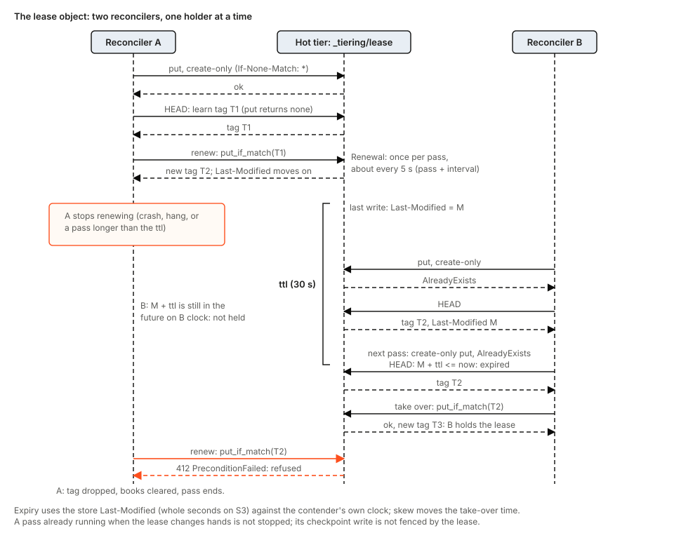
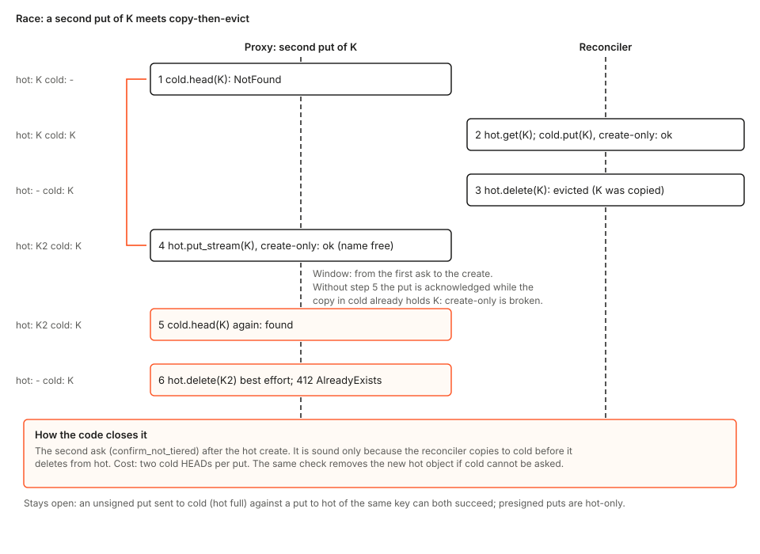
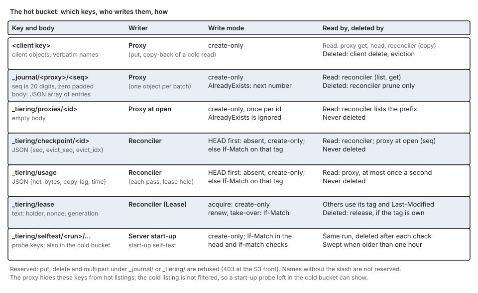

# tierstore design

This document says why tierstore exists, what it promises, and how the code keeps those promises. It is kept in step with the code: a change to code that this text describes changes the text with it. It also marks what is not built yet (section 12), so a reader can tell the design from the plan. Operators read [crates/tierstore/docs/](../../crates/tierstore/docs/) (start with [overview.md](../../crates/tierstore/docs/overview.md)); the update hook and the hand-over of a running node are in [tierstore-handover.md](tierstore-handover.md). Where a source comment and the code differ, this document follows the code. Terms in bold are defined in the glossary (section 14).

## 1. The problem

Many workloads, such as builds and CI, read and write very large numbers of large, immutable objects: build artifacts, container image layers, dependency caches. Two properties of such a workload decide the design.

- **Most reads are repeats.** The same objects are read again and again, and the set of objects in use changes slowly. A store for it is judged by how rarely a read has to reach its slowest part.
- **Writes arrive in bursts and are never overwritten.** A burst of many writes is hard on hard disks and on a store that must agree across nodes before each write returns. An object that is never overwritten can be copied, retried and re-copied without a reader ever seeing its bytes change.

A single S3 store forces a choice. A small store on fast media answers quickly and runs out of room. A large store on cheap disks, or one that is far away, holds everything and answers slowly. Compute nodes meanwhile have fast local NVMe that no shared store uses. The clients already speak S3, and the machines that run container images already speak OCI (pull by digest); neither should change.

From this follow the requirements:

1. **S3-compatible** for clients, and a read-only OCI front for image pulls, so existing tools work unchanged.
2. **Immutable objects.** A put creates; nothing overwrites.
3. **Recent data is fast.** A write is acknowledged once it is durable on fast media, and a read of a recent object is served from fast media.
4. **All data is durable in a large, cheap store** in the end.
5. **No extra coordination service.** Anything the parts must agree on lives as small objects in a store the deployment already has.
6. **Any number of stateless front processes** over the same stores, with one background worker chosen among them.

## 2. Goals and non-goals

Goals:

- One bucket with the S3 object calls clients need (put, get with ranges, head, delete, list, multipart, presigned put) and, beside it, a read-only OCI distribution front, both over one proxy.
- Create-only puts across two tiers: a key that exists in either tier is refused, except when two puts race with one going to the hot tier and one to the cold tier of a full hot tier (section 11).
- A put is acknowledged only when it can be found again: either its journal entry is durable in the hot tier, or the cold tier holds it.
- Reads from the fastest tier that holds the object, with a fill of the faster tier on a miss.
- Back-pressure instead of failure when the hot tier fills.
- Recovery from a restart or a lost lease using only what is stored in the tiers.
- A small contract for what a tier must do (section 9), checked when the process starts.

Non-goals:

- Overwrite, versioning, or object locking.
- Transactions across keys, or atomicity across the two tiers beyond what section 6 describes.
- Recovery of a lost hot tier: objects not yet copied to the cold tier are lost with it.
- Scrubbing stored objects for bit rot.
- Protection against clock skew larger than the lease ttl.
- TLS on the S3 listener (the OCI front has it).

## 3. The design in one picture

One `tierstore` process serves an S3 front (`--listen`) and, if asked, a read-only OCI front (`--oci-listen`, its own address). Both fronts call the same **proxy**, so an image pulled over OCI and an object read over S3 are answered from the same tiers by the same code ([server/cli.rs](../../crates/tierstore/src/server/cli.rs) module docs). The pieces:

- **Tiers.** A **hot tier** (small, fast: `dir:` on local disk or an S3-compatible bucket) and a **cold tier** (large, cheap: `dir:` or an S3-compatible bucket). Both are used through one trait, [`Backend`](../../crates/tierstore/src/backend.rs). `memory` is also accepted as a tier kind; it keeps nothing across a restart and stamps every object with time zero, so it is for tests.
- **Proxy** ([tiered.rs](../../crates/tierstore/src/tiered.rs), `Proxy`). Answers every request against the two tiers. It keeps no durable state: a cached reading of capacity, a full latch, the open journal batch and its next number. Each proxy has a **proxy id**, unique among processes running at once over the same tiers.
- **Fronts** ([server/](../../crates/tierstore/src/server/), `ops.rs` and `oci/`). Check signatures, enforce request limits, and call the proxy as a `Backend`.
- **Journal** ([journal.rs](../../crates/tierstore/src/journal.rs)). A put or delete is recorded as an entry in a small object `_journal/<proxy id>/<seq>` in the hot tier. A put is acknowledged after its entry is durable. The reconciler learns what the hot tier holds from journal objects and never lists the hot tier's data, so a pass costs work in proportion to new writes.
- **Reconciler** ([reconciler.rs](../../crates/tierstore/src/reconciler.rs)). Copies journaled puts to the cold tier, applies journaled deletes, evicts from the hot tier when it fills, checkpoints and prunes. It works on the raw tiers, not through the proxy.
- **Lease** ([lease.rs](../../crates/tierstore/src/lease.rs)). One object in the hot tier; its holder is the one active reconciler among all processes.
- **Local cache** ([server/local_cache/](../../crates/tierstore/src/server/local_cache/)). A read-through disk cache on a node's own NVMe, used by the build-node configuration (section 4). It is not part of the storage-node path.

Several processes may run over the same tiers; each has its own proxy and fronts, and only one reconciler works at a time.

## 4. Configurations

The configuration file ([server/config.rs](../../crates/tierstore/src/server/config.rs)) has two supported shapes, told apart by the tables it has. A third, local_cache + hot_store + cold_store, is planned.

| | Tables | What the process runs | Status |
|---|---|---|---|
| A. Build node | `[local_cache]` + `[cold_store]` | Fronts over a `LocalCache` over one upstream. No journal, lease or reconciler. | supported |
| B. Storage node | `[hot_store]` + `[cold_store]` (or the flags) | Fronts, proxy, journal, reconciler, lease. | supported |
| C. All three | `[local_cache]` + `[hot_store]` + `[cold_store]` | A and B in one process: fronts, then local cache, then proxy over hot and cold, with the reconciler. | planned (the loader refuses it) |

**A: build node.** `cold_store` is the upstream: usually the S3 endpoint of a storage node's tierstore, or any S3-compatible store. A hit is answered from local disk with no call upstream. A miss on a whole get fills the object; a miss on a ranged get fills the whole object if it is at most 64 MiB and otherwise passes the range through and keeps nothing; the misses of one key fill it once. By default the front refuses every write, so the cache has nothing to recover but files it can delete. With `write_through = true` the cache accepts writes and sends every one to the upstream before acknowledging it; a create-only put under a `cache = true` policy is also kept on the node, best effort, and never fails the put. OCI reads are served from the cache too ([server/local_cache/mod.rs](../../crates/tierstore/src/server/local_cache/mod.rs) module docs).

**B: storage node.** This is the design of sections 5 to 9.

**C: planned.** One process with a local cache in front of the proxy over a hot and a cold tier. The loader refuses the three tables together (`config.rs`, the match that builds `Settings`) with the error "the hot store is already local disk, and a disk cache in front of it would cache a disk with a disk". That reasoning does not hold when the hot store is an S3 bucket. The design treats C as part of the plan: a node that serves its own reads from NVMe and also owns the data. What it needs is in section 12(c). Until it exists, the same read path is reached by chaining: a build node whose `cold_store` is the S3 endpoint of a storage node.

## 5. How each operation works

The sequences below are for configuration B. Every store call is shown in code order. The proxy refuses a reserved key (section 7) for put, delete and multipart before anything else. A get or head of a reserved key is refused by the S3 front (403); the proxy does not check it.

### Put

The S3 front sends every create-only put that is not a multipart part to `Proxy::put_stream` (or `put_stream_hot_only` when the request is presigned). In order ([tiered.rs](../../crates/tierstore/src/tiered.rs), `put_object_stream` and `put_hot_stream`):

1. `cold.head(key)`. Found: `AlreadyExists` (HTTP 412). An error other than not-found fails the put, so a put fails closed if the cold tier cannot be asked.
2. Read the capacity **level** from the usage object the reconciler publishes (cached for one second). `Open`: continue. `Critical` (at or above 95% of the budget): sleep 20 ms, then continue. `Full` (at or above the budget): take the cold path below.
3. `hot.put_stream(key, len, body)`, create-only. The object becomes visible only when the last chunk has arrived, and a body that ends in error leaves nothing.
4. `cold.head(key)` again (`confirm_not_tiered`). Found: delete the new hot object (best effort) and return `AlreadyExists`. Any other error: delete the new hot object (best effort) and fail the put with that error, since the object cannot be shown to be the only one. This second ask exists because the reconciler copies to cold before it deletes from hot; section 7 shows the race it closes.
5. Append a `PUT` entry and wait for the batch holding it to be written to the hot tier as `_journal/<id>/<seq>`.
6. **Acknowledge.** If step 5 fails, delete the hot object (best effort) and return the error.

The ack point is therefore: the object and its journal entry are durable in the hot tier. The cold tier has nothing yet. A batch is written after a short linger (20 ms in the binary) or at 64 entries; every put in it waits for one shared outcome, and if the writer is dropped another waiter writes it.

**Cold path (hot tier full).** An unsigned put goes `hot.head(key)` (a hot object makes it `AlreadyExists`), then a create-only cold put, with no journal entry; it is acknowledged when the cold tier has it. A hot tier that answers `Full` before taking any byte takes the same path. The fallback applies only when the body has not been read at all (`Offered::taken() == 0`), because the bytes already taken cannot be offered to the cold tier again. If it answers `Full` after taking bytes, or the journal write answers `Full`, the put fails with 503 `SlowDown` (the hot object is removed) and the client's retry goes to the cold path.

**Presigned puts** are hot-only: at level `Full`, or when the hot tier or journal answers `Full`, the put gets 503 `SlowDown` and nothing is written to cold. One create-only write in one store then decides a race between presigned puts (section 7).

**Streaming.** The put holds no body. The front passes chunks through a small queue; `S3Backend` forwards them as one PUT (up to 16 MiB) or a multipart upload, and holds a whole body only when no length is declared, which is why the front requires `Content-Length` when a tier is S3. The front runs the proxy call on its own task, so a client that disconnects after the body arrived does not abandon the put half done.

### Get

The front calls `head` (see Head), then `get_stream`; the proxy has no streaming read, so the default `get_stream` calls `Proxy::get`, which holds the whole object (or the cut range). A read is two proxy calls. The numbers below are the numbers of the diagram, which shows `Proxy::get` only.

1. `hot.get(key, range)`. Found: return it (step 5). Any error but not-found is returned; the cold tier is not tried.
2. On a hot miss, a ranged get first reads the level (step 3). At `Critical` or `Full` it reads only the range from cold and copies nothing back, since a whole read per chunk of a long object would be quadratic. Otherwise, and for every unranged get, `cold.get` reads the whole object.
3. The level comes from the usage object (cached for one second); it is read here for a ranged get, and in `copy_back` for the others.
4. Unless the level is `Critical` or worse, **copy back**: a create-only `hot.put` of the whole object, awaited by the read; a ranged get is then cut from the whole body. A failed copy-back never fails the read.
5. Reply. A successful copy-back also starts a background task (`b`) that appends a `PUT` entry (so the reconciler can count and evict the copy) and deletes the hot copy if the append fails. The reply does not wait for it.

### Head

`hot.head`, and `cold.head` only on a hot not-found. Any other hot error is returned without asking cold. There is no copy-back.

### Delete

1. `hot.delete`, then `cold.delete` (a missing key succeeds). Either failing returns the error and writes no journal entry.
2. Append a `DELETE` entry and wait for its journal object, then reply 204.

The entry exists so the reconciler can undo a cold copy that was in flight when the delete ran. Deleting an absent key succeeds and is journaled. A journal failure returns an error for a delete that has taken effect; a retry is safe. The front runs the delete on its own task so a disconnect cannot split it.

### List and multipart

A listing is the union of both tiers in key order, the hot entry winning on a duplicate. `list_page` reads the hot tier in as many pages as it takes to find `max_keys` data keys after `start_after`, reads one page from the cold tier, merges and cuts. Hot is read first, so a key evicted between the two calls is still seen in cold. Either tier failing fails the listing. The S3 front supports `list-type=2`, `prefix`, `max-keys`, `continuation-token` and `start-after`; `delimiter` is not supported.

All multipart calls go to the cold tier; the proxy holds no part. At completion the proxy HEADs the hot tier (found: `AlreadyExists`), then calls the cold tier's create-only `complete_upload`. Nothing is journaled; a multipart object enters the hot tier only when a get copies it back.

### What a build node's local cache changes

On configuration A the same S3 calls reach a `LocalCache` instead of a proxy. A get or head of a kept key that is in the cache is answered from disk with no upstream call; a miss fills the cache from the upstream in chunks, hashing as it goes, and keeps the file only if it is whole (and, for a content-addressed key, hashes to its name). A key is kept if the longest matching `[[policy]]` prefix says `cache = true` and it is not reserved; other keys and every listing go to the upstream unchanged. Writes are refused unless `write_through` is set, and then every write goes to the upstream first (nothing is acknowledged before the upstream has it, and nothing is only local). A delete through the cache marks any fill of the key as forgotten, so a reader that was given bytes goes on only while the upstream still has that version.

## 6. Background work

### The reconciler pass

The binary runs a pass, sleeps `--reconcile-interval` (5 s), and repeats. In order ([reconciler.rs](../../crates/tierstore/src/reconciler.rs), `Reconciler::pass`):

1. **Lease.** Renew if held, else acquire. If not held, clear the books and end the pass.
2. **Discover** proxies by listing `_tiering/proxies/`, and load each new proxy's checkpoint.
3. **Read journals** per proxy from the last object read, and register the entries.
4. **Apply puts**: for one journal object, copy its distinct put keys with up to 16 in flight (`copy_key`: `hot.get` whole, then a create-only `cold.put`; hot not-found is skipped; `AlreadyExists` counts as copied without comparing content).
5. **Apply deletes** of the same journal object in entry order (`delete_cold`, below).
6. **Evict** if usage is above the high-water share (80%) of the budget: re-read the journals once more, then take candidates oldest first until usage is at the low-water share (70%), each with an unconditional `hot.delete`.
7. **Checkpoint** each proxy if it changed.
8. **Prune** journal objects behind the eviction position and older than the retention (24 h in the binary).
9. **Publish** `_tiering/usage`.

Copy to cold strictly before delete from hot. That order is what makes a get after an acknowledged put always find the object (hot first, then cold) and what the second cold HEAD of a put relies on.

`delete_cold` HEADs the hot tier. If hot lacks the key, it deletes from cold. If hot has the key, it deletes from cold only when the cold copy differs in size or content tag, on the reading that the cold copy is then one that was in flight when the key was deleted and the hot object is the new one. Section 8 gives the sequences in which a `delete_cold` acts on a cold object that is not the one the delete entry was written for.

### Eviction

Eviction is first-in-first-out by journal entry time across proxies and by journal order within one proxy. Nothing records reads, so recency is not available; the design chooses the policy that needs only the journal. Only entries of journal objects already applied are candidates, so the cold tier holds them. The reconciler never lists the hot tier: `hot_bytes` is the sum of logical sizes in journal entries minus deletes and evictions. It does not count puts that went straight to cold, multipart objects, or hot objects with no entry.

### Checkpoints and pruning

The checkpoint `{seq, evict_seq, evict_idx}` says: every journal object up to `seq` is applied; every entry before `(evict_seq, evict_idx)` is done with. The eviction cursor moves only when a candidate is popped. Below the high-water mark with no superseded entries it stays at the start, `evict_seq` stays 0 and nothing is pruned, so journal objects accumulate (about one per hot object). After a restart the set of retained objects is empty, so journal objects behind the cursor that are younger than the retention are never deleted.

### Usage and back-pressure

The reconciler publishes `{hot_bytes, copy_lag, time}` at the end of each pass in which it holds the lease. The proxy never measures the hot tier. It rereads the usage object at most once per second and maps it to a level; a missing, unreadable or 30-second-old usage counts as `Open`. A hot tier that answers `Full` is latched `Full` for one second. `hot_bytes` is a **budget** the deployment sets below the real capacity, not a measurement of the disk. `/usagez` answers 200, or 503 when the usage is older than `--usage-stale-after`.

### The lease and the process lock

The lease is the object `_tiering/lease`. **Acquire** is a create-only put, then a HEAD to learn the tag. **Renew** is `put_if_match` on the tag this holder last wrote; any error counts as not held, and clears the holder's tag. **Take over** HEADs the object and, if `modified + ttl <= now`, calls `put_if_match` on the tag just seen, so of two takers only one succeeds. **Release** HEADs and deletes only if the tag is still the holder's. The body is `holder`, `nonce`, `generation`; it is never read, only its tag and `modified` time are used. A failed renewal clears the holder's tag; the next pass tries to acquire, finds the object, and can take it over only after the ttl has passed since the last successful write, even if the failure was a transient error and no one else holds it. A holder learns it lost the lease only at its next renewal, once per pass.

On a `dir:` hot tier `put_if_match` is atomic only among calls of one in-process backend, so two processes on one node would not exclude each other through the lease. With `--lock-file` a process serves at once but reconciles only while it holds an exclusive `flock` on that file; this is also what lets two slots of a hand-over overlap ([tierstore-handover.md](tierstore-handover.md)).

## 7. Edge cases the design handles

Each entry is a mechanism in the code and the reason it works.

- **Demotion race.** The reconciler copies an object to cold and then evicts it from hot while a second put of the same key is between its first cold HEAD and its hot create. Without a second ask the put would win the hot slot after eviction and be acknowledged although cold holds the key. The proxy asks cold again after its hot create (`Proxy::confirm_not_tiered`) and removes the new object if cold has it. This is sound only because copy-before-evict is the reconciler's order. The race between a cold-path put and a hot put is not closed by it (section 11). Test: `tests/tierstore/recheck.rs`.

  

- **A killed or dropped put.** Acknowledgement waits for the journal write, so a put that is never acknowledged either has no hot object, or a hot object with no entry. An object with no entry is invisible to the reconciler (never copied, evicted or counted) and a retry of the key is refused as existing. The front finishes a put whose client has left, by running it on its own task, so the realistic triggers are a process kill, a crash, or a cut at the drain deadline. Test: `tests/tierstore/killed_put.rs`.
- **A failed journal write.** The proxy deletes its own hot object (best effort) and returns the error, so a put whose entry failed is not left stored by the proxy. A delete that returns an error is retried safely, because every step of it is idempotent.
- **Presigned puts are hot-only.** A presigned put never writes cold, so the hot tier's create-only write alone decides a race between them. Test: `tests/tierstore/one_winner.rs`.
- **Journal numbering on `AlreadyExists`.** A journal object is written create-only. If its number is taken (two writers with one proxy id, or a reopened proxy), the proxy tries the next number. A failed write does not advance the number. A proxy that opens resumes at one more than the larger of the highest number it lists and its checkpoint's `seq`, so after a prune it cannot reuse numbers the reconciler has already read. Test: `tests/tierstore/journal.rs`.
- **Restart rebuild.** The reconciler's in-memory books are rebuilt from checkpoints and journals: it reloads each checkpoint, re-reads journal objects from `evict_seq`, treats objects up to `seq` as already copied and later ones as pending. Work done since the last stored checkpoint is done again, which is safe because copies are create-only and deletes of missing keys succeed. Test: `tests/tierstore/reconciler.rs`.
- **Lease take-over by `If-Match`.** Many reconcilers may find the lease expired or absent at once; create-only or `If-Match` on the tag just read lets exactly one succeed. On a `dir:` hot tier this holds only within one process; two processes on one node are kept apart by `--lock-file`, not by the lease. Test: `tests/tierstore/lease_takeover.rs`.
- **Reserved prefixes.** `_journal/` and `_tiering/` hold coordination state in the hot bucket. The proxy refuses put, delete and multipart under them, and the S3 front refuses every call on them (403). The proxy filters them from the hot listing.
- **The start-up self-test.** Before any address is bound, each tier is probed (section 9). A store whose create-only put or `If-Match` does not hold is refused with exit status 3, so the lease and the one-winner promise are never built on a store that cannot keep them.
- **Fail closed.** A put whose first cold HEAD cannot be answered fails; a get whose hot read errors does not fall through to cold; a copy-back never fails a read.

## 8. Edge cases with several actors

This section lists the places where several actors touch one key, step by step, with the outcome the design intends and what the code does today. Each scenario has a test (`tests/tierstore/edge_cases.rs`; each test lands with the change that makes it pass) that holds the interleaving at the named step with a gate (`Stall` in `hold.rs`, or a backend defined in the test) and asserts the **intended** outcome. Today all eight tests fail, each on its final check, so all seven scenarios are known gaps: a lost object, a resurrected delete, a double acknowledgement or a checkpoint that moves backwards. The options are in section 12(d).

### A delete and a re-put of one key in one journal object

1. The reconciler is copying an earlier put of `k` (content `v1`): `copy_key` has read `v1` from hot and its `cold.put` is under way; the cold tier is slow, so the call lands late.
2. Client: `DELETE k`, then `PUT k` with content `v2`, within one linger of one proxy. `Proxy::delete` removes both tiers and appends a `DELETE` entry; `Proxy::put` finds cold without `k` (both cold HEADs), writes hot and appends a `PUT` entry. Both entries are in one journal object `[DELETE k, PUT k]`.
3. The delayed `cold.put(k, v1)` lands. The cold tier now holds a stray copy of the old content.
4. Reconciler pass: `apply_object` applies puts first: `copy_key(k)` reads `v2` from hot, `cold.put` returns `AlreadyExists` (the stray copy) and is counted as copied. Then `delete_cold(k)`: hot holds `k`, cold holds different content, so cold is deleted. Cold is now empty and the put is marked copied.
5. Further puts raise usage above high water; the next pass applies them and evicts oldest first, so `k` goes first and its hot copy is removed.

Intended: `GET k` returns `v2`. Today: with different content in the stray copy, cold is deleted after `v2` is copied and eviction then removes the hot copy, so `GET k` is `NotFound`. With no stray copy, or one of the same content as `v2`, cold keeps `v2` (`a_delete_entry_keeps_the_cold_copy_of_a_key_that_was_put_again` in `tests/tierstore/reconciler.rs` covers the case with no stray copy). Option: apply entries in order, section 12(d).

**Test:** `a_delete_then_a_reput_in_one_journal_object_keeps_the_new_object` fails today: `GET k` is `NotFound`.

### The same, when the two tiers tag content differently

1. The reconciler is given a cold tier whose HEAD reports every tag with a prefix, so that its tags are a different function of the content than the hot tier's, as an S3 ETag differs from a SHA-256 hot tag. The proxy uses the plain cold tier.
2. Client: `PUT k` (`v1`); a pass copies it to cold.
3. Client: `DELETE k` and `PUT k` (`v2`) with a batch size of 2, so they land in one journal object `[DELETE k, PUT k]`.
4. Reconciler pass: `copy_key(k)` writes `v2` to cold (cold was emptied by the delete). `delete_cold(k)` then HEADs hot and cold; the sizes are equal and the tags differ only because of the wrapper, so `same_content` is false.
5. Eviction removes the hot copy (`v2` is above high water for the budget).

Intended: the cold copy of the live object is never deleted because of a difference of tag function, so `GET k` returns `v2`. Today: `Meta::same_content` compares size and tag, so `delete_cold` deletes the cold copy just written and eviction then removes hot; `GET k` is `NotFound`. A dir hot tier (SHA-256 tags) over an S3 cold tier (ETags) is this case. Option: compare content or refuse the pair, section 12(d).

**Test:** `a_delete_and_a_reput_in_one_journal_object_keeps_the_new_object_when_the_tiers_tag_differently` fails today: the cold tier no longer holds `k` and `GET k` is `NotFound`.

### Eviction meets a delete and a re-put

1. `k` and other objects are put, `k` first, and the reconciler's budget is low enough that usage is above high water; one pass copies all of them, and `k` is the oldest candidate.
2. Reconciler pass: `evict` re-reads the journals (no change), picks `k`, finds its put still current, and calls `hot.delete(k)`; that call is held here (in a test, by a backend of its own over the hot tier, which only the reconciler uses).
3. Client: `DELETE k` (hot, cold, `DELETE` entry), then `PUT k` (`v2`): cold `NotFound`, hot create, second cold HEAD, `PUT` entry. `v2` is not copied yet.
4. The held `hot.delete(k)` runs; it is unconditional (the `Backend` trait has no conditional delete), so it removes `v2`.
5. Further passes run: they apply the `DELETE` (hot lacks `k`, so cold's `k` is deleted) and the `PUT` (hot lacks `k`, so it is skipped).

Intended: the re-put object is not lost; `GET k` returns `v2`. Today: `k` is in neither tier, so `GET k` is `NotFound`. Option: a conditional delete, section 12(d). The nearest tests are `an_object_replaced_while_the_reconciler_copies_is_not_evicted` and `an_object_put_again_is_not_evicted_by_its_old_entry` in `tests/tierstore/reconciler.rs`, which do not hold the eviction's own delete.

**Test:** `an_eviction_racing_a_delete_and_a_reput_keeps_the_new_object` fails today: `GET k` is `NotFound`.

### A copy-back meets a delete

1. `k` is in the cold tier only.
2. Client A: `GET k`. `get_object`: `hot.get` not-found, `cold.get` returns the bytes, `copy_back` starts `hot.put(k)`; that put is held.
3. Client B: `DELETE k`: `hot.delete`, `cold.delete`, `DELETE` entry journaled. The delete completes.
4. The held put runs: the copy-back's `hot.put` creates `k` in hot, and the background task appends a `PUT` entry after the `DELETE` entry.
5. Reconciler passes: apply the `DELETE` (nothing to delete) and then the `PUT`, which copies `k` to cold.

Intended: a deleted key stays deleted; `GET k` is `NotFound`. Today: the deleted key comes back. `k` is in hot and in cold and `GET k` returns the old bytes. The `Proxy` doc lists it as a known limit. Option: a second cold check after the copy-back, section 12(d).

**Test:** `a_delete_during_a_copy_back_keeps_the_key_deleted` fails today: `GET k` returns the deleted bytes.

### A delete meets a re-put that writes no journal entry

1. `k` is put and then deleted before any pass: the journal holds `[PUT k]` and then `[DELETE k]`, and neither tier holds `k`.
2. Client: `PUT k` (`v2`) with the proxy seeing the hot tier `Full`: `put_cold` (or `put_cold_stream` for a streamed body): `hot.head` not-found, then a create-only `cold.put`. No journal entry is written. The multipart variant ends in `complete_cold` (a hot HEAD, then the cold tier's create-only completion), also with no entry.
3. Reconciler pass: the `PUT` object is applied (`copy_key` finds hot without `k` and skips it), then the `DELETE`: `delete_cold` finds hot without `k` and deletes the cold object, which is `v2`.

Intended: the re-created object survives; `GET k` returns `v2`. Today: cold holds no `k`, so `GET k` is `NotFound`. Option: journal cold-path puts, section 12(d).

**Test:** `a_delete_then_a_cold_path_reput_keeps_the_new_object_after_the_reconciler_pass` and `a_delete_then_a_multipart_reput_keeps_the_new_object_after_the_reconciler_pass` fails today: `GET k` is `NotFound`, for both the cold-path put and the multipart completion.

### Two puts of one key, one to each tier

1. Two proxies, X and Y, over the same tiers read one usage object; X's budget is below the hot bytes it reports (it sees `Full`) and Y's is far larger (it sees `Open`). A held call on X's cold tier stops its create of `k` (in a test, `Stall` from `hold.rs`). The bodies are `A` (X) and `B` (Y).
2. Put X sees the hot tier `Full`: first cold HEAD `NotFound`, `hot.head` `NotFound`, then it is held before its cold create.
3. Put Y sees the hot tier open: first cold HEAD `NotFound`, `hot.put_stream` creates `B`, the second cold HEAD is `NotFound`, the journal entry is written, and Y is acknowledged.
4. X is released: its cold create-only write of `A` succeeds and X is acknowledged.
5. Reconciler pass with a budget small enough that the hot object is above high water: `copy_key(k)` reads `B` from hot, `cold.put` returns `AlreadyExists` and counts as copied. Eviction removes the hot copy.

Intended (the create-only promise): at most one put is acknowledged, and `GET k` returns the body that was acknowledged. Today: both puts are acknowledged. Cold holds `A`; after eviction `GET k` returns `A`, and the acknowledged `B` is gone. Section 11 lists the create-only checks as not atomic.  `one_winner.rs` covers presigned puts, which are hot-only.

**Test:** `an_unsigned_cold_put_and_a_hot_put_of_one_key_do_not_both_get_acknowledged` fails today: both puts are acknowledged.

### A pass that outlasts the lease

1. Reconciler A holds the lease and starts a pass that does not finish within the lease ttl: it has read journal objects 1 and 2 and waits in its cold `put` of `k2`, which is held (in a test, `Stall` in `hold.rs`). Two more puts then make journal objects 3 and 4.
2. The test clock moves past the ttl. Reconciler B's pass: `ensure` sees the lease expired and takes it over with `put_if_match`; B reads the journals, applies them, and stores its checkpoint for the proxy (`seq = 4`) through `journal::write_object` (HEAD, then `put_if_match` on the tag read).
3. A's held call returns and its pass ends: A stores the checkpoint it computed from its older view (`seq = 2`) the same way: HEAD returns B's fresh tag, `put_if_match` on that tag succeeds.

Intended: a checkpoint never moves backwards. Today: the stored checkpoint has `seq` 2. A restart re-reads and re-applies journal objects 3 and 4, which is safe because copies are create-only and deletes of missing keys succeed. `lease_takeover.rs` sets up overlapping passes. Option: fence or refuse a lower `seq`, section 12(d).

**Test:** `a_stale_pass_does_not_move_the_stored_checkpoint_back` fails today: the stored checkpoint is `{"seq":2,…}` after the new holder stored `seq` 4.

## 9. What tierstore assumes of a store

Both tiers are used through the `Backend` trait. The contract: `put` and `put_stream` are create-only (`AlreadyExists`, `Full`); `put_if_match(key, body, tag)` replaces only if the tag matches; `head` returns size, tag and modified time; `delete` of a missing key succeeds; `list_page` is ordered and honours `start_after`; multipart calls are optional, and `complete_upload` is create-only. A network backend bounds each call with its own timeout.

Before binding any address the server runs a self-test against each tier, hot first. Probe keys live under `_tiering/selftest/<run id>/` and are deleted after each check. A wrong answer is a violation: the process exits with status 3 and does not retry. An `Unavailable` answer is retried (1 s doubling to 30 s) until `--backend-check-wait` (5 minutes). A tier that is still unreachable when the wait ends fails the start with exit status 1 (a restart may mend it); a violation exits with status 3, which a restart cannot mend. A `Full` answer skips the write checks with a note. Only the multipart check can be skipped, and only with a stated reason. After a tier passes, a sweep removes probe keys left by a killed start that are older than one hour.

| Assumption | Why | Checked at start-up |
|---|---|---|
| Create-only put refuses a second put | One winner per key; the lease is taken create-only | yes (`create-only`; does not read the object back) |
| HEAD gives size and a non-empty tag, and the tag `put_if_match` returns equals the next HEAD tag | Lease and checkpoint use the tag from HEAD | yes (`head`) |
| `If-Match` refuses a wrong tag and accepts the right one | Lease take-over, renewal, checkpoint | yes (`if-match`) |
| Ranged read returns the exact bytes | Ranged gets | yes (`range`, one in-range read) |
| Listing is ordered, paged, honours `start_after` | Reading the journal | yes (`paging`) |
| Delete of a missing key succeeds | Repeated and re-applied deletes, eviction, prune, restart rebuild | no |
| Multipart completion is create-only (cold tier) | The proxy does not HEAD cold at completion | yes (`multipart-conditional`, skippable) |
| Create-only and `If-Match` are atomic under concurrent writers | One winner; one lease holder | no: the probes are sequential |
| The tag is the same function of content on both tiers | `delete_cold` compares a hot tag with a cold tag | no |
| Strong read-after-write for get, head and list | Journal reading, probes | implicitly, by reading right after writing |
| Store clock and this machine's clock agree to well under the lease ttl | Lease expiry, journal retention | no (the flag relations are checked, not the clocks) |
| Durability and replication of an acknowledged write | An acknowledgement means durable | no |
| Streaming put and read paths | Client writes | no (the probes use `put`) |

How `S3Backend` maps answers: 507 is `Full`; 408, 429, other 5xx (not 501), transport failures and a 409 conflict are `Unavailable`; 412 on a create-only put is `AlreadyExists`, on `put_if_match` `PreconditionFailed`. `DirBackend` and `MemoryBackend` tag an object with the SHA-256 of its body; `S3Backend` uses the store's ETag, which is an MD5 for a single PUT and something else for a multipart object.

## 10. State

All coordination state is small objects in the hot bucket, under reserved prefixes, beside client objects under their own names. The cold bucket holds client objects only (plus the self-test's probes).

| Key | Writer | Write mode | Content | Lifetime |
|---|---|---|---|---|
| client key | proxy (put, copy-back) | create-only | the client's bytes | until evicted or deleted |
| `_journal/<proxy id>/<seq:020>` | proxy | create-only; on `AlreadyExists` the next number | JSON array of entries `{op, key, size, time}` | pruned once applied, passed by the eviction cursor and older than retention |
| `_tiering/proxies/<id>` | proxy at open | create-only, empty | marker | never deleted |
| `_tiering/checkpoint/<id>` | reconciler | HEAD, create-only if absent, else `If-Match` | `{seq, evict_seq, evict_idx}` | never deleted |
| `_tiering/usage` | reconciler, each pass | as the checkpoint | `{hot_bytes, copy_lag, time}` | never deleted |
| `_tiering/lease` | reconciler | create-only to acquire; `If-Match` to renew and take over | `holder`, `nonce`, `generation` | deleted on release if the tag is still the holder's |
| `_tiering/selftest/<run>/...` | start-up | per check | short literals | deleted after each check; swept after an hour |

A `DELETE` entry has size 0. A journal object holds up to 64 entries. An unknown `op` decodes as `Unknown` and is skipped. The reconciler's own memory (`Books`: an index of the latest put per key, usage, lag, and per proxy a stream of pending, candidate and retained objects) is rebuilt from the above and is never a record.

**Formats and versioning.** No stored format carries a version: not the journal array, entries, checkpoint, usage, the lease body or the proxy marker. What is tolerated: an unknown `op` is skipped, and an added field is ignored by an older reader (no struct denies unknown fields). What is not: a missing field (none has a default), and a new top-level field in the journal (its root is a bare array). The rule the design follows is additive-only change; section 12(e) is the plan to make it checkable.

## 11. Limits

Operator-facing limits are in [crates/tierstore/docs/limits.md](../../crates/tierstore/docs/limits.md). The design-level limits are:

- A lost hot tier loses what was not yet copied; the window is the copy lag.
- Create-only across two tiers is four checks, none atomic with the others (section 7 and *Two puts of one key, one to each tier* in section 8).
- An object with no journal entry is invisible to eviction, usage and copy.
- A pass has no deadline and renews the lease only at its start; the lease ttl (30 s) must exceed a pass, which start-up does not check.
- The reconciler's copy and the proxy's read path hold whole objects, while puts are streamed.
- Eviction is first-in-first-out.
- One failed lease renewal stops reconciliation for up to a ttl.
- A stalled journal stream (a gap, a corrupt object, a copy that fails for good) is visible only on stderr.
- The sequences of section 8 end in a lost object, a resurrected delete, a double acknowledgement or a checkpoint that moves backwards; the options are in section 12(d).
- Reserved keys can appear in a cold listing (the filter applies to the hot listing).

## 12. Future work

**(a) Other object-store APIs and other backends.** What: further fronts over the same proxy, for example the Google Cloud Storage JSON or XML API and Azure Blob, beside the S3 and OCI fronts. Other stores as tiers would be further implementations of `Backend`. Why: clients that do not speak S3 could use the same tiers; the proxy already has one call per operation and does not know the front. Touches: a new module under `server/` per front (request parsing, auth, errors, listing and range semantics of that API); for a new tier, a `Backend` implementation that passes the conformance tests in `tests/tierstore/conformance.rs` and the self-test. Create-only needs a conditional create on the store; an API without one cannot be a tier.

**(b) Tierstore as a file system.** What: a FUSE mount or an NFS gateway over the proxy, read-mostly first. Why: tools that want paths can use immutable objects without an S3 client, and immutability avoids most of what makes a distributed file system hard (no overwrite, no rename). Touches: a front that maps paths to keys and directories to prefixes (listing is by prefix; `delimiter` is not supported); a read path with ranged gets and local caching, for which the build-node `local_cache` is the starting point; writes later, as create-only files closed whole.

**(c) The single-process local_cache + hot_store + cold_store configuration.** What: configuration C of section 4. Why: a node that also owns the data should serve its own reads from local NVMe without a second process and a hop between them. Touches: `config.rs` (accept the three tables), `config_cache.rs` and `cli.rs` (construct the `LocalCache` with the proxy as its `Arc<dyn Backend>` upstream, which it takes as any `Backend`, rather than over an S3 upstream), the start-up checks (the tiers are already self-tested before the proxy opens, so the cache must not run its write-through self-test against the proxy, which refuses the `_tiering/` probe keys; only the cache directory's own file-system check applies), the drain and hand-over (a local cache holds a directory lock), and `docs/configuration.md`.

**(d) Closing the known gaps of section 8.** Options, each closing one or more of the gaps in section 8:
- A conditional delete in `Backend` (delete if the tag is unchanged), which eviction and `delete_cold` could use so that they act only on the object they decided about. Touches `backend.rs`, the three backends, `reconciler.rs`. Closes *Eviction meets a delete and a re-put*.
- Applying a journal object's entries in entry order rather than puts first, or having a delete entry name the content it deleted. Touches `reconciler.rs` and `state.rs`, and the format if an entry gains a field. Closes *A delete and a re-put of one key in one journal object* (and *the same, when the two tiers tag content differently* when the order leaves cold without a stray copy).
- Fencing checkpoint writes by the lease (or by a generation stored with the checkpoint), or having a pass renew the lease. Touches `lease.rs`, `journal.rs`, `reconciler.rs`. Closes *A pass that outlasts the lease*; the smaller form is a checkpoint write that refuses to store a `seq` below the stored one, touching `journal.rs` `write_object` and `reconciler.rs` `persist`.
- Journaling cold-path puts and multipart completions so that a delete entry cannot meet an object it does not know. Touches `tiered.rs` and the accounting in `state.rs`; an entry gains a field for objects not in hot, so the format change is additive. Closes *A delete meets a re-put that writes no journal entry*.
- Making a copy compare content when the cold tier answers `AlreadyExists`, or refusing a tier pair whose tags are different functions. Touches `reconciler.rs` or the start-up in `cli.rs`. Closes *the same, when the two tiers tag content differently*.
- A second cold check after a copy-back's hot put (as `confirm_not_tiered` does for a put): if cold no longer has the key, delete the hot object and journal nothing. Touches `tiered.rs` (`copy_back`). It narrows the copy-back and delete race and does not close it (*A copy-back meets a delete*).
- *Two puts of one key, one to each tier* has no option here: closing it means making the cold-path create and the hot create exclude each other, which the two stores cannot do without a coordination step (open question 15).

**(e) Format versioning.** What: a version in each stored format, or a written additive-only rule enforced by a test that reads the previous release's objects. Why: the journal is a bare array and cannot gain a top-level field. Touches `journal.rs` and a compatibility test.

## 13. Open questions

1. Should a hot and a cold tier with different tag functions be supported? If yes, what compares content in `delete_cold`? If not, should start-up refuse the pair?
2. Should a journal object apply a key's entries in entry order, or should a delete not touch a cold object the reconciler cannot show it deleted?
3. Is it acceptable that cold-path puts and multipart objects bypass the journal?
4. Is a conditional delete in `Backend` in scope, or are the eviction and `delete_cold` windows documented limits?
5. Should a checkpoint write be fenced by the lease, or is "a pass is shorter than the ttl" enough? Should a pass renew the lease or be bounded?
6. The binary cuts an in-flight pass on halt while a comment in the reconciler says not to cancel one. Which is intended?
7. Should the reconciler's copy and the proxy's read path stay whole-object, given that puts are streamed?
8. Should start-up measure the store's clock against the machine's and refuse beyond a bound?
9. Should the self-test say plainly that concurrent atomicity is assumed, and should its paging check tolerate a lagging listing, which the trait allows?
10. Should reserved keys be filtered from cold listings, and from the proxy's get and head, or only at the front?
11. Should the 20 ms back-pressure, the 64-entry batch, the 1 s usage refresh and the proxy's 30 s staleness limit have flags?
12. Nothing deletes `_tiering/proxies/<id>`; each pass lists every id forever. Is a retirement path needed?
13. For configuration C, should the local cache sit in front of the proxy (cache hits skip the hot tier) or beside it?
14. Should a copy-back check the cold tier again after its hot put, as a put does, so a key deleted meanwhile is not brought back?
15. Create-only across two tiers is four non-atomic checks: is a window where an unsigned cold-path put and a hot put of one key are both acknowledged acceptable, or should a put at level `Full` take the hot path whenever the key might be in flight?

## 14. Glossary

| Term | Meaning |
|---|---|
| Hot tier / `hot_store` | The small, fast store that takes every write and holds all coordination state. |
| Cold tier / `cold_store` | The large, cheap store that holds every object eventually. On a build node, the upstream. |
| Local cache / `local_cache` | A read-through cache on a node's own disk in front of one upstream. |
| Proxy | The component that answers requests against the two tiers. |
| Proxy id | Non-empty name without `/` that names a proxy's journal and checkpoint. |
| Front | The S3 or OCI HTTP surface over a proxy. |
| Reconciler | The one component, chosen by lease, that copies, applies deletes, evicts, checkpoints, prunes and publishes usage. |
| Journal / entry | Per-proxy sequence of objects recording puts and deletes; one record is an entry. |
| Checkpoint | Stored per proxy: journal objects applied, and the position before which entries are done with. |
| Candidate | A copied put that may be evicted. |
| Lease | The object `_tiering/lease`, whose holder is the active reconciler. |
| Usage / copy lag | `_tiering/usage`: logical hot bytes, and the bytes of puts the cold tier does not yet hold. |
| Level | The proxy's reading of capacity: `Open`, `Critical`, `Full`. |
| Budget | The bytes of client objects, by logical size, the hot tier is meant to hold. |
| Back-pressure | At `Critical`, a put waits 20 ms first and copy-back stops. |
| High water / low water | Usage shares (80% / 70%) at which eviction starts and stops. |
| Copy-back | Writing an object read from cold into hot, journaled so it can be evicted again. |
| Create-only | A write that fails with `AlreadyExists` if the key exists (`If-None-Match: *`). |
| Presigned put | A put signed in the URL; hot-only. |
| Reserved prefix | `_journal/` and `_tiering/`; refused to clients. |
| Self-test | The start-up check of each tier's contract. |
